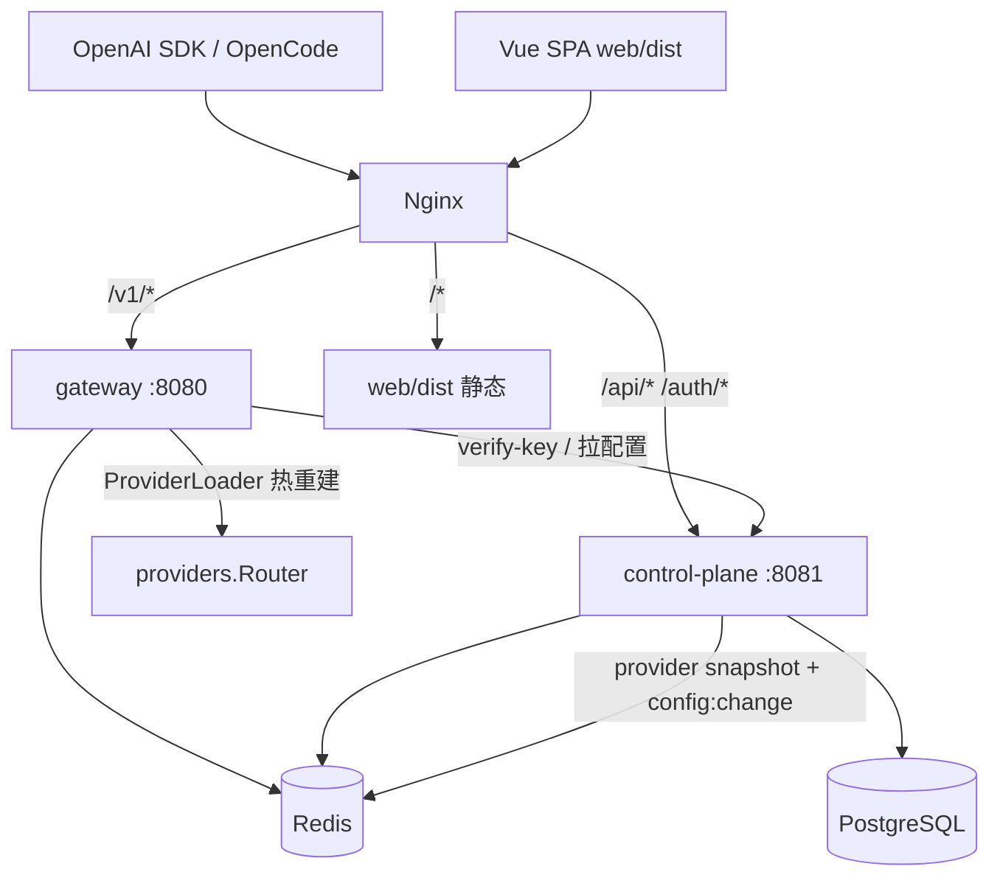

# AGENTS.md

面向 AI 编码助手与新加入开发者的项目指南。目标是让你**快速定位代码、遵循约定、安全地改动**。

## 项目是什么

LLM Gateway 是一个 Go 实现的**统一大模型网关**：对外提供 OpenAI 兼容接口，对内把请求按「模型组」调度到多家厂商。配套一个管理后台（控制面 + Vue 前端）做渠道/模型/Key/模型组/Catalog 管理与配置下发。

整体由**两个 Go 服务 + 一个前端 + 若干辅助二进制**组成：



- **gateway**（`cmd/gateway`，默认 `:8080`）：对外 `/v1/*`，鉴权 → 模型组调度 → 转发上游。**不直连 Postgres**，配置来自 Redis snapshot 或控制面 HTTP。
- **control-plane**（`cmd/control-plane`，默认 `:8081`）：管理后台 API、OAuth/SSO、Catalog 同步、Key/模型/渠道/模型组 CRUD、OpenCode 配置下发。持久化在 Postgres。
- **web**（`web/`，Vue3 + Element Plus + Vite）：管理面 SPA，构建到 `web/dist`，由 **nginx 静态托管**（不 embed 进 Go）。
- 辅助：`cmd/opencode-helper`（macOS URL Scheme 助手）、`cmd/bedrock_test`（Bedrock 连通性调试）。

> 生产/开发的 `/v1`、`/api`、`/auth`、`/` 分流由宿主机 **nginx** 完成（见 `deploy/docker/nginx*.conf` 与 `docker-compose.yml` 顶部注释）。开发机对外口常见为 `:8090`（nginx）。

## 代码地图

| 路径 | 职责 |
|------|------|
| `cmd/gateway/main.go` | gateway 启动：Redis、KeyCache、provider 工厂(`buildProviderFactory`)、`ProviderLoader`、路由、内嵌 auth 端点 |
| `cmd/control-plane/main.go` | control-plane 启动，路由在 `internal/controlplane/router/router.go` |
| `internal/gateway/` | gateway 进程内全部逻辑：`config/`、`handler/`、`infra/`、`orchestrator/`、`scheduler`、`server/router.go`、`binding/`、`loader/`、`middleware/` |
| `internal/controlplane/` | 控制面：`handler/`、`service/`、`repository/`(GORM)、`model/`、`router/`、`middleware/`、`event/`、`seed/` |
| `internal/providers/` | 各厂商 adapter + `factory.go` + `registry.go`（模型注册表）+ `router.go`（按 model 选 provider） |
| `internal/core/` | 跨进程共享领域类型：`interfaces.go`(`Provider` 接口)、`types.go`(`ChatRequest` 等) |
| `internal/auth/` | 可嵌入 gateway 的 JWT/OIDC/Key 验证库（`service/key_auth.go`、`crypto/jwt.go`） |
| `internal/configsync/` | 控制面→网关的 **provider snapshot**（Redis，`snapshot.go`） |
| `internal/llmclient/` `internal/httpclient/` | 上游 HTTP 客户端、重试/熔断（`circuit_breaker.go`）、连接池 |
| `internal/fallback/` `internal/llmclientconfig/` | fallback 候选链解析与韧性配置类型 |
| `internal/cache/` `internal/modeldata/` `internal/streaming/` | KV/模型缓存、外部 models.json 富化、SSE 流观测 |
| `web/src/views/admin/` | 管理面页面（渠道/模型/Catalog/设置/健康/公告等） |
| `atlas-migrations/` | Atlas SQL 迁移（唯一迁移源，时间戳命名；legacy `migrations/` 已冻结） |
| `tools/opencode-models-discovery/` | OpenCode 模型发现插件（fork），见 `docs/opencode-models-discovery.md` |
| `docs/` | 设计/架构文档 |
| `tests/` | 测试代码，与业务代码物理分离。按模块镜像 `internal/` 结构，原则见 `tests/README.md` |

## 路由边界（改路由时先看这里）

- **gateway**：`internal/gateway/server/router.go`
  - 公开：`/health`、`/ready`、`/swagger/*`
  - 鉴权后 `/v1`：`/models`、`/model/info`、`/chat/completions`、`/embeddings`、`/p/:provider/*path`
  - 进程内 auth：`/.well-known/jwks.json`、`/auth/refresh`、`/auth/logout`、`/internal/v1/auth/verify-key`（注册在 `cmd/gateway/main.go`）
- **control-plane**：`internal/controlplane/router/router.go`
  - `/api/v1/*`（管理面，`JWTAuth`）、`/internal/v1/*`（`InternalAuth` 校验 `X-Internal-Token`）、OAuth `/api/v1/auth/*`、公开 `/api/v1/settings/public`、OpenCode `/api/v1/opencode-config/*`

## 关键机制

- **鉴权**：gateway `AuthMiddleware`（`internal/gateway/middleware/auth.go`）→ `AuthClient.VerifyKey`（`internal/gateway/infra/auth_client.go`）POST 到控制面 `/internal/v1/auth/verify-key`。带**双层缓存** `KeyCache`（本地 5s + Redis 15s，`internal/gateway/infra/key_cache.go`），Key 吊销事件主动失效。
- **provider 热加载**：控制面 `SaveProviderSnapshot` 写 Redis 并 pub/sub `config:change`；gateway `ProviderLoader` 监听 + 30s reconcile，原子重建 `providers.Router`。
- **模型 / Catalog / 模型组**：`model_catalog`（LiteLLM 同步，能力/价格/上下文单源）→ `model`（绑定 provider，可关联 catalog）→ `group`（对外模型名，组内多 model）。组能力聚合见 `internal/controlplane/service/model_info_service.go`，**保守语义：组内全部成员都支持才算支持，token 上限取最小正值**。
- **OpenCode 配置下发**：`internal/controlplane/handler/opencode_config_handler.go` 生成安装脚本并 `go:embed` 插件 bundle；详见 `docs/opencode-models-discovery.md`。

## 配置体系

- Viper + `config/{APP_ENV}.yaml`（搜索 `./config`、`../config`、`../../config`），`APP_ENV` 默认 `dev`。
- 两个 `main` 都 `godotenv.Load()`；变量模板见 `.env.example`。
- **优先级**：环境变量 > YAML > 代码默认值。
- 常用：`GATEWAY_PORT`、`CONTROL_PLANE_PORT`、`DATABASE_URL`、`REDIS_ADDR`、`INTERNAL_TOKEN`、`JWT_SECRET`、`GATEWAY_URL`、`CATALOG_REMOTE_URL`、`OTLP_ENABLED/ENDPOINT`。

## 构建 / 运行 / 测试

```bash
# 构建
make build              # = build-gateway + build-cp（输出到 bin/）

# 本地起服务（需自行准备 Postgres + Redis）
make dev-all            # 一键并行起 control-plane + gateway + web（Ctrl-C 全部停止）
make dev                # 仅 gateway：APP_ENV=dev go run ./cmd/gateway
make dev-cp             # 仅 control-plane：APP_ENV=dev go run ./cmd/control-plane
make dev-web            # 仅前端：cd web && npm run dev（Vite，:5173）

# 测试
make test               # 全部单元测试 + 组件测试（tests/ 下）
go test ./tests/... -tags=integration -count=1  # 含集成测试（需 Docker）

# Swagger / Lint
make swagger            # swag init -> api/swagger/docs
make lint               # golangci-lint run ./...

# 前端
cd web && npm install                       # 首次安装依赖
cd web && npm run dev                        # 开发（Vite，:5173，含 HMR；亦可 make dev-web）
cd web && npx vite build                     # 构建到 web/dist（生产由 nginx 直接服务）

# OpenCode 插件
cd tools/opencode-models-discovery && bun run build:bundle && bunx tsc --noEmit && bun test
```

> 注意：Makefile 已移除 Docker 相关目标（`dev-infra` 等），Postgres/Redis 需自行准备；连接信息见 `.env` / `config/dev.yaml`。
> 开发态前端走 Vite dev server，统一入口可挂 `deploy/docker/nginx-dev.conf`（:8090，`/` 反代到 Vite，`/v1`、`/api`、`/auth` 直连后端）。

## 约定与注意事项

- **改了 Go 后**务必本地 `go build ./...` 并按需补测试；`tests/contract/contracts.json` 为 FE↔BE 接口契约参考，改动接口时需同步更新。
- **gateway 不要直连数据库**——它只通过 Redis snapshot / 控制面内部 API 获取配置。新增需要持久化的能力放控制面，gateway 经 `internal/gateway/binding` 调内部接口。
- **新增厂商**：在 `internal/providers/<vendor>/` 实现 `core.Provider`，在 `cmd/gateway/main.go` 的 `buildProviderFactory()` 注册 `Type`。
- **数据库变更**：用 Atlas 管理，迁移文件放 `atlas-migrations/<timestamp>_*.sql`，对应改 `internal/controlplane/model` 与 repository；改 schema 走 `atlas-db-migration` skill（`atlas migrate diff` / `atlas migrate apply`）。
- **能力/价格/上下文**走 `model_catalog`，不要在多处硬编码；模型组能力是**聚合**结果。
- **插件分发**改动后要 bump `tools/opencode-models-discovery/package.json` 版本并 `bun run build:bundle`，否则客户端不会自更新；插件落地目录是复数 `~/.config/opencode/plugins/`。
- **不要提交**编译产物（`bin/`、根目录的 `gateway`/`control-plane`/`auth` 大文件）和密钥（`.env`）。
- 代码与注释以中文为主；提交信息用 Conventional Commits（如 `feat(...)`、`fix(...)`）。

## 进一步阅读

### 工程基建文档（docs/）

| 文档 | 内容 |
|------|------|
| `docs/README.md` | docs 索引与分类规范 |
| `docs/architecture.md` | 系统架构、服务边界、分层与依赖方向 |
| `docs/deployment.md` | CI/CD、环境拓扑、容器部署、nginx 路由 |
| `docs/database.md` | 数据库部署、迁移机制与规范 |
| `docs/configuration.md` | 配置体系、参数注入、本地开发 |
| `docs/observability.md` | 日志、链路追踪、埋点采集 |
| `docs/guardrails.md` | 项目防护栏铁律 |
| `docs/frontend-design-guidelines.md` | 前端 UI/UX 设计规范（Vue3 + Element Plus） |
| `docs/opencode-models-discovery.md` | OpenCode 模型发现插件架构 |

### 其他

- `README.md` — 快速开始与命令速查
- `tests/README.md` — 测试原则、分层与文件组织
- `docs/ops-dashboard-comparison-report.md` — sub2api vs sunny-canyon 运维看板对比分析
- `docs/ops-dashboard-execution-plan.md` — 运维看板分步执行计划（7 phases）

<!-- SPECKIT START -->
## 当前开发计划

> 本节由 Spec Kit 自动管理，请勿手动修改。

**当前功能**: 模型自动恢复 (Model Auto Recovery)

- **计划文档**: [specs/001-model-auto-recovery/plan.md](specs/001-model-auto-recovery/plan.md)
- **功能规格**: [specs/001-model-auto-recovery/spec.md](specs/001-model-auto-recovery/spec.md)
- **数据模型**: [specs/001-model-auto-recovery/data-model.md](specs/001-model-auto-recovery/data-model.md)
<!-- SPECKIT END -->
