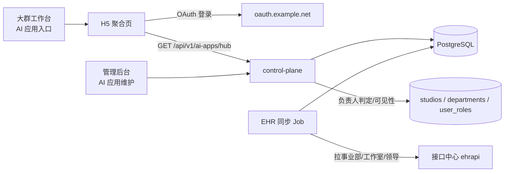

# AI 应用入口（工作室 AI 应用聚合 H5）技术方案

> 状态：草稿（待评审）｜ 关联需求：大群工作台「AI 应用」入口 + 工作室 AI 应用聚合页
> 目标读者：后端 / 前端 / 数据对接同学

## 1. 需求要点拆解

| # | 要点 | 落地位置 |
|---|------|----------|
| 1 | 大群工作台入口改名与新增（PC 左下角、协同办公「AI助手」与「X-LAB」之间） | **大群后台配置**，非本仓代码；本仓只需提供 H5 地址 |
| 2 | 点击进入 H5，走大群登录拿当前用户信息 | 本仓 OAuth（已有 `oauth.example.net` 接入）|
| 3 | 卡片点击新标签打开、描述 4 行截断 + hover 全文 | 前端 |
| 4 | 工作室排序按 AI 应用数量降序（并列按 ID 降序） | 后端聚合排序 |
| 5 | 负责人看全部；非负责人只看自己所属工作室 | 权限 + 数据可见性 |
| 6 | 工作室主数据（名称/ID/分管领导）来自 EHR，需可维护、可排除、可改名 | EHR 同步 + 本地覆盖 |
| 7 | AI 应用数据（名称/描述/icon/热度/新增） | 新增业务表 + 管理后台维护 |
| 8 | 登录日志（登录人/时间/所在工作室） | 新增日志表 |

## 2. 现状盘点（本仓已有能力）

| 能力 | 现状 | 复用建议 |
|------|------|----------|
| 工作室 | `studios(id uuid, name, owner_id)`，`StudioViewPage` 可维护 | **扩展**字段（department_id、分管领导等），不新建表 |
| 部门 | `departments(dept_id, dept_name, studio_id, status, owner_id)`，SSO 登录时归集 | 复用：用户 `dept_id` → 工作室 |
| 部门↔工作室映射 | `dept_studio_map`（import / manual） | 复用 |
| RBAC | `user_roles(role, scope_type, scope_id)`：`studio_admin` / `admin` 等 | 复用，新增 `ai_app_admin` 角色作为白名单 |
| EHR 数据表 | `ehr_departments`(leader_name / leader_employee_id / leader_email / ehr_modify_date)、`ehr_employees` 等表已在 `057_ehr_sync_tables` 建好 | 表可复用；**同步任务本仓未见实现**，需确认由谁跑 |
| 大群 OAuth | `oauth.issuer_url = https://oauth.example.net/`，`/api/v1/auth/oidc/login` + `/auth/oidc/callback` | 复用登录链路，换 H5 专用 client_id / redirect_uri |
| AI 应用实体 | **完全不存在** | 新建 |

> 结论：**工作室/部门/权限底座已经具备，缺口集中在「AI 应用实体 + 聚合接口 + H5 + EHR 工作室主数据同步」。**

## 3. 总体方案



分层沿用现有约定：H5 走 `control-plane`（持久化在 PG），gateway 不参与。

## 4. 数据模型

### 4.1 扩展 `studios`（工作室主数据，EHR 同步 + 人工覆盖）

```sql
ALTER TABLE studios
  ADD COLUMN IF NOT EXISTS department_id      VARCHAR(64),          -- EHR departmentId
  ADD COLUMN IF NOT EXISTS leader_name        VARCHAR(128) NOT NULL DEFAULT '',
  ADD COLUMN IF NOT EXISTS leader_passport    VARCHAR(128) NOT NULL DEFAULT '',
  ADD COLUMN IF NOT EXISTS leader_employee_id VARCHAR(64)  NOT NULL DEFAULT '',
  ADD COLUMN IF NOT EXISTS source             VARCHAR(16)  NOT NULL DEFAULT 'ehr',  -- ehr | manual
  ADD COLUMN IF NOT EXISTS visible            BOOLEAN      NOT NULL DEFAULT TRUE,   -- 停用/排除不删
  ADD COLUMN IF NOT EXISTS sort_order         INT          NOT NULL DEFAULT 0,
  ADD COLUMN IF NOT EXISTS modified_at        TIMESTAMPTZ;                          -- 人工覆盖时间
CREATE UNIQUE INDEX IF NOT EXISTS idx_studios_department_id ON studios(department_id)
  WHERE department_id IS NOT NULL;
```

覆盖规则（对应需求「特殊说明」）：

- `department_id = '377A16DD-EC42-4992-AF77-ABFC4E7FA305'`（x-lab）→ 名称固定为 **技术研究工作室**；
- 名称包含「公共关系事业部」→ `visible = false`（不展示，但保留历史应用，避免删数据）；
- 「元气工作室」策略待定 → 建议先同步为 `visible = false`，等确认后一键放开；
- EHR 侧已撤销/查不到的工作室 → `visible = false`，不物理删除。

### 4.2 `ai_apps`（AI 应用）

```sql
CREATE TABLE ai_apps (
  id          UUID PRIMARY KEY DEFAULT gen_random_uuid(),
  studio_id   UUID NOT NULL REFERENCES studios(id) ON DELETE CASCADE,
  name        VARCHAR(128)  NOT NULL,
  description VARCHAR(200)  NOT NULL DEFAULT '',   -- 需求：200 字以内
  icon_url    VARCHAR(500)  NOT NULL DEFAULT '',
  url         VARCHAR(1000) NOT NULL,               -- 点击跳转地址
  heat        SMALLINT      NOT NULL DEFAULT 0 CHECK (heat BETWEEN 0 AND 3),
  is_new      BOOLEAN       NOT NULL DEFAULT FALSE,
  status      VARCHAR(16)   NOT NULL DEFAULT 'published'
              CHECK (status IN ('draft','published','offline')),
  sort_order  INT           NOT NULL DEFAULT 0,
  created_by  VARCHAR(128)  NOT NULL DEFAULT '',
  updated_by  VARCHAR(128)  NOT NULL DEFAULT '',
  created_at  TIMESTAMPTZ   NOT NULL DEFAULT NOW(),
  updated_at  TIMESTAMPTZ   NOT NULL DEFAULT NOW()
);
CREATE INDEX idx_ai_apps_studio ON ai_apps(studio_id, status);
CREATE UNIQUE INDEX idx_ai_apps_studio_name ON ai_apps(studio_id, name);
```

### 4.3 管理员白名单

优先复用 `user_roles`：新增角色 `ai_app_admin`（`scope_type='company'`），表示「可维护全部 AI 应用与工作室」，与「工作室负责人自动可看」解耦。若产品希望独立维护，再加 `ai_app_hub_admins` 表；**建议先用 user_roles，避免两套权限来源**。

### 4.4 访问/登录日志

```sql
CREATE TABLE ai_app_hub_login_logs (
  id         BIGSERIAL PRIMARY KEY,
  user_id    VARCHAR(64)  NOT NULL DEFAULT '',
  passport   VARCHAR(128) NOT NULL DEFAULT '',
  user_name  VARCHAR(128) NOT NULL DEFAULT '',
  dept_id    VARCHAR(64)  NOT NULL DEFAULT '',
  studio_id  UUID,
  scope      VARCHAR(16)  NOT NULL DEFAULT '',   -- all | studio
  ip         VARCHAR(64)  NOT NULL DEFAULT '',
  user_agent VARCHAR(255) NOT NULL DEFAULT '',
  created_at TIMESTAMPTZ  NOT NULL DEFAULT NOW()
);
CREATE INDEX idx_hub_login_created ON ai_app_hub_login_logs(created_at DESC);
```

写入时机：H5 首屏取数接口（`/hub`）成功时异步落库，避免每次刷新阻塞。日志只记必要字段，不做全量埋点。

## 5. EHR 对接

### 5.1 需要的两类数据

1. **工作室清单**（某公司组织 `orgId = 1428195512246472704`，取 `departmentType = 2`）
   字段：`departmentName` / `departmentId` / `leaderName` / `leaderPassport` / `leaderPersonId` / `leaderEmployeeId`
2. **用户所属事业部**（按用户 / passport 查组织架构，取其事业部节点）

> **实测（2026-10-28，生产 key 已跑通）**：
> `GET https://open.example.com/open-apis/ehr-apic/open-apis/resource/v1/departments?orgId=1428195512246472704`
> 返回 99 条组织，其中 `departmentType=2`（事业部）15 条 —— **这 15 条就是业务口中的「工作室」**；
> `departmentType=3`（工作室）只有 1 条（内容发行虚拟组），不是主数据来源。
> 注意字段名是 `departmentType` 而不是需求里写的 `ehrDepartmentType`；`departmentType` / 分页参数均不生效，固定返回全量。
> 增量为 `lastModifyDate`（毫秒时间戳）。
>
> 测试环境（`https://open.test.daqun.chat`）当前 key 不识别；需求里 `open.test.daqun.chat.com` 的 `.com` 是错的。

### 5.2 同步策略

- 触发：定时（建议每 6 小时）+ 管理后台手动「立即同步」；
- 幂等：以 `department_id` 为业务主键 upsert；分页拉全量，先落库再计算 `visible`；
- 保护：`modified_at` 非空（人工改过名称/领导/可见性）的行，EHR 侧变更不覆盖，只记录 diff；
- 失败：写 `ehr_sync_error_logs`（表已存在），不阻断上次成功数据；
- 缓存：工作室清单缓存 5 分钟；用户所属事业部缓存 10 分钟，避免每次请求打接口中心。

### 5.3 用户 → 工作室

```
passport/email → EHR 用户组织架构 → 事业部 departmentId
             → 本地映射（dept_studio_map 优先，其次 departments.studio_id）
             → studio_id 集合
```

SSO 登录时已有 `dept_id` 存于 `departments`，**优先走本地映射**；本地查不到时再调接口中心兜底，并回写映射。

> 实测：当前 key **只授权了 `departments` 一个接口**，`employees` / `organizations` / `positions` 全部 403 `ROUTE_NOT_ALLOWED`。
> 因此「按用户查事业部」走接口中心暂时走不通；更省事的路径是复用大群 OAuth userinfo 里的 `ehr_dept_id` 声明（本仓 `internal/auth/service/oidc.go` 已在读），
> 再用 `departments` 全量树沿 `parentId` 向上找到 `departmentType=2` 的祖先，即所属工作室。若必须走接口中心，需要补申请员工/组织架构接口权限。

## 6. 权限与可见性

| 身份 | 判定 | 可见范围 |
|------|------|----------|
| 超级管理员 | `user_roles.role = admin` | 全部 + 管理入口 |
| AI 应用管理员 | `user_roles.role = ai_app_admin`（白名单） | 全部（可配置是否允许维护） |
| 工作室负责人 | `studios.leader_passport = 当前 passport`（或 `leader_employee_id` 命中） | **全部工作室** |
| 普通员工 | 其余 | 仅自己所属工作室（0 个则空态提示） |

判定顺序：管理员 → 负责人 → 普通员工；负责人判定结果随 `/hub` 返回 `scope` 字段，前端据此决定是否显示「全部工作室」侧栏。

## 7. 接口设计

### 7.1 H5

`GET /api/v1/ai-apps/hub`（用户态 JWT）

```json
{
  "viewer": { "name": "张三", "passport": "zhangsan", "scope": "all", "is_leader": true },
  "studios": [
    {
      "id": "uuid", "name": "技术研究工作室", "leader_name": "李四", "app_count": 6,
      "apps": [
        { "id": "uuid", "name": "DeepResearch", "description": "…", "icon_url": "…",
          "url": "https://…", "heat": 3, "is_new": true }
      ]
    }
  ]
}
```

排序（后端完成，前端不重排）：

- 工作室：`app_count DESC, id DESC`（数量相同按 ID 降序）；
- 工作室内应用：`is_new DESC, heat DESC, sort_order DESC, id DESC`（新增优先，多个新增按热度降序）；
- 只返回 `status='published'` 且所属工作室 `visible=true` 的应用。

### 7.2 管理后台

- `GET/POST/PUT/DELETE /api/v1/admin/ai-apps`（`ai_app_admin` / `admin`）
- `GET /api/v1/admin/ai-apps/meta`（工作室下拉、热度枚举）
- `POST /api/v1/admin/studios/sync-ehr`（手动触发同步）
- `GET /api/v1/admin/ai-app-hub/logs`（登录日志，分页 + 时间范围）

管理页放在现有后台「组织架构」分组下，新增 **AI 应用管理**、**访问日志** 两个页面。

## 8. H5 页面

- 路由：`/ai-apps`（建议独立移动端优先页面，不进管理后台布局）；
- 布局：左侧工作室目录（移动端折叠为顶部横向 Tab，显示「名称 + 数量」）+ 右侧卡片瀑布流；
- 卡片：icon 48×48、名称、描述 `-webkit-line-clamp: 4` + `title`/悬浮浮层显示全文、热度 0–3 星、`NEW` 角标；
- 跳转：`window.open(url, '_blank', 'noopener,noreferrer')`，不可用地址置灰并提示「应用暂不可用」；
- 空态：无可见工作室时提示「暂未配置所属工作室，请联系管理员」；单工作室内无应用显示占位；
- 埋点：曝光/点击（可选，落到日志表）。

## 9. 待确认问题（阻塞项）

1. ~~测试环境域名~~ **已确认**：正确域名是 `https://open.test.daqun.chat`（内网 `192.0.2.10`）。需求中的 `open.test.daqun.chat.com` 多写了 `.com`，DNS 指向停放域名，必然超时。**但需求给的口令 `NKQ8...` 在该网关被判定为「无效的认证令牌」**；文档里的示例 key `SOAhyz...` 同样无效（两者在测试/正式四个组合下均 401）。需接口中心管理员确认 key 是否已开通 ehr-apic 产品权限并处于有效期。
2. **接口中心鉴权头**：口令 `NKQ8Kp_i8Rl3r133Ql3EPA` 是走 `Authorization: Bearer` 还是自定义头？以文档为准。
3. ~~「事业部」与「工作室」的关系~~ **已确认**：EHR 里 `departmentType=2` 是事业部，业务口径直接等同于「工作室」，共 15 个；`departmentType=3`（工作室）仅 1 条虚拟组，不参与。
4. **工作室负责人判定口径**：以 `leaderPassport` 还是 `leader`（employeeId）为准？有人离职/更换时是否需要自动失效？
5. **AI 应用由谁维护**：各工作室负责人在后台自助维护，还是统一由管理员录入？影响管理页权限粒度。
6. **应用跳转地址**：是否全部为外部 URL，有没有需要携带 SSO token 的内部应用？
7. **icon 存储**：直接存外链，还是上传到对象存储？需要确认容量与图片规格。
8. **「新增」的时间口径**：手工勾选，还是按 `created_at` 最近 N 天自动判定？

## 10. 数据拉取验证（可执行清单）

在能访问测试环境的机器上执行（$TOKEN 为接口中心口令，路径以 yaml 为准）：

```bash
BASE=https://open.test.daqun.chat/open-apis/ehrapi
TOKEN='***'

# 1) 工作室清单：某公司组织 + 机构类型=2
curl -s -H "Authorization: Bearer $TOKEN" \
  "$BASE/<department-list-path>?organization=1428195512246472704&ehrDepartmentType=2&pageNo=1&pageSize=100" | jq .

# 2) 校验字段是否齐全（departmentName / departmentId / leaderName / leaderPassport / leader）
# 3) 用某个用户查组织架构，确认能拿到事业部节点
curl -s -H "Authorization: Bearer $TOKEN" "\$BASE/<user-org-path>?passport=liyanyan@example.com" | jq .

# 4) 翻页确认总数与分页参数语义（pageNo/pageSize vs offset/limit）
```

验收标准：

- [ ] 工作室条数与 EHR 后台一致，且包含 x-lab（`377A16DD-EC42-4992-AF77-ABFC4E7FA305`）；
- [ ] 每条都有 `leaderPassport`（个别为空可接受，需标注）；
- [ ] 分页可拉全（不重不漏）；
- [ ] 用户组织架构接口能返回事业部 departmentId。

> 说明：本次会话运行环境无法解析测试域名（`curl` 报 Could not resolve host），因此**未能实测**，需要在办公网/VPN 环境执行上述命令；把返回样例贴回来我可以直接核对字段映射。

## 11. 实施拆分（确认后开工）

| 阶段 | 内容 | 预估 |
|------|------|------|
| P0 | 迁移（studios 扩展 + ai_apps + 日志表）、模型/Repo | 0.5d |
| P1 | EHR 同步 Job + 覆盖规则 + 手动触发 | 1d |
| P2 | `/hub` 聚合接口 + 权限判定 + 日志 | 0.5d |
| P3 | 管理后台：AI 应用 CRUD、访问日志页 | 1d |
| P4 | H5 页面（移动优先 + 卡片交互） | 1d |
| P5 | 大群工作台入口配置、联调、灰度 | 0.5d |
