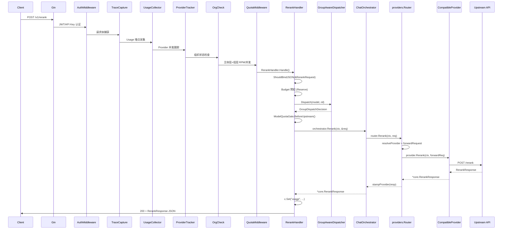

# Embedding & Rerank 向量模型接入方案

> **版本**: v1.0 | **日期**: 2026-07-06 | **状态**: 待评审
> **作者**: Gateway Team

---

## 1. 概述

### 1.1 背景与价值

当前 LLM Gateway 以 Chat Completion 为核心，已支持 OpenAI、Anthropic、Gemini 等 20+ provider 的统一接入，并具备配额管理、预算控制、负载均衡、模型组调度、用量监控等完整平台能力。随着 RAG（检索增强生成）类应用的普及，Embedding 和 Rerank 已成为与 Chat 同等重要的基础模型能力。

**核心痛点：**

- **多 provider 碎片化**：Cohere、Jina AI、阿里云、Voyage AI 等 provider 的 Rerank API 协议互不兼容，应用层直接对接需逐个适配，维护成本高。
- **缺乏统一管控**：Embedding/Rerank 调用缺少配额、限流、预算、监控等平台级治理能力，容易出现成本失控或滥用。
- **RAG 项目标准化诉求**：内部 RAG 项目需要一个统一的 `/v1/embeddings` 和 `/v1/rerank` 端点，切换 provider 时无需修改业务代码。

典型 RAG 流水线中，网关需要覆盖 **Embedding** 和 **Rerank** 两个关键节点：

```
[用户Query] → Embedding(向量化) → 向量检索 → Rerank(重排序) → LLM(生成回答)
```

### 1.2 当前状态

| 能力 | 状态 | 说明 |
|------|------|------|
| `POST /v1/embeddings` | **已实现** | Handler、Router、Provider 接口、配额/预算、模型组调度均已就绪 |
| `POST /v1/rerank` | **待实现** | 核心类型、Handler、Router、Provider 接口均未实现 |
| 模型探测 `probeRerank` | **已实现** | `model_probe.go:125`，已支持 rerank 端点探测 |
| `model_type=rerank` 分类 | **已实现** | `types.go:197`，`modeToCategory` 已映射到 `CategoryEmbedding` |
| 控制面 `model_type` 绑定 | **待扩展** | 当前仅支持 `chat` 和 `embedding`，需扩展支持 `rerank` |

### 1.3 方案目标

1. 新增 `POST /v1/rerank` 端点，以 Cohere API 协议为规范，统一接入多 provider 的 Rerank 模型。
2. 完全复用现有 Embedding 的中间件链、配额/预算/用量采集体系，最小化新增代码。
3. 支持 Cohere、Jina AI、Voyage AI、阿里云百炼等主流 Rerank provider。
4. 提供与 Embedding 一致的平台级治理能力（模型组调度、故障转移、可观测性）。

---

## 2. 需求分析

### 2.1 用户故事

**US-1: Embedding 模型调用**

> 作为 RAG 应用开发者，我想通过网关调用 embedding 模型获取文本向量，使用与 Chat 相同的 API Key 和模型组名，无需关心后端 provider 差异。

**验收标准：**
- `POST /v1/embeddings` 接口可正常调用，返回 OpenAI 兼容格式的向量数据。
- 支持通过模型组名调用（如 `my-embedding-group`），网关自动路由到组成负载均衡。
- 调用受配额、预算、限流等平台策略管控。

**US-2: Rerank 模型调用**

> 作为 RAG 应用开发者，我想通过网关调用 rerank 模型对检索结果重排序，只需传入 query 和 documents 列表，获得按相关性排序的结果。

**验收标准：**
- `POST /v1/rerank` 接口可用，接受 query + documents 输入，返回排序后的结果及相关性分数。
- 支持 Cohere、Jina AI、阿里云等主流 provider 的 rerank 模型。
- 调用受配额、预算、限流等平台策略管控。

**US-3: 统一管理与监控**

> 作为平台管理员，我想统一管理 embedding/rerank 模型的配额和监控，与 chat 模型使用相同的管理面板和告警体系。

**验收标准：**
- 控制面可注册 `model_type=rerank` 的模型。
- 运维看板可查看 embedding/rerank 调用的 QPS、延迟、错误率等指标。
- 配额和预算策略对 embedding/rerank 模型生效。

### 2.2 功能需求

**FR1: Embedding 接口（已基本实现，需确认补齐）**

`POST /v1/embeddings` 已实现，13 个集成点状态如下：

| 集成点 | 状态 | 代码位置 |
|--------|------|----------|
| Gin Handler | 已实现 | `internal/gateway/handler/embeddings.go` |
| Router 路由注册 | 已实现 | `internal/gateway/server/router.go:188` |
| 核心类型定义 | 已实现 | `internal/core/types.go` (EmbeddingRequest/Response) |
| Provider 接口 | 已实现 | `internal/core/interfaces.go:27` |
| Router.Embeddings | 已实现 | `internal/providers/router.go:709` |
| 预算检查 | 已实现 | `embeddings.go:74-82` |
| 模型组调度 | 已实现 | `embeddings.go:87-104` |
| 模型层配额 | 已实现 | `embeddings.go:108-118` |
| Usage 回填 | 已实现 | `embeddings.go:132-136` |
| Trace 采集 | 已实现 | `trace_capture.go:30` |
| Quota 中间件 | 已实现 | `router.go:188` |
| 模型探测 | 已实现 | `model_probe.go:91` probeEmbedding |
| 语义缓存 | 已实现 | semantic_canonical.go |

**待确认事项：**
- 确认 embedding 模型多 provider 的实际可用性。
- 确认 `encoding_format`（base64/float）和 `dimensions` 参数在各 provider 中的透传情况。

**FR2: Rerank 接口（新增）**

新增 `POST /v1/rerank` 端点，包含以下子任务：

1. **核心类型定义**：在 `internal/core/types.go` 新增 `RerankRequest`、`RerankResponse`、`RerankResult`、`RerankUsage` 四个结构体。
2. **Provider 接口扩展**：在 `Provider` 接口新增 `Rerank(ctx, req) (*RerankResponse, error)` 方法。
3. **Router 路由方法**：新增 `Router.Rerank()`，复用 `routeStampedModelResponse` 模式。
4. **Handler 实现**：新建 `RerankHandler`，镜像 `EmbeddingsHandler` 的预算检查、模型组调度、模型层配额完整链路。
5. **路由注册**：`v1.POST("/rerank", quotaMW.Handler(), rerankHandler.Handle)`。
6. **协议选择**：以 Cohere API 为规范。理由：Cohere 是 Rerank 领域标杆；OpenAI 无官方 Rerank API；LiteLLM 社区实践验证了可行性；Jina AI、阿里云等可适配到此协议。

**FR3: 多 Provider 的 Rerank 模型接入**

| Provider | Rerank 模型 | 接入方式 | 优先级 |
|----------|------------|---------|--------|
| Cohere | rerank-v3.5, rerank-english-v3.0 等 | 原生 API 适配 | P0 |
| Jina AI | jina-reranker-v2-base-multilingual | REST API 适配 | P1 |
| 阿里云 DashScope | gte-rerank | REST API 适配 | P1 |
| Voyage AI | rerank-2, rerank-2-lite | REST API 适配 | P2 |
| HuggingFace TEI | 自部署模型 | OpenAI 兼容适配 | P2 |

控制面 `model_type` 的 binding 校验需从 `oneof=chat embedding` 扩展为 `oneof=chat embedding rerank`。模型探测 `probeRerank` 已实现，无需额外改动。

**FR4: 复用现有配额、限流、预算、监控体系**

- **配额体系**：QuotaMiddleware（主体层+组层）已挂载在 `/v1` 路由组，新增路由自动生效。ModelQuotaGate（模型层）在 handler 中显式调用 `BeforeUpstream`。
- **预算体系**：Handler 调用 `middleware.Reserve(c, budgetDeps)` 进行预算检查，UsageCollector 的 `PostCostHook` 在请求完成后累加真实成本。
- **用量采集**：UsageCollector 对 `/v1/rerank` 路径自动生效，通过 `c.Set("usage", ...)` 回填。
- **监控与可观测性**：`traceCapturePaths` 新增 `/v1/rerank`；ProviderTracker 自动记录；Logger 和 RequestBodyLogger 全局生效。

**FR5: 模型组/负载均衡**

复用 `GroupAwareDispatcher`。`Dispatch` 方法签名接受 `modelName string`，不依赖 `ChatRequest`，Rerank handler 可调用 `groupDispatch.Dispatch(c, req.Model, nil)`。注意：`HandleFailover` 同样接受 `*core.ChatRequest`，caller 需传 `nil`。

**FR6: 模型探测支持 Rerank**

`model_probe.go` 已实现 `probeRerank` 函数，向 provider 的 `/rerank` 端点发送最小探测请求。需确认各 provider 的 `/rerank` 端点路径是否一致，如有差异需在 `probeRerank` 中支持自定义端点。

### 2.3 非功能需求

**性能**

| 指标 | Embedding | Rerank |
|------|-----------|--------|
| P50 延迟 | < 500ms | < 500ms |
| P99 延迟 | < 2000ms | < 2000ms |
| 单请求超时 | 30s | 30s |
| 网关额外开销 | < 10ms | < 10ms |

- Rerank 请求通常比 embedding 更大（documents 数量可达数百），需注意请求体大小限制。
- 建议设置最大 documents 数量限制（如 1000），防止超大请求耗尽内存。

**可靠性**

- **与 LiteLLM 的差距**：LiteLLM 的 Rerank 和 Chat 走同一套 router，天然享受相同的 retry/fallback 机制。我们的网关有两层 fallback，但都对 Embedding/Rerank 失效：
  - **Fallback Resolver（跨模型自动 fallback）**：`resolver.go:87-89` 硬编码跳过 `CategoryEmbedding`，直接返回 nil。LiteLLM 没有这种硬编码。
  - **GroupAwareDispatcher failover（模型组内 failover）**：Chat 通过 `ProtocolDispatcher` 在 primary 失败后自动调用 `HandleFailover` 切换同组内另一个 provider。但 `EmbeddingHandler` 没有用 `ProtocolDispatcher`，失败后直接 `return err`，没有重试。
- **为什么不补自动 fallback**：Embedding/Rerank 和 Chat 的 fallback 语义根本不同：
  - Chat 模型随意切换——输出都是文本，只是质量差异。
  - Embedding 模型切换意味着向量维度变化（768→1024），下游向量数据库索引不兼容，整个 RAG pipeline 断裂。
  - Rerank 模型切换意味着 scoring scale 不一致（0.95 vs 0.7），排序逻辑破坏。
  - Auto fallback 依赖的 ranking 数据（chatbot_arena 等）对 embedding/rerank 模型不存在。
- **唯一值得做的**：**模型组内 failover（同模型不同 provider）**。例如 `text-embedding-3-large` 同时走 openai / azure / litellm 三个 provider，返回的向量维度完全一致，切换无副作用。这是 Phase 1 必须做的事情。
- 实现方式：让 EmbeddingHandler 和 RerankHandler 在 primary 失败后调用 `HandleFailover` 做一次重试，而不是直接 `return err`。这和 Chat 的 `ProtocolDispatcher.chatWithFailover` 模式一致。

**可观测性**

- OpenTelemetry Tracing：orchestrator 层已集成 OTel，Rerank 方法需添加对应的 span。
- 日志：关键路径记录结构化日志。
- Metrics：通过 UsageCollector 埋点，自动采集 QPS、延迟、错误率、token 消耗。

**安全性**

- 复用现有 AuthMiddleware 进行 API Key 认证。
- 复用 OrgCheckMiddleware 进行组织状态检查。
- 复用 PassthroughGuard 进行透传权限控制。

**兼容性**

- Rerank 请求/响应格式遵循 Cohere API 协议，与 LiteLLM 生态兼容。
- 客户端可使用标准 HTTP client 调用，无需专用 SDK。
- Embedding 接口保持 OpenAI 兼容，现有客户端无需改动。

---

## 3. 技术调研

### 3.1 Rerank API 协议对比

| 维度 | Cohere V2 | Jina AI | 阿里云 DashScope | Voyage AI |
|------|-----------|---------|-----------------|-----------|
| Endpoint | `/v2/rerank` | `/v1/rerank` | `/api/v1/services/rerank/text-rerank/text-rerank` | `/v1/rerank` |
| 请求格式 | `{model, query, documents, top_n}` | `{model, query, documents, top_n}` | `{model, query, documents, top_n}` | `{model, query, documents, top_n}` |
| 返回格式 | `{results: [{index, relevance_score}]}` | `{results: [{index, relevance_score}]}` | `{output: {results: [{index, relevance_score}]}}` | `{data: [{index, relevance_score}]}` |
| 认证方式 | Bearer Token | Bearer Token | Bearer Token | Bearer Token |
| 特有字段 | `max_chunks_per_doc` | — | — | `truncation` |

**结论**：虽然各 provider 在端点路径和响应包裹层上有差异，但核心字段（`model`、`query`、`documents`、`top_n`、`results[].index`、`results[].relevance_score`）高度一致，可以在 adapter 层做统一转换。

### 3.2 开源项目参考

- **LiteLLM**：采用 Cohere 协议作为 Rerank 规范，架构为 `endpoints -> route_request -> litellm.arerank()`。网关可直接对标其设计。
- **OpenAI**：无官方 Rerank API，仅提供 Embedding API。
- **OneAPI**：基于 Cohere 协议实现 Rerank 代理。
- **Infinity**：支持自部署的 TEI 兼容 Rerank 端点。

### 3.3 统一协议设计

网关以 Cohere V2 协议为规范，定义统一的请求/响应格式。各 provider 在 `Rerank()` 方法实现中负责将统一协议转换为自身的 API 格式。

**字段来源对照：**

| 统一协议字段 | Cohere v2 | Jina | Voyage | 说明 |
|-------------|-----------|------|--------|------|
| `model` | model | model | model | 模型名称 |
| `query` | query | query | query | 查询文本 |
| `documents` | documents | documents | documents | 待排序文档列表 |
| `top_n` | top_n | top_n | top_n | 返回前 N 条 |
| `return_documents` | return_documents | — | return_documents | 是否返回原文 |
| `max_chunks_per_doc` | max_chunks_per_doc | — | — | Cohere 扩展 |

---

## 4. 整体架构设计

### 4.1 架构总览

Rerank 链路完全镜像现有 Embedding 链路，从 Gin Router 到 Upstream Provider 全链路复用相同的中间件和编排模式。



**与 Embedding 链路对比：**

| 步骤 | Embedding | Rerank |
|------|-----------|--------|
| 端点 | POST /v1/embeddings | POST /v1/rerank |
| 请求体 | `EmbeddingRequest` (Input: any) | `RerankRequest` (Query: string, Documents: []string) |
| 响应体 | `EmbeddingResponse` (Data: []EmbeddingData) | `RerankResponse` (Results: []RerankResult) |
| Token 用量 | 按 prompt_tokens/completion_tokens | 按 total_tokens |
| 中间件链 | 全部复用 | 全部复用（0 个新增） |

### 4.2 核心数据模型

```go
// RerankRequest 重排序请求 (统一协议)
type RerankRequest struct {
    Model           string            `json:"model"`
    Provider        string            `json:"provider,omitempty"`         // Gateway 路由提示，转发前剥离
    Query           string            `json:"query"`                      // 查询文本
    Documents       []string          `json:"documents"`                  // 待排序文档列表
    TopN            *int              `json:"top_n,omitempty"`            // 返回前 N 条结果
    ReturnDocuments *bool             `json:"return_documents,omitempty"` // 是否返回原始文档文本
    MaxChunksPerDoc *int              `json:"max_chunks_per_doc,omitempty"` // Cohere 扩展
    ExtraFields     UnknownJSONFields `json:"-" swaggerignore:"true"`
}

// RerankResponse 重排序响应
type RerankResponse struct {
    ID          string            `json:"id"`
    Model       string            `json:"model"`
    Provider    string            `json:"provider"`     // Gateway 回填
    Results     []RerankResult    `json:"results"`
    Usage       RerankUsage       `json:"usage"`
    ExtraFields UnknownJSONFields `json:"-" swaggerignore:"true"`
}

// RerankResult 单个文档的重排序结果
type RerankResult struct {
    Index          int              `json:"index"`                     // 原始文档在 documents 数组中的索引
    Document       *RerankDocument  `json:"document,omitempty"`        // 原始文档文本 (仅当 return_documents=true)
    RelevanceScore float64          `json:"relevance_score"`           // 相关性分数 (0-1)
}

// RerankDocument 重排序返回的文档
type RerankDocument struct {
    Text string `json:"text"`
}

// RerankUsage Rerank 用量信息（对齐 LiteLLM 双字段模式）
type RerankUsage struct {
    TotalTokens int     `json:"total_tokens"`
    SearchUnits float64 `json:"search_units,omitempty"` // Cohere 按 search_units 计费，默认 1
}
```

**与 Embedding 数据模型的核心差异：**

- `EmbeddingRequest.Input` 是 `any` (string 或 []string)，`RerankRequest.Query` 固定为 `string`。
- `EmbeddingRequest.Input` 可能是 []string (批量嵌入)，`RerankRequest.Documents` 始终是 `[]string`。
- `EmbeddingResponse.Data` 每个元素包含 `Embedding` (float 数组)，`RerankResponse.Results` 每个元素包含 `RelevanceScore` (float64)。
- 两者都实现 `semanticSelectorCarrier` 接口，由同一套 canonical codec 体系处理。

### 4.3 API 协议

**POST /v1/rerank**

请求体：

```json
{
  "model": "rerank-v3.5",
  "query": "What is the capital of the United States?",
  "documents": [
    "Carson City is the capital city of the American state of Nevada.",
    "Washington, D.C. is the capital of the United States.",
    "Capital punishment has existed in the United States since its founding."
  ],
  "top_n": 2,
  "return_documents": true
}
```

| 字段 | 类型 | 必填 | 说明 |
|------|------|------|------|
| `model` | string | 是 | 模型名称 |
| `query` | string | 是 | 搜索查询文本 |
| `documents` | []string | 是 | 待排序文档文本数组（1-1000 条） |
| `top_n` | int | 否 | 只返回前 N 条结果（默认全部） |
| `return_documents` | bool | 否 | 是否在结果中嵌入原始文档（默认 false） |
| `max_chunks_per_doc` | int | 否 | 每个文档最大内部分块数（Cohere 扩展） |

响应体：

```json
{
  "id": "req_abc123",
  "model": "rerank-v3.5",
  "provider": "cohere",
  "results": [
    {
      "index": 1,
      "document": {
        "text": "Washington, D.C. is the capital of the United States."
      },
      "relevance_score": 0.98
    },
    {
      "index": 0,
      "document": {
        "text": "Carson City is the capital city of the American state of Nevada."
      },
      "relevance_score": 0.35
    }
  ],
  "usage": {
    "total_tokens": 42
  }
}
```

**Provider 协议适配策略：**

每类 provider 在实现 `Rerank()` 方法时，负责将统一协议转换为自身的 API 格式：

- **Cohere 适配**：请求体可直接透传（Cohere v2 与统一协议一致），仅需处理 `search_units` 到 `total_tokens` 的映射。
- **Jina 适配**：过滤掉 `return_documents` 和 `max_chunks_per_doc`（Jina 不支持），其余字段透传。
- **阿里云适配**：请求体映射到 `{"model": ..., "input": {"query": ..., "documents": ...}}`，响应从 `output.results` 提取。
- **Voyage 适配**：请求体映射到 `{"model": ..., "query": ..., "documents": ...}`，响应从 `data` 提取。

---

## 5. 详细设计

### 5.1 代码改动清单

#### 5.1.1 新增文件（2 个）

| 文件 | 说明 | 行数估算 |
|------|------|----------|
| `internal/core/rerank_json.go` | RerankRequest/Response JSON 序列化，使用 `extractUnknownJSONFields` / `marshalWithUnknownJSONFields` 透传未知字段 | +60 |
| `internal/gateway/handler/rerank.go` | RerankHandler，镜像 EmbeddingsHandler，包含 JSON 绑定、请求校验、预算检查、组调度、模型层配额、编排调用、usage 回填 | +120 |

**RerankHandler 核心流程：**

```
1. ShouldBindJSON(&RerankRequest)    → 400 如解析失败
2. 请求校验（documents 非空、≤1000、top_n > 0）
3. 预算检查（middleware.Reserve）     → 402 如预算超限
4. 组调度（groupDispatch.Dispatch）   → 404 如模型组不存在
5. 模型层配额（quotaGate.BeforeUpstream）→ 429 如配额超限
6. 调用 orchestrator.Rerank()        → 失败直接返回错误
7. 回填 usage 到 gin context
8. 返回 JSON 响应
```

**与 EmbeddingHandler 一致，不实现 failover。** Chat 走 `ProtocolDispatcher`（路由 + failover），Embedding/Rerank 走 `GroupAwareDispatcher.Dispatch()`（纯路由）。两条路径在代码层面已经区分，Embedding/Rerank 的 failover 场景几乎不存在——同模型不同 provider 的部署在实际中很少，且不同模型之间向量维度不兼容，切换无意义。Provider 挂了就是挂了，直接返回错误即可。

#### 5.1.2 修改文件（10 个）

| 文件 | 改动内容 | 行数估算 |
|------|----------|----------|
| `internal/core/types.go` | 新增 RerankRequest/RerankResponse/RerankResult/RerankUsage 四个结构体 + `semanticSelector()` 方法 | +60 |
| `internal/core/interfaces.go` | Provider 接口新增 `Rerank(ctx, req) (*RerankResponse, error)` 方法 | +1 |
| `internal/core/endpoints.go` | 新增 `OperationRerank` 常量 + 端点匹配 + `BodyModeJSON` 注册 | +5 |
| `internal/providers/router.go` | 新增 `Router.Rerank()` + `forwardRerankRequest` + `callRerank` + `stampProvider` 扩展 | +20 |
| `internal/providers/openai/compatible_provider.go` | 新增 `CompatibleProvider.Rerank()` | +15 |
| `internal/gateway/orchestrator/chat.go` | `routerProvider` 接口新增 `Rerank` 方法 | +1 |
| `internal/gateway/orchestrator/stream.go` | 新增 `ChatOrchestrator.Rerank()`（含 OTel span、provider 回写、usage 回写） | +30 |
| `internal/gateway/server/router.go` | 创建 RerankHandler + 注册 `POST /v1/rerank` 路由 | +15 |
| `internal/core/semantic_canonical.go` | 注册 `OperationRerank` codec + `CachedRerankRequest()` 缓存方法 | +13 |
| `internal/controlplane/service/model_service.go` | `model_type` binding 从 `oneof=chat embedding` 扩展为 `oneof=chat embedding rerank`（2 处：CreateModelInput + UpdateModelInput） | +2 |
| `internal/controlplane/service/sync_service.go` | `inferModelType` 新增 rerank 检测：`name` 包含 `rerank` 时返回 `"rerank"`，避免渠道同步时 Cohere 等 rerank 模型被误标为 `chat` | +2 |
| `internal/gateway/middleware/trace_capture.go` | `traceCapturePaths` 新增 `"/v1/rerank": {}`，使 rerank 请求的请求/响应体被采集供 trace 记录 | +1 |

#### 5.1.3 前端改动（1 个文件）

| 文件 | 改动内容 | 行数估算 |
|------|----------|----------|
| `web/src/components/admin/ModelDialog.vue` | 下拉框新增 `Rerank（重排序）` 选项（value=`rerank`）；TypeScript 类型 `model_type` 联合类型新增 `'rerank'` | +2 |

#### 5.1.4 模型探测适配（1 个文件）

| 文件 | 改动内容 | 行数估算 |
|------|----------|----------|
| `internal/controlplane/handler/model_check_handler.go` | 批量检测跳过逻辑扩展：当前 `strings.Contains(lower, "embed")` 跳过 embedding 模型，需新增 `model_type == "rerank"` 的跳过条件，避免 rerank 模型走 `/chat/completions` 探测失败 | +1 |

`model_probe.go` 已实现 `probeRerank`（`case "rerank"` 分支），无需改动。

**CompatibleProvider.Rerank() 核心实现：**

```go
func (p *CompatibleProvider) Rerank(ctx context.Context, req *core.RerankRequest) (*core.RerankResponse, error) {
    if req == nil {
        return nil, core.NewInvalidRequestError("rerank request is required", nil)
    }
    var resp core.RerankResponse
    err := p.Do(ctx, llmclient.Request{
        Method:   http.MethodPost,
        Endpoint: "/rerank",
        Body:     req,
    }, &resp)
    if err != nil {
        return nil, err
    }
    if resp.Model == "" {
        resp.Model = req.Model
    }
    return &resp, nil
}
```

**Router.Rerank() 核心实现：**

```go
func (r *Router) Rerank(ctx context.Context, req *core.RerankRequest) (*core.RerankResponse, error) {
    return routeStampedModelResponse(
        r, ctx,
        req.Model, req.Provider,
        func(selector core.ModelSelector) *core.RerankRequest {
            return forwardRerankRequest(req, selector)
        },
        callRerank,
    )
}
```

#### 5.1.3 Provider 桩实现（用于不支持 Rerank 的 provider）

所有直接实现 `Provider` 接口但不使用 `CompatibleProvider` 基类的 provider 需要添加桩实现。基于 `CompatibleProvider` 的 provider（OpenAI、DeepSeek、xAI、Groq、Ollama、vLLM 等）自动继承 `Rerank()` 方法，**0 行改动**。

需要添加桩实现的 provider：

```go
// 模板
func (p *SomeProvider) Rerank(ctx context.Context, req *core.RerankRequest) (*core.RerankResponse, error) {
    return nil, core.NewInvalidRequestErrorWithStatus(
        http.StatusNotImplemented,
        "rerank is not supported by this provider",
        nil,
    ).WithCode("unsupported_operation")
}
```

涉及 provider: `anthropic`, `azure`, `bailian`, `bedrock`, `gemini`, `vertex`。

#### 5.1.4 改动汇总

| 层 | 新增文件 | 修改文件 | 合计行数 |
|-----|---------|---------|---------|
| core 层 | 1 | 3 | ~130 |
| providers 层 | 0 | 1 (+ 桩实现) | ~40 |
| gateway 层 | 1 | 3 | ~170 |
| **合计** | **2** | **7 (+ 6 个桩文件)** | **~370** |

### 5.2 中间件集成方案

**Rerank 完全复用现有中间件，无需新增任何中间件。**

| 中间件 | 位置 | Rerank 复用状态 | 说明 |
|--------|------|----------------|------|
| RequestID | 全局 | 复用 | 请求追踪 ID |
| Tracing | 全局 | 复用 | OpenTelemetry 链路 |
| Logger | 全局 | 复用 | 结构化日志 |
| ErrorHandler | 全局 | 复用 | 全局错误恢复 |
| RequestBodyLogger | 全局 | 复用 | DEBUG 级请求体日志 |
| AuthMiddleware | /v1 组 | 复用 | JWT/API Key 认证 |
| TraceCapture | /v1 组 | 复用 | 请求/响应正文捕获 |
| UsageCollector | /v1 组 | 复用 | 埋点采集 + 预算核销 |
| ProviderTracker | /v1 组 | 复用 | Provider 并发跟踪 |
| OrgCheck | /v1 组 | 复用 | 组织状态检查 |
| QuotaMiddleware | 路由级 | 复用 | 主体层+组层 RPM/并发 |
| Budget (Reserve) | Handler 内 | 复用 | 预算预扣 |
| ModelQuotaGate | Handler 内 | 复用 | 模型层配额检查 |

**中间件链路（按注册顺序）：**

```
gin.Recovery()
  → RequestID()
  → Tracing()
  → Logger()
  → ErrorHandler()
  → RequestBodyLogger()
  → AuthMiddleware()
  → TraceCapture()
  → UsageCollector()
  → ProviderTracker()
  → OrgCheckMiddleware()
  → [quotaMW.Handler()]         ← 主体层 + 组层配额
  → [rerankHandler.Handle()]     ← 业务逻辑
      ├─ middleware.Reserve()     ← 预算检查
      ├─ groupDispatch.Dispatch() ← 组调度
      ├─ quotaGate.BeforeUpstream() ← 模型层配额
      └─ orch.Rerank()            ← 调用上游
```

**关键适配点：**

1. **UsageCollector**：Rerank 场景下 `PromptTokens` 和 `CompletionTokens` 均为 0，`TotalTokens` 承载实际值。handler 回填用法：
   ```go
   c.Set("usage", core.Usage{
       PromptTokens: resp.Usage.TotalTokens,
       TotalTokens:  resp.Usage.TotalTokens,
   })
   ```

2. **Budget**：预算按 `TotalTokens` 累加。Rerank 的成本估算为 `total_tokens * input_price_per_token`（Rerank 只有输入 token，无输出 token）。

3. **Quota**：RPM 和并发限制按 `model` 维度生效。`extractModelParam` 自动从 JSON body 提取 `model` 字段用于组层配额匹配。

4. **OTel 埋点**：Orchestrator 的 `Rerank()` 方法创建 `upstream.rerank` span，记录属性：
   - `llm.model` (req.Model)
   - `llm.documents_count` (len(req.Documents))
   - `llm.usage.total_tokens` (resp.Usage.TotalTokens)
   - `llm.results_count` (len(resp.Results))

### 5.3 错误处理

#### 5.3.1 请求校验错误

| 场景 | HTTP | 错误码 | 消息 |
|------|------|--------|------|
| 空文档列表 | 400 | `request_invalid_param` | `documents must not be empty` |
| 文档超限 (>1000) | 400 | `request_invalid_param` | `documents exceeds maximum of 1000` |
| top_n <= 0 | 400 | `request_invalid_param` | `top_n must be positive` |
| 请求体无效 | 400 | `request_body_invalid` | (解析错误详情) |
| model 缺失 | 400 | `request_missing_model` | `model 字段是必填项` |

#### 5.3.2 路由/Provider 错误

| 场景 | HTTP | 错误码 | 处理方式 |
|------|------|--------|----------|
| 模型未注册 | 404 | `model_not_found` | Router.resolveProvider 返回 |
| Provider 不支持 Rerank | 501 | `unsupported_operation` | Provider stub 返回 |
| 注册表未初始化 | 503 | `provider_error` | Router.checkReady 返回 |
| 上游 Provider 超时 | 504 | `upstream_timeout` | llmclient 返回 |
| 上游 Provider 不可用 | 503 | `upstream_unavailable` | 熔断器触发 |
| 上游返回 4xx | 映射 | `provider_bad_request` | ParseProviderError 解析 |
| 上游返回 5xx | 502 | `provider_error` | ParseProviderError 解析 |

#### 5.3.3 配额/预算错误

| 场景 | HTTP | 错误码 | 来源 |
|------|------|--------|------|
| 主体层/组层 RPM 超限 | 429 | `quota_rpm_exceeded` | QuotaMiddleware |
| 主体层/组层并发超限 | 429 | `quota_concurrency_exceeded` | QuotaMiddleware |
| 模型层 RPM/并发超限 | 429 | 同上 | ModelQuotaGate |
| 预算超限 | 402 | `budget_exceeded` | middleware.Reserve |

#### 5.3.4 错误处理流程图

```
Client Request
    │
    ├─ [中间件链] Auth/Trace/Quota 等
    │    └─ 失败 → 立即返回错误响应
    │
    ├─ [Handler.Validate]
    │    ├─ 空文档 → 400
    │    ├─ 文档超限 → 400
    │    └─ top_n 无效 → 400
    │
    ├─ [Budget Reserve]
    │    └─ 预算超限 → 402
    │
    ├─ [Group Dispatch]
    │    └─ 模型组不存在 → 404
    │
    ├─ [Model Quota Gate]
    │    └─ 模型层配额超限 → 429
    │
    └─ [Orchestrator.Rerank]
         └─ [Router.Rerank]
              └─ [Provider.Rerank]
                   ├─ 超时 → 504
                   ├─ 不可用 → 503
                   ├─ 上游 4xx → 映射
                   └─ 上游 5xx → 502
```

### 5.4 测试策略

#### 5.4.1 单元测试（5 个测试文件）

| 测试文件 | 覆盖范围 | 覆盖率目标 |
|---------|---------|-----------|
| `internal/core/rerank_json_test.go` | RerankRequest/Response JSON 序列化/反序列化、extra fields 透传、optional 字段 | >= 90% |
| `internal/gateway/handler/rerank_test.go` | RerankHandler 正常/异常路径：空文档、超限文档、无效 top_n、缺失 model、无效 JSON | >= 85% |
| `internal/gateway/orchestrator/rerank_test.go` | Orchestrator Rerank 方法：mock routerProvider、OTel span 属性、gin context 回写、error mapping | >= 85% |
| `internal/providers/router_rerank_test.go` | Router.Rerank 路由逻辑、provider hint 剥离、stampProvider 回填、model not found 错误 | >= 90% |
| `internal/providers/openai/rerank_test.go` | CompatibleProvider.Rerank：成功请求、nil request、upstream 4xx/5xx、model fallback | >= 90% |

#### 5.4.2 集成测试

1. **E2E 调用链路测试**：启动完整 gateway，注册 mock provider，POST /v1/rerank，验证 HTTP 200、响应字段完整性、provider 字段已填充、usage 已记录。
2. **配额限流测试**：设置低配额，验证 429 响应。
3. **预算告警测试**：设置低预算，验证预算超额拦截（402）。
4. **中间件集成测试**：验证 UsageCollector 正确提取 usage、ProviderTracker 正确记录 provider、TraceCapture 正确捕获请求/响应。

#### 5.4.3 Provider Mock 模式

```go
type mockRerankProvider struct {
    rerankFn func(ctx context.Context, req *core.RerankRequest) (*core.RerankResponse, error)
}

func (m *mockRerankProvider) Rerank(ctx context.Context, req *core.RerankRequest) (*core.RerankResponse, error) {
    return m.rerankFn(ctx, req)
}
```

---

### 5.5 UI 设计

#### 5.5.1 影响范围

Rerank 模型类型的新增涉及以下前端页面和组件：

| 文件 | 角色 | 改动类型 |
|------|------|---------|
| `web/src/components/admin/ModelDialog.vue` | 创建/编辑模型对话框 | 下拉框新增选项 |
| `web/src/views/admin/ModelListPage.vue` | 模型管理列表页 | 新增模型类型筛选 Tab |
| `web/src/components/admin/SyncModelsDialog.vue` | 渠道同步模型对话框 | 类型检测逻辑扩展 |
| `web/src/components/access/ModelDiscoverySection.vue` | 模型广场发现组件 | 模式筛选器扩展 |
| `web/src/types/model.ts` | 模型类型定义 | 新增类型 |

**不需要改动的页面：**

| 页面 | 原因 |
|------|------|
| `ChatPlaygroundPage.vue` | 已过滤 `model_type === 'chat'`，rerank 不会出现在聊天页面 |
| `ModelCard.vue` | 已动态显示 `model.model_type` 标签，无需额外处理 |
| `ModelGroupSelector.vue` | 已动态显示 `model.model_type` 标签，无需额外处理 |
| `GroupListPage.vue` / `GroupDetailPage.vue` | 模型组不区分 model_type |

#### 5.5.2 改动详情

**① ModelDialog.vue — 模型类型下拉框**

当前下拉框只有两个选项：

```html
<el-select v-model="formData.model_type" placeholder="请选择模型类型">
  <el-option label="Chat（对话）" value="chat" />
  <el-option label="Embedding（向量）" value="embedding" />
</el-select>
```

额外新增：

```html
<el-option label="Rerank（重排序）" value="rerank" />
```

TypeScript 类型同步更新：

```typescript
// 当前
model_type: 'chat' | 'embedding'

// 改为
model_type: 'chat' | 'embedding' | 'rerank'
```

**② ModelListPage.vue — 模型类型筛选 Tab**

当前列表页没有 `model_type` 筛选功能。新增一个简洁的 Tab 切换栏，放在现有搜索框上方：

```
┌──────────────────────────────────────────────────────┐
│  [全部]  [Chat]  [Embedding]  [Rerank]              │
│                                                      │
│  🔍 搜索模型...    [渠道▼]  [状态▼]  [标签▼]         │
│                                                      │
│  (表格)                                              │
└──────────────────────────────────────────────────────┘
```

实现方式：

```html
<el-tabs v-model="filterModelType" @tab-change="handleTabChange">
  <el-tab-pane label="全部" name="" />
  <el-tab-pane label="Chat" name="chat" />
  <el-tab-pane label="Embedding" name="embedding" />
  <el-tab-pane label="Rerank" name="rerank" />
</el-tabs>
```

`filterModelType` 作为查询参数传给后端 API `GET /models?model_type=chat|embedding|rerank`。后端 `model_handler.go:114` 已经支持 `model_type` 查询参数，无需额外改动。

**③ SyncModelsDialog.vue — 同步类型检测**

当前筛选器按钮组：

```
[全部] [对话] [向量] [补全] [图像生成] [语音转写] [语音合成]
```

"向量"按钮当前筛选 `mode === 'embedding'`。rerank 模型在 catalog 中的 `mode` 字段已经是 `'rerank'`，`modeToCategory` 中映射到 `CategoryEmbedding`。两种处理方式：

- **方案 A**：在筛选器中新增"重排序"按钮，筛选 `mode === 'rerank'`
- **方案 B**：rerank 归入"向量"分类，和 embedding 一起展示

**建议方案 A**，因为 rerank 和 embedding 是不同的使用场景，用户需要区分。改动点：

```typescript
const MODE_LABEL: Record<string, string> = {
  chat: '对话',
  embedding: '向量',
  rerank: '重排序',        // 新增
  completion: '补全',
  // ...
}
```

#### 5.5.3 改动汇总

| 文件 | 改动 | 行数 |
|------|------|------|
| `ModelDialog.vue` | 下拉框新增 Rerank 选项 + TypeScript 类型扩展 | +2 |
| `ModelListPage.vue` | 新增 model_type Tab 筛选栏 | +15 |
| `SyncModelsDialog.vue` | `getModelType` 新增 rerank 检测 | +1 |
| `ModelDiscoverySection.vue` | 模式筛选器新增"重排序"按钮 | +2 |
| `types/model.ts` | `ModelInfo.type` 类型扩展 | +1 |

---

### 5.6 运维看板：端点筛选

参考 sub2api 的实现，在 `call_logs` 表新增 `inbound_endpoint` 字段，使运维看板能按端点类型（Chat / Embedding / Rerank）筛选调用数据。

#### 5.6.1 改动清单

**① DB Migration — `call_logs` 表新增字段**

```sql
ALTER TABLE call_logs ADD COLUMN IF NOT EXISTS inbound_endpoint VARCHAR(128);
```

**② `UsageEvent` 新增字段**

```go
// internal/gateway/observability/event.go
type UsageEvent struct {
    // ... 现有字段 ...
    InboundEndpoint string  // 新增：入站端点路径，如 /v1/chat/completions
}
```

**③ `NewUsageEvent` 写入端点**

```go
// internal/gateway/observability/collector.go
func (c *Collector) NewUsageEvent(ctx *gin.Context) UsageEvent {
    return UsageEvent{
        // ... 现有字段 ...
        InboundEndpoint: ctx.Request.URL.Path,  // 新增
    }
}
```

**④ `CallLog` 模型新增字段**

```go
// internal/observability/model/call_log.go
type CallLog struct {
    // ... 现有字段 ...
    InboundEndpoint string `gorm:"type:varchar(128)" json:"inbound_endpoint"`
}
```

**⑤ 后端 ops handler — 查询加 `endpoint` 筛选**

```go
// internal/controlplane/handler/ops_handler.go
// OpsFilter 新增字段
type OpsFilter struct {
    // ... 现有字段 ...
    Endpoint string `form:"endpoint"`  // 新增：如 /v1/rerank
}
```

查询 SQL 中加：
```sql
AND ($N = '' OR inbound_endpoint = $N+1)
```

**⑥ 前端看板 — 筛选栏新增"操作类型"下拉**

在 `OpsDashboardHeader.vue` 的筛选栏中新增：

```html
<el-select v-model="endpoint" placeholder="操作类型" clearable>
  <el-option label="全部" value="" />
  <el-option label="Chat" value="/v1/chat/completions" />
  <el-option label="Embedding" value="/v1/embeddings" />
  <el-option label="Rerank" value="/v1/rerank" />
</el-select>
```

#### 5.6.2 改动汇总

| 文件 | 改动 | 行数 |
|------|------|------|
| DB migration | `call_logs` 新增 `inbound_endpoint` 列 | +1 |
| `internal/gateway/observability/event.go` | `UsageEvent` 新增 `InboundEndpoint` 字段 | +1 |
| `internal/gateway/observability/collector.go` | `NewUsageEvent` 写入 `ctx.Request.URL.Path` | +1 |
| `internal/observability/model/call_log.go` | `CallLog` 新增 `InboundEndpoint` 字段 | +1 |
| `internal/controlplane/handler/ops_handler.go` | `OpsFilter` 新增 `Endpoint` 字段 + 查询条件 | +3 |
| `web/src/views/admin/ops/OpsDashboardHeader.vue` | 筛选栏新增"操作类型"下拉框 | +8 |
| `web/src/api/ops.ts` | API 参数新增 `endpoint` | +1 |

---

## 6. 实施方案

### 6.1 四个 Phase 的时间线

#### Phase 1: 核心协议 + 路由（P0，预计 2-3 天）

| 任务 | 说明 | 产出 |
|------|------|------|
| 核心类型定义 | `RerankRequest`/`RerankResponse` 等类型 + JSON 序列化（含 `search_units` 字段，对齐 LiteLLM） | `types.go`, `rerank_json.go` |
| Provider 接口扩展 | `Provider` 接口新增 `Rerank` 方法 | `interfaces.go` |
| Router 路由方法 | `Router.Rerank` + `forwardRerankRequest` + `callRerank` + `stampProvider` 扩展 | `router.go` |
| CompatibleProvider.Rerank | 基于 `Do()` 方法的通用实现 | `compatible_provider.go` |
| RerankHandler | 预算检查、组调度、模型层配额、编排调用、usage 回填。和 EmbeddingHandler 一致，失败直接返回错误，不做 failover | `handler/rerank.go` |
| Orchestrator 扩展 | `routerProvider` 接口 + `ChatOrchestrator.Rerank()`（含 OTel） | `chat.go`, `stream.go` |
| 路由注册 | `POST /v1/rerank` + handler 创建 + traceCapturePaths | `router.go` |
| Provider 桩实现 | 所有不支持 Rerank 的 provider 添加桩实现（返回 501 + 结构化错误日志：含 `provider`、`operation`、`suggestion`） | 6 个 provider 文件 |
| 端点描述符 | `OperationRerank` + 端点匹配 + BodyMode + semantic cache | `endpoints.go`, `semantic.go` |
| 控制面 model_type 扩展 | `model_type` binding 从 `oneof=chat embedding` 扩展为 `oneof=chat embedding rerank`（CreateModelInput + UpdateModelInput） | `model_service.go` |
| 模型同步类型推断 | `inferModelType` 新增 rerank 检测：`name` 包含 `rerank` 时返回 `"rerank"`，避免渠道同步时 Cohere 等 rerank 模型被误标为 `chat` | `sync_service.go` |
| Trace 采集路径 | `traceCapturePaths` 新增 `"/v1/rerank": {}`，使 rerank 请求/响应体被采集供 trace 记录 | `trace_capture.go` |
| 模型探测适配 | `model_check_handler.go` 批量检测跳过逻辑：新增 `model_type == "rerank"` 的跳过条件，避免走 `/chat/completions` 探测失败 | `model_check_handler.go` |
| 前端 UI 适配 | ① `ModelDialog.vue` 下拉框新增 Rerank 选项；② `ModelListPage.vue` 新增 model_type 筛选 Tab；③ `SyncModelsDialog.vue` 类型检测新增 rerank；④ `ModelDiscoverySection.vue` 模式筛选器新增"重排序"；⑤ `types/model.ts` 类型扩展 | 5 个前端文件 |
| 运维看板端点筛选 | ① `call_logs` 表新增 `inbound_endpoint` 字段；② `UsageEvent` 新增 `InboundEndpoint` 字段；③ `NewUsageEvent` 写入路径；④ `CallLog` 模型新增字段；⑤ ops handler 查询加 `endpoint` 筛选；⑥ 前端看板筛选栏新增"操作类型"下拉 | 7 个文件 |

**交付物：** 核心类型、路由、Handler、CompatibleProvider 实现、控制面 model_type 扩展、模型探测适配、前端全链路 UI 适配，全部 provider 编译通过。

#### Phase 2: 多 Provider 接入（P1，预计 3-5 天）

| 任务 | 说明 |
|------|------|
| Cohere 原生 Provider | 新建 `internal/providers/cohere/` 包，继承 CompatibleProvider，注册到 factory |
| Jina AI 适配 | 验证 `/v1/rerank` 兼容性，确认 OpenAPI 兼容或做 request/response 适配 |
| Voyage AI 适配 | 验证 API 兼容性，处理 response 字段映射 |
| 阿里云百炼适配 | 处理 `input` 包裹层和 `output.results` 提取 |
| SiliconFlow 适配 | 验证 OpenAI 兼容性 |
| Catalog 配置 | 在 `litellm_catalog.json` 中补充 rerank 模型条目 |
| 模型探测验证 | 确认 `probeRerank` 在各 provider 端点上的正确性 |

**交付物：** 至少 3 个 provider 接入，catalog 配置完成，控制面可注册 rerank 模型。

#### Phase 3: 中间件集成（P1，预计 1-2 天）

| 任务 | 说明 |
|------|------|
| 配额集成验证 | 确认 QuotaMiddleware 对 `/v1/rerank` 的 RPM/并发限制生效 |
| 预算集成验证 | 确认 `middleware.Reserve` 和 `BudgetAdd` 事后记账模式正确 |
| 用量采集验证 | 确认 UsageCollector 正确提取 `c.Get("usage")` 并写入 call_logs |
| OTel 集成验证 | 确认 `upstream.rerank` span 属性完整，在 Jaeger 中可查 |
| Provider 追踪验证 | 确认 ProviderTracker 正确记录 rerank 调用的 provider 信息 |
| 日志验证 | 确认结构化日志中包含 rerank 调用的关键字段 |

**交付物：** 配额/预算/用量/OTel 全链路集成验证通过。

#### Phase 4: 测试与上线（P1，预计 2-3 天）

| 任务 | 说明 |
|------|------|
| 单元测试 | 5 个测试文件，覆盖率达标 |
| 集成测试 | E2E 调用链路 + 配额/预算/用量中间件测试 |
| 灰度发布 Stage 1 | 部署到 staging 环境，内部 QA 验证所有 rerank 模型 |
| 灰度发布 Stage 2 | 开放给少量内部用户，监控错误率、延迟、配额/预算告警 |
| 灰度发布 Stage 3 | 全量开放，持续监控 7 天 |
| 文档更新 | API 文档 (Swagger)、用户手册、运维手册 |

**交付物：** 测试通过，灰度上线，文档更新。

### 6.2 里程碑与交付物

| 里程碑 | 预计日期 | 交付物 |
|--------|---------|--------|
| M1: Phase 1 完成 | Day 3 | 核心类型、路由、Handler、CompatibleProvider 实现 |
| M2: Phase 2 完成 | Day 8 | 至少 3 个 provider 接入，catalog 配置 |
| M3: Phase 3 完成 | Day 10 | 配额/预算/用量/OTel 全链路集成验证 |
| M4: Phase 4 完成 | Day 13 | 测试通过，灰度上线，文档更新 |

### 6.3 风险与缓解

| 风险 | 影响 | 缓解措施 |
|------|------|---------|
| 各 provider 的 Rerank API 协议差异大 | 适配工作量大 | 以 Cohere 协议为规范，对齐 LiteLLM 的 RerankRequest 定义（保留 `return_documents`、`max_chunks_per_doc` 等扩展字段），不支持的 provider 自动忽略；CompatibleProvider 的 `RequestMutator` 机制可处理请求差异 |
| Rerank 请求体大（documents 多） | 内存压力 | 设置最大 documents 限制（1000），在 Handler 中做请求体大小校验；建议用户对大列表自行分片调用 |
| Embedding/Rerank 不做 failover | primary 失败即返回错误 | Chat 走 `ProtocolDispatcher`（路由 + failover），Embedding/Rerank 走 `GroupAwareDispatcher.Dispatch()`（纯路由）。Embedding/Rerank 不存在有意义的 failover 场景：同模型不同 provider 部署在实际中很少，且不同模型间向量维度不兼容，切换无意义。失败直接返回错误是正确的行为 |
| 部分 provider 不提供 rerank 端点 | 探测失败 | 探测失败时跳过，标记为不可用；通过桩实现返回 `501 Not Implemented` + 结构化错误日志（含 `provider`、`operation`、`suggestion` 字段） |
| Provider 接口变更影响面大 | 所有 15+ provider 需同步修改 | Phase 1 为所有 provider 添加统一的桩实现，改动量虽大但机械性强；CompatibleProvider 子类自动继承，0 行改动 |

### 6.4 验收标准

| 编号 | 验收项 | 验证方式 |
|------|--------|---------|
| AC-1 | `POST /v1/rerank` 端点可正常调用，返回标准 RerankResponse | curl 测试 |
| AC-2 | 至少支持 3 个 provider 的 rerank 模型（如 Cohere、Jina、Voyage） | 分别调用验证 |
| AC-3 | 配额检查正常工作：RPM 超限返回 429 | 设置低配额压测 |
| AC-4 | 并发控制正常工作：超并发返回 429 | 并发压测 |
| AC-5 | 预算检查正常工作：预算超额拦截 | 设置低预算测试 |
| AC-6 | 用量采集正常：call_logs 表中有 rerank 调用记录 | 查询数据库 |
| AC-7 | OTel trace 正常：链路追踪中可见 rerank span | Jaeger 查看 |
| AC-8 | 模型探测（probeRerank）通过 | 健康检查页面验证 |
| AC-9 | 不支持的 provider 返回明确错误信息 | curl 测试 |
| AC-10 | 文档已更新 | 文档审查 |

### 6.5 依赖分析

**无外部系统依赖。** 完全复用现有基础设施：

| 组件 | 复用方式 |
|------|---------|
| 认证中间件 | `AuthMiddleware` 已注册在 `/v1` 路由组 |
| 配额中间件 | `QuotaMiddleware` 已注册，自动解析 model 字段 |
| 预算中间件 | `BudgetDeps` 通过 `Reserve` 调用，按 token 估算 |
| 用量采集 | `UsageCollector` 已注册在 `/v1` 路由组 |
| OTel 链路追踪 | `Tracing` 中间件已注册，Orchestrator 中创建 span |
| Provider 加载器 | 自动从 control-plane 同步 provider 配置 |
| 模型 Catalog | LiteLLM catalog 已包含部分 rerank 模型 |
| 模型探测 | `probeRerank` 已实现 |
| 运行时日志 | 自动记录到 `system_logs` 表 |

---

## 7. 附录

### 7.1 技术决策记录

| 决策 | 选择 | 理由 |
|------|------|------|
| Rerank 协议规范 | Cohere API，对齐 LiteLLM | LiteLLM 社区标准，保留 `return_documents`、`max_chunks_per_doc` 等扩展字段，不支持的 provider 自动忽略 |
| 路由模式 | 复用 `routeStampedModelResponse` | 与 Embeddings 一致，减少代码重复 |
| 配额模型 | 四层配额（主体+组层+模型层） | 与 Chat 完全一致，无需新增配额层级 |
| 模型分类 | `model_type=rerank` 映射到 `CategoryEmbedding` | 当前代码已如此映射，与 LiteLLM 一致 |
| Handler 架构 | 独立 `RerankHandler` | 与 EmbeddingsHandler 并行，职责清晰 |
| 不支持的 Provider | 返回 501 + 结构化错误日志 | 含 `provider`、`operation`、`suggestion` 字段，方便排查 |
| 计费模型 | 双字段：`search_units` + `total_tokens` | 对齐 LiteLLM，Cohere 用 search_units，Jina 用 total_tokens，provider 各自定价 |
| Fallback 策略 | 不做 failover，失败直接返回错误 | Chat 走 `ProtocolDispatcher`（路由 + failover），Embedding/Rerank 走 `GroupAwareDispatcher.Dispatch()`（纯路由）。两条路径在代码层面已区分。Embedding/Rerank 不存在有意义的 failover 场景——同模型不同 provider 部署极少，且不同模型间向量维度不兼容，切换无意义 |

### 7.2 后续扩展考虑

- **多文档模式**：Cohere v2 支持 `documents` 为对象数组（含 `id` + `text`），可按需扩展 `RerankRequest.Documents` 类型。
- **流式 Rerank**：如果未来有 provider 支持流式 Rerank，可参考 `StreamChatCompletion` 的模式新增 `StreamRerank` 方法。
- **Rerank 定价**：在 `ModelPricing` 中新增 `RerankPerSearchUnit` 字段，供 Cohere 的 "search_units" 定价模式使用。

### 7.3 完整数据流（ASCII 图）

```
┌─────────────────────────────────────────────────────────────────────┐
│                        POST /v1/rerank                              │
│  {"model":"rerank-3","query":"...","documents":["d1","d2","d3"]}   │
└───────────────────────────────┬─────────────────────────────────────┘
                                │
                    ┌───────────▼───────────┐
                    │   Gin Middleware Chain │
                    │   Auth → Trace → ...   │
                    └───────────┬───────────┘
                                │
                    ┌───────────▼───────────┐
                    │   QuotaMiddleware      │
                    │   主体层 RPM/并发检查    │
                    │   组层 RPM/并发检查      │
                    └───────────┬───────────┘
                                │
                    ┌───────────▼───────────┐
                    │   RerankHandler.Handle │
                    │   1. ShouldBindJSON     │
                    │   2. Validate           │
                    │   3. Budget Reserve     │
                    │   4. Group Dispatch     │
                    │   5. Model Quota Gate   │
                    └───────────┬───────────┘
                                │
                    ┌───────────▼───────────┐
                    │   Orchestrator.Rerank  │
                    │   1. OTel span start   │
                    │   2. Router.Rerank()   │
                    │   3. Write gin context │
                    │   4. OTel span end     │
                    └───────────┬───────────┘
                                │
                    ┌───────────▼───────────┐
                    │   Router.Rerank        │
                    │   1. resolveProvider   │
                    │   2. forwardRequest    │
                    │      (strip Provider)  │
                    │   3. callRerank        │
                    │   4. stampProvider     │
                    └───────────┬───────────┘
                                │
                    ┌───────────▼───────────┐
                    │   Provider.Rerank      │
                    │   POST /rerank         │
                    │   → upstream           │
                    └───────────┬───────────┘
                                │
                    ┌───────────▼───────────┐
                    │   Response             │
                    │   {                    │
                    │     "id": "...",       │
                    │     "model": "...",    │
                    │     "provider": "...", │
                    │     "results": [...],  │
                    │     "usage": {...}     │
                    │   }                    │
                    └───────────┬───────────┘
                                │
                    ┌───────────▼───────────┐
                    │   UsageCollector       │
                    │   1. Extract usage     │
                    │   2. Emit event        │
                    │   3. BudgetAdd hook    │
                    └───────────────────────┘
```

### 7.4 参考链接

- [Cohere Rerank API 文档](https://docs.cohere.com/reference/rerank)
- [Jina AI Reranker API 文档](https://jina.ai/embeddings/)
- [LiteLLM Rerank 实现](https://github.com/BerriAI/litellm)
- [Voyage AI Rerank API 文档](https://docs.voyageai.com/reference/rerank-api)
- [阿里云 DashScope 文本排序](https://help.aliyun.com/zh/model-studio/)

### 7.5 相关文档

| 文档 | 路径 |
|------|------|
| 需求分析文档 | `.agents/embedding-rerank-requirements.md` |
| 架构设计文档 | `docs/architecture/rerank-architecture-design.md` |
| 详细设计文档 | `.agents/rerank-detailed-design.md` |
| 实施方案文档 | `docs/rerank-implementation-plan.md` |
| 主文档（本文档） | `docs/embedding-rerank-master-design.md` |