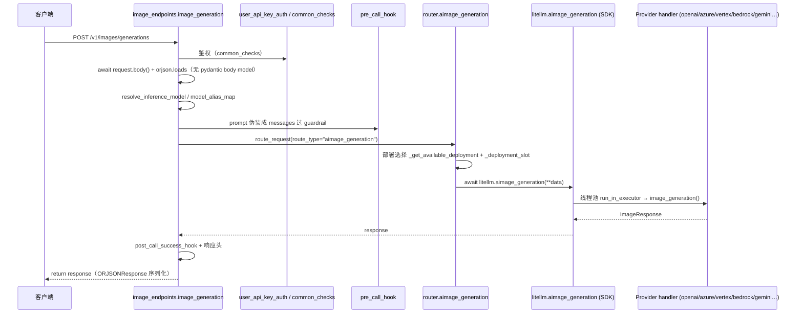
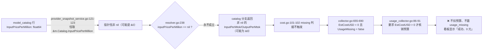

# 图像生成能力调研：LiteLLM / New API 对标与本网关落地方案

> 文档性质：工程决策依据（非产品宣传）。所有技术断言尽可能带 `文件:行号`。
> 标注约定：**【已核实】**＝本文档撰写时实际打开源码逐行确认；**【推断】**＝未经源码/实测确认的判断；**【采信】**＝采信上游调研纪要且本仓无法直接复验（如 LiteLLM 内部行为）。
> 调研对象与版本：
> - LiteLLM：`/private/tmp/llmres/litellm` @ `083d48f62f1e3dd9a4c6da393e9464013aff7929`（read-only）
> - New API：`https://github.com/QuantumNous/new-api` @ `7de10f2c602b50122017556e8a09cb7c488c273c`（2026-10-13，本次撰写时浅克隆）
> - one-api：`https://github.com/songquanpeng/one-api` @ `8df4a2670b98266bd287c698243fff327d9748cf`（2025-02-21，本次撰写时浅克隆）
> - 本网关 llm-gateway：`08ecc9c54ef201cd474df09382ab4bf2a860fd42`

---

## 0. 结论速览

**一句话结论：本网关今天没有任何图像生成 / 图像编辑能力；已有两条「能出图但不是图像 API」的旁路，且都不可作为图像能力方案；正确做法是新增原生 `/v1/images/generations` 与 `/v1/images/edits` handler，并在此之前先落地「最小计价兜底」，否则会出现「能出图、账目为 0、看板看不出」的静默免费期。**

证据（【已核实】）：

1. 路由层没有图像端点：`internal/gateway/server/router.go` 全文 `grep images` 零命中；网关已注册的 v1 路由只有 `/models`、`/models/:model_id`、`/model/info`、`/health/models`、`/chat/completions`、`/embeddings`、`/rerank`、`/responses`、`/messages`、`/messages/count_tokens`、`/p/:provider/*path`、视频任务与素材库（`internal/gateway/server/router.go:293-391`）。
2. 领域接口没有图像方法：`core.Provider` 只有 7 个方法 —— `ChatCompletion`、`StreamChatCompletion`、`ListModels`、`Responses`、`StreamResponses`、`Embeddings`、`Rerank`（`internal/core/interfaces.go:10-31`）。
3. `/v1/p/:provider/*path` 透传**技术上能把请求打到上游图像端点**，但有 6 条硬限制（特权 Key、预算豁免、凭证覆盖、无 call_type / 无成本、查询串丢弃、router 启动快照不热更），详见 §4.3。【已核实】
4. `/v1/responses` 的 `image_generation` 工具在 `openai` / `azure` / `openrouter` 上是原样转发（`internal/providers/openai/compatible_provider.go:218-236`；同一实现另由 vllm/oracle 显式委派，xai 自带原生 `/responses` 调用，详见 §4.4），其余 provider 走 `chat/completions` 桥接（桥接入口 `internal/providers/responses_adapter.go:23`、`:146`；其中非 function 工具原样保留，`:88-90`），不是图像端点形态。【已核实】
5. 控制面与目录侧已经有图像资产但**未接通**：`internal/controlplane/seed/litellm_catalog.json` 含 228 个 `mode ∈ {image_generation, image_edit}` 条目；`internal/controlplane/service/model_probe.go:211-219` 已经在探 `/images/generations`；但定价解析器只认 4 个 token 价字段（`internal/controlplane/service/catalog_parser.go:104-118`），图像价只留在 `RawPayload`（`internal/controlplane/model/model_catalog.go:47` 一带）。【已核实】

---

## 1. 第一章 LiteLLM 怎么做的

### 1.1 对外端点与代理主链路

**端点**（同一个 handler 挂 3 条路径，均带鉴权与 `ORJSONResponse`）：

| 路径 | 位置 |
|---|---|
| `POST /v1/images/generations` | `litellm/proxy/image_endpoints/endpoints.py:70-71` |
| `POST /images/generations` | `litellm/proxy/image_endpoints/endpoints.py:76-77` |
| `POST /openai/deployments/{model:path}/images/generations`（Azure 兼容） | `litellm/proxy/image_endpoints/endpoints.py:82-83` |

handler 签名 `async def image_generation(request, fastapi_response, user_api_key_dict=Depends(user_api_key_auth), model: str|None=None)`（`litellm/proxy/image_endpoints/endpoints.py:88-93`），router 挂载在 `litellm/proxy/proxy_server.py:20396`（import 在 `:607`）。



**请求解析**：**没有 pydantic body model**，直接 `await request.body()` + `orjson.loads(body) | {"litellm_call_id": ...}`（`litellm/proxy/image_endpoints/endpoints.py:106-110`），call id 来自 `resolve_litellm_call_id(x-litellm-call-id)`（`:105`，实现在 `litellm/proxy/common_request_processing.py:297-300`）；随后 `add_litellm_data_to_request(...)`（`:113-120`）。

**model 解析三段**（【已核实】行号已按 §1.9 勘误表修正）：

1. SSRF 防护：`reject_url_valued_destination("model", model)`（`litellm/proxy/image_endpoints/endpoints.py:122-123`；定义 `litellm/proxy/litellm_pre_call_utils.py:451-476`，URL 形式的 model → HTTP 400）。
2. 端点/CLI/组设置/body 的优先级解析：`resolve_inference_model(..., kind="image_generation")`（调用点 `endpoints.py:125-127`；定义 `litellm/proxy/common_utils/http_parsing_utils.py:34-46`，`case "image_generation":` 在 `:45-46`，取值表达式逐字为 `cli_model or endpoint_model or settings.get("image_generation_model") or body_model`）。
3. 别名映射：`litellm.model_alias_map`（`endpoints.py:132-133`）。

**必填参数校验在路由层**：`raise_if_required_body_param_missing`（`litellm/proxy/route_llm_request.py:344-357`），`REQUIRED_PRESENT_BODY_PARAMS_BY_ROUTE["aimage_generation"] = ("prompt",)`（`:176`）；`_ROUTE_TYPES_WITH_POSITIONAL_REQUIRED_PARAM` 含 `aimage_generation`（`:271-274`，理由：`Router.aimage_generation(prompt, model, **kwargs)` 位置绑定，因此 deployment/default 参数不能顶替 body 里的 `prompt`）。缺失 → `ProxyMissingRequiredParamError`（`:209-216`）或 `ProxyMissingParamWithoutLoadedModelError`（`:219-220`）。

**鉴权放行**：非 admin Key 的路由白名单判定见 `litellm/proxy/auth/route_checks.py:301-302`（`elif RouteChecks.is_llm_api_route(route=route): pass`）、`is_llm_api_route` 定义在 `:405`；图像路径列在 `litellm/proxy/_types.py:251-255`（`/images/generations`、`/v1/images/generations`、`/images/edits`、`/v1/images/edits`）。**【已核实】注意：原始调研把放行分支写成 `route_checks.py:313-314`，那两行实际属于 `/user/info` 的 403 拒绝逻辑，语义相反（见 §1.9）。**

**hook 顺序**：prompt 伪装成 chat messages（`endpoints.py:136-142`）→ `proxy_logging_obj.pre_call_hook(..., call_type="image_generation")`（`:144-146`）→ 还原 prompt 并删 messages（`:148-151`）→ `route_request`（`:154-159`）→ `update_request_status("success")`（`:163`）→ `post_call_success_hook`（`:166-168`）→ 响应头（`:176-192`）→ `return response`（`:203`）。

**响应归一化**：SDK 侧 `convert_to_model_response_object(response_type="image_generation")`（`litellm/litellm_core_utils/llm_response_utils/convert_dict_to_response.py:576-650`、图片分支 `:823-833`），返回 `ImageResponse`（`litellm/types/utils.py:2681-2724`），`data[]` 元素为 `ImageObject{b64_json,url,revised_prompt,provider_specific_fields}`（`:2602-2642`），顶层另有 `usage: ImageUsage`（`:2664-2675`）。b64 与 url 的取舍完全由 provider 返回字段决定。

**错误映射**：`except`（`endpoints.py:204-227`）→ `post_call_failure_hook`（`:205-207`）→ `log_llm_api_exception`（`:208`）→ `HTTPException` → `ProxyException`；`ProxyException` 由 `litellm/proxy/proxy_server.py:2050-2067` 渲染为 `{"error": {message,type,param,code}}`。状态码→type 映射表在 `litellm/proxy/common_utils/openai_error_payload.py:15-22`。

### 1.2 SDK 入口与参数分级

- provider 解析：`litellm/images/main.py:224-232`（给了 model/custom_llm_provider 就 `get_llm_provider`；都空则默认 `dall-e-2` + `openai`）。
- 参数白名单 `openai_params`（`litellm/images/main.py:234-250`）→ `filter_out_litellm_params`（`:251`；`litellm/utils.py:4253-4256`）。
- provider config 选择：`ProviderConfigManager.get_provider_image_generation_config`（`litellm/images/main.py:253-258`；`litellm/utils.py:9698` 起）。
- 参数校验与转换：`get_optional_params_image_gen`（`litellm/utils.py:3665`）：
  - pop 掉 `model/custom_llm_provider/provider_config/drop_params/additional_drop_params/kwargs`（`:3681-3687`）
  - `_check_valid_arg`（`:3728-3742`）：不支持的参数在 `drop_params=True` 时静默丢弃，否则抛 `UnsupportedParamsError(status_code=500, ...)`
  - provider_config 分支 `map_openai_params`（`:3744-3752`）；openai/azure/openai_compatible 原样透传（`:3753-3758`）；bedrock（`:3759-3763`）；vertex_ai 特例 `n→sampleCount`、`size→aspectRatio`（`:3764-3775`）
  - `add_provider_specific_params_to_optional_params`（`:3781-3787`）：**openai/azure 把白名单外的额外参数塞进 `extra_body` 并过 `ensure_extra_body_is_safe`；其他 provider 平铺**
- `litellm_params` 与日志：`get_litellm_params(**kwargs)`（`litellm/images/main.py:273`）、`logging.update_from_kwargs(...)`（`:275-291`）、`mock_response` 短路（`:296-297`）。
- handler 分派：azure（`:299-370`）、`llm_http_handler` 组（Recraft/AIML/Gemini/Fal/Stability/RunwayML/VertexAI/OpenRouter/DashScope/Qwen/EdenAI，`:374-406`）、black_forest_labs（`:407-422`）、azure_ai（`:423+`）、openai/其他（`:477`）、bedrock（`:494`）、custom_handler（`:523`/`:540`）。
- `aimage_generation` 是**线程池包装同步实现**：`async def aimage_generation`（`litellm/images/main.py:80`），真正的线程池调用是 `:107` `init_response = await loop.run_in_executor(None, func_with_context)`（`:98-106` 只是准备段；原调研与 §1.9 一度写成 `:109`，实测 `:109` 是 `response: ImageResponse | None = None`）。
- SDK 默认超时 `timeout=600`（`litellm/images/main.py:193`，第三个重载；另 `:145`/`:169` 也是 600）。**【已核实】**

**模型级参数矩阵**（`get_supported_openai_params` 返回什么就允许什么）：

| 模型 | 支持参数 | 位置 |
|---|---|---|
| OpenAI/Azure `dall-e-2` | `n, response_format, quality, size, user` | `litellm/llms/openai/image_generation/dall_e_2_transformation.py:24` |
| OpenAI/Azure `dall-e-3` | 上述 + `style` | `litellm/llms/openai/image_generation/dall_e_3_transformation.py:24` |
| `gpt-image-*` | `background, moderation, n, output_compression, output_format, quality, size, user`（**无 `response_format`、无 `style`**） | `litellm/llms/openai/image_generation/gpt_transformation.py:23-33` |
| Vertex AI Imagen | `n, size` | `litellm/llms/vertex_ai/image_generation/vertex_imagen_transformation.py:51-55` |
| Bedrock Titan / Nova / Stability3 / Stability1 | `size,n,quality` / `n,size,quality` / `[]` / `size` | `litellm/llms/bedrock/image_generation/amazon_titan_transformation.py:81-107` 等 |

**关键语义差异（对客户端可见）**：`dall-e-2/3` 用 `response_format` 控制返回 `url` / `b64_json`；`gpt-image-*` **没有** `response_format`，只回 `b64_json`，用 `output_format` 选编码格式 —— **客户端对 gpt-image 传 `response_format` 会触发 500 `UnsupportedParamsError`（除非 `litellm.drop_params=True`）**。`input_fidelity` 只存在于图像**编辑**路径（`litellm/types/images/main.py:16`、`litellm/llms/openai/image_edit/transformation.py:36-60`），生成路径不可用。

### 1.3 多厂商转换（取 4 家）

| 厂商 | 上游 URL | 参数改写 | 响应归一 |
|---|---|---|---|
| Vertex AI Imagen | `{base}/v1/projects/{p}/locations/{l}/publishers/google/models/{model}:predict`（`vertex_imagen_transformation.py:121-152`） | body `{"instances":[{"prompt":...}],"parameters":{"sampleCount":1,...}}`（`:184-213`）；`n→sampleCount`、`size→aspectRatio`（`:57-92`，映射表 `1024x1024→1:1`、`1792x1024→16:9`…） | `predictions[].bytesBase64Encoded → ImageObject(b64_json)`（`:251-256`） |
| Vertex AI Gemini 变体 | `.../{model}:generateContent`（`vertex_gemini_transformation.py:148-181`） | `{"contents":[...],"generationConfig":{"responseModalities":["IMAGE"],...}}`（`:211-254`）；`n→candidate_count`、`size→aspectRatio`（`:74-101`） | 同 Gemini |
| Bedrock | `{proxy_endpoint_url}/model/{modelId}/invoke`（`litellm/llms/bedrock/image_generation/image_handler.py:206-292`，URL `:251`），SigV4 头 | titan `{taskType:"TEXT_IMAGE",...}`（`amazon_titan_transformation.py:109-130`）；nova 三种 taskType（`amazon_nova_canvas_transformation.py:70-160`）；stability3 `AmazonStability3TextToImageRequest(prompt=..., **optional_params)`（`amazon_stability3_transformation.py:76-82`） | 统一 `response_dict["images"] → Image(b64_json=...)`，汇聚于 `image_handler.py:313-343` |
| Gemini（AI Studio） | `DEFAULT_BASE_URL="https://generativelanguage.googleapis.com/v1beta"`（`litellm/llms/gemini/image_generation/transformation.py:45-46`），`get_complete_url` `:72-98` | `{"contents":[{"parts":[{"text":prompt}]}],"generationConfig":...}`（`:112-176`） | `candidates[].content.parts[].inlineData.data → ImageObject(b64_json=...)`（`:178-255`） |
| Azure（含 dall-e-2 异步） | `create_azure_base_url`（`litellm/llms/azure/azure.py:1095-1140`，MAI/FLUX2 特例，否则 `/openai/deployments/{model}/images/generations`） | `azure_deployment_image_generation_json_body`（`litellm/llms/azure/image_generation/http_utils.py:5-27`） | `get_azure_image_generation_config(...).transform_image_generation_response`（`azure.py:1194-1205`） |

### 1.4 路由治理（fallback / retry / 冷却 / 通配）

- 异步主链（代理实际走的）：`Router.aimage_generation`（`litellm/router.py:4809-4827`）→ `_update_kwargs_before_fallbacks`（`:4814`）→ `async_function_with_fallbacks`（`:4815`，实现 `:7892-7965`）→ `async_function_with_retries`（`:8027+`）→ 最终 `await litellm.aimage_generation(...)`（`:4852-4860`）。**【已核实】** `model_name = data["model"]` 在 `:4843`（原始调研写 `:4845`，偏 2 行）。
- 部署选择：`_aimage_generation`（`:4829-4868`）→ `async_get_available_deployment`（`:4833-4838`）→ `_update_kwargs_with_deployment`（`:4840`，实现 `:4155+`，超时覆盖在 `:4284`）→ `async with self._deployment_slot(deployment, kwargs, parent_otel_span)`（`:4851`，实现 `:9087-9100`，持 `max_parallel_requests` 信号量）。
- 同步对照（差异明显）：`Router._image_generation`（`:4767-4806`）`data = deployment["litellm_params"].copy()`（`:4779`，全量并入 provider kwargs）、**没有 `_deployment_slot`**；且 `model_name: Final = ""`（`:4770`）在 try 块内从未被赋值，导致指标键为空串的不对称（`total_calls[""]` `:4784` / `success_calls[""]` `:4793`，而 except 用 `fail_calls[model_name]` `:4804`）。
- 冷却：`deployment_callback_on_failure`（`:8592-8715`，优先级 deployment `model_info` > `retry-after` 头 > `self.cooldown_time`，落地 `set_cooldown_deployments` `:8692`）。
- 通配：`PatternMatchRouter`（`:1133`）、`add_pattern`（`:10081`）、`"*" in model → pattern_router.route(...)`（`:11226-11240`）。
- **未发现任何按 `mode == "image_generation"` 过滤部署的逻辑**（全仓 grep 仅命中调用点）。**【采信（原始调研 + 复核一致）】**

### 1.5 计费与预算

**成本**：
- `litellm/litellm_core_utils/litellm_logging.py:1839-1997` `response_cost_calculator`（带 `call_type=self.call_type`）→ `litellm/cost_calculator.py:1388` `completion_cost`，`:1649-1665` 判定 `call_type_has_image_response(call_type) and isinstance(completion_response, ImageResponse)` → `CostCalculatorUtils.route_image_generation_cost_calculator`（`litellm/litellm_core_utils/llm_cost_calc/utils.py:1945`）。
- 默认计价器 `default_image_cost_calculator`（`litellm/cost_calculator.py:2487`），size 归一化为 `-x-` 形式（`:2514-2518`），**计价桶顺序**（`:2560-2573`）：

```python
unit_counts = (
    ("input_cost_per_image", image_count),
    ("output_cost_per_image", image_count),
    ("input_cost_per_pixel", height * width * image_count),
)   # 取首个命中
```

  **这个顺序很重要**：`dall-e-3` 在 LiteLLM 价表里只有 `input_cost_per_image`，把它映射到「每张输出图」的桶才会算对（见 §6 的 blocker/major）。
- `resolved_n = n if n is not None else (len(completion_response.data) if completion_response.data else 0)`（`litellm/litellm_core_utils/llm_cost_calc/utils.py:1988`）——引用时**必须带上 `if completion_response.data else 0`**，否则语义不同。**【已核实】**
- gpt-image 家族走 token 计价：`litellm/llms/openai/image_generation/cost_calculator.py:19-64`。

**预算预留**：`litellm/proxy/spend_tracking/budget_reservation.py:1517` 严格 `if model_info.get("mode") not in ("image_generation", "image_edit"): return None`（注释理由：chat/vision 模型也有 `input_cost_per_image`）；`:1522-1534` `cost_per_image = (output_cost_per_image or 0) + (input_cost_per_image or 0)`，`return cost_per_image * max(n, 1)`（`n` 缺省按 1）。**【已核实】**

**落库支出**：`litellm/proxy/proxy_server.py:2953-2954` 注册 `ProxyDBLogger`（`litellm/proxy/hooks/proxy_track_cost_callback.py:121`）。

### 1.6 图像编辑 multipart

`litellm/images/utils.py` 是**图片编辑**专用，不含生成参数。编辑路径在 `litellm/llms/openai/image_edit/transformation.py:36-60`，`input_fidelity` 只在这里存在（`litellm/types/images/main.py:16`）。

### 1.7 pass-through 与 Responses 的 `image_generation` 工具

- **图像生成不走 mapped passthrough**：`litellm/proxy/_types.py:387-421` 的 `mapped_pass_through_routes`（30 项）中**没有任何 images 路径**。**【已核实】但原始调研的下一句「`:667` 的直连分支不涉及图像」是错的**：`litellm/proxy/route_llm_request.py:667` `if "api_key" in data or "api_base" in data:` 与 route_type 无关，`:669-671` 直接 `getattr(llm_router, f"{route_type}")(**data)`，`aimage_generation` 同样会命中该分支。
- 图像 passthrough 是另一套：OpenAI 兼容主机上的 `/openai_passthrough` 通用透传，其 `call_type` 由 `litellm/proxy/pass_through_endpoints/llm_provider_handlers/openai_passthrough_logging_handler.py:164` `is_openai_image_generation_route` 判定，赋值出现在 `:431` **与 `:450` 两处**。
- Responses 工具的 `call_type`：`PassthroughCallTypes.passthrough_image_generation`（`litellm/types/utils.py:1110`）。

### 1.8 streaming / 异步：LiteLLM 的实际边界

- **`/v1/images/generations` 不支持流式**：端点单次 `return response`（`endpoints.py:203`）；SDK 签名与重载均无 `stream`（`litellm/images/main.py:79-199`）。**【采信，且与 §2.8 的 New API 形成对比】**
- **部分图只存在于 Responses API**：`ResponsesAPIStreamEvents.IMAGE_GENERATION_PARTIAL_IMAGE = "image_generation.partial_image"`（`litellm/types/llms/openai.py:1622`）、事件模型 `ImageGenerationPartialImageEvent`（`:1916-1919`）；`partial_images` 参数出现在 `OpenAIImageEditOptionalParams`（`:1243-1255`）与 `ResponsesAPIOptionalRequestParams.partial_images`（`:1345`）。
- **异步任务被封装在 handler 内部**，对外仍是同步 JSON：
  - Black Forest Labs：`litellm/llms/black_forest_labs/image_generation/handler.py:306` `_poll_for_result_sync`（轮询间隔/上限 `:311-312`，`status=="Ready"` 返回 `:377-378`，`Error/Failed/Content Moderated/Request Moderated → BlackForestLabsError(400)` `:379-387`，超时 `HTTP 408` `:392-395`）。
  - Azure dall-e-2 preview：`litellm/llms/azure/azure.py:893` 改写 URL 为 `/openai/images/generations:submit`、`:895-897` 删 `model`、`:903-906` 读 `operation-location`、`:929-938` 轮询 `status` 直到 `succeeded/failed`（超时 408），并带 `assert_same_origin` 防 SSRF（注释 VERIA-51）。**【已核实】**

**结论：LiteLLM 对外没有 task_id/poll API；异步能力被封装在 handler 内部，客户侧体验是「一次 HTTP 调用、长等待返回」。**

### 1.9 行号勘误表（必须按此表引用）

阶段 2 对抗性复核在 LiteLLM 仓库逐条重读源码后，发现原始调研有 1 处**承载语义的错行号**与多处漂移。下表为已修正值，本文档已全部采用：

| 断言 | 原始行号 | **修正后** | 性质 |
|---|---|---|---|
| 非 admin Key 放行分支 `elif RouteChecks.is_llm_api_route(...): pass` | `route_checks.py:313-314` | **`route_checks.py:301-302`** | ⚠️ **语义错**：313-314 落在 `/user/info` 的 403 拒绝分支（`:307-318`） |
| `is_llm_api_route` 定义 | `:405-431` | `:405`（区间基本正确） | 漂 1 行 |
| 图像路径枚举 | `_types.py:250-254` | `_types.py:251-255` | 偏 -1 |
| `resolve_inference_model` 的 `case "image_generation"` | `http_parsing_utils.py:38-39` | `http_parsing_utils.py:45-46`（定义 `:34-46`） | 偏 5~7 行 |
| `reject_url_valued_destination` 调用点 | `endpoints.py:121-122` | `endpoints.py:122-123`（定义 `litellm_pre_call_utils.py:451-476`） | 漂 1 行 |
| `model_alias_map` | `endpoints.py:131-133` | `endpoints.py:132-133` | 漂 1 行 |
| `get_optional_params_image_gen` 分支链 | `utils.py:3755-3800` | `utils.py:3744-3791` | 系统性 +11 |
| SDK 线程池执行行 | `images/main.py:98-107` | **`images/main.py:107`**（`:98-106` 是准备段） | ⚠️ **语义错**：`109-110` 是 `response: ImageResponse \| None = None`（原表误改到 `:109`） |
| `model_name = data["model"]`（async） | `router.py:4845` | `router.py:4843` | 偏 2 行 |
| passthrough 图像 call_type | 仅 `:422-437` | 补 `:450`（`:431` 与 `:450` 两处） | 漏一处 |

---

## 2. 第二章 New API / one-api 怎么做的

> **素材来源说明**：本章依据「New API / one-api 图像能力」专项调研交付物，并在成文时对其 `file:line` 逐条回归源码复核（证据索引见 §7.3）；版本见文档头。
>
> 【更正说明】本章早期草稿曾写「该交付物对象错位、全部 `file:line` 指向 `litellm/*`，不可使用」，**该判断已撤销**。复核确认交付物中的 New API / one-api 引用真实存在且语义一致（例如 `pkg/jsplugin/routing.go:102-103`、`router/task-plugin-protocol-router.go:37-44`、`relay/channel/adapter.go:27`、`service/image.go:69-117`、one-api `router/relay.go:27-29`）。误判根因是阶段 2 复核收到的**合并摘要被截断、只含 LiteLLM 部分**（投喂缺陷），与交付物本身无关，详见文末附注。

### 2.1 定位差异

| | New API (QuantumNous) | one-api (songquanpeng) |
|---|---|---|
| 体量 | `relay/` 下 20+ 渠道包 + `relaykit/` 共享 DTO + 插件协议（`pkg/jsplugin`） | `relay/adaptor/` 经典 adaptor 表 |
| 图像能力 | Images API（生成 + 编辑，含**流式**）+ MJ/Suno 异步任务 + 视频任务 | 仅 Images 生成（`/v1/images/edits` 是 `RelayNotImplemented`） |
| 版本 | `7de10f2c`（2026-10-13） | `8df4a267`（2025-02-21） |

### 2.2 路由与 distributor

**New API 的图像路由是「插件协议端点 + 回退」双轨**：

- `/v1/images/generations` 与 `/v1/images/edits` 由 **host protocol 注册**：`pkg/jsplugin/routing.go:102`（generate）与 `:103`（edit，BodyKinds 含 JSON 与 Multipart）声明；`router/task-plugin-protocol-router.go:13-24` 遍历 `HostProtocols()` 逐个 `router.Handle(method, operation.Path, ...)` 挂载；handler 链为 `TokenAuth → ModelRequestRateLimit → PinTaskPluginEndpoint → PrepareTaskPluginEndpoint → Distribute → RelayTaskPluginEndpoint(fallback: Relay(RelayFormatOpenAIImage))`（`router/task-plugin-protocol-router.go:37-44`）。
- 回退逻辑：`controller.RelayTaskPluginEndpoint`（`controller/relay.go:383-406`）在无插件 pin 时直接 `fallback(c)`（`:385-388`）。
- 传统路径 `POST /v1/edits`（旧版 OpenAI edits）直接在 `router/relay-router.go:122-124` 注册，走 `controller.Relay(RelayFormatOpenAIImage)`。
- relay 模式识别：`relay/constant/relay_mode.go:66`（`/v1/images/generations → RelayModeImagesGenerations`）、`:68`（`/v1/images/edits → RelayModeImagesEdits`）。
- 中间件链：`router/relay-router.go:70-92`（`/v1` 组：`RouteTag → SystemPerformanceCheck → TokenAuth → ModelRequestRateLimit → Distribute`）。

**distributor（渠道选择）**：`middleware/distributor.go:34` `Distribute()`：
- 构造约束并按请求路径过滤：`:43-46`（`FilterRequestPath`）；
- 取请求体里的 model 与「是否需要选渠道」：`:48` `getModelRequest(c)`；
- Token 级模型白名单校验：`:57-74`；
- 真正选渠道：`:103` `service.SelectChannelForRequest(c, modelRequest.Model, &service.RetryParam{...})`；
- 写上下文：`:125` `SetupContextForSelectedChannel(c, channel, modelRequest.Model)`。

### 2.3 Adaptor 抽象与 DTO

- 统一接口 `channel.Adaptor`（`relay/channel/adapter.go:18-35`）含 `ConvertImageRequest(c, info, request dto.ImageRequest) (any, error)`（`:27`）、`DoRequest`（`:29`）、`DoResponse`（`:30`）等。异步任务用**另一个接口** `TaskAdaptor`（`relay/channel/adapter.go:37+`），带 `EstimateBilling`（`:49`）/`AdjustBillingOnSubmit`（`:57`）/`AdjustBillingOnComplete`（`:59-62`）三个计费钩子。
- adaptor 工厂：`relay/relay_adaptor.go:50` `GetAdaptor(apiType int)`，按渠道类型 switch（`:51+`）。
- DTO：`relaykit/dto/openai_image.go` —— `ImageRequest`（`:26-52`）字段用 `json.RawMessage` 承载 provider 差异字段（`style`/`user`/`background`/`moderation`/`output_format`/`output_compression`/`partial_images`/`stream`/`images`/`mask`/`input_fidelity`/`watermark`…），另用匿名参数 `Extra map[string]json.RawMessage` 兜住未知字段（`:50`）。
- 数量语义与**上界防溢出**：`const MaxImageN = 128`（`:15`），注释明确「没有这个上界，巨大或负数 n 会把配额算出负计费」；`ImageCount(useProviderParameters bool)`（`:55-70`）负责解析并提供默认 1。

### 2.4 渠道转换与模型映射

- 模型改名：`relay/helper/model_mapped.go:14` `ModelMappedHelper`（支持链式重定向，`:19-30`），在 `relay/image_handler.go:39` 对图像请求调用。
- 请求体转换：`relay/image_handler.go:71` `adaptor.ConvertImageRequest(c, info, *request)`；结果若是 `*bytes.Buffer`（multipart）就直接作为 body，否则序列化 JSON 并应用参数覆盖（`:84-101`）。
- **编辑的 multipart 重建**：`relay/channel/openai/adaptor.go:520-580` —— `RelayModeImagesEdits` 且非 JSON 时用 `multipart.NewWriter` 重建：写 `model`（`:530`）、写全部非文件表单字段（`:544-553`）、再兼容 `image` / `image[]` / `image[` 前缀三种文件字段名（`:561-578`）；缺图报 `image is required`（`:575`）。
- 响应分派：`relay/channel/openai/adaptor.go:774-778`（`RelayModeImagesGenerations/Edits` → 流式走 `OpenaiImageStreamHandler`，否则 `OpenaiImageHandler`）。

### 2.5 计费与 quota（New API）

**先预估预留、后按实际结算**：

- 预留入口：`relay/image_handler.go:128` `service.PrepareImageBillingForRequest(c, info, imageCount)`。
- 实现 `service/image_billing.go:19-89`：
  - 上界校验 `count < 1 || count > dto.MaxImageN` → 400（`:20-22`）；
  - **tiered_expr 模式**：`info.TieredBillingSnapshot.BillingMode == "tiered_expr"`（`:26`）走表达式计费，`request.ImageCount = &count`（`:35`），随后 `QuotaRoundStrict(... * GroupRatio)`（`:46`），并回写预估快照（`:48-54`）；
  - **常规模式**：`quantity = count`（若走固定价 `UsePrice` 则也取 count，`:57-60`），`info.PriceData.AddOtherRatio("n", float64(quantity))`（`:63`，注释：覆盖每次尝试的倍率，避免失败尝试把数量泄漏到另一个渠道），`base = info.ImageQuotaBeforeGroup`，若 `UsePrice` 则 `base = ModelPrice * common.QuotaPerUnit`（`:64-67`）；
  - 落 `QuotaToPreConsume`（`:73`）并 `PreConsumeBilling` / `info.Billing.Reserve(quota)`（`:78-88`）。
- **出账数量以响应为准，防少收**：`relay/channel/openai/relay_image.go:44` `info.UpdateImageCount(openaiImageResponseCount(responseBody))`；`openaiImageResponseCount`（`:62-84`）用 gjson 数 `data[]` 里带 `url` / `b64_json` 的条目，取两者较大值，空条目不计费；`relay/image_handler.go:164-169` 取「响应实际张数」优先于预留值。
- **流式图像的防薅逻辑**（很有参考价值）：`relay/channel/openai/relay_image.go:186-192` —— 只有上游正常结束（done/eof）才相信 `completedImages`，客户端提前断开时不降低收费（否则客户端可以在第一张完成后断开只付 1 张的钱）；但当已完成事件数超过请求的 n 时，按更高的实际数收费。

**one-api 的计费（对照）**：`relay/controller/image.go:106` `RelayImageHelper`：
- 默认值填充（`n=1`、`size=1024x1024`、`model=dall-e-2`）在 `:26-41`；
- 静态校验表：`isValidImageSize`（`:44-50`）、`isValidImagePromptLength`（`:52-55`）、`isWithinRange`（`:57-60`）；
- 成本倍率：`getImageCostRatio`（`:91-104`）＝ `ImageSizeRatios[model][size]`，且 `dall-e-3 + hd` 再乘 2（1024x1024）或 1.5；
- **配额公式**：`quota = int64(ratio * imageCostRatio * 1000) * int64(imageRequest.N)`（`:182`，Replicate 特殊为固定 1 张 `:178-180`），ratio = `modelRatio * groupRatio`（`:171-173`）；
- **事后扣费**（不是预留）：在 `defer` 里 `PostConsumeTokenQuota` + `CacheUpdateUserQuota`（`:196-211`），并写消费日志（`:213-220`）；余额不足在请求前判 `userQuota-quota < 0 → 403 insufficient_user_quota`（`:185-187`）。
- 请求体：只有 `isModelMapped || 渠道是 Azure` 才重新 marshal，否则**直接透传原始 body**（`:139-146`）；只有 Zhipu/Ali/Replicate/Baidu 才调 `ConvertImageRequest`（`:154-168`）。
- 静态表位置：`relay/billing/ratio/image.go:3-13`（`ImageSizeRatios`）、`:43-51`（`ImageGenerationAmounts`）、`:53-61`（`ImagePromptLengthLimitations`）、`:63-66`（`ImageOriginModelName` 上游模型改名）。

### 2.6 异步任务与 MJ / Suno（New API）

- 平台常量：`constant/task.go:6-7`（`TaskPlatformSuno = "suno"`、`TaskPlatformMidjourney = "mj"`）。
- MJ 路由：`router/relay-router.go:210-230` —— `/mj/image/:id`、`/mj/submit/{action,shorten,modal,imagine,change,simple-change,describe,blend,edits,video,upload-discord-images}`、`/mj/task/:id/fetch`、`/mj/task/:id/image-seed`、`/mj/task/list-by-condition`、`/mj/insight-face/swap`；其中查询类（fetch/list/notify/image-seed）**不需要选渠道**（`middleware/distributor.go:362-367`、`:383`）。
- 控制器：`controller/relay.go:301-330` `RelayMidjourney`，按 `relayInfo.RelayMode` 分派 submit / task fetch / image seed（`:320-326`）。
- 通用视频/任务提交：`controller/relay.go:431` `RelayTask` → `executeTaskSubmissionWith`（`:471+`），带重试、计费预留/退款（`defer` 里 `relayInfo.Billing.Refund(c)`，`:485-488`）与持久化任务行（durable barrier）。
- **图片生成也能被任务插件接管**：`controller/plugin_protocol_image.go:22-30` `serveTaskPluginImageProtocol` —— 注释明确「API 是同步的：先在不受客户端断连影响的 context 上做持久化提交，随即在**同一请求内**轮询上游异步任务直到终态或协议超时，最后用插件的 render 钩子拼出 OpenAI 图像响应」；提交用 `context.WithoutCancel`（`:52-56`）。

### 2.7 图片下载转存（New API）

- `service/image.go:69-117` `GetImageFromUrl`：下载上游 `url` 图片 → 校验 `Content-Type` 必须是 `image/*` 或 `application/octet-stream`（`:81-84`）→ 按 `constant.MaxFileDownloadMB` 限长（`:85-93`）→ base64 编码（`:104`）→ `octet-stream` 时用 `image.DecodeConfig` 猜真实格式（`:107-114`）。
- 解码/格式识别：`DecodeBase64ImageData`（`:20-41`）、`getImageConfig`（`:161-193`，依次尝试 png/jpg/gif → webp → HEIF/HEIC 的 ispe 盒解析）。
- 使用点：`controller/plugin_protocol.go:94`（把下载函数注入插件协议，把上游 URL 图转成 base64 供插件渲染）、`relay/channel/zhipu_4v/image.go:100`、`relay/channel/replicate/adaptor.go:308`。

### 2.8 流式图像（New API 独有）

`relay/channel/openai/relay_image.go:123-194` `OpenaiImageStreamHandler`：
- 上游 4xx/5xx → 回退非流式处理（`:129-132`）；Content-Type 不是 `text/event-stream` 时走 `openaiImageJSONAsStreamHandler`（`:133-135`，把一次性 JSON 拆成 SSE 事件）；
- 真 SSE 走共享流式引擎 `helper.StreamScannerHandler`（`:146`），从 JSON 的 `type` 字段重建 `event:` 行（`:199-208`）；
- 只信 `image_generation.completed` / `image_edit.completed` 计数（`:163-165`）；
- 错误事件按 JSON 内容判定（`:215-228`）。

### 2.9 New API vs one-api 差异对比表

| 维度 | New API @7de10f2c | one-api @8df4a267 |
|---|---|---|
| 生成路由 | `/v1/images/generations` 由 host protocol 注册 + 回退 Relay（`pkg/jsplugin/routing.go:102`、`router/task-plugin-protocol-router.go:37-44`） | 直接注册 `POST /images/generations`（`router/relay.go:27`） |
| 编辑路由 | `/v1/images/edits`（BodyKinds 含 JSON + Multipart，`pkg/jsplugin/routing.go:103` 声明；`relay/channel/openai/adaptor.go:520-580` 重建 multipart） | `POST /images/edits → controller.RelayNotImplemented`（`router/relay.go:28`） |
| 流式图像 | 支持（SSE，`relay/channel/openai/relay_image.go:123-194`） | 不支持 |
| 图片下载转存 | 有（`service/image.go:69-117`） | 无同类能力 |
| 异步任务 | MJ/Suno/视频任务表 + 任务插件协议（`constant/task.go:6-7`、`controller/relay.go:431`、`controller/plugin_protocol_image.go:24`） | 无（全仓无 midjourney/suno） |
| 计费方式 | 先预留后结算（`service/image_billing.go:19-89`）+ tiered_expr 表达式计价 + 响应张数纠偏（`relay_image.go:44`） | 请求前只校验余额，响应后一次性扣费（`relay/controller/image.go:185-211`） |
| 计费因子 | n × 单价（固定价或表达式） | `modelRatio × groupRatio × sizeRatio × 1000 × n`（静态表，`relay/controller/image.go:177-183`） |
| n 上界 | `MaxImageN = 128` 显式校验（`relaykit/dto/openai_image.go:15`、`:60-66`；服务侧 `service/image_billing.go:20-22`） | 静态区间表（dall-e-2 {1,10}、dall-e-3 {1,1}，`relay/billing/ratio/image.go:43-51`） |
| 渠道转换 | 每个渠道一个 `ConvertImageRequest`（`relay/channel/adapter.go:27`），20+ 实现 | 仅 Zhipu/Ali/Replicate/Baidu 转换，其余原样透传（`relay/controller/image.go:139-168`） |
| 前端 | 有（web/ + 插件协议） | 有（web/） |

---

## 3. 第三章 横向对比表：LiteLLM vs New API vs 本网关

| 维度 | LiteLLM @083d48f | New API @7de10f2c | **本网关 @08ecc9c5** |
|---|---|---|---|
| 同步生成 `/v1/images/generations` | ✅（`image_endpoints/endpoints.py:70-71`） | ✅（`pkg/jsplugin/routing.go:102`） | ❌ **无路由**（`internal/gateway/server/router.go:293-391` 无 images） |
| 图像编辑 `/v1/images/edits` | ✅（multipart + JSON） | ✅（multipart 重建 `relay/channel/openai/adaptor.go:520-580`） | ❌ 无 |
| 多厂商参数智能转换 | ✅ `n→sampleCount`/`size→aspectRatio` 等（`litellm/utils.py:3764-3775`） | ✅ 每渠道 `ConvertImageRequest`（`relay/channel/adapter.go:27`） | ❌ 无（只有 `/v1/p` 原样透传） |
| 图像流式 / 部分图 | ❌ 生成无流式；部分图仅 Responses API（`litellm/types/llms/openai.py:1622`） | ✅ SSE 流式（`relay/channel/openai/relay_image.go:123-194`） | ❌ |
| 异步任务（对外 task_id） | ❌ handler 内部轮询，对外同步（`black_forest_labs/.../handler.py:306`、`azure.py:893`） | ✅ MJ/Suno/视频任务表 + 任务插件（`constant/task.go:6-7`） | 🟡 视频有完整范式（`internal/gateway/handler/video_handler.go`），图像无 |
| 计费口径 | 桶顺序 `input_cost_per_image → output_cost_per_image → input_cost_per_pixel`（`litellm/cost_calculator.py:2560-2573`）；gpt-image 走 token | n × 单价；tiered_expr 表达式；响应张数纠偏（`relay_image.go:44`） | 🟡 只有 token / per-search-unit 两个桶，**图像桶不存在**（`internal/core/types.go:255-256` 有字段但无解析与计算路径） |
| 预算 | 事前预留，严格 `mode ∈ {image_generation,image_edit}`（`budget_reservation.py:1517`） | 事前预扣（`service/image_billing.go:73-88`） | 事后记账（`internal/gateway/middleware/budget_reserve.go:14-19`），准入侧无需估价 |
| 结果转存（URL→本地/base64） | ❌ | ✅ URL→base64 内联，**不落盘**（`service/image.go:69-117`） | ❌ |
| 限流 | 复用通用 pre_call_hook（无图像专用 limiter） | `ModelRequestRateLimit` 中间件（`router/relay-router.go:86`） | 🟡 请求级 RPM/并发闸门 + 模型层配额（`internal/gateway/handler/budget.go:26-51`），无图像专用 |
| 观测 | `call_type=image_generation`（`litellm/types/utils.py:482`） | 消费日志 + 任务表 | 🟡 `call_type` 结构化字段已存在但**未覆盖图像**（`internal/gateway/observability/call_type.go:80-105` 无 images case） |
| 前端 | ❌（无内建 UI） | ✅ web/ | ✅ web/（管理面） |
| 对外文档 | ✅ | ✅ | 🟡 有 `docs/seedance-api.md` 范式，图像文档待写 |

---

## 4. 第四章 我们网关现状与缺口（逐项带 `file:line`）

### 4.1 已具备的「底座」

| 能力 | 位置 | 状态 |
|---|---|---|
| 可选能力接口的仓库约定 | `core.NativeBatchProvider`（`internal/core/interfaces.go:36-42`）、`NativeFileProvider`（`:81-87`）、`NativeResponseLifecycleProvider`（`:100-105`）、`NativeResponseUtilityProvider`（`:109-112`）、`core.PassthroughProvider`（`internal/core/passthrough.go:28-30`） | 【已核实】新增 `core.ImageProvider` 应照此模式，**不可扩 `core.Provider`** |
| 能力断言与 501 语义 | `resolveNativeBatchProvider`（`internal/providers/router.go:430-439`）、`resolveNativeFileProvider`（`:442-452`）、`resolveNativeResponseUtilityProvider`（`:466-476`）、`unsupportedNativeResponseOperation`（`:478-480`，`http.StatusNotImplemented`） | 【已核实】 |
| 按 model 解析 provider 的通用调用 | `routeResolvedModelCall`（`internal/providers/router.go:494-510`） | 【已核实】 |
| 组调度 | `GroupAwareDispatcher.Dispatch`（`internal/gateway/orchestrator/group_dispatcher.go:58`），写 `c.Set("routed_model", decision.ModelName)`（`:114`、`:172`）；`GetGroupTimeout`（`:209`） | 【已核实】 |
| 预算/配额准入 | `PrepareAuthorizedGates`（`internal/gateway/handler/budget.go:26-51`：dispatch → `gate.Check` → `requestQuota.BeforeUpstream`） | 【已核实】 |
| embeddings handler 范式（可直接照抄） | `internal/gateway/handler/embeddings.go:74` `Handle`（`:77` body 非法 → `request_body_invalid`；`:83` 缺 model → `request_missing_model`；`:118` `PrepareAuthorizedGates`；`:151` `model_capability_mismatch`） | 【已核实】 |
| 上游客户端韧性 | `llmclient.Client`：熔断、`Retry-After` 解析、非 200 原样返回（`DoPassthrough` `internal/llmclient/client.go:547-597`） | 【已核实】 |
| 视频异步范式（可参考但**不可直接复用**） | `VideoTaskStore` 接口（`internal/gateway/handler/video_handler.go:68-74`）、路由（`internal/gateway/server/router.go:355-364`）、`video_tasks` 表（`atlas-migrations/20260710150000_create_video_tasks_table.sql:3-18`） | 【已核实】强类型且视频专用 |
| 目录里已有的图像资产 | seed 目录 228 个 image 模式条目；`probeImageGeneration` 已在探 `/images/generations`（`internal/controlplane/service/model_probe.go:211-219`） | 【已核实】 |

### 4.2 缺口清单（按严重度）

| # | 缺口 | 证据 | 后果 |
|---|---|---|---|
| G1 | 无 `/v1/images/*` 路由 | `internal/gateway/server/router.go:293-391` 无 images | OpenAI SDK 直接 404 |
| G2 | `core.Provider` 无图像方法，也无 `core.ImageProvider` | `internal/core/interfaces.go:10-31` | 无能力抽象 |
| G3 | 路径分类未覆盖图像 | `isBillableRequest` 的 switch 只列 `/v1/chat/completions,/v1/embeddings,/v1/rerank,/v1/responses,/v1/messages`（`internal/gateway/server/router.go:420-430`）；`deriveExactCallType` 无 images case（`internal/gateway/observability/call_type.go:80-105`） | 图像请求不被计费事实守卫覆盖、`call_type` 为空、看板无法按类型筛选 |
| G4 | 图像定价解析缺失 | `ResolveUsagePricing` 仅处理 `rerank/rerank_vl`，其余直接返回空（`internal/controlplane/pricing/resolver.go:176-180`）；`catalog_parser` 只解析 4 个 token 价字段（`internal/controlplane/service/catalog_parser.go:104-118`） | 图像价只躺在 `RawPayload`，网关拿不到 |
| G5 | 图像成本计算路径缺失 | `UsageEvent.EstimateCost` 只有 rerank 分支（`internal/gateway/observability/collector.go:644-653`）与 token 分支（`:655-690`） | 图像请求成本恒为 0 |
| G6 | 图像探测不适用 | `probeImageGeneration` 固定 `size:"256x256"`（`internal/controlplane/service/model_probe.go:211-219`）；探针 `http.Client{Timeout: 30s}`（`:290-297`）；`ProbeModelForward` 的 switch 无 `image_edit`（`:32-33`，落 `default → probeChatCompletion` `:45-46`） | gpt-image 家族（只接受 1024x1024/1024x1536/1536x1024）稳定误判失败；`image_edit` 必然误判；每次探针**真实出图并计费** |
| G7 | 组能力聚合不认端点 | `aggregateGroupModelInfo` 的 mode 规则是「任一成员为 chat 即为 chat，否则取首个非空 mode」（实现 `internal/controlplane/service/model_info_service.go:164-172`），且文件顶部注释（`:15-16`）写「任一成员支持即视为支持」与同一文件 `:150-153`（注释）／`:162-163`（实现「全部支持才算支持」）**相反**（陈旧注释） | 图像组会被 `chat` 成员污染；且 `supported_endpoints` 未被解析（`internal/controlplane/model/model_catalog.go:33-49` 无该列） |
| G8 | 全局请求体日志会破坏 multipart | `RequestBodyLogger` 在 DEBUG 下 `io.ReadAll(io.LimitReader(c.Request.Body, 64*1024))` 后 `c.Request.Body = io.NopCloser(bytes.NewBuffer(body))`（`internal/gateway/middleware/middleware.go:136-138`），作为全局中间件注册（`internal/gateway/server/router.go:115`） | `LOG_LEVEL=debug` 时 >64KB 的 edits 上传被截断，`Content-Length` 与实际不符 → 解析失败或静默丢图 |
| G9 | `ModelPricing` 图像桶未进 FieldSources/Clone | `PerImage`/`InputPerImage` 已有（`internal/core/types.go:255-256`）且已登记（`:295-296`、`:370-371`），但**无像素/token 桶** | 新增桶若漏登记，provider snapshot 的 DB 来源判定会漏（`internal/controlplane/service/provider_snapshot_service.go:98` 依赖 `FieldSources("database") > 0`） |

### 4.3 必答问题：今天用 `/v1/p/:provider/*path` 透传能不能生成图片？

**结论：技术上能打通，但不能作为图像能力方案，共 6 条硬限制（全部【已核实】）。**

路由注册：`v1.Any("/p/:provider/*path", middleware.PassthroughGuard(), makePassthroughHandler(router))`（`internal/gateway/server/router.go:319`）；handler 实现 `internal/gateway/server/router.go:434-482`。

| # | 限制 | 证据 |
|---|---|---|
| L1 | **需要特权 Key**：普通 Key 一律 403，仅 `identity.AccessAllGroups == true` 放行 | `internal/gateway/middleware/org_check.go:86` `PassthroughGuard`、`:100` `if !ok || !id.AccessAllGroups` → 403 |
| L2 | **预算豁免是隐式死标志**：写入 `c.Set("budget_skipped","passthrough")`（`org_check.go:111`）但**生产代码无任何读取点**（常量定义在 `internal/gateway/middleware/budget_reserve.go:56`，唯一消费者在 `tests/gateway/middleware/budget_reserve_test.go:309`）；豁免实际来自「handler 不调 `Reserve`」 | `internal/gateway/handler/budget.go:26-51`（只有走 `PrepareAuthorizedGates` 的 handler 才触发预算与配额） |
| L3 | **入站凭证会覆盖上游凭证（密钥外泄路径）**：`buildRequest` 先调 `headerSetter` 写 provider 凭证，再用 `req.Headers` 逐键 `Del + Add` 覆盖 | `internal/llmclient/client.go:730-734`（headerSetter）、`:736-741`（覆盖）；`makePassthroughHandler` 把 `c.Request.Header.Clone()` 原样传入（`router.go:450-455`）→ 网关 Key 会被当作上游凭证发给第三方厂商 |
| L4 | **无 call_type、无成本、无模型维度**：透传不经过 handler 的 `c.Set("model", ...)`，因此 `call_type` 为空、`EstimateCost` 拿不到 model | `internal/gateway/observability/call_type.go:53-72`（按路径归一，`/v1/p/...` 无匹配）与 `:103-104`（`default: return ""`）；`collector.NewUsageEvent` 从 context 读 usage/model（`internal/gateway/observability/collector.go:291-317`） |
| L5 | **查询串被丢弃**：透传只取 path 参数，不拼 `c.Request.URL.RawQuery` | `internal/gateway/server/router.go:447-456`（`Endpoint: path`）；`internal/providers/openai/compatible_provider.go:410-431` 直接透传 endpoint |
| L6 | **router 是启动快照，不随 ProviderLoader 热更新**：`router := routerGetter()` 只取一次（`router.go:104`），`:319` 把这个快照传给 handler；ProviderLoader 每次 reload 都新建 registry+Router（`internal/gateway/loader/provider_loader.go:48-60`、`:195`），但 `/v1/p` 仍用旧实例 | 【已核实】源码路径确认；**换渠道/换 Key 后必须重启 gateway**（【推断】：未写测试实证交换后仍走旧上游） |

**所以：不能复用透传。正确做法是新增原生 handler，走 `providers.Router → CompatibleProvider` 的正常路径（凭证由 provider snapshot 注入的 `headerSetter` 提供，`internal/providers/openai/openai.go:59-60` 设 Bearer）。**

### 4.4 `/v1/responses` 的 `image_generation` 工具能不能替代？

**不能。**（【已核实】+【推断】）

- **真正把请求原样打到上游 `/responses` 的 provider 不止 3 个**：`openai`/`azure`/`openrouter` 匿名内嵌 `CompatibleProvider`（`internal/providers/openai/compatible_provider.go:218`（`Responses`）、`:238`（`StreamResponses`））；`vllm`（`vllm.go:106-112`）、`oracle`（`oracle.go:65-70`）显式委派同一实现；`xai` 自带原生 `/responses` 调用（`xai.go:214-220`）。`anthropic` 走 `/messages` 翻译（`anthropic/responses.go:82-99`），也不是图像端点形态。
- 其余 provider 是**桥接**：把 Responses 请求翻成 chat/completions（桥接入口 `internal/providers/responses_adapter.go:23`（`ConvertResponsesRequestToChat`）、`:146`（`ResponsesViaChat`），非 function 工具原样保留 `:88-90`），具体调用点 `deepseek.go:181-193`、`groq.go:117-123`、`gemini.go:723-773`、`bedrock.go:314-318`、`cohere.go:95-101`、`minimax.go:97-103`、`bailian.go:107-114`、`litellm.go:85-92`、`vertex.go:186-196`、`ollama.go:153-160`、`zai.go:80-87`。**上游会拒（400）属【推断】，未实测。**
- 不是图像端点形态：客户端 SDK 调的是 `/v1/responses`，拿不到 OpenAI Images 语义。

### 4.5 「Provider 自动获得能力」是错的（重要纠正）

原方案称「在 `openai.CompatibleProvider` 上实现该接口，内嵌该结构体的 provider 自动获得能力」。**只有 3 个真正匿名内嵌（方法被提升）**：

| 类别 | Provider | 证据 |
|---|---|---|
| ✅ 匿名内嵌（免费获得） | openai、azure、openrouter | `internal/providers/openai/openai.go:31`、`internal/providers/azure/azure.go:29`、`internal/providers/openrouter/openrouter.go:30` |
| 🟡 命名字段（需 3 行显式委派） | bailian、cohere、litellm、minimax、zai、vllm、oracle | `bailian.go:41`、`cohere.go:32`、`litellm.go:28`、`minimax.go:32`、`zai.go:28`、`vllm.go:31`、`oracle.go:25` |
| ❌ 完全没有 CompatibleProvider | groq、deepseek、xai | `groq.go:30-33`、`deepseek.go:29-32`、`xai.go:35-38` 均只有 `client + apiKey`；`deepseek.go:197-199` 对 embeddings 直接返回 unsupported（同款先例可抄） |

**【已核实】** 仓库共 20 个 provider 包；其中 **15 个包自带 `ChatCompletion` 实现**（`grep -rl "func (p \*Provider) ChatCompletion(ctx context.Context, req \*core.ChatRequest)" internal/providers/*/*.go | wc -l` = 15：anthropic/bailian/bedrock/cohere/deepseek/gemini/groq/litellm/minimax/ollama/oracle/vertex/vllm/xai/zai），另有 openai/azure/openrouter 由 `CompatibleProvider` 提供，共 18 个类型具备 chat 能力。**注意**：用 `grep -rn "ChatCompletion(ctx context.Context, req \*core.ChatRequest)"` 会得到 34，因为它同时命中 `StreamChatCompletion`／`nativeChatCompletion`，原稿的「= 17」两头都对不上。工厂注册在 `cmd/gateway/main.go:338` `buildProviderFactory()`。

### 4.6 计费静默失效的真实机制（与方案描述不同，必须纠正）

原方案的论证是「`p.InputPerMtok == nil || p.OutputPerMtok == nil` → `EstimateCost` 返回 missing → `usage_missing` 置位」。**这在 catalog 绑定模型上不成立**：



证据链（全部【已核实】）：
1. `internal/controlplane/service/provider_snapshot_service.go:121-123`：`if m.Catalog != nil { inputPricePerMillion = &m.Catalog.InputPricePerMillion; outputPricePerMillion = &m.Catalog.OutputPricePerMillion }`——字段是值类型 `float64`（`internal/controlplane/model/model_catalog.go:33-34`，default 0）。
2. `internal/controlplane/pricing/resolver.go:238` 的 `if inputPricePerMillion == nil || outputPricePerMillion == nil { return core.ModelPricing{} }` 因此**永不成立**，`:245-250` 返回非 nil（可能是 `&0`）。
3. `internal/gateway/observability/cost.go:100-102` `EstimateCost` 的首行判据不触发。
4. `internal/gateway/observability/collector.go:655-690`：token 分支算出 0，`UsageMissing` 保持 false。
5. `internal/gateway/middleware/usage_collector.go:86-91`：`postHook != nil && event.EstCostUSD > 0 && ...` 才核销；`internal/gateway/server/router.go:493-497` 的 `buildBudgetPostHook` 首行 `if httpStatus >= 400 || realCostUSD <= 0 || gate == nil { return }` 同样在 `realCostUSD <= 0` 时 `return`。

**因此 Phase 1-2 若不带计价兜底就上线，形成的是「无声无息、看板看不出的免费额度」，而不是「可见的 usage_missing」。**

### 4.7 「张数可用现有列反推」在像素口径下不成立（次要但要知道）

`call_logs` 相关列：`OutputPriceSnapshot *float64 gorm:"type:decimal(14,6)"`（`internal/observability/model/call_log.go:48`）、`EstCostUSD decimal(18,6)`（`:52`）、`CallType varchar(64)`（`:55`）、`UsageMissing bool`（`:43`）。`decimal(14,6)` 会把 per-pixel 单价（如 `1.9e-08`）截断为 0，因此「张数 = 成本 / 单价快照」的反推在像素口径下不可用。**【已核实（列定义）＋推断（截断后果）】**

---

## 5. 第五章 落地方案

> **素材说明**：随附的「两套方案」JSON 中**实际只包含 Option A**（另一套未随附，阶段 2 复核亦确认「JSON 里只提供了一个 option 对象」）。因此 **Option A 为采信原始方案 + 本文档修正**；**Option B 为本文档基于 Option A 的「明确排除清单」推导的补全路线，属【推断/建议】，需团队确认后再进入设计**。

### 5.0 两方案共同的 Phase 0（前置，插入到任何编码之前，0.5～1 人日）

这是本次评审最强的一条结论：**把「最小计价兜底」前移**，否则「能不能免费刷图」将由 Phase 3 的排期决定。

| 项 | 内容 | 关键位置 |
|---|---|---|
| P0-1 | 路径分类：`isBillableRequest` 加 `/v1/images/generations`、`/v1/images/edits` | `internal/gateway/server/router.go:420-430` |
| P0-2 | `call_type`：新增 `image.generations` / `image.edits` 常量与 case（长度远小于 `maxCallTypeLen = 64`） | `internal/gateway/observability/call_type.go:26-40`、`:47-50`、`:80-105` |
| P0-3 | `internal/core/endpoints.go`：`OperationImageGeneration/OperationImageEdit`（`:21-30` 常量区）、`describeEndpointPath`（`:55-132`）、`bodyModeForEndpoint`（`:134-172`，generations→`BodyModeJSON`，edits→`BodyModeMultipart`） | 消费方 `internal/core/semantic.go:225`、`internal/core/batch_semantic.go:165,198` |
| P0-4 | `core.ImageProvider`（新增独立文件 `internal/core/images.go`） | 理由同 `internal/core/interfaces.go:33-35` 的注释；先例 `internal/core/passthrough.go:28-30` |
| P0-5 | **无重试外发**：给 `llmclient.Request` 增加 per-call `NoRetry` 开关（比依赖 `RawBodyReader` 副作用清晰） | 现状：`MaxRetries: 3`（`internal/llmclientconfig/config.go:18`），仅 `RawBodyReader != nil` 才 `maxAttempts = 1`（`internal/llmclient/client.go:356-359`），`isRetryable` = 429/502/503/504（`:764-770`） |
| P0-6 | **最小计价兜底**：至少一个 per-image 桶 + 显式 `UsageMissing` + 「无价则拒绝」开关 | 落点 `internal/gateway/observability/collector.go:644` 前插入 image 分支；开关在控制面 |
| P0-7 | `RequestBodyLogger` 跳过 multipart（或路径） | `internal/gateway/middleware/middleware.go:128-138` |
| P0-8 | 集成测试骨架 + 表驱动计价对拍（§8 待确认清单引用） | `tests/gateway/...` |

### 5.1 Option A —— 最小可用（同步 `/v1/images/generations` + `/v1/images/edits`）

**范围**：OpenAI 兼容「透明转发优先」，不做多厂商参数智能转换。

**明确排除**：`vertex_ai`/`bedrock`/`gemini` 的参数映射（这些 provider 走类型断言失败返回 501）；异步任务表 + 轮询；流式/部分图；组级图像专用聚合字段；图像专用「按张」配额细分。

**Phase 1 — JSON 生成贯通**（原估 2.5-3 人日；评审修正为 **3-4 人日**）

1. 路由：`internal/gateway/server/router.go` v1 组内新增两条 `v1.POST(...)`（`:293-391` 闭包），构造对齐 `embeddingsHandler`（`:136-142` 的 `NewEmbeddingsHandler[WithGroup]` 模式），注入 `GroupAwareDispatcher`、`middleware.BudgetDeps`、`budget.Gate`、`quota.QuotaMiddleware`、`quota.ModelQuotaGate`。
2. `internal/core/images.go`：`ImageGenerationRequest`（Model/Prompt/N/Size/Quality/Style/ResponseFormat/User/Background/OutputFormat/OutputCompression/Moderation + `Extra map[string]json.RawMessage` + 自定义 `MarshalJSON` 平铺合并 → 「不认识的参数原样透传」）、`ImageObjectMeta{Index,URL,B64JSONBytes,RevisedPrompt}`、`ImageResponse{Raw json.RawMessage, Images, Usage, UpstreamStatus, ProviderType}`。
3. `core.ImageProvider`：`GenerateImage` / `EditImage`。
4. `internal/providers/openai/compatible_provider.go`：新增 `GenerateImage`，照抄 `Embeddings` 结构（`:372-389`）。
5. `internal/providers/router.go`：`resolveImageProvider`（照抄 `:442-452`）+ 501 语义（`:478-480`）+ `Router.GenerateImage` 走 `routeResolvedModelCall`（`:494-510`）。
6. `internal/gateway/handler/image_handler.go`：主流程严格对齐 `internal/gateway/handler/embeddings.go:74-190`（错误码 `request_body_invalid`/`request_missing_model`/`model_capability_mismatch`）。
7. `internal/gateway/orchestrator`：新增 `GenerateImage`/`EditImage`（照抄 embeddings 路径），并在 `routerProvider` 接口（`internal/gateway/orchestrator/chat.go:29-35`）加两个方法以保持可测；错误路径写 `error_message`/`upstream_status`。
8. **能力守卫必须收紧**：不能只比 `ModelType ∈ {image_generation,image_edit}`——seed 里 `gemini-2.5-flash-image` 等 9 个 `image_generation` 条目的 `supported_endpoints` **不含** `/v1/images/generations`（实测：`gemini-2.5-flash-image`、`gemini-3-pro-image-preview`、`gemini-3.1-flash-image-preview`、`deep-research-pro-preview-12-2025` 及其带前缀变体）。建议从 `CatalogRawPayload` 解析 `supported_endpoints` 并做端点能力校验。

**Phase 2 — multipart edits + 超时/重试治理**（原估 2 人日；修正 **2-3 人日**）

1. `ImageEditRequest` 持 `*multipart.FileHeader`（不读进 `[]byte`）。
2. `http.MaxBytesReader` 设上限 → `ParseMultipartForm` → 用 `io.Pipe` + `multipart.Writer` 重建上游 body（boundary 必变，`model` 必须改写） → `llmclient.Request{RawBodyReader: pr, Headers: {"Content-Type": {"multipart/form-data; boundary="+w.Boundary()}}}`。
   - 关键坑：`buildRequest` **只在 `req.Body != nil` 时**设 `application/json`（`internal/llmclient/client.go:725-728`），multipart/binary 必须自己传 Headers。
   - `RawBodyReader != nil` 时重试被禁用（`:356-359`）；`DoPassthrough` 对 POST 本来就不重试（`canRetryPassthrough` 仅 GET/HEAD/OPTIONS/PUT 或带 `Idempotency-Key`，`:516-529`）。
3. 快速路径：组内单一模型且无需改名时，直接把入站 body 作为 `RawBodyReader` 透传（含原始 Content-Type / Content-Length）。
4. **超时（评审修正的关键点）**：有效超时 = **min(http.Client.Timeout, ctx deadline, group timeout)**。
   - 上游 HTTP 客户端由 `llmclient.New` 构造（`internal/llmclient/client.go:102`）→ `httpclient.NewDefaultHTTPClient()`，默认 **300s**（`internal/httpclient/client.go:73-88`，`HTTP_TIMEOUT`/`HTTP_RESPONSE_HEADER_TIMEOUT` 可覆盖）。**因此「handler 设 600s ctx」是空操作。**
   - 若确实要 >300s，必须**成对调整** `HTTP_TIMEOUT` 与并发租约：`concurrencyLease = 360s`（`internal/gateway/quota/redis_store.go:28`），启动期有校验告警（`internal/gateway/quota/lease_guard.go:29-47`、`cmd/gateway/main.go:299-303`），否则槽位被并发复用、**并发限额被静默削弱**。
   - 更干净的做法：给图像 provider 单独构造 `http.Client`，不动全局 env。
5. 重试策略自己写：只对「连接建立失败且 body 可重放」重试 1 次；4xx 不重试；5xx/408/429 交给客户端。
6. Trace 脱敏：**不要**把图像路径加进 `traceCapturePaths`（`internal/gateway/middleware/trace_capture.go:25-32`）——`sanitizeJSONRequestBody` 对非 JSON 原样返回（`:116-121`），会把二进制塞进 `call_traces`；改为 handler 主动 `CaptureTraceRequestBody`（`:230-235`）与 `SanitizeJSONRequestBody`（`:219-221`）；响应摘要绝不登记原始 b64（`json.Marshal(resp_object)` 后整段写库，`internal/gateway/middleware/usage_collector.go:188-196`，无二次截断）。

**Phase 3 — 计费与预算对接**（原估 3 人日，自评高风险；评审修正 **4-5 人日**）

1. `ResolveUsagePricing` 放开 image 分支（`internal/controlplane/pricing/resolver.go:176-180`）：
   - manual 模式：`input_price` = 每张输入图 USD（edits）、`output_price` = 每张输出图 USD（生成）。
   - catalog 模式：从 `RawPayload` 读 `input_cost_per_image` / `output_cost_per_image` / `input_cost_per_pixel` / `output_cost_per_pixel` / `input_cost_per_image_token` / `output_cost_per_image_token`（seed 中真实存在：按**精确 key** 实测计数分别为 102 / 126 / 45 / 38 / 19 / 25；若按子串计数会把 `output_cost_per_image_premium_image`、`output_cost_per_image_token_batches`、`input_cost_per_image_above_128k_tokens` 等变体键也算进去，得到偏大的 104 / 135 / 26）。
   - **必须 exclusive 地只输出一种口径**（否则 1e6 倍计费事故）。
2. **计价桶优先级必须与 LiteLLM 一致**（否则 dall-e 家族算 0）：`input_cost_per_image` → `output_cost_per_image` → `input_cost_per_pixel × W × H × n`（`litellm/cost_calculator.py:2560-2573`）。实测：seed 中 `dall-e-3` 只有 `input_cost_per_image: 0.04`，`dall-e-2` 只有 `input_cost_per_image: 0.02`；`1024-x-1024/dall-e-2` 是纯像素行（`input_cost_per_pixel: 1.9e-08`）；`azure/high/1024-x-1024/gpt-image-1` 用 `input_cost_per_pixel: 1.59263611e-07`；`gpt-image-1` 走 image-token。
3. **snapshot 侧必须显式处理**：对 `model_type ∈ {image_generation, image_edit}` **不下发** token 桶（置 nil），只下发 image 桶（`internal/controlplane/service/provider_snapshot_service.go:115-146`）。
4. `core.ModelPricing` 新增 `OutputPerPixel` / `InputPerPixel` / `OutputPerImageToken` / `InputPerImageToken`（紧随 `internal/core/types.go:255-262`），**同步登记** `FieldSources`（`:286-302` 的 `add(...)` 列表）与 `Clone`（`:356-371`），并检查 `internal/modeldata/merge.go:115-116`、`internal/providers/registry_pricing_merge.go:62-63`。
5. `UsageEvent` 增加 `ImageCount` / `ImagePixels` / `ImageUnitPriceUSD`（`internal/gateway/observability/event.go:14-95`）；`ToCallLog`（`:97-129`）**不新增列**（`call_logs` 无对应列）。
6. `UsageEvent.EstimateCost` 在 rerank 分支（`collector.go:644-653`）之后、token 分支（`:655-690`，`EstimateCost` 调用在 `:661-665`）之前插入 image 分支：image-token → per-image → per-pixel；三者都缺 → `UsageMissing = true`。
7. 预算核销自动复活：`ImageCount > 0 && EstCostUSD > 0` 时 `usage_collector.go:86-91` 自然触发；准入侧零改动（`Reserve` 是事后记账，`internal/gateway/middleware/budget_reserve.go:14-19`、`:63-103`）。
8. 变体价问题**显式承认**：seed 里尺寸/质量档位是**独立 catalog 行**（如 `azure/high/1024-x-1024/gpt-image-1`），而 `models` 表一行只绑一个 `catalog_id` → Phase 3 只按绑定行取价，缺价计 0 但**打 warning + 置 `usage_missing`**；精确档位价留 Phase 5。

**Phase 4 — 目录 / 探测 / 文档 / 看板收口**（原估 2 人日；修正 **2.5-3 人日**）

1. `/v1/models` 无需改代码：按 Key 可见组 + `binding.Client.GetGroupModelInfo` 填 `Metadata.Modes`（`internal/gateway/handler/bound_models.go:70-74`）。
2. 组 mode 可用 `override_mode` 显式声明（`internal/controlplane/service/model_info_service.go:372-388`，字段 `internal/controlplane/model/group.go:37`）；顺手订正 `model_info_service.go:15-17` 的陈旧注释。
3. 修 probe（**评审补充 3 点**）：① size 策略不再固定 256x256；② `switch` 增加 `image_edit` 分支（`model_probe.go:25-47`）；③ **探针不应真出图**（改为可行性探测或最低尺寸/质量，并纳入预算与限频）；④ 探针 30s 超时与图像 SLA 对齐（`:290-297`）；⑤ multipart 探针需要新函数（现有 `doProbeRequest` 只支持 JSON + Bearer，`:290-324`）。
4. 文档：新增 `docs/image-api.md`，骨架照 `docs/seedance-api.md`（headings：`:26` 接入信息、`:43` 鉴权、`:65` 请求头约定、`:74` 调用总览、`:106` 调用约定、`:143` 创建任务、`:283` 查询状态、`:690` 错误处理与重试、`:735` 完整调用示例）。**必须写清** `response_format`（dall-e 家族）与 `output_format`（gpt-image 家族不支持 `response_format`）的差异，否则客户端必撞 400。
5. 契约：`tests/contract/contracts.json` 新增 images 段（现有顶层键：`quick_provider_onboard`、`observability`、`quota`、`model_tier_budget`、`model_tier_budget_p2`、`batch_register_models`、`user_feedback`）。
6. 看板：按 `call_type IN ('image.generations','image.edits')` 过滤即可（无需为图像加特判）。

**Option A 工作量汇总（评审修正）**：Phase 0 0.5-1 + Phase 1 3-4 + Phase 2 2-3 + Phase 3 4-5 + Phase 4 2.5-3 ≈ **12-15 人日**（原估 9.5-10）。

### 5.2 Option B —— 完整能力（含原始方案的 8 条关键决策）

在 Option A 之上补齐「真·多厂商 + 异步 + 精细化」。原始方案给出的关键设计决策如下（本文档已抽样回归源码复核，标注【已核实】/【推断】）：

| # | 决策 | 依据 |
|---|---|---|
| B0-1 | 异步通道「**表不通用、代码通用**」：从视频链路抽出模态无关的 `AsyncTaskStore`，**新建 `image_tasks` 表**，不改造 `video_tasks`（视频表下游消费点 20+，通用化是净负债） | `VideoTaskStore` 接口 `internal/gateway/handler/video_handler.go:68-74`【已核实】 |
| B0-2 | **不引入后台主动轮询上游**：多实例部署会重复回源 → 重复出图、重复计费。改为「GET 惰性查询 + 终态 CAS 记账 + 控制面 sweeper（60s，仅把超时任务置失败）」 | 与 Option A 的同步语义一致；【推断】 |
| B0-3 | 顺手修一个既有安全缺口：`VideoHandler.GetTask` **未做任务归属校验** —— 直接用 URL 的 `task_id` 查存储并请求上游，全程不比对调用方身份与任务的 `api_key_id`/`user_id`；图像任务表落地时必须带归属校验 | `internal/gateway/handler/video_handler.go:514-560`【已核实代码路径无校验；可利用性取决于 task_id 可猜性，属推断】 |
| B0-4 | 计费按**实际出图数 `len(data)`** 而非请求的 `n`（LiteLLM 以 `n` 优先，上游少出图时会多收钱）；本仓是事后记账，**无需预扣/回滚**（New API 的 `RefundTaskQuota` 是预扣模型的必然产物） | `litellm/litellm_core_utils/llm_cost_calc/utils.py:1988`【已核实】 |
| B0-5 | 结果交付默认透传上游 URL、按需转存；对象存储**零新增依赖**：复用 `internal/archive` 的 `ArchiveStore`（`internal/archive/store.go:144`）与 `LocalStore`（`internal/archive/local.go:25`），新开 `image_store.root`；下载端放控制面并全程鉴权 | 【已核实】 |
| B0-6 | 图像 handler 必须补齐 `PrepareAuthorizedGates` 三件套（预算 gate + `requestQuota` + `ModelQuotaGate`），顺手修掉视频/透传「不受配额」的既有缺口 | 范式见 `internal/gateway/handler/embeddings.go:118-168`【已核实】 |
| B0-7 | 参数差异化用「**翻译 / 明确 400 拒绝 / 忽略 + 响应头提示**」三分类，不给静默 drop 留口子（事后记账模式下静默丢弃会让用户预期与计费错位且无任何信号） | 与 §6.2 M-* 一致；【推断】 |
| B0-8 | **模型类型枚举必须先扩**：`model_type` 校验为 `omitempty,oneof=chat embedding embedding_vl rerank rerank_vl video`（六处 binding：`internal/controlplane/service/model_service.go:117,265,483`、`group_service.go:141,154`、`provider_quick_onboard_service.go:39`），`model_groups` 另有同名 CHECK 约束（`atlas-migrations/20260710180000_add_model_groups_model_type.sql:15`）——**image 缺席**，导致图像模型今天只能被判成 chat、永远走不到 `model_probe.go:32-33` 的图像探针；改这里必须走 `atlas-db-migration` skill | 【已核实】 |

**工作量**：原始方案估约 **41 人日，P0–P6 七阶段**（其中 P0「计价兜底」与 Option A 的 Phase 0 合并；【推断】，未逐项复核）。

在 Option A 之上补齐「真·多厂商 + 异步 + 精细化」：

| 模块 | 内容 | 依赖/复用 |
|---|---|---|
| B1 多厂商参数转换 | 按 LiteLLM 的映射表实现 `n→sampleCount`、`size→aspectRatio`（`litellm/llms/vertex_ai/image_generation/vertex_imagen_transformation.py:57-92`）、Bedrock titan/nova/stability 的 taskType 与 body 形状（`litellm/llms/bedrock/image_generation/*`）、Gemini `generationConfig`（`litellm/llms/gemini/image_generation/transformation.py:112-176`） | 新增 `core.ImageProvider` 的 provider 级实现；`internal/providers/{gemini,bedrock}/...` |
| B2 编辑 multipart 全兼容 | 兼容 `image` / `image[]` / `image[` 三种字段名（照 New API `relay/channel/openai/adaptor.go:561-578`）；mask 支持 | Phase 2 的 multipart 重建 |
| B3 图像流式/部分图 | 仅在确认上游支持时启用；参考 New API SSE（`relay/channel/openai/relay_image.go:123-194`）与 LiteLLM Responses 部分图事件（`litellm/types/llms/openai.py:1622`） | 需要 SSE 复用 `internal/streaming/` |
| B4 异步任务通道 | 参考本仓视频范式（`VideoTaskStore` `internal/gateway/handler/video_handler.go:68-74`、`video_tasks` 表）**新建图像专用适配器/路由/表**（不可直接复用视频强类型）；或按 New API 的「同步 API + 请求内轮询」（`controller/plugin_protocol_image.go:22-30`）折中 | 控制面新增持久化（gateway 不直连 PG） |
| B5 结果转存 | URL→base64/对象存储；参考 New API `service/image.go:69-117`（Content-Type 白名单 + 限长 + 格式识别） | 新增下载器，注意 SSRF（参考 LiteLLM `assert_same_origin`，`litellm/llms/azure/azure.py:910-918`） |
| B6 精确档位定价 | 控制面按 base model 汇总尺寸/质量变体成 map 下发；解决 §5.1 Phase 3 step 8 的变体价缺失 | `models` 表一行一 catalog 的约束（`internal/controlplane/model/model.go:44,66`） |
| B7 图像专用配额 | 「按张 / 按像素 / 按 image-token」的细分限额（Phase 1-3 直接复用请求级 RPM/并发闸门） | `internal/gateway/quota/` |
| B8 探测与看板精细化 | probe 不真出图 + 图像成功率/成本看板 + `usage_missing=true` 计数告警 | Phase 4 + 控制面前端 |

### 5.3 路由与分类改动清单（两方案共用）

| 路径 | 方法 | 备注 |
|---|---|---|
| `/v1/images/generations` | POST | v1 组闭包内新增；自动继承 `AuthMiddleware`(`router.go:267`)/`BillingFactGuard`(`:268`)/`TraceCapture`(`:270`)/`UsageCollectorWithRedis`(`:283`)/`ProviderTracker`(`:287`)/`OrgCheckMiddleware`(`:290`)；`usage_collector.go:37-38` 的跳过名单只含 `/health /ready /v1/models /v1/model/info /v1/health/models`，图像路径不会被跳过 |
| `/v1/images/edits` | POST | multipart；`MaxBytesReader` + `ParseMultipartForm` + `multipart.Writer` 重建 |
| `/v1/models`、`/v1/model/info` | GET | 不改代码，靠组 `mode` 暴露 |
| `/v1/p/:provider/*path` | ANY | **保持现状，明确不作为图像方案**（§4.3 六条限制） |
| 非路由：`internal/core/endpoints.go` | — | `Operation` 常量区（`:21-30`）、`describeEndpointPath`（`:55-132`）、`bodyModeForEndpoint`（`:134-172`），不做则语义快照/审计会把图像请求当未知路径 |

---

## 6. 第六章 评审意见与推荐路线

**评审结论：`approve_with_changes`** —— 方向正确、架构选型无需推翻，但有 **2 个 blocker + 6 个 major** 必须在动工前处置。

> 说明：随附评审 JSON 在 issues 第 10 条处被截断，下文收录可见的 10 条（2 blocker / 6 major / 1 minor + 1 未编号），并标注本文档的处置建议。

### 6.1 Blocker（必须先修）

**B-1 计费静默 0 元：方案依赖的 `usage_missing` 兜底不会触发**
- 机制见 §4.6（catalog 绑定模型的 token 价指针恒非 nil）。
- 处置（本文档采纳）：① `snapshotModelPricing` 对 image 模式**不下发** token 桶；② image 分支的 `UsageMissing` 由「是否命中任一 image 桶」直接赋值，不复用 `core.EstimateCost`；③ Phase 1 即上线「图像模型无价 → 拒绝(402/503) 或强制告警」开关；④ `tests/gateway/budget` 补「catalog 绑定图像模型 → 预算必须被扣减」端到端断言（这是唯一能挡住静默免费的测试）。
- 已并入 §5.0 P0-6。

**B-2 Phase 1 用 `DoRaw` 外发会按 429/502/503/504 自动重试 → 重复出图重复计费**
- 证据：`MaxRetries: 3`（`internal/llmclientconfig/config.go:18`）；只有 `RawBodyReader != nil` 才 `maxAttempts = 1`（`internal/llmclient/client.go:356-359`）；`isRetryable` = 429/503/502/504（`:764-770`）。方案内部自相矛盾：Phase 1 说 `DoRaw`、Phase 2 说「不重试」、§5 复用建议又说 `DoPassthrough`。
- 处置：① 生成/编辑统一走 `DoPassthrough`（`client.go:547-597`，非 200 原样返回）或新增 per-call `NoRetry`；② 「只重试连接建立失败且 body 可重放」写进 provider 层；③ httptest 断言 429 场景下上游只收到 1 次请求。
- `DoRaw`（`:346`，全量缓冲、非 200 变 error）与 `DoPassthrough` 语义不同，**不能互换**。

### 6.2 Major

**M-1 计价桶优先级与 LiteLLM 相反** → 已并入 §5.1 Phase 3 step 2；建一张与 LiteLLM 对拍的表驱动测试（`dall-e-3 = 0.04×n`、`1024-x-1024/dall-e-2 = 1.9e-08×W×H×n`、`nova = 0.06×n`）作为回归护栏。

**M-2 「避免 b64 大响应内存」的缓解手段不成立**：`llmclient.Response.Body` 是 `[]byte`（`client.go:171-175`），`doRequest` 用 `io.ReadAll` 全量读（`:662-671`）；`encoding/json` 没有零分配跳过字符串的 API。方案声称的「`DoRaw` + `json.Decoder` 逐 Token 跳过不 materialize b64」实际峰值 = body 副本 + Decoder 字符串副本。
→ 处置：优先用 `DoPassthrough` 拿 `*http.Response.Body` 直接 `io.Copy` 到 `c.Writer`（真正 O(1) 内存），张数从请求 `n` 或字节级扫描 `"b64_json"`/`"index"` 计数；若坚持 `DoRaw`，就不要再 `json.Decoder` 遍历，改 `bytes.Count`/子串扫描；用 10MB+ 假 b64 断言峰值分配（`go test -benchmem`）。
（另：`TraceWriter` 对响应体确实无二次截断，`trace_event.go:139-141` 仅 `json.Valid` 后原样写 → 方案 Phase 2 step 7「绝不登记原始 b64」**必须保留**。）

**M-3 超时漏掉真正的硬约束（300s）** → 已并入 §5.1 Phase 2 step 4。

**M-4 「内嵌 CompatibleProvider 即自动获得能力」只对 3 个成立** → 见 §4.5。处置：名单改三类 + 表驱动测试断言每个 provider type 是否实现 `core.ImageProvider`（期望集合写死，避免日后新增 provider 静默漏掉）+ 按此重估工作量。

**M-5 全局 `RequestBodyLogger` 在 DEBUG 下破坏 multipart** → 见 §4.2 G8。处置：`:128-133` 跳过名单加 `/v1/images/edits`（或对 `Content-Type: multipart/*` 直接跳过）；用 `LOG_LEVEL=debug` + >64KB 图跑集成测试断言字节一致；顺手评估把 logger 改成不破坏 Content-Length 的 tee 实现。

**M-6 图像探针除 size 外还有三个缺陷**：30s 超时（`model_probe.go:290-297`）、**每次探针都是真实计费出图**（`:211-219`）、`doProbeRequest` 只支持 JSON（edits 无法探，`:290-301`）。→ 已并入 §5.1 Phase 4 step 3。

**M-7 组内 `ModelType` 属图像不足以证明支持 `/v1/images/*`**：实测 9 个 `mode=image_generation` 条目的 `supported_endpoints` 不含 `/v1/images/generations`（gemini 图像模型族）；控制面未解析该字段（`catalog_parser.go:104-118` 只解析 token 价与 max_tokens；`model_catalog.go:33-49` 无该列，只在 `RawPayload:47`）。→ 见 §5.1 Phase 1 step 8。

**M-8 Phase 1-2 先上线无计费、无告警的端点 = 静默免费期** → 已由 §5.0 Phase 0 处置。

### 6.3 Minor

**m-1 「张数可用现有列反推」在像素口径下不可行**：`OutputPriceSnapshot decimal(14,6)`（`internal/observability/model/call_log.go:48`）会把 per-pixel 单价截断为 0。→ 见 §4.7；若要精确落库张数，Phase 5 单独走迁移加 `image_count` 列（并遵循 `atlas-db-migration` skill）。

### 6.4 推荐落地顺序（把计价兜底前移）

```
Phase 0（0.5-1 人日，新增）：路径分类 + core.ImageProvider + 无重试外发 + 最小计价兜底（per-image 一个桶 + 显式 usage_missing + 无价拒绝开关）+ RequestBodyLogger 跳过 multipart + 集成测试骨架
   ↓ 这一步做完，"能不能免费刷图" 就不再取决于 Phase 3
Phase 1 JSON generations（provider 委派按 §4.5 三类补齐）
   ↓
Phase 2 multipart edits + 超时与并发租约成对调整
   ↓
Phase 3 三口径计价 + 控制面/看板/前端
   ↓
Phase 4 probe（含"探针不真出图"）+ 文档 + 契约
```

**关于「不要走哪条路」的对抗性结论（评审）**：
- **不要复用 `/v1/p` 透传**（特权 Key + 凭证外泄 + 无配额/无 trace/无 call_type + 启动快照 router 不热更，见 §4.3）。
- **不要照搬视频异步任务表范式**：`VideoTaskStore` 是视频专用强类型（`internal/gateway/handler/video_handler.go:68-74`、`video_tasks` 表 `atlas-migrations/20260710150000_create_video_tasks_table.sql:3-18`），且 OpenAI 兼容图像全部同步返回；复用需要新增图像适配器、新路由、新持久化字段/表。
- **不要只靠 Responses 的 `image_generation` 工具**：Go 侧全仓仅 `internal/core/types.go:201` 与 `internal/controlplane/service/model_probe.go:32` 出现该字符串，所谓「支持」只是 `Responses()` 原样转发 body（`internal/providers/openai/compatible_provider.go:218-236`），并非端点形态。

---

## 7. 第七章 附录

### 7.1 证据索引（本网关，全部【已核实】）

| 断言 | 文件:行号 |
|---|---|
| v1 组与中间件链 | `internal/gateway/server/router.go:266-290` |
| 已有 v1 路由清单（无 images） | `internal/gateway/server/router.go:293-391` |
| `/v1/p` 路由注册 | `internal/gateway/server/router.go:319` |
| `makePassthroughHandler` | `internal/gateway/server/router.go:434-482` |
| `BillingFactGuard` / `isBillableRequest` | `internal/gateway/server/router.go:405-418` / `:420-430` |
| 预算事后核销 hook | `internal/gateway/server/router.go:493-530` |
| `router := routerGetter()`（启动快照） | `internal/gateway/server/router.go:104` |
| `RequestBodyLogger` 全局注册 | `internal/gateway/server/router.go:115` |
| `RequestBodyLogger` 64KB 截断 | `internal/gateway/middleware/middleware.go:136-138` |
| `PassthroughGuard` / 特权 Key / `budget_skipped` | `internal/gateway/middleware/org_check.go:86` / `:100` / `:111` |
| `budget_skipped` 常量与无消费方 | `internal/gateway/middleware/budget_reserve.go:56`；唯一读取在 `tests/gateway/middleware/budget_reserve_test.go:309` |
| `Reserve` 为事后记账 | `internal/gateway/middleware/budget_reserve.go:14-19`、`:63-103` |
| `core.Provider` 7 方法 | `internal/core/interfaces.go:10-31` |
| 可选接口先例 | `internal/core/interfaces.go:36-42`、`:81-87`、`:100-105`、`:109-112`；`internal/core/passthrough.go:28-30` |
| provider 断言 + 501 | `internal/providers/router.go:430-439`、`:442-452`、`:466-480`、`:494-510` |
| embeddings 范式 | `internal/providers/openai/compatible_provider.go:372-389`；`internal/gateway/handler/embeddings.go:74-190` |
| Responses 原生/桥接 | `internal/providers/openai/compatible_provider.go:218`（`Responses`）、`:238`（`StreamResponses`）；显式委派 `vllm.go:106-112`、`oracle.go:65-70`；xai 原生 `xai.go:214-220`；anthropic `/messages` 翻译 `anthropic/responses.go:82-99`；桥接入口 `internal/providers/responses_adapter.go:23`、`:146`（工具保留 `:88-90`） |
| 匿名内嵌 vs 命名字段 | `internal/providers/openai/openai.go:31`、`azure/azure.go:29`、`openrouter/openrouter.go:30`；`bailian/bailian.go:41`、`cohere/cohere.go:32`、`litellm/litellm.go:28`、`minimax/minimax.go:32`、`zai/zai.go:28`、`vllm/vllm.go:31`、`oracle/oracle.go:25`；`groq/groq.go:30-33`、`deepseek/deepseek.go:29-32`、`xai/xai.go:35-38` |
| headerSetter 后被 Headers 覆盖 | `internal/llmclient/client.go:730-741` |
| 只有 `Body != nil` 才设 `application/json` | `internal/llmclient/client.go:725-728` |
| `MaxRetries` / `maxAttempts` / `isRetryable` | `internal/llmclientconfig/config.go:18`；`internal/llmclient/client.go:356-359`、`:764-770` |
| `DoRaw` / `DoPassthrough` / `canRetryPassthrough` | `internal/llmclient/client.go:346`、`:547-597`、`:516-529` |
| 默认 300s 上游超时 | `internal/httpclient/client.go:73-88`；`internal/llmclient/client.go:102` |
| 并发租约 360s 与校验 | `internal/gateway/quota/redis_store.go:28`；`internal/gateway/quota/lease_guard.go:29-47`；`cmd/gateway/main.go:299-303` |
| `CostInput`/`EstimateCost` 缺价判据 | `internal/gateway/observability/cost.go:100-102` |
| `UsageEvent` 字段 | `internal/gateway/observability/event.go:14-95` |
| `UsageEvent.EstimateCost` 分支 | `internal/gateway/observability/collector.go:624-691`（rerank `:644-653`、token `:655-690`） |
| context 用量读取 | `internal/gateway/observability/collector.go:291-317` |
| 预算核销门槛 | `internal/gateway/middleware/usage_collector.go:86-91` |
| 响应体整段入 trace、无二次截断 | `internal/gateway/middleware/usage_collector.go:188-196` |
| 跳过采集的路径白名单 | `internal/gateway/middleware/usage_collector.go:37-38` |
| `call_type` 常量/判据/列宽 | `internal/gateway/observability/call_type.go:26-40`、`:47-50`、`:53-105` |
| `call_logs` 列定义 | `internal/observability/model/call_log.go:43`、`:48`、`:52`、`:55` |
| `core/endpoints.go` 三处 | `internal/core/endpoints.go:13-14`、`:21-30`、`:55-132`、`:134-172`、`:194` |
| `ModelPricing` 字段与登记 | `internal/core/types.go:244-264`、`:295-296`、`:370-371` |
| snapshot 定价恒取指针 | `internal/controlplane/service/provider_snapshot_service.go:115-146`（`:121-123`、`:142-144`） |
| catalog 缺价判据 | `internal/controlplane/pricing/resolver.go:238` |
| `ResolveUsagePricing` 只认 rerank | `internal/controlplane/pricing/resolver.go:176-180` |
| catalog 只解析 token 价 | `internal/controlplane/service/catalog_parser.go:104-118` |
| 图像探测三缺陷 | `internal/controlplane/service/model_probe.go:32-33`、`:45-46`、`:211-219`、`:290-297`、`:290-324` |
| 组能力聚合与陈旧注释 | `internal/controlplane/service/model_info_service.go:15-16`（陈旧，写「任一成员支持即视为支持」）vs `:150-153`（注释）/`:162-163`（实现「全部支持才算支持」）；mode 规则实现 `:164-172`；`override_mode` 在 `:372-388` |
| 视频异步范式 | `internal/gateway/handler/video_handler.go:68-74`；`internal/gateway/server/router.go:355-364`；`atlas-migrations/20260710150000_create_video_tasks_table.sql:3-18` |
| 预算/配额准入 | `internal/gateway/handler/budget.go:26-51` |
| 组调度 | `internal/gateway/orchestrator/group_dispatcher.go:58`、`:114`、`:172`、`:209` |
| `provider 工厂注册` | `cmd/gateway/main.go:338` |
| ProviderLoader 原子换 router | `internal/gateway/loader/provider_loader.go:48-60`、`:195` |
| 对外文档范式 | `docs/seedance-api.md:26`、`:43`、`:65`、`:74`、`:106`、`:143`、`:283`、`:690`、`:735` |
| 契约文件顶层键 | `tests/contract/contracts.json` |

**目录资产实测（本次用 python 统计）**：`internal/controlplane/seed/litellm_catalog.json` 中 `mode ∈ {image_generation, image_edit}` 共 **228** 条（全表 2724 条）；图像价 **精确 key** 出现次数：`input_cost_per_image` 102、`output_cost_per_image` 126、`input_cost_per_pixel` 45、`output_cost_per_pixel` 38、`input_cost_per_image_token` 19、`output_cost_per_image_token` 25（另存在变体键 `output_cost_per_image_premium_image` 3、`output_cost_per_image_above_*` 6、`input_cost_per_image_above_128k_tokens` 2、`output_cost_per_image_token_batches` 1，按子串统计会误得 104/135/26）；`dall-e-3 = {input_cost_per_image: 0.04, supported_endpoints: ["/v1/images/generations"]}`、`dall-e-2 = {input_cost_per_image: 0.02, endpoints 含 generations/edits/variations}`、`gpt-image-1 = {input_cost_per_image_token: 1e-05, output_cost_per_image_token: 4e-05}`、`1024-x-1024/dall-e-2 = {input_cost_per_pixel: 1.9e-08}`、`azure/high/1024-x-1024/gpt-image-1 = {input_cost_per_pixel: 1.59263611e-07}`。

### 7.2 LiteLLM 证据索引（关键项，均已按 §1.9 勘误后核对）

| 断言 | 文件:行号 |
|---|---|
| 3 条图像路由 | `litellm/proxy/image_endpoints/endpoints.py:70-71`、`:76-77`、`:82-83` |
| handler 签名 | `litellm/proxy/image_endpoints/endpoints.py:88-93` |
| 无 pydantic body、orjson 解析 | `litellm/proxy/image_endpoints/endpoints.py:106-110` |
| SSRF 防 URL model | `litellm/proxy/image_endpoints/endpoints.py:122-123`；`litellm/proxy/litellm_pre_call_utils.py:451-476` |
| model 优先级解析 | `litellm/proxy/common_utils/http_parsing_utils.py:34-46` |
| 必填 param = prompt | `litellm/proxy/route_llm_request.py:176`、`:271-274`、`:344-357` |
| 直连分支（与 route_type 无关） | `litellm/proxy/route_llm_request.py:667-671` |
| 非 admin 放行 | `litellm/proxy/auth/route_checks.py:301-302`、`:405` |
| 图像路径枚举 | `litellm/proxy/_types.py:251-255` |
| `mapped_pass_through_routes` 无 images | `litellm/proxy/_types.py:387-421` |
| passthrough 图像 call_type | `litellm/proxy/pass_through_endpoints/llm_provider_handlers/openai_passthrough_logging_handler.py:164`、`:431`、`:450` |
| SDK 线程池 | `litellm/images/main.py:80`、`:107`、`:193` |
| 参数分级与校验 | `litellm/utils.py:3665`、`:3681-3687`、`:3728-3742`、`:3744-3791` |
| gpt-image 支持参数 | `litellm/llms/openai/image_generation/gpt_transformation.py:23-33` |
| dall-e-2/3 支持参数 | `litellm/llms/openai/image_generation/dall_e_2_transformation.py:24`、`dall_e_3_transformation.py:24` |
| 计价桶顺序 | `litellm/cost_calculator.py:2487`、`:2514-2518`、`:2560-2573` |
| 图像分支入口 | `litellm/cost_calculator.py:1649-1665`；`litellm/litellm_core_utils/llm_cost_calc/utils.py:1945`、`:1988` |
| 预算预留严格判 mode | `litellm/proxy/spend_tracking/budget_reservation.py:1517`、`:1522-1534` |
| `model_name`（async） | `litellm/router.py:4843`、`:4852` |
| Azure dall-e-2 异步 submit+poll | `litellm/llms/azure/azure.py:893`、`:895-897`、`:903-906`、`:910-918`、`:929-938` |
| BFL 内部轮询 | `litellm/llms/black_forest_labs/image_generation/handler.py:306`、`:311-312`、`:377-379`、`:392-395` |
| Vertex Imagen / Gemini | `litellm/llms/vertex_ai/image_generation/vertex_imagen_transformation.py:51-55`、`:121-152`、`:184-213`；`vertex_gemini_transformation.py:148-181` |
| 部分图事件 | `litellm/types/llms/openai.py:1622`、`:1916-1919`、`:1243-1255`、`:1345` |

### 7.3 New API / one-api 证据索引（本次实测）

| 断言 | 文件:行号 |
|---|---|
| Images 插件协议声明 | `pkg/jsplugin/routing.go:102`（generate）、`:103`（edit，JSON+Multipart）、`:109`（`ProtocolOpenAIImage` 常量） |
| 协议路由挂载与中间件链 | `router/task-plugin-protocol-router.go:13-24`、`:37-44` |
| 插件未认领时回退 Relay | `controller/relay.go:383-388` |
| 旧 `/v1/edits` 路由 | `router/relay-router.go:122-124` |
| relay 模式识别 | `relay/constant/relay_mode.go:66`、`:68` |
| distributor | `middleware/distributor.go:34`、`:43-46`、`:48`、`:57-74`、`:103`、`:125` |
| Adaptor 接口 | `relay/channel/adapter.go:18-35`（`:27` 为 `ConvertImageRequest`）；TaskAdaptor `:37+`（计费钩子 `:42-62`） |
| adaptor 工厂 | `relay/relay_adaptor.go:50+` |
| ImageRequest DTO 与 MaxImageN | `relaykit/dto/openai_image.go:15`、`:26-52`、`:55-70` |
| 模型映射 | `relay/helper/model_mapped.go:14-30`；`relay/image_handler.go:39` |
| 图像主流程 | `relay/image_handler.go:24-196`（`:71` 转换、`:84-101` body 组装、`:128` 计费预留、`:134-160` 外发与响应、`:164-169` 出账张数、`:195` 结算） |
| multipart 编辑重建 | `relay/channel/openai/adaptor.go:520-580` |
| 响应分派 | `relay/channel/openai/adaptor.go:774-778` |
| 图像响应处理与张数纠偏 | `relay/channel/openai/relay_image.go:26-52`、`:62-84`、`:186-192` |
| 图像流式 | `relay/channel/openai/relay_image.go:123-194`、`:199-228`、`:260-366` |
| 计费预留 | `service/image_billing.go:19-89`（`:20-22`、`:26`、`:35`、`:46`、`:63-67`、`:73-88`） |
| 任务插件图像协议 | `controller/plugin_protocol_image.go:24-30`、`:50-54` |
| MJ 路由与控制器 | `router/relay-router.go:210-230`；`controller/relay.go:301-330` |
| 任务提交与退款 | `controller/relay.go:431`、`:471-488` |
| 平台常量 | `constant/task.go:6-7` |
| 图片下载转存 | `service/image.go:20-41`、`:69-117`、`:161-193`；使用点 `controller/plugin_protocol.go:94`、`relay/channel/zhipu_4v/image.go:100`、`relay/channel/replicate/adaptor.go:308` |
| one-api 生成路由 | `router/relay.go:27`；`/images/edits` → `RelayNotImplemented` `:28` |
| one-api 图像主流程与计费 | `relay/controller/image.go:26-41`、`:44-60`、`:91-104`、`:106`、`:139-168`、`:171-187`、`:196-220` |
| one-api 静态计费表 | `relay/billing/ratio/image.go:3-13`、`:43-51`、`:53-61`、`:63-66` |
| one-api 无 MJ/Suno | 全仓 `grep -rln "midjourney\|suno" --include=*.go` 零命中 |

### 7.4 待确认问题清单（需要在动工前拿到答案）

| # | 问题 | 为什么重要 | 建议验证方式 |
|---|---|---|---|
| Q1 | 图像模型的**计费口径**由谁定？运营在控制面「按张 / 按像素 / 按 image-token」三者只能选一个吗？ | 混配会造成 1e6 倍计费事故（§5.1 Phase 3 风险①） | 控制面前端加「图像定价单位」必选 + 校验；控制面单测 |
| Q2 | `HTTP_TIMEOUT` 是否允许上调到图像 SLA 所需的值？对应的 `concurrencyLease` 怎么调？ | 300s 是硬约束；调大会削弱并发限额（§5.1 Phase 2 step 4） | 读 `config/{dev,test,prod}.yaml` 现值 + 与运维确认图像 P99 延迟 |
| Q3 | 图像 provider 的 `supported_endpoints` 是否纳入控制面解析并下发？ | 否则 gemini 图像模型族（9 条）会被路由进 `/v1/images/generations` 并 400（§6.2 M-7） | 控制面新增列/RawPayload 解析 + 网关端点能力校验 + 表驱动测试 |
| Q4 | 图像探针允许「真出图」吗？如果不允许，用什么替代（`GET /v1/models`？最小尺寸+最低质量）？ | 每次健康检查都产生真实上游费用（§6.2 M-6） | 与运营确认成本容忍度；probe 改为可配置 |
| Q5 | 图像是否需要异步任务通道（对外 task_id）？还是接受「一次 HTTP 长等待」？ | 决定是否引入控制面持久化与图像任务表（Option B B4） | 用客户端真实超时行为 + 上游 P99 决定；先做 Phase 1-2 观测 |
| Q6 | 图像结果是否需要转存（URL→对象存储 / base64）？ | 影响 Option B B5 与成本（存储 + 带宽） | 与产品确认客户端是否能直连上游 URL（部分厂商 URL 短期有效） |
| Q7 | 图像是否需要「按张」细分配额（区别于请求级 RPM/并发闸门）？ | 影响 Option B B7 与配额模型改动 | 与运营确认是否有「一次请求 128 张」的滥用风险场景 |
| Q8 | 「图像模型无价」时的默认动作是拒绝（402/503）还是放行+告警？ | 直接决定 Phase 0 开关的默认值（§6.1 B-1 处置③） | 团队决策；建议默认为「拒绝」 |
| Q9 | `docs/image-api.md` 的模型组命名与客户端示例由谁提供？ | 文档是交付物的一部分（§5.1 Phase 4 step 4） | 与前端/客户端团队对接 |
| Q10 | 本网关是否需要与 LiteLLM 的 `drop_params` 语义对齐（不支持参数静默丢弃 vs 400）？ | 影响客户端兼容性预期（§1.2 的 500 `UnsupportedParamsError`） | 建议：默认严格（400/422），提供 `drop_params` 开关；需团队确认 |

---

## 附：关于交付物流转的两点说明（已更正）

1. 「New API / one-api 图像能力」专项调研交付物**内容有效**，其证据索引见 §7.3：`pkg/jsplugin/routing.go:102`（generate）/`:103`（edit，JSON+Multipart）、`router/task-plugin-protocol-router.go:37-44`、`relay/channel/adapter.go:27`、`service/image.go:69-117`、one-api `router/relay.go:27-29` 均已在对应仓库复核存在且语义一致。早期版本此处曾写「该交付物实际是 LiteLLM 调研、对象错位、不可使用」，**该判断已撤销**；误判根因是阶段 2 复核收到的合并摘要被截断（只含 LiteLLM 段落），属摘要投喂缺陷，不是交付物的问题。
2. 该交付物的 `gapsVsOurGateway` 部分在流转中被截断，故第四章的网关对照为**独立重做**，并已全部经源码复核（索引见 §7.1）。
