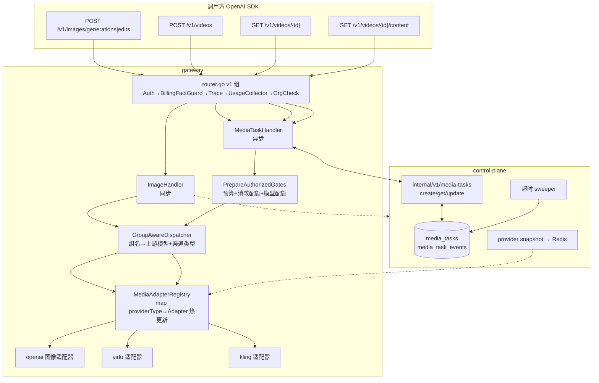
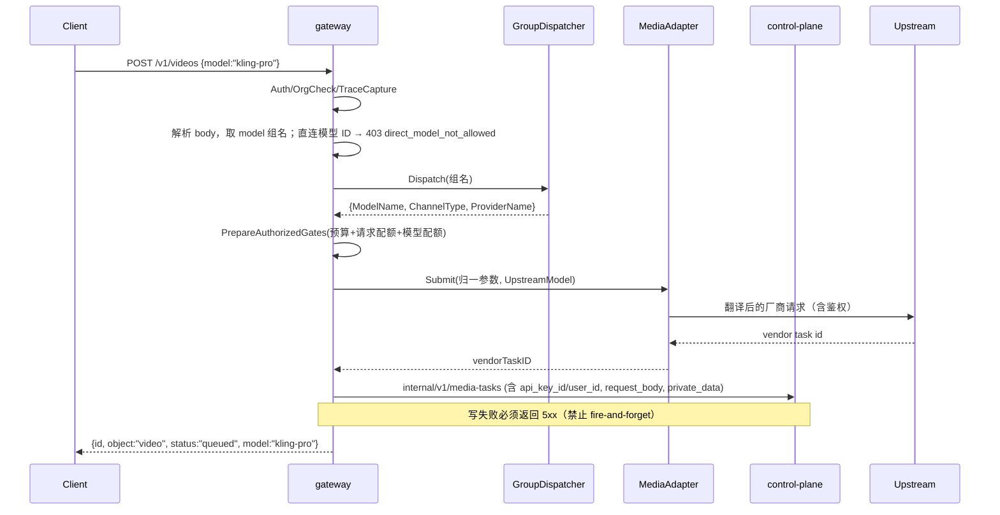
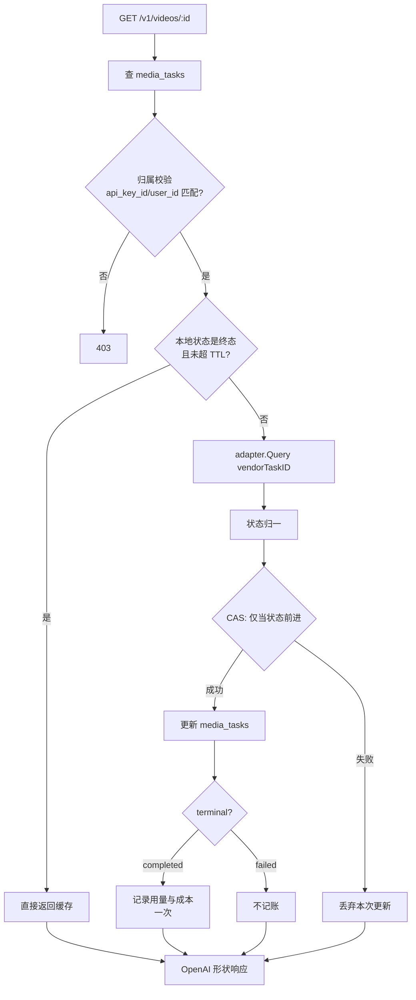

# 三渠道接入设计：gpt-image / Kling 可灵 / Vidu（参考 New API）

> 文档性质：可执行接入方案（设计 + 分阶段计划），非产品宣传。
> 标注约定：**【已核实】**＝撰写时实际打开源码逐行确认；**【推断】**＝未实测的判断；**【待确认】**＝需要外部信息才能定。
> 调研对象与版本：
> - 本网关 llm-gateway：`08ecc9c5`（其上有大量与本方案无关的未提交改动）
> - New API（参考实现）：`github.com/QuantumNous/new-api` @ `7de10f2c`
> - LiteLLM（图像参数参考）：`/private/tmp/llmres/litellm` @ `083d48f6`
> - 关联前置文档：[image-generation-relay-analysis.md](image-generation-relay-analysis.md)（LiteLLM/New API 图像机制调研 + 网关缺口 + 评审）

---

## 0. 决策与假设（先看这里）

用户提出「这三个渠道」。口径为：**gpt-image（图像，同步）、Kling 可灵（视频，异步）、Vidu（视频，异步）**。

四个前置决策本方案已代为拍板，**可推翻**，推翻会牵动对应章节：

| # | 决策 | 取值 | 理由 | 被推翻的代价 |
|---|---|---|---|---|
| D1 | 对外协议 | **新增 OpenAI 形状 `/v1/videos`（create/retrieve/content）；gpt-image 用 `/v1/images/generations|edits`**；Seedance 旧的 `/v1/contents/generations/tasks` **保留不动** | 对齐 OpenAI 生态（客户端 SDK 直接可用），与 New API 一致（`pkg/jsplugin/routing.go:93-96`）；避免把 Kling 的 `mode`/`cfg_scale` 语义硬塞进 Volcengine 的 `content`/`ratio` | 要改 §6.3 路由、§7.1 表设计、对外文档 |
| D2 | 任务持久化 | ⚠️ **已被用户决策取代（2026-10-16）**。原取值：「新建通用 `media_tasks` + `media_task_events`，`video_tasks` 保持原样（视作 legacy）」。**实际拍板 = 扩列 + 改名**：给 `video_tasks`/`video_task_events` 增 delta 列后 **`RENAME` 为 `media_tasks`/`media_task_events`**（不新建表、不删旧表、不复制数据） | 原取值被推翻的依据（逐条核实）：① 生产 `video_tasks` **只有 112 行**（2026-07-10 → 2026-10-15）、`video_task_events` 327 行 → **存量极小，改名成本远低于原估计**；② **无任何视图/物化视图引用** `video_tasks`，外键仅 1 个（`fk_video_task_events_task`）；③ Go 侧改名触点**只有 `TableName()` 一处**（`internal/controlplane/model/video_task.go:29-31`）→ 原估计的「要改 20+ 消费点」不成立；④ 新建表反而要求两套表长期双轨，看板/用例要同时理解两套 | `RENAME` 会留下 **21 个仍叫 `video_*` 的具名对象**（6 个二级索引 / 2 个主键 / 1 个外键 / 12 个 Atlas 自动生成的 NOT NULL 约束），需显式 `RENAME CONSTRAINT`/`RENAME TO` 或接受后续 diff 的 churn —— 见实施计划 §2「C1-补充」 |
| D3 | 计费口径 | **实现 `price_mode=video`（枚举已存在但全仓无实现）+ 新增按张/按秒/按 credit 的定价列**；**无价默认拒绝**（开关可关） | 不实现就永远是「静默 0 元」；见 §8 | 若不做，本方案上线即产生不可见的免费额度 |
| D4 | 结果交付 | **Phase 1-4 透传上游 URL + `302` 跳转；Phase 5 再加网关代理/转存** | New API 的 content 端点也是 `credentialless` 直跳上游（`plugins/tasks/kling/plugin.js:324-326`、`vidu/plugin.js:301-303`），先直跳成本最低 | 若一开始就做转存，需要对象存储 + SSRF 防护 + 带宽评估 |

> **决策落地状态（2026-10-16 更新）**：**D1** 的路由接缝已由 A7–A10 落地（`routes_media.go` 两个空注册函数 + `docs/media-api.md` + `tests/contract/contracts.json` 占位）；**D2** 已按上表取代后的取值执行；**D3** 主体已落地——A1 交付 12 个媒体价列 + 按 catalog `mode` 权威分派 + `EstimateMediaCost`，A2 交付无价拒绝（**402 `media_pricing_missing`**）与 `usage_missing` 打标；仅 `price_mode=manual` 的媒体价列（原 §7.2 的 `billing_unit`/`unit_price_usd`）**尚未落地**（这类模型计费必然 `usage_missing=true`）；**D4** 按 Phase 1（302 直跳）执行。
>
> ⚠️ **已核实的前置事实（影响 Batch 2/3 排期）**：生产库（**只读**核实）**没有任何 Kling / Vidu 渠道**——43 个 provider 的类型分布为 `空 23 / openai-compatible 12 / vertex 4 / bailian 2 / azure 1 / seedance-relay 1`，视频渠道只有 Seedance 一个；`models.model_type` 也**还没有任何 `image` 行**（chat 372 / video 3 / rerank 2 / rerank_vl 1 / embedding_vl 1 / embedding 1）。含义：**Kling/Vidu 适配器无法用真实上游凭据做端到端验证**，只能靠契约测试 + fake/回放；要在真实环境跑通，需先由运维/负责人配置这两家渠道的凭证（Kling 的 AK/SK 可直接复用既有 `api_key` + `access_key` + `secret_key` 的 credential schema，无需改数据结构）。
>
> 📌 **关于「不改造 Seedance 现有链路」与 D2 的关系**：表改名对 Seedance 是**透明的**——同一张表、同一份 `VideoTask` 代码，变的只是物理表名；Seedance 的对外路径 `/v1/contents/generations/tasks` 与 `docs/seedance-api.md` 契约**均不变**。

**不做什么**（明确边界，防范围失控）：

- **不引入 JS 插件引擎**。理由见 §4.3。
- 不改造 Seedance 现有链路（存量客户 + `docs/seedance-api.md` 已对外）。
- 不做图像流式/部分图（`/v1/images/*` 的 `partial_images` 属 Responses API 语义，另案）。
- 不做「运营在线编写适配器」的声明式 DSL（列入 §11 的后续可选项）。

---

## 1. 现状与差距

### 1.1 我们已具备的底座（比预期好）

| 能力 | 位置 | 状态 |
|---|---|---|
| 渠道元数据表（≈ New API 插件 `meta`） | `internal/controlplane/model/provider_definition.go:45-60`：`adapter`/`base_url`/`credential_schema`/`vendor_options`/`default_models`/`builtin` | 【已核实】已 DB 驱动、前端动态加载（`web/src/views/admin/ProviderListPage.vue:21`），有 Seedance 先例（`atlas-migrations/20260710140000_seedance_provider_definitions.sql`） |
| 多字段密钥 schema | `atlas-migrations/20260710200000_seedance_volcengine_auth_type_schema.sql`：`api_key` + `access_key` + `secret_key` + `region` | 【已核实】**正好装 Kling 的 AK/SK，无需改数据结构** |
| AK/SK 签名器 | `internal/providers/seedance/volcengine/signer.go`、`creds.go`（`adapter.go:18`：`api_key→Bearer` / `aksk→HMAC`，不做静默回退） | 【已核实】Kling 的 HS256 JWT 是小增量 |
| 视频模型元数据 | `internal/controlplane/model/model.go:53-57`：`VideoSupportedResolutions`/`AspectRatios`/`Min|MaxDurationSeconds`/`VideoSupportedActions`；DTO 见 `service/model_service.go:129-133` | 【已核实】已存在，Kling/Vidu 可直接复用 |
| 视频计费模式枚举 | `model_service.go:126` 的 `price_mode: catalog|manual|video`，注释「video 走独立计费，非 token 价」 | 【已核实】**枚举存在但全仓只消费 `manual`**（`observability/service/model_tier_lookup.go:79,92,105,118`、`model_info_service.go:315-348`）→ 这是视频计费恒 0 的根因 |
| 异步任务全链路 | `video_handler.go` + `VideoTaskStore` + Redis/PG + `video_task_events` 时间线 | 【已核实】可参考，但**不可直接复用**（见 1.3） |

### 1.2 三家渠道支持度

| 渠道 | New API | LiteLLM | 我们 |
|---|---|---|---|
| gpt-image-1/1.5/2 | ✅ 原生（OpenAI 渠道 images relay） | ✅ 原生 | ❌ |
| Kling 可灵（视频） | ✅ 一等公民：`ChannelTypeKling=50` → `https://api.klingai.com`（`constant/channel.go:50,121`）+ 插件 | ❌ 无专用 provider | ❌ |
| Vidu（视频） | ✅ 一等公民：`ChannelTypeVidu=52` → `https://api.vidu.cn`（`constant/channel.go:52,123`）+ 插件 | ❌ 无专用 provider | ❌ |

### 1.3 现有异步任务链路为什么不能直接复用

| 问题 | 证据 | 影响 |
|---|---|---|
| `VideoProvider` 是**纯直通**（收 raw JSON、不解析、不改写） | `internal/core/video/interfaces.go:9-22` | Kling/Vidu 的请求字段与状态枚举与 Seedance 完全不同 → **必须新增翻译层** |
| 适配器注册表**写死两槽** | `internal/gateway/handler/video_handler.go:82-140`（`relay`/`volcengine` 两个字段，非 map） | 加第三家就编译不过，必须泛化 |
| 任务元数据过窄 | `video_handler.go:60-75` `VideoTaskMeta{Model,UpstreamModel,ProviderType,ProviderName}` | 无用量、无终态时间、无 vendor 字段 |
| **任务创建落库是 fire-and-forget** | `video_handler.go` CreateTask 里 `go func(){ taskStore.Record(context.Background(), rec) }()` | 写失败则该任务永远查不到；GetTask 会 fallback 到默认 `seedance-relay` → **打到错误的适配器** |
| **GetTask 无归属校验** | `video_handler.go:514-560`：只按 URL 的 `task_id` 查存储并请求上游，不比对调用方与任务 `api_key_id`/`user_id` | IDOR（知道 task_id 即可读他人任务） |
| **无准入/计费/配额** | CreateTask 全程无 `PrepareAuthorizedGates`、无 `Reserve` | 视频/图像调用不计费、不受配额 |
| **无幂等** | CreateTask 无幂等键 | 客户端重试 = 重复出图 + 重复计费 |
| 响应不是 OpenAI 形状 | `c.JSON(200, gin.H{"id": taskID})` | 客户端 SDK 不兼容 |

---

## 2. 总体架构



**分层职责**：

- **gateway**：鉴权、组调度、准入（预算/配额）、请求翻译、状态归一、**不直连 PG**（任务读写走控制面内部 API，沿用 `internal/gateway/infra/video_task_client.go` 的范式）。
- **control-plane**：任务权威存储、归属数据、超时 sweeper、定价与能力下发（snapshot）。
- **适配器**：每渠道一个 Go 实现，负责「请求翻译 + 鉴权 + 提交 + 查询 + 状态/产物归一」。

### 2.1 对外协议

```
POST /v1/videos                       # OpenAI 视频创建
  body: {model: "<模型组名>", prompt, ... , image?, duration?, resolution?, mode?}
  resp: {id, object:"video", status:"queued", model:"<组名>", created_at, progress}

GET  /v1/videos/{id}                  # 查询
  resp: {id, object:"video", status:"queued|in_progress|completed|failed",
         progress?, error?, artifacts?}

GET  /v1/videos/{id}/content          # 产物（Phase 5 做代理，之前 302 直跳上游）

POST /v1/images/generations           # gpt-image 同步
POST /v1/images/edits                 # multipart/form-data
```

状态词表**统一为 OpenAI 语义**（`queued|in_progress|completed|failed`），与 New API 的 render 输出一致（`plugins/tasks/kling/plugin.js:465`、`vidu/plugin.js:377-382`）【已核实】。

---

## 3. 三家上游契约（实现依据）

### 3.1 Kling 可灵

| 项 | 值 | 证据 |
|---|---|---|
| Base URL | `https://api.klingai.com` | `constant/channel.go:121` |
| 提交（文生视频） | `POST /v1/videos/text2video` | `kling/plugin.js:33,116-117` |
| 提交（图生视频） | `POST /v1/videos/image2video` | `kling/plugin.js:34,116-117` |
| 查询 | `GET /v1/videos/{text2video\|image2video}/{task_id}` | `kling/plugin.js:35-36,284` |
| 鉴权 | **HS256 JWT**，header 为 `Authorization: Bearer <token>`；payload：`iss`=accessKey、`exp`=now+1800、`nbf`=now-5，**签名密钥=secretKey** | `kling/plugin.js:110-114,260,286` |
| 凭证格式 | 插件里凭证是 `accessKey\|secretKey`（按 `\|` 切两段）；**我们的 `credential_schema` 是 `access_key`/`secret_key` 两列，直接各自取值即可，无需拼接** | `kling/plugin.js:98-106`；`atlas-migrations/20260710200000_*.sql` |
| 其他必需 header | `Accept: application/json`、提交加 `Content-Type: application/json`、`User-Agent: kling-sdk/1.0` | `kling/plugin.js:260,286` |
| 模型 | `kling-v1`、`kling-v1-6`、`kling-v2-master` | `kling/plugin.js:13` |
| 提交响应 | `code !== 0` → 报错，错误串 `message`；task id 在 `data.task_id` | `kling/plugin.js:268-270` |
| **查询状态枚举（上游真实值）** | `data.task_status ∈ {submitted, processing, succeed, failed}` → 归一 `submitted`/`processing`/`succeed`/`failed`；未知值一律 `UNKNOWN`（不得当成功） | `kling/plugin.js:292-294` |
| 状态枚举的易错点 | `kling/plugin.js:225` 那张 `NOT_START/SUBMITTED/QUEUED/IN_PROGRESS/SUCCESS/FAILURE` 表是**插件反向渲染**（内部态→对外 Kling 形状），**不是上游返回值**；实现时别照抄错方向 | `kling/plugin.js:219-226` |
| 失败原因 | `data.task_status_msg` | `kling/plugin.js:226,296` |
| 产物 URL | `data.task_result.videos[0].url`（`videos` 是数组，多产物时需全取而非只取首个） | `kling/plugin.js:295-297,313-315` |
| 请求体要点 | `model` 与 `model_name` **同值且必填**；`mode` 缺省 `std`，**`kling-v2-master` 给 std 直接报错**；`duration` 是**字符串**（缺省 `"5"`，校验 1–3600）；`aspect_ratio` 由 `size` 映射（1024x1024/512x512→1:1、1280x720/1920x1080→16:9、720x1280/1080x1920→9:16、其他→1:1）；`cfg_scale` 固定 `0.5`；`metadata` 对象会平铺进 body 并可覆盖同名字段 | `kling/plugin.js:124-127,133-143,159-163,236,238-256` |
| 计费（每秒 units） | `kling-v1` std 0.2 / pro 0.7；`kling-v1-6` std 0.4 / pro 0.7；`kling-v2-master` pro 2.0 | `kling/plugin.js:43-45` |
| **计费（实际用量）** | 终态优先取 **`data.final_unit_deduction`**（上游实际扣减），估算仅作准入；示例：v1 std 5s=1、v1 pro 5s=3.5、v1-6 std 5s=2、v1-6 pro 10s=7、v2-master pro 5s=10 | `kling/plugin.js:24-30,152-154,298-302,329-341` |
| 产物获取 | `credentialless: true` 直跳上游 URL | `kling/plugin.js:324-326` |

### 3.2 Vidu

| 项 | 值 | 证据 |
|---|---|---|
| Base URL | `https://api.vidu.cn` | `constant/channel.go:123` |
| 提交 | `POST {base}/ent/v2` + `/text2video`、`/img2video`、`/start-end2video`、`/reference2video`（按 action 选路） | `vidu/plugin.js:215-220,245` |
| 查询 | `GET {base}/ent/v2/tasks/{task_id}/creations` | `vidu/plugin.js:266-268` |
| 鉴权 | `Authorization: Token <apiKey>` | `vidu/plugin.js:247,270` |
| 模型 | `viduq2`、`viduq1`、`vidu2.0`、`vidu1.5` | `vidu/plugin.js:12-13` |
| 能力 | 文生、图生、**首尾帧**、**参考生视频** | `vidu/plugin.js:5-8` |
| 提交响应 | `body.task_id`；`body.state === "failed"` → 报错 | `vidu/plugin.js:254-256` |
| 查询状态枚举 | 上游：`created`/`queueing`/`processing`/`success`/`failed` → 归一 `SUBMITTED`/`IN_PROGRESS`/`SUCCESS`/`FAILURE` | `vidu/plugin.js:275` |
| 失败原因 | `body.err_code` | `vidu/plugin.js:279` |
| 产物 URL | `body.creations[0].url` | `vidu/plugin.js:278,291-292` |
| 请求体要点 | `images` 数组决定 action：**0 张→text2video、1 张→image2video、2 张→首尾帧、>2→参考图**（`vidu2.0` 无图直接报错）；`duration` 按模型收紧（vidu2.0∈{4,8}、viduq1 仅 5、viduq2∈1–10）；`resolution ∈ {360p,540p,720p,1080p}`（viduq1 强制 1080p）；组合约束：vidu2.0 时长 8 只允许 720p；`movement_amplitude` 固定 `auto` | `vidu/plugin.js:52,62-65,92-142,209-212,228-243` |
| multipart 约定 | 文件字段仅 `input_reference`（最多 1 个，`dataUrl` 编码，上限 15728640 字节）；`metadata` 必须是 JSON 对象字符串 | `vidu/plugin.js:411-425,433-434` |
| **计费** | usageSchema 声明 `credits`(credit) + `duration`(second) + `resolution`，但 **`extractUsage` 只回 `{duration, resolution}`，不估算 credits**；usageExamples 的 credits 全为 0，实际 credits 由上游返回 | `vidu/plugin.js:15-48,259-264,306-311` |
| 计费口径影响 | **上游若不返回 credits，我们只能按「duration × resolution 档位单价」计价** → 定价列必须支持 resolution 维度（见 §7.2/§8.1） | 本方案推论 |
| 产物获取 | `credentialless: true` 直跳上游 URL | `vidu/plugin.js:301-303` |

> **【待确认】** Vidu `<action>` 的取值集合（`pathFor(action)`，`vidu/plugin.js:245`）需与 New API 的 `constant.TaskAction*` 对齐后逐字确认。

### 3.3 gpt-image（OpenAI Images）

| 项 | 值 | 证据 |
|---|---|---|
| 生成端点 | `POST /v1/images/generations`（+ 别名 `/images/generations`、Azure 风格） | LiteLLM `litellm/proxy/image_endpoints/endpoints.py:70-83` |
| 编辑端点 | `POST /v1/images/edits`（multipart：`image`/`image[]` + `mask`，mask 固定 filename `mask.png`） | LiteLLM `image_endpoints/endpoints.py:229-252`、`llms/openai/image_edit/transformation.py:125,136-138` |
| gpt-image 支持参数 | `background`/`moderation`/`n`/`output_compression`/`output_format`/`quality`/`size`/`user` | LiteLLM `llms/openai/image_generation/gpt_transformation.py:23-33` |
| edits 额外支持 | `image`（多图为**重复字段 `image[]`**）、`mask`（字段名 `mask`，默认文件名 `mask.png`；图片默认 `image.png`）、`input_fidelity`、`response_format` | LiteLLM `llms/openai/image_edit/transformation.py:35-55,75-78,125,135-138` |
| **不支持** | **generations 不支持 `response_format`**（edits 支持）、`style`（仅 dall-e-3）、`seed`；不支持时抛错（非 drop_params） | `gpt_transformation.py:23-33,43-52` vs `dall_e_3_transformation.py:23-24`、`image_edit/transformation.py:48` |
| 模型→配置选择 | 前缀 `dall-e-2`→DallE2、`dall-e-3`→DallE3、其余（含 gpt-image-1）→GPTImageGenerationConfig | `image_generation/__init__.py:22-28` |
| 默认值 | `size=1024x1024`、`quality=high`、`output_format=png` | `gpt_transformation.py:86-95` |
| 响应 | `data[].b64_json`（gpt-image 只回 b64）/`url`/`revised_prompt`/`provider_specific_fields` | LiteLLM `types/utils.py:2599-2628`；New API `relaykit/dto/openai_image.go:189-198` |
| **计费的 usage 字段** | `usage = ImageUsage{input_tokens, input_tokens_details{image_tokens, text_tokens}, output_tokens, total_tokens}`；`input_tokens_details` 会归一为 `prompt_tokens_details`，缺字段补 0 | LiteLLM `types/utils.py:2656-2675,2692`、`llm_response_utils/convert_dict_to_response.py:450-476` |
| 流式/部分图 | 生成**不支持** stream；`partial_images` 仅 Responses API 的 image_generation 工具 | LiteLLM `types/llms/openai.py:1622,1916-1919` |

---

## 4. 参考 New API：抄什么、不抄什么

### 4.1 抄（机制层）

| New API 机制 | 证据 | 我们的落点 |
|---|---|---|
| 路由协议表（异步三件套 + 产物钩子） | `pkg/jsplugin/routing.go:93-96` | `/v1/videos` create/retrieve/content（§6.3） |
| 渠道→适配器映射表 | `relay/relay_adaptor.go:141-155` | `MediaAdapterRegistry`（map，§6.2） |
| 任务表字段设计 | `model/task.go:50-72`（`Platform`/`Action`/`Status`/`Quota`/`Progress`/`Submit|Start|FinishTime`/`Data`/**`PrivateData`**） | `media_tasks`（§7.1），特别抄 **`PrivateData` 不返回给用户** 的隔离 |
| **CAS 状态推进** | `service/task_polling.go:69,101` `UpdateWithStatus(oldStatus)` | 终态/中间态推进都用 CAS，避免轮询与用户查询互相覆盖 |
| 轮询失败分类 | `service/task_polling.go:292-330`（not_found/auth/transient/hook_error/unrecognized） | 决定重试 vs 放弃，避免把上游抖动当业务失败 |
| 超时与失败上限可配 | `common/init.go:209,211`：`TASK_TIMEOUT_MINUTES=1440`、`TASK_POLL_MAX_FAILURES=20` | 网关/控制面加同义配置 |
| 用量表达式（credit/units） | `kling/plugin.js:19-27`、`vidu/plugin.js:19-30` | 定价列设计（§7.2、§8） |
| 归一后的 OpenAI 状态词表 | `kling/plugin.js:465`、`vidu/plugin.js:377-382` | 对外状态词表（§2.1） |
| 产物直跳（credentialless） | `kling/plugin.js:324-326` | Phase 1-4 的 content 实现（§10） |

### 4.2 参考其「不该有」的地方（我们做得更好）

| New API 的问题 | 证据 | 我们的设计 |
|---|---|---|
| 预扣 + 退款模型 | `service/task_polling.go:112,637` `RefundTaskQuota` | 我们是**事后记账**，无预扣则**无需退款**；改为「终态才记账、失败不记账」 |
| 按请求 `n` 计价（上游少出图时多收） | LiteLLM 亦然：`llm_cost_calc/utils.py:1988` | 按**实际产物数 `len(artifacts)`** 记账 |

### 4.3 不抄：JS 插件运行时

| 事实 | 证据 | 结论 |
|---|---|---|
| 引擎是维护者个人的 alpha fork | `go.mod:169`：`github.com/Calcium-Ion/moejs v0.1.0-alpha.6` | 供应链风险 |
| 单次调用 5s 超时 + watchdog | `pkg/jsplugin/engine.go:25,165,226,282` | 多一层运行时调试成本 |
| host 必须把密码学原语暴露给 JS | `pkg/jsplugin/utils.go:247,307`（SigV4）；`kling/plugin.js:108-113`（HS256 JWT） | **鉴权无法声明式表达**，JS 只省了「写 Go 适配器」的一半工作 |
| 插件可发起网络请求 | `pkg/jsplugin/fetch.go` 存在 | 沙箱/SSRF 审计面 |

> **结论**：New API 的「声明式」只在简单鉴权厂商（Vidu 静态 Token）成立。我们 Go 侧已有签名器（§1.1），**原生适配器成本更低、可控性更高**。

---

## 5. 渠道逐个设计

### 5.1 gpt-image（同步，先做）

- 新增可选接口 `core.ImageProvider`（**不扩 `core.Provider`**，遵循仓库既有可选接口约定：`NativeBatchProvider`/`NativeFileProvider`/`PassthroughProvider`）。
- 在 `openai.CompatibleProvider` 上实现；匿名内嵌者自动获得：`openai`/`azure`/`openrouter`；命名字段者需 3 行显式委派：`bailian`/`cohere`/`litellm`/`minimax`/`zai`/`vllm`/`oracle`；`groq`/`deepseek`/`xai` 无 `CompatibleProvider`，本期返回 501。【已核实，见前置文档 §4.5】
- 三条铁律：① **model 必须由组名改写为上游模型 ID**；② multipart edits 必须**重建 multipart**并改写 model 字段（boundary 会变）；③ 响应**原样回写**，不得重新序列化（b64_json 可达数十 MB）。
- 请求翻译：不做多厂商参数智能转换，按 §3.3 的 gpt-image 白名单**剔除/拒绝**不支持参数（`response_format`/`style` 等按 §8.4 策略处理）。
- 计费：优先按 image token（`usage`），退化到按张（`len(data)`）。

### 5.2 Vidu（异步，先做——最简单）

- 鉴权是静态 Token → 适配器最简单，作为**任务平台的第一个验证渠道**。
- 适配器职责：`action → path`、请求体字段翻译（首尾帧/参考图）、状态枚举归一（5→4）、产物抽取（`creations[0].url`）、失败原因取 `err_code`。
- 计费：credits + duration，按 §8 计价。

### 5.3 Kling（异步，后做）

- 鉴权需要 **HS256 JWT**（AK/SK）：新增 `internal/providers/kling/signer.go`（可对照 `seedance/volcengine/signer.go` 与 `plugin.js:108-113` 的 payload 规格：`iss=AK`、`exp=now+1800`、`nbf=now-5`）。
- 参数校验要**前置在网关**，给明确 400 而不是把上游报错透传：`kling-v2-master` 拒 std、`mode ∈ {std,pro}`、duration 区间（新模型 3–15s / 旧模型 5|10）。
- 提交必须**区分 text2video / image2video**（不同端点），查询也要带同一 type 段 → 任务表需存 `action`（§7.1）。
- 计费：**终态优先取上游 `data.final_unit_deduction`**（实际扣减），估算 units/秒 × (model×mode) 只用于准入，见 §3.1 表。
- 凭证：`credential_schema` 的 `access_key`/`secret_key` 各自取值即可（插件里的 `AK|SK` 拼接是它自己的约定，我们不需要）。

---

## 6. 网关侧设计

### 6.1 core 类型（提案）

```go
// internal/core/media.go
type MediaKind string // "image" | "video"

type MediaStatus string // queued | in_progress | completed | failed

type MediaArtifact struct {
    Kind     string // "video" | "image"
    URL      string
    MimeType string
    ExpiresAt *time.Time
}

// MediaTaskProvider 异步媒体任务能力（可选接口，不扩 core.Provider）
type MediaTaskProvider interface {
    // Submit 翻译并提交上游任务，返回上游任务 ID
    Submit(ctx context.Context, req *MediaSubmitRequest) (*MediaSubmitResult, error)
    // Query 查询并归一状态；不得在 failed 时返回 error（业务失败 ≠ 传输失败）
    Query(ctx context.Context, vendorTaskID string) (*MediaTaskStatus, error)
}

type MediaSubmitRequest struct {
    Kind          MediaKind
    Action        string // text_to_video | image_to_video | first_tail_to_video | reference_to_video
    UpstreamModel string
    Params        map[string]any // 已经过校验的归一参数
}

type MediaTaskStatus struct {
    Status    MediaStatus
    Progress  string // "0-100" 或阶段名，可空
    Artifacts []MediaArtifact
    FailReason string
    Usage     map[string]any // vendor 原始用量（credits/units/duration）
}

// 同步图像能力（gpt-image）
type ImageProvider interface {
    GenerateImage(ctx context.Context, req *ImageGenerationRequest) (*ImageGenerationResponse, error)
    EditImage(ctx context.Context, req *ImageEditRequest) (*ImageGenerationResponse, error) // multipart
}
```

**关键语义约定**：

- 传输错误（网络/鉴权/5xx）返回 `error`；**业务失败（上游 state=failed）返回 `Status=failed` + `FailReason`，不返回 error**，否则会被重试放大成重复计费。
- 请求翻译在适配器内完成（与 `core/video.VideoProvider` 的"纯直通"不同，这是本方案的核心增量）。

### 6.2 适配器注册表泛化

```go
// 替换 internal/gateway/handler/video_handler.go:82-140 的双槽结构
type MediaAdapterRegistry struct {
    mu       sync.RWMutex
    adapters map[string]core.MediaTaskProvider // key: providerType
    names    map[string]string                 // key: providerType → 展示名
}

func (r *MediaAdapterRegistry) Get(providerType string) core.MediaTaskProvider
func (r *MediaAdapterRegistry) Swap(next map[string]core.MediaTaskProvider, names map[string]string)
```

热更新沿用现有链路：`config:change` → `onSeedanceReloadReady` 回调（`internal/gateway/server/router.go` 的 `reloadSeedance`）→ 扩展为按 snapshot entries 重建整张 map。

### 6.3 路由与处理流程

新增路由（`internal/gateway/server/router.go` 的 v1 组内）：

| 路径 | 方法 | 说明 |
|---|---|---|
| `/v1/videos` | POST | 创建任务 |
| `/v1/videos/:task_id` | GET | 查询任务 |
| `/v1/videos/:task_id/content` | GET | 产物（302 直跳，Phase 5 改代理） |
| `/v1/images/generations` | POST | 同步图像 |
| `/v1/images/edits` | POST | multipart 同步编辑 |

**创建流程（时序）**



**查询流程（含 CAS 与记账）**



**幂等**：`POST /v1/videos` 支持 `Idempotency-Key` 头（或 body 内 `client_request_id`），在 `media_tasks` 建唯一索引；命中则**直接返回既有任务**，不打上游、不重复计费。

### 6.4 状态机

```
queued ──▶ in_progress ──▶ completed
   │            │
   └────────────┴────────▶ failed
                          expired（超时 sweeper 置位，视同 failed 但不记账）
```

推进规则：**只允许前进**（`queued < in_progress < terminal`），由 CAS 保证；终态不可回退。

### 6.5 出站 HTTP 策略（重要）

| 策略 | 值 | 理由 |
|---|---|---|
| 超时 | 提交/查询各 60s | 单次请求都是短请求（真正的长耗时在上游队列），**不要**用同步长等待 |
| 重试 | **POST 提交不重试**；GET 查询可重试（退避 3 次） | 提交重试 = 重复出图 + 重复计费 |
| 熔断 | 复用 `internal/llmclient` 的熔断 | 与仓库一致 |

> 注意：`internal/httpclient/client.go:73-88` 默认 300s，`internal/gateway/quota/redis_store.go:28` 的 `concurrencyLease=360s`；视频**不需要**抬升这两个值（因为我们不做同步等待），这一点与前置文档 §6.2 对同步图像的讨论不同，**不要混淆**。

---

## 7. 控制面与数据模型

> **迁移流程铁律**（见 `atlas-db-migration` skill）：GORM model 是唯一真相源；**禁止手写 SQL、禁止手改 `atlas.sum`**；流程为 `make atlas-diff name=...` → 人工审查 → `atlas migrate hash --env local` → `atlas migrate validate --env local`；提交三件套 `model + 迁移.sql + atlas.sum`；一次一个逻辑变更；破坏性变更走 Expand-Contract。前置：先 `git fetch origin && git rebase origin/test` 同步迁移目录。

### 7.1 新表 `media_tasks` / `media_task_events`

新增 GORM model（仿 `model/task.go:50-72` 的设计，并补上我们的归属与额度字段），**必须同时注册到 `tools/atlas-loader/main.go`**（现有 `VideoTask`/`VideoTaskEvent` 在 `:56-57`）。

```go
// internal/controlplane/model/media_task.go（提案）
type MediaTask struct {
    TaskID        string    `gorm:"type:varchar(128);primaryKey"` // 网关对外 id
    VendorTaskID  string    `gorm:"type:varchar(191);index"`      // 上游 id
    Kind          string    `gorm:"type:varchar(16);index"`       // image|video
    Platform      string    `gorm:"type:varchar(30);index"`       // provider type，如 kling/vidu
    Action        string    `gorm:"type:varchar(40);index"`       // text_to_video|image_to_video|...
    Status        string    `gorm:"type:varchar(20);index"`       // queued|in_progress|completed|failed|expired
    Progress      string    `gorm:"type:varchar(20)"`
    FailReason    string    `gorm:"type:text"`
    // 归属（GetTask 必须校验）
    APIKeyID      string    `gorm:"type:varchar(64);index"`
    APIKeyName    string    `gorm:"type:varchar(128)"`
    APIKeyType    string    `gorm:"type:varchar(16)"`
    UserID        string    `gorm:"type:text;index"`
    UserName      string    `gorm:"type:varchar(128)"`
    DeptID        string    `gorm:"type:varchar(64);index"`
    StudioID      string    `gorm:"type:varchar(64);index"`
    // 路由与计费
    Model         string    `gorm:"type:text"`   // 对外模型组名
    UpstreamModel string    `gorm:"type:text"`
    ProviderName  string    `gorm:"type:varchar(64)"`
    ProviderType  string    `gorm:"type:varchar(64)"`
    ProviderID    *uuid.UUID `gorm:"type:uuid;index"`
    PriceMode     string    `gorm:"type:varchar(16)"` // 记账时的计价口径快照
    UnitPriceUSD  float64   `gorm:"type:decimal(18,8)"`
    CostMicroUSD  int64     `gorm:"not null;default:0"`
    Usage         string    `gorm:"type:jsonb;not null;default:'{}'"` // 实际用量（credits/units/duration/images）
    BilledAt      *time.Time
    // 生命周期
    SubmittedAt   *time.Time
    StartedAt     *time.Time
    FinishedAt    *time.Time
    PollFailures  int       `gorm:"not null;default:0"`
    IdempotencyKey *string  `gorm:"type:varchar(191);uniqueIndex"` // 幂等
    RequestBody   string    `gorm:"type:text"`
    ResponseBody  string    `gorm:"type:text"`
    Data          string    `gorm:"type:jsonb;not null;default:'{}'"`   // 返回给用户
    PrivateData   string    `gorm:"type:jsonb;not null;default:'{}'"`   // 禁止返回（渠道/凭证引用）
    CreatedAt     time.Time
    UpdatedAt     time.Time
}
```

`media_task_events`：`id` / `task_id`(FK, CASCADE) / `event_type` / `event_data` / `created_at`，索引同 `video_task_events`（`atlas-migrations/20260710160000_*.sql`）。

**与 `video_tasks` 的关系**：并存。控制面 ops 看板需要把两个来源**合并展示**（视频统计口径会分成两段，需在前端明确标注 legacy/新）。

### 7.2 `models` 表计价扩展

现状（`internal/controlplane/model/model.go:41-57`）：`PriceMode`（`catalog|manual`，DTO 还允许 `video` 但无实现）、`InputPrice`/`OutputPrice`（仅 `manual` 生效，token 价）、`VideoSupported*`。

提案新增（一次只加一个逻辑变更 → 拆成 1–2 个迁移）：

| 列 | 类型 | 语义 |
|---|---|---|
| `billing_unit` | `varchar(20)` | `token`（默认）/`image`/`image_token`/`second`/`credit` |
| `unit_price_usd` | `decimal(18,8)` | 单一单价（按 `billing_unit`） |
| `billing_rules` | `jsonb` | 复合规则，如 `{"mode":{"std":0.2,"pro":0.7}}`（Kling 的 model×mode 每秒 units） |

同时**实现 `price_mode=video`** 的消费路径（§8）。

### 7.3 `provider_definitions` 种子

两个迁移（DML，手写后必须 `atlas migrate hash`）：

- `kling`：`adapter=kling`、`base_url=https://api.klingai.com`、`credential_schema={access_key,secret_key}`、`default_models=[kling-v1,kling-v1-6,kling-v2-master]`、`vendor_options={url_pattern: video_task, auth_header: jwt_hs256}`
- `vidu`：`adapter=vidu`、`base_url=https://api.vidu.cn`、`credential_schema={api_key}`、`default_models=[viduq2,viduq1,vidu2.0,vidu1.5]`

gpt-image 复用既有 OpenAI provider，只需要新增 `model_type=image` 的模型行 —— **但 `model_type` 白名单目前不含 `image`**（六处 binding：`service/model_service.go:117,265,483`、`group_service.go:141,154`、`provider_quick_onboard_service.go:39`，另加 `model_groups` 的 CHECK 约束 `atlas-migrations/20260710180000_*.sql:15`），**必须先把 `image` 加进枚举与约束**。

另需补两处绕过 `provider_definitions` 的硬编码 switch：`internal/controlplane/handler/test_handler.go:206-208`（连通性探针）、`handler/model_check_handler.go:165-180`（模型检测分发）。

### 7.4 内部 API（控制面）

沿用 `internal/gateway/infra/video_task_client.go` 的范式，新增 `/internal/v1/media-tasks`：

| 方法 | 路径 | 用途 |
|---|---|---|
| POST | `/internal/v1/media-tasks` | 创建（**同步返回错误**，网关必须感知失败） |
| GET | `/internal/v1/media-tasks/:id` | 查询（含归属字段） |
| PATCH | `/internal/v1/media-tasks/:id` | CAS 更新状态/进度/用量 |
| GET | `/internal/v1/media-tasks?sweep=1` | sweeper 用：拉取超时非终态任务 |

---

## 8. 计费方案

### 8.1 口径

| 渠道 | 主口径 | 退化口径 |
|---|---|---|
| gpt-image | image token（`usage.output_tokens` 等，§3.3） | 按张 `len(data)` × `unit_price_usd` |
| Vidu | duration × resolution 档位单价（**上游一般不回 credits**，§3.2） | 请求 duration × resolution |
| Kling | **优先 `data.final_unit_deduction`**（上游实际扣减）；估算 `f(model,mode) × duration` 仅用于准入 | 请求 duration × 每秒 units |

**统一原则**：按**实际产物数/实际时长**记账，不按请求参数；终态才记账，失败/超时不记账。

### 8.2 必须补的链路（否则静默 0 元）

1. **控制面**：`catalog_parser` 现在只解析 4 个 token 价字段（`service/catalog_parser.go:104-118`），图像价（`output_cost_per_image`/`input_cost_per_pixel` 等）只落在 `RawPayload` → 需要新增解析；`pricing/resolver.go:176-180` 对图像/视频直接返回空 → 需要新增分支。
2. **快照**：`provider_snapshot_service.go:112-155` 需携带 `billing_unit`/`unit_price_usd`/`billing_rules`；`core.ModelPricing` 增加字段（`PerImage`/`InputPerImage` 已有但无消费）。
3. **网关成本估算**：`observability/cost.go:101-102` 与 `collector.go:644-690` 只有 rerank/token 分支 → 增加 image/video 分支。
4. **准入**：`usage_collector.go:81` 原判据是 `event.EstCostUSD > 0` 才调预算记账钩子。⚠️ **2026-10-16 决策变更（原写「保持」）**：实测证明该门槛会**静默吞掉记账钩子**——`collector.Emit` 本身是无条件执行的（埋点/call_logs 从未被丢），被吞的只有预算钩子，于是「无价 / 缺用量」的请求对预算层完全不可见，正是本文档要消灭的「静默 0 元」的**残余来源**。若只加「无价拒绝」而不动门槛，则 `MEDIA_REQUIRE_PRICING=false` 的应急放行路径仍会静默漏账。故 A2 已把判据改为**「是否有计价事实」**（`hasBillableSignal` = 金额>0 ∨ 无价标记 ∨ `UsageMissing` ∨ 有真实用量），并配套：① 强制 `event.UsageMissing=true`；② 新增指标 `gateway_billable_cost_missing_total{reason,endpoint}`（reason ∈ media_pricing_missing/usage_missing/cost_zero）；③ 无价拒绝用 **402 `media_pricing_missing`**（不是 503——503 在本仓语义是「稍后重试」，而「模型没价」重试永远不会成功）；④ 闸门入口 `middleware.EnsureMediaPricing(c, routedModel, providerType)` 放在**组调度之后、调上游之前**（中间件阶段拿不到「组名→上游模型」：模型在 body 里、图像编辑还是 multipart，「查任务」类端点不得调用）。**不会污染账目**：生产钩子入口即 `realCostUSD <= 0` 短路（`router.go:513-515`），token 链路逐字段行为不变（有测试锁定）。

> **§8.2 落地状态（2026-10-16）**：第 1、2、3 条已由 A1 交付（`catalog_parser` 解析 12 个媒体价列 → `catalog_sync` 落库 → `provider_snapshot` 透传 `Catalog.Mode` → `pricing.ApplyCatalogMediaPricing` 按 catalog `mode` 权威分派；`EstimateMediaCost` + 采集器媒体分支）。第 4 条按上述新决策实现。原第 2 条提到的 `billing_unit`/`unit_price_usd`（`price_mode=manual` 的媒体价）**尚未落地**——这类模型计费时必然 `usage_missing=true`，是已知缺口。

### 8.3 无价策略（D3）

| 场景 | 行为 |
|---|---|
| 有价 | 正常记账 |
| 无价 + 开关开（默认） | **拒绝**：`402 payment_required` / `503 pricing_unavailable`，并计数告警 |
| 无价 + 开关关 | 放行但置 `usage_missing=true` 并**强告警**（不允许静默） |

### 8.4 不支持的参数策略

参照前置文档 §6.2：**默认严格**（明确 400/422），提供开关决定是否静默丢弃（对齐 LiteLLM 的 `drop_params`）。图像上尤其要注意：客户端对 gpt-image 传 `response_format` 在 LiteLLM 会 500，我们应给 400 并说明「gpt-image 只返回 b64_json，请用 `output_format`」。

---

## 9. 观测与治理

| 项 | 设计 | 落点 |
|---|---|---|
| `call_type` | `video.submit`/`video.get`/`video.content`/`image.generations`/`image.edits` | `observability/call_type.go:53-105`（现在无 images/videos 分支） |
| 计费事实守卫 | 把新路径加入 `isBillableRequest` | `server/router.go:420-430` |
| 账本 | `media_tasks`（成本、用量、状态、时长）+ `call_logs` | 新增 + 现有 |
| 看板 | 任务状态分布、成功率、P50/P99 时长、成本、`usage_missing` 计数 | 复用 ops 看板范式；注意合并 `video_tasks`（legacy） |
| 探活 | **不真出图/出视频**（每次探活都是真实费用）；改为连通性 + 鉴权校验（沿用 `test_handler.go` 的 `connectivity+auth only` 范式） | `handler/test_handler.go` |
| 告警 | 失败率突增、超时堆积、无价拒绝计数、成本异常 | 现有告警体系 |
| 文档 | `docs/media-api.md`（对齐 `docs/seedance-api.md` 范式：模型组、错误码、示例） | 新增 |

---

## 10. 分阶段实施计划

| Phase | 内容 | 交付物 | 工作量 | 风险 |
|---|---|---|---|---|
| **P0 前置修复**（必做） | ① 计价静默 0 元的机制修复（§8.2 + 无价拒绝开关）② `call_type`/`isBillableRequest` 加新路径 ③ 出站策略封板（提交不重试）④ `model_type` 加 `image` 枚举 + CHECK | 小 PR，可独立上线 | 2–3 人日 | 低。但**不做这步，后面全线免费** |
| **P1 gpt-image 同步** | `core.ImageProvider` + OpenAI 适配器 + `/v1/images/generations|edits`（JSON + multipart 重建）+ 图像价解析 + 401/400 语义 | 客户端可出图、可计费 | 5–7 人日 | 中：multipart 重建、大 b64 响应、`RequestBodyLogger` 在 DEBUG 下破坏 multipart（`middleware/middleware.go:136-138` 需跳过） |
| **P2 任务平台 + Vidu** | `media_tasks`/`media_task_events` + 内部 API + `MediaAdapterRegistry` 泛化 + 归属校验 + CAS + 幂等 + 超时 sweeper + Vidu 适配器 + `/v1/videos` 三件套 | 视频异步闭环（最简单的渠道先跑通） | 8–10 人日 | 高：这是最大的一块，CAS/归属/幂等/超时都要一次做对 |
| **P3 Kling** | JWT 签名器 + text2video/image2video + 参数前置校验 + units 计价（model×mode×秒） | 第二家视频渠道 | 4–5 人日 | 中：鉴权规格须与官方核对（`exp=1800`） |
| **P4 产物与转存** | `/v1/videos/:id/content`：先 302 直跳；再做可选代理/转存（复用 `internal/archive` 的 `ArchiveStore`/`LocalStore`）+ SSRF 白名单 + 下载鉴权 | 产物可稳定获取 | 3–5 人日 | 中：上游 URL 过期策略、带宽/存储成本 |
| **P5 治理收口** | 看板/告警/探活/前端（渠道与模型配置页复用 `VideoSupported*` 字段）/`docs/media-api.md`/契约测试（`tests/contract/contracts.json`） | 可运营、可审计 | 3–4 人日 | 低 |
| | | **合计** | **25–34 人日** | |

**顺序理由**：P1 先用最简单渠道验证「计价兜底 + 同步链路」；P2 才引入任务平台（最大风险集中处）；P3 复用 P2 的平台，成本最低；P4/P5 收尾。

**可并行的边界**：P1（图像）与 P2（任务平台）代码路径几乎不重叠，可两人并行；P3 依赖 P2 的接口，不可并行。

---

## 11. 测试策略

| 层 | 内容 | 位置 |
|---|---|---|
| 适配器单测 | 请求翻译（快照比对：真实请求体）+ 状态枚举归一（全枚举表驱动）+ 产物抽取 + 失败语义（业务失败不返回 error） | `tests/providers/kling/`、`tests/providers/vidu/` |
| 任务状态机 | CAS 只前进、终态不可回退、超时置 expired、幂等命中 | `tests/gateway/handler/` |
| 归属安全 | 跨 Key 读他人任务必须 403；admin 例外 | 同上（**回归测试**现有 video 的 IDOR） |
| 计费 | 有价记账、无价拒绝、失败不记账、按实际产物数 | `tests/gateway/observability/` |
| 契约 | 新端点进 `tests/contract/contracts.json` | `tests/contract/` |
| 集成 | httptest mock 上游（含 multipart、超时、429/5xx、状态推进序列） | `tests/integration/`（`-tags=integration`） |

---

## 12. 风险与对策

| # | 风险 | 影响 | 对策 |
|---|---|---|---|
| R1 | **无价静默免费** | 直接资损且看板看不出 | P0 修 + 无价拒绝默认开（§8.3） |
| R2 | **提交重试导致重复出图/重复计费** | 资损 + 用户投诉 | 提交不重试 + 幂等键（§6.3、§6.5） |
| R3 | **任务 IDOR** | 数据泄露 | 归属校验为硬门禁；现有视频 GetTask 是反面教材（`video_handler.go:514-560`） |
| R4 | 落库 fire-and-forget 丢任务 | 任务查不到 → 打错适配器 | 创建改为**同步写**，失败返 5xx（§6.3） |
| R5 | 上游内容审核失败被当异常重试 | 重复提交 | 归一为 `failed` + `FailReason`，不重试（§6.1） |
| R6 | `video_tasks` 与新表并存，统计口径分裂 | 运营困惑 | 看板合并展示并标注 legacy；不急于迁数据 |
| R7 | Atlas 并行开发冲突 | 迁移失败/乱序 | 严格走 skill：rebase → diff → hash → validate；不手改 `atlas.sum` |
| R8 | 大 b64 响应内存放大（gpt-image） | OOM | 设置响应体上限 + 流式回写（不重新序列化） |
| R9 | 成本失控（单次 video 单价高） | 资损 | 单次成本上限 + 按张/时长上限校验 + 成本告警 |
| R10 | Kling JWT 规格与官方不一致 | 全线 401 | P3 开工前用真实 AK/SK 做一次连通性验证（探活脚本） |

---

## 13. 待确认问题（动工前）

| # | 问题 | 影响 | 建议确认方式 |
|---|---|---|---|
| ~~Q1~~ | ~~Vidu `<action>` 路径取值~~ → **已确认**：`/text2video`、`/img2video`、`/start-end2video`、`/reference2video`（`vidu/plugin.js:215-220`） | — | 已解决 |
| Q1b | Vidu 上游是否会返回 credits？若不返回，resolution 档位单价由谁定 | P2 计价 | 用真实凭证跑一次终态响应，看有无 credits 字段 |
| Q2 | Kling JWT 的 `exp`/`nbf` 容差与是否需 `kid` | P3 鉴权 | 真实凭证联调 |
| Q3 | 上游产物 URL 的有效期与是否防盗链 | P4 是否必须转存 | 各厂商文档 + 实测 |
| Q4 | credit 与 USD 的换算由谁定（运营可否直接填 USD/credit） | 计价 UI 与字段 | 与运营确认 |
| Q5 | 是否需要把 Seedance 也迁到 `media_tasks`（长期一致性） | 未来工作量 | 等 P2 稳定后再评估 |
| Q6 | 图像是否需要异步通道（gpt-image 可能 >300s） | 是否给 `/v1/images` 加异步变体 | 先观测 P1 的 P99 |

---

## 附录 A：与前置文档的关系

- 机制调研、LiteLLM/New API 对比、本网关缺口的逐条证据 → [image-generation-relay-analysis.md](image-generation-relay-analysis.md)
- 本方案是那份文档「Option A/B」的落地版，并把范围从「图像」扩展到「图像 + 两家视频渠道」，同时把评审提出的 2 个 blocker（计价静默 0 元、`DoRaw` 重试）前移到 P0。

## 附录 B：不要混淆的两个超时话题

| 场景 | 结论 |
|---|---|
| **同步图像**（gpt-image） | 可能突破 `httpclient` 默认 300s（`internal/httpclient/client.go:73-88`）与 `concurrencyLease=360s`（`quota/redis_store.go:28`），需要成对调整 —— 见前置文档 §5.1 |
| **异步视频**（Kling/Vidu） | **不需要**调整：提交/查询都是短请求，长耗时在上游队列；靠任务轮询而非长连接 |
