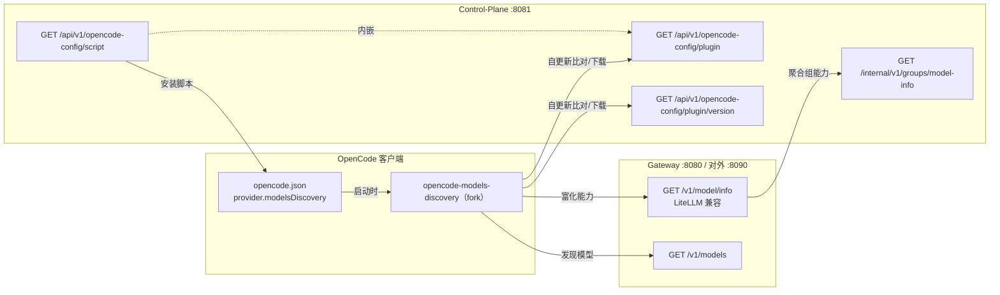

# OpenCode 模型发现插件架构

本文档说明 LLM Gateway 如何让 [OpenCode](https://opencode.ai) 客户端**自动发现网关上的模型并带上真实能力**（图像输入 / 工具调用 / 推理 / 上下文上限等），以及配套的插件分发、自更新与配置下发链路。

> 插件源码：`tools/opencode-models-discovery/`
> 内嵌产物：`internal/controlplane/handler/assets/opencode-models-discovery.{js,version}`
> 配置下发 Handler：`internal/controlplane/handler/opencode_config_handler.go`

---

## 1. 背景与目标

OpenCode 通过 provider 配置里的模型列表来展示可选模型。直接用 OpenAI 兼容的 `/v1/models` 只能拿到模型 **id**，拿不到能力，于是：

- 多模态模型不会被标记为支持图像输入（`attachment`），无法上传图片；
- 工具调用 / 推理等能力缺失；
- 上下文与输出上限缺失。

社区插件 [`opencode-models-discovery`](https://github.com/yuhp/opencode-models-discovery) 支持读取 LiteLLM 风格的 `/v1/model/info` 来富化能力，但它**默认会发现所有 OpenAI 兼容 provider**，无法只同步本网关。

因此我们**二次开发（fork）**了该插件，并在网关侧补齐了 LiteLLM 兼容的能力接口，达成两个目标：

1. **能力下发**：把网关聚合出的模型能力暴露成 `/v1/model/info`，让插件映射成 OpenCode 的 `attachment` / `tool_call` / `reasoning` / `modalities` / `limit`。
2. **按需发现**：发现默认改为**按 provider 显式开启**（opt-in），只同步本网关、不污染用户其它渠道。

---

## 2. 端到端架构



数据流要点：

- 对外模型名通常是**模型组（Group）名**；网关 `/v1/model/info` 把组内成员的能力**聚合**后以 LiteLLM 格式返回。
- 插件**只在内存里**把发现到的模型注入 OpenCode 配置，**不写回 `opencode.json`**（所以配置文件里看不到模型列表，属正常）。

---

## 3. 网关侧：能力接口

### 3.1 `/v1/model/info`（LiteLLM 兼容）

- Handler：`internal/gateway/handler/model_info.go`
- 路由：`internal/gateway/server/router.go` 中 `v1.GET("/model/info", ...)`
- 实现：解析当前 Key 可见的模型组名 → 调用 control-plane 内部接口聚合 → 输出 LiteLLM 风格：

```json
{
  "data": [
    {
      "model_name": "middle-level",
      "model_info": {
        "key": "middle-level",
        "mode": "chat",
        "max_input_tokens": 1000000,
        "max_output_tokens": 65536,
        "supports_vision": true,
        "supports_function_calling": true,
        "supports_tool_choice": true
      }
    }
  ]
}
```

### 3.2 组能力聚合（保守语义）

- 服务：`internal/controlplane/service/model_info_service.go` 的 `ModelInfoService.GetGroupModelInfo`
- 网关 → 控制面调用：`internal/gateway/binding/client.go` 的 `GetGroupModelInfo`，命中 `GET /internal/v1/groups/model-info`
- **聚合规则**：
  - 布尔能力（`vision` / `function_calling` / `tool_choice`）：**组内全部成员都支持**才算支持（保守 / "all"），任一成员未绑定 Catalog 或不支持即为 `false`；
  - `max_input_tokens` / `max_output_tokens`：取成员中的**最小正值**；
  - 能力数据源自 `model_catalog`（见 [模型与 Catalog](#5-能力数据来源model_catalog)）。
- 管理面也可查看聚合能力：`GET /api/v1/groups/capabilities`，前端 `web/src/views/GroupListPage.vue` 的「能力（聚合）」列。

---

## 4. 插件侧（`tools/opencode-models-discovery/`）

### 4.1 目录结构

```
src/
├── index.ts                      # 导出 ModelDiscoveryPlugin
├── version.ts                    # 构建时生成的 PLUGIN_VERSION
├── plugin/
│   ├── index.ts                  # 组装 config / event / chat.params 三个 hook
│   ├── config-hook.ts            # config hook：触发发现 + 自更新
│   ├── enhance-config.ts         # 核心：按 provider 发现模型、富化能力、注入配置
│   ├── chat-params-hook.ts       # chat.params hook
│   ├── event-hook.ts             # event hook
│   └── logger.ts
├── ui/toast-notifier.ts          # 封装 client.tui.showToast
├── utils/
│   ├── openai-compatible-api.ts  # /v1/models 与 /v1/model/info 拉取
│   ├── self-update.ts            # 自更新：比对版本、下载覆盖、提示重启
│   ├── discovery-report.ts       # 发现快照 + 摘要
│   ├── model-info/litellm.ts     # LiteLLM 能力 → OpenCode 字段映射
│   └── ...
└── types/
    ├── index.ts
    └── plugin-config.ts          # 配置项 + 默认值（发现默认 opt-in）
```

### 4.2 加载方式（重要）

OpenCode 的本地插件目录是**复数 `plugins/`**（单数 `plugin/` 在新版可能不被加载）。安装脚本会把 bundle 下到：

```
~/.config/opencode/plugins/opencode-models-discovery.js
```

OpenCode 启动时自动加载该目录下的 `.js`/`.ts`，**无需**在 `opencode.json` 的 `plugin` 数组里登记。脚本同时会清理旧的单数 `plugin/` 副本，避免重复加载或加载到旧版本。

### 4.3 发现与富化流程（`enhance-config.ts`）

对 `config.provider` 里每个 provider：

1. **门控**：仅当 `options.modelsDiscovery.enabled === true`（或全局 `discovery.enabled` 打开）才发现该 provider —— 默认 opt-in，见 `types/plugin-config.ts` 的 `shouldDiscoverProviderWithOverride`。
2. **拉模型**：`GET {baseURL}/v1/models`（baseURL 会规范化，去掉结尾 `/v1` 避免重复）。
3. **拉能力**：若配置了 `modelInfoEndpoint` + `modelInfoFormat: "litellm"`，则拉 `/v1/model/info` 构造能力富化器。
4. **逐模型注入**：跳过已存在/embedding/被过滤的模型，对其余模型：
   - 用 `model-info/litellm.ts` 把 `supports_vision` → `attachment` & `modalities.input` 含 `image`、`supports_function_calling|tool_choice` → `tool_call`、`supports_reasoning` → `reasoning`、`max_*_tokens` → `limit`；
   - 无能力信息时**保守**回退为纯文本 `modalities: { input: ["text"], output: ["text"] }`，不盲目假设图像支持。
5. **可见性**：写发现快照 `~/.config/opencode/plugins/models-discovery.snapshot.json`，并**按 provider 各弹一条** toast（标题用 provider 的 `name`，即供应商名称，如「某公司」），展示该 provider 发现到的模型数与能力计数。

### 4.4 自更新（`self-update.ts`）

- 在 config hook 中 fire-and-forget 触发，每个进程只跑一次、全程带超时、静默失败，不阻塞启动。
- 从「开启了发现」的 provider 的 `baseURL` 推导网关 origin；
- 比对 `GET /api/v1/opencode-config/plugin/version` 与本地 `PLUGIN_VERSION`，**只要不同**就下载 `GET /api/v1/opencode-config/plugin` 覆盖本地插件文件（写到复数 `plugins/`、清理单数副本），并弹「已更新，重启 opencode 生效」提示。

---

## 5. 能力数据来源：`model_catalog`

| 实体 | 说明 |
|------|------|
| `model_catalog` | 能力/价格/上下文的**单一来源**，从 LiteLLM 公共 JSON 同步（`internal/controlplane/service/catalog_sync_service.go`），失败回退内置快照（`internal/controlplane/seed/`） |
| `model` | 绑定某 Provider 的具体模型，可选 `CatalogID` 关联 catalog 继承能力，也可 override 上下文/输出上限 |
| `group`（模型组） | 对外暴露的「模型名」，组内含多个 model；`model_info_service` 按上面的保守规则聚合组能力 |

所以：要让某个模型在 OpenCode 里显示「图像输入」，需保证它**绑定了对应的 catalog 条目**（或其 catalog 标记 `supports_vision`），且模型组内**所有成员**都满足。管理面「模型组」页可查看聚合后的能力。

---

## 6. 配置下发链路（安装脚本）

由 control-plane 的 `opencode_config_handler.go` 动态生成，bundle 通过 `go:embed` 内嵌、随脚本下发，**不依赖 npm 公网安装**。

| 端点 | 认证 | 作用 |
|------|------|------|
| `POST /api/v1/keys/:id/opencode-config/token` | JWT | 生成 10 分钟有效的 Redis token |
| `GET /api/v1/opencode-config/script?token=&os=mac\|windows` | token | 返回 bash / PowerShell 安装脚本 |
| `GET /api/v1/opencode-config/plugin` | 无 | 返回插件 JS bundle（带 `X-Plugin-Version`） |
| `GET /api/v1/opencode-config/plugin/version` | 无 | 返回插件版本号（供自更新比对） |
| `POST /api/v1/opencode-config/callback` | token | 脚本回报 success / failed |

安装脚本（mac/windows）做的事：

1. 校验 `python3` / `curl`（mac）或 `Invoke-WebRequest`（windows）；
2. 下载插件到 `~/.config/opencode/plugins/`，清理旧单数 `plugin/` 副本；
3. 写入 `opencode.json`：把本 provider 配成
   ```json
   "options": {
     "baseURL": "https://gateway/v1",
     "apiKey": "sk-...",
     "modelsDiscovery": {
       "enabled": true,
       "endpoint": "/v1/models",
       "modelInfoEndpoint": "/v1/model/info",
       "modelInfoFormat": "litellm"
     }
   }
   ```
   provider 的 `name` 取后台「系统设置 → 接入配置 → 供应商名称」（默认「某公司」）；
4. 同名 provider 直接覆盖（按 provider id）；
5. 回调上报结果。

> 对外地址（含端口/scheme）以 token 里的 `BaseURL`（管理员在「接入配置」里设的对外网关地址）为准，避免反代场景下 `Host`/`X-Forwarded-*` 丢端口或改写 scheme。

---

## 7. 构建与发布

插件用 Bun 构建，版本号是 `package.json` → bundle → 服务端 version 资产的单一来源：

```bash
cd tools/opencode-models-discovery
bun run build:bundle      # 生成 src/version.ts + assets/opencode-models-discovery.{js,version}
bunx tsc --noEmit         # 类型检查
bun test                  # 单元测试
```

发布新插件版本的流程：

1. 改 `tools/opencode-models-discovery/package.json` 的 `version`（如 `0.9.0-llmgw.N` → `0.9.0-llmgw.N+1`）；
2. `bun run build:bundle` 重新生成内嵌产物；
3. 重新 `go build` 控制面（产物经 `go:embed` 打进二进制）并重启；
4. 已安装的客户端下次启动 OpenCode 时会**自更新**到新版本（版本不同即触发）。

---

## 8. 排查与验证

- **看发现快照**：`~/.config/opencode/plugins/models-discovery.snapshot.json`，含每个 provider 发现到的模型及解析出的能力。
- **看启动 toast**：按 provider 分别提示「{供应商名} · 模型发现 / 发现 N 个模型 · 图像输入 X · 工具调用 Y · 推理 Z」，显示约 10 秒。
- **模型不出来**：确认插件落在复数 `plugins/` 目录、且 OpenCode 已**完全重启**（非 reload）。
- **数量比预期多**：toast 按 provider 分别统计；若有多个 provider 都开了 `modelsDiscovery.enabled`，它们会各自被发现。只想要本网关时，把其它 provider 的 `modelsDiscovery.enabled` 关掉。
- **能力为 0**：检查对应模型/模型组成员是否绑定了 catalog，以及组能力是否因「保守聚合」被某个未绑定成员拉低。
