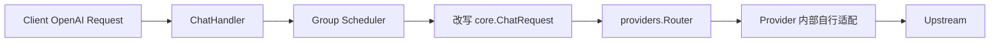
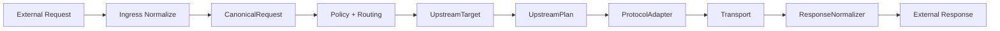
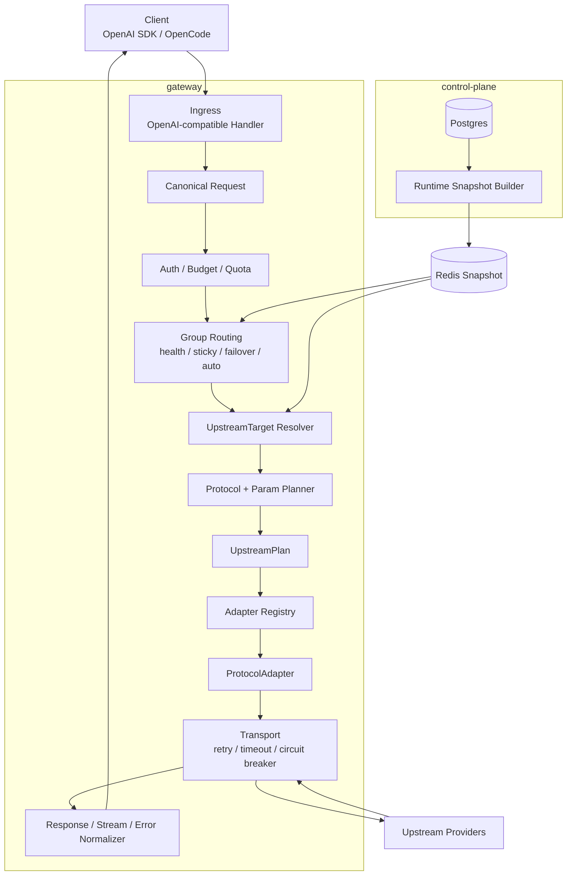

# Upstream Planner v2 协议适配与转发链路重构实施方案

> **状态**：设计实施方案 v0.1
> **目标分支**：建议新开 `codex/upstream-planner-v2` 或基于当前 `claude/silly-jemison-e7ad6a` 拆分
> **原则**：对外 API 与用户体验不变，底层转发链路推倒重来；先扩展、双跑、灰度，再替换旧链路。
> **强约束**：gateway 不直连 Postgres；所有 schema 变更必须走 Atlas 工作流；重构第一阶段只增字段不删字段。

---

## 1. 背景与问题

当前 gateway 的聊天转发链路是：



当前设计可以运行，但存在长期维护问题：

1. `req.Model` 同时承担 public model、logical model、upstream model、base model 判断依据等多重语义。
2. 协议选择散落在 provider 内部，例如 OpenAI Chat / Responses bridge、Azure sanitize、Gemini/DeepSeek reasoning 参数转换。
3. 没有统一的 `UpstreamTarget` / `UpstreamPlan`，无法审计“为什么选这个协议、为什么删/改这些参数”。
4. 模型组 scheduler 配置与 provider snapshot 配置有重叠，字段含义容易漂移。
5. 新增协议时容易在 handler、router、provider、stream、usage、error mapping 多处开洞。

本重构目标是将链路升级为：



---

## 2. 目标

### 2.1 用户侧目标

- `/v1/chat/completions`、`/v1/responses`、`/v1/models`、`/v1/embeddings`、`/v1/rerank` 等公开 API 路径不变。
- OpenAI-compatible 请求/响应结构不破坏。
- 模型组名、API Key、预算、配额、failover、sticky、auto routing 等用户可感知能力保持兼容。
- 客户端无需知道上游最终走 Azure deployment、OpenAI Responses、Anthropic Messages、Gemini Native 或其他协议。

### 2.2 内部目标

- 显式拆分四种模型身份：
  - `public_model`：客户端请求/看到的模型名。
  - `logical_model`：模型组名。
  - `base_model`：真实基础模型族，用于能力和协议判断。
  - `upstream_model`：真正发给上游的模型名 / deployment name。
- 通过 `UpstreamTarget` 表示“调谁”。
- 通过 `UpstreamPlan` 表示“怎么调”。
- 通过 `ProtocolAdapter` 执行协议转换、请求发送、响应归一。
- 将协议选择、参数适配、endpoint 构造、响应归一从 provider 内部散点逻辑收敛到 planner/adapter 框架。
- 新增协议时主要新增 `ProtocolMode`、adapter、planner rule、控制面枚举与测试，而不是改多处业务链路。

---

## 3. 非目标

本阶段不做：

1. 不改变外部公开 API 契约。
2. 不删除现有数据库字段。
3. 不让 gateway 直连数据库。
4. 不一次性重命名物理表 `models -> model_bindings`。
5. 不一次性迁移所有 provider 到新 adapter；先迁 OpenAI/Azure Chat 与 Responses bridge。
6. 不开放自由脚本式 transform DSL，避免配置不可控。

---

## 4. 目标架构



---

## 5. 核心领域对象

### 5.1 CanonicalRequest

第一阶段只覆盖 chat / responses / embeddings / rerank 中已存在能力，优先落地 chat。

```go
type RequestKind string

const (
    RequestKindChat       RequestKind = "chat"
    RequestKindResponses  RequestKind = "responses"
    RequestKindEmbeddings RequestKind = "embeddings"
    RequestKindRerank     RequestKind = "rerank"
)

type CanonicalRequest interface {
    Kind() RequestKind
    GetPublicModel() string
    IsStream() bool
}
```

第一阶段可以不重写所有 DTO，允许 `CanonicalChatRequest` 包装现有 `core.ChatRequest`：

```go
type CanonicalChatRequest struct {
    PublicModel string
    Body        *core.ChatRequest
}
```

### 5.2 UpstreamTarget

```go
type UpstreamTarget struct {
    PublicModel   string
    LogicalModel  string
    BaseModel     string
    UpstreamModel string

    ModelID      string
    ProviderID   string
    ProviderName string
    ProviderType string
    ChannelID    string

    BaseURL       string
    APIVersion    string
    CredentialRef string

    ProtocolModeOverride        ProtocolMode
    ParamProfileOverride        ParamProfile
    UnsupportedParamPolicy      UnsupportedParamPolicy
    Capabilities                ModelCapabilities
    SupportedParamsOverride     []string
    TransformOverrides          TransformOverrides
}
```

### 5.3 UpstreamPlan

```go
type UpstreamPlan struct {
    Target UpstreamTarget

    Protocol     ProtocolMode
    ParamProfile ParamProfile

    Method   string
    Endpoint string

    ModelForUpstream string
    ModelForClient   string

    ParamRules []ParamTransformRule

    UnsupportedParamPolicy UnsupportedParamPolicy
    RequestBodyProfile     RequestBodyProfile
    ResponseProfile        ResponseProfile
    StreamProfile          StreamProfile

    Adapter string
    Audit   ProtocolAudit
}
```

### 5.4 ProtocolMode

```go
type ProtocolMode string

const (
    ProtocolAuto              ProtocolMode = "auto"
    ProtocolOpenAIChat        ProtocolMode = "openai_chat"
    ProtocolOpenAIResponses   ProtocolMode = "openai_responses"
    ProtocolAnthropicMessages ProtocolMode = "anthropic_messages"
    ProtocolGeminiNative      ProtocolMode = "gemini_native"
    ProtocolBedrockConverse   ProtocolMode = "bedrock_converse"
    ProtocolOpenAICompatible  ProtocolMode = "openai_compatible"
    ProtocolPassthrough       ProtocolMode = "passthrough"
)
```

### 5.5 ParamProfile

```go
type ParamProfile string

const (
    ParamProfileAuto                ParamProfile = "auto"
    ParamProfileOpenAIStandard      ParamProfile = "openai_standard"
    ParamProfileOpenAIReasoningChat ParamProfile = "openai_reasoning_chat"
    ParamProfileOpenAIResponses     ParamProfile = "openai_responses"
    ParamProfileDeepSeekReasoning   ParamProfile = "deepseek_reasoning"
    ParamProfileGeminiThinking      ParamProfile = "gemini_thinking"
    ParamProfileAnthropicThinking   ParamProfile = "anthropic_thinking"
    ParamProfileBedrockConverse     ParamProfile = "bedrock_converse"
    ParamProfilePassthrough         ParamProfile = "passthrough"
)
```

---

## 6. 数据模型实施策略

### 6.1 第一阶段只增字段不删字段

保持现有 `models` 表名，代码层逐步引入 `ModelBinding` 语义。

建议新增字段：

| 字段 | 类型 | 默认值 | 说明 |
|---|---|---:|---|
| `base_model` | varchar(255) | `''` | 真实基础模型名，优先由 catalog 推断或管理员指定 |
| `protocol_mode` | varchar(40) | `auto` | 上游协议选择 |
| `param_profile` | varchar(64) | `auto` | 参数适配画像 |
| `unsupported_param_policy` | varchar(40) | `preserve` | 不支持参数时的策略 |
| `supported_params_override` | jsonb | `{}` | 单模型参数支持覆盖 |
| `transform_overrides` | jsonb | `{}` | 有限的参数转换覆盖 |

> 注意：如当前分支已有 `param_style`，新方案不继续扩展它；采用 `param_profile`。兼容期可读 `param_profile` 优先，缺省时回退 `param_style`。

### 6.2 Atlas 要求

任何 schema 改动必须走：

```bash
git fetch origin
# rebase 到目标分支最新状态
make atlas-diff name=add_model_protocol_planning_fields
atlas migrate hash --env local
atlas migrate validate --env local
```

提交必须包含：

```text
internal/controlplane/model/*.go
atlas-migrations/*.sql
atlas-migrations/atlas.sum
```

### 6.3 后续 contract phase 才考虑字段迁移/删除

未来可能迁移但不在本阶段删除：

- `param_style -> param_profile`
- `models.weight -> group_models.weight`
- `models.priority -> group_models.priority`
- `models.complexity_tier -> group_models.complexity_tier`
- 能力/价格冗余字段逐步改为 catalog + override 语义

---

## 7. Runtime Snapshot 设计

当前存在两套配置源：

1. Redis provider snapshot：provider/model/provider router。
2. control-plane internal groups API：group/scheduler route table。

重构建议最终统一为一个 gateway runtime snapshot，但分阶段推进。

### 7.1 Phase A：兼容现状，扩展字段

- 扩展 provider snapshot `ProviderEntry.ModelsV2`，加入：
  - `base_model`
  - `protocol_mode`
  - `param_profile`
  - `unsupported_param_policy`
  - `capabilities`
  - `supported_params_override`
  - `transform_overrides`
- 扩展 scheduler internal groups API 中的 model data，同步必要字段。
- gateway 在 `TargetResolver` 层合并 scheduler decision + provider registry 信息。

### 7.2 Phase B：统一 RuntimeSnapshot

新增：

```go
type GatewayRuntimeSnapshot struct {
    Version   int64
    UpdatedAt time.Time
    Providers []ProviderRuntimeEntry
    Models    []ModelBindingRuntimeEntry
    Groups    []GroupRuntimeEntry
    GroupModels []GroupModelRuntimeEntry
}
```

目标：scheduler 与 provider router 都消费同一个 runtime snapshot，避免字段重复漂移。

---

## 8. 新模块目录建议

第一阶段建议新增而不是大规模移动旧代码：

```text
internal/gateway/planning/
  target.go
  target_resolver.go
  protocol_mode.go
  param_profile.go
  planner.go
  protocol_planner.go
  param_planner.go
  audit.go

internal/protocol/canonical/
  chat.go
  responses.go
  embeddings.go
  rerank.go

internal/protocol/transform/
  rules.go
  apply.go
  unsupported_policy.go

internal/adapters/
  registry.go

internal/adapters/openai/
  chat_adapter.go
  responses_adapter.go
  param_rules.go
  response_normalizer.go

internal/adapters/azure/
  chat_adapter.go
  responses_adapter.go
  endpoint_builder.go
```

兼容期可以让新 adapter 内部复用旧 provider 的 transport/client 能力，避免一次性重写 HTTP 客户端。

---

## 9. 实施阶段与任务拆解

## Phase 0：冻结外部契约与建立基线测试

**目标**：先证明旧行为，避免重构中无意破坏用户契约。

- [ ] 梳理当前 `/v1/chat/completions` 典型请求/响应 golden cases。
- [ ] 增加 contract tests：
  - 普通 OpenAI chat 请求。
  - 模型组请求。
  - 流式请求。
  - failover 后响应仍为 OpenAI-compatible。
  - Azure deployment + reasoning 场景当前期望行为。
- [ ] 固定日志字段兼容性测试：`model`、`routed_model`、`provider`、`usage` 等字段继续存在。
- [ ] 增加 `UPSTREAM_PLANNER_ENABLED=false` 默认开关。

**验收**：不开启 planner 时，现有测试与 golden 行为不变。

---

## Phase 1：数据模型与控制面字段扩展

**目标**：为协议规划提供显式配置来源。

- [ ] 修改 GORM model：`base_model`、`protocol_mode`、`param_profile`、`unsupported_param_policy`、`supported_params_override`、`transform_overrides`。
- [ ] 走 Atlas 生成迁移，更新 `atlas.sum`。
- [ ] 控制面模型 CRUD 支持新字段。
- [ ] 前端模型编辑弹窗增加“协议模式 / 参数画像 / 不支持参数策略 / base_model”。
- [ ] 后端校验枚举值，非法值返回 400。
- [ ] 创建/编辑模型时，允许从非 auto 改回 auto。
- [ ] provider snapshot 与 internal groups API 输出新字段。

**验收**：

- 新字段可创建、编辑、查询、同步到 gateway。
- 老数据默认 `auto/preserve`，不影响现有转发。
- gateway 不直连 DB。

---

## Phase 2：引入 UpstreamTarget 与 Planner 骨架

**目标**：新增新链路骨架，但默认不接管执行。

- [ ] 新增 `internal/gateway/planning`。
- [ ] 实现 `UpstreamTarget`、`UpstreamPlan`、`ProtocolAudit`。
- [ ] 实现 `TargetResolver`：
  - 输入：`RouteDecision`、原始 public model、provider registry metadata。
  - 输出：`UpstreamTarget`。
- [ ] 实现基础 `ProtocolPlanner`：
  - 显式 `protocol_mode` 优先。
  - `auto` 时按 provider type + base model + request shape 推断。
- [ ] 实现基础 `ParamPlanner`：
  - 显式 `param_profile` 优先。
  - `auto` 时按 protocol + base model 推断。
- [ ] `UpstreamPlan.Audit` 输出安全摘要，不包含密钥和 prompt。
- [ ] 仅记录 plan，不改变执行路径。

**验收**：

- 开关关闭时只生成 audit/debug，不影响请求执行。
- 单测覆盖 target resolve 与 planner 推断。

---

## Phase 3：Adapter Registry 与 OpenAI/Azure Chat Adapter

**目标**：先迁移当前痛点最大的 OpenAI-compatible Chat 路径。

- [ ] 新增 `internal/adapters.Registry`，按 `(provider_type, protocol_mode)` 查找 adapter。
- [ ] 实现 `OpenAIChatAdapter`：
  - 执行 `openai_standard`。
  - 执行 `openai_reasoning_chat`：
    - `max_tokens -> max_completion_tokens`
    - 删除 `max_tokens`
    - 删除 `temperature`
    - `reasoningEffort -> reasoning_effort`
    - `reasoning:{effort} -> reasoning_effort`
    - 删除 chat 不支持的 `reasoningSummary/reasoning_summary`
- [ ] 实现 `AzureChatAdapter`：
  - 复用 OpenAI Chat 参数规则。
  - Azure endpoint/api-version 构造独立封装。
  - Azure 非法字段 sanitize 移入 adapter。
- [ ] 支持 plan 驱动执行，仍可通过 feature flag 回退旧 provider path。

**验收**：

- Azure deployment name 不包含 gpt/o 时，依赖 `base_model` 正确触发 reasoning 参数适配。
- `param_profile=openai_standard` 时，即使 base model 像 reasoning，也不做 reasoning 改写。
- `param_profile=openai_reasoning_chat` 时，不看模型名也强制改写。

---

## Phase 4：OpenAI Responses / Responses Bridge 迁移

**目标**：把 `ShouldBridgeChatToResponses` 从 provider 内部迁到 planner。

- [ ] 实现 `ProtocolOpenAIResponses` planner rule。
- [ ] 推断条件使用：
  - 显式 `protocol_mode=openai_responses` 优先。
  - `base_model` 优先，不再只看 `req.Model`。
  - 请求形态：reasoning summary、GPT-5.4+ + tools + reasoning_effort 等。
- [ ] 实现 `OpenAIResponsesAdapter`。
- [ ] 实现 `AzureResponsesAdapter`。
- [ ] 旧 `providers.ChatViaResponses` 可作为内部转换实现复用，但触发条件由 planner 决定。

**验收**：

- GPT-5.4+ tools + reasoning_effort 走 responses plan。
- Azure deployment 依赖 base_model 正确 bridge。
- 不满足条件时走 openai_chat + 对应 param profile。

---

## Phase 5：响应 / Stream / Error / Usage 归一化

**目标**：将响应归一与请求转换放到同等重要位置。

- [ ] 定义 `ResponseProfile`、`StreamProfile`。
- [ ] OpenAI Chat response normalizer：
  - `model` 对客户端返回 `public_model`。
  - 内部日志记录 `upstream_model`。
- [ ] Responses bridge response normalizer：
  - reasoning summary / reasoning_content 归一。
  - tool call / finish_reason / usage 归一。
- [ ] Stream normalizer：
  - 保持 OpenAI-compatible SSE 输出。
  - 统一 usage chunk 处理。
- [ ] Error normalizer：
  - provider error 转 OpenAI-compatible error shape。
  - 保留内部 `upstream_status` / `upstream_error_code` 供日志。

**验收**：

- 非流式和流式响应 schema 与旧接口兼容。
- 客户端不看到 Azure deployment，除非 debug 显式开启。
- call log 与 OTel span 中能看到 public/logical/base/upstream 四种模型身份。

---

## Phase 6：灰度接管主链路

**目标**：让 planner path 在生产可控启用。

- [ ] Feature flag 支持：
  - 全局：`UPSTREAM_PLANNER_ENABLED`
  - provider 级灰度
  - group/model 级灰度
- [ ] ChatHandler / Orchestrator 支持选择旧链路或 planner 链路。
- [ ] 失败时可按策略回退旧链路：
  - planning error 默认 fallback old path 或返回 500，按环境配置。
  - adapter error 不自动 fallback，避免双发造成副作用；只记录 plan audit。
- [ ] 增加 `X-Upstream-Plan` debug header，仅内部/debug key 可见。

**验收**：

- 单个 provider/model 可以启用 planner。
- 出现问题可以即时关闭开关回退旧链路。
- 新旧链路调用日志可区分。

---

## Phase 7：迁移其他 Provider

按风险从低到高迁移：

1. OpenAI-compatible 标准类：OpenRouter、vLLM、Ollama、Groq、ZAI、Bailian 等。
2. DeepSeek reasoning。
3. Gemini OpenAI-like 与 Gemini Native。
4. Anthropic Messages。
5. Bedrock Converse。
6. Vertex / Oracle / 其他 native provider。

每迁移一个 provider 必须包含：

- planner rule
- adapter
- request transform 单测
- response normalize 单测
- stream 单测（如支持）
- error normalize 单测
- golden compatibility case

---

## Phase 8：统一 RuntimeSnapshot 与清理旧链路

**目标**：完成结构性收束。

- [ ] 引入统一 `GatewayRuntimeSnapshot`。
- [ ] scheduler 与 provider router 同源消费 runtime snapshot。
- [ ] `core.ChatRequest` 移除内部路由字段依赖；兼容期字段保留但不再新增使用。
- [ ] provider 内部散落的参数适配函数迁入 adapters/transform。
- [ ] `param_style` 标记 deprecated。
- [ ] 一个稳定版本后再计划 contract migration 删除/迁移旧字段。

---

## 10. 日志与观测实施

### 10.1 保持旧字段兼容

必须保留：

```text
request_id
model
routed_model
routed_model_id
provider
stream
usage
error_message
failover_used
group_name
t_route_ms
t_upstream_ms
```

语义约定：

- `model`：客户端请求的 public model。
- `routed_model`：选中的模型绑定名称，兼容旧含义。
- `provider`：provider 实例名。

### 10.2 新增字段

```text
public_model
logical_model
base_model
upstream_model
provider_name
provider_type
protocol_mode
param_profile
unsupported_param_policy
adapter
plan_version
plan_reason
transform_rules
```

### 10.3 call_logs 建议新增

第一阶段可加列或放 JSON，建议：

- 高频查询列：`base_model`、`upstream_model`、`provider_type`、`protocol_mode`、`param_profile`
- 低频审计：`protocol_audit jsonb`

如涉及表结构，必须单独走 Atlas。

### 10.4 OTel attributes

新增：

```text
llm.public_model
llm.logical_model
llm.base_model
llm.upstream_model
llm.provider_name
llm.provider_type
llm.protocol_mode
llm.param_profile
llm.adapter
llm.plan_reason
```

`llm.model` 保持 public model。

---

## 11. 测试计划

### 11.1 Planner 单测

- 显式 protocol 优先。
- 显式 param profile 优先。
- `auto` 时 base_model 优先于 upstream_model。
- Azure deployment name 不影响 GPT-5 推断。
- 普通模型默认 openai_standard。

### 11.2 Adapter 单测

OpenAI reasoning chat：

- `max_tokens -> max_completion_tokens`
- 删除 `temperature`
- reasoning aliases 归一
- summary 字段在 chat 中删除

OpenAI standard：

- 不做 reasoning 改写。
- unknown fields 保留策略符合 policy。

Responses：

- chat -> responses bridge。
- tools / reasoning summary / stream delta 归一。

### 11.3 Handler / Orchestrator 集成测试

- feature flag off：旧链路。
- feature flag on：planner 链路。
- 模型组路由后构建 UpstreamTarget。
- failover 后重新生成 UpstreamPlan。
- sticky route 命中时 plan 与目标一致。

### 11.4 Control-plane / Snapshot 测试

- CRUD 新字段。
- enum 校验。
- snapshot 包含新字段。
- gateway 消费 snapshot 后 route table 与 provider metadata 一致。

### 11.5 兼容性测试

- OpenAI SDK 基本调用。
- OpenCode reasoning 参数。
- Azure deployment + GPT-5。
- 流式 SSE。
- error shape。
- usage / cost。

---

## 12. 回滚策略

### 12.1 运行时回滚

- `UPSTREAM_PLANNER_ENABLED=false` 全局关闭。
- provider/model 级禁用 planner。
- adapter 注册失败时启动不阻塞旧链路。

### 12.2 数据回滚

第一阶段只新增字段，默认值兼容旧代码：

```text
protocol_mode = auto
param_profile = auto
unsupported_param_policy = preserve
```

旧代码忽略新增字段即可运行。

### 12.3 发布回滚

- 新链路先 shadow planning，只记录不执行。
- 小流量启用 OpenAI/Azure chat。
- 观察错误率、latency、fallback、unknown_parameter 错误。
- 异常时关闭 flag，无需回滚 DB。

---

## 13. 风险与缓解

| 风险 | 影响 | 缓解 |
|---|---|---|
| Planner 变成巨型 if | 可维护性下降 | 拆分 TargetResolver / CapabilityResolver / ProtocolPlanner / ParamPlanner |
| profile 枚举爆炸 | 配置复杂 | 大类 profile + ParamRules，不为每个小差异建 profile |
| transform_overrides 失控 | 线上行为不可预测 | 限定 drop/rename/force，强校验、强审计 |
| 新旧配置源不一致 | 路由选中但 provider 不识别 | 先增加一致性校验，再推进统一 RuntimeSnapshot |
| 日志字段变化破坏看板 | 运维不可见 | 旧字段不改，仅新增字段 |
| 大爆炸迁移失败 | 影响主链路 | feature flag、shadow plan、小流量灰度、可回退旧链路 |

---

## 14. 里程碑建议

| 里程碑 | 内容 | 可合并标准 |
|---|---|---|
| M0 | 基线测试 + feature flag | 旧链路行为不变 |
| M1 | DB/control-plane/snapshot 扩展 | 新字段完整同步，默认兼容 |
| M2 | Planner shadow mode | 能生成 plan/audit，不执行 |
| M3 | OpenAI/Azure Chat planner path | 单测/集成测试通过，可按 model 灰度 |
| M4 | Responses bridge planner path | GPT-5/Azure bridge 正确 |
| M5 | Response/Error/Usage normalizer | 日志与响应兼容 |
| M6 | 其他 provider 迁移 | 每 provider 独立验收 |
| M7 | RuntimeSnapshot 统一 | 两套配置源收束 |

---

## 15. 第一批 PR 拆分建议

### PR 1：基线与开关

- golden tests
- feature flag
- no-op planner interface

### PR 2：DB/control-plane 扩展

- Atlas migration
- GORM model
- handler/service/repository
- FE 表单字段
- snapshot 新字段

### PR 3：planning shadow mode

- UpstreamTarget
- UpstreamPlan
- planner/audit
- 不改变执行路径

### PR 4：OpenAI/Azure Chat Adapter

- adapter registry
- openai_chat / azure_chat
- param profile rules
- feature flag 接管单模型

### PR 5：Responses bridge planner 化

- openai_responses / azure_responses
- bridge 触发迁移到 planner

### PR 6：日志与 normalizer

- public/base/upstream model 日志
- OTel attributes
- call_logs 扩展（如需要单独 DB PR）

---

## 16. 验收标准

最终验收必须满足：

- [ ] 用户公开 API 不变。
- [ ] OpenAI SDK / OpenCode 无需修改即可继续使用。
- [ ] `model` 主日志字段保持 public model。
- [ ] Azure deployment + GPT-5 reasoning 参数适配正确。
- [ ] GPT-5 Responses bridge 使用 base_model / request shape 决策，不依赖 deployment name。
- [ ] 新链路可按全局/provider/model 灰度。
- [ ] 关闭 feature flag 后旧链路可用。
- [ ] 所有新增 schema 迁移符合 Atlas 规范。
- [ ] OpenAI/Azure chat 与 responses 的 request/response/stream/error/usage 测试覆盖。
- [ ] 新增协议时无需修改 ChatHandler 主流程。

---

## 17. 立即下一步

1. 新开实施分支。
2. 落 PR 1：基线测试 + feature flag + planner 空接口。
3. 落 PR 2：只增字段的 Atlas 迁移与控制面字段流转。
4. 在 shadow mode 里为现有请求生成 `UpstreamPlan.Audit`，对比线上/测试日志，确认推断结果。
5. 再启用 OpenAI/Azure Chat Adapter 灰度。

---

## Phase 0 补充：Worker D 基线/开关落地记录（2026-07-17）

- Gateway 配置新增 `upstream_planner.enabled`、`upstream_planner.shadow_enabled`、`upstream_planner.debug_header_enabled`，代码默认值与 `config/*.yaml` 均为 `false`。
- 环境变量绑定：`UPSTREAM_PLANNER_ENABLED`、`UPSTREAM_PLANNER_SHADOW_ENABLED`、`UPSTREAM_PLANNER_DEBUG_HEADER_ENABLED`；测试环境如需启用仍应通过 CI/CD 注入，不写密钥或环境敏感值。
- 配置单测固定：无配置文件时三项默认关闭；显式环境变量可开启。
- Provider 兼容性 golden 基线新增：
  - OpenAI reasoning chat：记录 GPT-5 reasoning alias 在 Chat 与 Responses bridge 两条旧路径下的出站 payload。
  - Azure reasoning chat：记录 Azure OpenAI v1 endpoint、无默认 `api-version`、reasoning alias sanitize / bridge 旧行为。
- 这些测试只观察现有 provider 出站请求，不改变生产执行路径；后续 planner 接管前需保持 golden 语义一致，或在计划中显式说明迁移差异。
