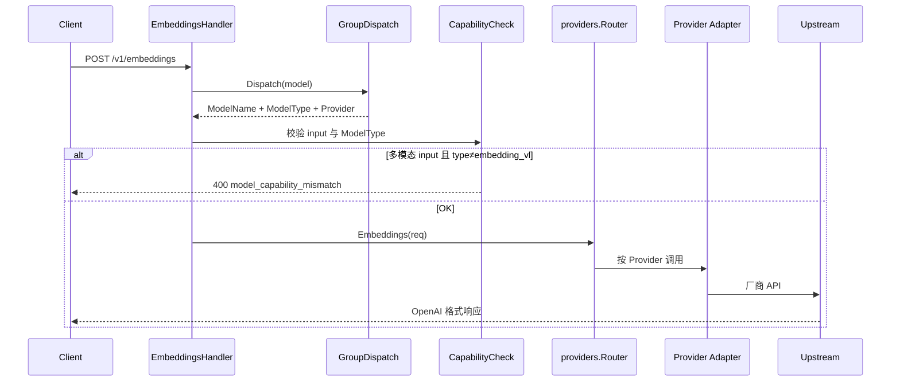

# Embedding / Rerank 完整协议与多厂商适配方案

> **版本**: v1.0 | **日期**: 2026-07-10 | **状态**: 待评审  
> **定位**: 在既有 `docs/embedding-rerank-master-design.md`（接入与平台能力）之上，补齐**对外协议对齐、model_type 能力模型、多厂商适配矩阵、Bailian/Qwen 路由铁律**。  
> **参考权威**: 协议与 Adapter 结构对齐 **LiteLLM**；国内百炼渠道配置可参考 NewAPI，**不**采用其名字启发式猜端点。

---

## 1. 目标与非目标

### 1.1 目标

1. 对外协议与 LiteLLM Proxy 同族：**Embedding = OpenAI**，**Rerank = Cohere**。
2. 用 `model_type`（`embedding` / `embedding_vl` / `rerank`）表达能力，调度与探测据此分流。
3. Provider Adapter 只做协议/端点转换，**禁止静默改 `req.Model`**。
4. Bailian（Qwen）双 Embedding API + 原生 Rerank 有明确、可测的路由规则。
5. 能力不匹配时返回明确 400，避免向量空间被悄悄污染。

### 1.2 非目标

- 不追求 LiteLLM / NewAPI 的全厂商覆盖面。
- 不做跨模型 Embedding/Rerank failover（向量维度 / score scale 不兼容）。
- 不把多模态 input 提升为 OpenAI 官方标准（定位为网关扩展，文档标明）。

---

## 2. 分层架构

```text
客户端
  │  统一协议（OpenAI Embeddings / Cohere Rerank）
  ▼
Gateway Handler
  │  鉴权 · 配额 · 预算 · Usage
  ▼
GroupDispatch（调度层）
  │  组名 → ModelName + ModelType + Provider
  │  （可选）按 input 形态校验能力匹配
  ▼
providers.Router
  ▼
Provider Adapter（适配层）
  │  协议变换 · 端点选择 · 响应归一
  │  铁律：不改 req.Model
  ▼
上游厂商 API
```

| 层 | 职责 | 禁止 |
|----|------|------|
| 统一协议 | 稳定对外契约 | 暴露厂商原生路径 |
| 调度 | 选模型、带 `model_type`、能力校验 | 改向量语义、静默换模型 |
| Adapter | 统一请求 → 厂商 API；厂商响应 → 统一响应 | 静默改 `req.Model` |

---

## 3. 对外统一协议（对齐 LiteLLM）

### 3.1 Embedding — `POST /v1/embeddings`

**请求（OpenAI 兼容）**

| 字段 | 类型 | 说明 |
|------|------|------|
| `model` | string | 模型组名或模型名 |
| `input` | string \| string[] \| object[] | 见下方 input 形态 |
| `dimensions` | int? | 输出维度（厂商支持时透传） |
| `encoding_format` | string? | `float` / `base64` |
| `provider` | string? | **网关扩展**：路由提示，转发前剥离 |

**标准 input**

- `string` / `string[]`：纯文本（OpenAI 标准）

**扩展 input（多模态，非 OpenAI 标准）**

```json
[
  { "text": "一只猫" },
  { "image": "https://... 或 data:image/..." },
  { "audio": "..." }
]
```

仅当调度结果为 `model_type=embedding_vl`（或等价 VL 模型）时合法。

**响应（OpenAI 兼容 + 网关扩展）**

```json
{
  "object": "list",
  "data": [{ "object": "embedding", "index": 0, "embedding": [0.1, ...] }],
  "model": "...",
  "provider": "bailian",
  "usage": { "prompt_tokens": 10, "total_tokens": 10 }
}
```

`provider` 为网关扩展字段，客户端可忽略。

### 3.2 Rerank — `POST /v1/rerank`

**与 LiteLLM 差异**：LiteLLM 文档常写 `/rerank`；本网关固定 **`/v1/rerank`**（与 `/v1/embeddings` 同前缀）。

**请求（Cohere 规范，对齐 LiteLLM）**

| 字段 | 类型 | 说明 |
|------|------|------|
| `model` | string | 模型组名或模型名 |
| `query` | string | 查询 |
| `documents` | string[] | 待排序文档 |
| `top_n` | int? | 返回前 N |
| `return_documents` | bool? | 是否回传原文 |
| `max_chunks_per_doc` | int? | Cohere 扩展；不支持的厂商忽略 |
| `provider` | string? | 网关扩展，转发前剥离 |

**响应**

```json
{
  "id": "...",
  "model": "...",
  "provider": "cohere",
  "results": [
    { "index": 2, "relevance_score": 0.95, "document": { "text": "..." } }
  ],
  "usage": { "total_tokens": 50, "search_units": 1 }
}
```

计费双字段对齐 LiteLLM：`search_units`（Cohere 等）+ `total_tokens`（Jina/百炼等）。

### 3.3 与 LiteLLM 兼容性声明

| 项 | 状态 |
|----|------|
| Embedding 字段语义 | ✅ 对齐 |
| Rerank 字段语义 | ✅ 对齐 Cohere / LiteLLM |
| Rerank 路径 | ⚠️ 本网关为 `/v1/rerank` |
| `provider` 请求/响应字段 | ⚠️ 网关扩展 |
| `provider/model` 前缀写法 | ❌ 不采用；用模型组 + 可选 `provider` 字段 |
| 多模态 embedding input | ⚠️ 网关扩展 |

---

## 4. 内部能力模型：`model_type`

| model_type | 含义 | 典型模型 |
|------------|------|----------|
| `embedding` | 纯文本向量 | `text-embedding-3-large`, `text-embedding-v4` |
| `embedding_vl` | 多模态向量 | `qwen3-vl-embedding` |
| `rerank` | 重排序 | `rerank-v3.5`, `gte-rerank` |

**同步推断**（渠道拉模型时，已有逻辑保留）：

- 名含 `rerank` → `rerank`
- 名含 `embed` 且含 `vl` / `multimodal` / `vision` → `embedding_vl`
- 名含 `embed` → `embedding`
- 否则 → `chat`

**约束**

- 同一模型组内成员应同类型；Embedding 组内维度策略需运维约定（同维或文档标明不可混检索）。
- Embedding / Rerank：**不做跨模型 failover**。
- 调度产出必须带上 `ModelType`，供 Adapter 选端点（尤其 Bailian）。

---

## 5. 端到端流程

### 5.1 Embedding



### 5.2 Input × ModelType 匹配规则

| Input 形态 | 允许的 model_type | 不匹配时 |
|------------|-------------------|----------|
| `string` / `string[]` | `embedding` 或 `embedding_vl` | — |
| 含 `image` / `audio` 的对象数组 | **仅** `embedding_vl` | **400**，提示改用 VL 模型/组 |
| 空 / 非法 | — | 400 invalid_request |

**明确禁止**：Adapter 发现多模态 input 后把模型改成 `qwen3-vl-embedding`。

### 5.3 Rerank

与 Embedding 同中间件链；`Dispatch` → `ModelQuotaGate` → `orchestrator.Rerank` → Adapter。  
失败直接返回错误，不 failover。

---

## 6. 多厂商适配矩阵

### 6.1 Embedding

| Provider | 策略 | 上游端点 | 备注 |
|----------|------|----------|------|
| OpenAI / Azure / xAI / Groq / Ollama / vLLM / LiteLLM / MiniMax / ZAI… | Compatible 透传 | `POST /embeddings` | 标准 OpenAI |
| Gemini / Vertex | 兼容层变换 | `POST /embeddings` | 已有实现 |
| **Bailian 文本** | 原生变换 | `.../text-embedding/text-embedding` | `model_type=embedding` |
| **Bailian 多模态** | 原生变换 | `.../multimodal-embedding/multimodal-embedding` | `model_type=embedding_vl` |
| Cohere | 兼容基类 | `/embeddings` | 厂商特有参数走 ExtraFields |
| Anthropic / Bedrock / DeepSeek… | 不支持 | — | 501 `unsupported_operation` |

### 6.2 Rerank

| Provider | 策略 | 上游端点 | 备注 |
|----------|------|----------|------|
| 对外统一 | Cohere 风格 | `/v1/rerank` | Handler 层 |
| CompatibleProvider 默认 | 透传 | `POST /rerank` | 聚合商 / TEI 等 |
| **Cohere** | 覆盖路径 | `POST /v2/rerank` | 字段基本一致 |
| **Bailian** | 原生变换 | `.../text-rerank/text-rerank` | 兼容 API 覆盖不全，必须原生 |
| Jina / Voyage（规划） | 近 Cohere 变换 | `/v1/rerank` | Voyage 响应 `data`→`results` |
| 不支持的厂商 | — | — | 501 |

### 6.3 Bailian / Qwen 专项（本方案核心）

```text
Embeddings(req):
  switch ModelType:
    embedding    → nativeEmbeddings      // text-embedding API，模型名不变
    embedding_vl → multimodalEmbeddings  // multimodal API，模型名不变
    空/未知      → 兼容：先 text，失败再 multimodal（过渡期；新流量应带 type）

  若 isMultimodalInput(input) && ModelType != embedding_vl:
    → 不在此切换模型；应由 Handler 校验拦截
    → 若漏网：Adapter 返回 400，而不是改 Model

Rerank(req):
  → 始终原生 text-rerank API，请求/响应映射到统一协议
```

**删除/禁止的行为（相对当前 `dba07c93`）**

- `isMultimodalCapableModel` 失败时 `req.Model = "qwen3-vl-embedding"`
- 仅凭 input 含图就「智能换模型」

**可保留**

- 按 `model_type` 选 text vs multimodal 端点
- 分批、并发 semaphore、调试日志（日志勿打印完整 input 大图 base64，需脱敏）

---

## 7. 控制面与运维

| 能力 | 要求 |
|------|------|
| 模型 CRUD | `model_type` 支持 `chat \| embedding \| embedding_vl \| rerank` |
| 渠道同步 | `InferModelType` 识别 VL / rerank |
| 模型探测 | `probeEmbedding` / `probeEmbeddingVL` / `probeRerank` 按类型选最小探测体 |
| 模型组 | 组内类型一致；对外暴露组名 |
| Catalog | 能力/价格仍以 `model_catalog` 为单源 |
| 可观测 | call_logs / ops 可按 inbound endpoint 区分 embeddings vs rerank |
| 文档 | 对外兼容性声明（§3.3）；多模态为扩展 |

---

## 8. 错误契约

| 场景 | HTTP | code（建议） | 说明 |
|------|------|--------------|------|
| 多模态 input + 非 VL 模型 | 400 | `model_capability_mismatch` | 提示改用 `embedding_vl` 组/模型 |
| 空 input / 非法结构 | 400 | `invalid_request` | |
| 厂商不支持该操作 | 501 | `unsupported_operation` | 含 provider、operation |
| 上游失败 | 透传/映射 | 既有错误映射 | 不换模型重试 |

---

## 9. 与业界对照（决策依据）

| 维度 | LiteLLM | NewAPI | 本方案 |
|------|---------|--------|--------|
| 对外协议 | OpenAI + Cohere | 同族 | **同 LiteLLM** |
| 选厂商 | `provider/model` | 渠道类型 | 模型组 + Provider |
| 选端点 | 按模型/Config | 渠道类型 + 名字启发式 | **`model_type` + Adapter** |
| 静默改模型 | 不做 | 不做（用 redirect） | **禁止** |
| Qwen 深度 | 文本强、rerank/多模态在补 | 通义渠道可配 | **Bailian 原生深做** |
| 跨模型 fallback | 可配 | 视实现 | **明确不做** |

---

## 10. 落地阶段

### P0 — 纠正错误行为（本分支优先）

1. 移除 Bailian「自动切换到 `qwen3-vl-embedding`」。
2. Handler（或 Bailian 入口）对「多模态 input + 非 `embedding_vl`」返回 400。
3. Bailian 路由仅依赖 `model_type`（及过渡期空 type 兼容）；调试日志脱敏。
4. 单测：文本模型 + 图片 input → 400；VL 模型 + 图片 → multimodal API 且 model 不变。

### P1 — 能力闭环

1. 控制面 / 前端完整支持 `embedding_vl` 筛选与创建校验。
2. 探测与健康检查覆盖 VL embedding。
3. 对外文档：LiteLLM 兼容说明 + 多模态扩展约定。
4. （可选）调度层：组内若存在 VL 成员且 input 多模态，**显式**优先选 VL 成员（可观测、可配置），仍不改模型名语义。

### P2 — 厂商扩展

1. Jina / Voyage Rerank 适配。
2. ops 看板按 endpoint 筛选。
3. 评估 Bailian 文本 embedding 是否可改走 `compatible-mode/v1/embeddings`（减原生维护；以实测为准）。

---

## 11. 验收标准

- [ ] 客户端用 OpenAI SDK 调 `/v1/embeddings`（文本）与现网一致。
- [ ] 客户端用 Cohere 风格调 `/v1/rerank`，Cohere + Bailian 均可返回统一 `results`。
- [ ] `embedding_vl` 模型 + 多模态 input → 打 multimodal API，响应 OpenAI 格式，**模型名不被替换**。
- [ ] `embedding` 模型 + 多模态 input → **400**，无上游调用 / 无静默换模。
- [ ] 无跨模型 embedding/rerank failover。
- [ ] 文档含与 LiteLLM 的差异表（路径、`provider` 字段、多模态扩展）。

---

## 12. 开放问题（评审时确认）

1. P1「组内自动优先选 VL 成员」是否要做，还是严格要求客户端/组配置点名 VL 组？
2. Bailian 文本 embedding 是否迁移到 DashScope compatible-mode（对齐 LiteLLM）？
3. 多模态 input 是否在 OpenAPI/Swagger 中正式暴露，还是仅内部/文档扩展？

---

## 13. 相关文档

- `docs/embedding-rerank-master-design.md` — 平台接入、配额、Phase 规划
- LiteLLM: `/embeddings`、`/rerank`、Add Rerank Provider
- 本分支现状：`internal/providers/bailian/bailian.go`（含待移除的智能切模）
