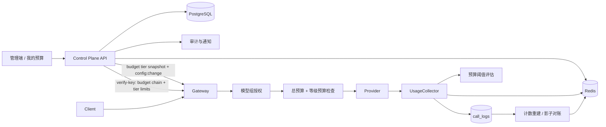
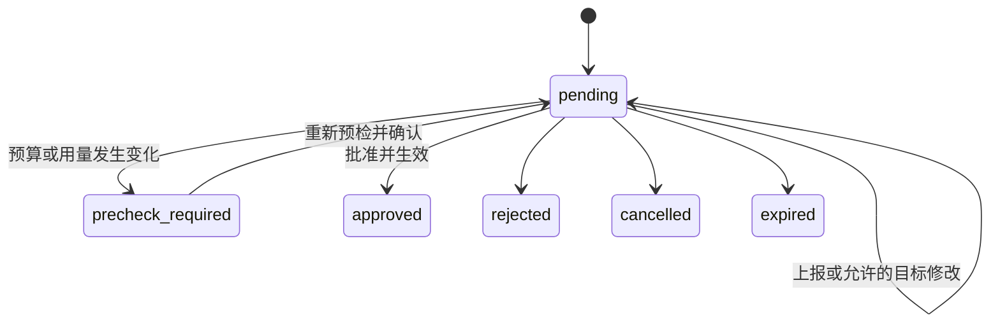

# 模型等级子预算完整技术设计（Technical Design v0.1）

## 1. 文档定位

本文把《模型等级子预算设计（Spec v0.5）》转换为可执行的系统设计，覆盖 Atlas 数据模型、Control Plane API 与事务、Gateway 与 Redis 执行链、扩容审批、风险事件、前端契约、观测、迁移、灰度和回滚。

事实基线：

- 现有系统已实现公司、工作室、部门日常池、部门服务池、成员五类总预算。
- Gateway 已实现请求前预算检查、请求后真实成本记账、Redis fail-open 和调用日志。
- 现有扩容申请仅支持总预算，批准后会调用 `SetBudget` 自动修改额度，但缺少事务、行锁和幂等字段。
- 代码中尚无模型等级、等级子预算、等级快照、等级风险事件和等级扩容实现。
- 新数据库变更只使用 `atlas-migrations/`，不再向遗留 `migrations/` 增加本功能迁移。

## 2. 关键技术决策

| 编号 | 决策 |
|---|---|
| TD-01 | 模型等级是模型组的预算分类，与 `group_models.complexity_tier` 完全隔离。 |
| TD-02 | 等级长期额度依附现有 `budget_allocations`，键为分配、等级、周期三元组。 |
| TD-03 | 临时额度使用通用 `budget_temporary_overrides`，同时支持总预算和等级预算，避免总预算临时扩容另建平行实现。 |
| TD-04 | 下周期生效使用通用 `budget_limit_schedules`，不把三个周期的计划值继续堆入 `budget_allocations`。 |
| TD-05 | 数据库与 API 金额使用 6 位小数字符串；Gateway Redis v2 使用整数微美元。 |
| TD-06 | Redis 新建 v2 key，不原地解释现有浮点 key；灰度期双写并从调用日志对账。 |
| TD-07 | 组到等级映射和功能开关走独立版本化快照；用户预算链中的等级额度继续随 verify-key 下发。 |
| TD-08 | 模型组授权先于预算检查，未授权请求必须先返回 403，避免泄露预算状态。 |
| TD-09 | 预算风险事件按实时用量计算，不新增人工关闭生命周期；告警记录只负责跨阈值通知去重。 |
| TD-10 | 扩容批准采用数据库事务、`FOR UPDATE`、批准幂等标记和事务后配置发布。 |
| TD-11 | “扩容申请”保留现有菜单名称；模型等级额度只是新增申请维度。 |
| TD-12 | 正数额度 Redis 故障 fail-open；静态 `$0` 从内存配置判断并保持 fail-closed。 |
| TD-13 | 周期使用系统级 `budget.timezone`（默认 `Asia/Shanghai`）和 ISO 周一作为周起点；Control Plane 与 Gateway 共享同一周期计算包。 |
| TD-14 | Gateway 对外错误码固定为小写 `budget_exceeded` 与 `tier_budget_exceeded`；Control Plane 管理 API 使用大写业务错误码。 |
| TD-15 | 等级功能开关固定为 `master_enabled`、`accounting_enabled`、`positive_enforcement_enabled`、`zero_block_enabled`、`shadow_enabled`、`v2_total_enforcement_enabled` 和 `legacy_total_write_enabled`。 |
| TD-16 | Gateway 等级预算代码统一放在 `internal/gateway/budget`，测试不得另建平行 `budgettier` 包。 |

## 3. 总体架构



服务边界：

- Control Plane 是等级、额度、审批和审计的唯一持久化写入口。
- Gateway 的预算决策不查询 PostgreSQL，只读 verify-key 预算链与 Redis 快照；调用日志 writer 可直写 PostgreSQL，但必须先写 Redis Stream，数据库启动不可用时后台重连并在恢复后回放。
- Redis 是实时检查与累计层，`call_logs` 是重建和历史报表事实源。
- Web 只负责展示与操作编排，所有范围裁剪和审批权限由服务端再次校验。

## 4. 数据模型

### 4.1 `model_tiers`

字段：

- `id uuid primary key`
- `name varchar(64) not null`
- `description text`
- `color varchar(7)`
- `sort_order int not null default 0`
- `enabled boolean not null default true`
- `archived_at timestamptz null`
- `created_at`、`updated_at`

约束：

- 未归档名称唯一。
- 有模型组、预算、审批、告警或调用日志引用时禁止物理删除。
- 归档等级不再出现在新建配置选项中，历史名称由调用日志快照保证。

### 4.2 `model_groups`

新增：

- `budget_tier_id uuid null references model_tiers(id) on delete restrict`
- 活跃模型组上的 `budget_tier_id` 部分索引。

`NULL` 表示未分级，只应用总预算。

### 4.3 `budget_tier_limits`

字段：

- `id uuid primary key`
- `budget_allocation_id uuid not null references budget_allocations(id) on delete restrict`
- `model_tier_id uuid not null references model_tiers(id) on delete restrict`
- `period_type varchar(8)`：`daily|weekly|monthly`
- `limit_usd numeric(18,6) not null`
- `effective_at timestamptz not null`
- `enabled boolean not null default true`
- `created_at`、`updated_at`

唯一约束：

- `(budget_allocation_id, model_tier_id, period_type)`

语义：

- 无记录：未配置，只受总预算。
- `enabled=true, limit_usd=0`：静态禁用。
- `enabled=true, limit_usd>0`：独立等级上限。
- `enabled=false`：暂停检查和等级累计，保留此前当前周期累计。

### 4.4 `budget_temporary_overrides`

通用临时额度表：

- `id uuid primary key`
- `budget_allocation_id uuid not null`
- `dimension_type varchar(8)`：`total|tier`
- `model_tier_id uuid null`
- `period_type varchar(8)`
- `target_limit_usd numeric(18,6) not null`
- `starts_at`、`expires_at`
- `expansion_request_id uuid unique null`
- `status varchar(16)`：`active|expired|cancelled|failed`
- `created_at`、`updated_at`

检查约束：

- `total` 时 `model_tier_id` 为空；`tier` 时必须存在。
- `expires_at > starts_at`。
- 同一预算分配、维度、等级、周期最多一个 active override。

有效额度：

```text
effective_limit = max(current_base_limit, active_override.target_limit)
```

总预算临时额度到期恢复届时有效的总预算基础值；等级临时额度到期恢复届时有效的等级基础值。临时额度不允许导致降额。

### 4.5 `budget_limit_schedules`

通用下周期计划表：

- `id`
- `budget_allocation_id`
- `dimension_type`
- `model_tier_id`
- `period_type`
- `target_limit_usd`
- `effective_at`
- `reason`
- `created_by`
- `status`：`pending|applied|replaced|cancelled|failed`
- `created_at`、`updated_at`

同一限制项最多一个 pending 计划。新计划替换旧计划时，将旧记录标记为 `replaced`，不删除审计历史。

Control Plane 只实现一个 `BudgetLifecycleExecutor` 处理到期 override 和到期 schedule。扫描使用 `FOR UPDATE SKIP LOCKED`，每条记录独立事务；应用失败后回滚该条事务，再用新事务标记 `failed`，不得在 PostgreSQL aborted transaction 中继续写。执行器通过 `BudgetLifecycleObserver` 发出 `override_expired`、`schedule_applied`、`schedule_failed` 事件，审批通知模块只实现 observer，不另建第二套 worker。

Observer 固定接口：

```go
type BudgetLifecycleObserver interface {
    OnOverrideExpired(context.Context, ExpiredBudgetOverride) error
    OnScheduleApplied(context.Context, AppliedBudgetSchedule) error
    OnScheduleFailed(context.Context, FailedBudgetSchedule) error
}
```

`failed` 表示到期状态迁移或计划应用失败，运维可重试；失败记录不再作为有效临时额度，是否恢复为 `active` 必须通过显式重试事务。

通知 observer 不直接把 `budget_allocation_id` 当作 scope ID。固定使用 `ResolveOwnerRecipients(ctx, budgetAllocationID)`，由 resolver 先读取 `budget_allocations.scope_type/scope_id`，再按真实组织作用域解析负责人。

### 4.6 `call_logs`

新增：

- `budget_tier_id uuid null`
- `budget_tier_name_snapshot varchar(64) null`
- `budget_tier_accounting_eligible boolean not null default false`
- `budget_tier_constraints_snapshot jsonb not null default '[]'`
- `budget_block_code varchar(64) null`
- `budget_block_dimension varchar(8) null`
- `budget_block_scope_type varchar(32) null`
- `budget_block_scope_id varchar(128) null`
- `budget_block_period_type varchar(8) null`

快照在请求开始、模型组完成解析后固定。`budget_tier_accounting_eligible` 记录该请求开始时是否应进入等级计数器；`budget_tier_constraints_snapshot` 保存该请求实际参与等级记账的每层 `redis_key/scope_type/scope_id/tier_id/period_type/period/reset_at`，无适用约束时为 `[]`。重建只能消费该 JSONB 事实，不能用当前 tier limit 或组织配置猜测历史。预算 402 把首要阻断维度写入 block 字段，风险事件据此聚合真实阻断；其他限制原因只进入结构化日志，不扩张调用日志列。历史数据不回填，存量记录 eligible 默认 `false`、约束默认空数组。

Go model 中上述五个 nullable block 字段统一使用 `*string`，长度严格对应 `64/8/32/128/8`；Gateway collector 使用统一 `stringPtr` helper 赋值，不把领域枚举直接赋给 `*string`。

### 4.7 独占重建与事实流硬容量

- 全局 lease key 为 `budget:v2:rebuild:lock`，owner 使用随机 token，Control Plane 仅通过 compare-and-renew Lua 续租和 compare-and-delete Lua 释放。
- 已放行可计费请求登记到 `budget:v2:billable:inflight` ZSET，member 为 request_id、score 为过期时间。准入 Lua 原子执行 lease 检查、过期 reservation 清理、`XLEN(stream) + ZCARD(inflight) < capacity` 校验和 `ZADD`，同时读取并固定 `budget:v2:active_generation`；无指针时使用 `legacy`，继续访问既有无 generation 前缀的 key。满载返回 503。
- 准入返回 typed outcome：检测到 rebuild lease 为 `rebuild_blocked`、容量满为 `capacity_blocked`，两者明确返回 503；Redis 连接、超时或 Lua 基础设施错误为 `infrastructure_fail_open`。该状态必须固化到 AccountingPlan 与 request context，即使紧随其后的 Redis check 已恢复成功也不得累计 v2 counter。正数预算继续放行且不创建 reservation，UsageCollector 优先同步写 PostgreSQL call_log；PostgreSQL 不可用而 Redis 已恢复时再写 Stream。`$0` 静态预算仍 fail-closed。
- 任一 admission/check Redis fail-open，或 `RedisCheckSucceeded=false` 时，不得生成或入队预算阈值告警；事实日志照常持久化，待后续 rebuild/reconciliation 恢复 counter 后再由正常成功请求触发阈值判断。reservation 请求将 alert callback/requests 挂到 PendingAccount，只有 request_id 幂等的 atomic account+spool 首次成功后才执行；callback 此时读取到的是累加后的新计数。重复完成、account 失败、仅 PG/Stream 事实路径均不告警。非 reservation 请求也必须在同步 account 成功后才入队。
- reservation 从准入开始按 TTL 的三分之一周期 heartbeat 续租，直到 UsageCollector 完成 counter 与 Redis Stream/同步 PostgreSQL fallback。完成或失败路径均停止 heartbeat 并 `ZREM`；进程崩溃才依赖 TTL 回收。正常 Stream 完成使用单个 Lua 执行 `XADD observability:call_logs:spool:v1` 与 `ZREM inflight`，所以 reservation 从占位转换为 Stream fact 时容量总和不变。普通非计费日志也必须在 Lua 中校验 Stream 与有效 reservation 的合计容量，不使用 `MAXLEN`。
- heartbeat 必须检查 Redis 错误与 Lua 返回值，并将 reservation 原子标记为 lost/error，记录 `gateway_budget_reservation_lost_total` / `gateway_budget_reservation_heartbeat_error_total`。若完成时 member 已丢失且 rebuild lease 存在，完成路径在有界 context 内等待 lease 释放，读取当前 active generation，并使用 request_id 幂等 marker 在一个 Lua 中完成“当前 generation counter 累加 + XADD + ZREM”；不得再写准入时的旧 generation。无法安全重绑时只持久化 call_log，并记录 `gateway_budget_counter_reconciliation_required_total`，由后续 rebuild 补齐 counter。
- Stream consumer 使用唯一 consumer name；`XAUTOCLAIM MinIdle` 默认 30 秒，必须大于单批最大处理时间，避免多实例抢占仍在处理的消息。poison 消息按有限重试后进入独立 DLQ。
- 每个请求固定准入时的 generation；check/account 将基础 key 映射为 `budget:v2:gen:{generation}:...`。重建持 lease 后等待 inflight 归零，可靠 drain Stream 到 PostgreSQL 并确认 length、pending、lag 均为零，再取 DB cutoff。allocations、tier limits、call_logs 均按 keyset 分页，聚合值和 metadata 写 run 临时 Redis hashes，再分批构建不可见的新 generation namespace。
- 新 generation 全部构建成功后，单个 Lua 校验 lease token 与预期旧 generation，并一次 `SET budget:v2:active_generation <new_generation>`。lease 丢失时指针不变并清理失败的新 namespace；旧 generation 保留原 TTL，可通过原子回写指针回滚。无逐批覆盖正式 key、delta 或 backup 路径。

### 4.8 `budget_alert_records`

新增：

- `dimension_type`：`total|tier`
- `model_tier_id uuid null`

唯一键必须包含：

```text
scope_type, scope_id, period_type, period, threshold,
dimension_type, coalesce(model_tier_id, zero_uuid)
```

同时修复现有 repository 查询遗漏 `period_type` 的问题。

### 4.9 `expansion_requests`

新增：

- `dimension_type`
- `model_tier_id`
- `duration_type`：`permanent|current_period`
- `priority`：`normal|urgent`
- `current_amount_snapshot`
- `used_amount_snapshot`
- `precheck_version`
- `prechecked_at`
- `expires_at`
- `applied_at`
- `applied_target_type`
- `applied_target_id`
- `sync_status`：`pending|synced|failed`

状态扩展：

- `pending`
- `precheck_required`
- `approved`
- `rejected`
- `cancelled`
- `expired`

同一申请人、作用域、周期、维度、等级、持续类型最多一条 `pending|precheck_required` 申请。

## 5. 金额与 Redis v2

### 5.1 金额边界

- API 金额用字符串传输，例如 `"100.000000"`，禁止前端依赖二进制浮点。
- Go 领域层使用 decimal 或明确的 micro-USD 转换函数。
- `microUSD = ROUND_HALF_UP(usd * 1_000_000)`。
- `call_logs.est_cost_usd` 继续保存 6 位小数成本快照。
- 本阶段不改变现有 `expansion_requests.current_amount/requested_amount` 的 Go JSON number 契约；数据库可无损扩大到 `numeric(18,6)`，新增快照和新 API DTO 使用 Decimal 字符串。旧字段契约迁移另行版本化。

### 5.2 Redis key

```text
budget:v2:used:{scope_type}:{scope_id}:{period}
budget:v2:tier:used:{scope_type}:{scope_id}:{tier_id}:{period}
budget:v2:tier:snapshot
```

period：

- 月：`YYYY-MM`
- 周：基于 `budget.timezone` 的 ISO 周一周期起点生成 `YYYY-Www`
- 日：`YYYY-MM-DD`

所有 v2 used value 为十进制整数字符串，Lua 只使用 `GET`、整数比较和 `INCRBY`。

Control Plane 与 Gateway 共用 `internal/budgetperiod` 计算周期和重置时间。首期 `budget.timezone=Asia/Shanghai`、`week_start=monday`，快照显式下发这两个值，禁止依赖容器本地时区。

### 5.3 迁移策略

1. 新 Gateway 在拦截关闭时写现有浮点总预算 key，同时影子写 v2 总预算和等级 key。
2. 对一个完整预算周期执行 `call_logs` 重建，与 v2 Redis 对账。
3. 偏差满足阈值后，检查切换到 v2；继续双写旧 key 一个周期用于快速回滚。
4. 稳定后停止旧 key 写入，旧 key 按 TTL 自然过期。

## 6. 配置同步

### 6.1 等级快照

Redis key：`budget:v2:tier:snapshot`

```json
{
  "schema_version": 1,
  "revision": 42,
  "updated_at": "2026-07-11T08:00:00Z",
  "master_enabled": true,
  "accounting_enabled": true,
  "positive_enforcement_enabled": false,
  "zero_block_enabled": true,
  "shadow_enabled": true,
  "v2_total_enforcement_enabled": false,
  "legacy_total_write_enabled": true,
  "timezone": "Asia/Shanghai",
  "week_start": "monday",
  "group_tiers": {
    "claude-opus": {"tier_id": "...", "tier_name": "高级", "enabled": true}
  }
}
```

Gateway 使用原子 holder 保存最近一次成功快照，通过 `config:change` 订阅和 30 秒 reconcile 更新。加载失败时继续使用 last-known-good。

开关语义：

- `master_enabled=false`：仍写等级快照到调用日志，但不检查、不累计等级计数。
- 影子期：`master_enabled=true`、`accounting_enabled=true`、`shadow_enabled=true`、`positive_enforcement_enabled=false`。
- `shadow_enabled` 只记录 would-block，不改变是否累计；是否累计仅由 `accounting_enabled` 决定。
- `$0` 是否阻断只由 `master_enabled && zero_block_enabled` 决定。
- v2 总预算切换和 legacy 双写由最后两个开关独立控制。

### 6.2 verify-key 预算链

每个 `BudgetScope` 增加仅已配置的 `tier_limits`：

```json
{
  "scope_type": "member",
  "scope_id": "...",
  "amount_usd": 300.0,
  "weekly_amount_usd": 75.0,
  "daily_amount_usd": 15.0,
  "tier_limits": [
    {
      "tier_id": "...",
      "tier_name": "高级",
      "period_type": "monthly",
      "base_limit_usd": "80.000000",
      "effective_limit_usd": "100.000000",
      "enabled": true,
      "effective_at": "...",
      "expires_at": "..."
    }
  ]
}
```

为保持 verify-key 向后兼容，现有总预算字段及 JSON number 类型不改名、不重复增加 v2 tag；Gateway 在构造 `AccountingPlan` 时转换为微美元。新增 `tier_limits` 内的 6 位 Decimal 使用字符串。

等级或子预算配置变化后：

1. 提交数据库事务。
2. Control Plane 的 `BudgetTierSnapshotPublisher` 从数据库构建完整快照并分配单调递增 revision。
3. 原子保存 `budget:v2:tier:snapshot`。
4. 发布现有 `infra.ChangeEvent` JSON 结构，事件类型固定为 `budget_tier_snapshot_updated`。
5. 失效相关 KeyCache。
6. 失败时记录同步状态，由 Control Plane reconcile job 恢复。

## 7. Gateway 请求执行

统一顺序：

1. 鉴权并取得预算链。
2. 解析请求模型组。
3. 执行模型组授权；失败返回 403。
4. 从等级快照固定 `TierContext`。
5. 检查预算链各层总预算。
6. 对已分级请求检查各层已配置且启用的对应等级额度。
7. 执行 RPM、并发及模型配额检查。
8. 调用上游。
9. 成功请求按实际成本累计总预算与等级预算。
10. 写含等级和价格快照的调用日志。
11. 异步评估 80%/100% 阈值。

阻断优先级：

1. 静态 `$0`
2. 已耗尽且重置时间最晚的限制
3. 其他已耗尽限制作为脱敏辅助原因

流式请求只在开始前检查，不中途截断；完成后正常记账并影响后续请求。

fail-open：

- Redis 错误且额度为正数：放行，不写对应 Redis 计数，仍写调用日志。
- 静态 `$0`：从内存配置直接阻断，不依赖 Redis。

Gateway 402 响应中的公开 `error.code` 固定为 `budget_exceeded` 或 `tier_budget_exceeded`，不使用 `model_tier_budget_exceeded` 等别名。

## 8. Control Plane API

### 8.1 模型等级

```text
GET    /api/v1/model-tiers
POST   /api/v1/model-tiers
GET    /api/v1/model-tiers/:id
PUT    /api/v1/model-tiers/:id
PATCH  /api/v1/model-tiers/:id/status
DELETE /api/v1/model-tiers/:id
PUT    /api/v1/model-tiers/reorder
PUT    /api/v1/groups/:id/budget-tier
PUT    /api/v1/groups/budget-tiers
```

### 8.2 等级额度

```text
GET  /api/v1/budgets/:allocation_id/tier-limits
PUT  /api/v1/budgets/:allocation_id/tier-limits
POST /api/v1/budgets/tier-limits/batch/preview
POST /api/v1/budgets/tier-limits/batch/apply
GET  /api/v1/budgets/tier-usage
GET  /api/v1/my/budget/tiers
```

这些接口均属于 Control Plane 基础交付，不能只在前端契约中声明。批量 preview/apply、tier usage 和 my budget tier aggregation 必须在 Gateway 计划开始前提供可测试的 handler 与 service。

`GET /api/v1/my/budget/tiers` 响应固定为：

```json
{
  "data": {
    "source_summary": {
      "mode": "personal",
      "primary_scope_type": "member",
      "has_shared_pool": false,
      "has_temporary_override": false
    },
    "effective_total": [
      {"period_type": "daily", "configured": true, "effective_limit_usd": "15.000000", "reset_at": "..."},
      {"period_type": "weekly", "configured": true, "effective_limit_usd": "75.000000", "reset_at": "..."},
      {"period_type": "monthly", "configured": true, "effective_limit_usd": "300.000000", "reset_at": "..."}
    ],
    "budget_chain": [],
    "tier_limits": [],
    "data_updated_at": "2026-07-11T08:00:00Z",
    "stale": false
  }
}
```

`source_summary.mode` 只允许 `personal|shared|mixed`，不得使用 `member`、`dept_shared` 或额外顶层 `source_mode` 别名。

### 8.3 风险事件

```text
GET /api/v1/budget/risk-events
GET /api/v1/budget/risk-events/summary
```

过滤支持作用域、周期、维度、等级、风险类型和严重程度。响应包含 `data_as_of` 与 `stale`。

### 8.4 扩容申请

```text
POST  /api/v1/expansion-requests/precheck
POST  /api/v1/expansion-requests
GET   /api/v1/expansion-requests/:id
PATCH /api/v1/expansion-requests/:id
POST  /api/v1/expansion-requests/:id/reprecheck
POST  /api/v1/expansion-requests/:id/decision
POST  /api/v1/expansion-requests/notify-owner
```

统一错误码：

- `MODEL_TIER_REFERENCED`
- `DUPLICATE_PENDING_EXPANSION`
- `EXPANSION_PRECHECK_STALE`
- `EXPANSION_USED_EXCEEDS_TARGET`
- `EXPANSION_REQUEST_EXPIRED`
- `BUDGET_LIMIT_BELOW_USED`
- `BUDGET_USAGE_UNAVAILABLE`
- `BUDGET_CONFIG_SYNC_PENDING`

## 9. 审批状态机与事务



批准事务：

1. `SELECT expansion_requests ... FOR UPDATE`。
2. 校验状态、过期时间、审批池权限和 `precheck_version`。
3. 读取最新基础额度、临时额度、当前已用和上级约束。
4. 若当前已用高于目标或快照变化，转 `precheck_required` 并返回 409。
5. 永久申请更新基础额度；当前周期申请写 temporary override。
6. 写审批流水、`applied_target_*`、`applied_at` 和 `sync_status=pending`。
7. 提交事务。
8. 事务后发布快照并通知；成功改 `synced`，失败改 `failed`。

重复批准同一 request ID 不重复写额度，返回原生效结果。

审批池实时从角色和组织范围解析，不固化成员列表。审批人失权后立即失去处理权限；审批池为空只通知上级，不自动改变审批层级。

## 10. 风险事件

风险事件是下列数据的实时投影：

- 基础额度与有效临时额度
- Redis v2 当前用量
- 80%/100% 告警去重记录
- `call_logs` 中近期预算 402 的首要阻断字段聚合

事件 ID 使用作用域、周期、维度、等级和风险类型的稳定哈希。使用率回落或进入新周期后事件自然消失。

Redis 不可用时返回 last-known 状态并标记 `stale=true`；不得把陈旧数据用于直接批准或高风险调额。

## 11. 前端模块

新增：

- `ModelTierListPage.vue`
- `BudgetOverviewSection.vue`
- `BudgetRiskEventsSection.vue`
- `BudgetTierLimitsPanel.vue`
- `BudgetAdjustDrawer.vue`
- `BudgetBatchAdjustWizard.vue`
- `ExpansionCreateForm.vue`
- `ExpansionApprovalDetail.vue`
- `ExpansionPrecheckPanel.vue`
- `ExpansionMobileListItem.vue`

状态管理：

- `modelTier` store：等级列表和颜色。
- `budgetNav` store：预算同页下钻、面包屑、页签和 URL query。
- 实时用量不做长时间全局缓存；页面显示 `data_updated_at`。

四角色规则由服务端范围裁剪为主，前端隐藏无权操作为辅。普通用户只通过“我的预算”发起个人申请；上级瓶颈改为通知负责人。

## 12. 安全与审计

- 新增 `model_tier:view`、`model_tier:manage`；预算和扩容继续复用 scoped 权限。
- 所有作用域 ID 在服务端按 Actor 管辖范围校验。
- 普通用户只收到上级限制来源与状态，不返回具体金额。
- 直接调额、批量调额、等级变更、归档、删除、审批、导出、重建均写审计。
- 审计保存变更前后值、原因、生效时间、操作者、目标对象和请求 ID。

## 13. 观测

指标：

- `gateway_budget_check_total{dimension,result,period,scope_type}`
- `gateway_budget_tier_reject_total{tier_id,scope_type,period}`
- `gateway_budget_fail_open_total{dimension}`
- `gateway_budget_shadow_would_block_total{dimension,tier_id}`
- `controlplane_budget_config_sync_total{result}`
- `controlplane_expansion_apply_total{dimension,duration,result}`

日志字段：

- `request_id`
- `group_name`
- `budget_tier_id`
- `dimension_type`
- `scope_type`
- `period_type`
- `used_micro_usd`
- `limit_micro_usd`
- `fail_open`
- `shadow_mode`

Trace 属性：

- `llm.budget_tier_id`
- `budget.check_result`
- `budget.block_reason`
- `budget.shadow_mode`

## 14. 性能与可靠性目标

- Gateway 预算检查额外 p99 小于 2ms。
- 单请求不增加 Control Plane 同步调用。
- Gateway CPU 增幅小于 5%（1k RPS 基线）。
- Redis Lua p99 小于 5ms。
- 影子计数与调用日志重建偏差小于 `max(0.1%, $1/day)`。
- 快照加载失败继续使用 last-known-good。

## 15. 发布与回滚

1. Atlas Expand 迁移。
2. Control Plane、Web、Gateway 全部部署，等级正数拦截关闭。
3. 打开等级快照、调用日志快照和 Redis v2 双写。
4. 至少运行一个完整预算周期影子对账。
5. 先启用 `$0` 静态禁用，再启用正数等级拦截。
6. 保留旧总预算 key 双写一个周期。
7. 稳定后停止旧 key 写入。

回滚优先级：

1. 关闭正数等级拦截。
2. 切回上一蓝绿版本。
3. 保留 Expand schema 和历史数据，不执行破坏性 DDL 回滚。
4. 仅严重故障且经确认后关闭 `$0` 静态禁用。

## 16. 实施分解

本功能拆为四个可独立验收的实施计划：

1. 数据模型、Atlas、领域契约与 Control Plane 基础能力。
2. Gateway、Redis v2、快照、记账与影子模式。
3. 扩容审批、风险事件与完整前端交互。
4. 端到端测试、观测、灰度发布和回滚演练。

每个阶段必须保持旧总预算流程可用，并通过功能开关实现向后兼容。

实施依赖固定为：

```text
P0 数据模型 + Control Plane API + snapshot publisher
  → P1 Gateway consumer + Redis v2
  → P2 审批/风险/前端
  → P3 系统验证/灰度
```

正式测试遵循仓库约定：Go 测试放在 `tests/` 镜像目录并验证业务行为，不对 GORM tag、类型声明或路由注册做反射/源码结构测试；前端只以 `vue-tsc` 和 Vite build 为自动门禁；端到端交互使用 `specs/<feature>/test/*.md` 手工用例，不引入前端组件测试、源码 token 测试、Playwright 或 Cypress。

## 17. 风险

- 现有 Redis 总预算使用浮点，切换微美元需要 v2 key 和完整对账。
- 现有 Gateway handler 在部分路径上预算检查早于授权，调序需要全接口回归。
- `BudgetManagePage.vue` 体积接近 3000 行，前端应分阶段拆分，避免一次重写。
- 扩容批准当前非事务，升级过程中必须防止旧实例与新状态机并行处理同一申请。
- verify-key payload 随等级数增长，必须只下发已配置额度并设置大小监控。
- CI 当前缺少强制 Go test 阶段，正式启用拦截前必须补齐。

## 18. 假设与非阻塞问题

假设：

- 全部纳入范围的请求都能在上游调用前解析模型组。
- 每个成员只属于一个部门。
- 现有审计日志支持按资源类型和资源 ID 查询对象时间线。
- 时区和周起始规则继续继承总预算配置。

非阻塞问题：

- 影子期长度应按实际启用的最长周期决定；生产月额度启用时建议至少一个自然月。
- Redis v2 旧 key 停写时间可根据回滚窗口延长。
- 是否把总预算数据库精度从 4 位统一升级到 6 位，应在 Atlas diff 审查时结合存量范围确认；API 与新表先固定 6 位。
