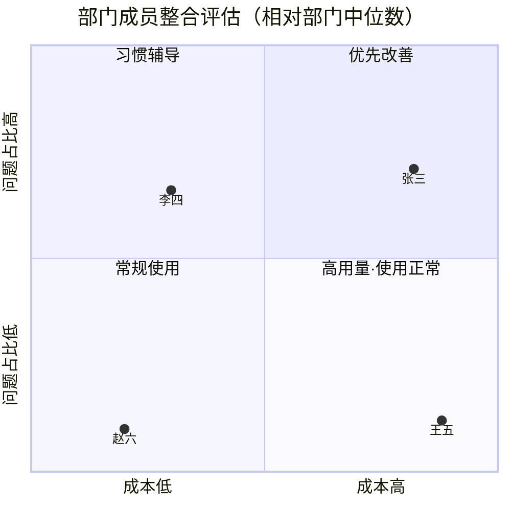

# Token 使用分析报告 · 输出与可视化设计（对齐 v0.6）

> 版本：设计 d1（对齐分析口径 v0.6，2026-09-01）
> 定位：本文只定义「报告长什么样、图怎么画、每块展示什么、状态怎么标」。
> 分析规则（维度/角度/五种情况/阈值）以 v0.6 为准，本文逐条映射，不改判定语义。
> 相关：`reports/*W33*.md`（旧版三级周报，被本设计替换）、`internal/observability/report/`（Report 契约纯库）、`docs/frontend-design-guidelines.md`（前端规范）。

---

## 0. 本文与 v0.6 的映射总表（先对齐，再看细节）

| v0.6 章节 | 对应本文 | 落在报告哪一块 |
| --- | --- | --- |
| §1 两个维度：成本 / 效率 | §2 判定口径 · §5 报告骨架 | 成本构成 + 效率诊断，两块分开 |
| §2 成本按计费项（输入/缓存/输出 + 选型放大器 + 无效消耗） | §2.2 成本三分法 | 「成本构成」块 |
| §2 效率按浪费机制（上下文/交互/生成/选型） | §3 五种情况诊断卡 | 「效率与情况」块 |
| §2 交互必须在会话上量、无 session 近似切分 | §2.4 会话口径 + §2.5 数据质量 | 顶部数据质量条 + 疑似标记 |
| §3.1–3.5 五种情况 | §3 逐条 | 五张诊断卡 |
| §3.6 严重异常：无关占比过高 | §4 严重异常 | 置顶「待核查」块（部门/工作室必现） |
| §4 成员整合评估（散点 + 分群） | §6 四象限 + §7 分群 | 部门/工作室主图 |
| §5.1 个人报告 | §8 | 个人版式 |
| §5.2 部门报告 | §9 | 部门版式 |
| §5.3 工作室报告 | §10 | 工作室版式 |
| 全程「高消耗≠用得差、只给线索不认定违规、疑似口径、不按总成本排序」 | §2.6 展示铁律 | 所有块的文案与排序规则 |

一句话目标：**报告要能写成「钱主要来自哪一块；其中多少来自哪类情况」，而不是只报花了多少。** 本设计的每一块都服务这句话。

---

## 1. 三种报告、一套骨架、一套数据

三份报告（个人 / 部门 / 工作室）**共用一个报告壳**，只是 scope 不同、可见块不同：

```text
┌─ 报告头 ─────────────────────────────────────────────┐
│ [层级切换 个人/部门/工作室] [周期 2026-W35] [CNY/USD] │
│ 数据截止 · 规则版本 v0.6 · 数据质量（会话/场景/价格覆盖率）│
└──────────────────────────────────────────────────────┘
 ① 基础数据
 ② 严重异常（命中才出现；部门/工作室必须在此，不能只写个人）
 ③ 成本构成（成本维度）
 ④ 效率与五种情况（效率维度）        ← 个人在此展开；部门/工作室折叠给到每人
 ⑤ 成员整合评估（部门/工作室独有）
 ⑥ 存在问题的人 / 正常使用的人（部门/工作室）
 ⑦ 口径与数据质量说明
```

三份报告都消费**同一份 Report JSON**（§11），页面、Markdown、HTML 输出逐字一致，避免「周报说 100、看板说 80」。旧版 `tools/report-viewer` 从 Markdown 正则抽数的做法废弃。

设计北极星（对齐前端规范）：浅色画布 + 品牌绿 `#36B34E` 单一强调色 + 友好圆角；状态不靠单一颜色，颜色 + 文字 + 图标三通道。

---

## 2. 判定口径（先把账和话对齐，避免误导）

### 2.1 两个维度，不合成一个分

- **成本维度**：花了多少、钱落在哪块（输入 / 缓存 / 输出）。
- **效率维度**：这种花钱方式合不合理（五种情况归因费用占比）。

报告里这两维**永远分成两块**，不做「效率分」「健康分」这类合成分。效率是用来解释成本的，不是第二套账。

### 2.2 成本三分法（对齐 §2 计费项）

成本按计费项拆三块，数据源已具备（`call_logs.input_cost_usd / cache_read_cost_usd / output_cost_usd / est_cost_usd`）：

| 计费块 | 口径 | 字段 |
| --- | --- | --- |
| 非缓存输入 | 实际按普通输入价计费的输入部分 | `input_cost_usd` |
| 缓存 | cache read；cache write 若计费另计，见下 | `cache_read_cost_usd`（+ 可选 cache write） |
| 输出 | completion / reasoning 输出 | `output_cost_usd` |

补充口径（写进报告附注，不进主图）：

- **cache write**：默认并入「缓存」块，附注注明是否含写入；若单价差异大可单列一条堆叠段，但不新增第四大块。
- **模型选型不是第四块**：它是**单价放大器**。同样体积换贵模型，输入/缓存/输出三块一起被抬高。报告用「成本构成 × 模型档位」的切片表达，不把模型当 Token 类别。
- **无效消耗（失败请求）**：照常计入对应的输入/缓存/输出块，但**打标为无效**，单独给一个「其中失败请求 ¥X」的注记，不当业务用量、不新增计费块。

### 2.3 分析顺序（写进结论生成逻辑，机器可复算）

```text
1. 看哪块费用高或涨得凶
2. 对上对应效率角度：
   - 输入/缓存 涨 → 查 上下文(3.1 前缀污染) + 交互(3.2/3.3)
   - 输出 涨       → 查 生成(3.4 输出失控)
   - 三块一起涨且高阶占比高 → 查 选型(3.5 杀鸡用牛刀)
3. 单信号只标记；两个条件同时成立才定性
4. 对照本人历史 + 同岗位，不跨岗位比绝对值
5. 缺会话/场景标签 → 结论加「疑似」
```

### 2.4 会话口径（对齐 §2「交互必须在会话上量」）

- 优先用真实 `session_id`（来自 `conversation_id`）。
- 无 `session_id` 时：**同一用户 + 同一 Key，间隔 > 30 分钟切分**为近似会话，标 `inferred=true`。
- 会话相关的三类情况（前缀污染连续段、挤牙膏、多任务不切会话）在 `inferred` 会话上得出的结论**一律标「疑似」**。

### 2.5 数据质量条（报告头必带，不能藏进附录）

一行中性文案 + 若干覆盖率，直接影响「疑似」比例：

```text
数据质量：真实会话 63% · 场景标签 41% · 模型价格目录 92% · 岗位标签 88%
其余按「同用户+同Key+30min」近似切分；标注「疑似」的结论表示证据不足，需人工确认。
```

覆盖率低于阈值（如 < 50%）时，相关情况卡整体降为「疑似」并在卡头提示。

### 2.6 展示铁律（贯穿所有块）

1. **高消耗 ≠ 用得差**：成本高的人默认不是问题，右下象限文案固定为「高用量、用法正常」。
2. **只给线索，不认定违规**：五种情况是「用法问题」，严重异常（3.6）是「待核查」，都不写「违规/滥用/浪费你」。
3. **疑似必标**：缺证据的结论用虚边 / 灰字 / 「疑似」徽标，与已定性视觉可区分。
4. **不按总成本排序当结论**：存在问题的人按「管理优先级」排；正常使用的人只做大概展示。
5. **五种情况分开记**：每类单独的次数、占比、费用、建议、状态，动作才能分开给。
6. **严重异常单独置顶**，不与五种情况混排。

### 2.7 五种情况的状态机（四态）

| 状态 | 含义 | 视觉 |
| --- | --- | --- |
| 已定性 confirmed | 双条件成立且排除项已检查、证据充分 | 实心色块 + 情况色 |
| 疑似 suspected | 命中但缺 session/场景/语义证据，或在 inferred 会话上 | 虚边 + 「疑似」徽标 |
| 未命中 not_hit | 判定未触发 | 折叠，不进正文 |
| 不可计算 not_computed | 字段覆盖不足，无法判定 | 灰字「数据不足」，**不等于未命中** |

---

## 3. 五种情况诊断卡（效率维度主体）

五种情况在报告里是**五张统一结构的诊断卡**，不用 A1–A5 裸码，用人类可读名。排序按**对应费用降序**，不按编号。

### 3.0 诊断卡统一结构

```text
┌────────────────────────────────────────────┐
│ 多任务不切会话                    [疑似]      │  ← 标题 + 状态徽标
│ 8 个会话 · 占全部会话 12.5%                   │  ← 次数/占比（会话或请求，看情况）
│ 归因费用 ¥420 · 占总成本 8.3%                 │  ← 费用（用归因费用，见 §3.6）
│ ──────────────────────────────────────────  │
│ 判定证据：                                    │  ← 机器可复算证据（判定区）
│  · 7 个会话输入单调上升                        │
│  · 缓存命中稳定 82%                            │
│  · 无 reset                                   │
│  · 5 个会话检测到任务类型切换                   │
│ 排除项：已排除「同任务工具连续轮」              │  ← 排除口径（§3.x 的「排除」）
│ ──────────────────────────────────────────  │
│ 建议：新任务开启新会话                          │  ← 单一动作（解读区）
│ [查看相关会话 →]                               │  ← 下钻
└────────────────────────────────────────────┘
```

判定区（证据、数值、占比）和建议区（一句话动作）视觉分格，对齐「判定/解读分界」。

下面逐条给出每张卡的**看什么 / 判定 / 排除 / 归因费用 / 占比口径**，全部照抄 v0.6。

### 3.1 前缀污染（上下文 → 输入、缓存）

- **看**：输入 Token、缓存命中率（缓存÷输入）、连续低命中段费用。
- **判定**：输入超长（>500k）且连续约 3 次命中率 < 30% 且这几轮输入并不短。
- **占比口径**：命中段请求数 ÷ 总请求数。
- **归因费用**：命中段的非缓存输入费 + 缓存费。
- **排除**：超长但命中稳定 → 不算污染，转看 3.3。

卡片额外展示：命中段数、平均输入长度、平均命中率、是否已排除「超长但稳定」。

### 3.2 挤牙膏（交互 → 先输出后输入，滚雪球再抬缓存）

- **看**：当轮用户输入 Token、会话轮次、这类会话总费用。
- **判定**：当轮输入过短（<30）且同会话轮次偏高（≥8），且属同一件事。
- **占比口径**：这类会话数 ÷ 总会话数。
- **归因费用**：会话内因多轮滚雪球额外产生的输入/缓存费（见 §3.6 桶）。
- **排除**：超短但一轮结束 = 正常短问。
- **动作**：首轮写清需求（不是切会话）。

卡片额外展示：会话短输入轮占比、中位轮次、P90 轮次。

### 3.3 多任务不切会话（交互 → 输入为主，其次缓存）

- **看**：会话内输入是否单调上升、有无 reset、缓存命中、当轮是否像另起一件事、这类会话输入费+缓存费。
- **判定**：超长 且 命中不差 且 无 reset 且 任务在切。
- **占比口径**：这类会话数 ÷ 总会话数。
- **归因费用**：任务切换后仍继承旧历史所产生的输入/缓存费。
- **排除**：同一任务的 Agent/IDE 连续工具轮（主题未切）= 正常复用。
- **疑似规则**：缺意图/任务标签时只标疑似；有任务类型切换或主题明显变化后才定性。
- **动作**：新任务开新会话。
- **与挤牙膏区别（卡上写明）**：挤牙膏=同一件事说不清；本条=多件事挤一个会话。

### 3.4 输出失控（生成 → 输出）

- **看**：输入 Token、输出 Token、输出/输入比（分模型看 P50/P90）、对应输出费。
- **判定**：输入 < 同模型/同岗位 P25，输出 > 同模型/同岗位 P75，或输出/输入 > 20；且反复出现或叠在贵模型上。
- **占比口径**：这类请求次数 ÷ 总请求数。
- **归因费用**：超出基准输出量的那部分输出费。
- **排除**：一次成功的长代码/长文档，且用轻量模型 = 可接受。

卡片额外展示：分模型的输出/输入 P50/P90 对比、是否叠加高阶模型。

### 3.5 杀鸡用牛刀（选型 → 三块乘贵单价）

- **看**：是否像简单任务（输入短、输出不长、一轮结束）、是否高阶模型、相对轻量模型溢价。
- **判定**：规模上像简单任务 且 走了高阶模型。
- **占比口径**：疑似简单请求中高阶次数占比。
- **归因费用**：相对合理轻量模型的**价格溢价**（不是整笔费用），需模型目录支持。
- **排除**：长上下文/高轮次/复杂任务用高阶 = 合理。
- **疑似规则**：无场景标签只标疑似。

卡片额外展示：模型档位、输入/缓存/输出单价、候选轻量模型及估算溢价。

### 3.6 归因费用防重复（实现要点，必须做）

同一请求可能同时命中 3.3 / 3.4 / 3.5，若各自把整笔费用相加会导致 `五种情况合计 > 个人总成本`，Y 轴失真。采用**费用桶归因**：

| 情况 | 归因费用桶 |
| --- | --- |
| 前缀污染 | 非缓存输入费 + 缓存费（命中段） |
| 挤牙膏 | 额外轮次的输入/缓存费 |
| 多任务不切会话 | 任务切换后继承旧历史的输入/缓存费 |
| 输出失控 | 超基准输出量的输出费 |
| 杀鸡用牛刀 | 相对轻量模型的价格溢价 |

重叠处理：**每个费用桶只归一个主因**；其他命中记为「共同命中费用」，不进合计。Report 同时给三个字段：

- `attributed_cost_usd`：进合计、进 Y 轴的归因费用。
- `overlap_cost_usd`：共同命中、不重复计。
- `affected_cost_usd`：涉及请求的整笔费用（仅展示影响面，不进 Y 轴）。

由此保证：`Σ attributed_cost ≤ 个人总成本`，Y 轴（问题消耗占比）稳定落在 0–100%。

---

## 4. 严重异常（3.6 与工作无关占比）——独立置顶块

这是五种情况之外的单独一条，**必须出现在部门报告和工作室报告**，不能只写在个人报告。

- **看**：可判定为与工作无关的消耗金额 ÷ 个人总成本。
- **判定**：该占比 > 20%。
- **展示**：报告置顶，写清金额、占比、主要时段/模型/Key。
- **口径可计算**：例如凌晨时段大量跑任务且未备案、或明显非工作场景。
- **红线**：Token 只给线索，不能自动认定违纪。现阶段一律标「待核查」，由负责人确认。
- **排除**：已备案的夜间批处理、跨时区、发布值班。

版式（置顶横幅 + 明细行）：

```text
┌─ 待核查（严重异常）───────────────────────────────────────┐
│ ⚠ 疑似与工作无关消耗占比 24.6%（> 20% 阈值）                 │
│ 金额 ¥1,280 · 主要时段 01:00–04:00 · 模型 GPT-X · Key xxxx │
│ 口径：凌晨时段大量任务且未备案；已排除跨时区/发布值班/已备案批处理│
│ [确认正常] [需核查] [误报]   证据：[相关会话] [相关请求]      │
└───────────────────────────────────────────────────────────┘
```

部门/工作室报告中，本块为**每个命中者一行**，置于四象限之前，姓名 + 无关消耗金额与占比 + 待核查状态；无人命中则整块不出现。四象限里这些点用**外描边**单独标记，不混进五种情况颜色。

---

## 5. 报告块级骨架（哪份报告出哪些块）

| 块 | 个人 | 部门 | 工作室 |
| --- | :-: | :-: | :-: |
| 报告头 + 数据质量 | ✓ | ✓ | ✓ |
| ① 基础数据 | ✓ | ✓（可附人数/人均） | ✓（+各部门基础数据） |
| ② 严重异常（待核查） | 命中才出现 | **命中必现·置顶** | **命中必现·置顶·带部门** |
| ③ 成本构成（三分法） | ✓ | ✓ | ✓ |
| ④ 效率与五种情况 | ✓ 完整展开 | 每个问题成员展开 | 各部门问题成员展开 |
| ⑤ 成员整合评估（四象限） | — | ✓ | ✓（全员一张图，点形分部门） |
| ⑥ 存在问题的人 | —（本人即主体） | ✓ | ✓（按部门分组） |
| ⑦ 正常使用的人 | — | ✓ 大概展示 | —（在各部门基础数据+全员图里可见） |
| ⑧ 口径与数据质量 | ✓ | ✓ | ✓ |

**存在问题的人定义**：整合评估图上问题消耗占比高于组织中位数（右上、左上），或被 3.1–3.5 定性，或命中 3.6。
**正常使用的人定义**：其余人。右下（成本高、问题占比低）算正常，不进问题清单。

---

## 6. 成员整合评估 · 主图散点（对齐 §4.1）

部门图相对**部门中位数**，工作室图相对**工作室中位数**。目的是分群、找该管的人，**不是排名**。只评同期有调用的人。

### 6.1 两轴

| 轴 | 指标 | 含义 |
| --- | --- | --- |
| X | 个人总成本 ÷ 组织成员成本中位数（倍数） | 花了多少 |
| Y | 问题消耗占比 = Σ 五种情况归因费用 ÷ 个人总成本 | 花得合不合理 |

- X 轴用**倍数**而非绝对值，避免被极端值撑开；建议对数刻度，画 `X=1`（中位）竖线。
- Y 轴十字线用**组织问题消耗占比中位数**画横线（不是固定 50%）。

### 6.2 四象限读法与文案

```text
        问题占比 高
            │
   左上      │      右上
 习惯辅导    │    优先改善
 (教用法,    │  (按点颜色对上
  不问责)    │   §3 对应动作)
 ───────────┼─────────── 成本 (×中位)
   左下      │      右下
 常规使用    │  高用量·使用正常
 (不重点)    │  (不干预,不当浪费)
            │
        问题占比 低
```

| 位置 | 页面标题 | 组织动作（写进点选详情） |
| --- | --- | --- |
| 右下 成本高·问题低 | 高用量·使用正常 | 不干预，不当浪费 |
| 右上 成本高·问题高 | 优先改善 | 按点颜色对上 §3 动作 |
| 左上 成本低·问题高 | 习惯辅导 | 教用法，不按金额问责 |
| 左下 成本低·问题低 | 常规使用 | 不作为重点 |

### 6.3 点的视觉编码

- **文字**：姓名（点用姓名，不匿名到无法识别；跨岗位裸成本排名的红线在「不排序、不比绝对值」上守，不是靠匿名）。
- **颜色**：主导问题类型（五种情况里归因费用最高的一类；五类都低 → 灰色「用法正常」）。
- **描边**：命中严重异常（3.6），单独描边，不混进五种颜色。
- **虚边/半透明**：仅「疑似」问题的人，与已定性区分（对齐 §4.2 末段）。
- **大小**：调用次数（可选，带开关）。
- **分面**：岗位差异大时按岗位分面（small multiples）。

配色（品牌绿系为正常，问题类型用可区分且色盲友好的定性色板，颜色 + 图例文字双通道）：

| 主导类型 | 建议色 | 图例文字 |
| --- | --- | --- |
| 用法正常 | 灰 `--el-text-color-secondary` | 正常 |
| 前缀污染 | 蓝 | 上下文 |
| 挤牙膏 | 青 | 交互-挤牙膏 |
| 多任务不切会话 | 紫 | 交互-混会话 |
| 输出失控 | 橙 | 生成 |
| 杀鸡用牛刀 | 红 | 选型 |
| 严重异常（描边） | 描边红 | 待核查 |

### 6.4 散点布局（Mermaid 示意，仅表达信息结构，不是最终视觉）



> 实现用 ECharts scatter（已在项目内用 Chart.js/ECharts），Mermaid 仅表达「四象限 + 点位」结构。真实实现需支持：点选、颜色映射、描边、分面、hover tooltip。

### 6.5 点选详情抽屉（右侧滑入，复用 UserDetailPanel 模式）

点一个点，只展示（对齐 §4.1 末段）：

```text
张三 · WEB前端开发
总成本 ¥1,600 · 相对部门中位 1.8×
问题消耗占比 71%（已定性）
主导问题：多任务不切会话 · 归因费用 ¥420
象限：优先改善
证据：7 会话输入上升 / 缓存稳定 / 无 reset / 任务切换 ×5
建议：新任务开新会话
[查看个人报告 →]
```

不默认跳调用明细（管理者先要「为什么」，再要「哪一条」）。

---

## 7. 成员整合评估 · 补充分群图（对齐 §4.2）

主图解决「贵不贵 × 浪费高不高」。分群图解决「浪费的方式像不像」：用五种情况各自的**费用占比向量**做聚类（人少时可直接按主导类型分色，不上算法）。

展示形态（二选一，按人数）：

- 人少（< 30）：**按主导类型分色的蜂群/条带**，同类聚在一起。
- 人多：**KMeans/层次聚类**后的分群散点或热力（行=人、列=五种情况费用占比）。

用途：一次讲清同一件事（如一簇都是挤牙膏、一簇都是不切会话）。分群是补充，**不替代主图四象限**。未定性、仅「疑似」的消耗在图上用虚边/单独图例，避免和已定性混读。

```text
分群（按主导问题）
[前缀污染]  ● ● ●
[挤牙膏]    ● ● ● ● ●
[混会话]    ● ●
[输出失控]  ● ● ● ●
[杀鸡牛刀]  ●
[正常]      ○ ○ ○ ○ ○ ○ ○
(实心=已定性  空心/虚=疑似)
```

---

## 8. 个人报告版式（对齐 §5.1）

周期默认本周。顺序严格如下。

### 8.1 ① 本周基础数据

第一屏五张 KPI 卡（对齐 §5.1 第 1 点：花多少、用多少 Token、各模型费用占比、调用次数）：

```text
[总成本 ¥11,520  ▲+806%]  [Token 2.3B  输入/缓存/输出 拆条]  [调用 8143 · 失败 25]
[会话 312 · 中位轮次 6 · P90 21]              [模型 8 个 · 高阶成本占比 85%]
```

Token 卡内嵌一条「非缓存输入 / 缓存 / 输出」占比小条，不再用总 Token 掩盖结构。

### 8.2 ② 严重异常（命中才出现）

见 §4 版式，放在基础数据之后、用法分析之前。

### 8.3 ③ 成本构成（对齐 §5.1 第 2 点）

主图：本周 vs 上周**堆叠条**（输入/缓存/输出），下方一句机器结论：

```text
本周 [■■■■ 非缓存输入 26.9%][■■■■■■ 缓存 55.7%][■■ 输出 17.4%]  ¥11,520
上周 [■■■■■ ][■■■ ][■ ]                                        ¥1,272
结论：本周成本主要来自缓存与非缓存输入，成本增长主要由输入侧驱动。
其中失败请求 ¥210（1.8%），已标为无效消耗。
```

再给「成本构成 × 模型档位」切片表（模型作为单价放大器，非第四块）：

| 模型（档位） | 成本 | 占比 | 非缓存输入 | 缓存 | 输出 |
| --- | --: | --: | --: | --: | --: |

### 8.4 ④ 效率与五种情况（对齐 §5.1 第 3 点）

五张诊断卡（§3），按归因费用降序。每张：命中哪类、次数占比、对应费用、一句建议、状态。都未命中则写「用法正常」空态：

```text
本周未命中五类用法问题，用法正常。（成本较高时补一句：高用量、用法正常。）
```

### 8.5 ⑤ 本周结论（两句话，机器模板）

```text
本周成本主要来自缓存与非缓存输入。问题消耗占总成本 11.8%，主导为多任务不切会话；
高成本主要由工作量造成，不建议按总金额干预。
```

### 8.6 个人报告红线

- 不出现跨岗位裸成本排名、不出现「你比别人贵/浪费」。
- 五种情况给建设性建议，owner=我。
- 严重异常只作「待核查」，配申诉/反馈入口。

---

## 9. 部门报告版式（对齐 §5.2）

顺序：基础数据 → 严重异常 → 四象限 → 存在问题的人 → 正常使用的人。

### 9.1 ① 部门本周基础数据

花了多少、用了多少 Token（输入/缓存/输出及费用）、各模型费用占比、调用次数；可附人数、人均成本。Service Key（程序调用）成本**单列**，不混入成员四象限。

```text
[部门成本 ¥43,648] [Token 36.6B 输入/缓存/输出] [调用 229,736 · 成功率 96.9%]
[活跃 27 人 · 人均 ¥1,617]   [Service Key 成本 ¥10,613（单列，不进成员评估）]
成本构成：[非缓存输入][缓存][输出]（同 §8.3 堆叠条）
```

### 9.2 ② 严重异常（命中必现·置顶）

见 §4。每人一行：姓名、无关消耗金额与占比、待核查。无则整节不出现。

### 9.3 ③ 部门成员整合评估图

§6 主图（相对部门中位数）；§7 分群图可选。点选详情见 §6.5。

### 9.4 ④ 存在问题的人

按**管理优先级**排序（不按总成本）：① 严重异常待核查 → ② 右上 → ③ 左上 → ④ 被 3.1–3.5 定性但未落上半区者。每人一份与个人报告 ③④⑤ 同结构的具体情况（不重复抄基础数据大表）：

| 姓名 | 象限 | 成本 | 问题占比 | 主导类型 | 归因费用 | 建议 |
| --- | --- | --: | --: | --- | --: | --- |

（点开展开该人的成本三分法 + 命中的诊断卡。）

### 9.5 ⑤ 正常使用的人

只做大概展示：姓名、成本、Token、调用次数、结论「用法正常 / 高用量·用法正常」。不展开五种情况。折叠表：

| 姓名 | 成本 | Token | 调用 | 结论 |
| --- | --: | --: | --: | --- |

---

## 10. 工作室报告版式（对齐 §5.3）

看结构、看严重异常、看各部门问题清单。顺序如下。

### 10.1 ① 工作室本周基础数据

花了多少、用了多少 Token、各模型费用占比、调用次数（+ 成本三分法堆叠条）。

### 10.2 ② 各部门基础数据

每部门一行/一块，字段同部门报告 ①，便于部门之间对照构成，**不做部门排名问责**：

| 部门 | 成本 | 非缓存输入费 | 缓存费 | 输出费 | 调用 | 活跃人数 | 主要模型构成 |
| --- | --: | --: | --: | --: | --: | --: | --- |

### 10.3 ③ 严重异常（命中必现·置顶·带部门）

全工作室命中 3.6 的人置顶，带所属部门，口径同部门 ②。无则整节不出现。

### 10.4 ④ 工作室成员整合评估图

全员一张图，轴相对**工作室中位数**；**点形区分部门**（避免只看见一堆人、看不见部门），颜色仍是主导问题，描边仍是严重异常。支持按部门/岗位/问题类型/已定性-疑似筛选。

### 10.5 ⑤ 各部门存在问题的人

按部门分组，每人具体情况同部门报告 ④。正常使用的人不上工作室报告（已在各部门基础数据与全员图里可见位置）。

---

## 11. 统一 Report JSON 契约（页面/Markdown/HTML 同源）

在现有 `internal/observability/report` 契约上升级，新增以下核心结构（示意，非最终字段名）：

```jsonc
{
  "schema_version": "2.0",
  "meta": {
    "level": "department",              // personal | department | studio
    "scope": { "id": "...", "name": "X-Lab", "studio_id": "...", "studio_name": "..." },
    "period": { "from": "2026-08-14", "to": "2026-08-21", "iso_week": "2026-W33" },
    "currency": { "report": "CNY", "usd_cny_rate": 7.2 },
    "rule_version": "v0.6"
  },

  "data_quality": {                     // §2.5 报告头必带
    "real_session_coverage": 0.63,
    "scene_label_coverage": 0.41,
    "price_catalog_coverage": 0.92,
    "position_label_coverage": 0.88,
    "failed_cost_coverage": 1.0
  },

  "cost_breakdown": {                    // §2.2 成本三分法
    "uncached_input_cost_usd": 0,
    "cache_cost_usd": 0,
    "cache_write_included": true,
    "output_cost_usd": 0,
    "failed_request_cost_usd": 0,       // 无效消耗，标记不新增块
    "prev": { "uncached_input_cost_usd": 0, "cache_cost_usd": 0, "output_cost_usd": 0 },
    "by_model_tier": [
      { "model": "qwen3.8-max", "tier": "high", "cost_usd": 0,
        "uncached_input_cost_usd": 0, "cache_cost_usd": 0, "output_cost_usd": 0 }
    ]
  },

  "safety_anomaly": {                    // §4 / §3.6 严重异常（待核查）
    "hit": true,
    "unrelated_cost_ratio": 0.246,
    "unrelated_cost_usd": 0,
    "top_hours": ["01:00-04:00"],
    "top_model": "gpt-x",
    "top_key": "xxxx",
    "basis": "凌晨大量任务且未备案",
    "excluded": ["跨时区", "发布值班", "已备案批处理"],
    "status": "pending_review"           // pending_review | confirmed_ok | need_check | false_positive
  },

  "usage_issues": [                      // §3 五种情况（个人层；单元层在 members[].usage_issues）
    {
      "type": "multi_task_session",      // prefix_pollution|toothpaste|multi_task_session|output_runaway|over_model
      "verdict": "suspected",            // confirmed | suspected | not_hit | not_computed
      "request_count": 0,
      "session_count": 8,
      "request_share": 0,
      "session_share": 0.125,
      "attributed_cost_usd": 60,         // §3.6 进合计/进 Y 轴
      "overlap_cost_usd": 12,            // 共同命中，不重复计
      "affected_cost_usd": 210,          // 影响面，仅展示
      "confidence": 0.6,
      "evidence": { "input_monotonic_sessions": 7, "cache_hit": 0.82, "reset": false, "task_switch": 5 },
      "excluded": ["同任务连续工具轮"],
      "suggestion_key": "start_new_session"
    }
  ],

  "member_evaluation": {                 // §6 / §7 仅 department | studio
    "cost_multiple_baseline": "median",
    "cost_median_usd": 0,
    "issue_ratio_median": 0.09,          // Y 轴十字线
    "members": [
      {
        "user_id": "...", "name": "张三", "position": "WEB前端开发", "dept_id": "...",
        "cost_usd": 1600, "cost_multiple": 1.8,
        "issue_attributed_cost_usd": 1136, "issue_cost_ratio": 0.71,
        "quadrant": "priority_improve",  // priority_improve|coach|routine|high_cost_normal
        "dominant_issue": "multi_task_session",
        "dominant_issue_cost_usd": 420,
        "safety_anomaly": false,
        "suspected_only": false,          // 仅疑似 → 虚边
        "calls": 8143,
        "usage_issues": [ /* 同上结构，用于点选详情与「存在问题的人」展开 */ ]
      }
    ],
    "clusters": [                         // §7 分群（可空）
      { "label": "toothpaste", "member_ids": ["..."] }
    ]
  },

  "conclusion": {                         // 两句话结论（机器模板变量）
    "cost_main_bucket": "cache",
    "issue_cost_ratio": 0.118,
    "dominant_issue": "multi_task_session",
    "note": "high_cost_by_workload"
  }
}
```

要点：

- `by_user` / `members` 由 level 裁剪；个人报告只出 `usage_issues` 与 `cost_breakdown`。
- 一切用法问题文案由前端模板按 `type/verdict/suggestion_key/evidence` 渲染，后端只出结构化判定（判定/解读分界）。
- `Σ attributed_cost_usd ≤ 总成本` 由 §3.6 桶归因保证，Report 层 `Validate()` 应校验此不等式。

---

## 12. 页面组件与复用

复用现有（`web/src/views/admin/usage/`）：`DashboardHeader`、`KpiCards`、`TrendChartSection`、`ModelChartSection`、`UserDetailPanel`、`UsageLogSection`、`UsageTraceDrawer`、`utils/currency`、`utils/time`。

新增（按最小面）：

| 组件 | 用途 | 复用基件 |
| --- | --- | --- |
| `ReportShell` | 报告壳（头 + 数据质量 + 块编排） | page-header 规范 |
| `ReportDataQuality` | §2.5 覆盖率条 + 疑似说明 | el-tag / tooltip |
| `CostBucketBar` | §2.2 输入/缓存/输出堆叠条 + 本周vs上周 | Chart.js bar / 纯 CSS 条 |
| `IssueDiagnosisCard` | §3 五种情况统一卡 | el-card + 判定/建议分格 |
| `SafetyAnomalyPanel` | §4 待核查置顶块 + 反馈按钮 | el-alert + 明细行 |
| `MemberQuadrantChart` | §6 四象限散点（颜色/描边/分面/点选） | ECharts scatter + UserDetailPanel 抽屉 |
| `MemberClusterChart` | §7 分群（可选） | ECharts |
| `ProblemMemberList` / `NormalMemberList` | §9.4 / §9.5 两张成员表 | RankingTable 变体（去排名语义） |

不在 `RankingTable` 上继续加列模拟四象限——排行表和四象限解决的问题不同。

三态强制（前端规范 §4）：每块处理 加载 / 空 / 数据不足；「数据不足」用灰字，不等于「未命中」。

---

## 13. 后端最小实施顺序（够用即可，不过度）

- **P0 统一账、停止误导**：统一 `total_tokens` 定义；周报出成本三分法（复用 `input/cache_read/output_cost_usd`）；失败请求费用打标；删除「高成本=关注」「高阶占比高=降级」这类单信号结论；统一五种情况 ID/名，弃用现有互相冲突的两套 A1–A5 编号。
- **P1 先上能可靠判断的**：输出失控（3.4）、部分杀鸡用牛刀（3.5）、前缀污染弱判（3.1）、成本三分法、部门/工作室四象限。缺标签一律「疑似」。
- **P2 补会话再做交互三类**：正式采集 `session_id`（source=client|inferred）、`turn_index`、`reset_flag`、`task_kind`/任务切换标签；完成挤牙膏（3.2）、多任务不切会话（3.3）、连续前缀污染段。暂不改采集链可先离线「用户+Key+30min」推断并标 `inferred`。
- **P3 严重异常闭环**：非工作场景规则 + 备案（夜间批处理/跨时区/发布值班）+ 待核查状态机 + 负责人确认 + 误报回写。无备案与场景口径前，3.6 只做内部试算，不正式上线。

---

## 14. 校验：本设计对 v0.6 的逐条覆盖

- §1 两维度 → §2.1（不合成分）。
- §2 计费项拆分 + 选型放大器 + 无效消耗 → §2.2 + §8.3 切片表。
- §2 效率四角度 → §3 五张卡（上下文=3.1、交互=3.2/3.3、生成=3.4、选型=3.5）。
- §2 交互在会话上量、无 session 30min 近似、疑似口径 → §2.4 + §2.5 + 状态机 §2.7。
- §2 分析顺序、单信号只标记、双条件定性、对本人历史+同岗、不跨岗位比绝对值 → §2.3 + §6.1（相对中位）。
- §3.1–3.5 看/判定/排除 → §3 逐条照抄。
- §3.6 严重异常 20% 阈值、置顶、待核查、不自动认定、排除备案 → §4 + 部门/工作室置顶。
- §4.1 散点两轴、中位十字、四象限动作、颜色=主导类型、描边=严重异常、大小=调用、岗位分面、点选详情 → §6。
- §4.2 分群、疑似虚边 → §7。
- §5.1 个人四段顺序 → §8。
- §5.2 部门五块 + 问题人管理优先级 + 正常人大概展示 + Service Key 单列 → §9。
- §5.3 工作室六块 + 各部门基础数据 + 点形分部门 + 不重复正常人 → §10。
- 全程铁律（高消耗≠差、只给线索、不按总成本排序、五类分记、异常单列） → §2.6 贯穿。
```
