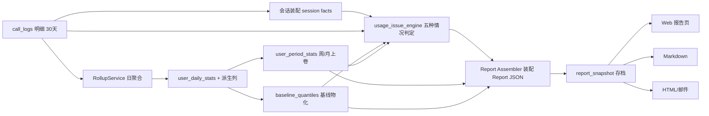

# Token 使用分析报告 · 实现细则（编写细节 / 输出形式 / 查询口径 / 实现逻辑）

> 配套：`docs/token-usage-analysis-report-design.md`（规范）、`docs/token-usage-analysis-report-sample.md`（样张）。
> 本文把每一部分落到**可开工级别**：字段口径、SQL、判定算法、费用桶归因、Report JSON 装配、后端接口、前端组件契约、实施阶段。
> 代码坐标基于现仓库：`internal/observability/`（聚合/handler/model）、`internal/gateway/observability/`（采集）、`internal/gateway/scheduler/session_key.go`（会话键）、`web/src/views/admin/usage/`（前端）。
> 铁律沿用 v0.6：成功=`status=200`；个人口径排除 `key_type='service'`；`total_tokens=prompt+completion+reasoning`（不含 cached/cache_write）；时区 `Asia/Shanghai`；`est_cost` 为估算非结算；CNY=USD×rate。

---

## 0. 数据流全景（先定层，再定每层怎么算）



分层职责（每层只做一件事，判定/解读分界）：

| 层 | 输入 | 产出 | 特性 |
| --- | --- | --- | --- |
| L0 明细 | 上游 usage | `call_logs`（含成本三分字段） | 事实，只增不改 |
| L0.5 会话 | `call_logs` | 会话事实（轮次/输入序列/reset/任务切换） | 事实，可复算 |
| L1 日聚合 | `call_logs` | `usage_daily` + `user_daily_stats`(+派生列) | 事实 |
| L2 周期/基线 | L1 | `user_period_stats` / `baseline_quantiles` | 相对基准，可复算 |
| L3 判定 | 会话 + L1/L2 + 基线 | `usage_issues` / `safety_anomaly`（结构化判定） | 判定，附证据 |
| L4 装配 | L3 + L1/L2 | `Report JSON`（三层：fact/judgment/expression） | 契约 |
| L5 输出 | Report JSON | 页面 / MD / HTML | 只回填措辞，无新算 |

---

## 1. 报告头 + 数据质量（对齐规范 §2.5）

### 1.1 输出形式

报告头组件 `ReportShell` + `ReportDataQuality`（Element Plus `el-tag`/`el-tooltip`）：

```text
[层级 个人|部门|工作室] [周期 el-date-picker/week] [币种 CNY|USD]
数据质量：真实会话 63% · 场景标签 41% · 价格目录 92% · 岗位标签 88% · 失败费用 100%
```

### 1.2 查询口径（覆盖率）

在装配期一次性算出（scope 内、期内、成功口径不限），全部为 `命中行数 / 总行数`：

```sql
-- data_quality（scope 过滤条件 :where 见 §3.2）
SELECT
  COUNT(*)                                                              AS total,
  COUNT(*) FILTER (WHERE session_id IS NOT NULL AND session_id <> '')   AS real_session,
  COUNT(*) FILTER (WHERE scene IS NOT NULL AND scene <> '')             AS with_scene,
  COUNT(*) FILTER (WHERE input_price_snapshot IS NOT NULL)              AS with_price,
  COUNT(*) FILTER (WHERE status <> 200)                                 AS failed
FROM call_logs
WHERE ts >= :from AND ts < :to_excl AND (:where);
```

- `岗位标签覆盖率`：`COUNT(DISTINCT user_id) 有 job_category / 全部 user_id`（LEFT JOIN users，见 §6.4）。
- `session_id`/`scene` 若列尚未落（见 §12 阶段），覆盖率返回 0 并前端显示「按近似切分」。

### 1.3 实现逻辑

- `real_session_coverage < 0.5` → 装配器把交互三类（前缀污染连续段、挤牙膏、多任务不切会话）默认 `verdict` 上限设为 `suspected`。
- 覆盖率写入 `Report.data_quality`，前端据此渲染疑似提示条。

---

## 2. 会话事实装配（对齐 §2.4，交互三类的地基）

### 2.1 会话键口径（复用现有 `ExtractSessionKey`）

- 采集侧已有 `scheduler.ExtractSessionKey`：优先 `conversation_id`，否则 `hash(KeyID)`。
- **落库**：在 `UsageEvent`/`call_logs` 增列 `session_id`（`hash(KeyID)` 兜底不适合会话切分，仅作占位）；再增 `session_id_source`（`client`|`inferred`）。
- 无 client 会话时，装配期用「同 `user_id` + 同 `key_id`，相邻请求间隔 > 30min 切分」生成 `inferred` 会话号。

### 2.2 近似切分 SQL（无 client session 时，装配期离线跑）

```sql
-- 生成 inferred 会话号：按 (user_id,key_id) 排序，间隔>30min 递增分段
WITH ordered AS (
  SELECT request_id, user_id, key_id, ts,
         prompt_tokens, cached_tokens, cache_write_tokens, completion_tokens,
         input_cost_usd, cache_read_cost_usd, output_cost_usd, est_cost_usd,
         model, status,
         LAG(ts) OVER (PARTITION BY user_id, key_id ORDER BY ts) AS prev_ts
  FROM call_logs
  WHERE ts >= :from AND ts < :to_excl
    AND (COALESCE(NULLIF(key_type,''),'personal') <> 'service')
    AND (:where)
),
marked AS (
  SELECT *,
    SUM(CASE WHEN prev_ts IS NULL
             OR ts - prev_ts > interval '30 minutes' THEN 1 ELSE 0 END)
        OVER (PARTITION BY user_id, key_id ORDER BY ts) AS session_seq
  FROM ordered
)
SELECT user_id, key_id, session_seq,
       COUNT(*)                              AS turns,
       MIN(ts)                               AS started_at,
       MAX(ts)                               AS ended_at,
       array_agg(prompt_tokens ORDER BY ts)  AS prompt_seq,
       array_agg(cached_tokens ORDER BY ts)  AS cached_seq,
       array_agg(model         ORDER BY ts)  AS model_seq,
       SUM(input_cost_usd)                   AS input_cost,
       SUM(cache_read_cost_usd)              AS cache_cost,
       SUM(output_cost_usd)                  AS output_cost
FROM marked
GROUP BY user_id, key_id, session_seq;
```

### 2.3 会话事实结构（内存，不必落表）

```go
type SessionFact struct {
    UserID, KeyID   string
    SessionID       string   // client 或 inferred:<seq>
    Inferred        bool
    Turns           int
    PromptSeq       []int64  // 每轮 prompt_tokens
    CachedSeq       []int64
    ModelSeq        []string
    HasReset        bool     // reset_flag 任一轮为真（阶段 P2 采集）
    TaskSwitches    int      // task_kind 相邻不同的次数（阶段 P2）
    InputCost, CacheCost, OutputCost float64
}
```

派生判据（纯函数，可单测）：

- `inputMonotonic()`：`PromptSeq` 单调不降的比例。
- `shortInputRatio(threshold=30)`：短输入轮占比。
- `cacheHitRate()`：`Σcached / Σprompt`。
- `taskSwitched()`：`TaskSwitches > 0`。

---

## 3. 成本三分法（对齐规范 §2.2）

### 3.1 输出形式

- `CostBucketBar`：本周 vs 上周堆叠条（非缓存输入 / 缓存 / 输出）。
- 模型档位切片表：成本构成 × 模型档位。
- 一句机器结论 + 失败费用注记。

### 3.2 查询口径（scope 过滤 `:where`）

三层 scope 用统一 where 片段（沿用现有 handler 写法）：

| level | where |
| --- | --- |
| personal | `user_id = :id AND (key_type<>'service')` |
| department | `dept_id 归一(:id)`（沿用 `usage_handler.go:505` 的 dept 归一）+ 成员用 `key_type<>'service'`、程序单列 `key_type='service'` |
| studio | `studio_id = :id`（或 dept_studio_map 反查），成员/程序同上 |

成本三分聚合：

```sql
SELECT
  COALESCE(SUM(input_cost_usd),0)                                   AS uncached_input_cost,
  COALESCE(SUM(cache_read_cost_usd),0)                              AS cache_cost,
  COALESCE(SUM(output_cost_usd),0)                                  AS output_cost,
  COALESCE(SUM(est_cost_usd) FILTER (WHERE status<>200),0)          AS failed_cost,
  COALESCE(SUM(est_cost_usd),0)                                     AS total_cost
FROM call_logs
WHERE ts >= :from AND ts < :to_excl AND (:where_member);
```

上周同口径：`ts ∈ [from-7d, from)`。模型档位切片：`GROUP BY model` 再 join 模型档位映射（见 §7.2）。

### 3.3 实现逻辑与口径注意

- cache write：默认并入 `cache_cost`，Report 标 `cache_write_included=true`；如需单列，追加 `SUM(cache write 成本)`（当前 `call_logs` 无独立 cache_write 成本列，只有 `cache_write_tokens`，需按 `cache_write_tokens × 价格` 现算或增列，阶段 P1 可先并入）。
- 失败费用只做标记，`failed_cost` 不从三块里扣除，仅注记「其中失败 ¥X」。
- 结论模板：比较三块占比，取最大块 + 与上周的增量方向，生成 `cost_main_bucket`。

---

## 4. 五种情况判定引擎（对齐规范 §3，判定层核心）

引擎 = 纯函数集合，输入 `SessionFact[]` + `call_logs` 行 + `baseline_quantiles`，输出 `[]UsageIssue`。每条规则一函数、独立单测、独立阈值（来自可配置 `RuleSet`，不写死）。

### 4.0 UsageIssue 输出结构

```go
type UsageIssue struct {
    Type        string  // prefix_pollution|toothpaste|multi_task_session|output_runaway|over_model
    Verdict     string  // confirmed|suspected|not_hit|not_computed
    RequestCnt  int
    SessionCnt  int
    RequestShare float64
    SessionShare float64
    AttributedCostUSD float64 // §5 进合计
    OverlapCostUSD    float64 // 共同命中，不重复计
    AffectedCostUSD   float64 // 影响面
    Confidence  float64
    Evidence    map[string]any
    Excluded    []string
    SuggestionKey string
}
```

### 4.1 前缀污染 prefix_pollution（上下文）

判定（§3.1）：输入超长（>500k）且**连续约 3 次**命中率 <30% 且这几轮输入并不短。

```text
遍历每个会话按时序的请求：
  维护滑窗 window=3
  命中条件(单轮): prompt_tokens > 500_000 且 (cached/prompt) < 0.30
  连续满足 >= 3 轮 → 该段标为污染段
排除: 段内命中率稳定(方差小)但长 → 不算污染(转 3.3)
占比 = 污染段请求数 / 总请求数
归因 = 污染段的 input_cost + cache_cost
verdict = confirmed（结构字段即可判，不依赖 scene；inferred 会话则 suspected）
```

依赖字段全在 `call_logs`（prompt/cached/cost），**P1 即可上**。

### 4.2 挤牙膏 toothpaste（交互）

判定（§3.2）：当轮输入过短（<30）且同会话轮次偏高（≥8）且同一件事。

```text
对每个会话:
  若 turns >= 8 且 shortInputRatio >= 阈值(如 0.5) 且 属同一任务:
    命中
排除: 超短但 turns==1(一轮结束) → 正常短问
归因 = 会话内额外轮次(除首轮外)的 input_cost + cache_cost 桶
占比 = 命中会话数 / 总会话数
verdict: 有 task_kind 且同任务 → confirmed；缺任务标签或 inferred → suspected
```

“同一任务”依赖 `task_kind`（P2 采集）；P1 阶段无此字段 → 一律 `suspected`。

### 4.3 多任务不切会话 multi_task_session（交互）

判定（§3.3）：超长 且 命中不差 且 无 reset 且 任务在切。

```text
对每个会话:
  超长: max(PromptSeq) 或末轮 prompt 超个人P90
  命中不差: cacheHitRate() >= 阈值(如 0.4)
  无 reset: HasReset == false
  任务在切: taskSwitched() == true
  四者成立 → 命中
排除: 同任务连续工具轮(taskSwitches==0 且主题未切) → 正常复用
归因 = 任务切换后仍继承旧历史的 input_cost + cache_cost
占比 = 命中会话数 / 总会话数
verdict: 有任务切换证据 → confirmed；缺 task 标签 → suspected
```

`reset_flag`/`task_kind` 为 P2 字段；缺失时只出 `suspected`，并在 evidence 标注。

### 4.4 输出失控 output_runaway（生成）

判定（§3.4）：输入 < 同模型/同岗位 P25，输出 > 同模型/同岗位 P75，或输出/输入 >20；反复出现或叠贵模型。

```sql
-- 分模型的输入/输出分位基线（baseline_quantiles 物化，或期内现算）
SELECT model,
  percentile_cont(0.25) WITHIN GROUP (ORDER BY prompt_tokens)     AS in_p25,
  percentile_cont(0.75) WITHIN GROUP (ORDER BY completion_tokens) AS out_p75
FROM call_logs
WHERE ts >= :from AND ts < :to_excl AND status=200
GROUP BY model;
```

```text
逐请求判定(用其 model 的 in_p25/out_p75):
  hit = prompt < in_p25 AND completion > out_p75
      OR (completion / NULLIF(prompt-cached,1)) > 20
  强化: 同一 user 反复出现(次数>=N) 或 model 为高阶 → 提升 confidence
排除: 一次成功长输出 + 轻量模型 → 可接受(不计)
归因 = 超基准输出量的输出费 = (completion - out_p75_tokens) 折算 output 单价
占比 = 命中请求数 / 总请求数
verdict: 纯结构字段可判 → confirmed
```

**P1 即可上**（不依赖 scene/session）。

### 4.5 杀鸡用牛刀 over_model（选型）

判定（§3.5）：像简单任务 且 走高阶模型。

```text
简单任务代理判据(无 scene 时): prompt 短(< 岗位P25) 且 completion 不长(< 岗位P50) 且 会话 turns==1
高阶: model 在高阶档位集合(§7.2)
命中 = 简单 且 高阶
排除: 长上下文/高轮次/复杂 → 合理
归因 = 相对候选轻量模型的价格溢价:
  premium = est_cost - recomputed_cost_with_light_model
  recomputed 用同 token 结构 × 轻量模型单价(model_catalog)
占比 = 疑似简单请求中高阶次数 / 疑似简单请求数
verdict: 无 scene → suspected；有 scene 且判为简单 → confirmed
```

依赖 `model_catalog` 价格与档位映射（已有）。溢价需要“候选轻量模型”，取同能力组内最低档位模型单价。

### 4.6 RuleSet（阈值集中、可配置、不写死）

```go
type RuleSet struct {
  PrefixLongInputTokens int64   // 500_000
  PrefixLowHitRate      float64 // 0.30
  PrefixConsecutive     int     // 3
  ToothShortInput       int64   // 30
  ToothMinTurns         int     // 8
  ToothShortRatio       float64 // 0.5
  MultiCacheHitMin      float64 // 0.40
  OutRunawayRatio       float64 // 20
  OverModelTiers        []string// {"high","ultra"}
}
```

沿用现有 `report.DefaultRuleSet()` 扩展；阈值先当口径，8–12 周数据后用 `baseline_quantiles` 校准。

---

## 5. 费用桶归因（对齐规范 §3.6，防重复计算）

**这是 Y 轴正确性的关键。** 装配器在拿到 `[]UsageIssue` 后做一次归因清算：

```text
1. 每笔请求/会话费用只允许进「一个主因桶」:
   对同一请求命中的多个情况，按优先级或按“该桶费用最大”择一为主因
   主因得 attributed_cost；其余情况在该笔上记 overlap_cost
2. 汇总:
   issue.attributed_cost_usd = Σ 该情况作为主因的费用桶
   issue.overlap_cost_usd    = Σ 该情况作为非主因的重叠费用
   issue.affected_cost_usd   = Σ 命中该情况的请求整笔费用(仅展示)
3. 校验(Report.Validate):
   Σ issue.attributed_cost_usd <= total_cost   // 否则报错
4. Y 轴: issue_cost_ratio = Σ attributed_cost / total_cost ∈ [0,1]
```

主因择一规则（可配置，默认按费用桶金额最大）：

```go
func pickPrimary(hits []Hit) *Hit {
  sort.Slice(hits, func(i,j int) bool { return hits[i].BucketCost > hits[j].BucketCost })
  return &hits[0]
}
```

这样保证四象限 Y 值稳定，不会出现「合计 > 总成本」。

---

## 6. 聚合、派生与基线（L1/L2 后端）

### 6.1 user_daily_stats 补派生列（P0-1）

在 `RollupService.Run(day)` 的聚合 SQL 一并算，幂等 upsert（`ON CONFLICT DO UPDATE`）：

| 新列 | 口径 |
| --- | --- |
| `cache_hit_pct` | `cached_tokens / NULLIF(prompt_tokens,0)` |
| `output_ratio` | `completion_tokens / NULLIF(prompt_tokens-cached_tokens,0)` |
| `reasoning_share` | `reasoning_tokens / NULLIF(completion_tokens,0)` |
| `cost_per_1m` | `est_cost_usd / NULLIF(total_tokens/1e6,0)` |
| `uncached_input_cost / cache_cost / output_cost` | `SUM(input_cost_usd)/SUM(cache_read_cost_usd)/SUM(output_cost_usd)` |
| `avg_duration_ms / p90_duration_ms` | `AVG / percentile_cont(0.9)` |

迁移：`atlas-migrations/<ts>_user_daily_stats_derived.sql`（走 `atlas-db-migration` skill）。

### 6.2 user_period_stats 周/月上卷（P0-2）

从 `user_daily_stats` `date_trunc('week'/'month')` 上卷，不回扫 call_logs：

```sql
INSERT INTO user_period_stats (period_type, period_start, user_id, studio_id, dept_id,
  active_days, req_count, success_count, error_count, model_count,
  prompt_tokens, cached_tokens, completion_tokens, reasoning_tokens, est_cost_usd,
  uncached_input_cost, cache_cost, output_cost,
  cache_hit_pct, output_ratio, reasoning_share, cost_per_1m)
SELECT 'week', date_trunc('week', stat_date), user_id, MAX(studio_id), MAX(dept_id),
  COUNT(DISTINCT stat_date), SUM(req_count), SUM(success_count), SUM(error_count),
  MAX(model_count), SUM(prompt_tokens), SUM(cached_tokens), SUM(completion_tokens),
  SUM(reasoning_tokens), SUM(est_cost_usd),
  SUM(uncached_input_cost), SUM(cache_cost), SUM(output_cost),
  SUM(cached_tokens)::float/NULLIF(SUM(prompt_tokens),0),
  SUM(completion_tokens)::float/NULLIF(SUM(prompt_tokens)-SUM(cached_tokens),0),
  SUM(reasoning_tokens)::float/NULLIF(SUM(completion_tokens),0),
  SUM(est_cost_usd)/NULLIF(SUM(total_tokens)/1e6,0)
FROM user_daily_stats
WHERE stat_date >= :week_start AND stat_date < :week_end
GROUP BY date_trunc('week', stat_date), user_id
ON CONFLICT (period_type, period_start, user_id) DO UPDATE SET ...;
```

- cron：周一 02:00 覆盖本周+上周；月 1 号覆盖当月+上月（复用 `RollupCron` ticker + Redis leader lock）。
- 部门/工作室层**不建表**，查询时对 `user_period_stats` 按 `dept_id`/`studio_id` 再 `GROUP BY`。
- 28 天基线、周环比、周快照都从此表取，突破 call_logs 30 天限制。

### 6.3 baseline_quantiles 物化（P0-3）

逐指标 scope（`all`/`position`/`model`）的 P25/P50/P75/P90/MAD，物化 + 钉死参考窗（如近 28 天），供输出失控（分模型/岗位分位）、纵向基线用。cron 每 6h 刷新，Redis 缓存。先只物化五种情况用到的：`prompt`/`completion` 分模型分位、`cost` 个人纵向。

### 6.4 岗位归因（P0-7，不改 call_logs）

查询侧 LEFT JOIN `users`（迁移 047 已有 `job_title/job_category/job_family`），收敛为一个 service 方法供四象限同岗分位与「输出失控/杀鸡用牛刀」的岗位分位共用：

```sql
LEFT JOIN users u ON u.id::text = cl.user_id
-- 取 COALESCE(u.job_category, u.job_family, u.job_title, '') AS position
```

---

## 7. 模型档位与选型放大器（对齐 §2.2 单价放大器 / §3.5）

### 7.1 输出形式

「成本构成 × 模型档位」表（§3.1）。

### 7.2 查询口径

- 档位来源：`model_catalog` + 模型组等级（复用 `FetchModelTierHierarchy`，已在旧 usage-report 用过）；`OverModelTiers` 命中即高阶。
- 切片 SQL：

```sql
SELECT model,
  COALESCE(SUM(est_cost_usd),0)      AS cost,
  COALESCE(SUM(input_cost_usd),0)    AS uncached_input_cost,
  COALESCE(SUM(cache_read_cost_usd),0) AS cache_cost,
  COALESCE(SUM(output_cost_usd),0)   AS output_cost
FROM call_logs
WHERE ts >= :from AND ts < :to_excl AND (:where_member)
GROUP BY model ORDER BY cost DESC;
```

- 前端把 `model → tier` 标注在行首（高阶/中/轻量），并算高阶成本占比（Report `high_tier_cost_ratio`）。

### 7.3 实现逻辑

杀鸡用牛刀溢价：`premium = est_cost - Σ(token_bucket × light_model_unit_price)`，`light_model` 取同能力组最低档位模型单价（`model_catalog`）；无候选则该请求不计溢价，标 `not_computed`。

---

## 8. 严重异常（对齐规范 §4 / §3.6）

### 8.1 输出形式

置顶 `SafetyAnomalyPanel`（`el-alert` 横幅 + 明细行 + 反馈按钮）。部门/工作室每命中者一行。

### 8.2 查询口径

“与工作无关消耗”离线可判口径（P3 前先用时间窗，缺备案表）：

```sql
-- 无关消耗 = 未备案的非工作时段消耗（凌晨00-07 或 周末）
SELECT user_id,
  SUM(est_cost_usd) FILTER (
    WHERE EXTRACT(hour FROM ts AT TIME ZONE 'Asia/Shanghai') < 7
       OR EXTRACT(dow  FROM ts AT TIME ZONE 'Asia/Shanghai') IN (0,6)
  ) AS unrelated_cost,
  SUM(est_cost_usd) AS total_cost,
  array_agg(DISTINCT model) AS models
FROM call_logs
WHERE ts >= :from AND ts < :to_excl AND (:where_member)
GROUP BY user_id
HAVING SUM(est_cost_usd) FILTER (WHERE ...) / NULLIF(SUM(est_cost_usd),0) > 0.20;
```

### 8.3 实现逻辑（红线）

- 命中只产出 `status='pending_review'`，**不认定违纪**。
- 排除已备案（夜间批处理/跨时区/发布值班）：P3 接备案表 `offhours_filing`；无表前把排除项写进 `excluded` 说明。
- 反馈按钮写 `safety_anomaly.status`（pending_review/confirmed_ok/need_check/false_positive），由负责人回填。

---

## 9. 成员整合评估（对齐 §4 / §6 / §7）

### 9.1 输出形式

`MemberQuadrantChart`（ECharts scatter）+ `MemberClusterChart`（可选）+ 点选 `UserDetailPanel` 抽屉。

### 9.2 查询口径

```text
成员集合 = scope 内同期有调用者(排除 service key)
每人:
  cost_usd            ← 成本三分聚合(§3.2)
  issue_attributed    ← 五种情况归因清算后(§5)的 Σ attributed_cost
  issue_cost_ratio    = issue_attributed / cost_usd
  dominant_issue      = attributed 最大的情况(全<阈值 → normal)
  cost_multiple       = cost_usd / median(所有成员 cost_usd)
  safety_anomaly      ← §8 命中
  suspected_only      ← 命中情况全为 suspected
组织十字线:
  x_median = 1.0 (成本中位倍数)
  y_median = median(所有成员 issue_cost_ratio)   ← 注意用中位数，非固定0.5
象限判定:
  quadrant = f(cost_multiple ⋛ 1, issue_cost_ratio ⋛ y_median)
```

### 9.3 ECharts 配置契约（前端）

```ts
// MemberQuadrantChart props
interface QuadrantProps {
  members: MemberPoint[]      // 见 Report.member_evaluation.members
  costMedian: number          // X 轴归一基准
  issueRatioMedian: number    // Y 十字线
  scope: 'department'|'studio'
  facetByPosition?: boolean   // 岗位分面开关
  sizeByCalls?: boolean       // 点大小=调用次数开关
}
interface MemberPoint {
  userId: string; name: string; position: string; deptId?: string
  x: number   // cost_multiple（对数轴）
  y: number   // issue_cost_ratio 0..1
  dominantIssue: IssueType    // 决定颜色
  safetyAnomaly: boolean      // 决定描边
  suspectedOnly: boolean      // 决定虚边
  calls: number               // 决定大小
}
```

ECharts series：`type:'scatter'`，`xAxis.type:'log'`，`markLine` 画 `x=1` 与 `y=issueRatioMedian` 十字；`itemStyle.color` 按 `dominantIssue` 映射；`borderColor` 描边严重异常；`symbol`（工作室按部门 `circle/triangle/...`）；分面用多 `grid`。

### 9.4 点选详情（复用 UserDetailPanel 模式）

抽屉只展示：总成本 / 相对中位倍数 / 问题占比 / 主导问题 / 归因费用 / 象限 / 证据 / 建议 / 「查看个人报告」。不默认跳明细。

### 9.5 分群（§7）

- 人少（<30）：按 `dominantIssue` 分色蜂群，不上算法。
- 人多：对 `[五种情况 attributed 占比]` 向量做 KMeans（k≈情况数），前端展示行=人列=情况的热力或分群散点。`clusters` 由后端算好写进 Report。

---

## 10. 三份报告装配与输出（对齐 §5 / §8-10）

### 10.1 Report 装配器（L4，纯函数）

```go
func Assemble(meta Meta, in AssembleInput, rs RuleSet) (*Report, error) {
  r := &Report{SchemaVersion: "2.0", Meta: meta}
  r.DataQuality   = computeDataQuality(in)          // §1
  r.CostBreakdown = computeCostBuckets(in)          // §3
  issues          := runUsageIssueEngine(in, rs)    // §4
  issues           = attributeCostBuckets(issues, r.CostBreakdown.Total) // §5 清算
  r.SafetyAnomaly = computeSafetyAnomaly(in)        // §8
  switch meta.Level {
  case "personal":
    r.UsageIssues = issues
  case "department", "studio":
    r.MemberEvaluation = buildMemberEvaluation(in, rs) // §9，每人跑一次上面流程
  }
  r.Conclusion = buildConclusion(r)                 // 两句话模板
  return r, r.Validate()                            // Σattributed ≤ total 校验
}
```

### 10.2 输出三形态（同源）

- Web：读 `report_snapshot`（或实时装配）→ `ReportShell` 编排组件。
- Markdown / HTML：`render.RenderMD(r)` / `RenderHTML(r)`（纯函数，复用旧库风格），块顺序严格按 §8/§9/§10。

### 10.3 存档

`report_snapshot(level, scope_id, period, report_json jsonb, generated_at)`，周期性 job 写；页面/MD/HTML 都读它，保证一致。

---

## 11. 后端接口（新增，复用 RBAC）

| 端点 | 权限 | 说明 |
| --- | --- | --- |
| `GET /api/v1/usage/report?level=&id=&period=` | `usage:view:scoped` | 返回 Report JSON（个人/部门/工作室） |
| `GET /api/v1/usage/report/members?level=&id=&period=` | `usage:view:scoped` | 四象限成员点集（大 scope 分离，避免超大 payload） |
| `POST /api/v1/usage/report/anomaly/:user_id/feedback` | `usage:view:scoped` | 严重异常待核查反馈回写 |

- 全部走 `UsagePolicy.EffectiveScope/QueryScope` 做 RBAC，不新建权限模型。
- 个人维度排除 service key；部门/工作室维度把程序调用单独聚合回填（Report `service_cost_usd`）。
- dept_id 归一沿用 `usage_handler.go:505`。

---

## 12. 前端组件契约汇总

| 组件 | Props 核心 | 事件 | 三态 |
| --- | --- | --- | --- |
| `ReportShell` | `level,scopeId,period,currency` | `change-scope/period` | 加载骨架 |
| `ReportDataQuality` | `quality: DataQuality` | — | — |
| `CostBucketBar` | `current,prev: CostBreakdown` | — | 空态无数据 |
| `IssueDiagnosisCard` | `issue: UsageIssue` | `drill(type)` | not_computed 灰字 |
| `SafetyAnomalyPanel` | `anomaly / members[]` | `feedback(userId,status)` | 命中才渲染 |
| `MemberQuadrantChart` | 见 §9.3 | `select(userId)` | el-empty |
| `MemberClusterChart` | `clusters,members` | — | 可选 |
| `ProblemMemberList` | `members(管理优先级排序)` | `expand(userId)` | — |
| `NormalMemberList` | `members(大概展示)` | — | 折叠 |

排序与文案铁律（§2.6）内建到组件：问题人按 `quadrant优先级` 排、正常人不展开、右下文案固定「高用量·使用正常」、疑似虚边、状态三通道。

---

## 13. 实施阶段（够用即可，不过度）

| 阶段 | 内容 | 依赖 |
| --- | --- | --- |
| **P0** 统一账 | `total_tokens` 统一；成本三分法（复用现成本列）；失败费用打标；删单信号误导结论；统一情况 ID/名 | 无 |
| **P1** 可靠先上 | 输出失控(4.4)、部分杀鸡用牛刀(4.5)、前缀污染弱判(4.1)；成本三分；部门/工作室四象限(§9)；`user_daily_stats` 派生列(6.1)；`baseline_quantiles`(6.3)；`user_period_stats`(6.2) | 迁移 |
| **P2** 会话交互 | 采集 `session_id/session_id_source/turn_index/reset_flag/task_kind`；挤牙膏(4.2)、多任务不切会话(4.3)、连续前缀段；缺采集先离线 30min 近似标 inferred | 采集侧改动 |
| **P3** 严重异常闭环 | 非工作场景规则 + `offhours_filing` 备案 + 待核查状态机 + 负责人确认 + 误报回写 | 备案表 |

缺 session/scene 前，交互三类与杀鸡用牛刀一律 `suspected`；3.6 只内部试算不正式上线。

---

## 14. 单测清单（判定/归因可复算，必须锁）

- 会话切分：给定时序 + 30min 间隔，断言分段数与轮次。
- 五种情况各一组边界样本：命中/未命中/排除项/不可计算/inferred→suspected。
- 费用桶归因：构造同请求多命中，断言 `Σattributed ≤ total` 且 `overlap` 不进合计。
- 四象限象限判定：跨越十字线四组，断言 quadrant。
- Report `Validate()`：`Σattributed ≤ total`、层级唯一、周期天数一致。
- 渲染黄金快照：三份报告 MD/HTML 逐字锁定。
```
