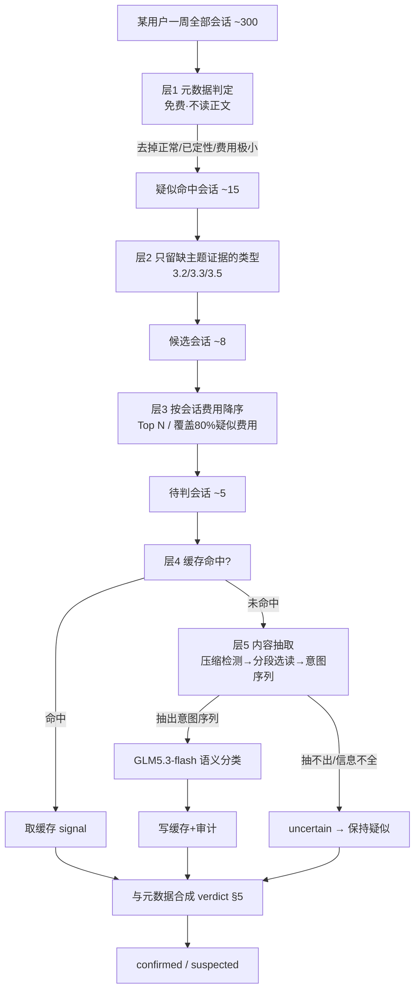

# 会话内容分析 · 完整设计方案（大模型语义判断 · v2 定稿）

> 目的：读会话正文、用 **GLM5.3-flash 量化版（512K 上下文）** 做语义判断，把「任务是否切换 / 是否同一件事 / 是否简单任务」这类元数据判不准的地方补上，使 **3.2 挤牙膏 / 3.3 多任务不切会话 / 3.5 杀鸡用牛刀** 从「疑似」升到「定性」。
> 本文替代 `token-usage-session-content-analysis-design.md`（v1），覆盖后续讨论出的全部真实问题：正文很大、哪条会话才判、内容累积、会话压缩/截断四种形态。
> 口径与前提（已确认）：
> - **口径 A**：大模型只作**证据**，需与确定性元数据**双条件同时成立才定性**；只有大模型支持 → 保持「疑似」。
> - **模型**：GLM5.3-flash 量化版，512K 上下文。512K 是安全垫，不是把全会话塞进去的理由。
> - **设计默认**：一会话一次调用 / 规则剥离大数据只留意图 / 判「整会话是否发生任务切换」/ 每人每周封顶 + 全局预算双限。

---

## 0. 前置约束（边界，先写死）

1. **突破隐私红线**：本设计读请求正文，突破 `docs/ua-behavior-analysis/product-design.md §1.4「不解析请求正文」`。上线前须过隐私/合规评审 + PII 脱敏 + 审计。本文只做技术设计。
2. **大模型不单独定性（口径 A）**：语义信号只是证据，最终 verdict = 元数据条件 AND 语义信号（§5）。
3. **可追溯**：每次判断记 `model/model_version/prompt_version/ts`，缓存保证同一份报告内结论稳定。
4. **512K 不等于免裁剪**：判主题切换需要的是「每轮用户意图」，不是贴进去的大数据。仍抽意图序列，512K 只用来容纳长会话的意图序列、提高容错（抽多了也不截断）。
5. **可关闭**：整块由配置总开关控制（默认关）；关闭时 3.2/3.3/3.5 全部回落元数据判定（疑似封顶），系统仍可用。

---

## 1. 总体流程（五层漏斗 + 内容抽取 + 语义判断 + 合成）



一个用户 ~300 会话 → 实际调用 ~2 次。全公司几百人一周几千次 flash 量化调用，量级可控。

---

## 2. 哪条会话才判（选择漏斗，核心）

**原则：能改变结论的才判，改变不了的一律不判。**

### 2.1 层 1 — 元数据分类（免费，不读正文）

对该用户一周所有会话，用元数据（`token-usage-context-analysis-design.md` 的判定）分四类：

| 会话状态 | 送模型? | 原因 |
| --- | :--: | --- |
| 正常（五类都没命中） | ❌ | 判了也不会变问题 |
| 已定性命中（如前缀污染绝对口径够了） | ❌ | 已能定性，不值这钱 |
| 费用极小（< 费用地板） | ❌ | 改判也不影响个人问题占比 |
| **疑似命中** | 进层 2 | 大模型唯一有价值处 |

### 2.2 层 2 — 只留「缺主题证据」的类型

| 情况 | 元数据能否单独定性 | 是否送模型 |
| --- | --- | --- |
| 3.1 前缀污染 | 能（绝对口径 500k/30%） | ❌ |
| 3.4 输出失控 | 能（分位判定） | ❌ |
| 3.2 挤牙膏 | 判不了「是否同一件事」 | ✅ |
| 3.3 多任务不切会话 | 判不了「任务是否在切」 | ✅ |
| 3.5 杀鸡用牛刀 | 判不了「是否真简单任务」 | ✅（缺场景标签时） |

### 2.3 层 3 — 按费用排序取 Top N

- 对该用户的候选会话按**会话费用降序**；
- 取 **Top N（默认 20）** 或 **累计覆盖该人 80% 疑似费用**的会话，二者取小；
- **费用地板**：低于「该人总成本 1% 或绝对 ¥5」（取大）的疑似会话直接不判，保持疑似。

### 2.4 层 4 — 缓存

- key = `sha256(session_id + 意图序列内容 + prompt_version + model_version)`；
- 命中即取历史 signal，不重复调用。会话内容不变 → 永远只判一次。

> 四个条件全满足才判：**疑似命中 + 缺主题证据类型 + 费用够高 + 无缓存**。其余保持疑似，不花钱、不误判。

---

## 3. 内容抽取（正文很大 / 累积 / 压缩四态处理，核心难点）

一个会话进入待判后，要从正文里还原「用户意图序列」再送模型。分三步：**压缩检测 → 分段选读 → 意图抽取与降级**。

### 3.1 事实基础

- 正常多轮会话内容**累积**：末轮 prompt 含全部历史（前面轮次是它的子集）→ 读末轮一条即可还原全程。
- 但会话可能被**压缩/截断**，末轮不再含全部历史，也不一定是信息最全的一轮。四种形态：

| 形态 | 现象 | 末轮是否含全部 |
| --- | --- | --- |
| 累积（正常） | prompt 单调递增 | 是 |
| 摘要替换 | 前 N 轮压成一条摘要 | 否（早期是摘要非原文） |
| 滑动窗口截断 | 只留最近 K 轮 | 否（早期直接丢） |
| 分段压缩 | 中间某轮压缩，后续重新累积 | 否（末轮不一定最大） |

### 3.2 步骤一 — 压缩检测（只用元数据，不读正文，免费）

会话切分时已聚出 `prompt_seq`（每轮 prompt_tokens）。据此判：

```text
compacted = false
for i in 1..len(prompt_seq)-1:
    if prompt_seq[i] < prompt_seq[i-1] * 0.7:   # 出现明显下降沿(阈值可配)
        compacted = true
        记录下降沿位置 i 为「压缩点」
# 附加信号（有采集时）：reset_flag[i]=true 也算压缩点
# max(prompt_seq) 不在末轮 → 也标 compacted
```

- 无下降沿、prompt 单调不降 → `compacted=false`（累积会话）。
- 有下降沿 → `compacted=true`，按压缩点把会话切成若干「上升段」。

### 3.3 步骤二 — 分段选读（决定读哪几条正文）

| compacted | 读哪条正文 | 读几条 |
| --- | --- | --- |
| false（累积） | **末轮**一条 | 1 |
| true（压缩） | **每个上升段的末轮**各一条 | 段数（通常 2–3） |

例：`8k→20k→45k→[压缩]→9k→30k→[压缩]→12k` → 切 3 段，读第 3、6、7 轮（各段末轮）3 条，而非全部 7 轮、也非只读最后 1 条。

> 读正文只发生在这几条「段末轮」上，从 `call_traces` 取（archive_status 0/1 直读 PG，2 从 jsonl.gz 回读）。

### 3.4 步骤三 — 从正文抽「用户意图序列」+ 剥离大数据

对每条读到的 `request_body`（messages 数组）：

```text
1. 过滤出 role='user' 的消息，按序
2. 每条 user 消息剥离「上下文数据」，只留「意图指令」：
   - 去掉 ```代码块```、超长引用(> 500 字的连续块)、base64、日志段、大 JSON
   - 保留自然语言指令句；若整条被剥空则取原文头尾各一句
3. 压到「意图指纹」：每条 user 取 开头一句 + 结尾一句（意图在头、追问在尾）
4. 拼成意图序列：[段1意图..., 段2意图...]（压缩会话跨段拼接）
```

结果：单个会话送模型的内容 = 所有 user 指令的浓缩，**与会话体积、贴了多少代码无关**。哪怕末轮 600k 全是代码，抽出的意图序列可能就 200 字。

### 3.5 步骤四 — 信息不全就降级（守 v0.6 不误判）

以下情况标 `uncertain` → 保持疑似，**不硬判定性**：

- 检测到**摘要占位**（如 assistant 消息含「以上是之前的总结/前情提要」等压缩痕迹，或 user 意图序列明显缺轮）→ 早期真实意图已丢 → uncertain。
- **跨压缩边界的切换判不了**：只在能读到原文的段内判切换；被压掉部分不能断言「没切换」→ uncertain。
- 正文读不到（`log_enabled=false` / 回读失败）→ uncertain。
- 意图序列抽空（全是二进制/超长数据，无自然语言）→ uncertain。

### 3.6 脱敏（读正文的必备）

意图指纹送模型前，正则去除邮箱/手机号/身份证/API Key/URL 中的 token；不落库正文副本，只在内存中用完即弃。

---

## 4. GLM5.3-flash 语义判断

### 4.1 输入（紧凑意图序列，非全文）

```json
{
  "session_id": "conv-123",
  "compacted": true,
  "intent_seq": [
    {"i": 1, "seg": 1, "user_head": "帮我把这个函数改成异步的", "prompt_tokens": 1200},
    {"i": 2, "seg": 1, "user_head": "现在写一下它的单测", "prompt_tokens": 8600},
    {"i": 5, "seg": 2, "user_head": "顺便帮我查下明天上海天气", "prompt_tokens": 41000}
  ],
  "gap_between_seg": true
}
```

- `compacted/gap_between_seg` 告诉模型「段之间可能有被压掉的轮次，不要跨段强断」。

### 4.2 system prompt（判主题切换，不评价内容）

```
你是会话结构分析器。仅根据每轮用户消息的开头判断“任务边界”，不评价内容质量、不猜测业务意图、不复述正文。
- task_switch：某轮明显换了一件不相关的事（如从改代码转到查天气）。
- same_task：全程围绕同一件事（含追问、补充、继续）。
- simple_task：整段是一次性简单请求。
- complex_task：需多轮、长上下文的复杂任务。
- 若存在段间空缺(gap)且无法判断跨段是否切换，就 uncertain。
只输出 JSON，不解释。
```

### 4.3 输出契约（结构化，量化模型防乱编）

```json
{ "signal": "task_switch", "switch_turns": [5], "confidence": 0.82, "reason_tag": "code_to_weather" }
```

- 强制 JSON schema 校验；解析失败/超时/`confidence < 0.6` → `uncertain`。
- 只取结构化字段，**不接受自由文本当报告依据**。
- 量化模型注意：低温度、限制 max_tokens、拒绝非 JSON 输出。

### 4.4 一会话一次调用（默认）

512K 用来容纳「单个长会话的意图序列」，不塞多会话（避免串味、缓存粒度粗、审计难）。

---

## 5. 与元数据合成「定性」（口径 A 真值表）

大模型信号 + 元数据条件，**双条件同时成立才 confirmed**：

| 情况 | 元数据条件（确定性） | 语义证据 | 合成 |
| --- | --- | --- | --- |
| 3.2 挤牙膏 | 轮次≥8 且 短输入占比高 | `same_task` | 都成立→confirmed；语义 uncertain→suspected |
| 3.3 多任务不切会话 | 超长 且 命中不差 且 无 reset | `task_switch` 且 switch_turns 有值 | 都成立→confirmed；语义未确认→suspected |
| 3.5 杀鸡用牛刀 | 规模像简单任务 且 走高阶模型 | `simple_task` | 都成立→confirmed；缺语义→suspected |

真值表（以 3.3 为例）：

```
元数据支持   语义支持            → verdict
  是         task_switch        → confirmed  （双条件，可定性）
  是         uncertain/其他      → suspected  （只有元数据，不足定性）
  否         任何                → not_hit    （语义单独不成立命中）
```

> 语义信号**永远不能单独定性**。它只把「元数据已命中、差主题证据」的疑似升级为定性。归因费用不变（升级 verdict 不改金额，只改标签）。

---

## 6. 成本控制与估算

### 6.1 控制手段
1. 只判「疑似 + 缺主题类型 + 费用够高」会话（§2）。
2. 缓存（内容不变只判一次）。
3. 每人每周封顶 Top N（默认 20）；全局每周预算封顶 ¥X（超限保持疑似，注记「语义未覆盖」）。
4. 轻量量化模型（GLM5.3-flash）+ 意图序列（非全文）→ 单次 input 极小。
5. 离线跑（报告装配 job），不进在线链路。

### 6.2 成本估算（量级）
```
单会话送模型 input ≈ 意图序列几百字 ≈ 数百~上千 token（远小于 512K）
每人实际调用 ≈ 2~5 次/周
全公司 500 人 ≈ 1000~2500 次/周
flash 量化单价低 → 全周成本可控在小额区间
```
报告附注透明写「本期语义判断覆盖 X 个疑似会话，消耗约 ¥Y」——自己的分析成本也要可见。

---

## 7. 合规与审计

- **脱敏**：意图指纹发模型前去 PII（§3.6）。
- **最小化**：只发意图序列（开头/结尾句），不发系统提示/模型回答/完整历史，不落正文副本。
- **审计**：记 `{session_id, model, model_version, prompt_version, signal, confidence, ts, 调用方}`。
- **权限**：只在离线报告 job（服务身份）跑，不暴露普通用户端点。
- **总开关**：默认关，关闭回落元数据疑似态。

---

## 8. 边界与降级汇总（全部保持疑似，不误判）

| 场景 | 处理 |
| --- | --- |
| 正文读不到（log_enabled=false/回读失败） | uncertain → 疑似 |
| 会话被摘要压缩，早期意图丢失 | uncertain → 疑似 |
| 跨压缩边界无法判切换 | 段内判，跨段 uncertain → 疑似 |
| 意图序列抽空（全是数据无指令） | uncertain → 疑似 |
| 模型输出非 JSON/超时/低置信 | uncertain → 疑似 |
| 超出每人/全局调用上限 | 保持疑似，注记未覆盖 |
| inferred 会话（无真实 session_id） | 即使语义支持，仍封顶疑似（会话边界不可靠） |
| 总开关关闭 | 全部回落元数据疑似 |

---

## 9. 落地顺序

| 步 | 内容 | 依赖 |
| --- | --- | --- |
| C0 | 隐私/合规评审 + 红线改动获批 | 非技术，前置 |
| C1 | 会话选择漏斗（层1-4，元数据侧，免费） | context-analysis |
| C2 | 压缩检测（prompt_seq 下降沿，免费） | 会话切分 |
| C3 | 分段选读 + 正文读取器（call_traces 三态回读） | 归档读器已有 |
| C4 | 意图序列抽取（剥离大数据 + 头尾句 + 脱敏） | C3 |
| C5 | GLM5.3-flash 调用（JSON schema + 置信阈值 + 降级） | C4 |
| C6 | 缓存 + 审计 + 每人/全局上限 | C5 |
| C7 | 与元数据合成 verdict（§5 真值表，只升级 suspected→confirmed） | C5 + context-analysis |
| C8 | 总开关 + 成本附注 | C6 |

> C1/C2 免费先行（纯元数据）；C3 起才读正文、才需 C0 合规通过。未通过前，元数据疑似态即兜底。

---

## 10. 对 v0.6 与口径 A 的守约校验

| 约束 | 落点 |
| --- | --- |
| 双条件才定性 | §5 真值表：元数据 AND 语义 |
| 判定可作依据/可追溯 | §4.3 结构化 + §7 审计 + §2.4 缓存 |
| 缺证据加疑似、不误判 | §3.5 + §8 全部降级路径 |
| 简单分类不用贵模型 | GLM5.3-flash 量化 + 意图序列 |
| 会话压缩/截断处理 | §3 压缩检测→分段选读→降级 |
| 正文很大处理 | §3.4 抽意图序列，与体积无关 |
| 哪条会话才判 | §2 四条件漏斗 |
| 成本可控 | §6 只判疑似+缓存+双上限+附注 |
| 隐私最小化 | §3.6 + §7 |
| 可关闭 | §0.5 总开关默认关 |
