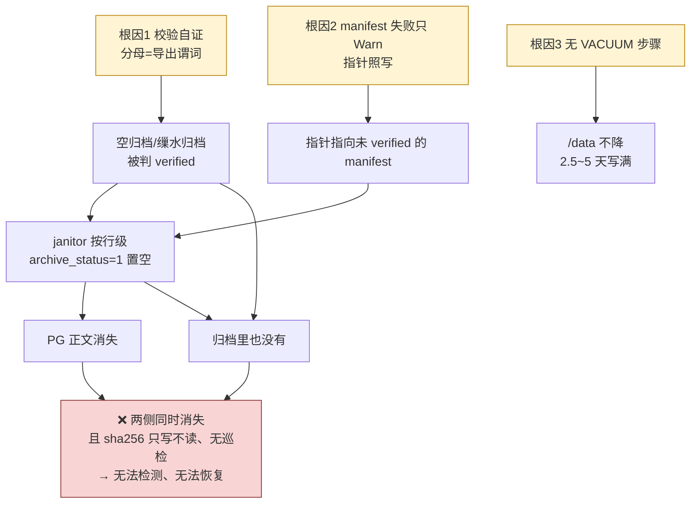

# trace 归档方案 · 核心问题诊断

> 对 `docs/trace-archive-solution-v2.md` 做 8 视角对抗评审（17 智能体、99 条原始问题 → 核验后存活 92 条）后的**根因提炼**。
> 完整问题清单见 `docs/trace-archive-solution-v2-review.md`（2 blocker / 15 major / 29 minor / 8 nit / 7 条被证伪）。

---

## 一句话

**方案的技术选型站得住（评审给出 17 条正反馈），核心问题不是"选错了"，而是把「设计意图」当成了「已核实的事实」——三条本该独立的防线，其实都是自证或未验证的。**

```
技术判断  →  ✅ 经住核验（zstd/分块/索引/纯 Go/不用 MinIO）
安全链    →  ❌ 自证循环
代码现状  →  ❌ 与描述相反
前置条件  →  ❌ 未核实
```

---

## 根因 1：唯一的数据防盗链是**自证循环** 【最高危害】

### 事实

方案的核心安全承诺是「指针先置、正文后清」，守门人是"两步校验"。但校验的分母与被校验者是同一套谓词：

```
校验分母（pgRowCount）谓词 = (ts ∈ 当天 AND body IS NOT NULL)      ← archive_service.go:354-356
导出谓词                   = (ts ∈ 当天 AND body IS NOT NULL ...) ← archive_service.go:528, 548, 565
```

**正文被置空的行既不在分子、也不在分母** ⇒ 分母可缩水到 0 ⇒ `0 == 0` 判 verified。

叠加三处放大：

| # | 缺陷 | 位置 | 效果 |
|---|---|---|---|
| 1 | 重导不清理旧 `_SUCCESS`，且成功路径无条件重写 | `archive_service.go:462` | 第 2 步校验**恒真** |
| 2 | `sha256` 只写不读，全流程**无一处消费** | `:573-598` + 全库 grep | 归档损坏/截断/漏行**不可检测** |
| 3 | manifest 落库失败**只 `slog.Warn`**，指针照写 | `:597-598` vs `:556` | 指针指向仍处 `archiving` 的 manifest |

### 为什么这是根因，而不是普通 bug

不是某一行写错，而是**校验者与被校验者是同一个东西**。在这个结构下，加多少条校验都不构成独立防线。所以：

- 修 A 处（换谓词）修不掉 B 处（陈旧标记），因为病根是"缺乏独立的期望基准"
- 而下游**全部**依赖这个 `verified` 标记：置空依赖它、保留期删除依赖它

### 修法必须换维度

| 不够的修法 | 够的修法 |
|---|---|
| 把行数校验改成集合校验 | 集合本身要以**独立于导出谓词**的来源冻结 |
| 加 `_SUCCESS` 判空 | `_SUCCESS` 必须在**本次导出开始时先删** |
| 记录 sha256 | 必须有流程**回读并比对** sha256 |

**最小可用形态**：置空前置条件从 `manifest.state == verified` 升级为「**独立冻结行集比对 + 回读校验通过**」。

---

## 根因 2：实施步骤默认「代码 = 文档描述」，而实际是**相反的**

| 方案写的 | 代码实际 | 后果 |
|---|---|---|
| §G2：先 manifest verified，再写指针 | `:556` 先写指针；`:597-598` manifest 失败只 Warn | 指针指向未 verified 的 manifest → 正文可能在两侧同时消失 |
| §K1 第 7 步「收紧窗口 → /data 停止增长」 | §K3 自己实测结论是"单纯置空并不阻止增长" | **文档内部自相矛盾** |
| K1 / N1 全流程 | **没有 VACUUM 这一步** | 验收要求"/data 增速趋零"，按方案做**达不到** |
| §N2 用 `ARCHIVE_ENABLED=false` 回滚 | 点读器也挂在该开关下 | 关掉后所有已置空 trace **静默返回空正文** |

**特点：这些不是"可能出错"，是照方案做就会触发。**

---

## 根因 3：前置条件没核实就写进了步骤

```
§J   "执行迁移 062/063"
     → 7 个迁移文件全是 git ?? 未跟踪状态（062/063 + 5 个），CI 从不发布
     → 062 版本号 20260824093000 < 已跟踪的 20260902070000 / 20260916095738
     → migrate-prod(CI:287) 无 --exec-order；migrate-test(CI:323) 有 non-linear
     ⇒ 生产线性顺序必挂，卡住发布（deploy-prod needs migrate-prod）
     ⇒ 这正好解释了生产为何没有 archive_status 列

§K1  "第 0 步：/datalog ≥ 500 GiB 可用"    → 实测只有 368 GiB（自我互锁）
§K4  "建议 archive_retention_days=365"      → 需 408~708 GiB，可用 368 GiB（自相矛盾）
§K5  "释放 leakscan 189 GB 后变 ~557 GiB"   → 368+189=557 ✅，但该批证据可否释放未核实
§R8  "/data 2.5~5 天写满"                   → 写成"本方案之外"，实际是决定方案能否执行的前提
     应急选项 a（手工置空）与 §R4（禁止手工 SET body=NULL）直接冲突
```

**最硬的是迁移**：方案里看起来最没风险的一步，实际是唯一的发布阻断点。

---

## 附带：一处我自己的算术错

```
jsonl 总量 241.4 GiB
gzip 3.47x →  69.6 GiB   ← 方案 §A1/§D3 写的是 236 GiB，错了
zstd 9.57x →  25.2 GiB   ← §L1 的 14~25 GiB 正确
```

gzip 实际仍有 **3.8 倍**缩减，"gzip ⇒ 零收益 / 项目白做"是**夸大且算错**的。
换 zstd 的结论仍成立（好 2.8~5 倍），但论证口径必须改。

---

## 根因之间如何叠加成事故



---

## 如果只先改一件事

**改根因 1。**

| 根因 | 不改的后果 | 可逆性 |
|---|---|---|
| **1. 校验自证** | PG 与归档**同时**失去正文 | ❌ **不可逆**，且无流程能检测 |
| 2. 代码现状 | 返工、发布后才发现 | ✅ 可逆 |
| 3. 前置条件 | 卡住发布、盘写满 | ✅ 可逆（扩容/补提交） |

**最小修复**：把置空前置条件从「`manifest.state == verified`」升级为「**独立冻结行集比对 + 回读校验通过**」。这条链一旦独立，根因 2 里的指针顺序问题也顺带被兜住。

---

## 需要你拍的 3 个决策（决定 v3 的核心形态）

| # | 决策 | 选项 | 我的推荐 |
|---|---|---|---|
| D-1 | **重导写盘策略** | (a) 写新版本目录 `dt=.../v2/`，保留旧版本直到全量对账完成；<br/>(b) 保留原地覆盖，但引入"冻结期望行集 + 重导必须包含上次已验证行集"硬校验 | **(b)** —— (a) 会让 `/datalog` 在过渡期翻倍，而该盘已只剩 368 GiB 且要同时容纳 pg_repack 临时空间 |
| D-2 | **置空前置条件强度** | (a) janitor 逐天校验「归档可读 + 离机凭证 sha256 一致」；<br/>(b) 上面再加「冻结快照行集 + 逐块回读 + 永久丢失行数=0」 | **(b)** —— 这是唯一会造成不可逆丢失的环节，多花的每轮耗时远比丢数据便宜 |
| D-3 | **§R8 应急处置与 §R4 的冲突** | (a) 允许"无归档的手工置空"写成受控例外（书面确认 + 审计）；<br/>(b) 禁止，只走扩容；<br/>(c) 手工先归档再置空 | **(b) 或 (c)** —— (a) 等于亲手制造"永久丢失态"，而这正是方案要消灭的状态 |

---

## 与评审报告的编号对应

| 根因 | 对应评审条目 |
|---|---|
| 1 校验自证 | **BLK-01, BLK-02**, MAJ-01, MAJ-09, MAJ-10, MAJ-11 |
| 2 代码现状不符 | **BLK-01**(部分), MAJ-07, MAJ-12, NIT-08 |
| 3 前置条件未核实 | **MAJ-13**, MAJ-14, MAJ-15, MAJ-04, MAJ-05 |
| 附带算术错 | MAJ-03 |
| 盘/临时空间合账 | MAJ-06 |
| 排序契约 | MAJ-02 |

> 修订后的完整方案见 `docs/trace-archive-solution-v3.md`。
