# 调用链路正文归档 · 完整方案 v2（审计版）

> 本文是**可审计的完整方案**，取代 `trace-archive-final-design.md`（下称"旧定稿"）中已被实测证伪的部分。
> 实测证据见 `docs/trace-archive-p0-measurements.md`；实测脚本 `diagnose_trace_archive.sh`。
> 状态：**设计定稿，尚未实施**。生产侧未做任何变更。

---

## A. 审计入口：本版改了什么（与旧定稿的差异）

| # | 旧定稿 | 本版 v2 | 依据 | 严重度 |
|---|---|---|---|---|
| A1 | codec = **gzip -6** | **zstd `SpeedBestCompression` + 窗口 128 MB** | 实测 gzip 3.47x vs zstd 19.61x；gzip 方案归档 ≈ 236 GiB ≈ 现状 266 GiB，**零收益** | 致命 |
| A2 | §12 「179 GB → 20~30 GB」 | **266 GiB → 14~25 GiB** | 实测；且 179 GB 已是 pglz 态，原文仅 188,534 B/行 < 存量 226,700 B/行 | 高 |
| A3 | §8 单文件 + 全量扫描，"延迟可接受" | **分块（256 MiB）+ 每日 rid 索引** | 实测点读与位置线性：首 0.00s / 中 0.34s / 尾 0.62s → 整天 15~31 s | 高 |
| A4 | §7 `hot_window_days = 30` | **默认 3（范围 2~7）** | 30 天需 642 GiB，`/data` 仅剩 54 GiB；且现存正文实际只留 11 天 | 高 |
| A5 | 无归档保留策略（`max_disk_gb=0`） | **新增 `archive_retention_days`** | 归档月增 34~59 GiB，`/datalog` 余 368 GiB → 仅 6~10 个月 | 中 |
| A6 | 缺磁盘回收章节 | **新增 §K.3 回收流程** | `SET body=NULL` 不缩文件；且**不 VACUUM 则新插入无法复用**，`/data` 仍持续增长（实测 df 与 TOAST 同步增长） | 中 |
| A7 | 假定迁移已应用 | **新增 §J 迁移前置** | 生产 `call_traces` 无 `archive_status` 等列，`atlas_schema_revisions` 表不存在 | 高 |
| A8 | 未提编码内存 | **新增 §I.4 内存预算** | 128 MB 窗口 → 编码/解码各需 150~300 MB；控制面容器上限 2g | 中 |
| A9 | 未提 leakscan 遗留 | **新增 §K.5** | `/datalog` 189 GB 为 leakscan 证据归档，非本设计产物；可评估释放 | 低 |

**未变的部分**（旧定稿仍然有效）：纯 Go 点读、不使用对象存储/MinIO、`ArchiveStore` 接口隔离、两段式读、三态机（archiving→verified→cleaned）、"指针先置、正文后清"、按天 `dt=` 分区布局、`require_offhost_copy` 硬闸。

---

## B. 目标与非目标

### B1. 目标

1. **抑制 /data 增长**：正文在 PG 只保留热窗口（默认 3 天），窗口外转存 `/datalog`。
2. **查询可回放**：trace 详情页可读取已归档正文，接受秒级延迟（用户明确接受"可以延迟"）。
3. **容量可控**：归档体积可预测、有保留上限、可告警。
4. **一致性**：任何时刻"正文要么在 PG、要么在归档"，不存在两者皆无。

### B2. 非目标

- 不引入对象存储 / MinIO / S3（已论证：单点未消除、不透明压缩、对 /data 无帮助）
- 不引入 Parquet / DuckDB / 列存
- 不做加密（`ArchiveStore` 预留了将来接 S3-SSE 的缝）
- **不改进全文检索能力**（归档正文不可被 SQL 查询，只能按 request_id 点读）
- 不改 gateway 与 `/v1` 转发链路

### B3. 明确接受的三项代价

1. 归档正文**只能按 request_id 点读**，不能 SQL 检索、不能聚合分析。
2. 点读有**秒级延迟**（分块后 ~0.3 s；未分块则 15~31 s）。
3. `/datalog` 是**单盘**，需靠 `require_offhost_copy` + 异机 rsync 满足 §13 的离机要求。

---

## C. 实测事实基线（方案的所有数字来源）

### C1. 数据规模（2026-09-21 实测）

| 项 | 值 |
|---|---|
| `call_traces` 总大小 | 271 GB（heap 2,060 MB + TOAST **265.84 GiB**） |
| 总行数 | 5,295,561 |
| **有正文的行数** | **1,259,124**（仅 2026-09-10 ~ 09-21） |
| 行生成速率 | 近 12 日均值 **101,195 行/天**（峰值 182,439） |
| 存量（jsonb+pglz） | **226,700 B/行** |
| 同批行 jsonb 文本 | **188,534 B/行** |
| jsonl（含键名/转义） | **205,879 B/行**（文本 × 1.092） |

### C2. 压缩（生产语料 440 MiB）

| codec | 压缩率 |
|---|---|
| gzip -6 | 3.47x |
| zstd -19 | 8.76x |
| **zstd -22 --ultra** | **19.61x** |
| xz -6 | 9.11x |

### C3. 纯 Go 库实测（`klauspost/compress v1.20.0`）

| 配置 | 压缩率 | 备注 |
|---|---|---|
| `SpeedBestCompression`（默认窗口） | 8.46x | |
| **`SpeedBestCompression` + `WithWindowSize(128<<20)`** | **9.57x** | 35.5 MB 生产样本 |
| 同上，142 MB 输入 | 37.90x | 同期 CLI -22 = 43.41x → **达 87%** |
| `EncoderLevelFromZstd(19)` / `(22)` | 均等于 `best` | **库中无 CLI 的 -19/-22 档** |

- 不加 `WithWindowSize`：8.81x → 37.90x，**差 4.3 倍且不报错**。
- Go 编码比 CLI -22 **快约 10 倍**（同机同文件 0.47s/9.57x vs 5.64s/10.90x）。
- Go 默认解码器可读 CLI 产出的 128 MB 窗口帧（`err=nil`）。

### C4. 吞吐与延迟

| 操作 | 值 |
|---|---|
| zstd -22 --ultra 压缩（生产机） | 3.4 MB/s |
| zstd 解压 | **1047 MB/s** |
| 点读（440 MiB 文件，未分块） | 首 0.00s / 中 0.34s / 尾 0.62s |
| 点读整天外推（~20.8 GB jsonl） | **中位 ~17 s / 最坏 ~31 s**（忙日 ~48 s） |

### C5. 磁盘

| 挂载 | 容量 | 已用 | 可用 |
|---|---|---|---|
| `/data`（PGDATA） | 344 G | 288 G (85%) | **54 GiB** |
| `/datalog`（目标） | 590 G | 193 G (35%) | **368 GiB** |

实测 `/data` 以 **11~23 GiB/天** 增长，且 **未发现任何自动清理**。

---

## D. 总体架构

### D1. 部署视图与数据流

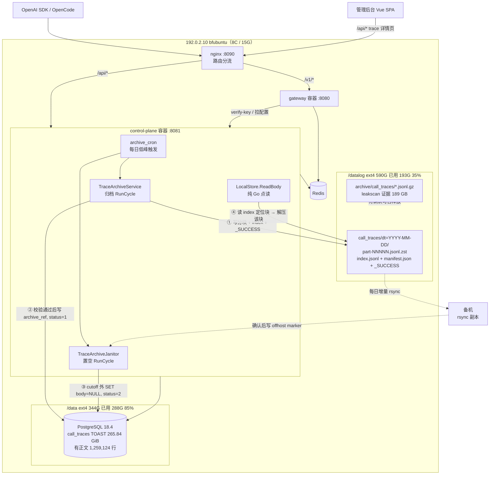

### D2. 分层职责

**分层**：`internal/archive`（存储抽象，`ArchiveStore` 接口）与 `internal/observability/service`（状态机）解耦，未来换 S3 只改 store 实现，状态机零改动。

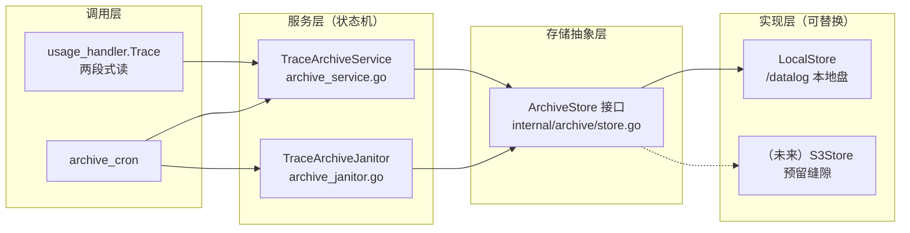

### D3. 核心收益：为什么必须换 codec

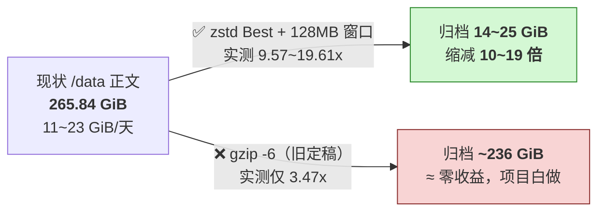

---

## E. 存储格式 v2（分块 + 索引）

### E1. 目录布局

```
{ARCHIVE_ROOT}/call_traces/dt=2026-09-19/
    ├── part-00000.jsonl.zst      每块约 256 MiB 未压缩内容，独立 zstd 帧
    ├── part-00001.jsonl.zst
    ├── ...
    ├── part-00081.jsonl.zst
    ├── index.jsonl               每块一行，见 E3
    ├── manifest.json             行数/字节数/sha256/块数/生成时间
    └── _SUCCESS                  最后写入，存在即代表当天归档完整
```

- 一天 ~20.8 GB jsonl ÷ 256 MiB ≈ **82 块**。
- 块内按 `request_id` **字典序连续**（导出即 `ORDER BY request_id`），因此 `index.jsonl` 的首尾 rid 单调递增。
- `_SUCCESS` **必须最后写**，是 §F 两步校验的第一半。

### E2. 块内格式

沿用现有 `archiveRecord`（`internal/archive/readbody.go:17`）不变：

```json
{"request_id":"...","ts":"...","request_headers":{...},"request_body":{...},"response_body":{...},"error_code":"","error_message":""}
```

一行一条、`\n` 分隔、无缩进。**格式不变**，只改外层容器（gzip 单文件 → zstd 分块）。

### E3. `index.jsonl`

```json
{"part":"part-00000.jsonl.zst","first_rid":"003096e5-...","last_rid":"01ab...","rows":1180,"bytes":268435456}
```

- 82 行 ≈ 10 KB，点读时整个读入内存。
- 查找：线性扫描或二分（`last_rid >= rid` 的第一个块）。
- **不使用 zstd seekable 格式**：分块方案更简单、可并行、且不依赖库的额外能力。

### E4. codec 参数（硬约束）

**写**：
```go
zstd.NewWriter(w,
    zstd.WithEncoderLevel(zstd.SpeedBestCompression), // ≈ CLI -19/-22 的 88%
    zstd.WithWindowSize(128<<20),                     // 必须！否则塌 4.3 倍且不报错
    zstd.WithEncoderConcurrency(1),                   // 单块单线程；并行靠多块
)
```

**读**：
```go
zstd.NewReader(r,
    zstd.WithDecoderMaxWindow(128<<20), // 防御性显式设置
)
```

### E5. 向后兼容

生产**尚无任何归档产物**（无 `archive_status` 列、无 manifest 表），因此无历史包袱。
保险起见，读取端按扩展名分派：`.jsonl.zst` → zstd 分块路径；`.jsonl.gz` → 旧 gzip 单文件路径（保留旧实现，标记 deprecated）。
**若确认测试环境也不需要，可删除 gzip 分支。**

---

## F. 状态机与一致性

### F1. 三态（沿用旧定稿）

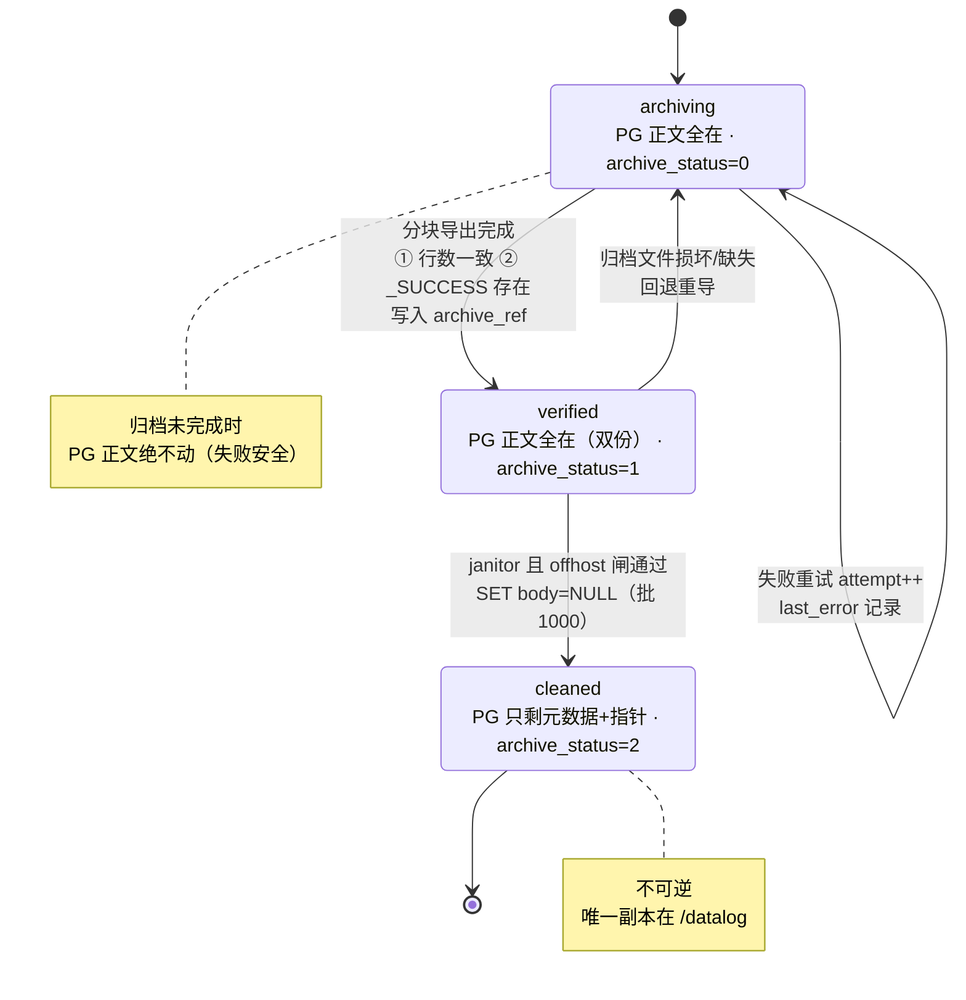

| 态 | 含义 | 对应 `archive_status` |
|---|---|---|
| `archiving` | 正在导出，PG 正文仍全在 | 0（未归档） |
| `verified` | 导出完成且校验通过，PG 正文仍全在 | 1（已归档校验） |
| `cleaned` | PG 对应正文已置空 | 2（已置空） |

### F2. 两步校验（`verified` 的门槛，两者都过才置 1）

1. `count(归档 jsonl 行数) == count(PG 该天行数)` —— 按 `dt` 时区口径
2. `_SUCCESS` 文件存在（`Head` 成功）

### F3. 不变量（审计要点）

- **指针先置**：`archive_ref` / `archive_status=1` 在导出+校验通过后写入。
- **正文后清**：`archive_status=2` 与 `SET body=NULL` 在**同一事务/同一批**内完成。
- **任何时刻**：`archive_status=2` ⇒ 归档文件必已 `verified`；失败则保持 =1，正文留在 PG。
- **失败安全**：归档写盘失败 → manifest 停在 `archiving`，PG 正文不动，次日重试。
- **绝不删数据**：`max_disk_gb` 超限只停归档 + 告警（沿用旧定稿 §13）。

---

## G. 写入链路（归档）

### G1. 涉及文件

| 文件 | 现状 | v2 改动 |
|---|---|---|
| `internal/observability/service/archive_service.go` | `gzip.NewWriterLevel`（:404-421） | 改为**分块 zstd**；新增 index/manifest 写入；`gzipLevel` → zstd 参数 |
| `internal/archive/store.go` | `ArchiveStore` 接口 | **不变**（Put/Get/Head/Exists/List/Delete 已足够） |
| `internal/archive/local.go` | 本地实现 | 新增 `PutPart`（可选，或复用 Put） |
| `internal/observability/cron/archive_cron.go` | 5/6 段 cron | 不变 |
| `internal/controlplane/config/config.go` | `GzipLevel` | `GzipLevel` → `ZstdLevel`/`ZstdWindowMB`/`ChunkMB`（保留旧键做兼容读取） |

### G2. `ArchiveDay` 流程（修订）

```
1.  BEGIN: 读该天 PG 行数 pg_row_count；INSERT manifest(dt, 'archiving', pg_row_count)
2.  流式导出：SELECT ... ORDER BY request_id（游标分批 BatchRows）
3.  累积到 ChunkMB 时封块：
      a. zstd 压缩 → part-XXXXX.jsonl.zst（写临时文件，成功后 rename）
      b. 记录 {part, first_rid, last_rid, rows, bytes}
      c. 释放缓冲，继续下一块
4.  全部块落盘后写 index.jsonl、manifest.json
5.  校验：sum(块 rows) == pg_row_count
6.  写入 _SUCCESS（最后一步）
7.  UPDATE manifest SET state='verified', files=..., sha256=..., verified_at=now()
8.  UPDATE call_traces SET archive_ref='dt=YYYY-MM-DD/', archive_status=1 WHERE ts ∈ 该天 AND archive_status=0
```

**关键点**：
- 先用**临时名**写，成功后 `rename` → 避免半成品被读取。
- `archive_ref`/`archive_status=1` 在第 7 步之后写 → 保证"指针指向的文件一定已完整"。

#### G2.1 归档写入时序图

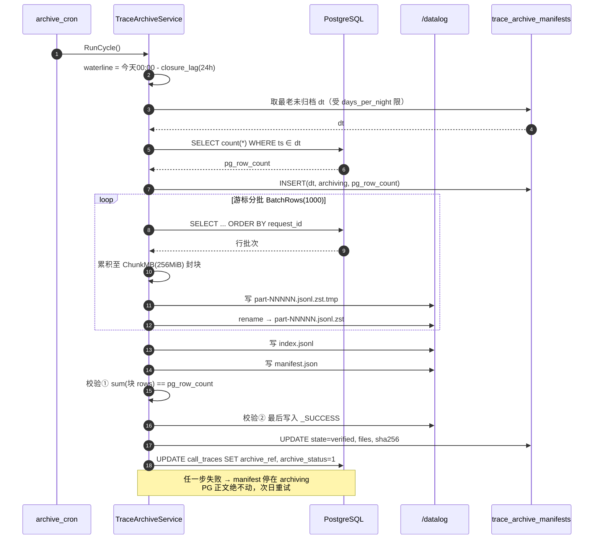


### G3. 每日水量线（`archiveWaterline`）

现状（`archive_service.go:298`）：`for d := minDt; d.Before(waterline)` —— **无 `days_per_night`、无速率上限**。

v2 修订：

```
waterline = 今天 00:00 (TZ) - closure_lag_hours(默认 24)
每天最多归档 days_per_night 天（默认 2）
优先归档最老的未归档 dt
```

理由：单日归档耗时约 9 min（Go 估）；限制每日数量避免首跑一次性拉爆，也给失败留重试余地。

### G4. 回填（Backfill）

**实测结论：回填量极小。**

- 生产现存正文仅 **11 天**（2026-09-10 ~ 09-21），6/7/8 月正文已被 leakscan 一次性置空、**不可恢复**。
- 回填总量 ≈ 11 天 × 20.8 GB ≈ **230 GB jsonl**。
- 按 Go 编码器 ~40 MB/s（估）→ **约 2 小时**；即使按 CLI -22 的 3.4 MB/s，也只需 ~19 小时。
- `BackfillOnce=true` 可在一次窗口内完成，**不存在多轮慢慢补的问题**。

---

## H. 读取链路（点读）

### H1. 涉及文件

| 文件 | 现状 | v2 改动 |
|---|---|---|
| `internal/archive/readbody.go` | `gzip.NewReader` + 逐行全量扫描（:56-86） | 改为**先读 index → 定位块 → 只解压该块** |
| `internal/observability/handler/usage_handler.go` | 两段式读（:127-146） | **不变** |
| `internal/controlplane/router/router.go` | :47-50 构造、:830/:1073 注入 | **不变** |

### H2. `ReadBody` 新流程

```
1. 解析 archiveRef → dt
2. 读 {dt}/index.jsonl（~10 KB），得到块列表
3. 拉取 _SUCCESS（不存在 → CodeRetryable，说明归档未完成）
4. 在 index 中定位 last_rid >= requestID 的第一个块（二分）
5. Get(part-XXXXX.jsonl.zst) → zstd 解码 → 逐行比对 request_id
6. 命中返回 ArchiveObject；块内未命中 → CodeNotFound
```

#### H2.1 点读时序图（两段式）

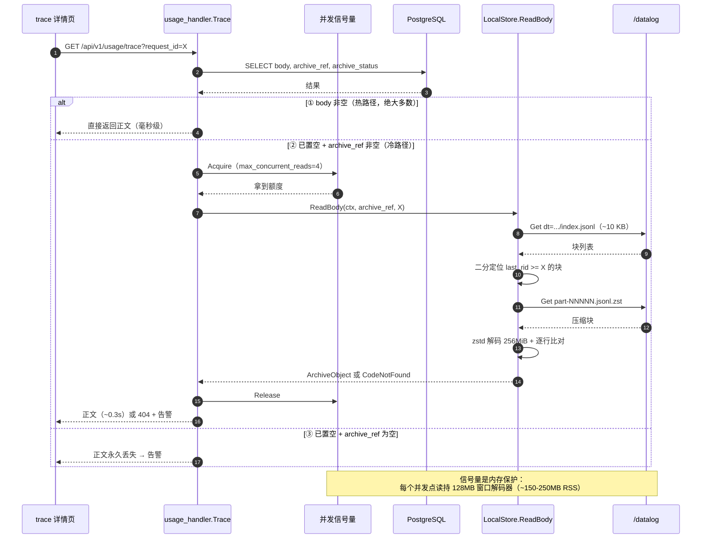


### H3. 延迟预算

| 步骤 | 耗时 |
|---|---|
| 读 index.jsonl | < 5 ms |
| 解压一个 256 MiB 块（1047 MB/s） | **~245 ms** |
| JSON 扫描命中 | ~10 ms |
| 磁盘读（块压缩后约 15 MB @ 19x） | ~20 ms |
| **合计** | **~0.3 s** |

对比未分块：中位 ~17 s / 最坏 ~31 s → **提升 50~100 倍**。

### H4. 并发与内存闸

点读在**控制面进程内**执行，每个并发点读持有一个 128 MB 窗口解码器（实测约 150~250 MB RSS）。

```
容器上限 2g ⇒ 同时最多 4~6 个点读
```

必须加**信号量**限制并发（超出排队或返回 429/503），否则 5 个并发点读即可触发容器 OOM。
（当前 `usage_handler` 无此限制，属**新增需求**。）

### H5. 未命中语义

| 场景 | 返回 |
|---|---|
| PG 有正文 | 直接返回（热点路径） |
| PG 无正文 + `archive_ref` 有值 + 归档命中 | 返回归档正文 |
| PG 无正文 + `archive_ref` 有值 + 归档未命中 | `CodeNotFound`（数据异常，需告警） |
| PG 无正文 + `archive_ref` 为空 | **正文永久丢失**（见风险 R4） |

---

## I. 配置项完整表

### I1. 变更对照

| 键（yaml） | 环境变量 | 旧 | **v2** | 说明 |
|---|---|---|---|---|
| `archive.enabled` | `ARCHIVE_ENABLED` | bool | bool（默认 false） | 总开关 |
| `archive.root` | `ARCHIVE_ROOT` | string | string（`/datalog/llm-gateway-archive`） | 归档根 |
| `archive.tz` | `ARCHIVE_TZ` | string | `Asia/Shanghai` | dt/结算时区 |
| `archive.hot_window_days` | `ARCHIVE_HOT_WINDOW_DAYS` | 30 | **3**（建议 2~7） | 热窗口 |
| `archive.batch_rows` | `ARCHIVE_BATCH_ROWS` | 1000 | 1000 | 每批导出 |
| `archive.days_per_night` | `ARCHIVE_DAYS_PER_NIGHT` | 无 | **2**（新增） | 每晚最多归档天数 |
| `archive.chunk_mb` | `ARCHIVE_CHUNK_MB` | 无 | **256**（新增） | 未压缩块大小 |
| ~~`archive.gzip_level`~~ | ~~`ARCHIVE_GZIP_LEVEL`~~ | 6 | **废弃** | 由 zstd 取代 |
| `archive.zstd_level` | `ARCHIVE_ZSTD_LEVEL` | 无 | **best**（新增） | `best`/`better`/`default`/`fastest` |
| `archive.zstd_window_mb` | `ARCHIVE_ZSTD_WINDOW_MB` | 无 | **128**（新增，不可省） | 压缩窗口 |
| `archive.max_concurrent_reads` | `ARCHIVE_MAX_CONCURRENT_READS` | 无 | **4**（新增） | 点读并发闸（内存保护） |
| `archive.closure_lag_hours` | — | 24 | 24 | 水量线滞后 |
| `archive.require_offhost_copy` | `ARCHIVE_REQUIRE_OFFHOST_COPY` | true | true | 置空硬闸 |
| `archive.offhost_copy_marker` | `ARCHIVE_OFFHOST_COPY_MARKER` | "" | "" | 异机副本标记 |
| `archive.disk_watermark_percent` | `ARCHIVE_DISK_WATERMARK_MB` | 80 | 80 | 水位告警（历史键名） |
| `archive.max_disk_gb` | `ARCHIVE_MAX_DISK_GB` | 0 | **0 → 建议实配** | 0=不限（有风险，见 R3） |
| `archive.archive_retention_days` | `ARCHIVE_RETENTION_DAYS` | 无 | **0（永不删）/ 建议 365**（新增） | 归档保留 |
| `archive.cron_schedule` | `ARCHIVE_CRON_SCHEDULE` | — | 每日低峰（如 `0 3 * * *`） | 5 段 |

**配置优先级**（已验证）：环境变量 > yaml > 代码默认。`SetEnvKeyReplacer(".","_") + AutomaticEnv()`。

### I2. 与容器的关系

`deploy/blue-green/docker-compose.{blue,green}.yml` 中控制面已挂 `volumes: - /datalog:/datalog`，并注入 `ARCHIVE_ENABLED` / `ARCHIVE_ROOT`。**本版需追加**：

```yaml
environment:
  ARCHIVE_HOT_WINDOW_DAYS: ${ARCHIVE_HOT_WINDOW_DAYS:-3}
  ARCHIVE_CHUNK_MB: ${ARCHIVE_CHUNK_MB:-256}
  ARCHIVE_ZSTD_WINDOW_MB: ${ARCHIVE_ZSTD_WINDOW_MB:-128}
  ARCHIVE_MAX_CONCURRENT_READS: ${ARCHIVE_MAX_CONCURRENT_READS:-4}
  ARCHIVE_DAYS_PER_NIGHT: ${ARCHIVE_DAYS_PER_NIGHT:-2}
```

### I3. 依赖

新增 `github.com/klauspost/compress`（纯 Go，无 cgo）。已实测 `v1.20.0` 可用。

```
go get github.com/klauspost/compress@v1.20.0
```

### I4. 内存预算（审计要点）

| 场景 | 单实例内存 | 说明 |
|---|---|---|
| 编码 1 块 | ~150~300 MB | 128 MB 窗口 + 哈希表 |
| 编码并行 2 块 | ~300~600 MB | **建议上限 2** |
| 点读解码 | ~150~250 MB | 128 MB 窗口 |
| 点读并发 4 | ~600 MB~1 GB | 需闸门 |

**控制面容器现为 `memory: 2g`。** 结论：
- 编码并发 ≤ 2，或**把容器上限提到 4g**（推荐）
- 点读并发闸 `max_concurrent_reads: 4`
- 归档 cron 与点读可能同时发生 ⇒ 峰值 ≈ 600 MB + 1 GB ≈ 1.6 GB，**在 2g 下过于贴近上限**

**建议：容器内存上限从 2g 提升到 4g**，或归档任务独立进程/独立容器。

---

## J. 数据库迁移（前置，未应用）

### J1. 现状

生产 `call_traces` 仅 13 列，**无** `task_id` / `documents_count` / `archive_ref` / `archive_status` / `archived_at`；
**无** `trace_archive_manifests` 表；`atlas_schema_revisions` 表不存在（迁移另有机制或从未执行）。

⇒ **已实现的归档服务按现状启用会直接报错。**

### J2. 需应用的迁移

| 文件 | 内容 |
|---|---|
| `atlas-migrations/20260824093000_trace_archive.up.sql` (062) | 4 列 + 索引 `idx_call_traces_archstatus_ts` + 表 `trace_archive_manifests` |
| `atlas-migrations/20260824093500_usage_settlement_daily.up.sql` (063) | `usage_settlement_daily`（清理闸依赖） |
| **v2 新增（待写）** | 若采用 `archive_retention_days`，manifest 增 `deleted_at`；若分块，manifest 的 `files` 需容纳块列表（JSONB 已够） |

### J3. 迁移影响评估

- 062 的 `ALTER TABLE ADD COLUMN ... DEFAULT 0`：PG 11+ 为**元数据变更**，不重写表 ✅
- `NOT NULL DEFAULT 0` 同理不重写 ✅
- `CREATE INDEX ... WHERE archive_status = 1`：**全表建索引**，千万行量级需评估耗时与 `maintenance_work_mem`
- **建议** 在低峰执行，并先 `SET statement_timeout = 0`

### J4. 迁移规范

按 `atlas-db-migration` skill（仓库强制）：新增迁移递增序号、生成对应 `.down.sql`、改动需同步 `internal/controlplane/model`。

---

## K. 运维流程

### K1. 部署顺序（严格）

```
0. 【前置】/datalog 已挂载且 ≥ 500 GiB 可用；控制面容器内存提到 4g
1. 执行迁移 062 / 063（低峰，先备份）
2. 部署代码（zstd + 分块 + 索引 + 并发闸），保持 ARCHIVE_ENABLED=false
3. 验证配置解析：ARCHIVE_ENABLED=false 时 cron 必须 no-op（不得有任何写入）
4. 小范围开启：ARCHIVE_ENABLED=true，hot_window_days 设为**大于现存窗口**（如 15）
   → 让归档只"补齐"，不触发置空（janitor 无候选）
5. 观察 1 天：确认 manifest 全部 verified、行数一致、/datalog 增长符合预期
6. 建立异机副本：rsync /datalog → 备机，写入 offhost_copy_marker
7. 收紧 hot_window_days 到 3
   → 此时 janitor 开始置空，/data 停止增长
8. 维护窗口执行 pg_repack 回收既有 266 GiB（见 K3）
```

**第 4→7 步是刻意的两段式**：先证明归档正确，再允许置空。

#### K1.1 部署顺序图

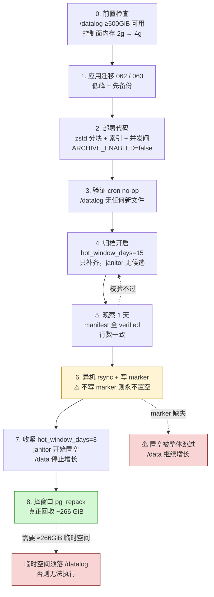


### K2. 回填

- `BackfillOnce=true` 或在第 4 步让 waterline 自然覆盖 11 天。
- 总量 ~230 GB jsonl，约 2 小时（Go 估）。
- 完成后确认 `call_traces` 中 2026-09-10 起每天都有 manifest 且 `verified`。

### K3. 磁盘回收（旧定稿缺失）

**问题**：`SET body=NULL` 只把 TOAST 元组标记为死元组。
**且实测发现**：不 VACUUM 时 FSM 不记录空闲页，新插入仍扩展文件 → **`df` 与 TOAST 同步增长**（实测 60 秒对账：TOAST +8.18 MB / `/data` +8.45 MB）。这意味着**单纯置空并不阻止 /data 增长**。

三条路径：

| 方案 | 锁 | 临时空间 | 说明 |
|---|---|---|---|
| `VACUUM call_traces`（非 FULL） | 无阻塞 | 无 | **能让新插入复用空闲页**，止住 df 增长；但不缩小文件 |
| `pg_repack -t call_traces --jobs 4` | 仅切换瞬间 | ≈ 266 GiB | **真正把空间还给 OS**；工作表须放 `/datalog` |
| `VACUUM FULL call_traces` | 全程 ACCESS EXCLUSIVE | ≈ 266 GiB | 需停机窗口 |

**关键约束**：`/data` 仅剩 54 GiB ⇒ 临时空间**必须落在 `/datalog`**（368 GiB 可用）。
`pg_repack` 对 TOAST 表的 `--tablespace` 行为**需实测确认**（未验证项 U3）。

**建议顺序**：先 `VACUUM` 止涨（立即、零风险）→ 再择窗口 `pg_repack` 回收。

#### K3.1 置空门闸流程图（janitor）

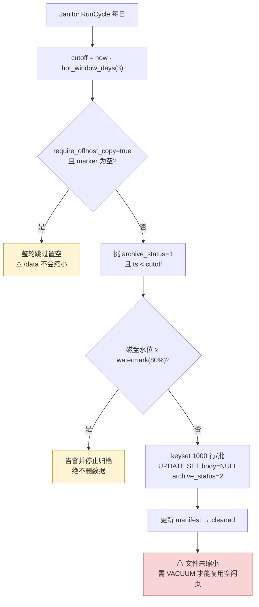

#### K3.2 磁盘回收链路图

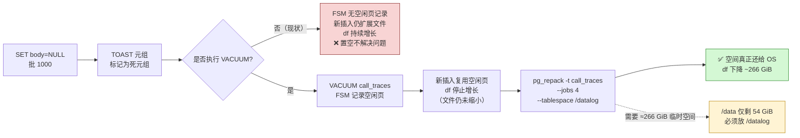


### K4. 保留策略（新增）

实测归档增速：

| 口径 | 每月 |
|---|---|
| 保守（Go 9.57x） | **59 GiB/月** |
| 现实（Go ≈17.2x） | **34 GiB/月** |

`/datalog` 可用 **368 GiB**（其中 189 GB 是 leakscan 遗留，见 K5）：

| 场景 | 可用 | 可支撑 |
|---|---|---|
| 现状（189 GB 遗留不释放） | 368 GiB | **6~10 个月** |
| 释放 leakscan 遗留后 | ~557 GiB | **9~16 个月** |

**必须二选一**：
- 配 `archive_retention_days`（建议 365 起步），到期删除归档并记录
- 或扩容 `/datalog`

### K5. leakscan 遗留（189 GB）

`/datalog/archive/call_traces/body-*.jsonl.gz`（189 GB，2026-09-08/09）是 **leakscan 泄漏证据归档**，与本案无关。
`/datalog` 已用 193 G ≈ 189 G（该归档）+ 2.2 G（`backup/`）+ 杂项。

**若泄漏处置已结案**，这批证据可迁出或删除 → 立刻释放 189 GB。**需业务/安全确认，不在本方案范围内。**

### K6. 异机副本（§13 离机要求）

- 每日 rsync `/datalog` → 备机（`_SUCCESS` 驱动的增量）
- 每季度一次**恢复演练**（随机抽一天、随机 rid 点读校验）
- 副本确认后写 `offhost_copy_marker`
- **注意**：`require_offhost_copy=true` 且 marker 为空时，janitor **整体跳过置空** → `/data` 不会缩小。这是刻意的安全闸，但会让"启用了归档却没效果"，需在部署清单中显式确认 marker 已写。

---

## L. 容量与成本

### L1. 容量（替换旧定稿 §12）

| 项 | 值 |
|---|---|
| 现状 `/data` 正文 | 265.84 GiB，**11~23 GiB/天**增长 |
| 归档后存量（126 万行） | **14~25 GiB**（缩减 **10~19 倍**） |
| 归档月增 | **34~59 GiB/月** |
| 若误用 gzip | 存量 **~236 GiB** ⇒ 零收益（**这就是必须改 codec 的原因**） |

### L2. 热窗口稳态（PG 内）

| `hot_window_days` | PG 正文 | `/data` 总量（含非 TOAST ~22 GiB） |
|---|---|---|
| 11（现状） | 236 GiB | 288 G（85%，**危险**） |
| 7 | 150 GiB | ~172 GiB（50%） |
| **3（建议）** | **64 GiB** | **~86 GiB（25%）** |
| 2 | 43 GiB | ~65 GiB（19%） |
| ~~30（旧默认）~~ | **642 GiB** | **不可能**（/data 总容量 344 G） |

### L3. 耗时

| 任务 | 纯 Go（估） | CLI -22 |
|---|---|---|
| 单日归档（20.8 GB jsonl） | ~9 min | 1.7 h |
| 回填 11 天（230 GB） | ~2 h | ~19 h |
| 点读（分块后） | ~0.3 s | — |

---

## M. 风险登记册

| # | 风险 | 触发条件 | 影响 | 缓解 |
|---|---|---|---|---|
| R1 | **漏配 `WithWindowSize`** | 代码评审疏漏 | 压缩率塌 4.3 倍，**不报错**，归档体积接近现状 | 单元测试断言"加点样本压缩率 ≥ 阈值"；code review 清单 |
| R2 | **点读并发打爆容器内存** | 多人同时查已归档 trace | 控制面 OOM → 管理面不可用 | `max_concurrent_reads=4` 信号量；容器提到 4g；超限排队/429 |
| R3 | **`/datalog` 写满** | 无保留策略 + 34~59 GiB/月 | 归档失败，随后 PG 因 `/data` 满而写入失败 | 配 `archive_retention_days`；`disk_watermark_percent=80` 告警；建议实配 `max_disk_gb` |
| R4 | **置空但归档缺失 → 数据永久丢失** | 校验被绕过、或手工置空 | 正文不可恢复 | 两步校验强制；`archive_status=2` 必须由 janitor 设置；**禁止手工 `SET body=NULL`** |
| R5 | **`require_offhost_copy` 卡住全部置空** | marker 未写 | "启用了却无效"，/data 继续增长 | 部署清单显式检查 marker；文档写明 |
| R6 | **迁移 062 在生产未应用** | 直接开 `ARCHIVE_ENABLED=true` | 服务启动即报错 | K1 步骤 1 强制执行迁移 |
| R7 | **建索引耗时/锁** | 千万行 `CREATE INDEX ... WHERE archive_status=1` | 低峰外执行影响写入 | 低峰执行，`maintenance_work_mem` 调优 |
| R8 | **`/data` 先于归档就绪写满** | 当前 54 GiB，11~23 GiB/天 | PG 写入失败（生产事故） | **见 R8 专项**（下） |
| R9 | `pg_repack` 在 TOAST 表不可行 | `--tablespace` 行为未验证 | 无法回收 266 GiB | 先做 `VACUUM` 止涨；实测确认后再择窗口 |
| R10 | 归档数据在单盘，无副本时盘损 | 盘故障 | 归档丢失（但 PG 内已无正文） | 异机 rsync + 季度演练 |

### R8 专项：/data 时间窗（本方案之外，但必须并列决策）

```
/data 可用 54 GiB
正文增速 11~23 GiB/天（实测）
未发现任何自动清理（crontab 空、/etc/cron.d 无相关项、无脚本）
⇒ 约 2.5 ~ 5 天写满
```

**本方案无法在 2.5~5 天内落地**（需迁移 + 代码 + 验证 + 回收）。
因此必须并行采取**独立于本方案的应急处置**，三选一：

| 选项 | 代价 | 效果 |
|---|---|---|
| a. 手工置空最老 N 天正文 + `VACUUM call_traces` | 需确认业务可接受正文丢失（**无归档**） | 立即止涨，每清 1 天约省 21 GiB |
| b. 扩容 `/data`（加盘/LVM 扩容） | 需停机或在线扩容能力 | 彻底解决时间压力 |
| c. 重跑 leakscan 式处置（归档后再置空） | 相当于本方案的轻量手工版 | 止涨 + 保留正文 |

**建议 a 或 b**：a 最快且零风险，但会丢正文；b 不丢数据但要硬件。**需你决策。**

#### R8.1 时间窗赛跑图

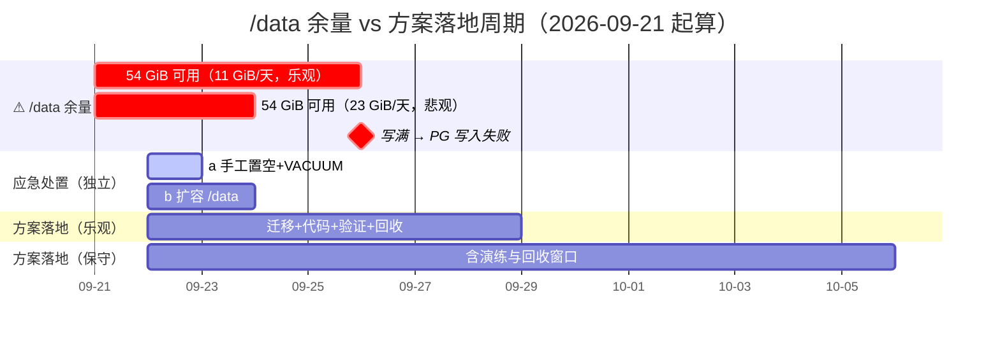

**读图**：方案最快 7 天完成，而 `/data` 最早 3 天写满 ⇒ **应急处置必须并行，不能等方案**。

#### R8.2 决策树

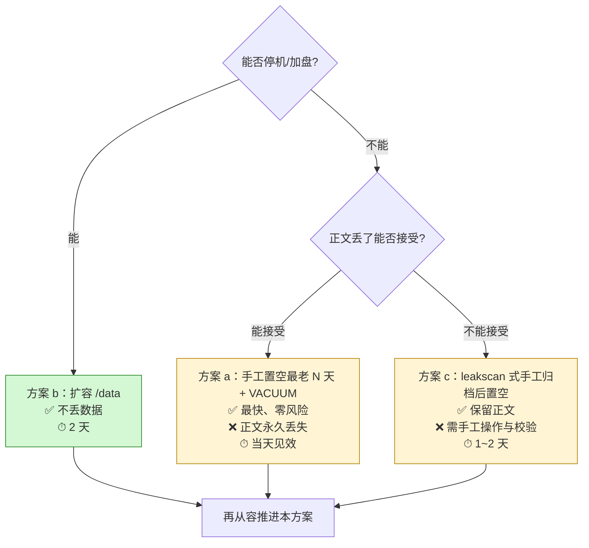


---

## N. 实施步骤与验收标准

### N1. 步骤（每条都有可验证的验收）

| # | 步骤 | 验收标准 |
|---|---|---|
| 1 | 申请/确认 `/datalog` ≥ 500 GiB 可用；控制面容器内存 → 4g | `df /datalog` 可用 ≥ 500 GiB；容器 `memory` = 4g |
| 2 | 应用迁移 062/063 | `\d call_traces` 出现 `archive_status` 等列；`trace_archive_manifests` 存在 |
| 3 | 引入 `klauspost/compress`；实现分块 zstd + index | 单元测试：压缩加点样本 ≥ 9x（断言防 R1） |
| 4 | 实现并发闸 `max_concurrent_reads` | 压测：10 并发点读时容器 RSS 峰值 < 3g |
| 5 | 部署，`ARCHIVE_ENABLED=false` | cron 日志显示 no-op；`/datalog` 无新文件 |
| 6 | `hot_window_days=15` 开启（只补齐不置空） | manifest 全部 `verified`；**`call_traces` 无任何 `archive_status=2`** |
| 7 | 验证点读 | 随机 20 条已归档 trace 详情页可正常回放；P95 < 1 s |
| 8 | 建立异机 rsync + 写 marker | `offhost_copy_marker` 文件存在且时间戳为部署后 |
| 9 | `hot_window_days=3`（开始置空） | `/data` 增速趋零；`archive_status=2` 行数按天增长 |
| 10 | 择窗口 `pg_repack` 回收 | `/data` 已用下降 > 150 GiB |
| 11 | 配 `archive_retention_days` + 告警 | `/datalog` 水位告警可触发 |

### N2. 回滚方案

| 场景 | 回滚 |
|---|---|
| 归档服务异常 | `ARCHIVE_ENABLED=false`（cron no-op），PG 正文不受影响 |
| 置空后发现归档不可读 | 归档文件仍在 `/datalog`（**置空不删归档**）；修复读取端即可恢复 |
| 需要恢复已置空正文 | 从 `/datalog` 归档按 request_id 批量回填（需临时工具） |
| 迁移回滚 | 对应的 `.down.sql` 已存在 |

---

## O. 未决项 / 待复核（审计时请重点看）

| # | 项 | 为何重要 | 建议验证方式 |
|---|---|---|---|
| U1 | **生产机上 Go 编码器的真实吞吐** | §L3 的 ~9 min/天是折算估计值 | 在服务端跑一个最小 Go 程序压一个真实全天文件 |
| U2 | **全天文件（~20.8 GB）的真实压缩率** | 440 MiB 样本 19.61x，全天应更高；决定 §K4 保留期限 | 用 Go 编码器压一个完整天 |
| U3 | **`pg_repack` 对 TOAST 表 + `--tablespace=/datalog` 的行为** | 决定 266 GiB 能否真正回收 | 测试库演练 |
| U4 | **块大小 256 MiB 的定标** | 影响点读延迟 / 并行度 / index 大小 | 用 64/128/256/512 MiB 做对比基准 |
| U5 | **`archive_retention_days` 的业务值** | 决定 `/datalog` 是否够用 | 业务确认 trace 需要保留多久 |
| U6 | **leakscan 遗留 189 GB 可否释放** | 直接决定 `/datalog` 余量（368 GiB vs ~557 GiB） | 安全/合规确认处置是否结案 |
| U7 | **R8 应急处置选型（a/b/c）** | /data 2.5~5 天写满，**独立于本方案的紧急决策** | 需你决策 |
| U8 | 迁移在生产的实际执行机制 | `atlas_schema_revisions` 不存在，迁移历史不明 | 查 CI 部署脚本与 `docs/database.md` |

---

## P. 图示索引（11 张，全部经 Mermaid 官方解析器校验通过）

| # | 图 | 位置 | 回答什么问题 |
|---|---|---|---|
| D1 | 部署视图与数据流 | §D1 | 组件在哪、数据怎么流、两个盘各装什么 |
| D2 | 分层职责 | §D2 | 换 S3 要改哪一层 |
| D3 | 核心收益：为什么必须换 codec | §D3 | gzip vs zstd 的后果对比 |
| F1 | 三态状态机 | §F1 | 归档生命周期与失败回退 |
| G1 | 归档写入时序 | §G2.1 | 分块、两步校验、指针何时写 |
| H1 | 点读时序（两段式） | §H2.1 | 热/冷/丢失三种路径 |
| K1 | 部署顺序 | §K1.1 | 8 步上线，哪步是安全闸 |
| K2 | 置空门闸流程 | §K3.1 | janitor 何时会拒绝置空 |
| K3 | 磁盘回收链路 | §K3.2 | 为什么置空了 df 还不降 |
| R1 | 时间窗赛跑 | §R8.1 | /data 剩余时间 vs 方案落地周期 |
| R2 | 应急处置决策树 | §R8.2 | a/b/c 三条路怎么选 |

> 渲染方式：GitLab / GitHub / VS Code（Markdown Preview Mermaid Support）/ 支持 Mermaid 的 Markdown 阅读器均可直接渲染。
> 本文件全部 11 张图已用 **mermaid v11.17.2 官方解析器**逐一 `mermaid.parse()` 校验，**0 失败**（环境需 `jsdom` 提供 DOM）。

---

## 附：关联文档与产物

| 文件 | 说明 |
|---|---|
| `docs/trace-archive-p0-measurements.md` | P0 实测证据（所有数字的来源） |
| `diagnose_trace_archive.sh` | 实测脚本（只读，已在生产验证） |
| `docs/trace-archive-final-design.md` | 旧定稿（部分被本文取代，见 §A 差异表） |
| `docs/trace-archive-compression-design.md` | 早期压缩选型草案（其 §146 的前提已被证伪） |
| `docs/trace-archive-deletion-migration-design.md` | 含 VACUUM/pg_repack 素材（§6.3） |
| `atlas-migrations/20260824093000_trace_archive.up.sql` | 迁移 062（**未应用**） |
| `atlas-migrations/20260824093500_usage_settlement_daily.up.sql` | 迁移 063（**未应用**） |
| `internal/archive/{store,local,readbody}.go` | 存储抽象 + 点读 |
| `internal/observability/service/archive_{service,janitor}.go` | 状态机 |
| `internal/controlplane/config/config.go` | `ArchiveConfig` |
