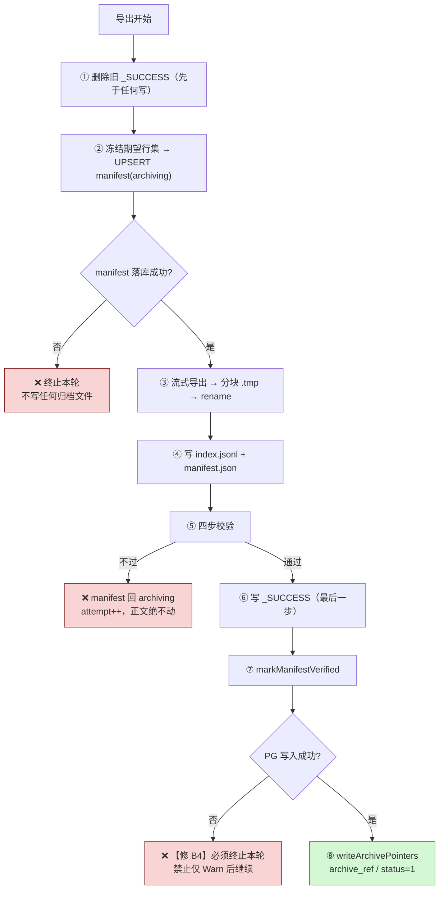
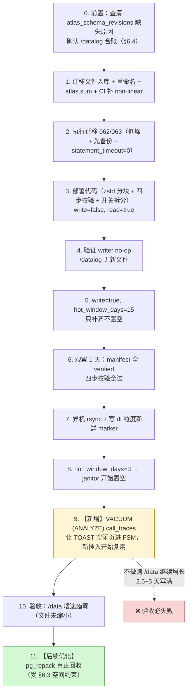
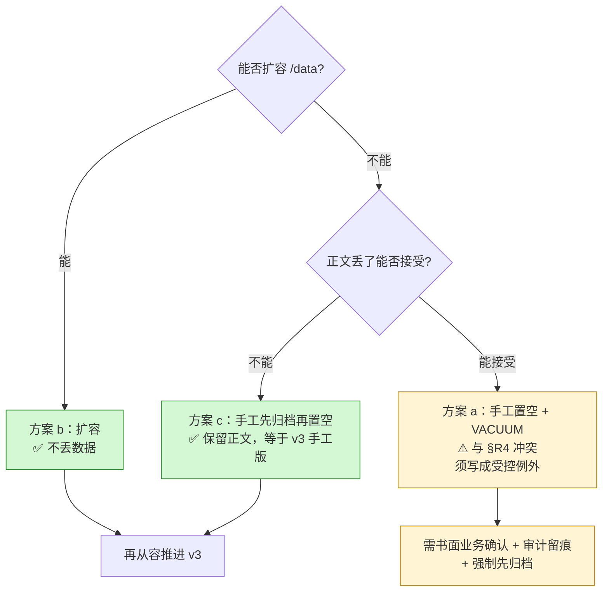

# 调用链路正文归档 · 完整方案 v3

> **v3 = v2 + 三根因修订。** 评审报告 `trace-archive-solution-v2-review.md`、核心问题诊断 `trace-archive-core-issues.md`。
> v2 中 **17 条被核验为正确的技术判断原样保留**（见 §11）。本版重写的是安全链、运维落地路径、容量口径与前置条件。
> 状态：**设计定稿（含 3 项待确认决策）**。生产侧未做任何变更。

---

## 0. 阅读方式：本版改动范围

| 章节 | 处置 | 说明 |
|---|---|---|
| v2 §A 差异表 | **保留**，追加 v2→v3 条目（§1） | |
| v2 §B 目标/非目标 | 保留，补 §8 时间窗上升为前置约束 | |
| v2 §C 实测基线 | 保留 | 数字来源不变 |
| v2 §D 总体架构/§E 存储格式 | 保留 | 分块格式不变 |
| v2 §F 状态机与一致性 | ❌ **整体重写** → 本版 §3 | 校验自证（BLK-01/02） |
| v2 §G2 写入链路 | ❌ **整体重写** → 本版 §4 | 含崩溃窗口与失败语义 |
| v2 §H 读取链路 | ⚠️ **部分改** → 本版 §5 | 开关拆分、延迟预算修正 |
| v2 §I 配置表 | ❌ **重写** → 本版 §9 | 开关拆分、校验/巡检项、保留期改值 |
| v2 §J 迁移 | ❌ **整体重写** → 本版 §6.1 | 未跟踪 + 乱序 + exec-order |
| v2 §K 运维 | ❌ **重写** → 本版 §6 | 缺 VACUUM、pg_repack 口径错、合账 |
| v2 §L 容量 | ⚠️ **更正** → 本版 §7 | gzip 数字算错 |
| v2 §M 风险 / §N 验收 | ❌ **重写** → 本版 §10 / §11 | 补负向测试 |
| v2 §R8 时间窗 | ⬆️ **升格** → 本版 §8 | 从"方案之外"变为"前置约束" |
| v2 §O 未决项 | 保留并收缩 | 见 §12 |

---

## 1. v2 → v3 修订对照（新增，接 v2 §A）

| # | v2 的问题 | v3 的修法 | 根因 | 对应评审 |
|---|---|---|---|---|
| B1 | 两步校验的分母与导出谓词**同源**，空归档也能判 verified | 引入**独立冻结期望行集** + 回读校验（§3.1/§3.2） | 1 | BLK-01/02 |
| B2 | 重导不清理旧 `_SUCCESS`，第 2 步恒真 | `_SUCCESS` 在**导出开始时先删**（§4.1） | 1 | BLK-02 |
| B3 | `sha256` 只写不读，无巡检 | **回读重算并比对** + 定期巡检（§3.2/§3.5） | 1 | MAJ-01 |
| B4 | manifest 落库失败**只 Warn**，指针照写 | **必须终止本轮**（§3.3） | 2 | BLK-01 |
| B5 | 置空前不校验归档存在/可读 | **7 项前置条件**（§3.4） | 1 | MAJ-09/10/11 |
| B6 | 排序契约未固定（DB collation vs Go 字节序） | 强制 `COLLATE "C"`（§4.3） | 1 | MAJ-02 |
| B7 | 全流程无 VACUUM 步骤，却要求 /data 止涨 | K1 补 **7b VACUUM**（§6.2） | 2 | MAJ-07 |
| B8 | `ARCHIVE_ENABLED=false` 会连点读一起关掉 | 拆 `write` / `read` 两个开关（§5.1） | 2 | MAJ-12 |
| B9 | 迁移 062/063 **未入库**且乱序，生产 linear 必挂 | §6.1 专项处置 | 3 | MAJ-13 |
| B10 | `/datalog ≥500 GiB` 与实测 368 GiB 互锁 | 合账并给出扩容/释放路径（§6.4） | 3 | MAJ-15 |
| B11 | `retention=365 天` 需 408~708 GiB，与 368 GiB 矛盾 | 容量反推 + 上限行为（§7.2） | 3 | MAJ-04 |
| B12 | 「gzip ⇒ 236 GiB ⇒ 零收益」**算错** | 正确值 **69.6 GiB**（§7.1） | 附 | MAJ-03 |
| B13 | pg_repack 空间与 `--tablespace` 语义错误 | 重述 + **降级为后续优化**（§6.3） | 3 | MAJ-06 |
| B14 | 回填/节流三处互斥，`BackfillOnce` 语义误用 | 回填独立通道（§7.3） | 3 | MAJ-05 |
| B15 | /data 时间窗被写成"方案之外" | **升格为前置约束**（§8） | 3 | MAJ-08 |
| B16 | 06-04~09-09 正文已永久丢失，方案未交代 | 显式声明 + UI 告知（§8.3） | 3 | gap |

---

## 2. 决策记录（3 项，已给推荐值；**请确认或覆盖**）

| # | 决策 | 选项 | **v3 采用** | 理由 |
|---|---|---|---|---|
| **D-1** | 重导写盘策略 | (a) 写新版本目录 `dt=.../v2/`，保留旧版本至全量对账完成<br/>(b) 原地覆盖 + 强制"冻结期望行集 + 重导必须包含上次已验证行集"硬校验 | **(b)** | (a) 使 `/datalog` 过渡期占用翻倍；该盘仅 368 GiB 可用且需与 pg_repack 竞争。**(b) 的独立冻结集（§3.1）已能从根源消除"覆盖导致丢行"** |
| **D-2** | 置空前置条件强度 | (a) 校验「归档可读 + 离机凭证 sha256 一致」<br/>(b) (a) + 「冻结快照行集 + 逐块回读 + 永久丢失行数=0」 | **(b)** | 这是**唯一**会造成不可逆丢失的环节（§核心问题诊断）。多花的每轮耗时远低于丢数据的代价 |
| **D-3** | §R8 应急处置与 §R4「禁止手工置空」冲突 | (a) 允许"无归档的手工置空"作为受控例外<br/>(b) 禁止，只走扩容<br/>(c) 手工先归档再置空 | **(b) 优先，(c) 次选** | (a) 等于亲手制造方案要消灭的"永久丢失态"。**若确需 (a)，必须写入受控例外清单：书面业务确认 + 审计留痕 + 强制先归档** |

> 若你对 D-1/D-2/D-3 有不同选择，§3/§4/§6/§8 的相关设计需相应调整——本版已按上表推荐值写就。

---

## 3. 修订后的数据安全链【重写 v2 §F】

### 3.1 独立冻结期望行集（取代"导出侧自己数行数"）

**这是整版最关键的设计。** 归档开始时，先为 `dt` 冻结一份**不依赖导出谓词**的基准：

```sql
-- 基准 1：该天全部行数（谓词只有时间范围，【不含 body 非空】）
SELECT count(*) FROM call_traces
 WHERE ts >= :'day_start' AND ts < :'day_end';

-- 基准 2：该天有正文行的 request_id 摘要（导出谓词 + 固定字节序）
SELECT count(*),
       encode(sha256(convert_to(
         string_agg(request_id, E'\n' ORDER BY request_id COLLATE "C"), 'UTF8')), 'hex')
  FROM call_traces
 WHERE ts >= :'day_start' AND ts < :'day_end'
   AND (request_body IS NOT NULL OR response_body IS NOT NULL);
```

三个值冻结进 manifest：

| 字段 | 含义 | 为什么必需 |
|---|---|---|
| `expected_total` | 该天**全部**行数 | 独立于导出谓词；防止分母缩水（**BLK-02 的根**） |
| `expected_body_count` | 该天**有正文**行数 | 与 `expected_total` 联立，可检出"该天是否被部分置空" |
| `expected_body_rids_sha256` | 有正文行 rid 的字节序摘要 | 回读比对的唯一权威基准 |

> 116,891 行 × 36 B ≈ 4.2 MB，单次 `string_agg` 内存可接受（峰值日 182,439 行 ≈ 6.6 MB）。

**三种天型必须显式区分（修 MAJ-05 的空天问题）：**

```
expected_total > 0 且 expected_body_count > 0   → 正常归档
expected_total > 0 且 expected_body_count == 0  → 标记 empty（正文早已不存在，无需归档）
                                                  不得写指针、不得置空、不计入归档 KPI
expected_total == 0                             → 标记 empty（该天本就无数据）
```

### 3.2 四步校验（取代 v2 的两步）

`verified` 的门槛，**四步全过**：

| 步 | 校验 | 独立于导出路径？ | 检出什么 |
|---|---|---|---|
| **① 回读重算** | 重新打开刚写的分块归档，流式读出全部 `request_id`，本地重算 `count` 与 `sha256(join(rids,"\n"))`，必须 **等于** 冻结的 `expected_body_count` / `expected_body_rids_sha256` | ✅ **是**（读盘重算，不信任导出侧计数） | 漏行、截断、覆盖丢行、块写坏 |
| **② 全量覆盖** | `导出行数 + 该天无正文行数 == expected_total` | ✅ 分母来自独立基准 1 | 分母缩水、部分天被静默跳过 |
| **③ 无陈旧标记** | `_SUCCESS` 存在 **且** mtime > 本次导出开始时间 | ✅ 时间戳不可伪造 | 重导时把陈旧 `_SUCCESS` 当证据 |
| **④ 结构一致** | `index.jsonl` 的块数/行数与实际文件一致；`manifest.json` 字节数与盘上一致 | ✅ | 索引与数据不一致 |

**只有四步全过**才允许：`manifest → verified` → 写指针。

### 3.3 写入顺序与失败语义【修 B4】



**与 v2 代码的差异（必须改代码，不是只改文档）：**

| 现码 | v3 要求 |
|---|---|
| `:556` `writeArchivePointers` 先于 `:573` `markManifestVerified` | **反转**：先 verified 落库，再写指针 |
| `:597-598` `Save` 失败仅 `slog.Warn` | **返回 error 终止本轮** |
| 无"删除旧 `_SUCCESS`"逻辑 | 导出开始前先删 |
| `:354-356` 分母与导出同谓词 | 改用 §3.1 的独立基准 |

### 3.4 置空前置条件（janitor 门闸）【修 B5】

对每个候选 `dt`，**7 项全过**才允许 `SET body=NULL`：

```
① manifest.state == verified
② verified_at IS NOT NULL AND verified_at > created_at        （非陈旧）
③ expected_body_rids_sha256 IS NOT NULL                        （独立基准存在）
④ 抽样回读：随机 20 条 + 首/尾各 1 条，全部命中且内容非空
⑤ 巡检记录：该 dt 最近一次巡检 PASS，且在 freshness 窗口内（默认 7 天）
⑥ 离机凭证：marker 含该 dt 且时间戳新鲜（默认 24h 内）        （修 MAJ-10：由"存在性"升为"dt+新鲜度"）
⑦ 磁盘水位 < disk_watermark_percent
任何一项不过 → 跳过该 dt，记录原因并告警（不得静默跳过）
```

### 3.5 巡检与 sha256 消费【修 B3 / MAJ-01】

`trace_archive_inspections`（或 manifest 上的 `last_inspected_at` / `verify_state`）：

- **轮转巡检**：每日抽 N 个 dt（按最久未巡检优先），回读归档、重算 rid 摘要、与 manifest 比对
- **失败处置**：标记 `verify_state = suspect` → **禁止该 dt 进一步置空** + **禁止保留期删除** + 告警
- **`sha256` 必须被消费**：v2 只写不读，v3 在两处消费——§3.2①（写入时回读）与本节（定期巡检）

### 3.6 保留期删除前置【修 MAJ-04】

```
允许删除归档 dt ⇔ manifest.state == cleaned
                AND verify_state == ok 且巡检在 freshness 窗口内
                AND 不在保护窗（最近 N 天）
                AND 通过人工/策略确认（可配置为自动，但必须留审计）
```

**绝不允许**"到达保留期就静默删除"。

### 3.7 不变量与崩溃窗口分析【新增，v2 缺失】

**核心不变量**：
- `archive_status = 2` ⇒ 该 dt 的 manifest 已 `verified` **且** 四步校验通过 **且** 本次置空前抽样回读通过
- `archive_status = 2` ⇒ 归档文件正在被巡检保护（`verify_state = ok`）
- 任何时刻：`archive_status = 0` ⇒ 正文必在 PG

| 崩溃点 | PG 侧 | 归档侧 | 安全？ | 恢复动作 |
|---|---|---|---|---|
| 删 `_SUCCESS` 后、分块写完前 | 正文在，指针空 | 无 `_SUCCESS`，有 `.tmp` | ✅ | 次轮重导（先删 `.tmp`） |
| 分块写完、`_SUCCESS` 前 | 正文在，指针空 | 无 `_SUCCESS` | ✅ | 次轮重导覆盖 |
| `_SUCCESS` 写完、verified 落库前 | 正文在，指针空 | 完整 | ✅ | 次轮校验后落 verified（janitor 不会动，因 `status=0`） |
| verified 落库后、指针写入前 | 正文在，指针空，manifest verified | 完整 | ✅ | 次轮重试写指针 |
| 指针写入后、置空前 | 正文在，指针有 | 完整 | ✅ | janitor 过 7 项前置后置空 |
| 置空批次中途崩溃 | 部分置空，`status` 已为 2 的行 | 完整 | ✅ | 次轮续置空（幂等：`status=1` 才处理） |
| **manifest 落库失败但继续（v2 缺陷）** | 指针有，manifest=archiving | 可能不完整 | ❌ **危险** | v3 §3.3 已改为终止 |

---

## 4. 修订后的写入链路【重写 v2 §G2】

### 4.1 `ArchiveDay` 修订流程

```
1.  删除该 dt 旧 _SUCCESS（若存在）；删除遗留 .tmp          ← 修 B2
2.  计算并冻结期望行集（§3.1 两条 SQL）
3.  天型判定：正常 / empty（§3.1）——empty 直接结束，不写指针
4.  UPSERT manifest(dt, archiving, expected_total, expected_body_count,
                    expected_body_rids_sha256, attempt+1)
    落库失败 → 终止本轮                                     ← 修 B4
5.  流式导出（游标 BatchRows，ORDER BY request_id COLLATE "C"）：
      每写完【一整行】后判断缓冲是否 >= chunk_mb → 封块
      单行 > chunk_mb 时该行独立成块（绝不跨块）              ← 修 tech 视角发现
      封块：写 part-NNNNN.jsonl.zst.tmp → fsync → rename
      同时累积 index 记录 {part, first_rid, last_rid, rows, bytes}
6.  写 index.jsonl、manifest.json
7.  四步校验（§3.2）；不过 → manifest 回 archiving，正文绝不动
8.  写 _SUCCESS（最后一步）
9.  markManifestVerified（失败必须终止）                       ← 修 B4
10. writeArchivePointers：SET archive_ref, archive_status=1
      WHERE ts ∈ dt AND archive_status IN (0,1)               （幂等）
```

### 4.2 回读校验的实现要点【修 B3】

```go
// 重新打开本次写的分块，流式读出全部 request_id，本地重算摘要
h := sha256.New()
n := 0
for each part in index.Parts {
    for each line in decode(part) {
        n++
        h.Write([]byte(rec.RequestID)); h.Write([]byte("\n"))
    }
}
// 与 manifest.expected_body_rids_sha256 比对（顺序已由 COLLATE "C" 固定）
```
**注意**：必须**按 index 中记录的块顺序**串联，且块内顺序即导出顺序——这样本地摘要与 SQL 侧 `ORDER BY request_id COLLATE "C"` 等价。

### 4.3 排序契约【修 B6 / MAJ-02】

`request_id` 是**客户端可控任意文本**，DB 默认 collation 与 Go `bytes.Compare` 不一定一致。因此：

- 导出 SQL：`ORDER BY request_id COLLATE "C"`（字节序）
- index 二分比较、本地摘要重算：**一律字节序**
- 单元测试：构造含大写/小写/数字/连字符/非 ASCII 的 rid 集合，断言 SQL 排序与 Go 排序**逐位一致**
- 若不满足则回退方案：导出后本地重排（成本高，不推荐）

---

## 5. 修订后的读取链路【改 v2 §H4/§N2】

### 5.1 开关拆分【修 B8 / MAJ-12】

```
archive.write.enabled   → 归档 cron + janitor（写入/置空）
archive.read.enabled    → 点读（LocalStore.ReadBody）
```

- **回滚只关写入，点读保持可用**（v2 的单一开关会把已置空 trace 全部变成"静默返回空正文"）
- 点读器**独立构造**：只要 `archive.root` 可读即可用
- `usage_handler` 必须区分三种情况并分别告警：
  1. 正文为空 + `archive_ref` 非空 + 点读**可用** → 正常冷路径
  2. 正文为空 + `archive_ref` 非空 + 点读**被关闭** → 返回可观测错误码（**不得**表现为"数据不存在"）
  3. 正文为空 + `archive_ref` 为空 → 永久丢失，告警

### 5.2 点读延迟预算修正【修 tech 视角】

v2 的 ~0.3 s 只算了"解压 + 一次命中"，漏了**行扫描的 JSON 反序列化开销**。修正：

| 步骤 | 修正后 |
|---|---|
| 读 index.jsonl | < 5 ms |
| 解压 256 MiB 块（1047 MB/s） | ~245 ms |
| **行定位（字节预筛 `bytes.Index`，不反序列化）** | ~250 ms |
| 仅对命中行做 JSON 解析 | ~5 ms |
| 磁盘读（压缩后 ~15 MB） | ~20 ms |
| **合计** | **~0.5 s** |

**实现要求**：块内**先做字节级预筛定位候选行，再仅对该行反序列化**，避免对 256 MiB 全量 `json.Unmarshal`（后者会显著更慢）。

### 5.3 并发信号量落点【修 MIN-14】

`max_concurrent_reads` 的信号量放在 **`LocalStore` 层**（每次 `ReadBody` 解码前 acquire），而不是 handler 层——否则同一进程内其它调用方绕过闸门。

---

## 6. 修订后的运维落地路径【重写 v2 §K】

### 6.1 迁移前置【修 B9 / MAJ-13 —— 唯一的发布阻断点】

**现状（已验证）**：
```
git status:  062/063 及其余共 7 个迁移文件全部 ?? 未跟踪  → CI 从不发布
git ls-files: 已跟踪 50 个，不含 20260824093000/093500
版本号:      20260824093000 < 已提交的 20260902070000 / 20260916095738
CI:287       migrate-prod: 无 --exec-order（默认 linear）
CI:323       migrate-test: 有 --exec-order non-linear      → 测试过、生产挂
```

**处置（4 步，缺一不可）**：
1. `git add` 全部 7 个未跟踪迁移文件
2. **重命名** 062/063 为大于当前 HEAD 最大值的时间戳（它们语义上确实是"今天"新增的）
3. 重新生成 `atlas.sum`（当前已是 `M` 状态但文件未入库）
4. **CI:287 `migrate-prod` 补 `--exec-order non-linear` 作为兜底**（与 migrate-test 对齐）

**另需查清**：生产 `atlas_schema_revisions` **表不存在** —— 是 `ATLAS_BASELINE` 未跑、还是 revisions-schema 不同？**这决定迁移能否安全执行**，必须先查明再动生产。

### 6.2 部署顺序【修 B7：补 VACUUM】



**第 8→9 步是 v2 缺失的关键环节**：`VACUUM` 使 TOAST 空闲页进入 FSM，新插入才能复用——这是"/data 增速趋零"的**真正前提**，`pg_repack` 只负责把已用从 288 G 降到目标值。

> ⚠️ **待实测确认**：`VACUUM call_traces` 是否级联 vacuum TOAST 关系并更新其 FSM（PG 会处理 toast 关系，但本库需实测验证）。这是解除 §8 时间窗风险的**唯一低成本手段**，优先级高于 pg_repack。

### 6.3 磁盘回收口径修正【修 B13 / MAJ-06】

**v2 的两处错误**：
1. 临时空间按 1× 算（实际 pg_repack 需建新表 + 索引 + 日志表，官方口径约 **2×**）
2. `--tablespace` 语义写错：它不是"临时空间放别处，用完归还"，而是**把表永久建在该表空间** → 若指向 `/datalog`，`call_traces` 会**永久留在 `/datalog`**，与归档争盘

**修正后的路径**：

| 方案 | 空间需求 | 结论 |
|---|---|---|
| `VACUUM`（非 FULL） | 0 | ✅ **第一步必做**：止住增长（文件不缩小） |
| `pg_repack`（同表空间） | ~2× 表 ≈ **532 GiB** | ❌ `/data` 仅 54 GiB 可用 → 不可行 |
| `pg_repack --tablespace /datalog` | ~532 GiB | ❌ 且会把表永久搬到 `/datalog`，不可接受 |
| `VACUUM FULL` | ~266 GiB | ❌ `/data` 不够；需停机窗口 + 扩容 |
| **扩容 `/data` 后再 `VACUUM FULL`** | 需 +266 GiB | ✅ 唯一能真正归还空间的路径 |

**关键结论（改变优先级）**：**`VACUUM` 是解除紧急风险的动作，`pg_repack`/`VACUUM FULL` 只是"把已用降下来"的优化。** v2 把 pg_repack 当作必需步骤，是错的。

### 6.4 `/datalog` 合账【修 B10 / MAJ-15】

| 用途 | 需要 |
|---|---|
| 已有 leakscan 证据 | 189 GB |
| 归档存量（126 万行） | 14~25 GiB |
| 未来归档 12 个月 | 408~708 GiB |
| pg_repack 临时（若做） | ~532 GiB |
| **合计** | **远超 368 GiB 可用** |

**结论**：`/datalog` **必须扩容**，或同时做到三件事——释放 leakscan 189 GB（需安全/合规确认）、把保留期压到 ≤6 个月、**不在 `/datalog` 做 pg_repack**。

---

## 7. 修订后的容量与保留期【更正 v2 §K4/§L】

### 7.1 gzip 数字更正【修 B12 / MAJ-03】

```
jsonl 总量 = 1,259,124 行 × 205,879 B = 241.4 GiB

gzip 3.47x  →  69.6 GiB    ← v2 §A1/§D3 写的 236 GiB 是错的
zstd 9.57x  →  25.2 GiB
zstd 17.2x  →  14.0 GiB
```

**论证口径更正**：gzip 仍有 **3.8 倍**缩减，**不是"零收益"**。正确表述是：

> zstd 比 gzip 好 **2.8~5 倍**（25.2→69.6 GiB 的差距），因此值得换 codec；但 gzip 并非无效。

v2 §A1「gzip ⇒ 零收益 / 项目白做」与 §D3 的对应表述**作废**。

### 7.2 保留期容量反推【修 B11 / MAJ-04】

| 月增（中值 46 GiB） | 可用盘 | 可支撑 |
|---|---|---|
| 46 GiB/月 | 368 GiB（现状） | **约 8 个月** |
| 46 GiB/月 | 557 GiB（释放 leakscan 后） | **约 12 个月** |

**`archive_retention_days` 建议值从 365 改为 180（6 个月）**，并明确**到达上限时的行为**：

```
① 告警（不静默）
② 停止新的置空（避免"归档删了、PG 也清了"的双重丢失）
③ 人工确认后才允许删除
（绝不"到期自动删"）
```

### 7.3 回填解耦【修 B14 / MAJ-05】

| v2 的问题 | v3 修法 |
|---|---|
| `days_per_night=2` 与"一次窗口回填 11 天"互斥 | `days_per_night` **只约束常规每日归档**；回填走独立通道 `archive.backfill.enabled` + `archive.backfill.max_days` |
| `BackfillOnce` 语义误用 | 现码 `backfill_once` **只回填 `task_id`/`documents_count` 两个标量列，与正文无通路** → v3 明确：**不复用它**，新增独立的正文回填路径 |
| 空天是否占配额未定义 | §3.1 天型判定：`empty` 天**不占配额、不计 KPI** |
| "观察 1 天 manifest 全部 verified" 与节流矛盾 | 改为"观察 1 天：**已处理的天**全部 verified"，并放宽为 N 天 |

---

## 8. /data 时间窗【从 v2 §R8 升格为前置约束】

### 8.1 事实

```
/data 可用 54 GiB（344 G 盘，已用 288 G / 85%）
正文增速 11~23 GiB/天（实测，60 秒精确对账）
未发现任何自动清理（crontab 空、/etc/cron.d 无相关项、无脚本）
⇒ 约 2.5 ~ 5 天写满
```

**这不是"本方案之外"，而是决定方案能否执行的约束**：方案最快 7 天落地 > 时间窗。

### 8.2 与 §R4 的冲突收敛

| 选项 | 与 §R4「禁止手工 `SET body=NULL`」 | v3 结论 |
|---|---|---|
| a. 手工置空 + VACUUM | ❌ **直接冲突**，且正是制造"永久丢失态"的手段 | **不推荐**（决策 D-3 选 b） |
| b. 扩容 `/data` | ✅ 无冲突 | **首选** |
| c. 手工先归档再置空 | ✅ 无冲突（等于 v3 的手工版） | 次选 |

> v2 §R8 表格里"每清 1 天约省 21 GiB"也是不准确的——那省下的是**可复用空间**，不是**已释放空间**（需 VACUUM + 复用才生效）。

### 8.3 已发生的数据丢失，必须显式声明【修 B16】

**2026-06-04 ~ 2026-09-09 的正文已永久丢失**（leakscan 处置，无归档）。方案**不回填这部分，也不可能回填**。

必须做到：
- 文档明确记录这段区间
- **UI 层告知**：该区间 trace 详情页应显示"正文未保留"，而不是静默空白
- 不把这段计入归档覆盖率/KPI

### 8.4 决策树



---

## 9. 修订后的配置表【重写 v2 §I1】

| 键（yaml） | 环境变量 | v2 | **v3** | 说明 |
|---|---|---|---|---|
| `archive.write.enabled` | `ARCHIVE_WRITE_ENABLED` | — | **bool（false）** | 【新】归档 cron + janitor |
| `archive.read.enabled` | `ARCHIVE_READ_ENABLED` | — | **bool（false）** | 【新】点读独立开关 |
| ~~`archive.enabled`~~ | ~~`ARCHIVE_ENABLED`~~ | bool | **废弃/兼容读取** | 拆分后保留兼容，语义映射到 write |
| `archive.root` | `ARCHIVE_ROOT` | `/datalog/llm-gateway-archive` | 同 | |
| `archive.tz` | `ARCHIVE_TZ` | `Asia/Shanghai` | 同 | |
| `archive.hot_window_days` | `ARCHIVE_HOT_WINDOW_DAYS` | 3 | **3**（范围 2~7） | |
| `archive.chunk_mb` | `ARCHIVE_CHUNK_MB` | 256 | 256（待 U4 定标） | |
| `archive.zstd_level` | `ARCHIVE_ZSTD_LEVEL` | best | best | |
| `archive.zstd_window_mb` | `ARCHIVE_ZSTD_WINDOW_MB` | 128 | **128（不可省）** | 漏配静默塌 4.3 倍 |
| `archive.max_concurrent_reads` | `ARCHIVE_MAX_CONCURRENT_READS` | 4 | 4 | 落点在 `LocalStore`（§5.3） |
| `archive.batch_rows` | `ARCHIVE_BATCH_ROWS` | 1000 | 1000 | |
| `archive.days_per_night` | `ARCHIVE_DAYS_PER_NIGHT` | 2 | 2（**仅常规归档，不含回填**） | |
| `archive.backfill.enabled` | `ARCHIVE_BACKFILL_ENABLED` | — | **bool（false）** | 【新】正文回填独立通道 |
| `archive.backfill.max_days` | `ARCHIVE_BACKFILL_MAX_DAYS` | — | **int（30）** | 【新】 |
| `archive.verify_sample_rows` | `ARCHIVE_VERIFY_SAMPLE_ROWS` | — | **int（20）** | 【新】置空前抽样回读条数 |
| `archive.inspect_freshness_hours` | `ARCHIVE_INSPECT_FRESHNESS_HOURS` | — | **int（168）** | 【新】巡检新鲜度窗口 |
| `archive.offhost_marker_freshness_hours` | `ARCHIVE_OFFHOST_MARKER_FRESHNESS_HOURS` | — | **int（24）** | 【新】marker 新鲜度 |
| `archive.require_offhost_copy` | `ARCHIVE_REQUIRE_OFFHOST_COPY` | true | true | |
| `archive.offhost_copy_marker` | `ARCHIVE_OFFHOST_COPY_MARKER` | "" | ""（**须为 dt 粒度格式**） | |
| `archive.disk_watermark_percent` | `ARCHIVE_DISK_WATERMARK_MB` | 80 | 80 | 历史键名 |
| `archive.max_disk_gb` | `ARCHIVE_MAX_DISK_GB` | 0 | **0 → 建议实配** | 0=不限有风险 |
| `archive.archive_retention_days` | `ARCHIVE_RETENTION_DAYS` | 0 | **180**（原建议 365 → 修正） | 到期行为见 §3.6/§7.2 |

---

## 10. 修订后的风险登记册【重写 v2 §M】

| # | 风险 | 触发 | 影响 | 缓解 | 变化 |
|---|---|---|---|---|---|
| R1 | 漏配 `WithWindowSize` | 代码疏漏 | 压缩率塌 4.3 倍，**不报错** | 单测断言压缩率阈值 | 保留 |
| R2 | 点读并发 OOM | 多人同查冷 trace | 控制面不可用 | 信号量落 `LocalStore`（§5.3）；容器 2g→4g | 细化落点 |
| R3 | `/datalog` 写满 | 无保留策略 | 归档失败 | retention=180 + 水位告警 + 合账 | 改值 |
| R4 | 置空但归档缺失 → 永久丢失 | 校验被绕过 | **不可逆** | **四步校验 + 7 项前置 + 巡检**（§3） | **强化** |
| R5 | marker 未写 → 置空全跳过 | 部署遗漏 | 启用了却无效 | 部署清单显式检查 | 保留 |
| R6 | 迁移未应用 → 启动报错 | 直接开 write | 服务报错 | §6.1 四步处置 | **升为阻断项** |
| R7 | 建索引耗时/锁 | 千万行 partial index | 影响写入 | 低峰 + `maintenance_work_mem` | 保留 |
| R8 | `/data` 先写满 | 54 GiB、11~23 GiB/天 | **PG 写入失败** | **§8 升格为前置约束** | **升格** |
| R9 | `pg_repack` 不可行 | 空间 2× 且 `/data` 仅 54 GiB | 无法归还空间 | **降级为后续优化；VACUUM 先行** | **纠错** |
| R10 | 单盘无副本 | 盘损 | 归档丢失 | 异机 rsync + 季度演练 | 保留 |
| **R11** | **排序契约不一致** | collation 与字节序不符 | 二分定位失败 → 点读全 miss | 强制 `COLLATE "C"` + 单测（§4.3） | **新增** |
| **R12** | **`_SUCCESS` 陈旧** | 重导未删旧标记 | 校验恒真 | 导出开始先删（§4.1） | **新增** |
| **R13** | **点读器随总开关关闭** | 回滚时关 `enabled` | 已置空 trace 静默空正文 | 开关拆分（§5.1） | **新增** |
| **R14** | **空天被当"归档成功"** | `expected_body_count=0` | KPI 虚高、掩盖失败 | 天型判定 `empty` 单列（§3.1） | **新增** |

---

## 11. 修订后的验收标准【重写 v2 §N1】

在 v2 的 11 条基础上**新增负向测试**（这是防回归的关键）：

| # | 验收 | 类型 |
|---|---|---|
| N1 | 压缩率断言 ≥9x（防 R1 静默劣化） | 正向 |
| N2 | 排序一致性单测：SQL `COLLATE "C"` 与 Go 字节序逐位一致（防 R11） | 正向 |
| **N3** | **人为从归档删 1 行 → 四步校验①必须失败**（防 BLK-02 回归） | **负向** |
| **N4** | **人为让 manifest 落库失败 → 本轮必须终止、指针不得写入**（防 BLK-01 回归） | **负向** |
| **N5** | **人为构造陈旧 `_SUCCESS` → 校验③必须失败**（防 B2 回归） | **负向** |
| **N6** | **`expected_body_count=0` 的天 → 标记 empty，不得写指针/置空**（防 R14） | **负向** |
| **N7** | **置空前抽样回读失败 → janitor 必须跳过该 dt 并告警**（防 R4） | **负向** |
| N8 | 10 并发点读时控制面 RSS 峰值 < 3g（防 R2） | 正向 |
| N9 | `write=false, read=true` 时点读仍可用（防 R13） | 正向 |
| N10 | `/data` 增速趋零（**须在 VACUUM 之后**） | 正向 |

---

## 12. 仍沿用 v2 的章节（无需重读）

| v2 章节 | 内容 | 状态 |
|---|---|---|
| §B | 目标与非目标 | ✅ 有效（§8 升格为前置约束） |
| §C | 实测事实基线 | ✅ 有效（所有数字来源） |
| §D | 总体架构、分层职责 | ✅ 有效 |
| §E | 存储格式（分块+索引+codec 参数） | ✅ 有效（补 §4.3 排序契约） |
| §H1/H2 | 读取链路主体、`ReadBody` 6 步 | ✅ 有效（补 §5.1/5.2/5.3） |
| §I2/I3/I4 | 容器变量、依赖、内存预算 | ✅ 有效（配置表见 §9） |
| §K2 | 回填 | ⚠️ 按 §7.3 解耦 |
| §K6 | 异机副本 | ⚠️ 按 §3.4⑥ 升为 dt 粒度 + 新鲜度 |
| §O | 未决项 | ✅ 有效，收敛为 §13 |
| 附 关联文档 | — | ✅ 有效 |

**v2 中作废的表述**：§A1「gzip 零收益」（→ §7.1）、§D3 同义表述、§K3「pg_repack 用 `--tablespace` 放临时空间」（→ §6.3）、§N2「关 `ARCHIVE_ENABLED` 即安全回滚」（→ §5.1）。

---

## 13. 剩余未决项

| # | 项 | 为何重要 | 归属 |
|---|---|---|---|
| U1 | 生产机 Go 编码器真实吞吐 | §L3 是折算估计 | 生产实测 |
| U2 | 全天文件真实压缩率 | 决定 retention 与是否买盘 | 生产实测 |
| **U3** | **`VACUUM` 能否让 TOAST 空闲页被复用** | **决定 §8 时间窗能否解除** | **最高优先** |
| U4 | 块大小定标（64/128/256/512 MiB） | 影响延迟与并行 | 本地基准 |
| U5 | trace 需要保留多久 | 决定盘量 | **业务决策** |
| U6 | leakscan 189 GB 能否释放 | `/datalog` 368→557 GiB | 安全/合规 |
| **U7** | **§8 应急处置选型（b/c）** | **2.5~5 天窗口** | **需你决策** |
| U8 | 生产 `atlas_schema_revisions` 为何不存在 | 决定迁移能否安全执行 | 需查明 |
| U9 | `pg_repack` 对 TOAST 表的实际行为 | 决定空间能否归还 | 测试库演练 |
