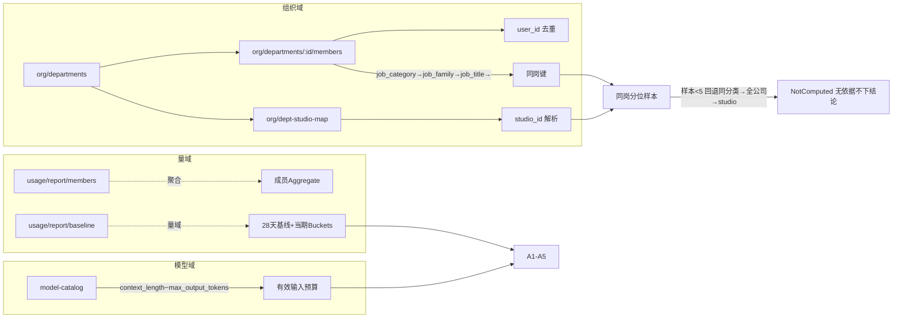
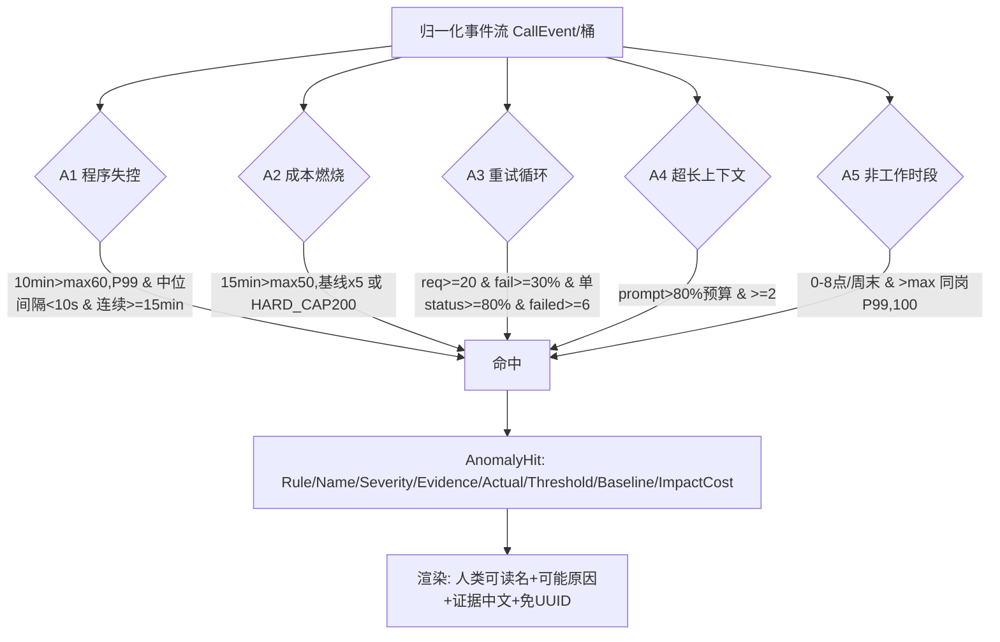
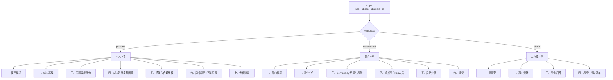
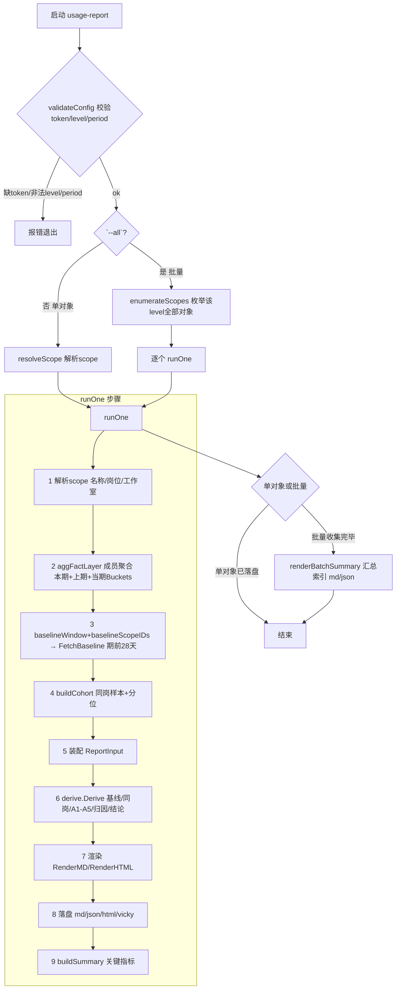

# usage-report —— 离线用量周报工具 实现逻辑

> 阶段一「离线用量周报」CLI。只读、零库权限，复用网关现有 RBAC/查询逻辑；数据面全部走 HTTP（`/api/v1/usage/*`、`/api/v1/my/usage*`、`/api/v1/org/*`、`/api/v1/model-catalog/*`），**不直连 DB、不新增端点、不改 gateway/control-plane 运行时**。

---

## 1. 工具定位与目标

| 维度 | 说明 |
|---|---|
| 输入 | 一个 scope（user / dept / studio）+ 一个周期（默认周）|
| 输出 | 三层报告：**personal / department / studio**（MD + JSON + HTML + Vicky 规范 JSON 载荷）|
| 数据源 | 网关聚合接口（零明细），非 Postgres |
| 只读 | 仅发起 HTTP GET，无任何写请求 |
| 对齐 | 报告结构严格对齐用户 Vicky 模板（`gateway-token-behavior-analysis.md`）|

---

## 2. 总体架构（纯库 + 薄入口）

```
tools/usage-report/            ← 薄入口：HTTP 拉数 → 归一化 → derive → 渲染
  main.go / config.go          ← CLI、runOne、batch 编排、文件命名
  client/usage_client.go       ← 各类 /api/v1/usage/* / org/* / model-catalog/* 客户端
  cohort.go                    ← 同岗分位样本构建
  anomaly_feedback.go          ← 异常反馈入口闭环
internal/observability/report/  ← 核心纯库（数据源无关）
  report.go / metric.go        ← 三层层级契约(fact/judgment/expression)、归一化中间表示
  derive/                      ← Derive(ctx, ReportInput, RuleSet) 纯函数
    baseline.go                ← 28 天稳健基线(median + 1.4826×MAD)、同岗匿名分位
    anomalies.go               ← A1–A5(统一命中 schema)
  render/                      ← render_md.go / render_html.go 只读 Report
```

- **纯库设计**：`derive`、`render` 只读契约，不含网络/DB，便于单测与复用。
- **薄入口**：`tools/usage-report` 负责拉数、装配 `ReportInput`、调 `derive`、落盘。

---

## 3. 数据流 / 管线

```
--scope + --from/--to
   ↓
1. validateConfig        ← 校验 token/level/period/scope(--all 时豁免 scope)
   ↓
2. runOne(ctx, cfg, scope)
   ├── a. resolveScope      ← 解析 scope(名称/岗位/工作室)
   ├── b. aggFactLayer      ← 成员聚合(/usage/report/members + /usage/report/baseline) 零明细
   │        memberAgg / prevMemberAgg / baselineCurrent / currentBuckets / resolvedName
   ├── c. baselineWindow    ← 期前 28 完整自然日 [from-28d, from-1d]
   ├── d. FetchBaseline     ← 同 level/scope 过滤，零明细 → baselineMetrics + baselineBuckets
   ├── e. buildCohort       ← 同岗池 + 匿名分位(不足 5 回退同 category→全公司→studio)
   ├── f. derive.Derive     ← 事实→judgment/expression(基线/同岗/异常 A1-A5/模型归因/结论)
   ├── g. RenderMD/HTML     ← 只读 Report，含表达层幻觉校验
   └── h. buildSummary      ← 该对象关键指标(供批量汇总索引)
   ↓
3. 单对象：写 --md-out/--json-out/--html-out/--vicky-out
   批量 --all：枚举全体对象，各出 <outdir>/<文件>.md + 汇总索引 summary_<from>_<to>.md/.json
```

---

## 4. 核心契约（report.go）

`Report` 是唯一渲染输入，含三段：

| 段 | 结构 | 含义 |
|---|---|---|
| `Meta` | Scope / Period / Level / Currency / QA | 谁、何时、口径（对账元信息）|
| `Fact` | `Personal *PersonalFact`、`Department/Studio *UnitFact` | 事实层（用量/成本/成员/ServiceKey/TopModel）|
| `Judgment` | Baseline / Peer / PeerProfile / Anomalies / ModelGuidance / UnitConclusion / Expression | 判断层（派生结论、A1–A5 命中、模型归因）|

**归一化中间表示**：`DailyMetric`（按天）、`CallEvent`（单次调用事件）、`CohortDef`、`RuleSet`（A1–A5 阈值）。

**AnomalyHit（A1–A5 统一命中 schema）** 四要素：

```
Rule         A1..A5
Name         人类可读名（程序失控 / 成本燃烧 / 重试循环 / 超长上下文 / 非工作时段）
Severity     P1 / P2
Evidence[]   证据链（Field/Value），Field 渲染时映射中文
Note         规则豁免/触发说明（**不是**可能原因）
ActualValue / ThresholdValue / BaselineValue / BaselineWindow
ImpactCostUSD / ExcessCostUSD
Dimensions   map（含 user_id / user_name）
Status       待确认 / 已确认正常 / ...
```

---

## 5. 数据源与口径（对账基准）

- **成功** = `status=200`。
- **`total_tokens = prompt + completion + reasoning`**（不含 cached/cache_write）；对账基准 `GET /api/v1/usage/dashboard`。
- 个人画像/岗位人均**排除** `key_type='service'`；部门 Service Key 块仅 `=service` 且归属当前部门。
- `dept_id` 归一：`d.dept_id = cl.dept_id OR d.id::text = cl.dept_id`；小时粒度 `ts AT TIME ZONE 'Asia/Shanghai'`。
- **CNY 为换算（非判定）**：`est_cost_usd × rate`（记录 `rate/source/at`，默认 7.2）。
- 事实层一律走**成员聚合**（大部门单期可 38 万条，是 detail 超时根因），零明细。

---

## 6. 异常检测 A1–A5（阶段一默认阈值，待真实数据校准）

| 规则 | 判定 |
|---|---|
| **A1 程序失控** | 10min 调用 > max(60, 个人P99_10min) 且中位间隔 <10s 且连续 ≥15min（1min 滑动窗；豁免 service/`__system_`/备案）|
| **A2 成本燃烧** | 15min 成本 > max(¥50, 个人28天同窗中位×5)；另 **HARD_CAP ¥200/15min** 独立触发 |
| **A3 重试循环** | 段=(key_id,model)：req≥20 ∧ fail_rate≥30% ∧ 单一 status 占失败≥80% ∧ failed≥6（区分上游 5xx / 客户端 429/400）|
| **A4 超长上下文** | 15min 窗口「prompt>80% 有效输入预算(context_length−max_output_tokens，来自 model_catalog)」≥2；单条 >80% 偏噪 |
| **A5 非工作时段** | 00:00–08:00 或周末成本 > max(同岗P99, ¥100) 且非备案；阶段一无备案表 → 纯时间窗口触发并标注"阶段二补备案豁免" |

- 同岗分位样本 <5 回退（同 category+studio → 公司同 category → studio），仍 <5 → `NotComputed`（无依据不下结论）。
- `Derive` 纯函数：事实层 → judgment/expression；锚定在 `derive/anomalies.go` 各 `A1..A5` 函数。

**可能原因映射（渲染层，确定性标签）**：

```
A1 → 脚本循环 / 定时任务     A2 → 批处理 / 循环 / 异常重试
A3 → 失败重试 / 异常循环      A4 → 长上下文 / 未压缩会话    A5 → 定时任务 / 未备案
```

---

## 7. 三层报告结构（严格对齐模板）

### personal（7 章）
```
一、使用概览          ← bullet 行（调用/成本/耗时/缓存占比/周环比），非表格
二、纵向基线          ← vs 本人过去 N 天(基线 P/MAD/趋势)
三、同岗使用效能画像   ← 对标范围 + 指标表(本人/同岗P50/分位) + 效能标签
四、成本最高模型的同岗画像 ← 模型 + 采用率/频率/单位成本对比
五、场景与合理用模     ← 用模洞察 + 模型归因
六、异常提示          ← 命中列表：Name(Severity) / actual·threshold·baseline / 影响成本·超支 / 可能原因 / 证据链 / 反馈入口
七、优化建议
```

### department（6 章）
```
一、部门概览
二、岗位分布（同岗位分位，不做跨岗位裸排名）
三、Service Key 用量与风险（仅当前归属部门）
四、重点变化（Top 变化人员）
五、异常处置
六、建议
```

### studio（4 章）
```
一、一页摘要
二、部门贡献
三、变化归因（成本 % 拆解）
四、风险与行动清单
```

---

## 8. 渲染逻辑（人类可读化，去 Code）

`render/render_md.go` 关键策略（Round-4/5/6 落地）：

| 策略 | 实现 |
|---|---|
| **去裸规则码** | 主因句/异常名/风险清单用人类可读名（程序失控/成本燃烧/非工作时段），**不出现 A1/A2/A5 裸码**；规则码仅在内部 `RuleCodes` 字段保留 |
| **真实姓名** | 诊断 `window_top_user`、风险清单「对象」列、重点变化表显示成员真实姓名（去 UUID），不用「员工N/匿名」 |
| **全篇无 UUID** | 用户可见处不暴露 scope UUID；对象名 + 短 hash |
| **证据字段中文** | `evidenceFieldCN` 映射 20 个证据 key → 中文（如 `window_calls_10min`→窗口调用数(10min)、`window_top_user`→窗口top用户、`median_interval_s`→调用间隔中位数(秒)）|
| **可能原因** | 六、异常提示每条命中后补「可能原因：…」（确定性命中，非大模型生成）|
| **删附加章节** | 对齐模板，删「判断」「口径与对账」「概况」独立表、头部元信息条 |
| **标题 ISO 周** | 标题含 `2026-W33`；元信息条移除，front-matter `facts_digest` 保留（机器可读对账）|
| **幻觉校验** | 表达层裸数字降级（无 LLM 时用确定性措辞）|

---

## 9. 批量编排与文件命名

- `--all`：`enumerateScopes` 枚举 level 全体对象（personal 枚举各活部门成员去重；department/studio 枚举组织单元）。
- 每个对象经 `runOne` 出报告 + 一条汇总索引；`renderBatchSummary` 写 `summary_<from>_<to>.md/.json`。
- `batchFileName(level, scope, from, to)`：
  - 文件名 = `<level>_<名称保留中文>_<scope 短 hash>_<from>_<to>.md`
  - `nameSlug`：保留 CJK/字母/数字/`-`/`_`，其余特殊字符（`+/:?<>|*` 等）转 `-`，超长截断
  - `shortHash`：SHA-256 前 4 字节 hex（8 位），识别同名/共享 id 对象，**不暴露完整 UUID**

---

## 10. CLI 参数与使用

```bash
go build -o usage-report ./tools/usage-report
./usage-report \
  --base http://127.0.0.1:8081/api/v1 --token $TOKEN \
  --level personal --scope <user_id> \
  --from 2026-08-01 --to 2026-08-07 \
  --json-out out/report.json --md-out out/report.md --html-out out/report.html
```

| 参数 | 说明 |
|---|---|
| `--base` | 控制面 `/api/v1` base（默认 `:8081`）|
| `--level` | `personal\|department\|studio` |
| `--scope` | scope id（user/dept/studio）|
| `--from/--to` | `YYYY-MM-DD` |
| `--agg` | 用成员聚合构造事实层加法核心（不拉全量明细）|
| `--all` | 批量编排：枚举该 level 全体对象各出报告 + 汇总索引 |
| `--outdir` | 批量输出目录 |
| `--md-out/--json-out/--html-out/--vicky-out` | 单对象输出路径 |
| `--vicky-submit` | 同时生成可 POST /api/reports 的 JSON 载荷 |
| `--token` | admin JWT（PermUsageViewAll/PermMemberView；也支持 `USAGE_REPORT_TOKEN`）|
| `--fx-rate` | USD→CNY 汇率（默认 7.2）|
| `--llm-*` | LLM 分析开关/模型/超时（可选推理）|

需具有 `PermUsageViewAll` 的 token（全公司口径）；同岗分位需 `PermMemberView`。

---

## 11. 花名册取数与安全

- 只走 HTTP：`/org/departments?status=active`（按 total 分页）→ 逐部门 `/org/departments/:dept_id/members?page_size=100` → `/org/dept-studio-map`。
- studio 解析：`departments.studio_id`（非空）→ `dept_studio_map.studio_id` → `""`。
- 同岗键取值链：`job_category → job_family → job_title → ""`。
- 去重以 `user_id` 为键（每用户单部门）；403/404/429/5xx 记录 `skipped_depts` 并继续（客户端 429/5xx 指数退避重试 3 次，非 admin 越权 403 不重试）。
- **必须 admin（IsGlobal）+ `PermMemberView` JWT** 才能拉全量（非 admin 只可见自己范围，普通用户 403）。
- 覆盖缺口：`users.dept_id IS NULL` 用户不在任何 `members` 中 → 不入 roster，报告在 `meta.qa` 标注。
- **安全红线**：admin JWT 仅在内存/env（`--token`/`USAGE_REPORT_TOKEN`），不写 roster.json/report/日志；只取组织元数据，不取请求正文/PII。

---

## 12. 关键文件清单

| 文件 | 职责 |
|---|---|
| `internal/observability/report/report.go` | `Report` 三层层级契约 |
| `internal/observability/report/metric.go` | `DailyMetric`/`CallEvent`/`CohortDef`/`RuleSet` 中间表示 |
| `internal/observability/report/derive/derive.go` | `Derive()` 纯函数入口 |
| `internal/observability/report/derive/baseline.go` | 28 天稳健基线、同岗匿名分位 |
| `internal/observability/report/derive/anomalies.go` | A1–A5 异常检测 |
| `internal/observability/report/render/render_md.go` | MD 渲染（人类可读化/可能原因/证明中文/去码）|
| `internal/observability/report/render/render_html.go` | HTML 渲染 |
| `tools/usage-report/main.go` | CLI 入口、`runOne`、批量编排、`batchFileName`/`nameSlug`/`shortHash` |
| `tools/usage-report/config.go` | 全部 CLI flag |
| `tools/usage-report/client/usage_client.go` | 各类 `/api/v1/*` 客户端 |
| `tools/usage-report/cohort.go` | 同岗分位样本构建 |

---

## 13. 测试

```bash
go test ./internal/observability/report/...
go test ./tools/usage-report/...
```

- `render_md_test.go`：三层矩阵（首章标题 + 无「判断/对账/概况/元信息」章节 + 人类可读断言）。
- `batch_test.go`：`batchFileName` 命名约定（名称保留中文 + 短 hash，不去 UUID）。
- `cohort_test.go` / `anomaly_feedback_test.go`：同岗构样本、异常反馈闭环。

---

## 附录：查询逻辑关系图

> Mermaid 图，支持 Mermaid 的渲染器（GitHub / Typora / VS Code / Docusaurus）可直接渲染。

### 附录A　整体管线（查询 → 派生 → 渲染）

```mermaid
flowchart TD
  subgraph 数据获取(HTTP GET,零明细)
    A[resolveScope] --> B[aggFactLayer 成员聚合]
    B --> C1[GET usage/report/members 本期+上期]
    B --> C2[GET usage/report/baseline 当期Buckets]
    A --> D[baselineScopeIDs]
    D --> E[FetchBaseline 期前28天]
    E --> E1[GET usage/report/baseline]
    A --> F[buildCohort 同岗/花名册]
    F --> F1[GET org/departments]
    F1 --> F2[GET org/departments/:id/members]
    F2 --> F3[GET org/dept-studio-map]
    F --> F4[GET model-catalog]
  end
  subgraph 派生
    C1 & C2 & E1 & F3 & F4 --> G[derive.Derive 基线/同岗/A1-A5/回归]
  end
  subgraph 渲染
    G --> H[RenderMD]
    G --> I[RenderHTML]
    H --> J[buildSummary 汇总索引]
  end
```

### 附录B　数据获取查询依赖（同岗分位取值链）



### 附录C　异常判定逻辑（A1–A5）



### 附录D　三层报告章节结构



### 附录E　报告生成完整逻辑（单对象 + 批量）


