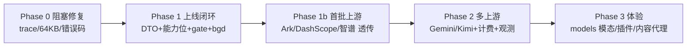

# 视频输入接入 · 执行计划清单

> 依据：[`docs/video-input-analysis.md`](../video-input-analysis.md)（总报告）与 `docs/research/video-input/01..05`（5 份明细）。
> 目标：**"视频输入完成接入并上线，已声明的模型可带视频对话。"**
> 本文 = 可直接排期的任务清单，每个任务带 **改哪里 / 怎么改 / 抄谁 / 怎么验收**。

---

## 0. 先拍板 3 件事（决定后面 30% 工作量）

| # | 决策 | 选项 | 建议默认 | 影响面 |
|---|---|---|---|---|
| D1 | 能力语义 | A 整组 AND（现状语义）/ B 对外 AND + **路由期过滤** | **B** | 决定是否要改 scheduler（+3 文件）；选 A 则混合组一律不能带视频 |
| D2 | 视频是否参与复杂度打分 | A 视作复杂（现状会自然发生）/ B 不参与 | **B**（先保持现状 A 上线，观测后再切 B） | 决定 auto 路由成本 |
| D3 | 大文件路径 | A 只收 URL / B 透传 base64 / C 上传后引用 | **A + B（限 10MB）**，C 留 P2 | 决定是否要动存储/凭证 |

---

## 1. 阶段总览



| 阶段 | 目标 | 任务数 | 估时 | 可独立上线 |
|---|---|---|---|---|
| Phase 0 | 大 body 不再打爆（上线前置） | 4 | 2–3 d | ✅ |
| Phase 1 | 视频能进来 + 只给声明过的模型 + 组内按能力选成员 | 9 | 6–8 d | ✅ **MVP** |
| Phase 1b | Ark / DashScope / 智谱 真实跑通（0 行 adapter） | 3 | 2–3 d | ✅ |
| Phase 2 | Gemini 原生 + Kimi + 方言层 + 计费 + 观测 | 6 | 5–7 d | 分两次 |
| Phase 3 | `/v1/models` 模态 + OpenCode 插件 + 内容代理 | 4 | 3–4 d | 分三次 |

> 合计 ≈ **18–25 人日**（不含 web UI 美化与压测）。

---

## 2. Phase 0：阻塞修复（4 项，2–3 d）

| ID | 任务 | 改哪里 | 做法 | 参考 | 验收 |
|---|---|---|---|---|---|
| **F-1** | 修 64KB 截断 bug | `internal/gateway/middleware/middleware.go:136-139` | 用 `io.TeeReader` 或 `http.MaxBytesReader` 只"窥视"前 64KB 写日志，**不替换 body**；仅 debug 生效（`:117`） | 竞品无此问题（不做 body 改写） | debug 日志开启下，30MB base64 请求仍 200 |
| **F-2** | TraceCapture 不整包驻留 | `internal/gateway/middleware/trace_capture.go:85-88,110-127` | ① 超阈值（如 2MB）不落 body，仅记 `body_bytes`+`sha256`；② 内容片段级裁剪：`image_url/video_url` 的 `url` 只存头 128 字节 + 长度；③ 单次 `ReadAll` 改为有上限读取 | LiteLLM 只记 metadata，不存 body | 30MB 请求峰值内存 ≤ 1.5× body；trace 体积 ≤ 64KB |
| **F-3** | 统一"不支持内容片段"错误码 | `internal/core/chat_content.go:78-80,416-417,466-467`；`internal/errors/registry.go` | 裸 `fmt.Errorf` → 带 code 的 `core.NewInvalidRequestError`（`unsupported_content_part` + `param=messages[i].content[j].type`） | LiteLLM `UnsupportedParamsError`（`litellm/decisions/call.py:528-537`）文案含参数名 | 报错体里有 `param`、有 `code`，前端可直接提示 |
| **F-4** | 内联体积阈值 | `internal/gateway/handler/chat.go`（入口）+ 配置 | body > N MB（默认 10MB）且含 base64 媒体片段 → 400 `inline_media_too_large`，提示改用 URL | done-hub 完全不下载（零拷贝）；我们只做阈值 | 阈值可配置，超限报错文案含替代方案 |

---

## 3. Phase 1：上线闭环（9 项，6–8 d）— **这就是 MVP**

### 3.1 DTO 层（3 项）

| ID | 任务 | 改哪里 | 做法 | 参考 | 验收 |
|---|---|---|---|---|---|
| **C-1** | 新增 `VideoURLContent` 与三处同步 | `internal/core/chat_content.go`：`:11-17`（struct）、`:351-419`（unmarshal）、`:421-469`（normalize）、`:43-81`（marshal） | 字段：`URL/FileID/FPS/MaxFrames/StartOffset/EndOffset/MediaType/Source/ExtraFields`；**string|object 双形态**；`fps` 用 `*float64`；规范 type 统一为 `video_url` | **LiteLLM** `types/llms/openai.py:845-851`（video_metadata 标准化）；本仓 `ImageURLContent` 双形态 `:83-129,490-518` | 三种形态 round-trip 单测：`{"video_url":{"url":…}}` / `{"video_url":"data:video/mp4;base64,…"}` / `{"type":"input_video",…}` |
| **C-2** | `input_video` 别名归一 | `chat_content.go:371-418` | `case "input_video": → Type="video_url"`，payload 兼容 `video_url:{url}` 与 `video_url:"…"` | **new-api** `oai_responses/to_oai_chat_req.go:306-310`（input_video→video_url） | 同一 video 用两种 type 提交，出站 body 一致 |
| **C-3** | Responses 入口放开 | `internal/core/responses.go:135`、`internal/providers/responses_content.go:46-105` | 白名单加 `input_video`，映射成 `video_url`（键名保持 `video_url`） | 同上 new-api | `POST /v1/responses` 带 `input_video` 通过 |

> ⚠️ 三处必须同 PR：只改 unmarshal 会在出站 `ContentPart.MarshalJSON` 二次 400（`chat_content.go:78-80`）。

### 3.2 能力声明层（3 项）

| ID | 任务 | 改哪里 | 做法 | 参考 | 验收 |
|---|---|---|---|---|---|
| **A-1** | 采集能力位 | `internal/controlplane/service/catalog_parser.go:31-36,157-163` | 白名单加 `SupportsVideoInput`（顺手加 `supports_audio_input`，同批被丢 89 处） | **LiteLLM** `model_prices_and_context_window.json` 的 `supports_video_input`；门控 `litellm/utils.py:3215-3216` | seed 里 41 条能解析出来（单测断言 41→`true`） |
| **A-2** | 落库 + 同步 | `model/model_catalog.go:41`、`repository/model_catalog_repo.go:68` **与 `:102`**、`service/catalog_sync_service.go:318,343`、迁移 | DB 加列 `supports_video_input boolean default false`；**两份白名单都改**（Upsert + BatchUpsert，实际走 Batch）；迁移必须放 `atlas-migrations/`（时间戳 > `20261014063200`） | — | `make atlas-diff` 出 SQL；跑 sync 后 DB 有 41 条 true |
| **A-3** | 聚合 + 下发 | `service/model_info_service.go:23,163,208-217,220-222`、`handler/group_handler.go:445-456`（路由配置 payload）、`gateway/binding/client.go:135` | 聚合用 **AND**（`:215-217` 逐个 AND；未绑 catalog 视为不支持）；组 override 加一列 + `group_service.go:162-165,307-318,542`；路由配置 payload 与 `GroupModelInfo` 都要带该字段 | 语义对齐 `docs/guardrails.md` 保守聚合；**不要**照 `:15-17` 那条与实现相反的注释写 OR | `/v1/model/info` 返回 `supports_video_input`；混合组 = false；单成员组 = true |

### 3.3 网关校验与路由（3 项）

| ID | 任务 | 改哪里 | 做法 | 参考 | 验收 |
|---|---|---|---|---|---|
| **G-1** | 入口能力 gate | `internal/gateway/handler/chat.go:97-142`（新增校验，位置在 `Dispatch` 后、`handleNonStream` 前） | 若请求含 video 片段且目标模型/组未声明 → 400 `video_input_not_supported`（附 model、可选提示 `drop_params`） | **LiteLLM** 门控（`decisions/call.py:311-320`）+ `drop_params` 开关（静默剔除需显式开启） | 未声明模型返回 400 且 code 稳定；声明模型 200 |
| **G-2** | 路由期能力过滤（决策 D1-B） | `gateway/scheduler/data.go:55-70`（`GroupModel`）、`:85-99`（`ModelRoutingEntry`）、`routetable.go:58-70`、`router.go:50`（`FilterHealthy` 之后） | 加 `SupportsVideoInput bool` 字段，沿用 `healthStore.FilterHealthy` 的写法：`if needsVideo(req) { models = filterVideoCapable(models) }`；全被过滤掉 → `ErrNoAvailableModel` 但要给 `video_input_not_supported` 的语义化错误 | 竞品普遍**不做**路由期能力过滤（new-api 的 ability 只到 channel/model 粒度）→ 我们的差异化，因为我们是"组 = 多成员聚合" | 混合组（1 支持 + 1 不支持）+ video 请求 → 稳定命中支持的那个；文本请求行为不变 |
| **G-3** | 禁止静默丢 | `internal/providers/bedrock/chat.go:632-656`（无 default）、`internal/core/anthropic.go:308-357`（无 default）、`providers/anthropic/request_translation.go:825-826`（已有先例） | 补 `default:` 返回带 code 的错误（`unsupported_content_part_for_provider`），并落 `video_part_dropped`/`content_part_rejected` 事件 | **反面教材**：new-api `oai_chat/to_claude_messages_req.go:291-294` 注释"audio and video have no Claude block"后直接丢 | 给 Anthropic/Bedrock 发视频 → 400 且日志有事件；**不允许 200 但内容缺失** |

### 3.4 Phase 1 涉及文件清单（15 个）

```
internal/core/chat_content.go                     C-1 C-2 F-3
internal/core/responses.go                        C-3
internal/providers/responses_content.go           C-3
internal/controlplane/service/catalog_parser.go   A-1
internal/controlplane/model/model_catalog.go      A-2
internal/controlplane/repository/model_catalog_repo.go  A-2（两处白名单）
internal/controlplane/service/catalog_sync_service.go   A-2
internal/controlplane/service/model_info_service.go     A-3
internal/controlplane/service/group_service.go    A-3（override）
internal/controlplane/model/group.go              A-3（override 列）
internal/controlplane/handler/group_handler.go    A-3（路由配置 payload）
internal/gateway/binding/client.go                A-3
internal/gateway/handler/chat.go                  G-1 F-4
internal/gateway/scheduler/{data,routetable,router}.go  G-2
internal/providers/bedrock/chat.go                G-3
atlas-migrations/<ts>_add_video_input_capability.sql    A-2 A-3
```

---

## 4. Phase 1b：首批上游跑通（3 项，2–3 d）— **0 行 adapter 代码**

| ID | 任务 | 做法 | 参考 | 验收 |
|---|---|---|---|---|
| **P-1** | Ark（doubao-seed/vision） | 走既有 OpenAI 兼容 provider（`providers/openai/openai.go:344-355` + `compatible_provider.go:97-148`）；客户端不传 fps 时**完全透传**；传 fps 时由方言层决定放 `video_url` 对象内 | Ark 官方：Chat `video_url{fps}`（fps 在对象内）、Responses `input_video{fps}`（fps 在 part 顶层） | 真实 key 跑通 1 条"视频问答"，usage 有值 |
| **P-2** | DashScope（qwen3-vl / qwen2.5-vl） | 同上；fps 落在 **part 级** | 官方：`{"type":"video_url","video_url":{"url"},"fps":2}`，≤64 视频、URL≤2GB、base64<10MB | 同上 |
| **P-3** | 智谱（glm-4.5v / glm-4v-plus） | 同上；无 fps 字段，**不要下发 fps** | 官方 schema 只有 url；且不能与图片/文件同请求 → 需前置校验 | 同上；混合图片+视频请求按 400 处理 |

> 关键：**catalog 里这三家 `supports_video_input` 声明为 0 条**（`dashscope/qwen` 254 个 key、`ark/doubao` 10 个、`zhipu/glm` 51 个）。所以 Phase 1b 必须同时交付 **admin 手动 override**（模型级能力开关），否则"已声明的模型"永远为空。

---

## 5. Phase 2：多上游 + 计费 + 观测（6 项，5–7 d）

| ID | 任务 | 改哪里 | 做法 | 参考 | 验收 |
|---|---|---|---|---|---|
| **V-1** | Gemini 原生适配 | `providers/gemini/native.go:95,110-114,498,520-555` | `data:`→`inline_data`；`https/gs`→`file_data{file_uri}`；fps→`video_metadata`；补 `file_uri` 分支（现在远程 URL 直接报错 `:520-546`） | LiteLLM：https→file_data、其余下载→inline_data（`vertex_ai/transformation.py:477-580`） | golden test + 真实调用各 1 |
| **V-2** | 方言层 | 新增 `internal/providers/videodialect`（+ 渠道配置字段 `video_dialect`） | `Source` 决定 fps 落位（ark 对象内 / dashscope part 级 / gemini video_metadata / zhipu 不下发） | 上游官方差异（见 `04-upstream-vendor-formats.md` §3-§6） | 每方言 1 个 golden JSON |
| **V-3** | Kimi Files API | 新增上传链路 + `ms://` 引用 | `purpose="video"` 上传换 fileId；**存 fileId 时必须存过期时间与方言** | Kimi 官方（100MiB、不支持 http/base64） | 上传→引用→对话全链路 |
| **V-4** | 视频计费 | `gateway/observability/cost.go:35-71,101-135`、`model_catalog` 加价目列 | `INPUT_COST_PER_VIDEO_SECOND` / `…VIDEO_TOKEN`；响应 `usage.prompt_tokens_details.video_tokens` 记录；**校准口径**：首版按"声明价 × 帧数"，与上游 usage 分账比对 | **LiteLLM** `video_tokens` + `input_cost_per_video_token`（`cost_calculator.py:3010-3022`）；**反面教材** new-api 固定 8192（`token_counter.go:161-162`） | 2s 与 60s 视频费用明显不同；账单与上游差 <20% |
| **V-5** | 观测事件 | 现有 trace/埋点 | `video_parts_total`、`video_input_seconds`、`content_part_rejected{reason,provider}`、`video_part_dropped` | 竞品全部缺可观测（三家都静默丢） | 看板能区分"无视频请求/视频请求/被拒" |
| **V-6** | Gemini modality 映射 | `providers/gemini/native.go:1009-1030` | usage modality 映射补 `VIDEO` | Gemini usage 字段 | `video_tokens` 能进 cost 计算 |

---

## 6. Phase 3：体验与治理（4 项，3–4 d）

| ID | 任务 | 改哪里 | 做法 | 参考 |
|---|---|---|---|---|
| **X-1** | `/v1/models` 暴露模态 | `gateway/handler/bound_models.go:58-77`（Key 绑定组视角）**与** `gateway/handler/models.go:56-72`（registry 视角，两个入口都要改）、`core/types.go:146-154` | 加 `architecture.input_modalities: ["text","image","video"]`（保持 OpenAI 兼容子集，未知字段不影响老客户端） | **OpenRouter** `/api/v1/models` 的 `architecture.input_modalities`（实测 468 模型中 90 个含 video） |
| **X-2** | OpenCode 插件识别 video | `tools/opencode-models-discovery/src/litellm.ts:85-97,124-134` + 重建 bundle `internal/controlplane/handler/assets/opencode-models-discovery.js` + bump `package.json:4` | `supports_video_input → modalities 加 'video' + attachment=true` | 顺手修已存在断链：插件读 `supports_reasoning`（`litellm.ts:113`）但网关不输出 |
| **X-3** | 媒体内容代理 | 复用 `internal/archive`（`store.go:144-157` `ArchiveStore`、`local.go:25`） | `GET /v1/videos/{id}/content` 反代，避免上游直链/48h 过期外泄 | LiteLLM / New API 都有反代；对应 `video-integration-comparison.md` P2-12 |
| **X-4** | admin UI | `web/src/views/admin/`（catalog/model/group 页） | 模型级"支持视频输入"开关 + 组级 override 开关 + 能力列展示 | — |

---

## 7. 测试计划（现有 **0 覆盖**，必须补齐）

| 层 | 用例 | 位置 |
|---|---|---|
| 单测 | `video_url` 三形态 round-trip；`input_video` 归一；缺 `url`/`file_id` 报错；`fps` int/float 兼容 | `internal/core/chat_content_test.go`（新建） |
| 单测 | 方言 golden：`Source` → 各上游 JSON 精确比对 | `tests/providers/videodialect/` |
| 单测 | 能力聚合 AND + override 生效 | `internal/controlplane/service/model_info_service_test.go`（已有骨架） |
| 组件 | gate：未声明→400、声明→200；混合组按能力选成员 | `tests/gateway/handler/` |
| 组件 | 负向：Anthropic/Bedrock 收到视频 → 400 且**无静默丢弃** | `tests/providers/anthropic|bedrock` |
| 集成 | 真实 Ark/DashScope 各 1 条视频问答（带 skip 标记） | `tests/integration/video_input_test.go` |
| 回归 | `middleware_test.go:530-557`（image data URI 截断）、`anthropic_cache_control_test.go`、`gemini/cached_content_test.go`、`bedrock/cache_injection_test.go` | 既有 |

---

## 8. 上线与回滚

- **开关**：`VIDEO_INPUT_ENABLED`（全局）+ 模型级能力位；关闭时行为回退到今天的 400。
- **灰度**：先 1 个组（Ark 单成员组）→ 1 个 Key → 全量。
- **看板**：`video_parts_total`、`video_input_rejected{code}`、p99 延迟、`prompt_tokens_details.video_tokens` 与账单偏差。
- **回滚**：开关置 false；DB 新列可留（默认 false 即现状语义），无需回滚迁移。

---

## 9. 风险对照表

| 风险 | 触发点 | 缓解 |
|---|---|---|
| 出站二次 400 | 只改 unmarshal | C-1 三处同 PR + round-trip 单测 |
| 能力位又"只改控制面" | 漏 `binding/client.go` 或 `group_handler.go` payload | 结构化断言测试：从 control-plane 响应到 `GroupModelInfo`/`ModelRoutingEntry` 逐跳校验（已有 `video_*` 前车之鉴） |
| repo 双白名单漏改 | 只改 Upsert | 加测试：BatchUpsert 后 DB 有值 |
| 静默丢 | Bedrock/Anthropic 无 default | G-3 + 负向测试断言"要么 400，要么内容完整" |
| 方言混用 | 同一 fps 字段 | V-2 方言层 + 每方言 golden |
| 大 base64 打爆 | trace/日志 | Phase 0 先修再放量 |
| 声明源为空 | catalog 缺 Ark/Qwen/GLM | Phase 1b 的 admin override 必须同期交付 |

---

## 10. 建议排期（可并行）

| 周 | 内容 | 交付物 |
|---|---|---|
| W1 | Phase 0（F-1..F-4）+ C-1/C-2 | 大 body 安全 + DTO 可解析 |
| W2 | A-1/A-2/A-3 + G-1 | 能力位全链路 + 入口 gate（**可发内测**） |
| W3 | G-2 + G-3 + P-1/P-2/P-3 | 组内按能力选成员 + 首批三家跑通（**MVP 上线**） |
| W4–W5 | V-1/V-2/V-5 + 测试补齐 | Gemini 原生 + 方言层 + 观测 |
| W6 | V-3/V-4/V-6 + X-1/X-2 | 计费上线 + 模态对外 + 插件 |
| W7 | X-3/X-4 + 压测收尾 | 内容代理 + admin UI |

---

## 11. 明确不做（本期 scope out）

1. **不做抽帧/转码/降级**（无 ffmpeg，全仓零命中）；视频原样透传，上游自己抽帧。
2. **不做"猜模型能力"**（例如看到 mp4 域名就当视频）——done-hub 的嗅探做法不采用。
3. **不改 `/v1/messages` 的协议语义**，只补 default 报错。
4. **不把视频输入的片段结构塞进视频生成链路**（`reference_video` 的 `role` 语义与 chat 冲突，两套类型，共享"规范形状"文档）。
5. **不动 media-channels 计划里的 `media_tasks` 改名**——那是视频生成侧，与本需求解耦。

---

## 12. 实施状态（2026-10-21，MVP 一节已落地）

计划 `docs/superpowers/plans/2026-10-21-video-input-mvp.md` 的 11 个任务已全部实现并提交，
台账见 `.superpowers/sdd/2026-10-21-video-input-mvp/progress.md`。落地范围：

| 能力 | 状态 | 落点 |
|---|---|---|
| 协议层接受 `video_url` / `input_video`（含 `fps`/`file_id`/`media_type`/`start_offset`/`end_offset`） | ✅ | `internal/core/chat_content.go`（三处归一：marshal / 归一化 / unmarshal），`/v1/responses` 方言见 `internal/providers/responses_content.go` |
| 方言别名归一为 `video_url`，`HasVideoContent` 认别名 | ✅ | 同上 |
| 不支持的内容片段返回 `400 unsupported_content_part`（带 `param=content[N].<field>`） | ✅ | `internal/core/content_part_error.go` + `internal/errors/registry.go` |
| 内联媒体体积上限（默认 10MiB，仅含视频片段时生效） | ✅ | `internal/gateway/handler/chat.go` + `inline_media_too_large` |
| catalog 采集 `supports_video_input` | ✅ | `model_catalog` 列 + parser + repo 双白名单 + 迁移 `20261021024215` |
| 控制面聚合（保守 AND）+ 模型级三态 override | ✅ | `service.EffectiveSupportsVideoInput`；迁移 `20261021024708`（`models.override_supports_video_input`） |
| 两条跨进程契约增量下发 | ✅ | `/api/v1/internal/groups`、`/internal/v1/groups/model-info`（旧 payload 缺字段按"不支持"处理） |
| 路由期按能力过滤 | ✅ | `scheduler.filterVideoCapable`，`Route` 与 **failover** 都过滤；无成员可服务时 `400 video_input_not_supported` |
| 协议不支持的转换器显式拒绝 | ✅ | Bedrock `convertUserContentBlocks`、Anthropic `flattenAnthropicBlocksToMessages`（显式 case，**不是** `default`） |
| 大 body 安全（Phase 0） | ✅ | `middleware.peekBody` 修复日志截断覆盖请求体；trace 超 2MiB 只记 `trace_req_body_omitted` |
| OpenAI 兼容上游透传验收 | ✅ | `tests/providers/openai/video_passthrough_test.go`（fps 落位逐字节断言） |

与本文档原文的**两处偏差**（以计划为准，已记录原因）：

1. 第 11 节第 3 条写"只补 default 报错"；实际改为**显式 case + 函数返回 error**
   （`AnthropicToChatRequest` 签名改为 `(*ChatRequest, error)`）。原因：加 `default`
   会把"其它未知 block 保持宽松"的既有行为一起改掉，而静默丢弃问题只需要命中
   `video_url/input_video/video` 三类。
2. 直连（非组名）请求仍不走 `scheduler.Route`，因此能力位不参与直连准入；
   直连带视频时由上面的 adapter 显式拒绝兜底（已知限制，与本文档一致）。

仍未做（后续独立计划，见计划文档末尾"本计划之外"）：Gemini 原生 `inline_data`/`file_data`/
`video_metadata` 与方言层 fps 落位、视频 token 计量与计费、管理面 override 开关 UI、
Kimi `ms://` 上传与 `/v1/videos/{id}/content` 反代、`/v1/models` 的
`architecture.input_modalities` 与 OpenCode 插件版本 bump。

