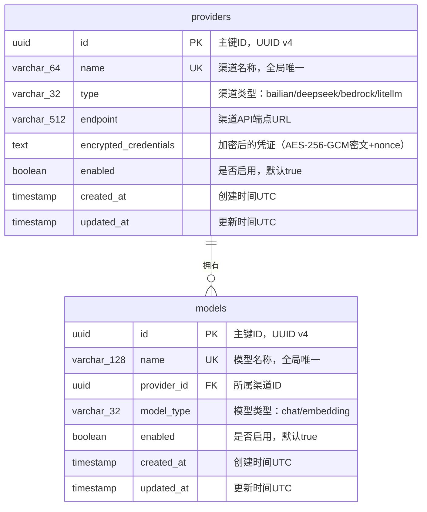

# control-plane Web 后端数据模型

## 1. 文档概述

本文档描述 control-plane 模块的数据库模型设计，包括实体结构、关系、索引策略、事务边界和迁移方案。

| 属性 | 内容 |
| :--- | :--- |
| **所属变更** | CHG-20260521-001 |
| **数据库类型** | PostgreSQL 15+ |
| **ORM 框架** | GORM v2 |
| **迁移工具** | golang-migrate |
| **核心实体** | providers（渠道表）、models（模型注册表） |
| **创建时间** | 2026-05-21 |
| **修改人** | OpenCode |

---

## 2. 实体关系总览

> providers 与 models 为一对多关系：一个渠道下可注册多个模型，一个模型只属于一个渠道。

| 关系 | 类型 | 说明 |
| :--- | :---: | :--- |
| providers → models | 1:N | 一个渠道下可注册多个模型，通过 models.provider_id 外键关联 |

### ER 图



---

## 3. 实体定义

> 字段类型使用逻辑类型标注，括号内为建议长度限制。

### 3.1 providers（渠道表）

**用途**：存储 LLM 渠道的配置信息，包括渠道名称、类型、API 端点和加密后的访问凭证。

| 字段 | 逻辑类型 | 约束 | 说明 |
| :--- | :--- | :--- | :--- |
| `id` | `uuid` | PK，非空 | 主键，应用层生成 UUID v4 |
| `name` | `string(64)` | 非空，唯一 | 渠道名称，仅允许字母数字下划线连字符，如 `bailian-main` |
| `type` | `string(32)` | 非空 | 渠道类型枚举：`bailian` / `deepseek` / `bedrock` / `litellm` |
| `endpoint` | `string(512)` | 非空 | 渠道 API 端点 URL，如 `https://dashscope.aliyuncs.com/compatible-mode/v1` |
| `encrypted_credentials` | `text` | 非空 | AES-256-GCM 加密后的凭证 JSON，Base64 编码存储（含 nonce 前缀） |
| `enabled` | `boolean` | 非空，默认 `true` | 渠道是否启用；禁用后其下模型不可用 |
| `created_at` | `timestamp` | 非空，自动填充 | UTC 时间戳，记录创建时刻 |
| `updated_at` | `timestamp` | 非空，自动更新 | UTC 时间戳，每次更新自动刷新 |

**删除策略**：物理删除。管理面低频操作，数据量小，无需软删除机制。删除前强制检查无关联模型。

**凭证存储格式说明**：
- 原始凭证为 JSON 对象，如 `{"api_key": "sk-xxx", "secret_key": "yyy"}`
- 加密流程：JSON 序列化 → AES-256-GCM 加密（随机 12 字节 nonce）→ nonce + ciphertext 拼接 → Base64 编码
- 解密流程：Base64 解码 → 前 12 字节为 nonce，剩余为 ciphertext → AES-256-GCM 解密 → JSON 反序列化

---

### 3.2 models（模型注册表）

**用途**：存储注册到各渠道下的模型信息，model name 作为 gateway-api 路由的唯一标识。

| 字段 | 逻辑类型 | 约束 | 说明 |
| :--- | :--- | :--- | :--- |
| `id` | `uuid` | PK，非空 | 主键，应用层生成 UUID v4 |
| `name` | `string(128)` | 非空，唯一 | 模型名称，全局唯一，如 `qwen-turbo`、`deepseek-chat` |
| `provider_id` | `uuid` | FK → providers.id，非空 | 所属渠道 ID |
| `model_type` | `string(32)` | 非空 | 模型类型枚举：`chat` / `embedding` |
| `enabled` | `boolean` | 非空，默认 `true` | 模型是否启用；渠道禁用时级联设为 false |
| `created_at` | `timestamp` | 非空，自动填充 | UTC 时间戳 |
| `updated_at` | `timestamp` | 非空，自动更新 | UTC 时间戳 |

**删除策略**：物理删除。模型注册为纯配置数据，无需保留历史。

---

## 4. 关系定义

### 4.1 外键约束

| 外键字段 | 引用表.字段 | ON DELETE | ON UPDATE | 说明 |
| :--- | :--- | :---: | :---: | :--- |
| `models.provider_id` | `providers.id` | RESTRICT | CASCADE | 删除渠道前必须先清空其下所有模型（应用层阻断）；RESTRICT 作为数据库级兜底 |

### 4.2 关联表

不适用。providers 与 models 为简单 1:N 关系，无需中间关联表。

---

## 5. 索引设计

| 索引名 | 所在实体 | 覆盖字段 | 访问模式 | 取舍说明 |
| :--- | :--- | :--- | :--- | :--- |
| `uniq_providers_name` | providers | `name` | 创建/更新时唯一性检查 | 唯一索引，保证渠道名称不重复 |
| `idx_providers_enabled` | providers | `enabled` | 内部接口查询启用渠道 | 过滤条件索引，数据量小时效果有限但无写入负担 |
| `uniq_models_name` | models | `name` | 创建/更新时唯一性检查；gateway-api 按模型名路由 | 唯一索引，保证模型名称全局不重复 |
| `idx_models_provider_id` | models | `provider_id` | 按渠道过滤模型列表；级联禁用时批量更新 | 外键关联查询高频使用 |
| `idx_models_enabled` | models | `enabled` | 内部接口查询启用模型 | 配合 provider_id 过滤 |
| `idx_models_provider_enabled` | models | `provider_id, enabled` | 复合查询：查询某渠道下启用的模型 | 复合索引，覆盖两个常用过滤条件 |

**索引维护注意：**
- 使用物理删除策略，无需考虑软删除与唯一索引的冲突
- 数据量预估较小（providers < 100, models < 1000），索引数量对写入性能影响可忽略

---

## 6. 事务边界

| 操作场景 | 涉及实体 | 事务 | 隔离级别 | 说明 |
| :--- | :--- | :---: | :--- | :--- |
| 创建渠道 | providers | 是 | Read Committed | 唯一性检查 + 插入在同一事务中 |
| 更新渠道 | providers | 是 | Read Committed | 存在性检查 + 更新在同一事务中 |
| 禁用渠道（级联） | providers + models | 是 | Read Committed | 更新渠道状态 + 批量禁用模型必须原子完成 |
| 删除渠道 | providers | 是 | Read Committed | 检查关联模型数量 + 删除在同一事务中（防止并发创建模型） |
| 创建模型 | models | 是 | Read Committed | 检查渠道存在且启用 + 模型名唯一性检查 + 插入在同一事务中 |
| 更新模型 | models | 是 | Read Committed | 存在性检查 + 更新在同一事务中 |
| 删除模型 | models | 是 | Read Committed | 存在性检查 + 删除在同一事务中 |
| 查询列表 | providers / models | 否 | — | 只读查询，无需事务 |
| 查询可用模型（内部接口） | models + providers (JOIN) | 否 | — | 只读聚合查询 |

**锁策略：**

| 场景 | 策略 | 实现方式 |
| :--- | :--- | :--- |
| 删除渠道时防止并发创建模型 | 行级锁 | `SELECT ... FROM providers WHERE id=? FOR UPDATE`，锁定目标渠道行后再检查模型数 |
| 禁用渠道级联 | 事务原子性 | 同一事务内先更新 providers 再批量更新 models，依赖事务隔离保证一致性 |

**Redis 通知与事务的关系：**
- Redis PUBLISH 在事务提交成功后执行（事务外）
- 如果 PUBLISH 失败，数据已持久化，不回滚主事务
- gateway-api 侧定时轮询（30s）作为兜底机制

---

## 7. 迁移策略

### 7.1 迁移规则

- 所有结构变更通过 golang-migrate 迁移脚本完成，禁止手动修改生产库 Schema
- 每次迁移只做一件事（加列 / 加索引 / 建表单独成脚本）
- 迁移脚本必须同时提供 up 和 down 文件

### 7.2 初始迁移脚本（001_init_schema）

**UP：**

```sql
-- 001_init_schema.up.sql

CREATE EXTENSION IF NOT EXISTS "uuid-ossp";

CREATE TABLE providers (
    id UUID PRIMARY KEY DEFAULT uuid_generate_v4(),
    name VARCHAR(64) NOT NULL,
    type VARCHAR(32) NOT NULL,
    endpoint VARCHAR(512) NOT NULL,
    encrypted_credentials TEXT NOT NULL,
    enabled BOOLEAN NOT NULL DEFAULT true,
    created_at TIMESTAMP WITH TIME ZONE NOT NULL DEFAULT NOW(),
    updated_at TIMESTAMP WITH TIME ZONE NOT NULL DEFAULT NOW(),
    CONSTRAINT uniq_providers_name UNIQUE (name),
    CONSTRAINT chk_providers_type CHECK (type IN ('bailian', 'deepseek', 'bedrock', 'litellm'))
);

CREATE INDEX idx_providers_enabled ON providers (enabled);

CREATE TABLE models (
    id UUID PRIMARY KEY DEFAULT uuid_generate_v4(),
    name VARCHAR(128) NOT NULL,
    provider_id UUID NOT NULL,
    model_type VARCHAR(32) NOT NULL,
    enabled BOOLEAN NOT NULL DEFAULT true,
    created_at TIMESTAMP WITH TIME ZONE NOT NULL DEFAULT NOW(),
    updated_at TIMESTAMP WITH TIME ZONE NOT NULL DEFAULT NOW(),
    CONSTRAINT uniq_models_name UNIQUE (name),
    CONSTRAINT fk_models_provider FOREIGN KEY (provider_id) REFERENCES providers(id) ON DELETE RESTRICT ON UPDATE CASCADE,
    CONSTRAINT chk_models_type CHECK (model_type IN ('chat', 'embedding'))
);

CREATE INDEX idx_models_provider_id ON models (provider_id);
CREATE INDEX idx_models_enabled ON models (enabled);
CREATE INDEX idx_models_provider_enabled ON models (provider_id, enabled);
```

**DOWN：**

```sql
-- 001_init_schema.down.sql

DROP TABLE IF EXISTS models;
DROP TABLE IF EXISTS providers;
```

### 7.3 安全操作表

| 操作 | 安全做法 | 禁止做法 |
| :--- | :--- | :--- |
| 新增字段 | `ADD COLUMN`，设置默认值或允许 NULL | 直接加非空无默认值列（会锁表） |
| 删除字段 | 先在应用层停止使用 → 发布 → 再删除列 | 直接删除仍在使用的列 |
| 修改字段类型 | 新建列 → 迁移数据 → 切换引用 → 删除旧列 | 直接 ALTER COLUMN TYPE |
| 新增唯一索引 | 先检查数据无重复 → `CREATE UNIQUE INDEX CONCURRENTLY` | 普通 CREATE UNIQUE INDEX（锁表） |
| 新增枚举值 | 扩展 CHECK 约束（DROP + ADD）或改用应用层校验 | 修改 PostgreSQL enum 类型（不可删除值） |

### 7.4 版本追踪

| 字段 | 内容 |
| :--- | :--- |
| 版本命名规范 | `{三位序号}_{描述}.up.sql` / `{三位序号}_{描述}.down.sql`，如 `001_init_schema.up.sql` |
| 回滚策略 | 每个 up 文件必须配套 down 文件；不可逆操作（如删除列含数据）在 down 中标注为 `-- IRREVERSIBLE` 并抛出错误 |

---

## 8. 数据约束与规则

* **审计字段**：`created_at` 在插入时自动填充当前 UTC 时间；`updated_at` 在每次更新时自动刷新为当前 UTC 时间（GORM AutoUpdateTime）
* **主键生成**：应用层使用 Go `github.com/google/uuid` 生成 UUID v4，不依赖数据库序列
* **时间精度**：所有时间字段使用 `TIMESTAMP WITH TIME ZONE`，存储精度到微秒
* **字符编码**：数据库和连接均使用 UTF-8 编码
* **空值规则**：除明确标注"可空"的字段外，所有字段均为 NOT NULL
* **枚举约束**：`providers.type` 和 `models.model_type` 使用 CHECK 约束在数据库级别保证值合法
* **外键约束**：`models.provider_id` 的 RESTRICT 策略确保不会出现孤儿模型记录
* **凭证安全**：`encrypted_credentials` 存储的是 Base64 编码的密文，永远不存储明文；数据库级别无法解密，必须通过应用层持有的密钥解密
* **名称格式**：`providers.name` 仅允许 `[a-zA-Z0-9_-]`，长度 2-64；`models.name` 允许更宽松的字符集（含 `.` 和 `/`），长度 2-128，由应用层校验
