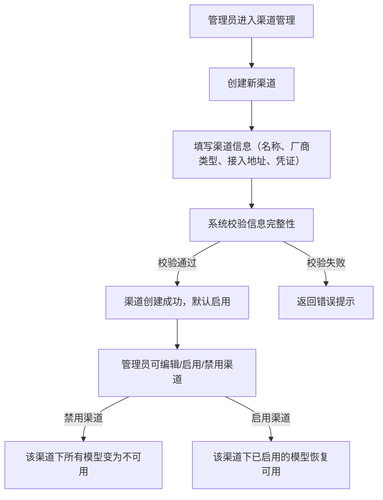
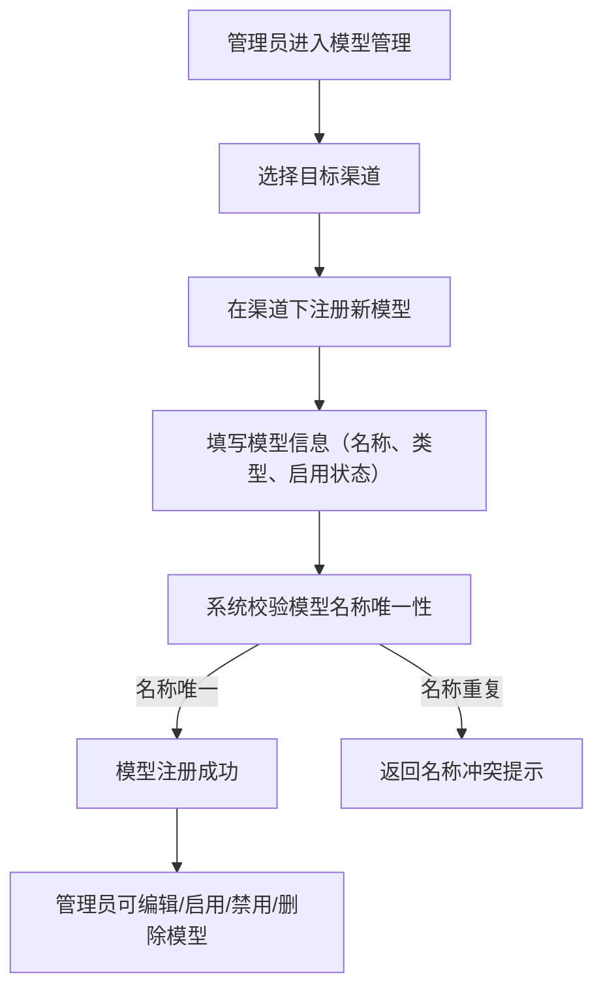
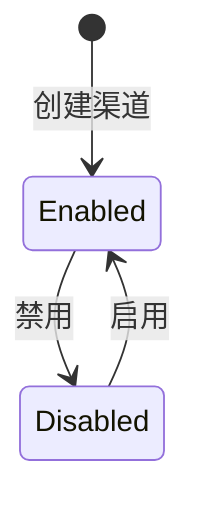
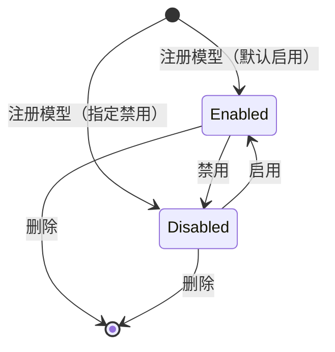

# control-plane Web 后端需求规范

## 0. 文档信息

| 属性 | 内容 |
| :--- | :--- |
| **所属变更** | CHG-20260521-001 |
| **模块名称** | control-plane |
| **模块类型** | web-backend |
| **创建时间** | 2026-05-21 |

### 修订记录

| 版本号 | 修改日期 | 修改内容摘要 | 修改人 |
| :--- | :--- | :--- | :--- |
| v1.0 | 2026-05-21 | 初稿创建 | OpenCode |

---

## 1. 业务背景与系统目标

* **业务背景**：公司统一大模型网关需要一个集中的配置管理能力，负责维护厂商渠道连接信息和模型注册信息。gateway-api 需要稳定的配置源来决定模型可用性和路由分发，ops-console 需要治理接口来完成渠道与模型的日常管理操作。当前缺少这一配置管理层，导致渠道接入和模型注册无法被统一管控。
* **核心目标**：提供渠道配置管理与模型注册管理能力，使平台管理员能够完成厂商渠道的创建、启用/禁用和维护，以及在渠道下注册和管理模型，从而为 gateway-api 提供可靠的配置源、为 ops-console 提供可操作的治理接口。
* **关键衡量指标**：
  - 渠道配置变更在 5 秒内对 gateway-api 生效
  - 配置管理接口响应时间 P95 不超过 200 毫秒
  - 系统可用性不低于 99.9%

---

## 2. 关键概念

> 统一术语定义，后续所有章节直接引用此处概念名，避免歧义。

- **渠道（Channel）**：对接一个厂商模型服务的连接配置单元，包含该厂商的接入地址和认证凭证信息，是模型注册的承载容器。
- **模型注册（Model Registration）**：在某个渠道下登记一个具体可用模型的配置记录，包含模型名称、模型类型和启用状态，是 gateway-api 判断模型可用性和进行路由分发的依据。
- **模型类型（Model Type）**：标识模型的能力分类，当前支持对话补全（chat）和向量嵌入（embedding）两种类型。
- **渠道状态**：渠道的可用性标识，分为启用和禁用两种状态，决定该渠道及其下属所有模型是否对外提供服务。
- **凭证信息（Credential）**：渠道对接厂商服务所需的认证信息，属于敏感数据，必须加密存储、脱敏展示。

---

## 3. 超出范围

> 明确本次不做的内容，防止范围蔓延。

- 不做权限配置（部门权限模型组），本模块所有操作均限定为平台管理员角色
- 不做限额策略配置（TPM/RPM/Token 套餐）
- 不做 Key 生命周期管理（API Key 的创建、轮转、吊销等）
- 不做用量统计和审计日志
- 不做模型组（低/中/高智力抽象层）
- 不做渠道健康探测与自动熔断

---

## 4. 角色与权限控制（RBAC）

| 角色名称 | 角色描述 | 菜单权限 | 操作权限 | 数据范围 |
| :--- | :--- | :--- | :--- | :--- |
| 平台管理员 | 负责配置和管理厂商渠道与模型注册的运维人员 | 渠道管理、模型管理 | 渠道的创建/查看/编辑/启用/禁用；模型注册的创建/查看/编辑/启用/禁用/删除 | 全局所有渠道和模型数据 |

---

## 5. 业务流程与状态机

### 5.1 渠道配置管理流程

### 5.2 模型注册管理流程

### 5.3 渠道状态机

| 当前状态 | 触发动作 | 目标状态 | 前置条件 |
| :--- | :--- | :--- | :--- |
| 无 | 创建渠道 | 启用 | 渠道信息校验通过 |
| 启用 | 管理员执行禁用 | 禁用 | 渠道当前为启用状态 |
| 禁用 | 管理员执行启用 | 启用 | 渠道当前为禁用状态 |

### 5.4 模型注册状态机

| 当前状态 | 触发动作 | 目标状态 | 前置条件 |
| :--- | :--- | :--- | :--- |
| 无 | 注册模型 | 启用/禁用 | 模型名称全局唯一且归属渠道存在 |
| 启用 | 管理员执行禁用 | 禁用 | 模型当前为启用状态 |
| 禁用 | 管理员执行启用 | 启用 | 模型当前为禁用状态且归属渠道为启用状态 |
| 启用/禁用 | 管理员执行删除 | 已删除 | 模型存在 |

---

## 6. 详细功能需求

### 6.1 渠道配置管理

**A. 功能说明**

平台管理员可以创建、查看、编辑、启用和禁用厂商渠道。每个渠道代表与一个厂商模型服务的连接配置，包含厂商类型（如百炼、DeepSeek、AWS Bedrock）、接入地址和认证凭证。渠道是模型注册的承载容器，gateway-api 基于渠道的启用状态和连接信息完成模型请求的路由分发。

**B. 数据实体与关系**

- 渠道：包含渠道名称、厂商类型、接入地址、凭证信息、启用状态、创建时间、更新时间。
- 渠道与模型注册为一对多关系：一个渠道下可注册多个模型。
- 渠道的启用状态影响其下所有模型的可用性。

**C. 接口概要**

| 接口 | 方法 | 路径 | 说明 |
| :--- | :--- | :--- | :--- |
| 创建渠道 | POST | /api/v1/channels | 创建新的厂商渠道配置 |
| 查询渠道列表 | GET | /api/v1/channels | 分页查询渠道列表，支持按名称和状态筛选 |
| 查询渠道详情 | GET | /api/v1/channels/{id} | 获取单个渠道的完整信息（凭证脱敏展示） |
| 编辑渠道 | PUT | /api/v1/channels/{id} | 修改渠道的基本信息和凭证 |
| 启用渠道 | PUT | /api/v1/channels/{id}/enable | 将渠道状态切换为启用 |
| 禁用渠道 | PUT | /api/v1/channels/{id}/disable | 将渠道状态切换为禁用 |

**D. 业务规则与校验**

- 渠道名称在系统内必须唯一，不允许重复
- 创建渠道时必须提供：渠道名称、厂商类型、接入地址、凭证信息
- 凭证信息必须加密存储，查询和列表展示时对凭证进行脱敏处理（仅展示末尾 4 位）
- 创建渠道后默认为启用状态
- 禁用渠道时，该渠道下所有已注册模型对 gateway-api 均不可用（无论模型自身启用状态如何）
- 重新启用渠道时，仅恢复该渠道下自身状态为启用的模型的可用性
- 渠道不支持物理删除；若渠道下存在任何模型注册记录，则禁止删除操作

**E. 异常与边界**

* **名称冲突**：创建或编辑渠道时，若名称与已有渠道重复，返回明确的名称冲突错误。
* **凭证格式校验**：凭证信息不能为空且长度不超过系统允许上限（4096 字符），超出时返回格式校验失败。
* **并发编辑**：同时编辑同一渠道时，后提交的请求应基于版本号判断冲突并返回冲突提示，避免静默覆盖。
* **渠道不存在**：对不存在的渠道 ID 执行查询、编辑、启用、禁用操作时，返回资源不存在错误。

### 6.2 模型注册管理

**A. 功能说明**

平台管理员可以在已有渠道下注册模型，并对已注册模型进行查看、编辑、启用、禁用和删除操作。每个模型注册记录包含模型名称、归属渠道、模型类型和启用状态。gateway-api 基于模型注册信息判断模型是否可用以及如何路由到对应渠道。

**B. 数据实体与关系**

- 模型注册：包含模型名称、归属渠道标识、模型类型（chat/embedding）、启用状态、创建时间、更新时间。
- 模型注册必须归属于一个已存在的渠道。
- 模型名称在全局范围内唯一（跨渠道不允许重名）。
- 模型的最终可用性 = 模型自身启用 且 归属渠道启用。

**C. 接口概要**

| 接口 | 方法 | 路径 | 说明 |
| :--- | :--- | :--- | :--- |
| 注册模型 | POST | /api/v1/models | 在指定渠道下注册新模型 |
| 查询模型列表 | GET | /api/v1/models | 分页查询模型列表，支持按名称、渠道、类型和状态筛选 |
| 查询模型详情 | GET | /api/v1/models/{id} | 获取单个模型注册记录的完整信息 |
| 编辑模型 | PUT | /api/v1/models/{id} | 修改模型注册信息（名称、类型等） |
| 启用模型 | PUT | /api/v1/models/{id}/enable | 将模型状态切换为启用 |
| 禁用模型 | PUT | /api/v1/models/{id}/disable | 将模型状态切换为禁用 |
| 删除模型 | DELETE | /api/v1/models/{id} | 删除模型注册记录 |

**D. 业务规则与校验**

- 模型名称在全局范围内必须唯一，不允许跨渠道重复
- 注册模型时必须提供：模型名称、归属渠道标识、模型类型
- 模型类型仅允许 chat 和 embedding 两种取值
- 注册模型时归属渠道必须存在，否则拒绝注册
- 模型自身启用且归属渠道启用时，该模型对 gateway-api 可用
- 启用一个归属渠道处于禁用状态的模型时，系统应明确提示该模型因渠道禁用仍不可用
- 编辑模型时不允许变更归属渠道（需先删除再重新注册）
- 删除模型为物理删除，删除后不可恢复

**E. 异常与边界**

* **模型名称冲突**：注册或编辑模型时，若名称与已有模型重复，返回明确的名称冲突错误。
* **归属渠道不存在**：注册模型时指定的渠道标识不存在，返回渠道不存在错误。
* **渠道禁用下启用模型**：在归属渠道处于禁用状态时启用模型，操作本身允许执行但返回警告信息说明模型因渠道禁用仍不对外可用。
* **模型不存在**：对不存在的模型 ID 执行查询、编辑、启用、禁用、删除操作时，返回资源不存在错误。
* **并发编辑**：同时编辑同一模型时，后提交的请求应基于版本号判断冲突并返回冲突提示。

---

## 7. 数据流与外部接口

* **配置源输出**：control-plane 作为配置源，向 gateway-api 提供当前可用的渠道和模型注册信息，gateway-api 基于此信息判断模型可用性并执行路由分发。配置变更后需在 5 秒内对 gateway-api 生效。
* **治理接口输入**：ops-console 通过 control-plane 的管理接口完成渠道和模型的增删改查操作，control-plane 为其提供完整的 CRUD 能力。
* **消息/事件**：渠道状态变更（启用/禁用）时需通知 gateway-api 刷新本地配置缓存，确保路由行为与配置状态一致。

---

## 8. 非功能需求

* **安全性**：
  - 凭证信息必须加密存储，任何接口返回中不得明文暴露完整凭证
  - 所有管理接口必须经过身份认证，仅允许平台管理员角色访问
  - 接口返回中不得暴露内部系统实现细节

* **并发与性能**：
  - 管理接口响应时间 P95 不超过 200 毫秒
  - 配置查询接口支持并发读取，不因单次写操作阻塞查询
  - 配置变更在 5 秒内对下游消费方生效

* **可观测性**：
  - 所有管理操作形成结构化日志，包含操作人、操作对象、操作类型和结果
  - 关键操作（创建渠道、禁用渠道、删除模型）需记录操作前后状态

---

## 9. 验收标准

| 编号 | 关联 | Given（前置状态） | When（触发动作） | Then（预期结果） | 优先级 |
| :--- | :--- | :--- | :--- | :--- | :--- |
| AC-01 | 渠道配置管理-创建 | Given 平台管理员已登录且提供了完整的渠道信息（名称、厂商类型、接入地址、凭证） | When 调用创建渠道接口 | Then 渠道创建成功，返回渠道标识，渠道默认状态为启用 | P0 |
| AC-02 | 渠道配置管理-凭证安全 | Given 已存在一个包含凭证信息的渠道 | When 调用查询渠道详情接口 | Then 返回的凭证字段经过脱敏处理，仅展示末尾 4 位，完整凭证不可见 | P0 |
| AC-03 | 渠道配置管理-名称唯一 | Given 系统中已存在名称为"百炼生产渠道"的渠道 | When 创建另一个名称同为"百炼生产渠道"的渠道 | Then 返回名称冲突错误，渠道未被创建 | P0 |
| AC-04 | 渠道配置管理-禁用级联 | Given 渠道 A 处于启用状态且其下注册了 3 个启用状态的模型 | When 平台管理员禁用渠道 A | Then 渠道 A 变为禁用状态，其下 3 个模型对 gateway-api 均不可用 | P0 |
| AC-05 | 渠道配置管理-删除阻断 | Given 渠道 B 下存在 2 条模型注册记录 | When 平台管理员尝试删除渠道 B | Then 系统拒绝删除并返回明确提示：该渠道下存在模型注册记录，需先移除所有模型 | P0 |
| AC-06 | 渠道配置管理-启用恢复 | Given 渠道 A 处于禁用状态，其下有 2 个自身启用的模型和 1 个自身禁用的模型 | When 平台管理员重新启用渠道 A | Then 2 个自身启用的模型恢复对 gateway-api 可用，1 个自身禁用的模型仍不可用 | P1 |
| AC-07 | 模型注册管理-创建 | Given 平台管理员已登录且系统中存在一个启用状态的渠道 | When 在该渠道下注册一个模型（提供名称、类型为 chat） | Then 模型注册成功，返回模型标识，模型归属该渠道且对 gateway-api 可用 | P0 |
| AC-08 | 模型注册管理-名称唯一 | Given 系统中已存在名称为"gpt-4o"的模型注册记录 | When 在任意渠道下注册另一个名称同为"gpt-4o"的模型 | Then 返回模型名称冲突错误，模型未被注册 | P0 |
| AC-09 | 模型注册管理-渠道不存在 | Given 平台管理员提供了一个不存在的渠道标识 | When 尝试在该渠道下注册模型 | Then 返回渠道不存在错误，模型未被注册 | P1 |
| AC-10 | 模型注册管理-渠道禁用下启用模型 | Given 模型 X 归属的渠道当前处于禁用状态，模型 X 自身为禁用状态 | When 平台管理员启用模型 X | Then 模型 X 自身状态变为启用，但系统返回提示信息说明该模型因归属渠道禁用仍不对外可用 | P1 |
| AC-11 | 模型注册管理-并发编辑冲突 | Given 两个管理员同时获取了模型 Y 的编辑信息（版本号相同） | When 管理员 A 先提交编辑成功后管理员 B 再提交编辑 | Then 管理员 B 收到版本冲突错误，需刷新后重试 | P1 |
| AC-12 | 渠道配置管理-凭证加密存储 | Given 平台管理员创建渠道时提供了明文凭证信息 | When 渠道创建成功后查看持久化的数据 | Then 凭证在存储层以加密形态保存，非明文 | P0 |

---

## 10. 假设与依赖

- 假设平台管理员的身份认证由独立的认证服务提供，control-plane 直接消费认证结果（Token），不负责登录和用户管理
- 依赖 gateway-api 具备配置刷新机制，能够在 control-plane 配置变更后主动或被动获取最新配置
- 假设厂商类型为预定义枚举集合，首批支持百炼、DeepSeek、AWS Bedrock，后续新增厂商类型需扩展枚举
- 假设模型类型当前仅支持 chat 和 embedding 两种，后续如需增加新类型需要同步更新 control-plane 和 gateway-api
- 风险：若 gateway-api 的配置缓存刷新机制不可靠，可能导致配置变更后短时间内路由行为与管理面状态不一致
