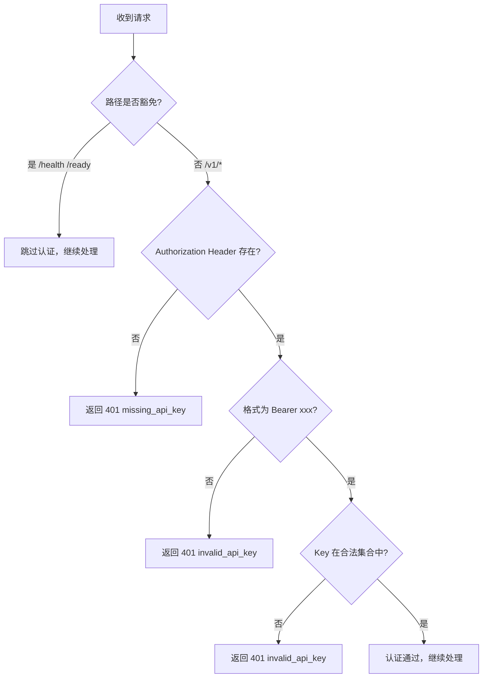

# gateway-api 接口契约

## 1. 概览

| 属性 | 内容 |
| :--- | :--- |
| **所属变更** | CHG-20260521-001 |
| **模块名称** | gateway-api |
| **模块类型** | web-backend |
| **创建时间** | 2026-05-21 |
| **修改人** | OpenCode |

本契约定义了 gateway-api 模块对外暴露的 OpenAI 兼容接口规范。gateway-api 作为统一大模型网关的接入层，对外提供标准的 OpenAI Chat Completions API 格式，调用方无需修改现有代码即可通过本网关访问多家大模型厂商的服务。

---

## 2. 公共约定

### 2.1 基础信息

| 项目 | 约定 |
| :--- | :--- |
| Base URL | `/v1` |
| 数据格式 | JSON，UTF-8 编码 |
| 认证方式 | Bearer Token（HTTP Header：`Authorization: Bearer {api_key}`） |
| 字符集 | UTF-8 |
| 时间格式 | Unix 时间戳（秒） |

### 2.2 请求头约定

| Header | 必填 | 说明 |
| :--- | :--- | :--- |
| `Authorization` | 是（业务接口） | `Bearer {api_key}` |
| `Content-Type` | 是（POST 请求） | `application/json` |
| `X-Request-ID` | 否 | 调用方自定义请求追踪 ID，缺失时网关自动生成 UUID v4 |

### 2.3 响应头约定

| Header | 说明 | 适用场景 |
| :--- | :--- | :--- |
| `Content-Type` | `application/json` 或 `text/event-stream` | 所有响应 |
| `X-Request-ID` | 请求唯一标识 | 所有响应 |
| `Cache-Control` | `no-cache` | 流式响应 |
| `Connection` | `keep-alive` | 流式响应 |

### 2.4 统一错误响应格式

所有错误统一使用以下 JSON 结构：

```json
{
  "error": {
    "type": "error_type",
    "message": "人类可读的错误描述",
    "code": "machine_readable_code"
  }
}
```

### 2.5 认证规则

| 规则 | 说明 |
| :--- | :--- |
| Header 格式 | `Authorization: Bearer {api_key}` |
| Key 格式 | 字符串，长度 32-128 字符，允许字母/数字/连字符 |
| 适用范围 | `/v1/*` 路径下所有接口 |
| 豁免路径 | `/health`、`/ready` 无需认证 |
| 失败响应 | 401 + `authentication_error` |

---

## 3. 端点索引

| 路径 | 方法 | 说明 | 认证 | 幂等性 |
| :--- | :--- | :--- | :--- | :--- |
| `/v1/chat/completions` | POST | 对话补全（支持普通/流式） | Bearer Token | 非幂等 |
| `/v1/models` | GET | 获取可用模型列表 | Bearer Token | 幂等 |
| `/health` | GET | 存活探针 | 无 | 幂等 |
| `/ready` | GET | 就绪探针 | 无 | 幂等 |

---

## 4. 端点详细设计

### 4.1 POST /v1/chat/completions

对话补全接口，兼容 OpenAI Chat Completions API 格式。根据 `stream` 参数决定返回普通 JSON 响应或 SSE 流式响应。

#### 请求参数

**Headers**：

| Header | 必填 | 说明 |
| :--- | :--- | :--- |
| `Authorization` | 是 | `Bearer {api_key}` |
| `Content-Type` | 是 | `application/json` |
| `X-Request-ID` | 否 | 调用方自定义请求 ID |

**Body（JSON）**：

| 字段 | 类型 | 必填 | 默认值 | 说明 |
| :--- | :--- | :--- | :--- | :--- |
| `model` | string | 是 | - | 模型标识，如 `qwen-plus`、`deepseek-chat`、`anthropic.claude-3-5-sonnet-20241022-v2:0` |
| `messages` | array | 是 | - | 对话消息列表，长度 1~256 |
| `messages[].role` | string | 是 | - | 角色：`system`、`user`、`assistant` |
| `messages[].content` | string | 是 | - | 消息内容 |
| `stream` | boolean | 否 | `false` | 是否启用流式返回 |
| `temperature` | number | 否 | 模型默认值 | 采样温度，范围 [0, 2] |
| `top_p` | number | 否 | 模型默认值 | 核采样概率，范围 (0, 1] |
| `max_tokens` | integer | 否 | 模型默认值 | 生成的最大 token 数 |
| `stop` | string/array | 否 | - | 停止生成的标记词 |
| `presence_penalty` | number | 否 | 0 | 存在惩罚，范围 [-2, 2] |
| `frequency_penalty` | number | 否 | 0 | 频率惩罚，范围 [-2, 2] |

**请求示例**：

```json
{
  "model": "qwen-plus",
  "messages": [
    {"role": "system", "content": "你是一个有帮助的助手。"},
    {"role": "user", "content": "你好"}
  ],
  "stream": false,
  "temperature": 0.7,
  "max_tokens": 1024
}
```

#### 成功响应 — 普通模式（stream=false）

**HTTP 状态码**：200

**Headers**：`Content-Type: application/json`、`X-Request-ID: {uuid}`

**Body 示例**：

```json
{
  "id": "chatcmpl-abc123",
  "object": "chat.completion",
  "created": 1716249600,
  "model": "qwen-plus",
  "choices": [
    {
      "index": 0,
      "message": {
        "role": "assistant",
        "content": "你好！有什么我可以帮助你的吗？"
      },
      "finish_reason": "stop"
    }
  ],
  "usage": {
    "prompt_tokens": 20,
    "completion_tokens": 12,
    "total_tokens": 32
  }
}
```

**响应字段说明**：

| 字段 | 类型 | 说明 |
| :--- | :--- | :--- |
| `id` | string | 本次补全唯一 ID |
| `object` | string | 固定值 `"chat.completion"` |
| `created` | integer | Unix 时间戳（秒） |
| `model` | string | 实际使用的模型名称 |
| `choices[].index` | integer | 选项索引 |
| `choices[].message.role` | string | 固定值 `"assistant"` |
| `choices[].message.content` | string | 生成的回复内容 |
| `choices[].finish_reason` | string | 结束原因：`stop`（正常）、`length`（达到 max_tokens） |
| `usage.prompt_tokens` | integer | 输入 token 数 |
| `usage.completion_tokens` | integer | 输出 token 数 |
| `usage.total_tokens` | integer | 总 token 数 |

#### 成功响应 — 流式模式（stream=true）

**HTTP 状态码**：200

**Headers**：

| Header | 值 |
| :--- | :--- |
| `Content-Type` | `text/event-stream` |
| `Cache-Control` | `no-cache` |
| `Connection` | `keep-alive` |
| `X-Request-ID` | `{uuid}` |

**SSE 事件流格式**：

每个事件格式为 `data: {JSON}\n\n`，流结束以 `data: [DONE]\n\n` 标记。

**完整流式响应示例**：

```
data: {"id":"chatcmpl-abc123","object":"chat.completion.chunk","created":1716249600,"model":"qwen-plus","choices":[{"index":0,"delta":{"role":"assistant","content":""},"finish_reason":null}]}

data: {"id":"chatcmpl-abc123","object":"chat.completion.chunk","created":1716249600,"model":"qwen-plus","choices":[{"index":0,"delta":{"content":"你好"},"finish_reason":null}]}

data: {"id":"chatcmpl-abc123","object":"chat.completion.chunk","created":1716249600,"model":"qwen-plus","choices":[{"index":0,"delta":{"content":"！有什么"},"finish_reason":null}]}

data: {"id":"chatcmpl-abc123","object":"chat.completion.chunk","created":1716249600,"model":"qwen-plus","choices":[{"index":0,"delta":{"content":"可以帮助你的吗？"},"finish_reason":null}]}

data: {"id":"chatcmpl-abc123","object":"chat.completion.chunk","created":1716249600,"model":"qwen-plus","choices":[{"index":0,"delta":{},"finish_reason":"stop"}],"usage":{"prompt_tokens":20,"completion_tokens":12,"total_tokens":32}}

data: [DONE]
```

**chunk 字段说明**：

| 字段 | 类型 | 说明 |
| :--- | :--- | :--- |
| `id` | string | 同一流内所有 chunk 共享相同 ID |
| `object` | string | 固定值 `"chat.completion.chunk"` |
| `created` | integer | Unix 时间戳 |
| `model` | string | 模型名称 |
| `choices[].delta.role` | string | 仅第一个 chunk 包含，值为 `"assistant"` |
| `choices[].delta.content` | string | 增量文本内容 |
| `choices[].finish_reason` | string/null | 仅最后一个内容 chunk 有值 |
| `usage` | object | 仅最后一个 chunk 包含 |

#### 错误响应

**普通模式错误**：

```json
{
  "error": {
    "type": "invalid_request_error",
    "message": "参数 'model' 为必填字段",
    "code": "missing_required_field"
  }
}
```

**流式模式中途错误**（以 SSE error 事件发送）：

```
event: error
data: {"error":{"type":"upstream_error","message":"upstream connection lost","code":"stream_interrupted"}}
```

---

### 4.2 GET /v1/models

获取当前可用的模型列表。

#### 请求参数

**Headers**：

| Header | 必填 | 说明 |
| :--- | :--- | :--- |
| `Authorization` | 是 | `Bearer {api_key}` |

无查询参数。

#### 成功响应

**HTTP 状态码**：200

**Body 示例**：

```json
{
  "object": "list",
  "data": [
    {
      "id": "qwen-plus",
      "object": "model",
      "created": 1716249600,
      "owned_by": "bailian"
    },
    {
      "id": "qwen-turbo-latest",
      "object": "model",
      "created": 1716249600,
      "owned_by": "bailian"
    },
    {
      "id": "deepseek-chat",
      "object": "model",
      "created": 1716249600,
      "owned_by": "deepseek"
    },
    {
      "id": "deepseek-reasoner",
      "object": "model",
      "created": 1716249600,
      "owned_by": "deepseek"
    },
    {
      "id": "anthropic.claude-3-5-sonnet-20241022-v2:0",
      "object": "model",
      "created": 1716249600,
      "owned_by": "bedrock"
    }
  ]
}
```

**响应字段说明**：

| 字段 | 类型 | 说明 |
| :--- | :--- | :--- |
| `object` | string | 固定值 `"list"` |
| `data` | array | 模型列表 |
| `data[].id` | string | 模型标识 |
| `data[].object` | string | 固定值 `"model"` |
| `data[].created` | integer | 模型注册时间（Unix 时间戳） |
| `data[].owned_by` | string | 所属厂商标识 |

#### 错误响应

| 状态码 | 错误类型 | 场景 |
| :--- | :--- | :--- |
| 401 | `authentication_error` | 未认证或 Key 无效 |
| 500 | `internal_error` | 内部异常 |

---

### 4.3 GET /health

存活探针，用于 Kubernetes liveness probe。仅检查服务进程存活状态，不检查外部依赖。

#### 请求参数

无需 Header 和参数。

#### 成功响应

**HTTP 状态码**：200

```json
{
  "status": "ok"
}
```

#### 错误响应

服务进程不可达时无响应（由 Kubernetes 判定为不健康并重启 Pod）。

---

### 4.4 GET /ready

就绪探针，用于 Kubernetes readiness probe。检查服务是否可以接收流量，包括外部依赖连通性。

#### 请求参数

无需 Header 和参数。

#### 成功响应（HTTP 200）

```json
{
  "status": "ready",
  "checks": {
    "redis": "ok",
    "providers": "ok"
  }
}
```

#### 未就绪响应（HTTP 503）

```json
{
  "status": "not_ready",
  "checks": {
    "redis": "failed: connection refused",
    "providers": "ok"
  }
}
```

**检查项说明**：

| 检查项 | 检查内容 | 失败影响 |
| :--- | :--- | :--- |
| `redis` | Redis PING 是否成功 | 返回 503，从负载均衡摘除 |
| `providers` | 至少一个 Provider 可达 | 返回 503，从负载均衡摘除 |

---

## 5. 错误码（后端含 §5）

### 5.1 统一错误体格式

```json
{
  "error": {
    "type": "error_type_identifier",
    "message": "描述性错误信息",
    "code": "specific_error_code"
  }
}
```

### 5.2 完整错误码表

#### 输入错误类（调用方应修正请求）

| HTTP 码 | error.type | error.code | 含义 | 处理建议 |
| :--- | :--- | :--- | :--- | :--- |
| 400 | `invalid_request_error` | `invalid_json` | 请求体 JSON 格式错误 | 检查 JSON 语法 |
| 400 | `invalid_request_error` | `missing_required_field` | 缺少必填字段 | 补充 model/messages 等必填字段 |
| 400 | `invalid_request_error` | `invalid_field_value` | 字段值不合法 | 修正参数值（如 temperature 超范围） |
| 400 | `invalid_request_error` | `empty_messages` | messages 数组为空 | 至少提供一条消息 |
| 400 | `invalid_request_error` | `too_many_messages` | messages 超过 256 条 | 减少对话历史长度 |
| 400 | `invalid_request_error` | `request_too_large` | 请求体超过 1MB | 缩减请求体大小 |

#### 模型不可用类（调用方应换模型或稍后重试）

| HTTP 码 | error.type | error.code | 含义 | 处理建议 |
| :--- | :--- | :--- | :--- | :--- |
| 401 | `authentication_error` | `missing_api_key` | 未提供 API Key | 添加 Authorization Header |
| 401 | `authentication_error` | `invalid_api_key` | API Key 无效 | 检查 Key 是否正确 |
| 404 | `model_not_found` | `unknown_model` | 请求模型未注册 | 调用 GET /v1/models 确认可用模型 |
| 503 | `model_unavailable` | `model_disabled` | 模型已被管理员禁用 | 更换模型或稍后重试 |
| 503 | `model_unavailable` | `model_offline` | 模型临时下线维护 | 稍后重试 |

#### 临时失败类（调用方应重试）

| HTTP 码 | error.type | error.code | 含义 | 处理建议 |
| :--- | :--- | :--- | :--- | :--- |
| 502 | `upstream_error` | `provider_error` | 厂商 API 返回错误 | 稍后重试 |
| 502 | `upstream_error` | `provider_rate_limited` | 厂商限流 | 降低调用频率后重试 |
| 502 | `upstream_error` | `stream_interrupted` | 流式传输中途中断 | 重新发起请求 |
| 504 | `upstream_timeout` | `provider_timeout` | 厂商 API 响应超时 | 稍后重试，可考虑减少 max_tokens |
| 500 | `internal_error` | `unexpected_error` | 网关内部非预期异常 | 联系网关管理员 |

---

## 6. 版本策略与 Breaking Change 规则

### 6.1 版本策略

| 规则 | 说明 |
| :--- | :--- |
| 版本标识 | URL 路径中包含版本号，当前为 `/v1` |
| 版本共存 | 新大版本通过 `/v2` 路径独立部署，旧版本保持兼容运行 |
| 小版本迭代 | 同一大版本内仅做向后兼容变更 |

### 6.2 兼容性变更（不需要升级版本）

- 响应体新增可选字段
- 新增可选请求参数
- 新增新的 error.code 值
- 新增新的模型支持

### 6.3 Breaking Change（需要升级大版本）

- 删除或重命名现有字段
- 修改字段类型
- 修改错误响应结构
- 修改认证方式
- 删除端点

### 6.4 废弃流程

1. 提前 30 天通过文档和响应头 `Deprecation` 通知调用方
2. 旧版本至少维持 90 天可用
3. 下线前通过监控确认无流量后执行

---

## 7. 非功能约束（适用时填）

### 7.1 超时约束

| 场景 | 超时时间 | 超限处理 |
| :--- | :--- | :--- |
| 请求体读取 | 5s | 返回 400 |
| 普通调用总超时 | 30s | 返回 504 upstream_timeout |
| 流式连接总时长 | 300s | 关闭连接 |
| 流式 chunk 间隔 | 60s | 发送 SSE error 事件后关闭 |
| 就绪探针检查 | 5s | 视为不就绪 |

### 7.2 请求体大小限制

| 限制项 | 值 | 超限处理 |
| :--- | :--- | :--- |
| 请求体最大字节数 | 1MB | 返回 400 `request_too_large` |
| messages 数组最大长度 | 256 条 | 返回 400 `too_many_messages` |

### 7.3 并发与吞吐

| 指标 | 目标值 |
| :--- | :--- |
| 同时在线连接数 | ≥ 1000 |
| 网关自身处理延迟（P99） | < 10ms |
| 流式首 chunk 额外延迟 | < 50ms |

### 7.4 可用性

| 指标 | 目标值 |
| :--- | :--- |
| 服务可用率 | ≥ 99.9% |
| 优雅关停时间 | 30s（等待存量请求完成） |

---

## 8. 接口安全

### 8.1 认证流程



### 8.2 安全措施

| 措施 | 说明 |
| :--- | :--- |
| 传输加密 | 生产环境强制 HTTPS（TLS 1.2+） |
| Key 脱敏 | 日志中 API Key 仅记录前 8 位 + 后 4 位 |
| 请求体限制 | 最大 1MB，防止大 payload 攻击 |
| 请求 ID 追踪 | 每个请求分配唯一 ID，便于安全审计 |
| 无敏感数据缓存 | 网关不缓存对话内容，仅转发 |
| 限流预留 | 当前不实现 429，后续迭代引入基于 Key 的限流 |

### 8.3 CORS 策略

本网关为后端服务间调用设计，默认不启用 CORS。若需浏览器端直接调用，需在反向代理层（如 Nginx/Envoy）配置 CORS 头。

---

## 9. 变更历史

| 版本 | 日期 | 修改人 | 变更内容 |
| :--- | :--- | :--- | :--- |
| v1.0.0 | 2026-05-21 | OpenCode | 初始版本，定义 OpenAI 兼容接口契约 |
