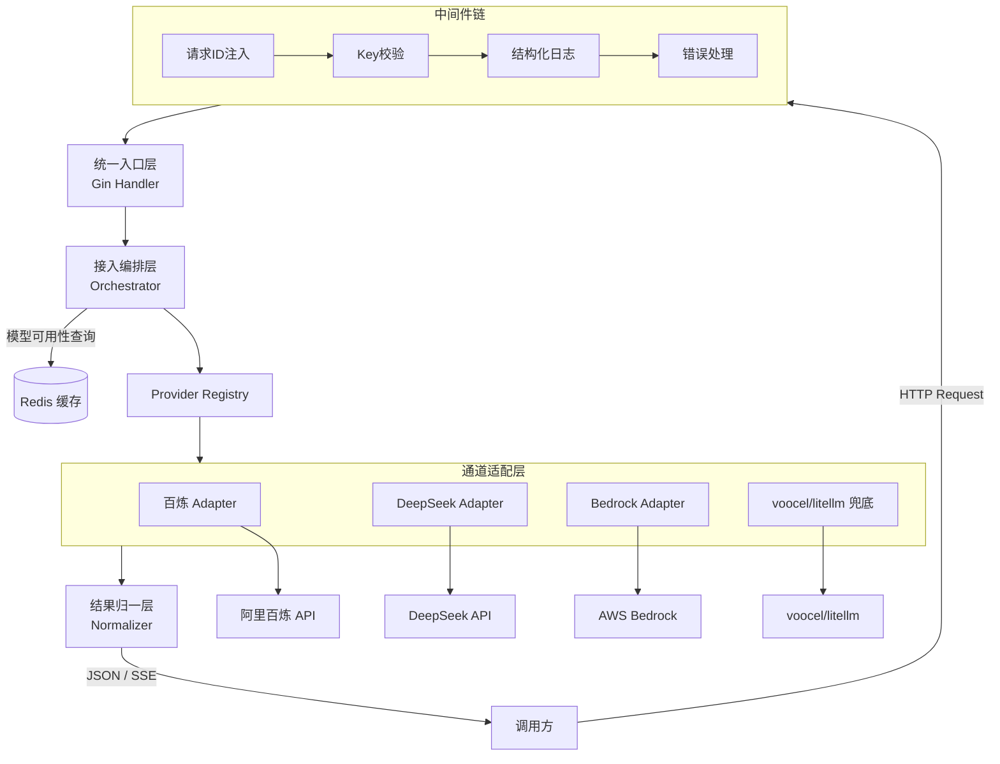
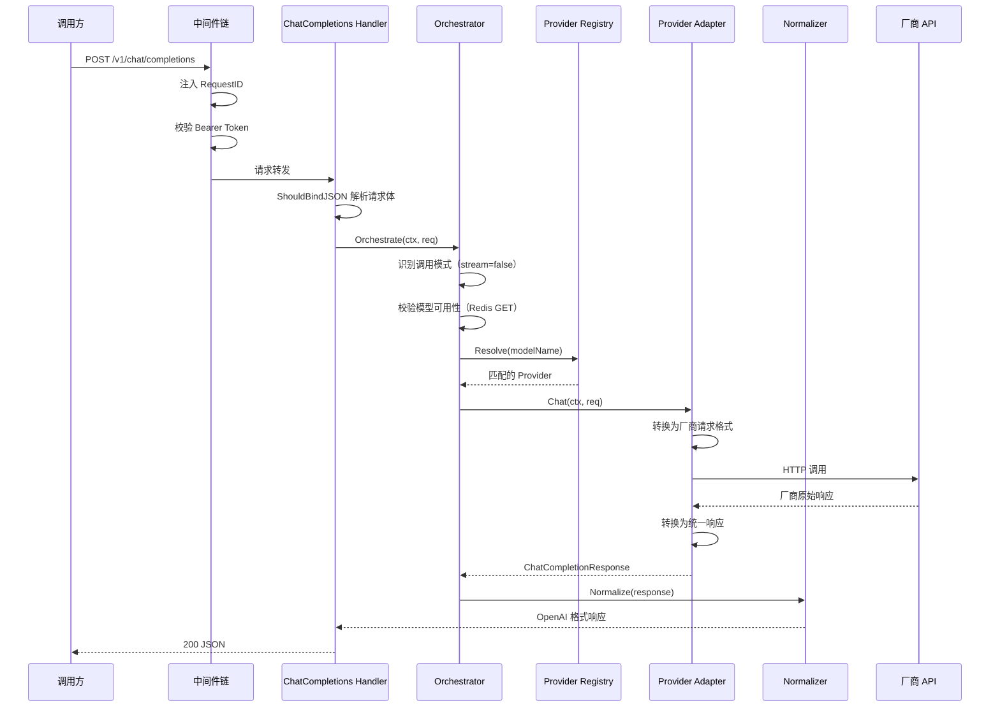
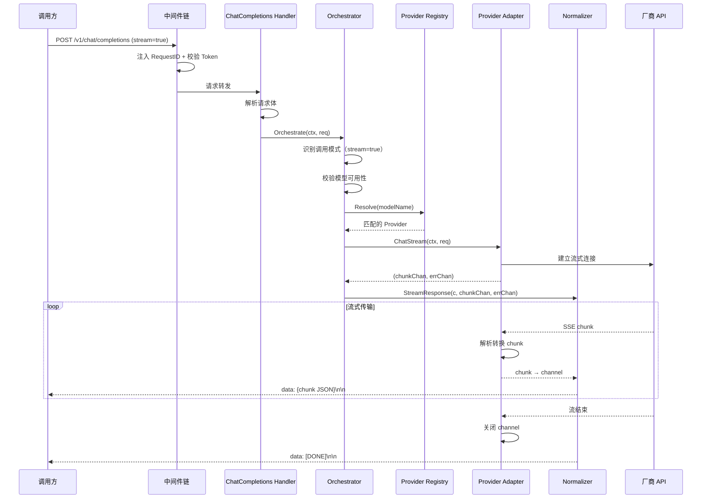
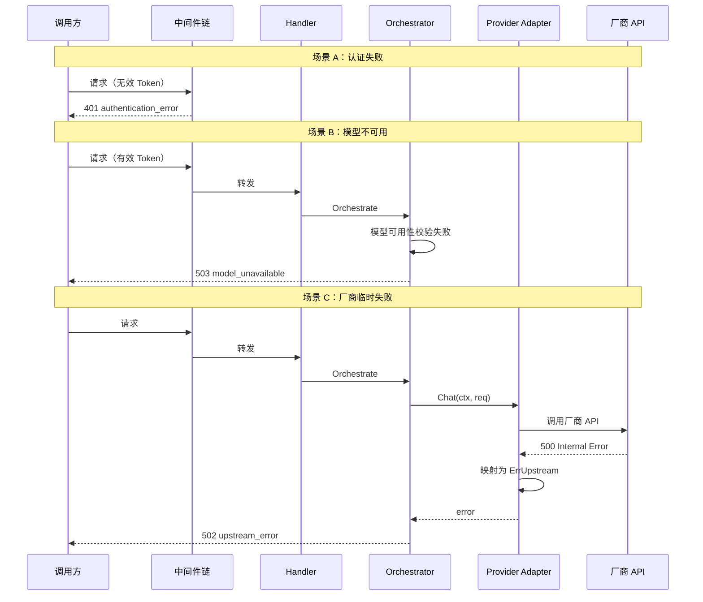

# gateway-api 详细设计

## 0. 文档信息

| 属性 | 内容 |
| :--- | :--- |
| **所属变更** | CHG-20260521-001 |
| **模块名称** | gateway-api |
| **模块类型** | web-backend |
| **创建时间** | 2026-05-21 |
| **修改人** | OpenCode |

---

## 1. 背景与目标

### 1.1 背景

公司需要统一大模型网关，替换现有 LiteLLM 方案。gateway-api 模块作为统一网关的接入层，承担所有对外 API 请求的接收、路由分发和结果归一化职责。

### 1.2 目标

| 维度 | 目标描述 |
| :--- | :--- |
| 兼容性 | 对外暴露 OpenAI 兼容 API，调用方无需修改代码即可接入 |
| 可扩展性 | 新增厂商仅需实现 Provider interface 并注册前缀，无需修改核心逻辑 |
| 低延迟 | 流式场景下首 token 延迟不超过厂商侧延迟 + 50ms |
| 高可用 | 无状态设计，支持水平扩缩容；Redis 不可用时降级放行 |
| 统一错误语义 | 将各厂商异构错误码映射为三类统一语义，便于调用方决策 |

---

## 2. 模块职责边界

### 2.1 本模块负责

- 接收并校验 OpenAI 兼容格式的 HTTP 请求
- Bearer Token 认证校验
- 根据 model name 前缀将请求路由到对应厂商 Provider
- 将厂商特定响应/错误转换为 OpenAI 兼容格式
- 流式响应的 SSE 推送
- 结构化请求日志和链路追踪

### 2.2 本模块不负责

- 不管理模型配置数据（由 control-plane 管理）
- 不管理 API Key 数据的增删改（只读消费）
- 不做 token 计量和配额限制（由独立计量服务负责）
- 不持有业务数据库表
- 不实现重试和熔断（首版不引入，后续迭代）

### 2.3 依赖关系

| 依赖方 | 依赖方式 | 说明 |
| :--- | :--- | :--- |
| control-plane | Redis 只读消费 | 模型可用性状态、API Key 集合 |
| 配置文件 | 启动加载 | Provider 注册信息、模型列表 |
| Redis | 运行时只读 | 模型可用性缓存、Key 校验 |
| 百炼 API | HTTP 调用 | qwen 系列模型 |
| DeepSeek API | HTTP 调用 | deepseek 系列模型 |
| AWS Bedrock | SDK 调用 | anthropic 系列模型 |
| voocel/litellm | 进程内调用 | 兜底路由 |

---

## 3. 技术选型与研究

| 技术领域 | 选型 | 版本 | 选择理由 |
| :--- | :--- | :--- | :--- |
| 语言 | Go | 1.22+ | 高并发原生支持，编译型语言性能优异 |
| Web 框架 | Gin | v1.9+ | 轻量高性能，原生支持 SSE 流式输出 |
| 缓存 | Redis | 7+ | 高性能 KV 存储，支持 SET 类型用于 Key 校验 |
| 配置管理 | YAML | - | 结构化配置，人类可读 |
| 日志 | slog (标准库) | Go 1.22 | 结构化日志，无外部依赖 |
| AWS SDK | aws-sdk-go-v2 | latest | Bedrock 官方 Go SDK |
| 百炼 SDK | DashScope OpenAI 兼容模式 | - | 通过标准 HTTP Client 调用，无需专用 SDK |

### 备选方案对比

| 方案 | 优势 | 劣势 | 结论 |
| :--- | :--- | :--- | :--- |
| 直接使用 LiteLLM (Python) | 现成多厂商支持 | Python 性能瓶颈，部署复杂 | 不选 |
| Go + Gin + Provider 模式 | 高性能、可控、可扩展 | 需自行实现适配层 | **选定** |
| Go + gRPC 对外暴露 | 高性能 | 不兼容 OpenAI HTTP 接口 | 不选 |

---

## 4. 架构概述



### 层次说明

| 层次 | 组件 | 职责 |
| :--- | :--- | :--- |
| 中间件链 | RequestID / KeyAuth / Logger / Recovery | 请求预处理、认证、日志、异常兜底 |
| 统一入口层 | Gin Handler | 请求解析、参数校验、响应序列化 |
| 接入编排层 | Orchestrator | 调用模式识别、模型路由、可用性校验 |
| 通道适配层 | Provider Adapters | 请求格式转换、厂商 API 调用、响应格式转换 |
| 结果归一层 | Normalizer | 统一响应格式化、流式 SSE 输出、错误语义映射 |

---

## 5. 关键流程设计

### 5.1 普通调用时序



### 5.2 流式调用时序



### 5.3 错误场景时序



---

## 6. 数据流转

### 6.1 请求数据流

```
调用方 HTTP 请求
    ↓ (原始 JSON Body)
Gin ShouldBindJSON → ChatCompletionRequest struct
    ↓ (统一请求结构)
Orchestrator 路由决策
    ↓ (附带 Provider 信息)
Provider Adapter 格式转换 → 厂商特定请求格式
    ↓ (厂商格式)
厂商 API
```

### 6.2 响应数据流（普通模式）

```
厂商 API 响应
    ↓ (厂商特有格式)
Provider Adapter 格式转换 → ChatCompletionResponse struct
    ↓ (统一响应结构)
Normalizer 格式化
    ↓ (OpenAI 兼容 JSON)
Gin c.JSON() 序列化输出
    ↓
调用方
```

### 6.3 响应数据流（流式模式）

```
厂商 SSE 流
    ↓ (厂商 chunk 格式)
Provider Adapter 解析转换 → ChatCompletionChunk struct
    ↓ (写入 Go channel)
Normalizer 消费 channel
    ↓ (逐 chunk JSON 序列化)
Gin SSEvent + Flush → SSE 事件流
    ↓
调用方实时接收
```

### 6.4 外部数据消费

| 数据 | 来源 | 消费时机 | 缓存策略 |
| :--- | :--- | :--- | :--- |
| Provider 配置 | control-plane 内部接口 GET /internal/v1/models/available | 启动加载 + Redis pub/sub 变更通知触发刷新 | 内存常驻 |
| API Key 集合 | Redis SET `gateway:apikeys` | 每次请求 | Redis 侧无 TTL |
| 模型可用性 | Redis STRING `model:available:{id}`（control-plane 写入） | 每次请求 | TTL 300s（写入方设定） |
| 模型列表缓存 | Redis STRING `gateway:models:list` | GET /v1/models 请求 | TTL 60s |
| 配置变更事件 | Redis pub/sub channel `config:change` | control-plane 发布变更时 | 触发本地 registry 重建 |

---

## 7. 分层职责落实

### 7.1 Handler 层（Gin）

| 职责 | 实现方式 |
| :--- | :--- |
| 请求体解析 | `c.ShouldBindJSON(&req)` 绑定到 `ChatCompletionRequest` |
| 参数校验 | struct tag 校验 + 自定义校验函数 |
| 响应序列化 | 普通：`c.JSON(200, resp)`；流式：`c.Stream()` + `c.SSEvent()` |
| 错误响应 | 捕获 error 调用 `renderError(c, err)` 输出统一错误体 |
| 路由注册 | `/v1/chat/completions`、`/v1/models`、`/health`、`/ready` |

### 7.2 编排层（Orchestrator）

| 职责 | 实现方式 |
| :--- | :--- |
| 调用模式识别 | 检查 `req.Stream` 字段确定 Normal / Stream 模式 |
| 模型前缀解析 | 从 `req.Model` 提取前缀匹配 Provider |
| 模型可用性校验 | Redis GET `model:available:{modelID}`，未命中时 fail-open |
| Provider 分发 | 调用 `registry.Resolve(modelName)` 获取 Provider 实例 |
| 调用协调 | 根据模式调用 `provider.Chat()` 或 `provider.ChatStream()` |

### 7.3 适配层（Provider）

| 职责 | 实现方式 |
| :--- | :--- |
| 请求格式转换 | 将 `ChatCompletionRequest` 转换为厂商特定请求结构 |
| API 调用执行 | 通过 HTTP Client / SDK 调用厂商 API |
| 响应格式转换 | 将厂商响应转换为 `ChatCompletionResponse` 或 `ChatCompletionChunk` |
| 流式 chunk 生产 | 解析厂商 SSE 流，逐 chunk 写入 Go channel |
| 错误语义转换 | 将厂商特有错误码映射为统一 `GatewayError` |

### 7.4 归一层（Normalizer）

| 职责 | 实现方式 |
| :--- | :--- |
| 响应格式标准化 | 确保 `id`、`object`、`created` 等字段符合 OpenAI 规范 |
| 流式 SSE 输出 | 消费 chunk channel，逐条 `json.Marshal` 后通过 SSE flush |
| 流结束标记 | channel 关闭后发送 `data: [DONE]\n\n` |
| 错误事件输出 | 流式中途错误通过 `event: error` SSE 事件发送 |
| 统一错误体构建 | 将 `GatewayError` 格式化为 `{"error":{"type":"...","message":"...","code":"..."}}` |

---

## 8. 异常处理链

### 8.1 异常传播路径

```
厂商 API 异常
    ↓ Provider Adapter 捕获并转换为 GatewayError
Orchestrator 接收 error
    ↓ 直接返回（不做额外包装）
Handler 层 renderError()
    ↓ 根据 GatewayError.HTTPStatus 设置状态码
Gin Response 输出统一错误体
    ↓
调用方收到结构化错误
```

### 8.2 各层异常处理职责

| 层次 | 异常来源 | 处理方式 |
| :--- | :--- | :--- |
| 中间件 | 认证失败 | 直接返回 401，不进入业务逻辑 |
| 中间件 | panic | Recovery 中间件捕获，转为 500 |
| Handler | JSON 解析失败 | 返回 400 invalid_json |
| Handler | 参数校验失败 | 返回 400 invalid_field_value |
| Orchestrator | 模型不可用 | 返回 503 model_unavailable |
| Orchestrator | Provider 未找到 | 返回 404 model_not_found |
| Provider | 厂商 4xx | 映射为对应 GatewayError（400/500） |
| Provider | 厂商 5xx | 映射为 502 upstream_error |
| Provider | 连接/读取超时 | 映射为 504 upstream_timeout |
| Normalizer | 流式中途中断 | 发送 SSE error 事件后关闭连接 |

### 8.3 流式场景异常处理

| 异常场景 | 检测方式 | 处理策略 |
| :--- | :--- | :--- |
| 厂商连接中断 | error channel 接收 | 发送 SSE error 事件，关闭连接 |
| 客户端断开 | `ctx.Done()` 触发 | 取消厂商请求，释放 channel |
| 请求级超时 | context deadline | ctx 取消传导至 Provider，同客户端断开处理 |
| chunk 间隔超时 | 60s 无数据 | 发送 SSE error 事件（upstream_timeout），关闭连接 |

---

## 9. 数据库设计要点

本模块为无状态接入层，不直接管理数据库表；模型配置和 Key 数据由 control-plane 管理，本模块只读消费。

具体消费方式：
- 模型可用性数据：通过 Redis GET 命令只读查询，Key 格式 `model:available:{modelID}`
- API Key 数据：通过 Redis SISMEMBER 命令只读校验，Key 格式 `gateway:apikeys`
- 模型列表：通过 Redis GET 命令只读获取缓存，Key 格式 `gateway:models:list`

所有数据写入由 control-plane 模块负责，gateway-api 无数据库连接、无事务、无写入操作。

---

## 10. 接口设计要点

### 10.1 接口总览

| 端点 | 方法 | 认证 | 说明 |
| :--- | :--- | :--- | :--- |
| `/v1/chat/completions` | POST | Bearer Token | 对话补全（普通/流式） |
| `/v1/models` | GET | Bearer Token | 获取可用模型列表 |
| `/health` | GET | 无 | 存活探针 |
| `/ready` | GET | 无 | 就绪探针 |

### 10.2 设计原则

- **OpenAI 兼容**：请求/响应格式与 OpenAI API 完全兼容，调用方无需适配
- **流式优先**：通过 `stream` 参数控制，默认普通模式，设为 `true` 启用 SSE
- **统一错误体**：所有错误响应使用 `{"error":{"type":"...","message":"...","code":"..."}}` 格式
- **幂等性**：GET 接口幂等可重试，POST 接口非幂等

### 10.3 版本策略

- Base URL 含版本号 `/v1`，未来新版本通过 `/v2` 路径区分
- 同一大版本内仅做兼容性扩展（新增字段），不做 Breaking Change

---

## 11. 错误处理与容灾

### 11.1 错误分类与处理策略

| 错误类别 | HTTP 状态码 | error.type | 调用方行为建议 |
| :--- | :--- | :--- | :--- |
| 输入错误 | 400 | `invalid_request_error` | 修正请求参数 |
| 认证失败 | 401 | `authentication_error` | 检查 API Key |
| 模型不存在 | 404 | `model_not_found` | 确认模型名称 |
| 模型不可用 | 503 | `model_unavailable` | 稍后重试或换模型 |
| 厂商临时失败 | 502 | `upstream_error` | 稍后重试 |
| 厂商超时 | 504 | `upstream_timeout` | 稍后重试 |
| 内部错误 | 500 | `internal_error` | 联系管理员 |

### 11.2 厂商错误码映射

| 厂商 | 厂商错误 | 统一映射 | HTTP 码 |
| :--- | :--- | :--- | :--- |
| 百炼 | 400 InvalidParameter | `invalid_request_error` | 400 |
| 百炼 | 401 Unauthorized | `internal_error` | 500 |
| 百炼 | 429 Throttling | `upstream_error` | 502 |
| 百炼 | 500/503 | `upstream_error` | 502 |
| DeepSeek | 400 | `invalid_request_error` | 400 |
| DeepSeek | 401 | `internal_error` | 500 |
| DeepSeek | 429 | `upstream_error` | 502 |
| DeepSeek | 500/502/503 | `upstream_error` | 502 |
| Bedrock | ValidationException | `invalid_request_error` | 400 |
| Bedrock | AccessDeniedException | `internal_error` | 500 |
| Bedrock | ThrottlingException | `upstream_error` | 502 |
| Bedrock | ModelNotReadyException | `model_unavailable` | 503 |
| Bedrock | InternalServerException | `upstream_error` | 502 |
| 所有 | 连接/读取超时 | `upstream_timeout` | 504 |

### 11.3 容灾降级策略

| 故障场景 | 降级策略 |
| :--- | :--- |
| Redis 完全不可达 | Key 校验降级为本地配置校验；模型可用性 fail-open 放行 |
| 单个 Provider 不可达 | 该 Provider 模型返回 502，不影响其他 Provider |
| 兜底 Provider 不可达 | 未注册前缀模型返回 404 model_not_found |
| 配置文件缺失 | 启动失败，拒绝服务（fast-fail） |

---

## 12. 性能设计

### 12.1 性能目标

| 指标 | 目标值 | 说明 |
| :--- | :--- | :--- |
| 网关自身延迟（不含厂商） | < 10ms (P99) | 仅计算网关处理耗时 |
| 并发连接数 | ≥ 1000 | 支持同时处理的请求数 |
| 流式首 chunk 延迟开销 | < 50ms | 相比直连厂商的额外延迟 |
| 内存占用（空载） | < 100MB | 无请求时的基础内存 |

### 12.2 性能优化手段

| 优化点 | 实现方式 |
| :--- | :--- |
| 连接复用 | HTTP Client 启用 keep-alive，连接池大小 100/host |
| Redis 连接池 | 池大小 20，避免频繁建连 |
| 零拷贝流式 | chunk channel 传递指针，避免大对象复制 |
| JSON 序列化 | 使用 `json.Marshal` 标准库（后续可替换 sonic） |
| 前缀匹配优化 | 前缀列表按长度降序排列，命中后立即返回 |
| 请求体大小限制 | Gin 中间件限制 1MB，避免大请求占用内存 |

### 12.3 资源限制

| 资源 | 限制值 | 超限处理 |
| :--- | :--- | :--- |
| 请求体大小 | 1MB | 返回 400 request_too_large |
| 单次请求超时 | 30s（普通） | 返回 504 upstream_timeout |
| 流式连接总时长 | 300s | 关闭连接 |
| messages 数组长度 | 256 条 | 返回 400 too_many_messages |

---

## 13. 测试矩阵

### 13.1 单元测试

| 测试对象 | 测试内容 | Mock 依赖 |
| :--- | :--- | :--- |
| Orchestrator | 调用模式识别、Provider 路由、可用性校验 | MockProvider, MockRedis |
| Provider Adapter | 请求格式转换、响应格式转换、错误映射 | HTTP Mock Server |
| Normalizer | 普通响应格式化、chunk 格式化、错误体构建 | 无 |
| KeyAuth 中间件 | 合法/非法 Token 校验 | MockRedis |
| ProviderRegistry | 前缀匹配、最长匹配、兜底分发 | 无 |

### 13.2 集成测试

| 场景 | 验证内容 | 方式 |
| :--- | :--- | :--- |
| 普通调用完整流程 | 请求 → 编排 → mock 响应 → JSON 输出 | httptest + MockProvider |
| 流式调用完整流程 | 请求 → 编排 → mock chunk → SSE 输出 | httptest + MockProvider |
| 认证失败 | 无/错误 Token → 401 | httptest |
| 模型不存在 | 未注册 model → 404 | httptest |
| 模型不可用 | Redis 标记不可用 → 503 | httptest + Redis mock |
| 厂商错误映射 | Provider 返回错误 → 正确状态码 | httptest + MockProvider |
| 流式中断 | error channel 触发 → SSE error 事件 | httptest + MockProvider |
| 客户端断开 | 模拟断开 → ctx 取消 → 资源释放 | httptest + context cancel |

### 13.3 性能测试

| 场景 | 关注指标 | 工具 |
| :--- | :--- | :--- |
| 高并发普通请求 | QPS、P99 延迟、错误率 | wrk / vegeta |
| 高并发流式请求 | 并发连接数、首 chunk 延迟 | 自定义 Go 压测脚本 |
| 长时间稳定性 | 内存泄漏、goroutine 泄漏 | pprof + 持续观测 |

---

## 14. 设计决策记录（方案探索结果）

### 决策 1：通道适配层分发策略

| 维度 | 内容 |
| :--- | :--- |
| **问题** | 如何根据请求中的 model 字段将调用分发到不同厂商 API |
| **选择** | 统一 Provider interface + registry map 按 model name 前缀分发 |
| **理由** | 前缀匹配简单高效，model name 天然包含厂商信息（如 `qwen-*` → 百炼，`deepseek-*` → DeepSeek，`anthropic.*` → Bedrock）；registry map 支持运行时动态注册/注销，扩展新厂商只需实现接口并注册前缀 |
| **备选** | (A) 配置文件显式映射每个 model → provider，维护成本随模型数线性增长；(B) 通过路由路径区分厂商（如 `/v1/openai/...`），破坏 OpenAI 兼容性 |

### 决策 2：流式响应传输架构

| 维度 | 内容 |
| :--- | :--- |
| **问题** | 如何实现低延迟、可控的流式响应返回 |
| **选择** | Go channel 流水线：Provider 写入 chunk channel → Normalizer 消费 → Gin SSE flush |
| **理由** | channel 天然支持背压控制，Normalizer 可在不修改适配层的前提下统一格式化 chunk；Gin `c.Stream()` 配合 `c.SSEvent()` 原生支持 SSE |
| **备选** | (A) 直接透传厂商 SSE 流（格式不统一）；(B) WebSocket 双向通信（客户端改造成本大） |

### 决策 3：错误语义映射策略

| 维度 | 内容 |
| :--- | :--- |
| **问题** | 各厂商错误码格式各异，如何给调用方一致的错误语义 |
| **选择** | 三类分治——输入错误(400)、模型不可用(404/503)、临时失败(502/504) |
| **理由** | 三类覆盖调用方核心决策场景（修正请求 / 换模型 / 重试），映射规则在适配层内聚，归一层只处理统一语义错误 |
| **备选** | (A) 透传厂商原始错误码（耦合严重）；(B) 全部包装为 500（丢失可操作信息） |

### 决策 4：Redis 不可用时的降级策略

| 维度 | 内容 |
| :--- | :--- |
| **问题** | Redis 不可达时是否拒绝所有请求 |
| **选择** | fail-open 降级放行 |
| **理由** | 网关是核心链路，Redis 仅用于辅助校验（Key 校验可降级本地、模型可用性可跳过），宁可放行少量非法请求，不可因辅助组件故障导致全站不可用 |
| **备选** | fail-close 拒绝所有请求（可用性损失过大，不可接受） |
