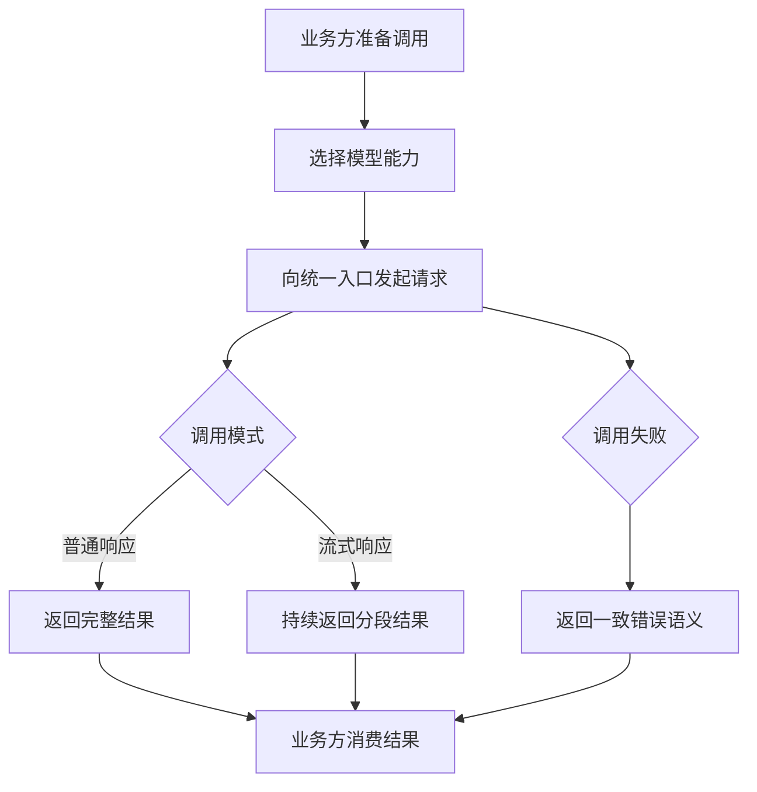
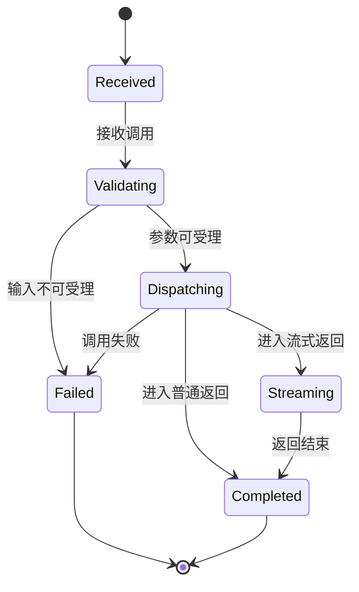

# gateway-api Web 后端需求规范

## 0. 文档信息

| 属性 | 内容 |
| :--- | :--- |
| **所属变更** | CHG-20260521-001 |
| **模块名称** | gateway-api |
| **模块类型** | web-backend |
| **创建时间** | 2026-05-21 |

### 修订记录

| 版本号 | 修改日期 | 修改内容摘要 | 修改人 |
| :--- | :--- | :--- | :--- |
| v1.0 | 2026-05-21 | 初稿创建 | OpenCode |

---

## 1. 业务背景与系统目标

* **业务背景**：当前项目需要形成公司统一的大模型调用入口，但接入能力仍停留在产品规划层，尚未明确统一入口在强兼容场景下应承担的业务行为边界。若没有一份清晰的统一接入需求规范，后续实现容易把主链路、模型选择、流式兼容和错误语义混写，导致替换 LiteLLM 的路径失焦。
* **核心目标**：定义统一接入强兼容主链路的业务需求，使业务开发团队能够通过统一入口完成模型选择、普通调用和流式调用，并在失败时获得一致、可理解的错误反馈，为后续逐步替换 LiteLLM 建立可验证的接入基线。
<!--
  衡量指标必须满足：
  1. 可衡量：包含具体数值（时间、百分比、数量）
  2. 技术无关：不提及具体中间件、数据库、缓存等
  3. 业务可感知：从业务/用户视角描述，非系统内部指标

  好的: "订单处理在 5 秒内完成" "系统可用性 99.9%"
  坏的: "MySQL QPS > 5000" "Redis 命中率 > 80%"
-->
* **关键衡量指标**：业务开发团队在单次接入变更中可完成模型调用切换；试点调用场景可同时验证普通响应与流式响应；调用失败时调用方可基于返回结果识别失败原因并决定是否重试。

---

## 2. 关键概念

> 统一术语定义，后续所有章节直接引用此处概念名，避免歧义。

- **统一入口**：业务方唯一使用的模型调用入口，对外保持稳定兼容的调用方式。
- **模型选择**：业务方在发起调用时指定要使用的模型能力标识，由统一入口决定如何承接本次调用。
- **兼容调用**：在统一入口下完成的普通返回或流式返回调用体验，要求行为语义一致、可预期。
- **错误语义**：统一入口在调用失败时向调用方表达的失败类型与可理解结果，用于区分输入问题、模型不可用和临时失败等不同情形。

---

## 3. 超出范围

> 明确本次不做的内容，防止范围蔓延。

- 不包含完整治理后台、权限配置、限额策略配置和模型组策略维护。
- 不包含日志分析看板、用量报表、健康度统计等观测能力细节。
- 不包含 Prompt 管理、工作流、Agent 编排、知识库等产品级范围外能力。

---

## 4. 角色与权限控制（RBAC）

| 角色名称 | 角色描述 | 菜单权限 | 操作权限 | 数据范围 |
| :--- | :--- | :--- | :--- | :--- |
| 业务开发团队 | 通过统一入口把模型能力接入业务系统 | 不适用 | 发起兼容调用、选择模型、消费返回结果 | 仅限其业务调用上下文 |
| 平台管理员 | 负责验证统一接入能力是否满足替换路径要求 | 接入能力菜单 | 查看接入说明、验证可用性 | 平台级接入能力范围 |

---

## 5. 业务流程与状态机

### 3.1 跨角色业务流程

### 3.2 核心对象状态机

| 当前状态 | 触发动作 | 目标状态 | 前置条件 |
| :--- | :--- | :--- | :--- |
| Received | 接收调用 | Validating | 业务方通过统一入口发起请求 |
| Validating | 校验通过 | Dispatching | 调用信息完整且可受理 |
| Dispatching | 选择流式返回 | Streaming | 本次调用采用流式返回 |
| Dispatching | 选择普通返回 | Completed | 本次调用采用普通返回 |
| Validating | 校验失败 | Failed | 输入不完整、模型不可选或请求不可受理 |
| Dispatching | 调用失败 | Failed | 调用过程中出现可感知失败 |

---

## 6. 详细功能需求

<!--
  功能描述规则：
  - 只写 WHAT（做什么）和 WHY（为什么），不写 HOW（怎么实现）
  - 禁止出现框架名、库名、ORM 名等技术实现细节（接口概要中的路径除外）
  - 每个功能点必须可追溯到至少一个用户故事或业务场景
  - 异常与边界不能留空 — 至少列出 2 个
  - 如果不确定某个细节，用 [待确认: 具体问题] 标记（整个 spec 最多 3 个）
-->

### 6.1 统一兼容调用入口

**A. 功能说明**

统一入口必须承接业务方的模型调用请求，并向调用方暴露一致的兼容调用体验。业务方应只关心“我要调用哪个模型能力、是否需要流式返回、得到什么结果”，而不需要感知底层承接差异。该功能是替换 LiteLLM 的主链路基础。

**B. 数据实体与关系**

- 调用请求：描述业务方本次调用意图的业务载体。
- 调用结果：描述统一入口最终向业务方返回的可消费结果。
- 失败结果：描述统一入口在调用失败时返回的可理解失败语义。

**C. 接口概要**

| 接口 | 方法 | 路径 | 说明 |
| :--- | :--- | :--- | :--- |
| 统一兼容调用 | POST | /v1/chat/completions | 承接普通调用和流式调用请求 |

**D. 业务规则与校验**

- 统一入口必须以稳定兼容的调用方式承接请求，不要求业务方因内部变化改造调用模式。
- 统一入口必须能够区分普通响应与流式响应两类调用体验，并保持结果语义一致。
- 当调用无法受理或执行失败时，必须向业务方返回可理解、可区分的失败结果。

**E. 异常与边界**

* **并发处理**：同一时段存在多笔调用时，每笔调用都应独立返回对应结果，不因其他调用存在而混淆响应语义。
* **幂等性**：业务方重复提交同一业务意图时，统一入口至少应保证每次返回结果语义自洽，不产生难以识别的异常状态。
* **超时降级**：当本次调用在合理等待期内无法完成时，统一入口应返回明确失败结果，而不是长时间无反馈。

### 6.2 模型选择与可用性约束

**A. 功能说明**

业务方在统一入口发起调用时，需要明确当前想使用的模型能力。统一入口必须对“可被选择的模型能力”给出稳定承接规则，避免业务方出现“能调用入口但不知道能用什么”的状态。

**B. 数据实体与关系**

- 模型能力标识：业务方在调用时选择的目标模型能力。
- 可用模型集合：当前对该调用主体可受理的模型能力范围。
- 调用主体：发起本次调用的业务侧身份上下文。

**C. 接口概要**

| 接口 | 方法 | 路径 | 说明 |
| :--- | :--- | :--- | :--- |
| 模型列表查询 | GET | /v1/models | 返回当前调用主体可见的模型能力集合 |

**D. 业务规则与校验**

- 调用主体只能在当前可用模型集合内选择模型能力。
- 当业务方选择了不可用模型能力时，统一入口必须直接返回明确失败结果。
- 模型列表查询结果必须与统一入口实际可受理范围保持一致。

**E. 异常与边界**

* **空集合**：当当前调用主体暂无可用模型时，应返回清晰结果，避免业务方误以为入口异常。
* **选择冲突**：当业务方请求中的模型能力不在当前可用范围内时，应立即阻断并返回可理解原因。
* **临时不可用**：当模型能力暂时不可承接时，应向业务方表达“当前不可用”而不是静默失败。

### 6.3 错误语义与兼容体验

**A. 功能说明**

统一入口不仅要在成功时兼容，更要在失败时兼容。业务方需要从失败结果中区分输入错误、模型不可用、临时失败等不同情况，以决定是否修正请求或稍后重试。

**B. 数据实体与关系**

- 输入错误：因请求内容不满足受理条件而产生的失败类型。
- 不可用错误：因当前模型能力不可承接而产生的失败类型。
- 临时失败：因短时异常导致本次调用未完成的失败类型。

**C. 接口概要**

| 接口 | 方法 | 路径 | 说明 |
| :--- | :--- | :--- | :--- |
| 错误结果返回 | POST | /v1/chat/completions | 在统一入口返回一致失败语义 |

**D. 业务规则与校验**

- 输入不合法、模型不可用、临时失败必须在返回结果中有明确可区分语义。
- 业务方不应从失败结果中接收到相互矛盾的提示。
- 同类失败在不同调用模式下应保持一致理解方式。

**E. 异常与边界**

* **输入缺失**：请求缺少必要信息时，应直接返回输入错误结果。
* **流式中断**：流式调用中途失败时，应让业务方明确本次返回已中断且未完成。
* **重复失败**：连续发生同类失败时，返回语义仍应保持一致，避免调用方误判。

---

## 7. 数据流与外部接口

* **数据导入**：本模块不涉及批量导入。
* **外部 API 对接**：统一入口在业务方发起调用时承接外部模型能力访问，并将结果回传给调用方。
* **消息/事件**：本次需求不要求异步消息驱动流程，统一以一次调用过程内的结果反馈为主。

---

## 8. 非功能需求

* **安全性**：统一入口返回的信息不得泄漏与业务调用无关的敏感内部细节。
* **并发与性能**：同一阶段的试点业务调用应具备稳定、连续的兼容体验，不因调用模式变化导致结果语义失真。
* **可观测性**：每次调用至少应形成可用于后续验证的结果表现，便于人工演示和问题回溯。

---

## 9. 验收标准

<!--
  验收标准必须使用 BDD 格式（Given/When/Then），确保可测试、无歧义。
  每条 AC 须关联至少一个业务场景或用户故事。

  好的写法:
    AC-01 Given 有效的创建订单请求，When 调用创建订单接口，Then 返回 201 且订单状态为 Created
    AC-02 Given 用户连续 3 次登录失败，When 第 4 次尝试，Then 返回 429 且账号锁定 15 分钟

  坏的写法（禁止）:
    "接口能正常工作" — 模糊，无具体前置/触发/结果
    "数据库写入成功" — 技术实现细节，不是业务可观测的结果
    "系统运行正常" — 不可测试
-->

| 编号 | 关联 | Given（前置状态） | When（触发动作） | Then（预期结果） | 优先级 |
| :--- | :--- | :--- | :--- | :--- | :--- |
| AC-01 | 统一兼容调用入口 | Given 业务开发团队已接入统一入口且选择了可用模型能力 | When 发起一次普通调用 | Then 业务方收到完整结果且无需感知底层承接差异 | P0 |
| AC-02 | 统一兼容调用入口 | Given 业务开发团队已接入统一入口且选择了可用模型能力 | When 发起一次流式调用 | Then 业务方持续收到分段结果并能识别调用正常结束 | P0 |
| AC-03 | 模型选择与可用性约束 | Given 当前调用主体存在可用模型集合 | When 查询可用模型能力并选择其中一个模型发起调用 | Then 查询结果与实际可受理范围一致且调用可被正常承接 | P0 |
| AC-04 | 模型选择与可用性约束 | Given 当前调用主体选择了不在可用范围内的模型能力 | When 发起调用 | Then 统一入口直接返回明确失败结果并说明该模型当前不可用 | P1 |
| AC-05 | 错误语义与兼容体验 | Given 请求内容不满足受理条件 | When 发起统一调用 | Then 统一入口返回可区分的输入错误结果且业务方可据此修正请求 | P0 |
| AC-06 | 错误语义与兼容体验 | Given 流式调用在返回过程中未能完成 | When 业务方消费本次结果 | Then 业务方能够明确识别本次调用已中断且结果不完整 | P1 |

---

## 10. 假设与依赖（适用时填）

> 有外部前提或不确定性时填写。

- 假设当前调用主体的身份上下文可由统一入口消费，不在本次需求中展开身份体系建设。
- 依赖后续治理能力为可用模型集合提供稳定来源，但本次需求先定义统一入口应如何消费该结果。
- 风险在于若后续模型可用性规则频繁变化，需要保证统一入口与模型列表查询始终保持一致。
