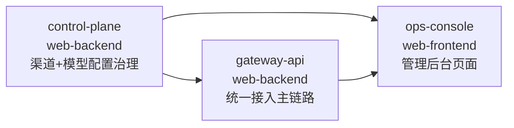

# 统一接入强兼容主链路 跨模块协调视图

> 本文件是跨模块集成的导航与协调中心，不是任务汇总表。
> 各模块内部任务在对应 `task.md` 中管理，通过下方索引导航。

## 基本信息

| 属性 | 内容 |
| :--- | :--- |
| **变更编号** | CHG-20260521-001 |
| **变更名称** | 统一接入强兼容主链路 |
| **生成时间** | 2026-05-21 |

---

## 1. 模块任务索引

| 模块 | 类型 | 任务文件 | 任务数 |
| :--- | :--- | :--- | :--- |
| control-plane | web-backend | [`task.md`](./control-plane/task.md) | 42 |
| gateway-api | web-backend | [`task.md`](./gateway-api/task.md) | 43 |
| ops-console | web-frontend | [`task.md`](./ops-console/task.md) | 30 |

---

## 2. 跨模块执行顺序

**推荐启动顺序**：
1. **control-plane** 先行（提供配置源和管理接口，被另外两个模块依赖）
2. **gateway-api** 次之（消费 control-plane 配置，提供 /v1/models 给 ops-console）
3. **ops-console** 最后（消费上述两个后端接口做前后端联调）

> 阶段 1-3 内各模块可并行开发（使用 Mock），阶段 4 联调时按上述顺序串联。

---

## 3. 跨模块集成任务

### 阶段：接口联调

- [ ] I001 P0 ops-console 统一接入页与 gateway-api /v1/models 联调（涉及模块：ops-console ↔ gateway-api）
  depends: T040@gateway-api, T027@ops-console

- [ ] I002 P0 ops-console 渠道管理页与 control-plane /api/v1/providers/* 联调（涉及模块：ops-console ↔ control-plane）
  depends: T040@control-plane, T028@ops-console

- [ ] I003 P0 ops-console 模型管理页与 control-plane /api/v1/models/* 联调（涉及模块：ops-console ↔ control-plane）
  depends: T040@control-plane, T028@ops-console

- [ ] I004 P0 gateway-api 配置消费与 control-plane 内部接口 + pub/sub 联调（涉及模块：gateway-api ↔ control-plane）
  depends: T040@control-plane, T086@gateway-api

### 阶段：端到端验证

- [ ] I005 P0 全链路 E2E 验证：管理员创建渠道+注册模型 → gateway-api 自动获取配置 → 业务方调用 /v1/chat/completions 成功
  depends: I001, I002, I003, I004

- [ ] I006 P1 全链路异常验证：禁用渠道 → gateway-api 感知变更 → 业务方调用该渠道模型返回 503 错误语义
  depends: I005

---

## 4. 质量门禁

- [ ] 所有模块 task.md 任务已完成
- [ ] 跨模块接口联调通过（I001-I004）
- [ ] 验收标准全部覆盖（AC-01 ~ AC-06）
- [ ] E2E 集成测试通过（I005、I006）
- [ ] 代码审查完成
- [ ] 部署前检查完成（Docker Compose 环境验证）
