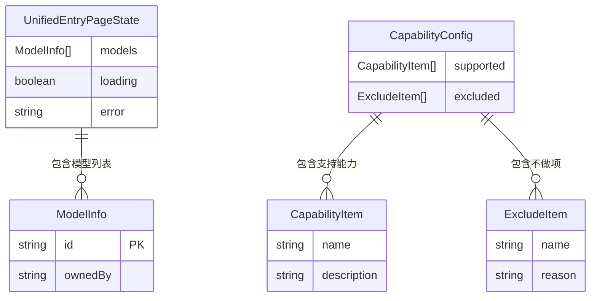

# ops-console 数据模型

## 1. 文档概述

| 属性 | 内容 |
| :--- | :--- |
| **所属变更** | CHG-20260521-001 |
| **模块名称** | ops-console |
| **模块类型** | web-frontend |
| **创建时间** | 2026-05-21 |
| **修改人** | OpenCode |

本文档定义 ops-console 统一接入页面的前端数据结构，包括静态配置实体、API 响应类型、以及页面本地状态类型。所有类型均以 TypeScript interface 形式描述，作为前端开发的类型约束依据。

---

## 2. 核心实体

### 2.1 能力配置（CapabilityConfig）

```typescript
/** 能力说明完整配置，对应 src/config/capability.json */
interface CapabilityConfig {
  /** 本次支持的能力列表 */
  supported: CapabilityItem[]
  /** 明确不做项列表 */
  excluded: ExcludeItem[]
}
```

### 2.2 能力项（CapabilityItem）

```typescript
/** 单项支持能力 */
interface CapabilityItem {
  /** 能力名称，如"OpenAI 兼容接口" */
  name: string
  /** 能力描述，简述该能力涵盖的内容 */
  description: string
}
```

### 2.3 不做项（ExcludeItem）

```typescript
/** 单项不做项 */
interface ExcludeItem {
  /** 不做项名称，如"Prompt 管理" */
  name: string
  /** 不做的原因说明 */
  reason: string
}
```

### 2.4 模型信息（ModelInfo）

```typescript
/** 前端展示用模型信息，从 /v1/models 响应映射而来 */
interface ModelInfo {
  /** 模型唯一标识，即模型名称，如"gpt-4o"、"qwen-turbo" */
  id: string
  /** 归属厂商，如"openai"、"alibaba" */
  ownedBy: string
}
```

---

## 3. 数据关系



**关系说明**：

| 主体 | 关系 | 客体 | 基数 |
| :--- | :--- | :--- | :--- |
| UnifiedEntryPageState | 包含 | ModelInfo | 0..N |
| CapabilityConfig | 包含 | CapabilityItem | 1..N |
| CapabilityConfig | 包含 | ExcludeItem | 1..N |

---

## 4. 请求/响应类型

### 4.1 GET /v1/models 请求

本接口无请求参数，认证通过浏览器自动携带的 JWT Cookie 完成。

```typescript
/** GET /v1/models 请求配置（无 body/params） */
interface FetchModelsRequest {
  method: 'GET'
  url: '/v1/models'
  headers: {
    Accept: 'application/json'
    // Cookie 由浏览器自动携带，无需显式设置
  }
}
```

### 4.2 GET /v1/models 成功响应

遵循 OpenAI Models List API 格式：

```typescript
/** /v1/models 接口原始响应 */
interface ModelsListResponse {
  /** 固定值 "list" */
  object: 'list'
  /** 模型对象数组 */
  data: ModelsListItem[]
}

/** 单个模型原始数据（OpenAI 格式） */
interface ModelsListItem {
  /** 模型唯一标识（模型名称） */
  id: string
  /** 固定值 "model" */
  object: 'model'
  /** 模型创建时间戳（Unix 秒） */
  created: number
  /** 归属厂商标识（snake_case） */
  owned_by: string
}
```

### 4.3 GET /v1/models 错误响应

```typescript
/** 错误响应结构 */
interface ModelsErrorResponse {
  error: {
    /** 错误描述信息 */
    message: string
    /** 错误类型标识 */
    type: 'auth_error' | 'permission_error' | 'server_error'
  }
}
```

### 4.4 响应映射函数

```typescript
/** 将 API 原始响应映射为前端 ModelInfo 数组 */
function mapModelsResponse(response: ModelsListResponse): ModelInfo[] {
  return response.data.map(item => ({
    id: item.id,
    ownedBy: item.owned_by
  }))
}
```

**字段映射规则**：

| 原始字段路径 | 目标字段 | 映射方式 |
| :--- | :--- | :--- |
| data[].id | ModelInfo.id | 直接赋值 |
| data[].owned_by | ModelInfo.ownedBy | snake_case 转 camelCase |
| data[].object | 不映射 | 前端不使用 |
| data[].created | 不映射 | 前端不使用 |

---

## 5. 本地状态类型

### 5.1 页面状态（UnifiedEntryPageState）

```typescript
/** 统一接入页面整体状态 */
interface UnifiedEntryPageState {
  /** 模型列表数据，初始为空数组 */
  models: ModelInfo[]
  /** 是否正在加载模型列表，初始为 false */
  loading: boolean
  /** 错误信息，null 表示无错误，初始为 null */
  error: string | null
}
```

### 5.2 状态初始值

```typescript
const initialState: UnifiedEntryPageState = {
  models: [],
  loading: false,
  error: null
}
```

### 5.3 状态变更场景

| 场景 | models | loading | error |
| :--- | :--- | :--- | :--- |
| 初始状态 | [] | false | null |
| 发起请求 | [] | true | null |
| 请求成功（有数据） | ModelInfo[] | false | null |
| 请求成功（无数据） | [] | false | null |
| 请求失败（403） | [] | false | "暂无权限查看模型信息" |
| 请求失败（500/503） | [] | false | "服务暂时不可用，请稍后重试" |
| 请求失败（网络异常） | [] | false | "网络异常，请刷新重试" |
| 点击刷新 | [] | true | null |
