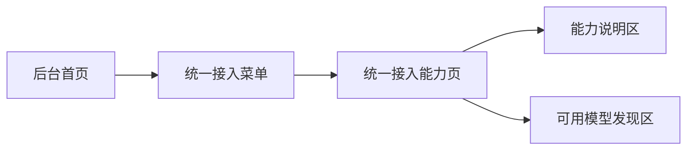

# ops-console Web 前端需求规范

## 0. 文档信息

| 属性 | 内容 |
| :--- | :--- |
| **所属变更** | CHG-20260521-001 |
| **模块名称** | ops-console |
| **模块类型** | web-frontend |
| **创建时间** | 2026-05-21 |

### 修订记录

| 版本号 | 修改日期 | 修改内容摘要 | 修改人 |
| :--- | :--- | :--- | :--- |
| v1.0 | 2026-05-21 | 初稿创建 | OpenCode |

---

## 1. 需求背景与目标

* **业务背景**：当前产品已经明确统一接入是替换 LiteLLM 的主链路，但后台侧还没有一个对应的菜单与功能承接点，导致平台管理员无法在产品界面中看到“统一接入能力”这一主题，也不利于后续扩展更完整的后台治理功能。
* **核心目标**：为统一接入能力提供一个清晰的菜单入口和功能页面，向平台管理员呈现接入范围、兼容能力和当前可执行的接入说明，同时严格控制范围，不扩展为完整治理后台。
<!--
  成功指标必须满足：
  1. 可衡量：包含具体数值（时间、百分比、数量）
  2. 技术无关：不提及框架、数据库、缓存等
  3. 用户可感知：从用户/业务视角描述，非系统内部指标

  好的: "用户 2 分钟内完成注册流程" "首屏内容 1.5 秒内可见"
  坏的: "API p95 < 200ms" "Redis 命中率 > 80%"
-->
* **成功指标**：平台管理员可在 1 次进入后台后找到统一接入菜单；可在同一功能页中理解本次接入能力覆盖范围；演示过程中无需跳出多个页面即可完成统一接入能力说明。

---

## 2. 关键概念

> 统一术语定义，后续所有章节直接引用此处概念名，避免歧义。

- **统一接入菜单**：后台导航中承接统一接入能力的功能入口。
- **接入能力页**：进入统一接入菜单后展示本次能力范围、可用模型发现和兼容说明的页面。
- **兼容说明**：帮助平台管理员理解统一接入当前支持内容与本次不覆盖内容的产品级说明。

---

## 3. 超出范围

> 明确本次不做的内容，防止范围蔓延。

- 不包含完整治理后台的信息架构重做。
- 不包含权限配置、限额配置、审计查询、日志分析等完整后台能力。
- 不包含面向普通员工的大范围自服务交互扩展。

---

## 4. 目标用户与使用场景

* **目标用户**：平台管理员。
* **核心场景**：平台管理员在后台中查看和演示统一接入能力时，需要快速进入对应菜单并理解当前能力边界。

### 用户故事

| 编号 | 角色 | 行为 | 目的 | 优先级 |
| :--- | :--- | :--- | :--- | :--- |
| US-01 | 作为平台管理员 | 我想要在后台看到统一接入菜单并进入对应页面 | 以便快速找到本次统一接入能力入口 | P0 |
| US-02 | 作为平台管理员 | 我想要在统一接入页面看到当前支持能力与边界说明 | 以便演示和确认本次变更的实际覆盖范围 | P0 |

---

## 5. 页面流与路由结构

### 3.1 页面流转图

### 3.2 路由定义

| 路由路径 | 页面名称 | 说明 |
| :--- | :--- | :--- |
| /access/unified-entry | 统一接入能力页 | 承接统一接入菜单入口与能力说明 |

---

## 6. 详细功能说明

<!--
  功能描述规则：
  - 只写 WHAT（做什么）和 WHY（为什么），不写 HOW（怎么实现）
  - 禁止出现框架名、库名、API 路径、数据库表名等技术实现细节
  - 每个功能点必须可追溯到至少一个用户故事（US-XX）
  - 边界/异常场景不能留空 — 至少列出 2 个
  - 如果不确定某个细节，用 [待确认: 具体问题] 标记（整个 spec 最多 3 个）
-->

### 6.1 统一接入菜单入口（关联 US-01）

**A. 界面与交互说明**

* **UI 原型/视觉**：在后台导航中提供“统一接入”菜单项，与其他平台能力菜单并列可见。
* **交互规则**：
  * 触发方式：点击菜单进入统一接入能力页。
  * 动效反馈：菜单选中状态应清晰可见，便于管理员确认当前位置。
  * 刷新机制：再次进入页面时应展示当前页面内容，不要求复杂刷新机制。

**B. 核心展示与业务逻辑**

* **数据来源**：菜单入口由后台信息架构直接暴露，进入后展示本次统一接入的能力说明与当前可见内容。
* **缓存策略**：本次无需为菜单入口定义单独缓存策略，确保进入后可稳定看到页面主体内容即可。

**C. 异常与边界状态**

* **网络异常**：若页面主体信息未能加载，应明确提示当前无法展示统一接入说明，而不是空白页。
* **空状态**：若当前暂无可展示的模型发现信息，应保留页面主体结构并说明“当前无可展示模型能力”。
* **极限值**：当说明文案较长时，应保证管理员仍能完整阅读，不因截断影响理解。
* **权限异常**：若当前用户无后台访问权限，应阻断进入并显示无权限提示。
* **中断恢复**：管理员刷新或重新进入页面后，应仍可回到统一接入能力页主体内容。

### 6.2 统一接入能力说明页（关联 US-02）

**A. 界面与交互说明**

* **UI 原型/视觉**：统一接入能力页需要明确展示“本次支持什么”“本次不做什么”“当前可用模型发现入口或结果”三类信息。
* **交互规则**：
  * 触发方式：进入菜单后直接看到能力说明页主体。
  * 动效反馈：切换到该页时应让管理员明确已经进入统一接入主题，而不是普通占位页。
  * 刷新机制：页面信息更新后，管理员重新进入即可看到最新说明。

**B. 核心展示与业务逻辑**

* **数据来源**：页面需承接本次统一接入需求中已确认的能力范围，包括强兼容主链路、模型选择、普通与流式调用兼容、错误语义说明。
* **缓存策略**：说明型内容不要求复杂本地缓存，但页面再次进入时应保持结构稳定、内容可读。

**C. 异常与边界状态**

* **网络异常**：若模型发现信息暂时不可见，应保留能力说明区，避免整页不可用。
* **空状态**：若当前没有模型发现结果，可展示“暂无可用模型信息”的说明文案。
* **极限值**：若可展示模型较多，页面应保证管理员仍能区分模型名称与可用性信息。
* **权限异常**：若用户仅能进入后台但无该菜单权限，应隐藏或阻断该菜单入口。
* **中断恢复**：管理员中途离开后再次进入，应能继续查看统一接入主题页，不要求恢复复杂输入状态。

---

## 7. 状态管理需求

| 状态名称 | 类型 | 初始值 | 说明 |
| :--- | :--- | :--- | :--- |
| currentMenu | string | unified-entry | 当前所在后台菜单，用于定位统一接入主题 |
| pageSection | string | overview | 当前页面主要展示分区 |
| modelVisibilityState | string | unknown | 当前模型发现区域的展示状态 |

---

## 8. 非功能需求

* **浏览器兼容性**：应满足当前后台产品的标准浏览器使用环境。
* **性能要求**：平台管理员进入菜单后，应在一次正常页面打开流程内看到统一接入页面主体。
* **响应式设计**：本次以后台常用桌面使用场景为主，不额外扩展移动端交互。
* **无障碍**：菜单名称与页面标题应清晰可辨，避免管理员误解页面用途。

---

## 9. 验收标准

<!--
  验收标准必须使用 BDD 格式（Given/When/Then），确保可测试、无歧义。
  每条 AC 须关联至少一个用户故事（US-XX）。

  好的写法:
    AC-01 (US-01) Given 用户在登录页，When 输入正确的邮箱和密码并点击登录，Then 跳转到仪表盘且显示用户名
    AC-02 (US-01) Given 用户连续输错密码 3 次，When 第 4 次尝试，Then 账号锁定 15 分钟并提示剩余时间

  坏的写法（禁止）:
    "用户可以正常登录" — 模糊，无具体前置/触发/结果
    "系统响应时间 < 200ms" — 技术实现细节，不是用户可感知的验收条件
    "登录功能工作正常" — 不可测试
-->

| 编号 | 关联 | Given（前置状态） | When（触发动作） | Then（预期结果） | 优先级 |
| :--- | :--- | :--- | :--- | :--- | :--- |
| AC-01 | US-01 | Given 平台管理员已进入后台可见导航区域 | When 查看后台菜单 | Then 能看到“统一接入”菜单入口并可识别其主题含义 | P0 |
| AC-02 | US-01 | Given 平台管理员已看到“统一接入”菜单入口 | When 点击进入 | Then 打开统一接入能力页且页面标题与当前位置清晰可见 | P0 |
| AC-03 | US-02 | Given 平台管理员已进入统一接入能力页 | When 查看页面主体内容 | Then 能看到本次支持能力、明确不做项和接入主题说明 | P0 |
| AC-04 | US-02 | Given 统一接入能力页存在模型发现区域 | When 当前没有可展示模型信息 | Then 页面保留主体结构并明确提示暂无可用模型信息 | P1 |
| AC-05 | US-02 | Given 平台管理员在演示统一接入能力页 | When 需要确认本次是否已包含完整后台治理能力 | Then 页面内容能明确表达本次仅覆盖接入主题与菜单功能，不误导为完整后台已完成 | P1 |

---

## 10. 假设与依赖（适用时填）

> 有外部前提或不确定性时填写。

- 假设后台已有稳定导航体系可挂载新的统一接入菜单入口。
- 依赖统一接入主链路需求对“支持能力”和“明确不做项”给出稳定表述来源。
- 风险在于若后续统一接入范围扩展过快，当前页面信息架构可能需要重新梳理，但不影响本次作为菜单级承接入口落地。
