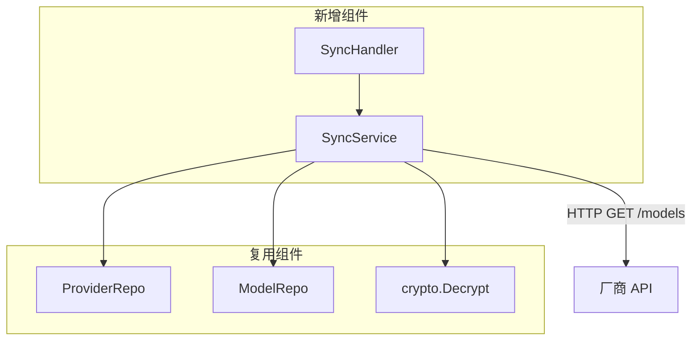
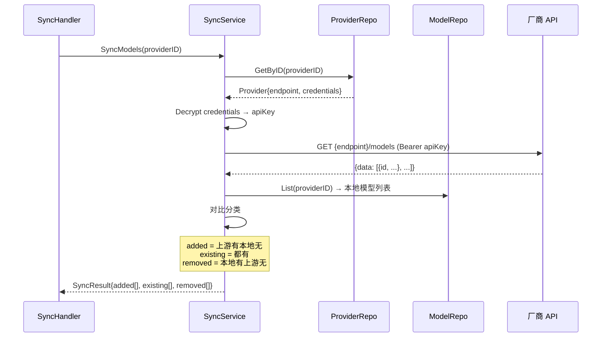

# control-plane 技术设计变更 — CHG-20260521-002

> 基线：xspec/modules/control-plane/design.md (v1.0)

## 变更摘要

新增模型同步功能：SyncHandler + SyncService，实现从厂商拉取模型列表、对比去重、批量注册、下架禁用。

## 设计决策变更

### 决策：同步接口拆为两步

- **问题**：同步是一次性完成还是分步？
- **选择**：两步接口（先拉取对比 → 再确认注册）
- **理由**：管理员需要在中间环节勾选，不能全量盲导入
- **备选**：一步完成（全量导入后管理员逐个禁用）— 体验差

### 决策：下架检测防误禁用

- **问题**：上游返回空列表时是否禁用本地所有模型？
- **选择**：空列表时不执行禁用，仅提示
- **理由**：网络故障可能导致空返回，全量禁用影响严重
- **备选**：无论如何都执行 — 风险过大

## 架构变更



## 新增接口详细设计

### POST /api/v1/providers/:id/sync-models（拉取对比）



**返回结构**：
```json
{
  "data": {
    "added": [{"id": "qwen-max", "owned_by": "dashscope"}, ...],
    "existing": [{"id": "qwen-turbo", "owned_by": "dashscope"}, ...],
    "removed": [{"id": "old-model", "owned_by": "dashscope"}, ...],
    "total_upstream": 244,
    "total_local": 5
  }
}
```

### POST /api/v1/providers/:id/sync-models/confirm（批量注册+禁用）

**请求体**：
```json
{
  "models_to_add": ["qwen-max", "qwen-plus", "qwen-vl-max"],
  "disable_removed": true
}
```

**逻辑**：
1. 遍历 `models_to_add`，逐个创建 Model 记录（enabled=false, provider_id=当前渠道）
2. 已存在的跳过（name + provider_id 去重）
3. 如 `disable_removed=true` 且上游返回非空，将 removed 列表中的模型 enabled 设为 false
4. 返回注册结果统计

**返回结构**：
```json
{
  "data": {
    "registered": 3,
    "skipped": 0,
    "disabled": 2
  }
}
```

## 错误处理

| 场景 | 处理 |
| :--- | :--- |
| 渠道不存在 | 404 |
| 渠道禁用 | 400 "provider is disabled" |
| 厂商不支持 /models（Anthropic/Bedrock） | 400 "this provider type does not support model sync" |
| 厂商超时 | 502 "upstream timeout" |
| 厂商返回空列表 | 正常返回 added=[], removed 不执行禁用 |
