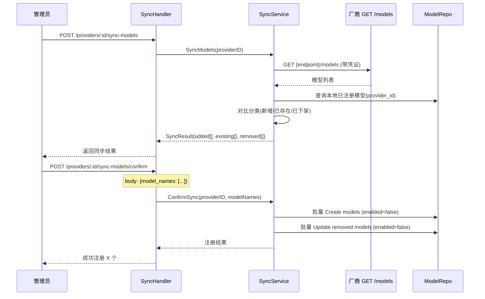

# control-plane 概要设计变更 — CHG-20260521-002

> 基线：xspec/modules/control-plane/hld.md (v1.0)

## 变更摘要

新增模型同步接口 POST /api/v1/providers/:id/sync-models，复用现有 Handler → Service → Repository 分层结构。

## 架构变更

无架构变更。新增一个接口端点，复用现有中间件链和认证体系。

## 技术选型变更

无变更。使用现有 Go + Gin + GORM 栈。

## 新增组件

| 组件 | 位置 | 职责 |
| :--- | :--- | :--- |
| SyncHandler | handler/sync_handler.go | 处理同步请求，调用 SyncService |
| SyncService | service/sync_service.go | 编排同步逻辑：调厂商 API → 对比本地 → 分类 → 批量写入/禁用 |

## 核心流程

