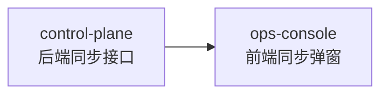

# 一键同步模型列表 跨模块协调视图

> 本文件是跨模块集成的导航与协调中心，不是任务汇总表。

## 基本信息

| 属性 | 内容 |
| :--- | :--- |
| **变更编号** | CHG-20260521-002 |
| **变更名称** | 一键同步模型列表 |
| **生成时间** | 2026-05-21 |

---

## 1. 模块任务索引

| 模块 | 类型 | 任务文件 | 任务数 |
| :--- | :--- | :--- | :--- |
| control-plane | web-backend | [`task.md`](./control-plane/task.md) | 8 |
| ops-console | web-frontend | [`task.md`](./ops-console/task.md) | 10 |

---

## 2. 跨模块执行顺序

**推荐顺序**：control-plane 先完成接口 → ops-console 再做前端联调

---

## 3. 跨模块集成任务

- [ ] I001 P0 前后端联调：ops-console 同步弹窗对接 control-plane 同步接口（真实百炼渠道验证）
  depends: T004@control-plane, T009@ops-console

---

## 4. 质量门禁

- [ ] 所有模块 task.md 任务已完成
- [ ] 跨模块接口联调通过（I001）
- [ ] 验收标准覆盖（AC-S01 ~ AC-S06, AC-UI-01 ~ AC-UI-05）
- [ ] 代码审查完成
