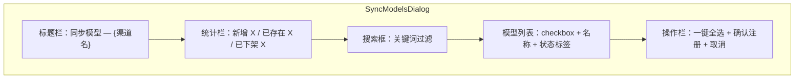
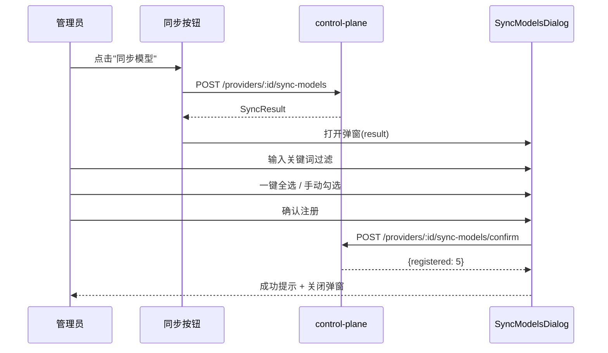

# ops-console 技术设计变更 — CHG-20260521-002

> 基线：xspec/modules/ops-console/design.md (v1.0)

## 变更摘要

渠道列表页新增"同步模型"按钮 + SyncModelsDialog 弹窗组件。

## 新增组件

### SyncModelsDialog.vue



**交互流程**：



**状态管理**：组件内 ref 管理，无需 Pinia store

| 状态 | 类型 | 说明 |
| :--- | :--- | :--- |
| syncResult | SyncResult | null | 同步结果数据 |
| filterKeyword | string | 搜索关键词 |
| selectedModels | string[] | 勾选的模型名列表 |
| confirming | boolean | 确认注册 loading |

## 界面设计

```
┌─────────────────────────────────────────────┐
│ 同步模型 — 百炼                        [×] │
├─────────────────────────────────────────────┤
│ 新增 238 个 │ 已存在 5 个 │ 已下架 1 个   │
├─────────────────────────────────────────────┤
│ 🔍 [搜索模型名称...                     ]  │
├─────────────────────────────────────────────┤
│ ☑ qwen-max                      [新增]    │
│ ☑ qwen-plus                     [新增]    │
│ ☐ qwen-turbo              [已存在] (禁用) │
│ ☑ qwen-vl-max                   [新增]    │
│ ...（滚动）                                │
├─────────────────────────────────────────────┤
│ [☑ 一键全选]        [取消]  [确认注册(3)]  │
└─────────────────────────────────────────────┘
```
