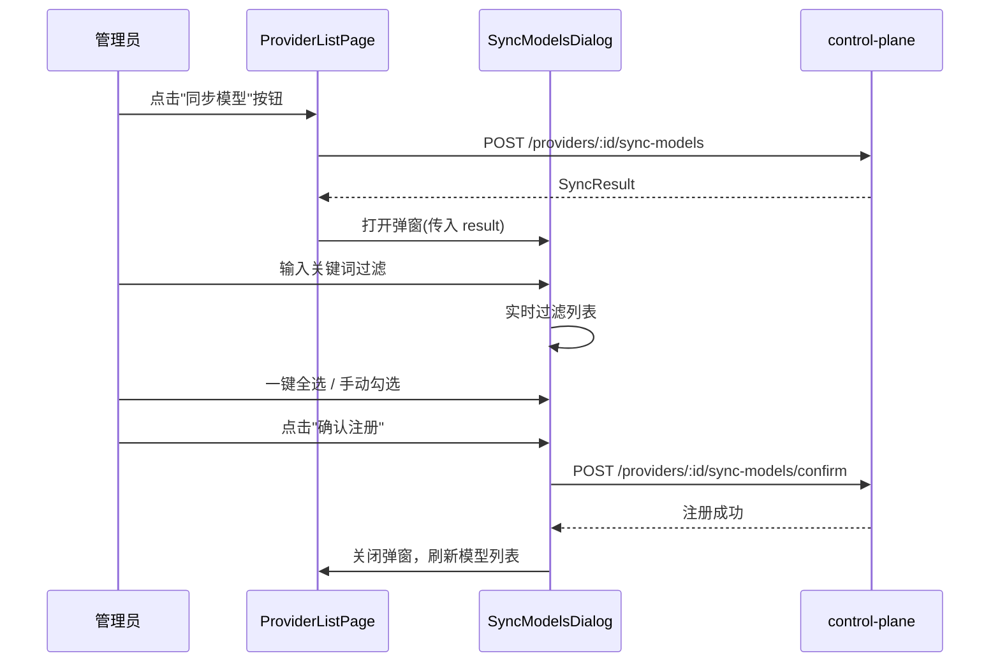

# ops-console 概要设计变更 — CHG-20260521-002

> 基线：xspec/modules/ops-console/hld.md (v1.0)

## 变更摘要

渠道列表页操作列新增"同步模型"按钮，点击后弹出同步结果弹窗，支持过滤+勾选+批量注册。

## 架构变更

无架构变更。在现有渠道管理页基础上新增组件。

## 技术选型变更

无变更。使用现有 Vue 3 + Element Plus 栈。

## 新增组件

| 组件 | 位置 | 职责 |
| :--- | :--- | :--- |
| SyncModelsDialog.vue | components/admin/ | 同步结果弹窗：展示列表、过滤、勾选、确认注册 |

## 核心交互流程

