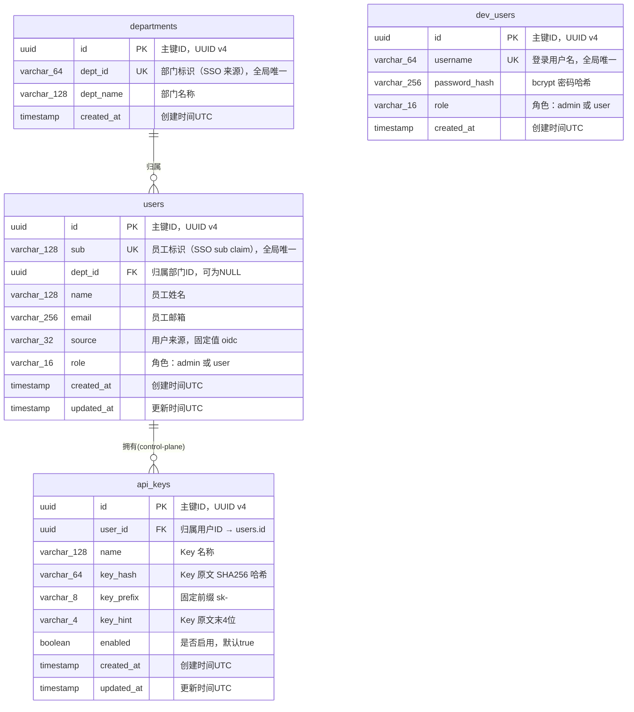

# auth Web 后端数据模型

## 1. 文档概述

本文档描述 auth 模块的数据库模型设计，包括实体结构、关系、索引策略、事务边界和迁移方案。auth 模块管理的表为 users、departments、dev_users；api_keys 表位于 control-plane 数据库中，本处仅记录其结构供 Key 鉴权链路参考。

| 属性 | 内容 |
| :--- | :--- |
| **所属变更** | CHG-20260523-001 |
| **数据库类型** | PostgreSQL 15+ |
| **ORM 框架** | GORM v2 |
| **迁移工具** | golang-migrate |
| **核心实体** | users（用户表）、departments（部门表）、dev_users（开发模式测试用户表） |
| **关联实体（位于 control-plane）** | api_keys（API Key 表） |
| **创建时间** | 2026-05-23 |
| **修改人** | OpenCode |

---

## 2. 实体关系总览

> users 与 departments 为多对一关系：一个部门下可有多个用户，一个用户只归属一个部门。dev_users 独立表，与 users/departments 无外键关联。api_keys 表位于 control-plane 数据库，api_keys.user_id 外键关联 users.id。

| 关系 | 类型 | 说明 |
| :--- | :---: | :--- |
| departments → users | 1:N | 一个部门下可有多个用户（users.dept_id 外键），dept_id 可为 NULL |
| users ↔ api_keys | 1:N | 一个用户可创建多把 Key，由 control-plane 管理（api_keys.user_id 外键关联 users.id） |
| dev_users | 独立 | 与 users / departments 无关联，仅 dev 环境存在 |

### ER 图



---

## 3. 实体定义

> 字段类型使用逻辑类型标注，括号内为建议长度限制。

### 3.1 users（员工用户表）

**用途**：存储通过 SSO（OIDC）登录的正式员工用户数据。所有调用追溯和身份关联均以此表为基础。

| 字段 | 逻辑类型 | 约束 | 说明 |
| :--- | :--- | :--- | :--- |
| `id` | `uuid` | PK，非空 | 主键，应用层生成 UUID v4 |
| `sub` | `string(128)` | 非空，唯一 | 员工标识，对应 OIDC id_token 的 sub claim。SSO 回调中的唯一身份标识 |
| `dept_id` | `uuid` | FK → departments.id，可空 | 归属部门 ID。SSO 回调中 department_id 为空时此字段为 NULL |
| `name` | `string(128)` | 非空 | 员工姓名，SSO 回调 name claim。非首次登录时更新 |
| `email` | `string(256)` | 非空 | 员工邮箱，SSO 回调 email claim。非首次登录时更新 |
| `source` | `string(32)` | 非空，默认 `oidc` | 用户来源。当前固定为 oidc，预留后续其他来源 |
| `role` | `string(16)` | 非空，默认 `user` | 角色：`admin`（平台管理员）或 `user`（普通员工）。由 OIDC claims 角色映射配置决定 |
| `created_at` | `timestamp` | 非空，自动填充 | UTC 时间戳，记录首次 SSO 登录时刻 |
| `updated_at` | `timestamp` | 非空，自动更新 | UTC 时间戳，每次非首次登录更新时自动刷新 |

**删除策略**：物理删除。用户被删除后，其已签发的 JWT 因 TokenService.VerifyAccessToken 中的用户存在性检查而被拒绝。control-plane 中该用户创建的 api_keys 通过外键 ON DELETE RESTRICT 阻止级联删除（Key 不会被自动删除，需管理员先处理 Key）。

**唯一性规则**：
- `sub` 为唯一键，不允许同一员工标识创建多条用户记录
- 非首次 SSO 登录时，通过 `sub` 定位已有记录并更新 `name`、`email`、`role`、`dept_id`

**角色来源**：
- SSO 登录时由 OIDCService 通过 Viper 配置 `oidc.role_mapping` 映射决定：
  - 从 id_token claims 指定 claim_path 读取值
  - 与 admin_match_values 列表比对，匹配则为 `admin`
  - 不匹配或 claim_path 缺失则为 `user`（default_role）
- 后续管理员可通过 ops-console 手动修改 users.role（不在本次范围，预留字段）

---

### 3.2 departments（部门表）

**用途**：存储公司部门数据。SSO 回调中 department_id 非空时写入，已存在的部门不重复创建。

| 字段 | 逻辑类型 | 约束 | 说明 |
| :--- | :--- | :--- | :--- |
| `id` | `uuid` | PK，非空 | 主键，应用层生成 UUID v4 |
| `dept_id` | `string(64)` | 非空，唯一 | 部门标识，对应 SSO 回调中的 department_id。作为业务唯一键 |
| `dept_name` | `string(128)` | 非空 | 部门名称，对应 SSO 回调中的 department_name |
| `created_at` | `timestamp` | 非空，自动填充 | UTC 时间戳，记录首次写入时刻 |

**删除策略**：不提供删除操作。部门数据仅通过 SSO 回调写入，部门标识变更时用户重新绑定新部门，旧部门保留不删除（可能仍有其他用户归属）。

**唯一性规则**：
- `dept_id` 为唯一键，同一部门标识只创建一次
- SSO 回调中部门标识已存在时跳过写入，不更新 dept_name（部门名称变更需管理员手动维护，不在本次范围）

---

### 3.3 dev_users（开发模式测试用户表）

**用途**：存储开发模式下通过账号密码登录的测试用户数据。完全独立于 SSO 用户体系，仅在 `auth.mode == "dev"` 时随迁移脚本创建此表，生产环境不创建。

| 字段 | 逻辑类型 | 约束 | 说明 |
| :--- | :--- | :--- | :--- |
| `id` | `uuid` | PK，非空 | 主键，应用层生成 UUID v4 |
| `username` | `string(64)` | 非空，唯一 | 登录用户名，仅允许字母数字下划线连字符 |
| `password_hash` | `string(256)` | 非空 | bcrypt 哈希后的密码（cost=12），原始明文不存储 |
| `role` | `string(16)` | 非空，默认 `user` | 角色：`admin` 或 `user`。开发模式下可手动指定 |
| `created_at` | `timestamp` | 非空，自动填充 | UTC 时间戳 |

**删除策略**：物理删除。开发模式测试数据无需保留历史。

**安全约束**：
- `password_hash` 使用 `golang.org/x/crypto/bcrypt` 的 cost=12 生成
- 密码校验使用 `bcrypt.CompareHashAndPassword`，失败返回统一错误（不暴露用户是否存在）
- dev_users 表在 production 模式的迁移脚本中不存在（000_init_schema 区分环境）
- 生产环境代码层硬校验：`auth.mode != "dev"` 时 dev login 路由组不注册

---

### 3.4 api_keys（API Key 表）— 位于 control-plane，auth 仅消费

**用途**：存储用户创建的 API Key。此表由 control-plane 管理，auth 通过 `POST /internal/v1/keys/verify` 内部接口查询。以下列出的结构为 auth 鉴权链路所需的最小字段集。

| 字段 | 逻辑类型 | 约束 | 说明 |
| :--- | :--- | :--- | :--- |
| `id` | `uuid` | PK，非空 | 主键，control-plane 生成 |
| `user_id` | `uuid` | FK → users.id，非空 | 归属用户 ID。auth 鉴权链路据此关联用户和部门 |
| `name` | `string(128)` | 非空 | Key 名称，用户自定义标识 |
| `key_hash` | `string(64)` | 非空，唯一 | Key 原文的 SHA256 哈希。control-plane 存储哈希，auth 验 Key 时用 SHA256(输入) 与哈希比对 |
| `key_prefix` | `string(8)` | 非空，固定 `sk-` | Key 前缀标识 |
| `key_hint` | `string(4)` | 非空 | Key 原文末 4 位，用于列表展示脱敏（如 `sk-...abcd`） |
| `enabled` | `boolean` | 非空，默认 `true` | Key 启用状态。`false` 表示已禁用。鉴权中间件仅放行 enabled=true 且未软删除的 Key |
| `deleted_at` | `timestamp` | 可空 | 软删除时间戳。非 NULL 表示已删除，鉴权中间件拒绝 |
| `created_at` | `timestamp` | 非空 | 创建时间 |
| `updated_at` | `timestamp` | 非空 | 更新时间 |

**auth 消费方式**：
- auth 不直接查 api_keys 表，不持有 control-plane 数据库连接
- auth 通过 `POST /internal/v1/keys/verify` 调用 control-plane，传入 Key 原文
- control-plane 内部完成 `SHA256(Key原文)` 与 `key_hash` 匹配、关联查询 users 和 departments
- control-plane 返回合并结果：`{key_id, status, user{user_id, name, department_id}}`
- auth 对 control-plane 响应的 status 做判断：`active` 放行，其他拒绝

**状态枚举（auth 视角）**：

| control-plane 返回 status | auth 中间件行为 | 说明 |
| :--- | :--- | :--- |
| `active` | 放行，注入 user_id + department_id | Key 正常可用 |
| `disabled` | 拒绝，返回 E4016 | Key 被用户或管理员主动禁用 |
| `not_found` | 拒绝，返回 E4015 | Key 不存在（哈希不匹配或无此记录） |

### 3.5 VerifyKeyResponse — 内部验证响应 DTO

```typescript
// 文档表达用 DTO 结构，真实实现为 Go struct
interface VerifyKeyResponse {
  data: {
    key_id?: string
    status: 'active' | 'disabled' | 'not_found'
    user?: {
      user_id: string
      name: string
      department_id: string | null
    }
  }
}
```

---

## 4. 关系定义

### 4.1 外键约束

| 外键字段 | 引用表.字段 | ON DELETE | ON UPDATE | 说明 |
| :--- | :--- | :---: | :---: | :--- |
| `users.dept_id` | `departments.id` | SET NULL | CASCADE | 部门被删除时用户部门置空（管理员操作），不级联删除用户 |
| `api_keys.user_id` | `users.id` | RESTRICT | CASCADE | 删除用户前必须先处理其 Key，防止孤儿 Key（control-plane 端约束） |

### 4.2 关联表

不适用。users ↔ departments 为简单 1:N 关系；dev_users 独立无关联；api_keys 与 users 为 1:N 关系（control-plane 端）。

---

## 5. 索引设计

| 索引名 | 所在实体 | 覆盖字段 | 访问模式 | 取舍说明 |
| :--- | :--- | :--- | :--- | :--- |
| `uniq_users_sub` | users | `sub` | OIDC 回调 Upsert 时按 sub 查找已有用户（高频） | 唯一索引，保证员工标识不重复 |
| `idx_users_dept_id` | users | `dept_id` | 按部门查询用户列表（低频） | 普通索引，写入开销低 |
| `idx_users_email` | users | `email` | 按邮箱查找用户（低频） | 普通索引，预留 |
| `uniq_departments_dept_id` | departments | `dept_id` | OIDC 回调 Upsert 时按 dept_id 查找已有部门（高频） | 唯一索引，保证部门标识不重复 |
| `uniq_dev_users_username` | dev_users | `username` | Dev 模式登录按 username 查找（高频） | 唯一索引，保证用户名不重复 |

**索引维护注意：**
- 使用物理删除策略，无需考虑软删除与唯一索引的冲突
- 数据量预估较小（users < 10,000，departments < 500，dev_users < 50），索引数量对写入性能影响可忽略
- users 表 `sub` 唯一索引为 OIDC 回调 Upsert 的核心查询路径，必须高效
- dev_users 表仅在 dev 环境创建，其索引不影响生产环境

---

## 6. 事务边界

| 操作场景 | 涉及实体 | 事务 | 隔离级别 | 说明 |
| :--- | :--- | :---: | :--- | :--- |
| OIDC 回调 — Upsert 部门 + 用户 | departments + users | 否 | — | 两次独立写入，幂等操作。部门不存在则 INSERT，用户按 sub Upsert。即使部门写入成功后用户写入失败，下次 SSO 登录时部门已存在会跳过，用户重新 Upsert |
| OIDC 回调 — 仅更新用户 | users | 否 | — | 单表 UPDATE，无需事务 |
| Dev 模式登录 — 查询 dev_users | dev_users | 否 | — | 只读查询，无需事务 |
| JWT 刷新 — 签 Token | — | 否 | — | 纯内存 RS256 签名 + Redis 黑名单写入（Redis 不支持事务回滚，先签 Token 再写黑名单，失败时 Token 存在但 Refresh 无法再用） |
| JWT 登出 — 黑名单写入 | — | 否 | — | 仅 Redis 操作，无需数据库事务 |

**事务选择理由**：
- OIDC 回调的部门 + 用户写入无需在同一事务中：部门写入失败不影响用户写入（dept_id 可 NULL）；用户写入失败不影响已写入的部门（部门独立存在）
- 用户 Upsert 本身是幂等操作（按 sub 查找，存在则 UPDATE，不存在则 INSERT），GORM FirstOrCreate 模式，单条 SQL 无需应用层事务
- Key 鉴权链路中 auth 不写入任何数据，仅读取缓存 + 调用 control-plane API，无事务需求

**Redis 操作与数据库的关系**：
- JWT 黑名单写入在内存签发 Token 之后：先签再写黑名单，写入失败时旧 Token 仍可用但无法被刷新（access 过期后需重新 SSO 登录）
- Key 状态缓存写入在 control-plane verify 成功之后：异步回填，写入失败下次请求仍穿透 control-plane
- 以上均为非关键路径，失败不阻塞主流程

---

## 7. 迁移策略

### 7.1 迁移规则

- 所有结构变更通过 golang-migrate 迁移脚本完成，禁止手动修改生产库 Schema
- 每次迁移只做一件事（加列 / 加索引 / 建表单独成脚本）
- 迁移脚本必须同时提供 up 和 down 文件
- dev_users 表的迁移脚本仅在 dev 环境执行，生产环境跳过

### 7.2 初始迁移脚本（001_init_schema）

**UP：**

```sql
-- 001_init_schema.up.sql

CREATE EXTENSION IF NOT EXISTS "uuid-ossp";

-- 部门表
CREATE TABLE departments (
    id UUID PRIMARY KEY DEFAULT uuid_generate_v4(),
    dept_id VARCHAR(64) NOT NULL,
    dept_name VARCHAR(128) NOT NULL,
    created_at TIMESTAMP WITH TIME ZONE NOT NULL DEFAULT NOW(),
    CONSTRAINT uniq_departments_dept_id UNIQUE (dept_id)
);

-- 员工用户表
CREATE TABLE users (
    id UUID PRIMARY KEY DEFAULT uuid_generate_v4(),
    sub VARCHAR(128) NOT NULL,
    dept_id UUID REFERENCES departments(id) ON DELETE SET NULL ON UPDATE CASCADE,
    name VARCHAR(128) NOT NULL,
    email VARCHAR(256) NOT NULL,
    source VARCHAR(32) NOT NULL DEFAULT 'oidc',
    role VARCHAR(16) NOT NULL DEFAULT 'user',
    created_at TIMESTAMP WITH TIME ZONE NOT NULL DEFAULT NOW(),
    updated_at TIMESTAMP WITH TIME ZONE NOT NULL DEFAULT NOW(),
    CONSTRAINT uniq_users_sub UNIQUE (sub),
    CONSTRAINT chk_users_role CHECK (role IN ('admin', 'user')),
    CONSTRAINT chk_users_source CHECK (source = 'oidc')
);

CREATE INDEX idx_users_dept_id ON users (dept_id);
CREATE INDEX idx_users_email ON users (email);

-- 开发模式测试用户表（仅 dev 环境创建）
-- 生产环境部署时跳过此表
-- CREATE TABLE dev_users (
--     id UUID PRIMARY KEY DEFAULT uuid_generate_v4(),
--     username VARCHAR(64) NOT NULL,
--     password_hash VARCHAR(256) NOT NULL,
--     role VARCHAR(16) NOT NULL DEFAULT 'user',
--     created_at TIMESTAMP WITH TIME ZONE NOT NULL DEFAULT NOW(),
--     CONSTRAINT uniq_dev_users_username UNIQUE (username),
--     CONSTRAINT chk_dev_users_role CHECK (role IN ('admin', 'user'))
-- );
```

**DOWN：**

```sql
-- 001_init_schema.down.sql

DROP TABLE IF EXISTS users;
DROP TABLE IF EXISTS departments;
-- DROP TABLE IF EXISTS dev_users;
```

### 7.3 dev 环境迁移脚本（002_dev_users，仅 dev 环境执行）

```sql
-- 002_dev_users.up.sql（仅在 auth.mode=dev 时执行）

CREATE TABLE IF NOT EXISTS dev_users (
    id UUID PRIMARY KEY DEFAULT uuid_generate_v4(),
    username VARCHAR(64) NOT NULL,
    password_hash VARCHAR(256) NOT NULL,
    role VARCHAR(16) NOT NULL DEFAULT 'user',
    created_at TIMESTAMP WITH TIME ZONE NOT NULL DEFAULT NOW(),
    CONSTRAINT uniq_dev_users_username UNIQUE (username),
    CONSTRAINT chk_dev_users_role CHECK (role IN ('admin', 'user'))
);

-- 预置默认开发账号（密码：devadmin / devuser，部署后应立即修改）
INSERT INTO dev_users (username, password_hash, role) VALUES
    ('devadmin', '$2a$12$...', 'admin'),
    ('devuser', '$2a$12$...', 'user')
ON CONFLICT (username) DO NOTHING;
```

```sql
-- 002_dev_users.down.sql

DROP TABLE IF EXISTS dev_users;
```

### 7.4 安全操作表

| 操作 | 安全做法 | 禁止做法 |
| :--- | :--- | :--- |
| 新增字段 | `ADD COLUMN`，设置默认值或允许 NULL | 直接加非空无默认值列（会锁表） |
| 删除字段 | 先在应用层停止使用 → 发布 → 再删除列 | 直接删除仍在使用的列 |
| 修改字段类型 | 新建列 → 迁移数据 → 切换引用 → 删除旧列 | 直接 ALTER COLUMN TYPE |
| 新增唯一索引 | 先检查数据无重复 → `CREATE UNIQUE INDEX CONCURRENTLY` | 普通 CREATE UNIQUE INDEX（锁表） |

### 7.5 版本追踪

| 字段 | 内容 |
| :--- | :--- |
| 版本命名规范 | `{三位序号}_{描述}.up.sql` / `{三位序号}_{描述}.down.sql`，如 `001_init_schema.up.sql` |
| 回滚策略 | 每个 up 文件必须配套 down 文件；不可逆操作（如删除列含数据）在 down 中标注为 `-- IRREVERSIBLE` 并抛出错误 |
| 环境区分 | dev_users 表通过独立迁移脚本（002_dev_users）管理，CI 流水线按 `auth.mode` 环境变量决定是否执行 |

---

## 8. 数据约束与规则

* **审计字段**：`created_at` 在插入时自动填充当前 UTC 时间；`updated_at` 在每次更新时自动刷新为当前 UTC 时间（GORM AutoUpdateTime）。departments 和 dev_users 仅含 `created_at`（无需更新）。
* **主键生成**：应用层使用 Go `github.com/google/uuid` 生成 UUID v4，不依赖数据库序列。
* **时间精度**：所有时间字段使用 `TIMESTAMP WITH TIME ZONE`，存储精度到微秒。
* **字符编码**：数据库和连接均使用 UTF-8 编码。
* **空值规则**：除 `users.dept_id` 明确标注可空外，所有字段均为 NOT NULL。
* **枚举约束**：`users.role` 和 `dev_users.role` 使用 CHECK 约束（admin / user）。
* **外键约束**：`users.dept_id` 的 ON DELETE SET NULL 策略确保删除部门时用户记录不被级联删除，仅部门关联置空。
* **密码安全**：`dev_users.password_hash` 存储 bcrypt(cost=12) 哈希，不存储明文；数据库级别无法还原明文密码。
* **用户来源**：`users.source` 固定为 `oidc`，CHECK 约束防止误写入其他来源。
* **开发模式隔离**：`dev_users` 表仅在 dev 环境存在，生产环境数据库中无此表；迁移脚本通过 CI 流水线条件执行实现。
* **跨库关联**：`api_keys.user_id` 外键关联 `users.id`，但 api_keys 位于 control-plane 数据库，不属于 auth 数据库。auth 通过内部 HTTP API 消费 Key 数据，不持有跨库查询连接。
