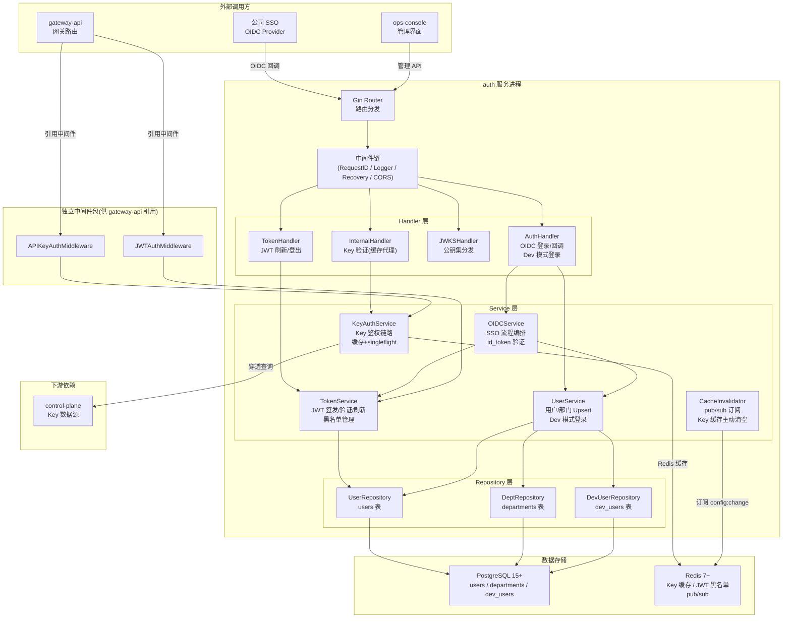
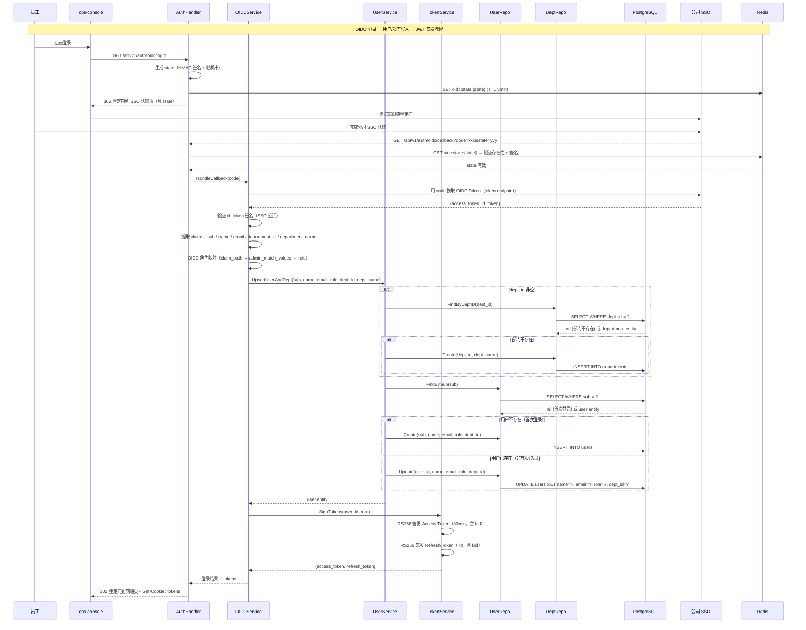
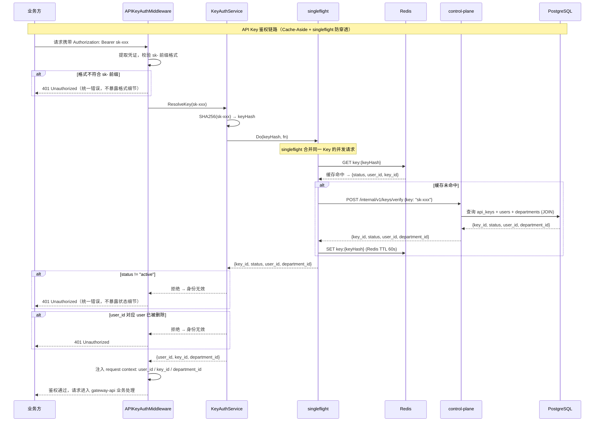
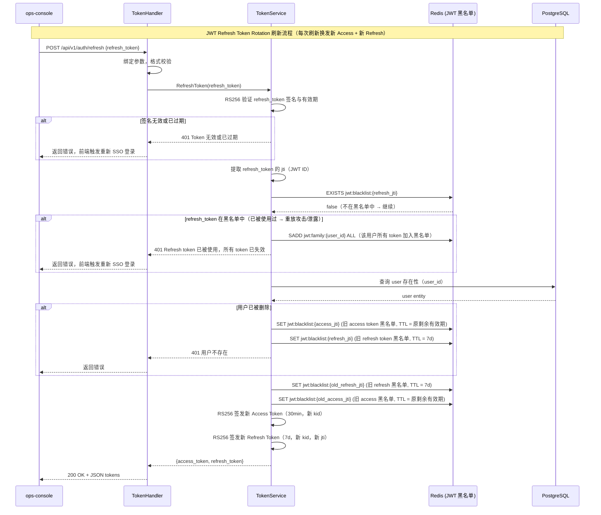
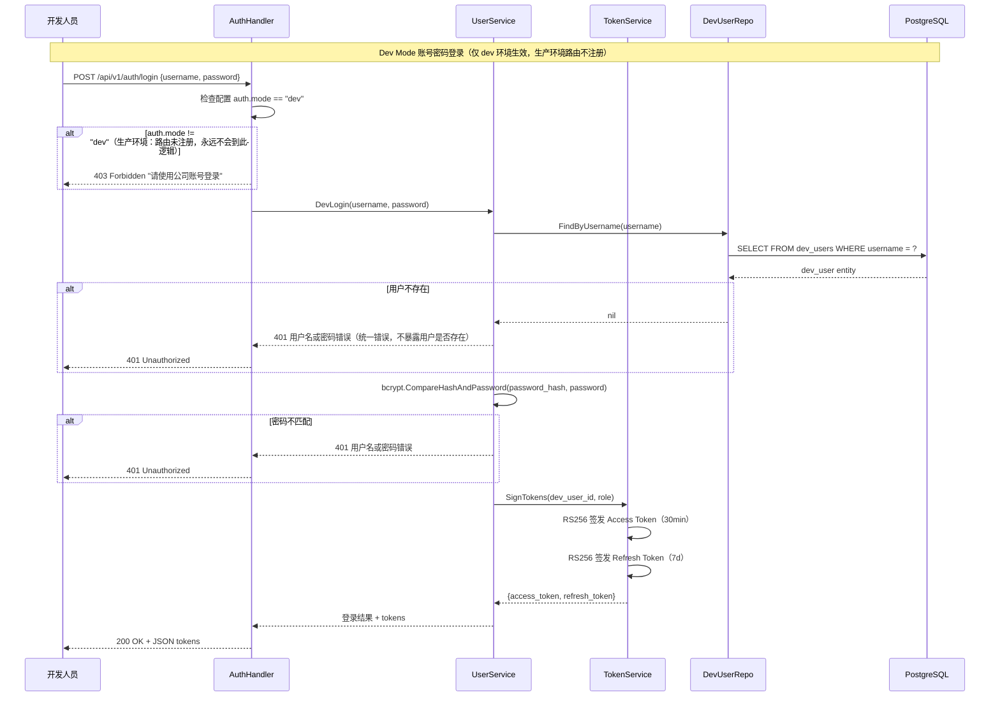
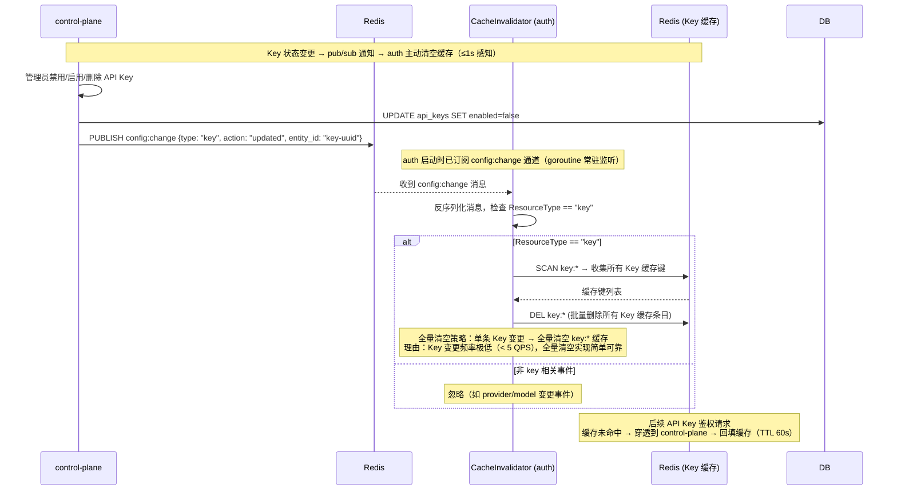
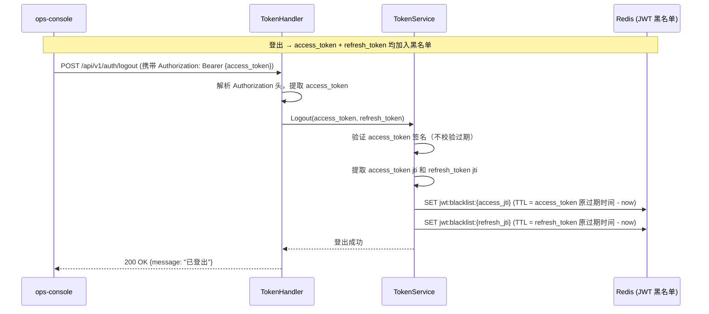
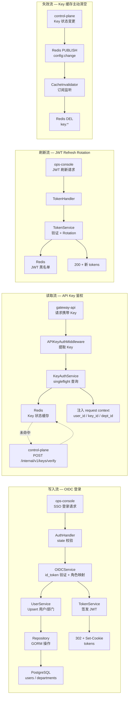
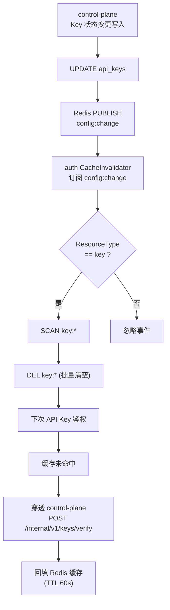

# auth Web 后端技术设计

## 0. 文档信息

| 属性 | 内容 |
| :--- | :--- |
| **所属变更** | CHG-20260523-001 |
| **模块名称** | auth |
| **模块类型** | web-backend |
| **创建时间** | 2026-05-23 |
| **修改人** | OpenCode |

### 修订记录

| 版本号 | 修改日期 | 修改内容摘要 | 修改人 |
| :--- | :--- | :--- | :--- |
| v1.0 | 2026-05-23 | 初稿创建 | OpenCode |

---

## 1. 背景与目标

* **技术背景**：V0.1 版本中 gateway-api 使用硬编码 token 进行鉴权，无法将模型调用与真实员工身份关联，违反"组织感知"原则。公司已有 SSO 体系（基于 OIDC 协议），当前缺少 SSO 对接、JWT 签发和 API Key 鉴权中间件三个核心能力。
* **技术目标**：实现 SSO 登录对接与用户/部门数据写入、内部 JWT 签发与刷新（Refresh Token Rotation + 黑名单）、API Key 鉴权中间件（含 Redis 缓存 + pub/sub 主动失效），使每次模型调用都能追溯到真实员工身份，替换 V0.1 硬编码 token，为 v0.2.0"身份 → Key → 调用追溯"闭环提供基础支撑。
* **关键衡量指标**：
  - 鉴权中间件对单个请求的身份识别时间 ≤ 100 ms（P95）
  - Key 状态变更（禁用/启用/删除）后 ≤ 1 秒内在鉴权中间件生效
  - SSO 登录流程从员工点击到进入平台 ≤ 5 秒
  - V0.1 硬编码 token 在 v0.2.0 上线后彻底失效

---

## 2. 模块职责边界

**负责：**
- SSO（OIDC）登录发起、回调接收、id_token 验证与用户/部门数据写入
- 内部 JWT 签发（RS256）、验证、刷新（Refresh Token Rotation + 黑名单）
- API Key 鉴权中间件（Key → 用户 → 部门三级链路解析，含 Redis 缓存 + singleflight）
- Key 状态缓存主动失效（订阅 control-plane `config:change` Redis pub/sub 通道）
- 开发模式账号密码登录（仅 dev 环境生效，dev_users 独立表）
- JWKS 端点提供公钥集分发（支持 kid 匹配的密钥轮换）

**不负责（显式排除）：**
- Key 的创建、列表查询、禁用、启用、删除等 CRUD 接口（由 control-plane 提供）
- 模型组策略与模型可见性控制（属于 control-plane 和 gateway-api 的后续迭代）
- 限流策略（TPM/RPM 套餐配置）
- 用量统计与调用日志审计（属于 observability-hub）
- 部门级权限配置（部门对哪些模型组有访问权）
- 复杂角色权限体系（RBAC 多角色多层级）
- 数据库 Schema 定义与迁移脚本细节（见 data-model.md）
- 接口契约完整定义（见 contracts.md）

**调用关系：**

| 方向 | 模块 | 方式 |
| :--- | :--- | :--- |
| 被调用 | ops-console | HTTP RESTful API（OIDC 登录/回调、JWT 刷新/登出） |
| 被调用 | gateway-api | 引用中间件包（APIKeyAuthMiddleware / JWTAuthMiddleware） |
| 调用 | PostgreSQL | GORM ORM 操作（用户/部门/dev_users 表） |
| 调用 | Redis | Key 状态缓存读写、JWT 黑名单存取、pub/sub 订阅 config:change 通道 |
| 调用 | 公司 SSO (OIDC) | OIDC Discovery、Token 交换、id_token 验证 |
| 调用 | control-plane | HTTP 内部 API：POST /internal/v1/keys/verify（Key 状态与归属查询） |

---

## 3. 技术选型

| 领域 | 选型 | 理由 |
| :--- | :--- | :--- |
| 运行时 | Go 1.22+ | 公司技术栈统一要求，高性能低资源占用，与 control-plane/gateway-api 保持一致 |
| Web 框架 | Gin | 社区成熟，路由性能优秀，中间件生态丰富，与现有模块一致 |
| 数据库 | PostgreSQL 15+ | 支持 JSONB、强事务保证，用户/部门/dev_users 数据持久化 |
| 缓存/消息 | Redis 7+ | Key 状态缓存 + pub/sub 主动失效、JWT 黑名单存储、singleflight 合并穿透 |
| ORM | GORM v2 | Go 生态主流 ORM，支持迁移、钩子、事务管理，与现有模块一致 |
| 配置管理 | Viper | 支持多格式配置文件和环境变量覆盖，与现有模块一致 |
| 日志 | Zap | 高性能结构化日志，支持 JSON 输出，与现有模块一致 |
| JWT | crypto/rsa + golang-jwt/jwt | RS256 签名，公私钥分离，公钥通过 JWKS 端点分发给其他模块验证 |
| OIDC 客户端 | coreos/go-oidc | Go 生态主流 OIDC 库，支持 id_token 验证与 claims 提取 |
| 密码哈希 | golang.org/x/crypto/bcrypt | 开发模式 dev_users 密码存储，业界标准自适应哈希 |
| OpenTelemetry | otelgin + otelgorm | 分布式追踪，与现有模块一致 |

---

## 4. 架构概述

### 4.1 系统架构



### 4.2 目录结构

```
auth/
├── cmd/
│   └── server/
│       └── main.go              # 启动入口（Gin 路由注册、中间件链装配）
├── internal/
│   ├── config/
│   │   └── config.go            # 配置加载（Viper）：OIDC 参数、Redis 连接、RS256 密钥路径
│   ├── handler/
│   │   ├── auth.go              # AuthHandler：OIDC 登录发起、回调接收、Dev 模式登录
│   │   ├── token.go             # TokenHandler：JWT 刷新、登出
│   │   ├── jwks.go              # JWKSHandler：/.well-known/jwks.json 公钥集端点
│   │   └── internal.go          # InternalHandler：POST /internal/v1/auth/verify-key（缓存代理）
│   ├── middleware/
│   │   ├── api_key_auth.go      # APIKeyAuthMiddleware：独立包，供 gateway-api 引用
│   │   ├── jwt_auth.go          # JWTAuthMiddleware：独立包，供管理接口使用
│   │   ├── requestid.go         # 请求 ID 注入
│   │   ├── logger.go            # 结构化日志（Zap）
│   │   └── ratelimit.go         # 限流（管理接口 60 次/分钟）
│   ├── service/
│   │   ├── oidc.go              # OIDCService：SSO 回调编排
│   │   ├── user.go              # UserService：用户/部门 Upsert、Dev 模式登录
│   │   ├── token.go             # TokenService：JWT 签发、验证、刷新、黑名单
│   │   ├── key_auth.go          # KeyAuthService：API Key 鉴权链路解析、缓存、singleflight
│   │   └── cache_invalidator.go # CacheInvalidator：pub/sub 订阅、Key 缓存主动清空
│   ├── repository/
│   │   ├── user.go              # UserRepository：users 表 CRUD
│   │   ├── dept.go              # DeptRepository：departments 表 CRUD
│   │   └── dev_user.go          # DevUserRepository：dev_users 表 CRUD
│   ├── model/
│   │   ├── user.go              # User 实体
│   │   ├── dept.go              # Department 实体
│   │   └── dev_user.go          # DevUser 实体
│   ├── dto/
│   │   ├── auth.go              # OIDC/Dev 登录请求/响应 DTO
│   │   ├── token.go             # JWT 刷新/登出请求/响应 DTO
│   │   └── internal.go          # 内部接口请求/响应 DTO
│   ├── crypto/
│   │   └── jwt.go               # JWT 签发与验证工具（RS256，kid 注入）
│   └── errors/
│       └── errors.go            # 业务错误定义
├── migrations/
│   └── 001_init_schema.sql      # 数据库迁移脚本
├── go.mod
├── go.sum
└── Dockerfile
```

---

## 5. 关键流程设计

### 5.1 OIDC 登录与数据写入



### 5.2 API Key 鉴权链路（含缓存 + singleflight）



### 5.3 JWT Refresh Token Rotation（含黑名单）



### 5.4 开发模式账号密码登录



### 5.5 Key 缓存主动失效（Redis pub/sub）



### 5.6 登出流程（JWT 黑名单）



---

## 6. 数据流转

### 6.1 系统数据流



### 6.2 核心数据流转说明

| 数据 | 入口 | 处理环节 | 出口 | 持久化 |
| :--- | :--- | :--- | :--- | :--- |
| SSO 用户/部门数据 | GET /api/v1/auth/oidc/callback | state 验证 → code 换 token → id_token 验证 → 角色映射 → Upsert 用户/部门 → JWT 签发 | 302 重定向 + Set-Cookie tokens | users + departments 表 |
| JWT Token 对 | TokenService.SignTokens() | user_id + role → RS256 签名 → 注入 kid → 生成 jti | JSON {access_token, refresh_token} | —（无状态 JWT） |
| API Key 鉴权结果 | Authorization: Bearer sk-xxx | 提取 Key → SHA256 → Redis 缓存查询 → 穿透 control-plane verify → 状态校验 → 部门拼接 | request context: user_id / key_id / department_id | —（缓存 TTL 60s） |
| JWT 黑名单条目 | TokenService 刷新/登出时 | 提取 jti → SET Redis（TTL = 原 token 剩余有效期） | — | Redis（非持久化，重启丢失可接受） |
| Key 缓存失效 | Redis pub/sub config:change | 反序列化 → ResourceType 过滤 → SCAN + DEL key:* | — | — |

### 6.3 Key 状态变更感知数据流



---

## 7. 分层职责

### 7.1 Handler 层

> Handler 只做：请求解析、参数绑定与格式校验、调用 Service、响应序列化。不含业务逻辑。

**AuthHandler 输入校验：**

| 字段 / 参数 | 校验规则 | 失败时 |
| :--- | :--- | :--- |
| OIDC callback `code` | 非空 | 400 E4001 |
| OIDC callback `state` | 非空，必须与 Redis 中存储的 state 匹配 | 401 E4011（CSRF 防御） |
| Dev login `username` | 非空，长度 2–64，仅允许字母数字下划线连字符 | 400 E4001 |
| Dev login `password` | 非空，长度 6–128 | 400 E4001 |

**TokenHandler 输入校验：**

| 字段 / 参数 | 校验规则 | 失败时 |
| :--- | :--- | :--- |
| `refresh_token` | 非空，合法 JWT 格式（三段 Base64URL） | 400 E4001 |
| Authorization header（logout） | 非空，Bearer 前缀 | 401 E4011 |

**InternalHandler 输入校验：**

| 字段 / 参数 | 校验规则 | 失败时 |
| :--- | :--- | :--- |
| `key`（请求体） | 非空，sk- 前缀，长度 ≤ 256 | 400 E4001 |

### 7.2 Service 层

> 包含全部业务逻辑和事务编排，不处理 HTTP 细节。

**OIDCService 公开方法：**

| 方法签名 | 职责 | 事务 | 抛出异常 |
| :--- | :--- | :---: | :--- |
| `HandleCallback(ctx, code string) (*TokenPair, error)` | 用 code 换 OIDC token → 验证 id_token 签名 → 提取 claims → 角色映射 → 调 UserService Upsert → 调 TokenService 签发 JWT | 否（编排多个 Service 调用） | OIDCError, InvalidCallbackError |
| `GetAuthURL(ctx) (string, error)` | 生成 state → 存 Redis → 构造 SSO 授权 URL 重定向地址 | 否 | OIDCError |

**UserService 公开方法：**

| 方法签名 | 职责 | 事务 | 抛出异常 |
| :--- | :--- | :---: | :--- |
| `UpsertUserAndDept(ctx, sub, name, email, role, deptID, deptName string) (*User, error)` | 部门不存在时创建 → 用户 Upsert（首次 INSERT / 非首次 UPDATE）→ 返回 user entity | 否（逐操作，幂等） | InternalError |
| `DevLogin(ctx, username, password string) (*TokenPair, error)` | 查 dev_users 表 → bcrypt 密码校验 → 调 TokenService 签发 JWT | 否 | UnauthorizedError |
| `GetUserByID(ctx, userID string) (*User, error)` | 按 UUID 查用户 | 否 | NotFoundError |

**TokenService 公开方法：**

| 方法签名 | 职责 | 事务 | 抛出异常 |
| :--- | :--- | :---: | :--- |
| `SignTokens(ctx, userID, role string) (*TokenPair, error)` | RS256 签发 Access（30min, kid）+ Refresh（7d, kid），生成 jti | 否 | TokenSignError |
| `VerifyAccessToken(ctx, tokenStr string) (*Claims, error)` | 验证 RS256 签名 → 过期时间 → 黑名单（jti）→ 用户存在性 | 否 | TokenExpiredError, TokenInvalidError, TokenBlacklistedError |
| `RefreshToken(ctx, refreshTokenStr string) (*TokenPair, error)` | 验证 Refresh Token 签名 → 黑名单检查（已用则全族失效） → 用户存在性 → 旧 token 黑名单 → 签发新 token 对 | 否 | TokenExpiredError, TokenInvalidError, TokenBlacklistedError, TokenFamilyCompromisedError |
| `Logout(ctx, accessTokenStr, refreshTokenStr string) error` | 提取 jti → access + refresh 均加入黑名单（TTL = 原剩余有效期） | 否 | TokenInvalidError |
| `GetJWKS(ctx) (*JWKS, error)` | 返回当前有效公钥集（含新旧 kid，用于密钥轮换过渡窗口） | 否 | — |

**KeyAuthService 公开方法：**

| 方法签名 | 职责 | 事务 | 抛出异常 |
| :--- | :--- | :---: | :--- |
| `ResolveKey(ctx, keyStr string) (*KeyContext, error)` | SHA256 Key → Redis 缓存查询（singleflight 合并）→ 未命中则调 control-plane verify → 回填缓存 → 状态校验 → 返回 {key_id, user_id, department_id} | 否 | KeyInvalidError, KeyDisabledError, UserNotFoundError, UpstreamUnavailableError |

**CacheInvalidator 公开方法：**

| 方法签名 | 职责 | 事务 | 抛出异常 |
| :--- | :--- | :---: | :--- |
| `Start(ctx) error` | 启动 goroutine 订阅 Redis config:change 通道 → 按 ResourceType=="key" 过滤 → 全量清空 key:* 缓存 | 否（常驻 goroutine） | — |
| `Stop() error` | 关闭订阅，优雅退出 goroutine | 否 | — |

**业务规则：**
- 用户记录以 `sub`（员工标识）为唯一键，不允许同一员工标识创建多条用户记录
- 部门记录以 `dept_id`（部门标识）为唯一键，不允许同一部门标识创建多条部门记录
- 用户与部门为多对一关系：一个用户只归属一个部门，部门可为空
- SSO 回调必须验证 id_token 签名和 state 参数，防止伪造回调攻击
- JWT Access Token 有效期 30 分钟，Refresh Token 有效期 7 天
- Refresh Token Rotation：每次刷新签发新 Access + 新 Refresh，旧 Refresh 加入黑名单
- Refresh Token 复用检测：同一 Refresh Token 被使用两次视为泄露，该用户所有 token 全族失效
- 开发模式仅在 `auth.mode == "dev"` 时注册账号密码路由，生产环境不注册
- API Key 鉴权必须完成完整链路：Key 状态 → 归属用户 → 归属部门，任何一步失败均拒绝
- Key 状态变更后 ≤ 1 秒内鉴权中间件感知（Redis pub/sub 主动清空 + TTL 60s 兜底）

**跨模块调用：**

| 依赖模块 | 调用时机 | 失败处理 |
| :--- | :--- | :--- |
| Redis（Key 状态缓存） | API Key 鉴权时查询缓存 | 缓存不可用时降级为直查 control-plane（延迟增加但可用） |
| Redis（JWT 黑名单） | JWT 刷新/登出时读写黑名单 | 黑名单不可用时保守策略：拒绝 Refresh Token 使用，要求重新 SSO 登录 |
| Redis（pub/sub 订阅） | auth 启动时订阅 config:change 通道 | 订阅失败记录错误日志；TTL 60s 兜底保证最坏 60s 感知 |
| control-plane（Key verify） | API Key 鉴权缓存未命中时 | 查询超时/不可用返回"身份验证服务暂不可用"，不放行请求 |
| 公司 SSO（OIDC） | OIDC 登录回调时 | 超时/不可用返回明确提示，开发模式不受影响 |

### 7.3 Repository 层

> 封装全部数据库操作，向 Service 屏蔽 GORM 细节。

**UserRepository：**

| 方法签名 | 操作 | 说明 |
| :--- | :--- | :--- |
| `Create(ctx, *User) error` | INSERT | sub 唯一约束冲突返回 ConflictError |
| `FindByID(ctx, id string) (*User, error)` | SELECT | 不存在返回 nil, nil |
| `FindBySub(ctx, sub string) (*User, error)` | SELECT | 按员工标识查询，用于 Upsert 前判断 |
| `Update(ctx, id string, updates map[string]interface{}) error` | UPDATE | 不存在返回 NotFoundError |
| `Delete(ctx, id string) error` | DELETE | 物理删除 |

**DeptRepository：**

| 方法签名 | 操作 | 说明 |
| :--- | :--- | :--- |
| `Create(ctx, *Department) error` | INSERT | dept_id 唯一约束冲突返回 ConflictError |
| `FindByDeptID(ctx, deptID string) (*Department, error)` | SELECT | 不存在返回 nil, nil |
| `Update(ctx, id string, updates map[string]interface{}) error` | UPDATE | 不存在返回 NotFoundError |

**DevUserRepository：**

| 方法签名 | 操作 | 说明 |
| :--- | :--- | :--- |
| `FindByUsername(ctx, username string) (*DevUser, error)` | SELECT | 不存在返回 nil, nil |
| `Create(ctx, *DevUser) error` | INSERT | username 唯一约束冲突返回 ConflictError |

### 7.4 DTO 与领域对象映射

| 类型 | 用途 | 转换时机 |
| :--- | :--- | :--- |
| TokenPairResponse | 序列化 JWT token 对响应（access_token, refresh_token） | Handler 出口 |
| RefreshRequest | 接收 POST /api/v1/auth/refresh 请求体 | Handler 入口绑定 |
| DevLoginRequest | 接收 POST /api/v1/auth/login 请求体 | Handler 入口绑定 |
| VerifyKeyRequest | 接收 POST /internal/v1/auth/verify-key 请求体 | Handler 入口绑定 |
| VerifyKeyResponse | 序列化 Key 验证结果 | Handler 出口 |
| JWKSResponse | 序列化 JWKS 公钥集 | JWKSHandler 出口 |
| User (entity) | 数据库持久化对象 | Repository ↔ Service |
| Department (entity) | 数据库持久化对象 | Repository ↔ Service |
| DevUser (entity) | 数据库持久化对象 | Repository ↔ Service |
| TokenClaims | JWT 载荷解析结果（user_id, role, jti, kid, exp） | TokenService 内部 |
| KeyContext | Key 鉴权上下文（key_id, user_id, department_id） | KeyAuthService → APIKeyAuthMiddleware |

> **安全规则**：以下字段禁止序列化到任何 ResponseDTO：`password_hash`（dev_users）、`key_hash`（api_keys）、`key_plaintext`（API Key 原文）。JWT 私钥不在任何响应中出现。access_token / refresh_token 仅在签发/刷新时返回，列表/详情接口不返回。

---

## 8. 异常处理链

### 8.1 异常类型

| 异常类 | 抛出层 | 语义 |
| :--- | :--- | :--- |
| ValidationError | Handler | 请求参数格式校验失败 |
| UnauthorizedError | Middleware / Service | 认证失败（Token 无效、密码错误、state 不匹配） |
| ForbiddenError | Handler / Service | 权限不足（生产环境尝试 Dev 模式登录） |
| NotFoundError | Repository / Service | 资源不存在（用户、dev_user、部门） |
| ConflictError | Repository | 资源唯一约束冲突（sub 重复、username 重复、dept_id 重复） |
| TokenExpiredError | TokenService | JWT Access/Refresh Token 已过期 |
| TokenInvalidError | TokenService | JWT 签名无效或格式不合法 |
| TokenBlacklistedError | TokenService | JWT jti 在黑名单中（已登出/已刷新） |
| TokenFamilyCompromisedError | TokenService | Refresh Token 复用检测触发，全族失效 |
| KeyInvalidError | KeyAuthService | API Key 不存在或格式无效 |
| KeyDisabledError | KeyAuthService | API Key 状态非 Active（Disabled 或 Deleted） |
| UserNotFoundError | KeyAuthService | API Key 归属用户已被删除 |
| OIDCError | OIDCService | SSO 交互失败（code 换 token 失败、id_token 验证失败、claims 缺失） |
| UpstreamUnavailableError | Service | 上游服务不可用（control-plane 超时/不可达、SSO 超时） |
| InternalError | 任意层 | 未预期的系统错误（数据库异常、加密失败、密钥缺失） |

### 8.2 HTTP 状态码映射

| 异常类 | HTTP 状态 | 错误码 | 备注 |
| :--- | :---: | :--- | :--- |
| ValidationError | 400 | E4001 | 请求参数校验失败 |
| UnauthorizedError | 401 | E4011 | 认证失败（令牌无效、密码错误、state 不匹配） |
| TokenExpiredError | 401 | E4012 | Token 已过期 |
| TokenBlacklistedError | 401 | E4013 | Token 已被登出或刷新（在黑名单中） |
| TokenFamilyCompromisedError | 401 | E4014 | Refresh Token 复用检测，所有 Token 已失效 |
| ForbiddenError | 403 | E4031 | 生产环境拒绝 Dev 模式登录 |
| NotFoundError | 404 | E4041 | 资源不存在 |
| ConflictError | 409 | E4091 | 唯一约束冲突 |
| KeyInvalidError | 401 | E4015 | API Key 无效（不存在或格式错误） |
| KeyDisabledError | 401 | E4016 | API Key 已禁用或已删除 |
| UserNotFoundError | 401 | E4017 | API Key 归属用户已删除 |
| OIDCError | 401 | E4011 | OIDC 认证流程失败 |
| UpstreamUnavailableError | 502 | E5021 | 上游服务不可用（control-plane / SSO） |
| InternalError | 500 | E5001 | 内部服务错误，不暴露内部细节 |

---

## 9. 数据库设计要点

* **核心数据表**：users（员工用户表）、departments（部门表）、dev_users（开发模式测试用户表）。api_keys 表位于 control-plane 数据库中，auth 通过内部 API 消费 Key 数据。
* **分库分表策略**：不需要。管理面数据量小（预估用户 < 10,000，部门 < 500），单表即可满足。
* **索引设计原则**：users.sub 建唯一索引（员工标识唯一键）；departments.dept_id 建唯一索引（部门标识唯一键）；dev_users.username 建唯一索引；users.dept_id 建普通索引（按部门过滤查询）。
* **迁移方案**：使用 golang-migrate 管理 SQL 迁移脚本，版本号格式 `{序号}_{描述}.up.sql / .down.sql`，CI 中自动执行迁移。dev_users 表仅在 dev 环境迁移脚本中创建，生产环境不创建此表。
* **事务隔离级别**：Read Committed（PostgreSQL 默认），满足用户/部门 Upsert 场景。

---

## 10. 接口设计要点

* **版本控制**：URL 路径前缀 `/api/v1/auth`（管理接口）、`/internal/v1/auth`（内部接口）。公开端点 `/.well-known/jwks.json` 无版本前缀。Breaking Change 时升级为 v2。
* **认证鉴权**：管理接口（refresh/logout）使用 JWT Bearer Token（RS256 验签）；公开接口（OIDC 登录/回调、Dev 登录）无需认证；内部接口使用预共享 Token 验证；JWKS 端点公开无需认证。
* **限流策略**：管理接口按客户端 IP 限制 60 次/分钟；OIDC 回调接口 120 次/分钟（防止暴力攻击）；公开 JWKS 端点不限流；内部接口不限流（信任的内部服务）。
* **接口契约完整定义**：见 contracts.md。

---

## 11. 错误处理与容灾

| 故障场景 | 检测方式 | 处理策略 | 恢复方案 |
| :--- | :--- | :--- | :--- |
| PostgreSQL 不可用 | GORM 连接错误 + 就绪探针失败 | 就绪探针标记 NotReady，K8s 停止流量分发；SSO 登录返回"服务暂不可用" | GORM 连接池自动重连 |
| Redis 不可用 | go-redis 连接错误 | Key 缓存降级为直查 control-plane（延迟从 <10ms 升至 <50ms）；JWT 黑名单不可用 → Refresh 保守拒绝要求重新 SSO 登录 | 自动重连 |
| 公司 SSO 不可用 | HTTP 请求超时或连接拒绝 | SSO 登录返回明确提示"当前无法访问认证服务，请稍后重试"；开发模式不受影响 | SSO 恢复后自动恢复 |
| control-plane 不可用 | HTTP 请求超时（200ms）或连接拒绝 | Key 鉴权返回"身份验证服务暂不可用"，不放行请求；已缓存的 Key 仍可服务（60s 有限降级窗口） | control-plane 恢复后自动恢复 |
| Redis pub/sub 消息丢失 | auth 启动后长时间未收到 config:change 消息 | TTL 60s 兜底保证最坏 60s 感知变更 | pub/sub 连接自动重连 |
| RS256 私钥缺失/损坏 | 启动时加载私钥失败 / 签发 JWT 失败 | 启动时缺失则服务拒绝启动（Fatal）；运行时签发失败返回 500 | 重新注入私钥并重启服务 |
| 开发模式误开启在生产 | auth.mode 配置值检查 | 代码层硬校验：非 dev 模式路由不注册；配置文件默认 production；部署流水线校验配置值 | 配置修正后重启 |
| control-plane 日志泄漏 Key 原文 | 代码审查 | control-plane `/internal/v1/keys/verify` 端点请求体脱敏（Key 原文替换为 SHA256 前 8 位）；auth 侧 Key 原文仅 SHA256 后参与 Redis Key 命名 | 上线前 code review 强制检查 |
| 部署滚动更新 | 优雅关闭 | 滚动更新（maxSurge: 1, maxUnavailable: 0）+ graceful shutdown 15s | 自动完成 |
| JWKS 端点不可用 | gateway-api 拉取 JWKS 失败 | gateway-api 内存常驻缓存上次 JWKS 结果 + 定时 300s 刷新兜底 | 拉取失败记录日志触发告警 |

---

## 12. 性能设计

* **QPS 目标**：
  - API Key 鉴权中间件：随 gateway-api QPS 线性扩展（目标 < 500 QPS），P95 ≤ 100 ms
  - 管理接口（OIDC 登录/回调、JWT 刷新/登出）：< 20 QPS，P95 ≤ 200 ms
  - JWKS 端点：低频拉取（gateway-api 300s 刷新一次），< 1 QPS
* **响应时间**：
  - Key 缓存命中：< 10 ms（纯 Redis 查询 + SHA256 + 状态判断）
  - Key 缓存未命中：< 50 ms（control-plane verify + 回填缓存）
  - JWT 签发：< 5 ms（纯内存 RS256 签名）
  - JWT 验证：< 2 ms（RS256 验签 + Redis 黑名单检查）
* **缓存策略**：
  - Key 状态缓存：Cache-Aside 模式，TTL 60s（兜底过期），Redis pub/sub 主动清空
  - singleflight：同一 Key 的并发穿透请求合并为一次 control-plane 调用
  - 用户部门缓存：TTL 300s（部门信息变更频率极低）
  - JWT 公钥缓存：gateway-api 侧内存缓存 + 300s 定时 JWKS 刷新
  - JWT 黑名单：Redis 存储，TTL = 原 Token 剩余有效期，不设永久黑名单
* **异步处理**：
  - Redis pub/sub 订阅：独立 goroutine 常驻监听，不阻塞主请求处理
  - CacheInvalidator 启动/停止：在 main.go 中通过 signal 控制生命周期
  - 健康检查（/ready）：SSO OIDC discovery endpoint 为非阻塞检查（超时 3s 后降级标记）

---

## 13. 测试矩阵

| 测试目标 | 测试类型 | 通过条件 |
| :--- | :--- | :--- |
| AuthHandler 参数校验 | 单元测试 | 非法输入返回 400 + E4001；合法输入正确调用 Service |
| OIDCService state 验证 | 单元测试（Mock Redis） | 非法的 state 返回 401 E4011；合法的 state 继续流程 |
| OIDCService id_token 验证 | 单元测试（Mock OIDC Provider） | 签名无效返回 401 E4011；claims 缺失返回 400；合法返回正常 |
| UserService Upsert 逻辑 | 单元测试（Mock Repository） | 首次登录 INSERT；非首次 UPDATE；部门不存在时 CREATE |
| UserService DevLogin | 单元测试（Mock Repository） | 用户名不存在返回 401；密码错误返回 401；正确返回 tokens |
| TokenService JWT 签发 | 单元测试 | RS256 签名有效；载荷含 user_id/role/jti/kid；过期时间正确 |
| TokenService JWT 验证 | 单元测试 | 有效签名通过；过期返回 E4012；签名不匹配返回 E4011 |
| TokenService Refresh Rotation | 单元测试（Mock Redis） | 正常刷新返回新 token 对；旧 refresh 加入黑名单；复用检测触发 E4014 |
| TokenService 登出 | 单元测试（Mock Redis） | access + refresh jti 均加入黑名单 |
| KeyAuthService 缓存命中 | 单元测试（Mock Redis） | 命中时直接返回结果，不调 control-plane |
| KeyAuthService 缓存未命中 | 单元测试（Mock Redis + Mock HTTP） | 调 control-plane verify → 回填缓存 → 返回结果 |
| KeyAuthService singleflight | 单元测试 | 并发调用同一 Key 只触发一次 control-plane 请求 |
| KeyAuthService 状态判断 | 单元测试 | status != active 返回 E4016；用户不存在返回 E4017 |
| CacheInvalidator pub/sub | 单元测试（Mock Redis） | 收到 key 类型事件 → 触发 DEL key:*；非 key 事件 → 忽略 |
| APIKeyAuthMiddleware | 单元测试 | 无 Key 返回 401；sk- 前缀非法返回 401；合法 Key 注入 context |
| JWTAuthMiddleware | 单元测试 | 无 Token 返回 401；过期 Token 返回 401；有效 Token 注入 context |
| Repository CRUD | 集成测试（测试库） | 增删改查结果与预期一致；唯一约束生效 |
| OIDC 端到端 | 集成测试（Mock SSO） | 完整 OIDC 流程：发起 → 回调 → 数据写入 → JWT 签发 |
| Dev 模式端到端 | 集成测试（测试库） | dev_users 密码 bcrypt 校验 → JWT 签发成功 |
| JWT 刷新端到端 | 集成测试（测试库 + Redis） | 旧 refresh 黑名单 → 新 token 对可验证 |
| Key 鉴权端到端 | 集成测试（测试库 + Redis + Mock control-plane） | 缓存命中/未命中均正确返回鉴权上下文 |
| 异常映射 | 单元测试 | 每种业务异常正确映射到 HTTP 状态码和错误码 |
| DTO 字段安全 | 单元测试 | password_hash 不出现于响应；access_token 不在非签发接口返回 |
| 密钥缺失启动保护 | 单元测试 | 私钥不存在时 main 函数 Fatal 退出 |

---

## 14. 设计决策记录

### 决策 1：开发模式用户存储方案 — dev_users 独立表

* **问题**：开发模式账号密码登录的用户数据如何存储？与 SSO 用户是否共用 users 表？
* **候选方案**：
  * A — 共用 users 表，增加 source 字段区分（source=oidc / source=dev）：单表管理简单 / dev 用户混入生产用户表，存在数据污染风险；bcrypt 密码字段对 SSO 用户无意义
  * B — 独立 dev_users 表，完全隔离：数据隔离清晰，dev 表仅 dev 环境创建 / 多一张表的维护成本
* **决策**：选择方案 B
* **理由**：dev_users 与 users 表字段结构差异大（dev_users 无 sub/email/dept_id，有 username/password_hash/role；users 无 password_hash），共用表会引入大量 NULL 字段。独立表保证生产环境 users 表数据纯净，且 dev_users 表仅在 dev 环境迁移脚本中创建，生产环境不存在此表，杜绝任何绕过 SSO 的通道。

### 决策 2：JWT 刷新策略 — Refresh Token Rotation + 黑名单 + 复用检测

* **问题**：JWT Access Token 过期后如何安全地续期？是否需要刷新机制？
* **候选方案**：
  * A — 长有效期 Access Token（8h）无刷新：实现简单，前端无刷新逻辑 / Token 泄露后攻击窗口长达 8h，无法主动失效
  * B — 短 Access（30min）+ 固定 Refresh Token：Access 短窗口降低泄露风险 / Refresh 泄露后可无限续期
  * C — 短 Access（30min）+ Refresh Token Rotation（每次刷新换发新的 Refresh）：Access 短窗口 + Refresh 泄露后原 Refresh 立即失效 / 需黑名单管理；若攻击者先于合法用户刷新则合法用户的 Refresh 也会失效
  * D — 方案 C + Refresh Token 复用检测（全族失效）：方案 C 优势 + 复用检测可识别 token 泄露并全族失效 / 合法用户需重新 SSO 登录（但安全收益远超代价）
* **决策**：选择方案 D
* **理由**：Refresh Token Rotation 确保每次刷新产生新 token 对，旧 Refresh 立即加入黑名单，泄露窗口仅 30 分钟（Access 有效期）或一次使用（Refresh 使用后即时失效）。复用检测作为额外安全层：若攻击者使用已失效的旧 Refresh 尝试刷新，系统检测到复用后该用户所有 token 全族失效，防止攻击者利用泄露的 Refresh 建立持久访问。Redis 黑名单 TTL = 原 Token 剩余有效期，过期后自动清理无需维护。符合宪章安全性要求。

### 决策 3：Key 状态变更感知方案 — Redis pub/sub 主动失效 + TTL 兜底

* **问题**：control-plane 中 Key 状态变更（禁用/启用/删除）后，auth 鉴权中间件如何在 ≤ 1 秒内感知？
* **候选方案**：
  * A — 纯 TTL 缓存（短 TTL 如 5s 兜底）：实现最简单 / TTL 内存在延迟窗口，5s TTL 意味着最坏 5s 感知，远超过 1s 目标
  * B — control-plane 变更时回调 auth API 主动失效：响应及时，auth 无需订阅机制 / control-plane 需感知 auth 实例地址，耦合度高；auth 实例扩缩容需同步更新回调列表
  * C — Redis pub/sub 共享通道 + auth 订阅过滤：control-plane 已有 config:change pub/sub 基础设施；auth 订阅同一通道按 ResourceType 过滤；≤ 1s 感知延迟（Redis pub/sub 微秒级 + 全量清空 key:* 操作 ≤ 1ms）/ pub/sub 消息不持久化，auth 断线期间消息丢失需 TTL 兜底
  * D — Redis Keyspace Notifications：Redis 原生支持 key 空间通知 / 通知粒度太细（每个 key 一条消息），且需在 Redis 配置中开启（notify-keyspace-events），运维复杂度增加
* **决策**：选择方案 C（复用 config:change pub/sub + TTL 60s 兜底）
* **理由**：复用 control-plane 已有 Redis pub/sub 基础设施（config:change 通道），不引入新依赖或新通道。auth 收到 Key 变更事件后全量清空 key:* 缓存（SCAN + DEL），实现简单可靠。Key 变更频率极低（< 5 QPS），全量清空后短暂穿透到 control-plane 的请求通过 singleflight 合并，不会对 control-plane 造成额外压力。TTL 60s 作为兜底保证 auth 断线重连期间最坏 60s 感知。符合宪章"无例外通道"原则和融合现有设施精神。

---

## 宪章合规性核对

- [x] 符合 `constitution.md` 的技术栈约束（Go 1.22+ + Gin + PostgreSQL + Redis）
- [x] 符合组织感知原则（身份 → Key → 调用追溯闭环，消除硬编码 token 例外通道）
- [x] 符合安全性要求（RS256 签名 + kid 轮换、OIDC id_token 签名验证、Key 状态 ≤ 1s 感知、统一错误响应不暴露内部细节、Refresh Token Rotation + 黑名单 + 复用检测）
- [x] 符合渐进演进原则（v0.2.0 首先跑通身份闭环，RBAC/限流等后续版本补齐）
- [x] 符合"无例外通道"原则（生产环境 dev_users 路由不注册，代码层硬校验 + 部署流水线校验 + 配置默认 production）