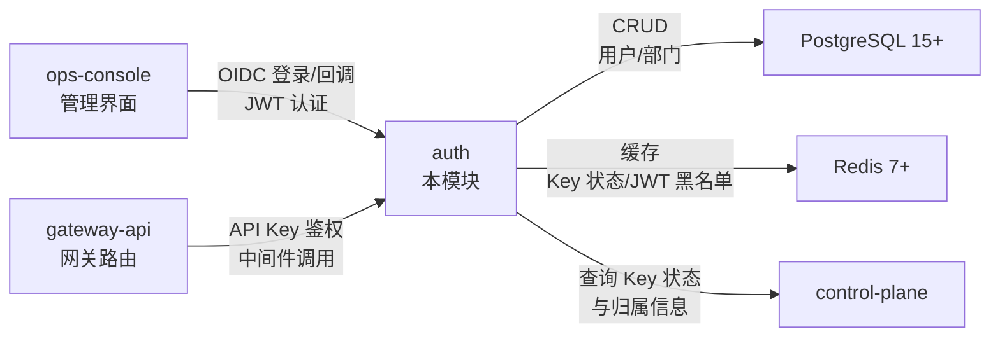
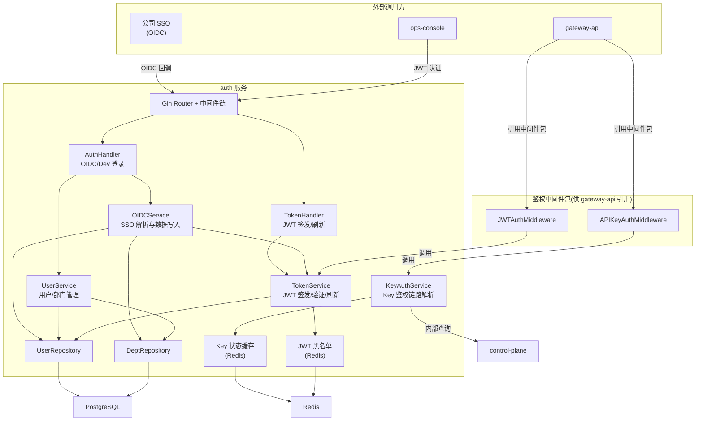
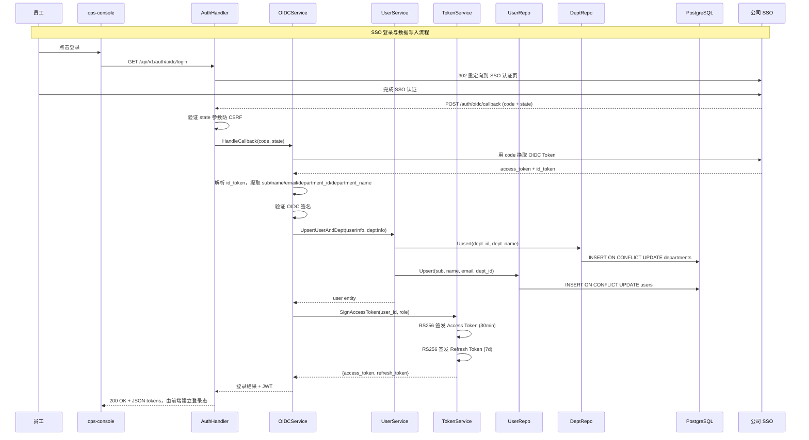
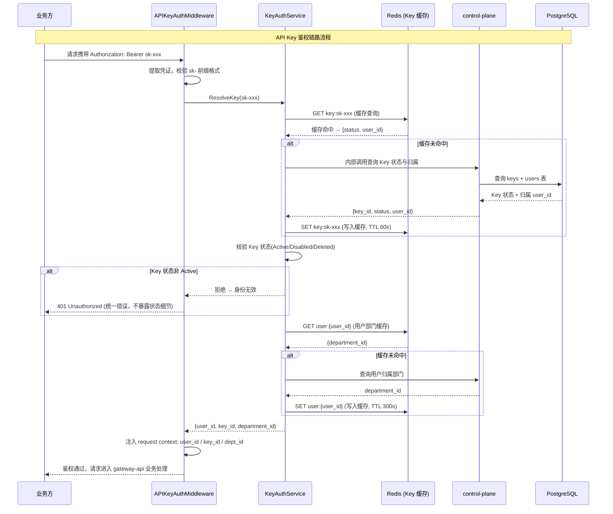
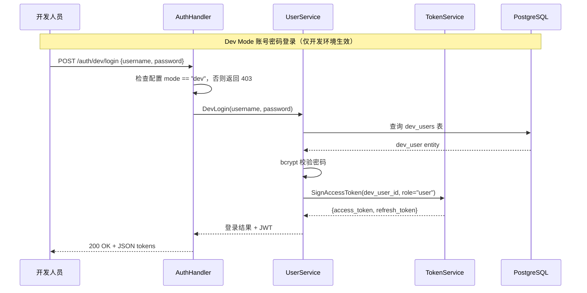

# auth Web 后端概要设计

## 0. 文档信息

| 属性 | 内容 |
| :--- | :--- |
| **所属变更** | CHG-20260523-001 |
| **模块名称** | auth |
| **模块类型** | web-backend |
| **创建时间** | 2026-05-23 |

### 修订记录

| 版本号 | 修改日期 | 修改内容摘要 | 修改人 |
| :--- | :--- | :--- | :--- |
| v1.0 | 2026-05-23 | 初稿创建 | OpenCode |

---

## 1. 技术范围界定

### 1.1 起点与终点

| 维度 | 说明 |
| :--- | :--- |
| **起点** | ops-console 发起的 OIDC 登录/回调请求；gateway-api 发起的 API Key 鉴权请求；开发模式下的账号密码登录请求 |
| **终点** | PostgreSQL 持久化用户/部门数据；Redis 缓存 Key 状态与 JWT 黑名单；HTTP JSON 响应返回 JWT 或鉴权结果 |
| **解决的问题** | 替换 V0.1 硬编码 token，实现 SSO 对接、内部 JWT 签发与 API Key 鉴权中间件，使每次模型调用可追溯到真实员工身份 |

### 1.2 技术边界



- **上游依赖**：ops-console（SSO 登录/回调、JWT 刷新）、gateway-api（API Key 鉴权中间件调用）
- **下游依赖**：PostgreSQL（用户/部门数据持久化）、Redis（Key 状态缓存、JWT 黑名单）、control-plane（Key 状态与归属信息查询）
- **不涉及**：Key CRUD 接口（由 control-plane 提供）、限流策略配置、用量统计与审计日志、模型组与权限配置、RBAC 多角色多层级权限体系

---

## 2. 架构方向探索

| 方向 | 核心思路 | 适合场景 | 风险 |
| :--- | :--- | :--- | :--- |
| 标准分层 REST 服务 | Handler → Service → Repository 三层分离，单进程部署，中间件作为独立包供 gateway-api 引用 | 认证鉴权类服务，业务逻辑清晰，写入 QPS 低，需提供可复用中间件 | 鉴权中间件需与 gateway-api 共进程部署，需设计清晰的包边界 |
| 独立鉴权网关 | auth 作为独立网关前置，所有请求先经 auth 代理转发 | 高并发鉴权、需集中流量管控 | 过度设计，引入额外网络跳转延迟，gateway-api 已是流量入口 |

**选定方向**：标准分层 REST 服务

**选择理由**：auth 本质是身份管理 + 鉴权中间件服务。REST 分层处理 OIDC/JWT/用户数据等管理逻辑，鉴权中间件作为独立 Go 包（middleware）供 gateway-api 引用而非独立网关代理，避免额外网络延迟，与 control-plane、gateway-api 保持一致的分层架构风格。

---

## 3. 架构方案

### 3.1 整体架构



### 3.2 OIDC 登录流程



### 3.3 API Key 鉴权流程



### 3.4 JWT 刷新流程

```mermaid
sequenceDiagram
    participant OC as ops-console
    participant H as TokenHandler
    participant Svc as TokenService
    participant BL as Redis (JWT 黑名单)
    participant DB as PostgreSQL

    Note over OC,DB: JWT Refresh Token 刷新流程
    OC->>H: POST /auth/refresh {refresh_token}
    H->>Svc: RefreshToken(refresh_token)
    Svc->>Svc: RS256 验证 refresh_token 签名与有效期
    Svc->>BL: GET jwt:blacklist:{refresh_token_jti}
    BL-->>Svc: 不在黑名单中 → 继续
    alt refresh_token 在黑名单中
        Svc-->>H: 401 Refresh token 已失效
        H-->>OC: 返回错误，前端触发重新 SSO 登录
    end
    Svc->>DB: 查询 user 存在性
    DB-->>Svc: 用户存在
    alt 用户已删除
        Svc->>BL: SET jwt:blacklist:{access_jti} (旧 access token 黑名单, TTL = 原过期剩余)
        Svc->>BL: SET jwt:blacklist:{refresh_jti} (refresh token 黑名单)
        Svc-->>H: 401 用户不存在
    end
    Svc->>Svc: RS256 签发新 Access Token (30min)
    Svc->->Svc: RS256 签发新 Refresh Token (7d)
    Svc->>BL: SET jwt:blacklist:{old_refresh_jti} (旧 refresh token 黑名单, TTL = 7d)
    Svc-->>H: {access_token, refresh_token}
    H-->>OC: 200 OK + JSON tokens
```

### 3.5 开发模式账号密码登录流程



### 3.6 新增组件

| 组件 | 位置 | 职责 |
| :--- | :--- | :--- |
| AuthHandler | handler/auth_handler.go | 处理 OIDC 登录发起、回调接收、开发模式登录请求 |
| TokenHandler | handler/token_handler.go | 处理 JWT 刷新请求 |
| OIDCService | service/oidc_service.go | 编排 OIDC 回调逻辑：换 token → 解析 id_token → 验证签名 → 调 UserService 写入数据 → 调 TokenService 签发 JWT |
| UserService | service/user_service.go | 用户/部门数据的 Upsert 逻辑：首次创建、非首次更新 |
| TokenService | service/token_service.go | JWT 签发、验证、刷新、黑名单管理 |
| KeyAuthService | service/key_auth_service.go | API Key 鉴权链路解析：Key 状态 → 归属用户 → 归属部门，含 Redis 缓存策略 |
| UserRepository | repository/user_repository.go | 用户表 CRUD |
| DeptRepository | repository/dept_repository.go | 部门表 Upsert |
| APIKeyAuthMiddleware | middleware/api_key_auth.go | Gin 中间件，提取 API Key → 调 KeyAuthService → 注入 context，供 gateway-api 引用 |
| JWTAuthMiddleware | middleware/jwt_auth.go | Gin 中间件，验证 JWT → 提取 user_id/role → 注入 context，供管理接口使用 |

---

## 4. 技术选型与约束

| 领域 | 选型 | 理由 |
| :--- | :--- | :--- |
| 运行时 | Go 1.22+ | 公司技术栈统一要求，高性能低资源占用，与 control-plane/gateway-api 保持一致 |
| Web 框架 | Gin | 社区成熟，路由性能优秀，中间件生态丰富，与现有模块一致 |
| 数据库 | PostgreSQL 15+ | 支持 JSONB、强事务保证、企业级稳定性，用户/部门数据持久化 |
| 缓存/消息 | Redis 7+ | Key 状态缓存（1s 感知变更）、JWT 黑名单存储、部门信息缓存 |
| ORM | GORM | Go 生态主流 ORM，支持迁移、钩子、事务管理，与现有模块一致 |
| 配置管理 | Viper | 支持多格式配置文件和环境变量覆盖，与现有模块一致 |
| 日志 | Zap | 高性能结构化日志，支持 JSON 输出，与现有模块一致 |
| JWT | Go 标准库 crypto/rsa + golang-jwt/jwt | RS256 签名，公私钥分离，公钥可分发给其他模块验证 |
| OIDC 客户端 | coreos/go-oidc | Go 生态主流 OIDC 库，支持 id_token 验证与 claims 提取 |
| 密码哈希 | golang.org/x/crypto/bcrypt | 开发模式密码存储，业界标准自适应哈希 |

### 宪章合规性

- [x] 符合 `constitution.md` 的技术栈约束（Go + Gin + PostgreSQL + Redis）
- [x] 符合组织感知原则（身份 → Key → 调用追溯闭环，消除硬编码 token 例外通道）
- [x] 符合安全性要求（RS256 签名、OIDC 签名验证、Key 状态实时感知、统一错误响应）
- [x] 符合渐进演进原则（v0.2.0 首先跑通身份闭环，RBAC/限流等后续版本补齐）

---

## 5. 中间件链

### 5.1 auth 服务自身中间件链

> 按执行顺序排列，靠前的先执行。

| 顺序 | 中间件 | 职责 | 失败时 |
| :---: | :--- | :--- | :--- |
| 1 | RequestID | 为每个请求生成唯一 UUID，注入上下文并写入 X-Request-ID 响应头 | — |
| 2 | StructuredLogger | 记录请求方法、路径、状态码、耗时，关联 request_id | — |
| 3 | Recovery | 捕获 panic，返回 500 并记录堆栈 | 500 Internal Server Error |
| 4 | CORS | 处理跨域请求，配置允许的 Origin/Method/Header | — |
| 5 | Authentication | 管理接口组：JWTAuthMiddleware；公开路由组（登录/回调）：无需认证 | 401 Unauthorized |
| 6 | RateLimit | 按客户端 IP 限制请求速率（管理接口 60 次/分钟，回调接口 120 次/分钟） | 429 Too Many Requests |

---

## 6. 认证与授权

### 6.1 双认证模式

本模块实现双认证模式，管理接口与 API 调用接口使用不同的认证机制：

| 认证模式 | 适用场景 | 认证方式 | 令牌类型 |
| :--- | :--- | :--- | :--- |
| JWT 认证 | ops-console / control-plane 管理接口 | Authorization: Bearer {jwt} | RS256 签名 JWT |
| API Key 认证 | gateway-api 模型调用接口 | Authorization: Bearer sk-xxx | sk- 前缀 API Key |

### 6.2 JWT 认证方案

| 字段 | 内容 |
| :--- | :--- |
| 方案 | RS256 签名 JWT，私钥由 auth 保管签发，公钥供其他模块验证 |
| Token 存储（客户端） | Authorization: Bearer {access_token}；Refresh Token 由前端安全持有并用于刷新 |
| Access Token 有效期 | 30 分钟 |
| Refresh Token 有效期 | 7 天，使用后即失效（Rotation 机制） |
| 刷新策略 | Refresh Token Rotation：每次刷新签发新 Access + 新 Refresh，旧 Refresh 加入黑名单 |
| 密钥管理 | RS256 私钥通过环境变量注入（PEM 格式），不进入代码库；公钥通过 `/.well-known/jwks.json` 端点分发 |

### 6.3 API Key 认证方案

| 字段 | 内容 |
| :--- | :--- |
| 方案 | sk- 前缀 API Key，通过鉴权中间件解析 Key → User → Department 链路 |
| Key 提取方式 | Authorization: Bearer sk-xxx，不符合 sk- 前缀一律视为无效 |
| 鉴权链路 | Key 状态查询 → 归属 user_id → 归属 department_id，任何一步失败均拒绝 |
| 状态感知延迟 | ≤ 1 秒（Redis 缓存 TTL 60s + control-plane pub/sub 变更通知主动刷新） |
| 拒绝策略 | 返回统一错误格式，不暴露 Key 状态、用户标识或部门标识等内部细节 |

### 6.4 授权模型

| 字段 | 内容 |
| :--- | :--- |
| 模型 | 简单角色校验：admin（平台管理员）、user（普通员工） |
| 角色来源 | SSO 登录时由 OIDC claims 或配置映射决定；开发模式默认 user |
| 权限粒度 | 路由组级别：管理接口统一要求 JWT 且角色为 admin/user；API 调用接口仅要求有效 Key |
| 鉴权时机 | 中间件统一处理（JWTAuthMiddleware / APIKeyAuthMiddleware），Handler 不再做额外权限判断 |

## 7. 数据存储与外部依赖

### 7.1 主数据库

| 字段 | 内容 |
| :--- | :--- |
| 数据库 | PostgreSQL 15+ |
| 连接池 | 最大连接数：20；最大空闲连接：5；连接最大生命周期：30 min |
| 读写分离 | 无（身份管理写入量低，单主实例即可） |
| 事务隔离级别 | Read Committed（默认） |

#### 核心数据表

| 表名 | 职责 | 关键字段 | 唯一约束 |
| :--- | :--- | :--- | :--- |
| users | 员工用户数据 | id, sub(员工标识), name, email, department_id, role, created_at, updated_at | sub |
| departments | 部门数据 | id, dept_id(部门标识), dept_name, created_at, updated_at | dept_id |
| dev_users | 开发模式测试用户（仅 dev 环境） | id, username, password_hash, role, created_at | username |

> users 与 departments 为多对一关系：一个部门下可有多个用户（department_id 外键），一个用户只归属一个部门。

### 7.2 缓存策略

| 字段 | 内容 |
| :--- | :--- |
| 缓存引擎 | Redis 7+ |
| 缓存模式 | Cache-Aside：先查缓存，未命中时查 control-plane 并回填 |
| TTL 策略 | Key 状态缓存：60s（确保 ≤ 1s 变更感知，60s 为兜底过期）；用户部门缓存：300s；JWT 黑名单：等于原 Token 剩余有效期 |
| 缓存击穿防护 | Key 查询使用 singleflight 合并并发请求，避免同一 Key 并发穿透到 control-plane |

#### 缓存 Key 设计

| Redis Key | 值 | TTL | 说明 |
| :--- | :--- | :--- | :--- |
| `key:{sk-xxx_hash}` | JSON: {key_id, status, user_id} | 60s | API Key 状态缓存，存储 Key 哈希而非明文 |
| `user:{user_id}` | JSON: {department_id, name} | 300s | 用户归属部门缓存 |
| `jwt:blacklist:{jti}` | "1" | = 原 Token 剩余有效期 | JWT 黑名单，Refresh Token Rotation 时写入 |

> Key 缓存使用 Key 原文 SHA256 哈希作为 Redis Key，避免明文 Key 存入 Redis。

### 7.3 外部服务依赖

| 服务 | 用途 | 超时配置 | 降级策略 |
| :--- | :--- | :---: | :--- |
| 公司 SSO (OIDC) | OIDC 认证与 token 交换 | 5000 ms | 回调超时返回明确提示"当前无法访问认证服务，请稍后重试"；开发模式不受影响 |
| control-plane | Key 状态与归属信息查询 | 50 ms（P95），200 ms（超时上限） | 查询超时返回"身份验证服务暂不可用"，不放行请求；缓存兜底减少直接调用 |
| Redis 7+ | Key 缓存 / JWT 黑名单 | 10 ms | Key 缓存不可用时直查 control-plane（降级增加延迟）；JWT 黑名单不可用时保守拒绝刷新请求 |

---

## 8. 安全设计

| 威胁 | 防御措施 |
| :--- | :--- |
| OIDC 回调伪造 | 验证 OIDC id_token 签名（使用 SSO 公钥）；验证 state 参数防 CSRF（state 由 auth 签发、session 存储） |
| SQL 注入 | GORM 参数化查询；禁止拼接原始 SQL |
| JWT 伪造 | RS256 签名，私钥仅 auth 模块持有，公钥分发验证；签名不匹配一律拒绝 |
| JWT 重放 | Access Token 短有效期（30min）限制重放窗口；Refresh Token Rotation + 黑名单防止重用 |
| API Key 泄露猜测 | sk- 前缀 + 随机高熵字符串（≥ 32 字节随机）；Key 明文仅在创建时返回一次，后续脱敏展示 |
| Key 状态延迟感知 | Redis 缓存 TTL 60s + control-plane pub/sub 主动失效推送，确保 ≤ 1s 感知 |
| 开发模式绕过生产 | 配置项 `auth.mode` 生产环境强制为 `production`，代码层硬校验：非 dev 模式收到账号密码请求直接 403 |
| RS256 私钥泄漏 | 私钥通过环境变量注入（PEM 格式），不进入代码库和配置文件；生产环境使用 Secret Manager / KMS |
| 鉴权信息泄漏 | 拒绝请求返回统一错误格式（不暴露 Key 状态、用户标识、部门标识）；日志中 Key 原文替换为哈希 |
| 敏感数据传输 | 强制 TLS 1.2+；内部通信使用服务网格 mTLS；Key 原文在 auth 与 control-plane 之间传输走内部安全通道 |
| 暴力破解 | IP 级别限流（登录接口 120 次/分钟）；密码校验失败返回统一错误消息，不泄漏用户是否存在 |

---

## 9. 观测与运维

### 9.1 质量目标

| 指标 | 目标值 | 测试条件 |
| :--- | :---: | :--- |
| P95 响应时间（鉴权中间件） | ≤ 100 ms | 正常负载（gateway-api QPS < 500） |
| P95 响应时间（管理接口） | ≤ 200 ms | 正常负载（管理面 QPS < 10） |
| 可用性 | ≥ 99.9% | 滚动 30 天 |
| 错误率（5xx） | ≤ 0.1% | 正常流量 |
| Key 状态变更感知延迟 | ≤ 1 s | Key 禁用/启用/删除后鉴权中间件感知 |

### 9.2 日志与追踪

| 维度 | 方案 |
| :--- | :--- |
| 日志格式 | JSON，必含：`request_id`、`level`、`timestamp`、`method`、`path`、`status`、`duration_ms`、`client_ip` |
| 日志聚合 | ELK（Elasticsearch + Logstash + Kibana） |
| 分布式追踪 | OpenTelemetry + Jaeger，通过 W3C Trace Context 传递 |
| 关键事件日志 | SSO 登录成功/失败（含员工标识、结果）；JWT 签发/刷新/黑名单（含 user_id）；Key 鉴权通过/拒绝（含 key_id 脱敏、user_id、耗时） |
| 日志脱敏规则 | Key 原文替换为 SHA256 哈希前 8 位；JWT Token 不记录完整内容；密码字段不记录 |

### 9.3 健康检查端点

| 端点 | 用途 | 检查内容 |
| :--- | :--- | :--- |
| `GET /health` | 存活探针（Liveness） | 进程在线，返回 200 |
| `GET /ready` | 就绪探针（Readiness） | PostgreSQL 连接可用、Redis 连接可用、SSO OIDC discovery endpoint 可达（非阻塞检查） |

### 9.4 监控告警

| 指标 | 告警阈值 | 通知方式 |
| :--- | :--- | :--- |
| 鉴权中间件 P99 响应时间 | > 200 ms（持续 3 分钟） | 钉钉告警群 |
| 管理接口响应时间 P99 | > 500 ms（持续 3 分钟） | 钉钉告警群 |
| 错误率 | > 1%（持续 2 分钟） | 钉钉告警群 |
| DB 连接池利用率 | > 80% | 钉钉告警群 |
| Key 缓存命中率 | < 90%（持续 5 分钟） | 钉钉告警群 |
| SSO 登录失败率 | > 30%（持续 5 分钟） | 钉钉告警群 |

---

## 10. 失败模式与降级策略

| 失败场景 | 影响 | 降级策略 | 恢复方式 |
| :--- | :--- | :--- | :--- |
| PostgreSQL 不可用 | SSO 登录数据写入失败；JWT 刷新时用户存在性检查失败 | 就绪探针标记为 NotReady，K8s 停止流量分发；SSO 登录返回"服务暂不可用"；JWT 验证降级为仅签名校验（不校验用户存在性） | 自动重连（GORM 连接池内置重试） |
| Redis 不可用 | Key 缓存失效 → 鉴权中间件直查 control-plane（延迟增加）；JWT 黑名单不可用 → Refresh 保守拒绝 | Key 鉴权降级为直查 control-plane（延迟从 <10ms 升至 <50ms，仍满足 P95 ≤ 100ms）；JWT 刷新降级为保守策略：Redis 不可用时拒绝 Refresh Token 使用，要求重新 SSO 登录 | 自动重连 |
| 公司 SSO 不可用 | 员工无法通过 SSO 登录 | 开发模式不受影响（账号密码通道独立）；生产环境返回明确提示，不降级为账号密码登录（遵守宪章"无例外通道"原则） | SSO 服务恢复后自动恢复 |
| control-plane 不可用 | Key 状态查询失败 → 鉴权中间件无法解析 Key | 鉴权中间件返回"身份验证服务暂不可用"，不放行请求；Redis 缓存仍可服务已缓存的 Key（有限降级窗口） | control-plane 恢复后自动恢复；缓存 TTL 60s 自然过期后回填 |
| RS256 私钥缺失/损坏 | 无法签发新 JWT；无法签发 Refresh Token | 启动时检查私钥存在性，缺失则启动失败；运行时签发失败返回 500 | 重新注入私钥并重启服务 |
| 开发模式误开启在生产 | 生产环境存在账号密码绕过通道 | 代码层硬校验：`auth.mode != "dev"` 时账号密码路由组不注册；配置文件默认为 `production`；部署流水线校验配置值 | 配置修正后重启 |
| 部署滚动更新 | 短暂的请求中断 | 滚动更新（maxSurge: 1, maxUnavailable: 0），配合优雅关闭（graceful shutdown 15s） | 自动完成 |

---

## 11. 待研究事项

### 11.1 已完成研究结论

| 编号 | 研究课题 | 结论 | 影响范围 |
| :--- | :--- | :--- | :--- |
| R-01 | 公司 SSO OIDC 配置 | `[待确认: 需 IT 提供 discovery URL 和回调域名]` | OIDCService 初始化和回调 URL 构建 |
| R-02 | control-plane Key 查询契约 | 采用单次合并验证端点 `POST /internal/v1/keys/verify`，请求体携带 Key 原文，返回合并鉴权上下文（key_id + status + user_id + department_id），认证方式复用预共享内部 Token | KeyAuthService 与 APIKeyAuthMiddleware 实现 |
| R-03 | RS256 密钥轮换 | 采用 JWKS 端点 + kid 匹配方案：auth 提供 `/.well-known/jwks.json` 返回多公钥集，JWT header 注入 kid，验证方按 kid 精确匹配。轮换过渡窗口 7 天 | TokenService 验证逻辑和公钥分发端点 |
| R-04 | Key 缓存主动失效 | 复用 control-plane 已有 `config:change` Redis pub/sub 通道，按 ResourceType=="key" 过滤，收到事件后全量清空 `key:*` 缓存条目 | Key 状态感知延迟稳定 ≤ 1s |
| R-05 | OIDC claims 角色映射 | 采用 YAML/Viper 配置映射：声明 `oidc.role_mapping` 配置块（claim_path + admin_match_values + default_role），SSO 变化仅改配置无需改代码 | UserService 角色赋值逻辑 |

> 详见 `research/` 子目录深研究文件：001-rs256-key-rotation.md、002-key-cache-invalidation.md、003-oidc-role-mapping.md、004-key-query-contract.md

---

## 12. 风险与对策

| 风险 | 概率 | 影响 | 对策 |
| :--- | :--- | :--- | :--- |
| SSO 联调排期延迟导致身份闭环无法按时落地 | 中 | 高 | 开发模式账号密码回退确保开发测试不受阻塞；生产上线前必须完成 SSO 联调 |
| control-plane Key 查询接口 P95 响应时间 > 50ms 导致鉴权中间件成为性能瓶颈 | 中 | 高 | Redis 缓存 + singleflight 合并穿透请求；缓存命中率 ≥ 90% 时中间件 P95 ≤ 100ms 仍有保障 |
| Redis Key 缓存与 control-plane 数据不一致（缓存命中但状态已变更） | 中 | 中 | TTL 60s 兜底 + control-plane 通过 `config:change` pub/sub 主动推送 Key 状态变更事件，auth 按 ResourceType 过滤后全量清空缓存，确保 ≤ 1s 感知 |
| RS256 私钥轮换期间已签发的 JWT 无法被新公钥验证 | 低 | 高 | JWKS 端点 + kid 匹配：新旧公钥并存于 JWKS 7 天过渡窗口，验证方按 JWT header kid 精确匹配对应公钥 |
| 开发模式账号密码通道成为生产环境长期绕过 SSO 的通道 | 低 | 高 | 代码层硬校验非 dev 模式不注册路由；配置默认 production；部署流水线校验；宪章约束"无例外通道" |
| OIDC state 参数存储方案选择不当导致 CSRF 防御失效 | 低 | 高 | state 使用 HMAC 签名 + Redis 短 TTL 存储（5min），验证时校验签名与存在性 |

---

## 13. 概要设计确认

- [x] 技术范围已界定（SSO 对接 + JWT 签发/刷新 + API Key 鉴权中间件 + Dev 模式回退）
- [x] 架构方向已探索并选定（标准分层 REST 服务 + 独立中间件包）
- [x] 架构方案已确认（双认证模式：JWT 管理接口 / API Key 调用接口）
- [x] 技术选型符合宪章（Go + Gin + PostgreSQL + Redis，与现有模块一致）
- [x] 技术研究全部完成（JWKS+kid密钥轮换、Key查询契约、缓存失效推送、OIDC角色映射，仅 R-01 需IT外部确认）
