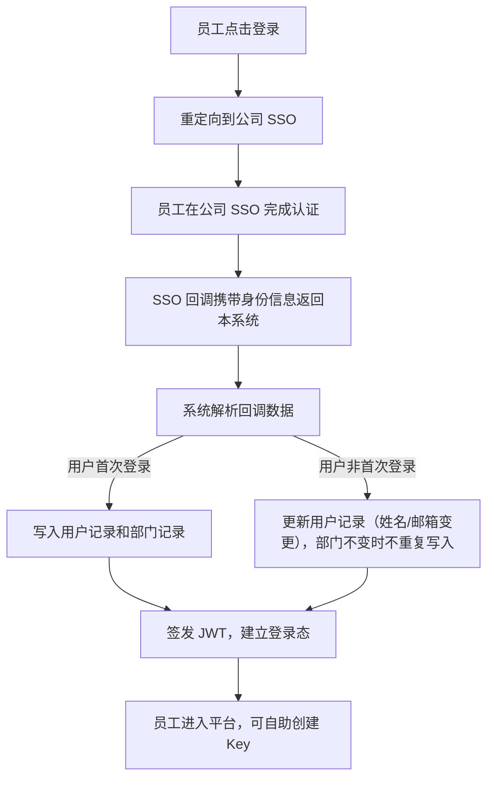
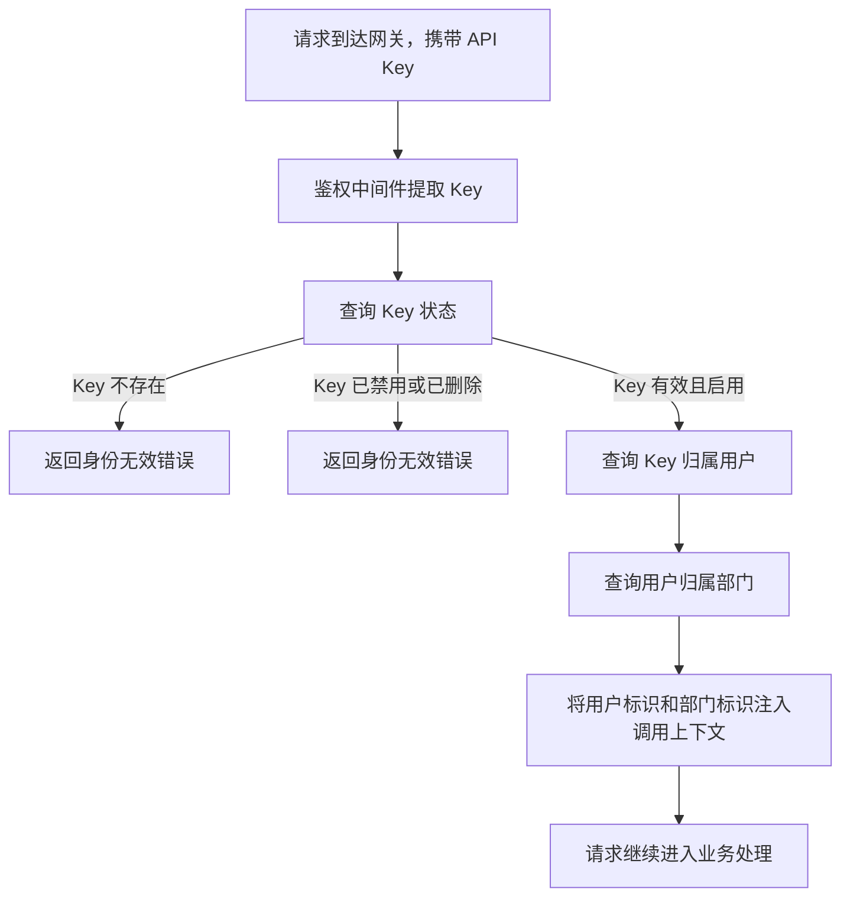
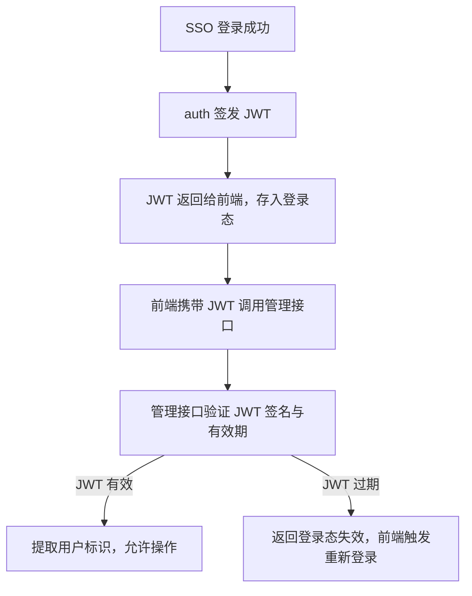
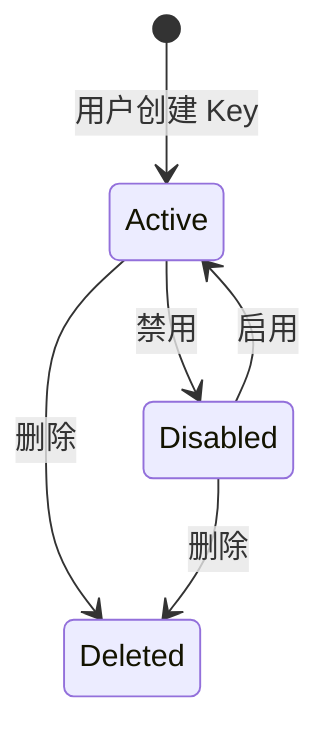

# auth Web 后端需求规范

## 0. 文档信息

| 属性 | 内容 |
| :--- | :--- |
| **所属变更** | CHG-20260523-001 |
| **模块名称** | auth |
| **模块类型** | web-backend |
| **创建时间** | 2026-05-23 |

### 修订记录

| 版本号 | 修改日期 | 修改内容摘要 | 修改人 |
| :--- | :--- | :--- | :--- |
| v1.0 | 2026-05-23 | 初稿创建 | OpenCode |

---

## 1. 业务背景与系统目标

* **业务背景**：V0.1 版本中 gateway-api 使用硬编码 token 进行鉴权，无法将模型调用与真实员工身份关联，不符合宪章"组织感知"原则。公司已有 SSO 体系（基于 OIDC 协议），员工通过公司账号登录后应能自助创建 API Key 并通过 Key 调用网关，形成"身份 → Key → 调用追溯"闭环。当前缺少 SSO 对接、JWT 签发和 API Key 鉴权中间件这三个核心能力，导致身份体系无法落地。
* **核心目标**：实现 SSO 登录对接与用户/部门数据写入、内部 JWT 签发、API Key 鉴权中间件，使每次模型调用都能追溯到真实员工身份，替换 V0.1 硬编码 token，为 v0.2.0 "身份 → Key → 调用追溯"闭环提供基础支撑。
* **关键衡量指标**：
  - 员工通过 SSO 登录后 3 秒内可看到个人身份信息与归属部门
  - 携带有效 API Key 的模型调用请求在 100 毫秒内完成身份识别
  - V0.1 硬编码 token 在 v0.2.0 上线后彻底失效，不再存在任何绕过 Key 鉴权的调用通道

---

## 2. 关键概念

> 统一术语定义，后续所有章节直接引用此处概念名，避免歧义。

- **SSO（OIDC）登录**：员工使用公司统一账号通过 OIDC 协议完成身份认证的登录方式，SSO 回调时将用户信息和部门信息写入本系统。
- **JWT（内部令牌）**：系统签发的内部令牌，用于管理后台的身份保持和接口鉴权，采用 RS256 签名算法，仅在本系统内部使用。
- **API Key**：员工自助创建的调用凭证，以"sk-"前缀标识，用于发起模型调用请求时通过鉴权中间件识别调用者身份。创建时明文仅返回一次，后续查询均脱敏展示。
- **鉴权链路**：模型调用请求到达网关后的身份识别链路，解析顺序为：API Key → 归属用户 → 归属部门，最终将调用上下文与真实员工身份绑定。

---

## 3. 超出范围

> 明确本次不做的内容，防止范围蔓延。

- 不做模型组策略与模型可见性控制（属于 control-plane 和 gateway-api 的后续迭代）
- 不做限流策略（TPM/RPM 套餐配置）
- 不做用量统计与调用日志审计（属于 observability-hub）
- 不做部门级权限配置（部门对哪些模型组有访问权）
- 不做复杂角色权限体系（RBAC 多角色多层级）
- 不做 Key 重新生成功能（需要换 Key 时删旧建新即可）
- 不做 Key 的 CRUD 接口（Key 创建/列表/禁用/启用/删除由 control-plane 提供，auth 仅提供鉴权中间件）

---

## 4. 角色与权限控制

| 角色名称 | 角色描述 | 操作权限 | 数据范围 |
| :--- | :--- | :--- | :--- |
| admin（平台管理员） | 负责平台配置与全局治理的管理人员 | SSO 登录、签发和刷新 JWT、查看全局用户与部门信息 | 全局所有用户和部门数据 |
| user（普通员工） | 通过平台自助使用模型能力的内部员工 | SSO 登录、消费 JWT、通过 API Key 发起模型调用 | 仅限本人身份、本人创建的 Key 和本人归属部门的数据 |

---

## 5. 业务流程与状态机

### 5.1 SSO 登录与数据写入流程

### 5.2 API Key 鉴权链路流程

### 5.3 JWT 签发与使用流程

### 5.4 Key 状态机（由 control-plane 管理，auth 仅消费状态）

| 当前状态 | 鉴权中间件行为 | 说明 |
| :--- | :--- | :--- |
| Active（启用） | 允许通过，解析归属用户与部门 | 正常可用状态 |
| Disabled（禁用） | 拒绝通过，返回身份无效 | Key 被用户或管理员主动禁用 |
| Deleted（已删除） | 拒绝通过，返回身份无效 | Key 已被删除，不可恢复 |

---

## 6. 详细功能需求

### 6.1 OIDC 登录与用户数据写入

**A. 功能说明**

员工通过公司 SSO（OIDC 协议）完成身份认证后，系统接收 SSO 回调数据，解析员工身份信息（姓名、邮箱、员工标识）和部门信息（部门名称、部门标识），并将用户和部门数据写入本系统。首次登录时创建用户和部门记录，非首次登录时更新用户信息但不重复创建部门记录。

**B. 用户故事**

#### US-SSO-01 — SSO 登录入口 (P0)

**作为**普通员工，**我想要**通过公司账号一键登录平台，**以便**无需单独注册即可使用平台提供的模型能力。

**功能说明**：
- 员工点击登录后，系统将员工重定向到公司 SSO 认证页面
- 员工在公司 SSO 完成认证后，SSO 回调携带身份信息返回本系统
- 系统解析回调数据，完成身份验证

**异常与边界**：
- SSO 认证页面不可达或超时 → 返回明确提示"当前无法访问认证服务，请稍后重试"
- SSO 回调数据缺少必要字段（员工标识或姓名缺失） → 返回明确提示"认证信息不完整，请联系管理员"
- 员工取消 SSO 认证或认证失败 → 返回认证失败提示，不写入任何用户数据

#### US-SSO-02 — 用户与部门数据写入 (P0)

**作为**系统，**我想要**在员工首次 SSO 登录时自动写入用户和部门数据，**以便**后续鉴权链路能将 API Key 与真实员工身份关联。

**功能说明**：
- 首次登录：根据 SSO 回调数据创建用户记录（员工标识、姓名、邮箱、归属部门标识）和部门记录（部门标识、部门名称），部门不存在时创建，已存在时不重复创建
- 非首次登录：更新用户记录中可能变更的字段（姓名、邮箱），部门标识不变时不更新部门记录
- 用户与部门为多对一关系：一个部门下可有多个用户，一个用户只归属一个部门

**异常与边界**：
- SSO 回调中部门标识为空 → 创建用户记录但归属部门标识设为空，该用户通过 Key 调用时无法关联部门层级信息
- 同一员工标识在不同次回调中返回不同部门标识 → 更新用户的归属部门标识为新部门，但不删除原部门记录（原部门可能仍有其他用户）
- SSO 回调数据格式不符合 OIDC 标准要求 → 拒绝写入，返回数据格式错误提示

#### US-SSO-03 — 开发模式回退登录 (P1)

**作为**开发人员，**我想要**在 SSO 服务不可用时通过账号密码登录平台，**以便**开发和测试不受 SSO 联调排期阻塞。

**功能说明**：
- 提供账号密码登录方式作为开发环境回退，仅在开发模式生效
- 生产环境必须强制 SSO 登录，账号密码通道必须关闭
- 开发模式下创建的测试用户数据与正式用户数据隔离标记

**异常与边界**：
- 生产环境收到账号密码登录请求 → 直接拒绝，返回"请使用公司账号登录"
- 开发模式下 SSO 服务恢复可用 → 优先使用 SSO 登录，账号密码通道仍然保留但不作为主入口

**C. 接口概要**

| 接口 | 方法 | 路径 | 说明 |
| :--- | :--- | :--- | :--- |
| SSO 登录发起 | GET | /api/v1/auth/oidc/login | 将员工重定向到公司 SSO 认证页面 |
| SSO 回调接收 | POST | /auth/oidc/callback | 接收 SSO 回调数据，完成身份验证与数据写入 |

**D. 业务规则与校验**

- SSO 回调必须包含员工标识（sub）、姓名（name）、邮箱（email）三个必要字段，缺少任一字段拒绝写入
- 部门标识（department_id）和部门名称（department_name）为可选字段，缺失时用户归属部门标识为空
- 用户记录以员工标识为唯一键，不允许同一员工标识创建多条用户记录
- 部门记录以部门标识为唯一键，不允许同一部门标识创建多条部门记录
- SSO 回调必须验证 OIDC 签名和 state 参数，防止伪造回调攻击
- 非首次登录时仅更新姓名和邮箱字段，不变更员工标识

### 6.2 JWT 签发

**A. 功能说明**

系统在 SSO 登录成功后签发内部 JWT，用于管理后台的身份保持和接口鉴权。JWT 包含用户标识、用户角色和有效期信息，采用不可伪造的签名机制确保令牌不可篡改。JWT 过期后前端触发重新 SSO 登录。

**B. 用户故事**

#### US-JWT-01 — 登录态建立 (P0)

**作为**普通员工，**我想要**在 SSO 登录成功后立即获得平台登录态，**以便**在管理后台和自服务页面中持续操作而无需反复登录。

**功能说明**：
- SSO 登录成功后，系统签发 JWT 并返回给前端
- JWT 载荷包含：用户标识（user_id）、角色（role: admin 或 user）、签发时间、过期时间
- Access Token 过期时间固定为 30 分钟，Refresh Token 过期时间固定为 7 天，采用 Rotation 机制续期

**异常与边界**：
- JWT 在有效期内被篡改（签名校验失败） → 拒绝请求，返回登录态无效，前端触发重新登录
- JWT 过期 → 拒绝请求，返回登录态已过期，前端触发重新登录
- 用户被删除后其已签发的 JWT 仍在有效期 → 后续请求验证 JWT 时需检查用户是否仍存在，若用户已删除则拒绝请求

#### US-JWT-02 — JWT 验证 (P0)

**作为**管理接口，**我想要**验证请求中携带的 JWT 签名和有效期，**以便**确认调用者身份并决定是否允许操作。

**功能说明**：
- 所有管理后台接口必须验证 JWT，未携带 JWT 或 JWT 无效的请求直接拒绝
- 验证内容包括：签名校验、过期时间校验、用户存在性校验
- 验证通过后将用户标识和角色注入请求上下文，供后续业务逻辑使用

**异常与边界**：
- 请求未携带 JWT → 返回身份缺失错误，不进入业务处理
- JWT 签名不匹配 → 返回身份无效错误，不进入业务处理
- JWT 载荷中角色字段取值不在 admin/user 范围内 → 视为无效 JWT，拒绝请求

**C. 接口概要**

| 接口 | 方法 | 路径 | 说明 |
| :--- | :--- | :--- | :--- |
| 签发 JWT（内部） | — | — | SSO 登录成功后系统内部签发，不暴露独立接口 |

**D. 业务规则与校验**

- JWT 必须使用 RS256 签名算法，私钥由 auth 模块保管，公钥供其他模块验证
- Access Token 过期时间固定为 30 分钟，Refresh Token 过期时间固定为 7 天，采用固定 Rotation 机制
- JWT 载荷必须包含 user_id 和 role 两个声明字段
- role 取值仅允许 admin 和 user，其他取值视为无效
- JWT 采用 Refresh Token Rotation 机制续期，Access Token 过期后前端优先尝试 refresh，refresh 失效后重新走 SSO 登录流程
- RS256 私钥必须加密存储，不得明文暴露在任何配置文件或日志中

### 6.3 API Key 鉴权中间件

**A. 功能说明**

API Key 鉴权中间件在模型调用请求到达网关时拦截，从请求中提取 API Key，查询 Key 状态和归属信息，完成"API Key → 归属用户 → 归属部门"的鉴权链路解析，将用户标识和部门标识注入调用上下文。该中间件替换 V0.1 硬编码 token，是 v0.2.0 身份闭环的核心环节。

**B. 用户故事**

#### US-KEY-AUTH-01 — Key 鉴权链路 (P0)

**作为**业务开发团队，**我想要**在模型调用请求中携带 API Key 即可自动完成身份识别，**以便**无需使用硬编码 token 且每次调用都能追溯到真实员工身份。

**功能说明**：
- 鉴权中间件从请求头中提取 API Key（Authorization: Bearer sk-xxx 格式）
- 查询 Key 的状态：不存在、已删除、已禁用的 Key 均拒绝通过
- 查询 Key 的归属用户标识，再查询用户的归属部门标识
- 将用户标识和部门标识注入调用上下文，供 gateway-api 后续业务逻辑使用
- v0.2.0 上线后，V0.1 硬编码 token 必须彻底失效，所有模型调用必须通过 Key 鉴权

**异常与边界**：
- 请求未携带 API Key → 返回身份缺失错误，请求不进入业务处理
- API Key 格式不符合 sk- 前缀要求 → 返回身份无效错误，不尝试查询
- API Key 对应的归属用户已被删除 → 返回身份无效错误，即使 Key 状态为 Active
- API Key 对应的归属用户部门标识为空 → 允许通过鉴权，但调用上下文中部门标识为空，后续业务逻辑按无部门归属处理

#### US-KEY-AUTH-02 — 禁用 Key 拦截 (P0)

**作为**普通员工，**我想要**在主动禁用某个 Key 后该 Key 立即无法发起任何模型调用，**以便** Key 泄露时可以快速止损。

**功能说明**：
- Key 状态为 Disabled 时，鉴权中间件立即拒绝请求
- Key 状态变更（禁用/启用/删除）后，鉴权中间件在 1 秒内感知最新状态，不存在延迟窗口
- 拒绝请求时返回统一的身份无效错误，不暴露 Key 具体状态细节

**异常与边界**：
- Key 在请求到达瞬间被禁用（状态变更与请求并发） → 鉴权中间件必须基于最新状态判断，若此时 Key 已禁用则拒绝
- Key 已删除后仍被携带在请求中 → 返回身份无效错误，不暴露"Key 已删除"这一细节

#### US-KEY-AUTH-03 — V0.1 硬编码 token 废弃 (P0)

**作为**系统，**我想要**在 v0.2.0 上线后彻底废弃 V0.1 硬编码 token，**以便**所有模型调用必须通过 API Key 鉴权，消除身份追溯的盲区。

**功能说明**：
- v0.2.0 上线后，鉴权中间件仅接受 API Key（sk- 前缀），不再接受任何其他格式的调用凭证
- V0.1 硬编码 token 在 v0.2.0 上线后视为无效凭证，携带该 token 的请求返回身份无效错误
- 不提供从硬编码 token 到 API Key 的自动迁移机制，业务方必须主动切换

**异常与边界**：
- 业务方在 v0.2.0 上线后仍使用硬编码 token → 返回身份无效错误，不提供兼容回退
- 请求同时携带 API Key 和硬编码 token → 仅以 API Key 为准进行鉴权，忽略硬编码 token

**C. 接口概要**

| 接口 | 方法 | 路径 | 说明 |
| :--- | :--- | :--- | :--- |
| Key 状态查询（内部） | — | — | 鉴权中间件内部调用，查询 Key 当前状态和归属信息，不暴露外部接口 |

**D. 业务规则与校验**

- 鉴权中间件从请求头 Authorization 字段提取凭证，格式必须为 Bearer sk-xxx
- 不符合 sk- 前缀的凭证一律视为无效，不做二次解析
- Key 鉴权必须完成完整链路：Key 状态 → 归属用户 → 归属部门，任何一步查询失败均拒绝请求
- 鉴权结果注入调用上下文，包含 user_id 和 department_id 两个字段
- Key 状态变更后鉴权中间件在 1 秒内感知最新状态
- 拒绝请求时返回统一错误格式，不暴露 Key 状态、用户信息或部门信息等内部细节

### 6.4 Key 生命周期管理的调用接口

**A. 功能说明**

Key 的创建、列表查询、禁用、启用和删除操作由 control-plane 模块提供 CRUD 接口。auth 模块仅提供鉴权中间件消费 Key 状态数据，不直接提供 Key 管理接口。auth 需要定义与 control-plane 之间的 Key 数据查询契约，确保鉴权中间件能准确、实时地获取 Key 状态和归属信息。

**B. 用户故事**

#### US-KEY-QUERY-01 — Key 数据查询契约 (P0)

**作为**鉴权中间件，**我想要**通过明确的查询契约从 control-plane 获取 Key 状态和归属用户信息，**以便**完成 API Key 鉴权链路。

**功能说明**：
- auth 与 control-plane 之间约定 Key 数据查询的输入（Key 值）和输出（Key 状态、归属 user_id、Key 创建时间）
- 查询结果必须包含 Key 当前状态（Active/Disabled/Deleted）和归属用户标识
- 查询响应时间不超过 50 毫秒，确保鉴权中间件不成为调用链路性能瓶颈

**异常与边界**：
- control-plane 服务不可达 → 鉴权中间件返回身份验证服务暂不可用错误，不放行请求
- 查询响应超时（超过 200 毫秒） → 鉴权中间件返回身份验证超时错误，不放行请求
- Key 值格式合法但在 control-plane 中不存在 → 返回身份无效错误

**C. 接口概要**

| 接口 | 方法 | 路径 | 说明 |
| :--- | :--- | :--- | :--- |
| Key 查询（内部） | — | — | auth 内部调用 control-plane 的 Key 查询能力，契约由 contracts.md 定义 |

**D. 业务规则与校验**

- auth 不提供 Key 的 CRUD 接口，所有 Key 管理操作由 control-plane 承担
- auth 仅消费 control-plane 提供的 Key 状态数据，用于鉴权中间件的身份识别
- Key 查询契约的输入为 Key 原始值（sk-xxx），输出为 Key 状态和归属 user_id
- Key 原始值在 auth 与 control-plane 之间传输时必须通过安全通道，不得明文暴露在日志中

---

## 7. 数据流与外部接口

* **SSO 输入**：员工通过公司 SSO 完成认证，SSO 回调将 OIDC 标准身份数据（sub、name、email、department_id、department_name）传递给 auth 模块，auth 据此写入用户和部门数据。
* **JWT 输出**：auth 向 ops-console 和 control-plane 等管理端模块提供 JWT 签发和验证能力，管理端模块消费 JWT 中的 user_id 和 role 进行接口鉴权。
* **Key 鉴权输出**：auth 向 gateway-api 提供鉴权中间件能力，gateway-api 在请求入口处调用鉴权中间件完成身份识别，鉴权结果（user_id、department_id）注入调用上下文供后续路由和追溯使用。
* **Key 数据查询**：auth 的鉴权中间件需要从 control-plane 查询 Key 状态和归属信息，查询契约由 contracts.md 定义，查询响应时间不超过 50 毫秒。
* **V0.1 硬编码 token 废弃**：v0.2.0 上线后，auth 鉴权中间件不再接受任何非 sk- 前缀的调用凭证，V0.1 硬编码 token 通道彻底关闭。

---

## 8. 非功能需求

* **安全性**：
  - SSO 回调必须验证 OIDC 签名和 state 参数，防止伪造回调攻击
  - RS256 私钥必须加密存储，不得在日志、配置文件或接口返回中明文暴露
  - API Key 原始值仅在创建时返回一次，鉴权中间件内部查询传输必须通过安全通道
  - 鉴权中间件拒绝请求时返回统一错误格式，不暴露 Key 状态、用户标识或部门标识等内部信息
  - v0.2.0 上线后不得存在任何绕过 API Key 鉴权的调用通道

* **并发与性能**：
  - 鉴权中间件对单个请求的身份识别时间不超过 100 毫秒
  - Key 状态变更后鉴权中间件在 1 秒内感知最新状态
  - SSO 登录流程从员工点击到进入平台不超过 5 秒
  - 鉴权中间件支持并发请求处理，不因单个请求的鉴权查询阻塞其他请求

* **可观测性**：
  - SSO 登录成功/失败事件形成结构化日志，包含员工标识、登录时间和结果
  - 鉴权中间件的通过/拒绝事件形成结构化日志，包含 Key 标识（脱敏）、用户标识、结果和耗时
  - JWT 签发事件形成结构化日志，包含用户标识和签发时间

---

## 9. 验收标准

| 编号 | 关联 | Given（前置状态） | When（触发动作） | Then（预期结果） | 优先级 |
| :--- | :--- | :--- | :--- | :--- | :--- |
| AC-01 | US-SSO-01 | Given 员工在平台登录页面 | When 点击登录按钮 | Then 员工被重定向到公司 SSO 认证页面 | P0 |
| AC-02 | US-SSO-01 | Given 员工在公司 SSO 完成认证且 SSO 回调数据包含完整身份信息（sub、name、email） | When SSO 回调返回本系统 | Then 员工身份验证成功，系统解析回调数据并准备写入用户记录 | P0 |
| AC-03 | US-SSO-02 | Given SSO 回调包含员工标识"E001"、姓名"张三"、邮箱"zhangsan@company.com"、部门标识"D01"、部门名称"研发部"，且系统中不存在员工标识"E001"的用户记录 | When 系统处理该回调 | Then 创建用户记录（员工标识 E001、姓名 张三、邮箱 zhangsan@company.com、归属部门 D01）和部门记录（部门标识 D01、部门名称 研发部） | P0 |
| AC-04 | US-SSO-02 | Given 系统中已存在员工标识"E001"的用户记录和部门标识"D01"的部门记录 | When 同一员工"E001"再次 SSO 登录且回调中姓名变更为"张三丰" | Then 更新用户记录的姓名为"张三丰"，部门记录不变 | P0 |
| AC-05 | US-SSO-01 | Given SSO 认证页面不可达 | When 员工点击登录按钮 | Then 返回明确提示"当前无法访问认证服务，请稍后重试"，不写入任何用户数据 | P0 |
| AC-06 | US-SSO-01 | Given SSO 回调数据缺少员工标识（sub 字段为空） | When 系统处理该回调 | Then 返回明确提示"认证信息不完整，请联系管理员"，拒绝写入用户数据 | P0 |
| AC-07 | US-SSO-02 | Given SSO 回调中部门标识为空 | When 系统处理该回调 | Then 创建用户记录但归属部门标识为空，不创建部门记录 | P1 |
| AC-08 | US-JWT-01 | Given 员工 SSO 登录成功且用户数据已写入 | When 系统签发 JWT | Then 返回的登录态包含 30 分钟有效的 access token 与 7 天有效的 refresh token，且 access token 载荷包含 user_id（员工标识）、role（user）、签发时间与过期时间 | P0 |
| AC-09 | US-JWT-02 | Given 管理接口收到携带有效 JWT 的请求 | When 验证 JWT 签名和过期时间 | Then JWT 校验通过，请求上下文注入 user_id 和 role | P0 |
| AC-10 | US-JWT-02 | Given 管理接口收到携带已过期 JWT 的请求 | When 验证 JWT | Then JWT 校验失败，返回登录态已过期错误，前端触发重新 SSO 登录 | P0 |
| AC-11 | US-JWT-02 | Given 管理接口收到未携带 JWT 的请求 | When 尝试进入业务处理 | Then 返回身份缺失错误，请求不进入业务处理 | P0 |
| AC-12 | US-KEY-AUTH-01 | Given 请求携带有效的 sk- 前缀 API Key 且 Key 状态为 Active，Key 归属用户标识为"E001"，用户归属部门标识为"D01" | When 鉴权中间件处理该请求 | Then 鉴权通过，调用上下文注入 user_id=E001 和 department_id=D01 | P0 |
| AC-13 | US-KEY-AUTH-01 | Given 请求未携带 Authorization 头 | When 鉴权中间件处理该请求 | Then 返回身份缺失错误，请求不进入业务处理 | P0 |
| AC-14 | US-KEY-AUTH-02 | Given 请求携带的 API Key 状态为 Disabled | When 鉴权中间件处理该请求 | Then 返回身份无效错误，请求不进入业务处理，错误信息不暴露 Key 具体状态 | P0 |
| AC-15 | US-KEY-AUTH-02 | Given Key 在请求到达鉴权中间件前 1 秒内被禁用 | When 鉴权中间件处理该请求 | Then 鉴权中间件基于最新状态判断，返回身份无效错误 | P0 |
| AC-16 | US-KEY-AUTH-01 | Given 请求携带的 API Key 归属用户已被删除 | When 鉴权中间件处理该请求 | Then 返回身份无效错误，即使 Key 状态为 Active | P1 |
| AC-17 | US-KEY-AUTH-01 | Given 请求携带的 API Key 归属用户部门标识为空 | When 鉴权中间件处理该请求 | Then 鉴权通过，调用上下文中 user_id 有值但 department_id 为空 | P1 |
| AC-18 | US-KEY-AUTH-03 | Given v0.2.0 已上线 | When 请求携带 V0.1 硬编码 token 调用模型接口 | Then 返回身份无效错误，硬编码 token 不被接受 | P0 |
| AC-19 | US-KEY-AUTH-03 | Given v0.2.0 已上线，请求同时携带有效 API Key 和 V0.1 硬编码 token | When 鉴权中间件处理该请求 | Then 仅以 API Key 为准进行鉴权，忽略硬编码 token | P1 |
| AC-20 | US-KEY-AUTH-01 | Given 请求携带不符合 sk- 前缀格式的凭证 | When 鉴权中间件处理该请求 | Then 返回身份无效错误，不尝试查询 | P0 |
| AC-21 | US-SSO-03 | Given 生产环境收到账号密码登录请求 | When 尝试账号密码登录 | Then 直接拒绝，返回"请使用公司账号登录"提示 | P1 |
| AC-22 | US-KEY-QUERY-01 | Given control-plane 服务不可达 | When 鉴权中间件查询 Key 状态 | Then 返回身份验证服务暂不可用错误，不放行请求 | P0 |
| AC-23 | US-JWT-01 | Given JWT 载荷中 role 字段取值为"superadmin"（不在 admin/user 范围内） | When 验证 JWT | Then 视为无效 JWT，拒绝请求 | P1 |

---

## 10. 假设与依赖

- 假设公司 SSO 服务支持 OIDC 标准协议并提供必要的回调参数（sub、name、email），SSO 联调排期可能不可控，开发模式保留账号密码回退
- 依赖 control-plane 提供 Key 状态和归属信息的查询能力，查询契约由 contracts.md 定义，查询响应时间不超过 50 毫秒
- 假设 RS256 签名密钥的生成、存储和轮转由运维基础设施保障，auth 仅消费密钥进行签发和验证
- 依赖 ops-console 提供 SSO 登录回调页面的前端承载能力，auth 仅提供后端登录和回调接口
- 风险：若 SSO 联调排期延迟，开发模式账号密码回退需确保在生产环境彻底关闭，避免成为长期绕过通道
- 风险：若 control-plane 的 Key 查询接口响应时间超过 50 毫秒，鉴权中间件可能成为模型调用链路性能瓶颈
