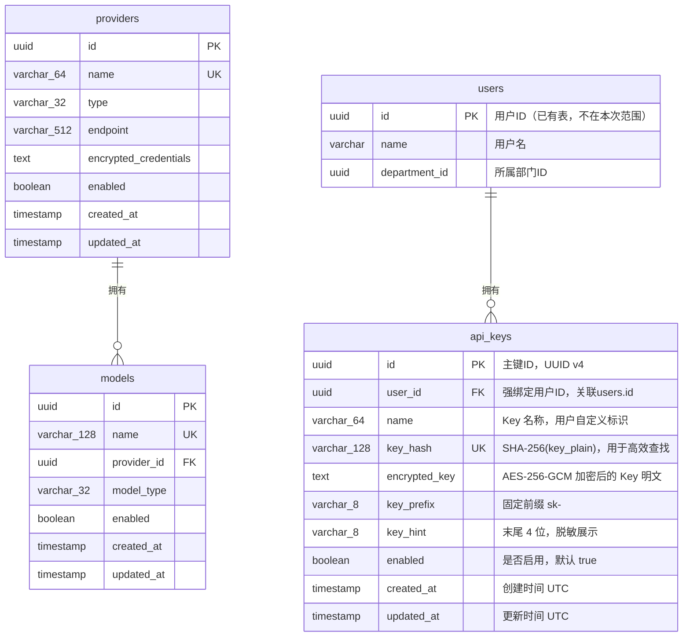

# control-plane Web 后端数据模型变更 — CHG-20260523-001

> 基线：xspec/modules/control-plane/data-model.md (v1.1)

## 变更摘要

新增 `api_keys` 表，用于存储员工自助创建的 API Key。Key 以 `sk-` 为前缀、SHA-256 hash 用于快速查找、AES-256-GCM 加密密文存储完整 Key、强绑定 `user_id` 构成鉴权链路 API Key → User → Department。新增唯一索引 `uniq_key_hash`、普通索引 `idx_user_id` 和 `idx_enabled`。不修改现有 `providers` 和 `models` 表结构。

---

## 1. 实体关系变更

> 新增 `api_keys` 表，与 `users` 表为 N:1 关系（多个 Key 归属一个用户）。`users` 表为已有认证系统表，不在本次变更范围内。

| 关系 | 类型 | 说明 |
| :--- | :---: | :--- |
| api_keys → users | N:1 | 一个用户可创建多个 Key，通过 `user_id` 关联 `users.id` |

### 更新 ER 图



---

## 2. 新增实体定义

### 2.1 api_keys（API Key 表）

**用途**：存储员工自助创建的 API Key，支持创建、脱敏查询、禁用/启用、删除操作，以及 Key 验证时的高效查找。

| 字段 | 逻辑类型 | 约束 | 说明 |
| :--- | :--- | :--- | :--- |
| `id` | `uuid` | PK，非空 | 主键，应用层生成 UUID v4 |
| `user_id` | `uuid` | FK → users.id，非空 | 强绑定用户 ID，不可更改，Key 创建时从 JWT 提取 |
| `name` | `string(64)` | 非空 | Key 名称，用户自定义标识，长度 2–64，仅允许字母数字下划线连字符 |
| `key_hash` | `string(128)` | 非空，唯一 | SHA-256(Key 明文) 的十六进制字符串，用于 Key 验证时快速定位（O(1) 唯一索引查找） |
| `encrypted_key` | `text` | 非空 | AES-256-GCM 加密后的 Key 明文，Base64 编码存储（含 nonce 前缀），加密方案复用已有 CryptoService |
| `key_prefix` | `string(8)` | 非空，默认 `'sk-'` | Key 前缀，系统固定，用于格式校验 |
| `key_hint` | `string(8)` | 非空 | Key 明文末尾 4 位字符，用于脱敏展示（如 `"XY12"` → 展示为 `"****XY12"`） |
| `enabled` | `boolean` | 非空，默认 `true` | Key 启用状态；禁用后验证接口返回 disabled，gateway-api 拒绝请求 |
| `created_at` | `timestamp` | 非空，自动填充 | UTC 时间戳，记录创建时刻 |
| `updated_at` | `timestamp` | 非空，自动更新 | UTC 时间戳，每次更新自动刷新 |

**删除策略**：物理删除。Key 删除后 `key_hash` 和 `encrypted_key` 均不可恢复，通过该 Key 的后续调用返回 not_found。

**Key 存储与验证流程说明**：

```
创建流程：
  Key 明文 (sk- + 32位随机字符) ──SHA-256──▶ key_hash (128位hex) ──▶ 唯一索引查找
  Key 明文 ──AES-256-GCM──▶ Base64编码 ──▶ encrypted_key 存储

验证流程：
  请求 Key 明文 ──SHA-256──▶ key_hash ──▶ SELECT * FROM api_keys WHERE key_hash = ?
    ├── 不存在 → 返回 "not_found"
    ├── enabled=false → 返回 "disabled"
    └── enabled=true → 查 users 表 → 返回 key_id, user{user_id, name, department_id}
```

> **设计要点**：`key_hash` 保证高效 O(1) 查找且不会暴露 Key 原文（SHA-256 单向不可逆）；`encrypted_key` 保留完整 Key 密文，未来可支持 Key 轮转、审计等需求。验证流程不需要解密 `encrypted_key`，直接比对 `key_hash`。

### 2.2 Key 响应 DTO 约定

为保持 control-plane 契约与数据模型一致，Key 管理接口响应中的列表/详情 DTO 显式区分 `masked_key` 与 `key_hint`：

| 字段 | 类型 | 说明 |
| :--- | :--- | :--- |
| `masked_key` | `string` | 用于直接展示的脱敏值，格式固定为 `"****" + key_hint` |
| `key_hint` | `string(4)` | Key 明文末尾 4 位，供前端定位与二次拼装 |

内部验证 DTO 的 `status` 枚举仅包含 `active`、`disabled`、`not_found`；物理删除后的 Key 统一表现为 `not_found`，不再单独暴露 `deleted` 状态。

---

## 3. 索引设计

### 3.1 新增索引

| 索引名 | 所在实体 | 覆盖字段 | 访问模式 | 取舍说明 |
| :--- | :--- | :--- | :--- | :--- |
| `uniq_key_hash` | api_keys | `key_hash` | Key 验证时按哈希查找 | 唯一索引，验证为最高频读操作，单条精确匹配 |
| `idx_user_id` | api_keys | `user_id` | Key 列表查询时按 `user_id` 过滤 | 每个用户查自己的 Key，按用户过滤是主要查询模式 |
| `idx_enabled` | api_keys | `enabled` | 审计/统计查询按启用状态过滤 | 选择性一般但写入负担几乎为零 |

**索引维护注意：**
- `uniq_key_hash` 唯一索引保证 SHA-256 哈希全表唯一，极低概率碰撞时由应用层重试生成新 Key 明文
- `idx_user_id` 配合 `ORDER BY created_at DESC` 使用，列表查询热点为用户维度
- 物理删除策略不影响唯一索引
- 预估数据量：单用户 < 10 个 Key，全公司用户 < 5000 人，总行数 < 50000，索引维护开销可忽略

### 3.2 已有索引（不变更）

`providers` 和 `models` 表的所有现有索引保持不变。

---

## 4. 外键约束

| 外键字段 | 引用表.字段 | ON DELETE | ON UPDATE | 说明 |
| :--- | :--- | :---: | :---: | :--- |
| `api_keys.user_id` | `users.id` | RESTRICT | CASCADE | 保护 Key 不被级联删除；用户注销时需先处理其名下 Key |

> **注意**：`users` 表由认证系统管理，不在 control-plane 管理的表中。RESTRICT 确保 users 表删除操作会被数据库层面阻断，需先清理 Key。另外需在应用层补充逻辑：用户被注销时由管理后台批量禁用其名下所有 Key。

---

## 5. 事务边界

### 5.1 新增事务场景

| 操作场景 | 涉及实体 | 事务 | 隔离级别 | 说明 |
| :--- | :--- | :---: | :--- | :--- |
| 创建 Key | api_keys | 是 | Read Committed | 数量上限检查 + INSERT 在同一事务中，防并发超限 |
| 禁用/启用 Key | api_keys | 是 | Read Committed | 归属校验(FOR UPDATE) + 状态更新在同一事务中 |
| 删除 Key | api_keys | 是 | Read Committed | 归属校验 + DELETE 在同一事务中 |
| Key 列表查询 | api_keys | 否 | — | 只读查询，无需事务 |
| Key 验证 | api_keys + users | 否 | — | 只读查询，查 api_keys + users（外部表） |

### 5.2 锁策略

| 场景 | 策略 | 实现方式 |
| :--- | :--- | :--- |
| 创建 Key 时数量上限检查 | 行级锁 | `SELECT COUNT(*) FROM api_keys WHERE user_id=? AND enabled=true FOR UPDATE`，锁定该用户行防止并发创建超限 |
| 禁用/启用/删除 Key | 归属校验锁 | `SELECT * FROM api_keys WHERE id=? FOR UPDATE`，锁定目标行后校验 user_id |

### 5.3 已有事务场景（不变更）

现有 `providers` 和 `models` 表的所有事务边界保持不变，Key 操作与渠道/模型操作无事务交叉。

---

## 6. 迁移脚本

### 6.1 迁移编号

| 字段 | 内容 |
| :--- | :--- |
| 迁移序号 | `002` |
| 迁移名称 | `add_api_keys` |

### 6.2 UP 脚本

```sql
-- 002_add_api_keys.up.sql

CREATE TABLE api_keys (
    id UUID PRIMARY KEY DEFAULT uuid_generate_v4(),
    user_id UUID NOT NULL,
    name VARCHAR(64) NOT NULL,
    key_hash VARCHAR(128) NOT NULL,
    encrypted_key TEXT NOT NULL,
    key_prefix VARCHAR(8) NOT NULL DEFAULT 'sk-',
    key_hint VARCHAR(8) NOT NULL,
    enabled BOOLEAN NOT NULL DEFAULT true,
    created_at TIMESTAMP WITH TIME ZONE NOT NULL DEFAULT NOW(),
    updated_at TIMESTAMP WITH TIME ZONE NOT NULL DEFAULT NOW(),
    CONSTRAINT uniq_key_hash UNIQUE (key_hash),
    CONSTRAINT fk_api_keys_user FOREIGN KEY (user_id) REFERENCES users(id) ON DELETE RESTRICT ON UPDATE CASCADE,
    CONSTRAINT chk_key_prefix CHECK (key_prefix = 'sk-'),
    CONSTRAINT chk_key_hint_length CHECK (char_length(key_hint) = 4)
);

CREATE INDEX idx_api_keys_user_id ON api_keys (user_id);
CREATE INDEX idx_api_keys_enabled ON api_keys (enabled);
```

### 6.3 DOWN 脚本

```sql
-- 002_add_api_keys.down.sql

DROP TABLE IF EXISTS api_keys;
```

---

## 7. 数据约束与规则

**新增约束：**

- `key_hash` 唯一约束，SHA-256 输出 256 位（64 十六进制字符），字段预留 128 字符以兼容未来哈希算法
- `key_prefix` CHECK 约束固定为 `'sk-'`，Key 前缀不可自定义
- `key_hint` CHECK 约束长度必须为 4 字符（Key 明文末尾 4 位）
- `name` 长度 2–64，同用户下不重名（应用层校验，不做数据库唯一约束以允许不同用户使用相同名称）
- `user_id` 不可为 NULL，Key 必须有归属用户
- `fk_api_keys_user` 外键 RESTRICT 策略防止用户误删

**已有约束（不变更）：**

`providers` 和 `models` 表的所有现有约束保持不变。

---

## 8. 变更历史

| 版本号 | 更新时间 | 变更类型 | 变更描述 | 变更人 |
| :--- | :--- | :---: | :--- | :--- |
| v1.2 | 2026-05-23 | 新增 | 新增 api_keys 表及索引，迁移脚本 002_add_api_keys | OpenCode |
