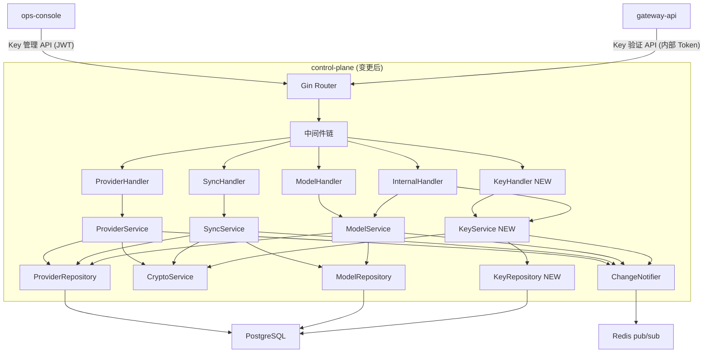
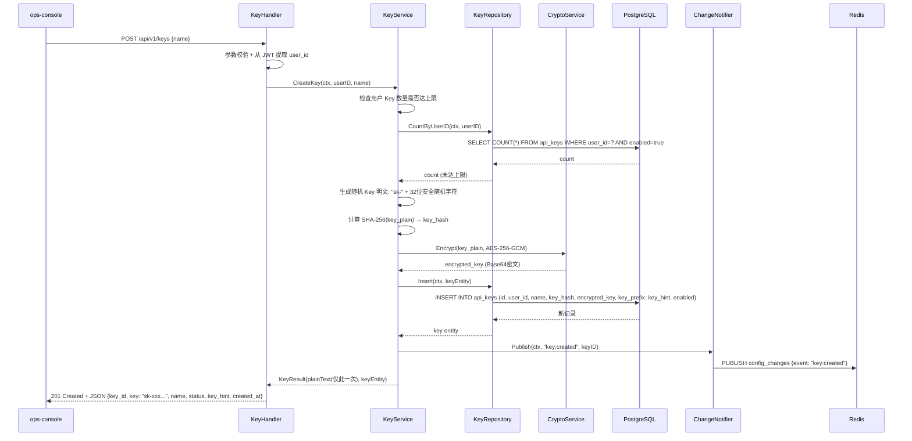
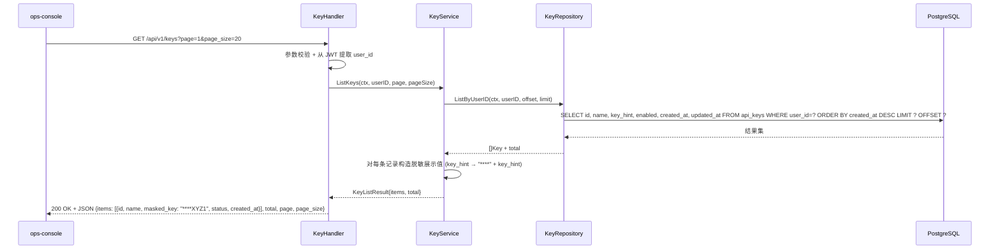
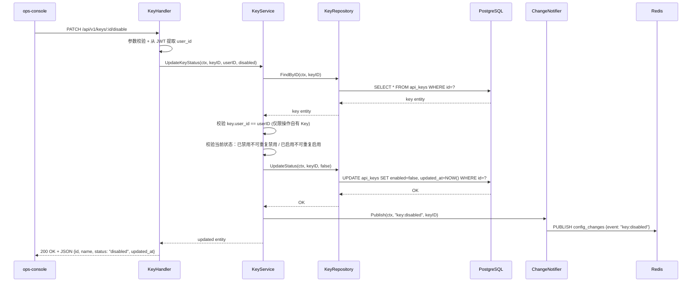
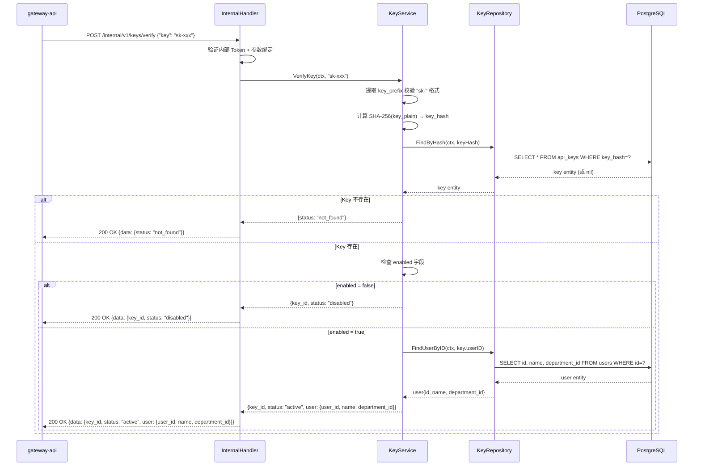
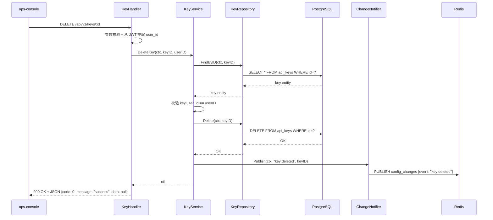

# control-plane Web 后端技术设计变更 — CHG-20260523-001

> 基线：xspec/modules/control-plane/design.md (v1.1)

## 变更摘要

新增 Key CRUD 功能：在现有 Handler → Service → Repository 分层架构中引入 KeyHandler / KeyService / KeyRepository 三层组件，提供 API Key 的自助创建（`sk-` 前缀、明文仅返回一次、AES-256-GCM 加密存储）、脱敏列表查询、禁用/启用/删除管理，Key 强绑定 `user_id` 构成鉴权链路 API Key → User → Department；新增内部 Key 验证接口供 gateway-api 实时校验。

---

## 1. 模块职责边界变更

**新增负责：**

- 员工自助创建 API Key（`sk-` 前缀，明文仅创建响应返回一次）
- 自有 Key 列表脱敏查询（仅展示末尾 4 位）
- 自有 Key 的禁用、启用、删除操作
- Key 与 `user_id` 强绑定，不可转让
- Key 内部验证接口（供 gateway-api 鉴权消费）

**不负责（仍排除）：**

- 基于 Key 的实际请求路由与转发（gateway-api 职责）
- Key 的用量统计与计费

**调用关系新增：**

| 方向 | 模块 | 方式 |
| :--- | :--- | :--- |
| 被调用 | gateway-api | POST `/internal/v1/keys/verify`（预共享 Token 认证） |

---

## 2. 架构变更

### 2.1 系统架构

> 在现有 ProviderHandler / ModelHandler / SyncHandler / InternalHandler 基础上新增 KeyHandler，在 ProviderService / ModelService / SyncService 基础上新增 KeyService，在 ProviderRepository / ModelRepository 基础上新增 KeyRepository。



### 2.2 目录新增

```
control-plane/
├── internal/
│   ├── handler/
│   │   └── key_handler.go           # NEW - Key CRUD Handler
│   ├── service/
│   │   └── key_service.go           # NEW - Key 业务逻辑 Service
│   ├── repository/
│   │   └── key_repository.go        # NEW - Key 数据访问 Repository
│   ├── model/
│   │   └── key.go                   # NEW - Key 实体定义
│   └── dto/
│       └── key.go                   # NEW - Key 请求/响应 DTO
```

---

## 3. 关键流程设计

### 3.1 Key 创建流程



### 3.2 Key 列表查询



### 3.3 Key 禁用/启用



### 3.4 Key 验证（内部接口，供 gateway-api 消费）



### 3.5 Key 删除



---

## 4. 分层职责落实

### 4.1 KeyHandler 层

> Handler 只做：请求解析、参数绑定与格式校验、从 JWT 提取 `user_id`、调用 Service、响应序列化。不含业务逻辑。

**KeyHandler 输入校验：**

| 字段 / 参数 | 校验规则 | 失败时 |
| :--- | :--- | :--- |
| `name`（创建 body） | 非空，长度 2–64，仅允许字母数字下划线连字符，不可含 `sk-` 开头 | 400 |
| `:id`（path） | 非空，合法 UUID v4 格式 | 400 |
| JWT `user_id` | 必须存在且非空 | 401 |
| `page`（query） | 正整数，默认 1 | 400 |
| `page_size`（query） | 正整数，默认 20，最大 100 | 400 |

### 4.2 KeyService 层

> 包含全部 Key 业务逻辑和事务编排，不处理 HTTP 细节。

**KeyService 公开方法：**

| 方法签名 | 职责 | 事务 | 抛出异常 |
| :--- | :--- | :---: | :--- |
| `CreateKey(ctx, userID, name string) (*KeyResult, error)` | 检查数量上限，生成 sk- Key 明文，SHA-256 哈希，AES-256-GCM 加密，持久化，返回明文（仅一次） | 是 | LimitExceededError, CryptoError |
| `ListKeys(ctx, userID string, page, pageSize int) (*KeyListResult, error)` | 按 user_id 分页查询，构造脱敏 Key 值（仅末尾 4 位） | 否 | — |
| `UpdateKeyStatus(ctx, keyID, userID string, enabled bool) (*Key, error)` | 校验归属权，检查状态幂等性（已禁用不可再禁用），更新启用/禁用状态，发布通知 | 是 | NotFoundError, ForbiddenError, ConflictError |
| `DeleteKey(ctx, keyID, userID string) error` | 校验归属权，物理删除 Key 记录，发布通知 | 是 | NotFoundError, ForbiddenError |
| `VerifyKey(ctx, keyPlain string) (*VerifyKeyResult, error)` | 校验 Key 格式（sk- 前缀），计算 SHA-256 查找，返回 key 状态及 user_id/dept_id 身份链路 | 否 | — |

**业务规则：**

- Key 明文格式：`sk-` + 32 位安全随机字符（大小写字母 + 数字），总长度 35
- 单用户启用 Key 数量上限：10 个（可配置），达上限返回 `LimitExceededError`
- Key 强绑定 `user_id`，不可更改绑定；操作他人 Key 返回 `ForbiddenError`
- Key 明文仅在 CreateKey 返回中提供一次，后续任何接口不返回明文
- `ListKeys` 中 Key 值以 `****` + 末尾 4 位展示
- `key_hash` 使用 SHA-256 计算：`hex(sha256("sk-xxxxxx"))`，用于唯一查找
- Key 验证：先查 `key_hash` 定位 → 判断 `enabled` → 查询 `users` 表获取 `user_id`、`name`、`department_id`
- 禁用操作幂等：对已禁用 Key 再次禁用返回 200 且提示"Key 已处于禁用状态"
- 删除为物理删除，不可恢复

**跨模块调用：**

| 依赖模块 | 调用时机 | 失败处理 |
| :--- | :--- | :--- |
| CryptoService | CreateKey 加密 Key 明文 | 加密失败返回 500 内部错误 |
| ChangeNotifier（Redis） | 创建/禁用/启用/删除操作完成后 | 通知失败不回滚主事务，仅记录 error 日志 |
| users 表查询 | VerifyKey 查 user_id + department_id | 用户不存在返回 status "not_found" |

### 4.3 KeyRepository 层

> 封装全部 api_keys 表操作，向 Service 屏蔽 GORM 细节。

**KeyRepository 方法：**

| 方法签名 | 操作 | 说明 |
| :--- | :--- | :--- |
| `Insert(ctx, *Key) error` | INSERT | `key_hash` 唯一约束冲突返回 ConflictError |
| `FindByID(ctx, id string) (*Key, error)` | SELECT | 不存在返回 nil, nil |
| `FindByHash(ctx, hash string) (*Key, error)` | SELECT | 按 `key_hash` 唯一索引查找，用于 VerifyKey |
| `ListByUserID(ctx, userID string, offset, limit int) ([]*Key, int64, error)` | SELECT + COUNT | 按 `user_id` 过滤 + 分页，按 `created_at DESC` 排序 |
| `CountByUserID(ctx, userID string, enabledOnly bool) (int64, error)` | COUNT | 检查用户 Key 数量上限，支持仅统计启用 Key |
| `UpdateStatus(ctx, id string, enabled bool) error` | UPDATE | 更新 `enabled` 和 `updated_at` |
| `Delete(ctx, id string) error` | DELETE | 物理删除，不存在返回 NotFoundError |
| `FindUserByID(ctx, userID string) (*User, error)` | SELECT | 查询 users 表（只读），返回 user_id, name, department_id |

### 4.4 DTO 与领域对象映射

| 类型 | 用途 | 转换时机 |
| :--- | :--- | :--- |
| `CreateKeyRequest` | 接收 POST /api/v1/keys 请求体 | KeyHandler 入口绑定 |
| `CreateKeyResponse` | 序列化 Key 创建响应（含唯一明文） | KeyHandler 出口 |
| `KeyListResponse` | 序列化 Key 列表响应（Key 值脱敏） | KeyHandler 出口 |
| `UpdateKeyStatusRequest` | 接收 PATCH /api/v1/keys/:id/disable 或 .../enable 请求体 | KeyHandler 入口绑定 |
| `VerifyKeyRequest` | 接收 POST /internal/v1/keys/verify 请求体 | InternalHandler 入口绑定 |
| `VerifyKeyResponse` | 序列化 Key 验证响应 | InternalHandler 出口 |
| `Key` (entity) | 数据库持久化对象 | Repository ↔ Service |
| `User` (entity) | users 表只读查询对象 | Repository ↔ Service |
| `KeyResult` | Service 层返回创建结果（含明文） | Service → Handler |
| `KeyListResult` | Service 层返回分页列表结果 | Service → Handler |
| `VerifyKeyResult` | Service 层返回验证结果 | Service → Handler |

> **安全规则**：`key_hash`、`encrypted_key` 字段禁止序列化到任何外部响应。`CreateKeyResponse.key` 包含明文 Key，创建后服务端不保留明文，后续任何接口不再返回。`KeyListResponse.masked_key` 仅包含 `"****"` + 末尾 4 位。

---

## 5. 异常处理链

### 5.1 新增异常类型

| 异常类 | 抛出层 | 语义 |
| :--- | :--- | :--- |
| `KeyNameConflictError` | Repository | Key 名称在同一 user_id 下重复 |
| `KeyNotFoundError` | Repository / Service | Key 不存在或已被删除 |
| `KeyForbiddenError` | Service | 尝试操作非自有 Key |
| `KeyLimitExceededError` | Service | 用户启用 Key 数量已达上限 |
| `KeyAlreadyDisabledError` | Service | Key 已处于禁用状态，重复操作 |
| `KeyAlreadyEnabledError` | Service | Key 已处于启用状态，重复操作 |

### 5.2 新增 HTTP 状态码映射

| 异常类 | HTTP 状态 | 错误码 | 备注 |
| :--- | :---: | :--- | :--- |
| `KeyLimitExceededError` | 422 | E4223 | 启用 Key 数量已达上限 |
| `KeyNotFoundError` | 404 | E4042 | Key 不存在 |
| `KeyNameConflictError` | 409 | E4093 | 同用户下 Key 名称冲突 |
| `KeyForbiddenError` | 403 | E4031 | 无权操作他人 Key |
| `KeyAlreadyDisabledError` | 409 | E4094 | Key 已处于禁用状态 |
| `KeyAlreadyEnabledError` | 409 | E4095 | Key 已处于启用状态 |

### 5.3 错误场景说明

| 场景 | 触发条件 | 错误码 | message 示例 |
| :--- | :--- | :--- | :--- |
| 创建 Key 名称冲突 | 同 user_id 下已存在同名 Key | E4093 | `"Key 名称 'my-key' 已存在"` |
| Key 不存在 | 对不存在的 Key 执行操作 | E4042 | `"Key 不存在或已被删除"` |
| 操作他人 Key | user_id 不匹配 | E4031 | `"无权操作该 Key"` |
| Key 数量达上限 | 用户启用 Key 数 > 10 | E4223 | `"已达最大 Key 数量限制（10），请先禁用或删除不再使用的 Key"` |
| 重复禁用 | 对已禁用的 Key 执行禁用 | E4094 | `"Key 已处于禁用状态"` |
| 重复启用 | 对已启用的 Key 执行启用 | E4095 | `"Key 已处于启用状态"` |

---

## 6. 设计决策记录

### 决策 7：Key 存储方案 — hash + 密文双字段

* **问题**：API Key 如何安全存储同时支持高效验证？
* **候选方案**：
  * A — 仅存储密文：需要时解密比对 / 验证需遍历全表解密每条记录，性能不可接受
  * B — 存储 hash + 密文：hash 用于快速唯一查找，密文用于未来可能需要解密场景 / 冗余存储，hash 碰撞极低概率（SHA-256）
  * C — 仅存储 hash，不保留密文：最安全，Key 完全不可恢复 / 未来无法支持 Key 轮转、审计回溯等需求
* **决策**：选择方案 B
* **理由**：SHA-256 加盐 hash 提供 O(1) 查找性能，避免全表扫描；AES-256-GCM 加密密文保留完整的 Key 信息，为未来 Key 轮转、审计、导出提供可能。两个字段各司其职：hash 用于高频验证读，密文用于低频管理写。加密方案复用已有 CryptoService（AES-256-GCM，与渠道凭证方案一致）。

### 决策 8：Key 验证接口设计 — 内部 POST + 实时查库

* **问题**：gateway-api 如何验证 API Key？
* **候选方案**：
  * A — JWT Token 发放：用户在 ops-console 创建 Key 时签发 JWT / JWT 无法撤消（需维护黑名单），过期时间管理复杂
  * B — 内部 HTTP 接口实时查库：gateway-api 每次调用验证 / 增加一次网络 RTT，但对接口延迟影响可接受（内网 < 5ms）
  * C — Redis 缓存验证结果：gateway-api 本地缓存 / 缓存更新延迟导致禁用 Key 在窗口期内仍可通过
* **决策**：选择方案 B
* **理由**：需求明确"禁用 Key 立即失效"，实时查库是最简单可靠的保证。内网 RTT 可控制在 5ms 以内，对 LLM 调用总延迟（通常 1s+）影响可忽略。key_hash 唯一索引保证查询效率。如未来 QPS 升高，可在 gateway-api 侧添加短 TTL 缓存（如 1s），配合 Redis pub/sub 失效通知。

### 决策 9：禁用/启用端点设计 — 独立语义端点

* **问题**：状态变更是用单一 `PATCH /status` 端点还是独立端点？
* **候选方案**：
  * A — 单一端点 `PATCH /api/v1/keys/:id/status`，body 传 `{enabled: bool}` / 简单统一，但与 rbac 审计日志联动不便
  * B — 独立语义端点 `PATCH /api/v1/keys/:id/disable` 和 `.../enable` / URL 自描述操作语义，审计日志自动捕获操作类型
* **决策**：选择方案 B
* **理由**：独立端点语义更清晰，URL 直接表达操作意图，便于审计日志、监控告警和限流策略区分 disable 和 enable 操作。操作审计是安全合规的基础。

---

## 7. 错误处理与容灾

| 故障场景 | 检测方式 | 处理策略 | 恢复方案 |
| :--- | :--- | :--- | :--- |
| `key_hash` 哈希碰撞 | INSERT 时唯一约束冲突 | 重新生成 Key 明文（极低概率） | 自动重试，最多 3 次 |
| Key 数量上限检查并发 | 唯一约束未覆盖计数 | 查询时使用 `FOR UPDATE` 锁用户行 | 重试或返回上限错误 |
| 禁用 Key 与并发调用的窗口期 | 数据库更新未同步至 gateway-api 缓存 | 实时查库保证一致性，窗口期 < 1s | 可接受边界 |
| 用户被注销后 Key 验证 | users 表无对应记录 | 返回 status "not_found"，gateway-api 拒绝请求 | 管理员手动清理 Key |

---

## 8. 测试矩阵

| 测试目标 | 测试类型 | 通过条件 |
| :--- | :--- | :--- |
| KeyHandler 参数校验 | 单元测试 | 非法 name 返回 400；无 JWT user_id 返回 401 |
| KeyService 创建流程 | 单元测试（Mock Repository） | 数量未超限时成功返回明文；超限返回 LimitExceededError；同名冲突返回 ConflictError |
| KeyService 归属校验 | 单元测试 | 操作他人 Key 返回 ForbiddenError；操作自己 Key 成功 |
| KeyService 状态幂等 | 单元测试 | 重复禁用返回 KeyAlreadyDisabledError；重复启用返回 KeyAlreadyEnabledError |
| KeyService VerifyKey | 单元测试（Mock Repository） | 有效 Key 返回 active + user info；禁用 Key 返回 disabled；不存在 Key 返回 not_found |
| KeyService 脱敏条目 | 单元测试 | ListKeys 返回的 masked_key 仅包含末尾 4 位，其余为 `****` |
| KeyRepository CRUD | 集成测试（测试库） | Insert/FindByID/FindByHash/ListByUserID/UpdateStatus/Delete 结果与预期一致 |
| 密钥加密存储 | 单元测试 | 加密后密文不等于明文；key_hash 一致可查找到记录 |
| 内部接口认证 | 单元测试 | 无内部 Token 返回 401；无效 Token 返回 401 |
| Redis 通知 | 集成测试 | 创建/禁用/启用/删除操作后 Redis channel 收到正确事件 |
| 用户注销场景 | 集成测试 | 无对应用户记录时 VerifyKey 返回 not_found |

---

## 9. 变更历史

| 版本号 | 修改日期 | 修改内容摘要 | 修改人 |
| :--- | :--- | :--- | :--- |
| v1.2 | 2026-05-23 | 新增 Key CRUD 功能（KeyHandler / KeyService / KeyRepository）；新增内部 Key 验证接口；新增 api_keys 表 | OpenCode |