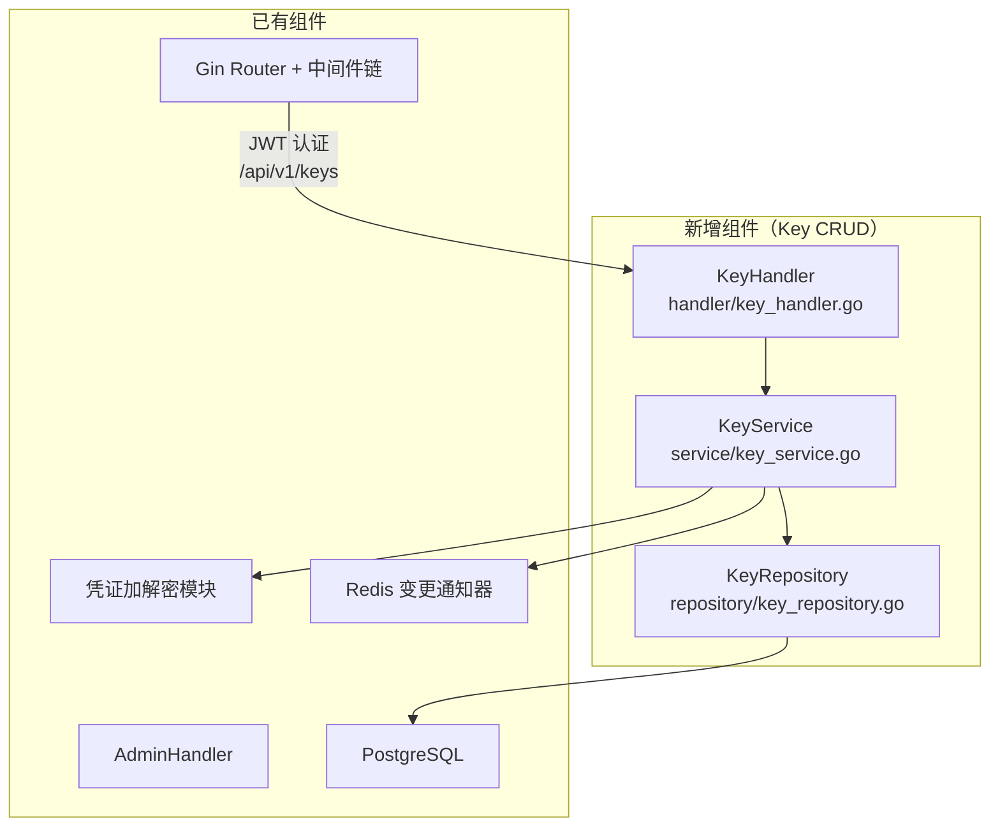
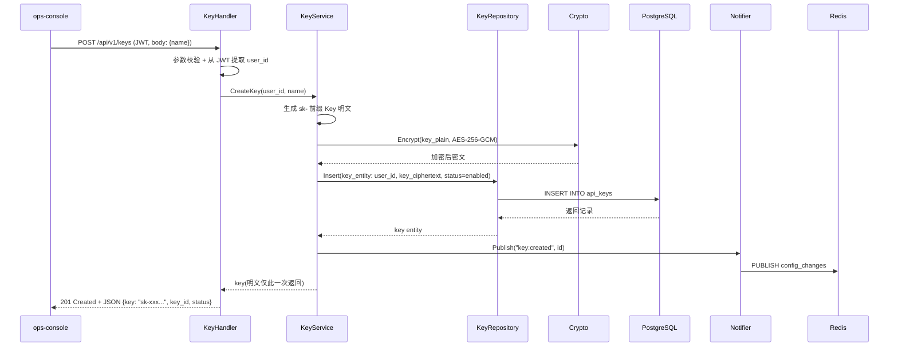
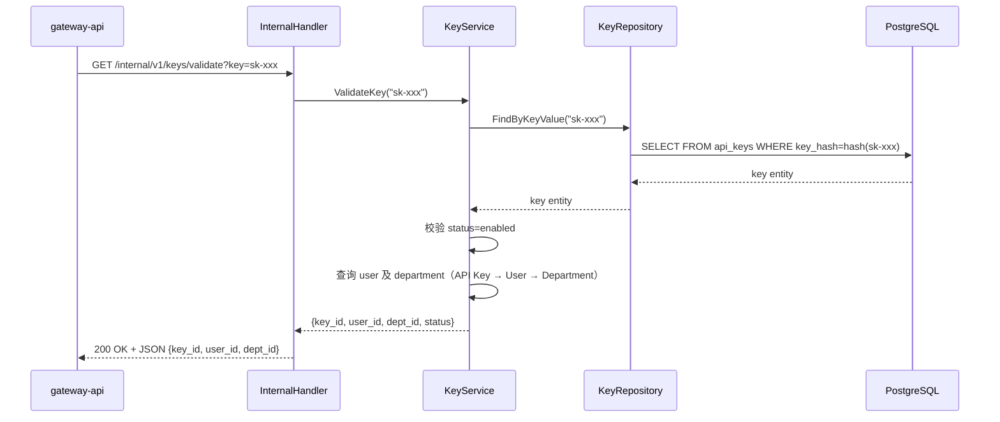

# control-plane 概要设计变更 — CHG-20260523-001

> 基线：xspec/modules/control-plane/hld.md (v1.1)

## 变更摘要

新增 Key CRUD 功能：在现有 Handler → Service → Repository 分层架构中引入 KeyHandler / KeyService / KeyRepository 三层组件，提供 API Key 的创建（sk- 前缀、明文仅返回一次、AES-256-GCM 加密存储）、脱敏列表查询、禁用/启用/删除管理，Key 强绑定 user_id 构成鉴权链路 API Key → User → Department。

## 架构变更

### Key 创建流程

### Key 验证流程（供 gateway-api 调用）

## 技术选型变更

无变更，沿用 Go + Gin + GORM + PostgreSQL + Redis 技术栈。

## 新增组件

| 组件 | 位置 | 职责 |
| :--- | :--- | :--- |
| KeyHandler | handler/key_handler.go | 处理 Key CRUD HTTP 请求（POST/GET/PATCH/DELETE），从 JWT 提取 user_id 强绑定 Key |
| KeyService | service/key_service.go | 编排 Key 逻辑：生成 sk- Key → 加密存储 → 脱敏返回 → 状态切换 → 校验身份链路（API Key → User → Department） |
| KeyRepository | repository/key_repository.go | Key 数据持久化：CRUD 操作 api_keys 表，按 user_id 过滤列表查询，按 key hash 查询验证 |

## 新增端点

| 端点 | 方法 | 认证 | 说明 |
| :--- | :--- | :--- | :--- |
| /api/v1/keys | POST | JWT (admin) | 创建 Key，明文仅此响应返回，存储加密 |
| /api/v1/keys | GET | JWT (admin) | 查询当前 user_id 名下 Key 列表（脱敏） |
| /api/v1/keys/:id/status | PATCH | JWT (admin) | 禁用/启用 Key，body: {enabled: bool} |
| /api/v1/keys/:id | DELETE | JWT (admin) | 永久删除 Key |
| /internal/v1/keys/validate | GET | 内部 Token | Key 验证接口，供 gateway-api 调用 |

## 数据存储变更

新增 `api_keys` 表：

| 字段 | 类型 | 说明 |
| :--- | :--- | :--- |
| id | UUID | 主键 |
| user_id | UUID | 强绑定用户，不可更改 |
| key_hash | VARCHAR(64) | sk- Key 的 SHA-256 哈希，用于验证查询 |
| key_ciphertext | TEXT | AES-256-GCM 加密后的 Key 密文 |
| key_suffix | VARCHAR(4) | Key 末尾 4 位，用于脱敏展示 |
| name | VARCHAR(128) | Key 名称标识 |
| status | ENUM(enabled, disabled) | Key 状态 |
| created_at | TIMESTAMP | 创建时间 |
| updated_at | TIMESTAMP | 更新时间 |

> Key 验证时通过 key_hash 定位记录（sk- Key → SHA-256 → 查询），避免密文全表扫描；key_ciphertext 仅在需要解密时使用（当前验证流程不需要解密，直接比对 hash）。

## 中间件链变更

无变更，Key CRUD 端点走已有 JWT 认证中间件（管理接口组）。

## 安全设计补充

| 威胁 | 防御措施 |
| :--- | :--- |
| Key 明文泄漏 | Key 明文仅在创建响应中返回一次，后续接口只提供脱敏值；存储使用 AES-256-GCM 加密（同渠道凭证加密方案） |
| Key 验证绕过 | Key 验证接口为内部 Token 保护，仅 gateway-api 可调用；验证结果包含完整身份链路（key_id → user_id → dept_id） |
| 禁用 Key 短窗口期 | Key 禁用后立即更新数据库状态，gateway-api 每次验证实时查库；极短窗口期（< 1s）为可接受边界 |