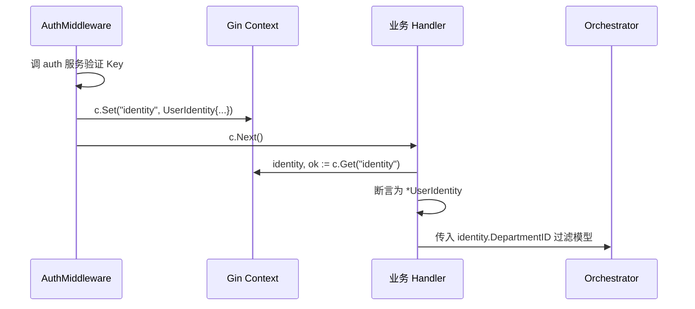
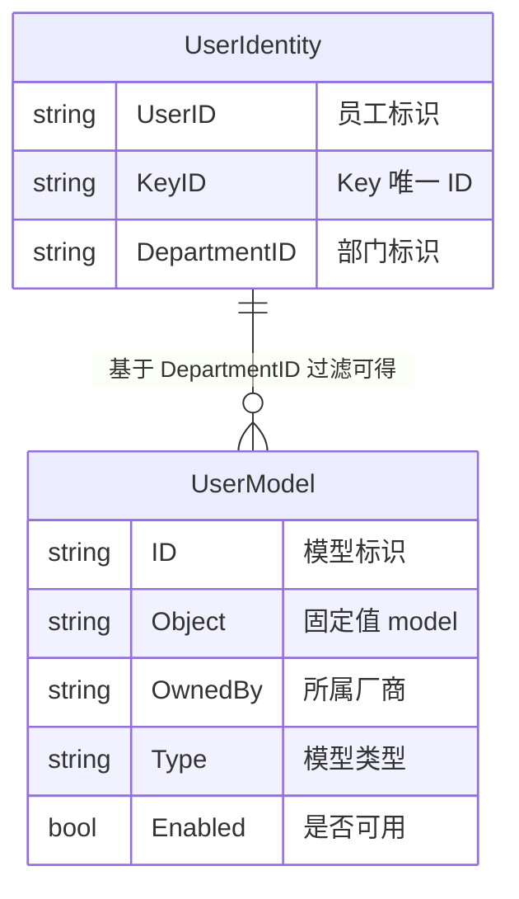

# gateway-api 数据模型变更 — CHG-20260523-001

> 基线：xspec/modules/gateway-api/data-model.md (v1.0)

## 变更摘要

新增身份上下文结构 `UserIdentity` 与用户模型响应结构 `UserModel`，均为运行时 Go struct。gateway-api 保持无状态设计，无新增数据库表、无迁移需求。

---

## 1. 新增运行时结构

### 1.1 UserIdentity — 身份上下文

由 AuthMiddleware 在鉴权通过后写入 Gin Context，供后续 Handler 和中间件读取。字段来源为 auth 服务 `/internal/v1/auth/verify-key` 验证接口返回的 Key 元数据，或 JWT 验证结果。

```go
// UserIdentity 认证身份上下文
// 由 AuthMiddleware 注入 Gin Context，Key 为 "identity"
type UserIdentity struct {
    UserID       string `json:"user_id"`       // 员工标识（来自 control-plane 用户表）
    KeyID        string `json:"key_id"`        // API Key 唯一 ID
    DepartmentID string `json:"department_id"` // 部门标识，用于模型权限过滤
}
```

**字段约束**：

| 字段 | 类型 | 来源 | 约束 |
| :--- | :--- | :--- | :--- |
| `UserID` | string | auth 服务 → control-plane 用户表 | 非空，与员工一一对应 |
| `KeyID` | string | auth 服务 → control-plane Key 表 | 非空，唯一标识一个 API Key |
| `DepartmentID` | string | auth 服务 → control-plane 用户表（用户所属部门） | 非空，用于过滤模型可用性 |

**使用生命周期**：



**读取方式**：

```go
// Handler / 中间件中读取身份上下文
identity, exists := c.Get("identity")
if !exists {
    // 鉴权中间件未注入，视为异常——不应发生
    return errors.New("identity context missing")
}
userIdentity := identity.(*UserIdentity)
```

**不变式**：

| 不变式 | 说明 |
| :--- | :--- |
| `UserIdentity` 非 nil | 经过 AuthMiddleware 的请求必定携带完整 identity，后续 Handler 不判空 |
| `DepartmentID` 非空 | 所有用户必有部门归属，无部门用户无法获取 Key |
| Context Key 为 `"identity"` | 唯一约定 Key，全模块统一读取 |
| 只读约束 | Handler 和后续中间件只能读取 `UserIdentity`，不得修改其字段 |

---

### 1.2 UserModel — 用户可用模型

`GET /v1/me/models` 接口返回的模型列表项，保持 OpenAI `model` 列表兼容字段，并补充前端自服务页面所需的 `type` / `enabled` 字段。

```go
// UserModel 用户可用模型条目（GET /v1/me/models 响应）
type UserModel struct {
    ID      string `json:"id"`       // 模型标识，如 "qwen-plus"、"deepseek-chat"
    Object  string `json:"object"`   // 固定值 "model"
    OwnedBy string `json:"owned_by"` // 所属厂商，如 "bailian"、"deepseek"、"bedrock"
    Type    string `json:"type"`     // 模型类型：chat / embedding / rerank
    Enabled bool   `json:"enabled"`  // 当前用户是否有权限调用（始终为 true，仅返回可用模型）
}
```

**字段约束**：

| 字段 | 类型 | 约束 |
| :--- | :--- | :--- |
| `ID` | string | 模型唯一标识，与 `POST /v1/chat/completions` 中 `model` 字段取值一致 |
| `Object` | string | 固定为 `model`，与 `/v1/models` 保持一致 |
| `OwnedBy` | string | 厂商标识，枚举值由 Provider Registry 管理 |
| `Type` | string | 枚举值：`chat`、`embedding`、`rerank` |
| `Enabled` | bool | 过滤后返回的模型均为 `true`（不可用模型不出现在列表中） |

**过滤逻辑**：

1. 从 Context 读取 `UserIdentity.DepartmentID`
2. 调 Orchestrator 查询该部门关联的模型列表
3. 仅返回 `Enabled` 为 `true` 的模型（当前实现中过滤后列表全为 `true`）
4. 部门无任何模型权限时返回空数组 `[]`

---

## 2. 实体关系变更

### 2.1 新增运行时关系



### 2.2 数据消费关系扩充

在原有 Redis 只读消费基础上，新增 auth 服务的身份解析数据来源：

| 数据源 | 消费方式 | 用途 | 变更类型 |
| :--- | :--- | :--- | :--- |
| auth 服务 `/internal/v1/auth/verify-key` | 每次请求 HTTP POST 调用 | 验证 API Key 并解析 user_id / key_id / dept_id | 新增 |

---

## 3. 数据约束与规则扩充

### 3.1 新增身份上下文约束

| 约束 | 值 |
| :--- | :--- |
| `UserIdentity` 注入时序 | 必须在任何业务 Handler 执行前由 AuthMiddleware 注入 |
| Context Key | 固定字符串 `"identity"` |
| `UserIdentity` 生命周期 | 随请求生命周期，请求结束后 GC 回收 |

### 3.2 新增 API Key 验证路径约束

| 约束 | 值 |
| :--- | :--- |
| 验证接口 | `POST /internal/v1/auth/verify-key` |
| 超时 | 500ms |
| 重试 | 不重试（失败直接 503） |
| 缓存 | 不缓存（由 auth 服务侧缓存，gateway-api 每次请求均调验证接口） |

### 3.3 模型过滤不变式

| 不变式 | 说明 |
| :--- | :--- |
| `/v1/models` 过滤一致性 | 返回的模型列表与 `/v1/me/models` 基于同一身份过滤逻辑，结果等价 |
| 空列表即空列表 | 用户无可用模型时返回 `{"object":"list","data":[]}`，HTTP 200，不返回错误 |

### 3.4 `/v1/me/models` 响应封装

```go
type MeModelsResponse struct {
    Object string      `json:"object"` // 固定值 "list"
    Data   []UserModel `json:"data"`
}
```

映射说明：ops-console 仅消费 `data[].id`、`data[].type`、`data[].enabled` 三个字段；`object`、`data[].object`、`data[].owned_by` 保留用于与 OpenAI 风格列表响应对齐。

---

## 4. 数据库变更

**无变更。** gateway-api 保持无状态设计，无新增数据库表，无迁移需求。

现有外部数据消费（Redis、config/models.yaml）不变，新增的 auth 服务为 HTTP 接口调用，不产生持久化数据依赖。
