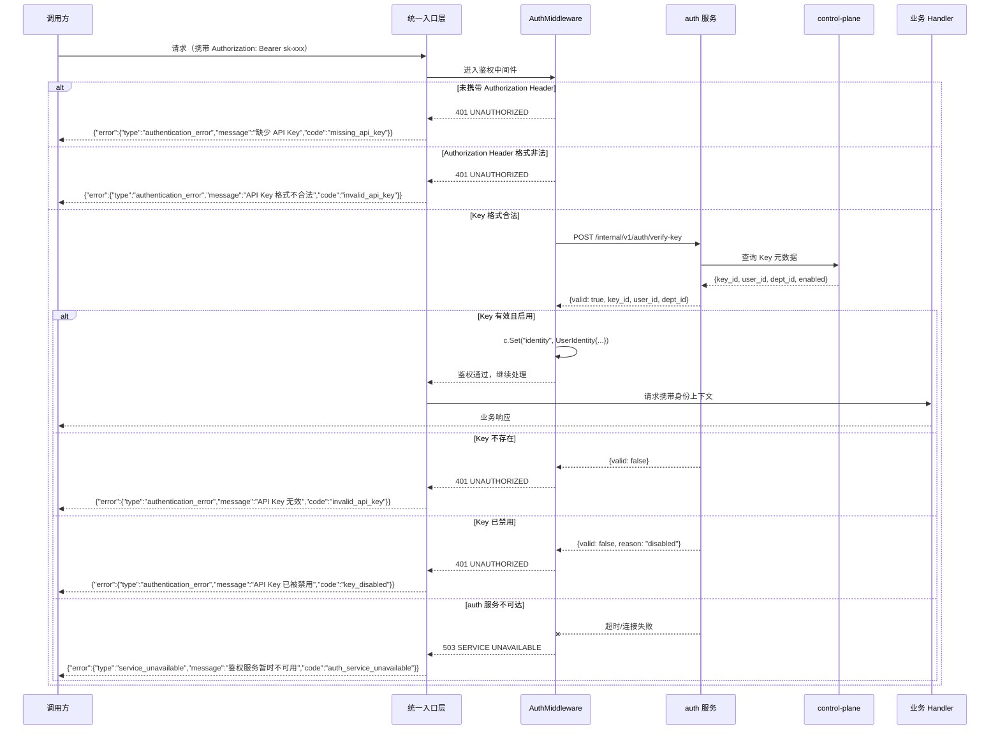
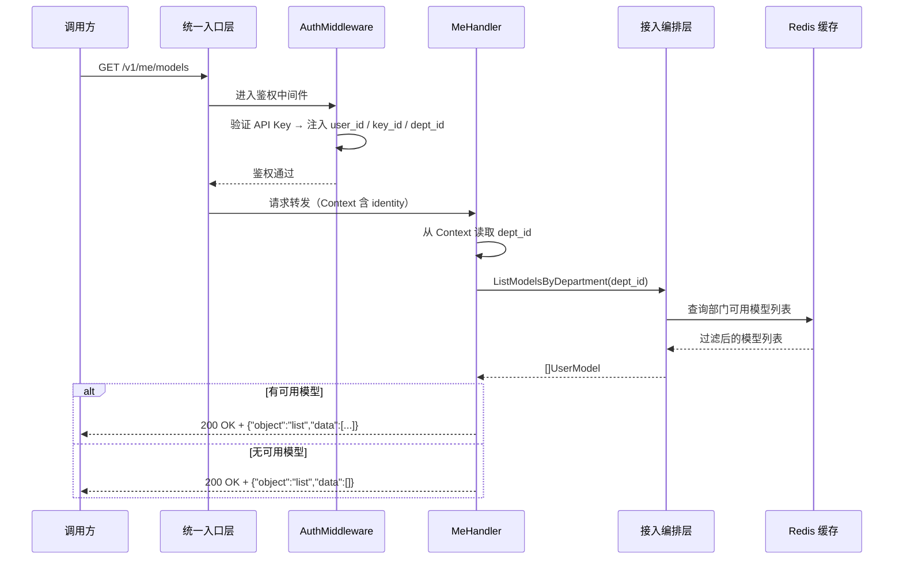
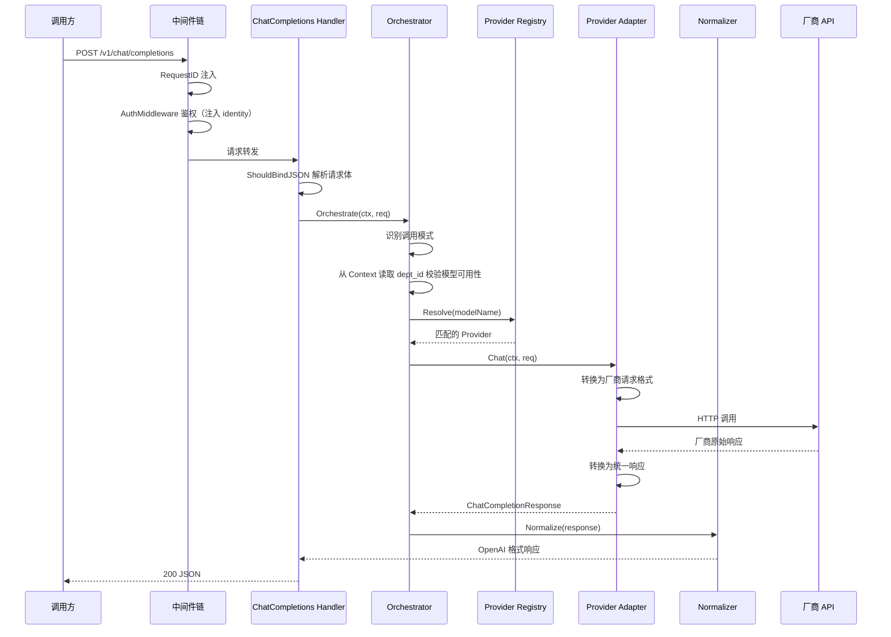

# gateway-api 详细设计变更 — CHG-20260523-001

> 基线：xspec/modules/gateway-api/design.md (v1.0)

## 变更摘要

新增 AuthMiddleware 鉴权中间件与 MeHandler 端点，将请求认证从简单 Key 校验升级为完整的 API Key → User → Department 身份解析链路，并新增基于当前身份的模型查询能力。

---

## 1. 新增组件

### 1.1 AuthMiddleware — API Key 鉴权中间件

| 属性 | 内容 |
| :--- | :--- |
| 位置 | `middleware/auth.go` |
| 职责 | 从请求提取凭证，按 Token 前缀分流到 auth 服务 verify 接口或 JWT 校验逻辑，将 `user_id` / `key_id` / `dept_id` 注入 Gin Context |
| 失败行为 | 直接返回 401 / 503，请求不进入后续业务处理环节 |

**工作流程**：

1. 从 `Authorization: Bearer sk-xxx` Header 提取 Key
2. 校验 Key 格式（长度 32~128 字符，允许字母/数字/连字符），格式不合法直接返回 401
3. 若为 API Key，则调用 auth 服务 `/internal/v1/auth/verify-key` 验证 Key 有效性；若为 JWT，则执行本地 JWT 验签与过期校验
4. 验证成功 → 将 `{user_id, key_id, dept_id}` 写入 Gin Context，放行请求
5. 验证失败（Key 不存在/已禁用）→ 返回 401，不泄露 Key 详情
6. auth 服务不可达（超时 500ms）→ 返回 503，不降级为无鉴权放行

**设计决策**：

- 选项 A：gateway-api 直接调用 control-plane 校验 API Key。未采用，因为会把网关与 Key 存储实现强耦合，也会让 JWT 与 API Key 认证逻辑分散在不同依赖上。
- 选项 B：gateway-api 仅依赖 auth 服务统一认证，API Key 走 `/internal/v1/auth/verify-key`，JWT 走 auth 公钥验签。最终采用，因为 auth 已被设计为统一身份边界，能够封装 control-plane 查询与缓存策略，同时保留 `/v1/me/models` 对员工 JWT 自服务访问的支持。

### 1.2 MeHandler — 身份关联模型查询

| 属性 | 内容 |
| :--- | :--- |
| 位置 | `handler/me_handler.go` |
| 路由 | `GET /v1/me/models` |
| 职责 | 从 Gin Context 读取身份上下文（由 AuthMiddleware 注入），基于 `dept_id` 过滤可用模型列表，返回当前认证用户有权访问的模型 |
| 空结果策略 | 返回空列表 `{"object":"list","data":[]}` 而非错误，表达"当前身份暂无可用模型" |

---

## 2. 中间件链变更

原中间件链（RequestID → Key校验 → 结构化日志 → Recovery）中，"Key校验"中间件从简单 Token 校验升级为完整的 AuthMiddleware。中间件链更新如下：

| 顺序 | 中间件 | 职责 | 失败时 | 变更类型 |
| :---: | :--- | :--- | :--- | :--- |
| 1 | RequestID | 生成唯一 ID，写入响应头 | — | 原有 |
| 2 | 结构化日志 | 记录请求路径、耗时、状态码 | — | 原有 |
| 3 | Recovery | 捕获 panic，转为 500 | 500 | 原有 |
| 4 | CORS | 处理跨域预检请求 | — | 原有 |
| **5** | **AuthMiddleware** | **提取 API Key → 调 auth 服务验证 → 注入身份上下文** | **401 / 503** | **新增** |
| 6 | RateLimit | 基于身份上下文的频率控制 | 429 | 原有 |

> AuthMiddleware 插入在 CORS 之后、RateLimit 之前。RateLimit 可依赖 AuthMiddleware 注入的身份上下文（`key_id`）实现按 Key 限流。

---

## 3. 关键流程设计

### 3.1 API Key 鉴权流程

### 3.2 GET /v1/me/models 流程

### 3.3 完整请求链路（含鉴权）

---

## 4. 异常处理扩充

在原有异常处理链基础上，新增鉴权相关异常场景：

| 层次 | 异常来源 | 错误码 | HTTP 码 | 处理方式 |
| :--- | :--- | :--- | :--- | :--- |
| AuthMiddleware | 未携带 API Key | `missing_api_key` | 401 | 直接返回 401，不进入业务逻辑 |
| AuthMiddleware | API Key 格式不合法 | `invalid_api_key` | 401 | 直接返回 401 |
| AuthMiddleware | API Key 验证失败（不存在） | `invalid_api_key` | 401 | 返回 401，不泄露 Key 是否存在 |
| AuthMiddleware | API Key 已被禁用 | `key_disabled` | 401 | 返回 401，提示 Key 不可用 |
| AuthMiddleware | auth 服务超时（500ms） | `auth_service_unavailable` | 503 | 返回 503，不降级放行 |
| AuthMiddleware | auth 服务连接失败 | `auth_service_unavailable` | 503 | 返回 503，不降级放行 |

---

## 5. 外部服务依赖变更

| 服务 | 端点 | 用途 | 超时 | 降级策略 | 变更类型 |
| :--- | :--- | :--- | :---: | :--- | :--- |
| auth 服务 | `POST /internal/v1/auth/verify-key` | API Key 验证与身份解析 | 500ms | **不可达时返回 503，不降级放行** | 新增 |

---

## 6. 认证与授权变更

| 维度 | 变更前 | 变更后 |
| :--- | :--- | :--- |
| 认证方案 | API Key（Bearer Token）简单校验（Redis SISMEMBER） | API Key → auth 服务 `/internal/v1/auth/verify-key` → User → Department；`/v1/me/models` 额外支持员工 JWT |
| 身份上下文 | 无 | Gin Context 注入 `UserIdentity{UserID, KeyID, DepartmentID}` |
| 模型可用性 | 全量返回 | GET /v1/models 和 GET /v1/me/models 均基于 dept_id 过滤 |
| 授权模型 | Key 有效即可调用 | Key 有效 + 身份上下文注入，模型可用性基于 dept_id 过滤 |

---

## 7. 安全设计补充

| 威胁 | 防御措施 |
| :--- | :--- |
| auth 服务不可达导致全量拒绝 | AuthMiddleware 调 auth 服务超时 500ms 直接返回 503，**不降级为无鉴权放行** |
| 身份上下文注入篡改 | identity 由 AuthMiddleware 写入 Gin Context，后续 Handler 只读取不修改 |
| Key 详情泄露 | 鉴权失败统一返回相同错误格式，不区分"不存在"与"已禁用"（后者仅提示 Key 不可用） |
| 未认证绕过鉴权 | AuthMiddleware 覆盖所有 `/v1/*` 路径，无豁免（除 `/health`、`/ready` 在中间件链外） |
