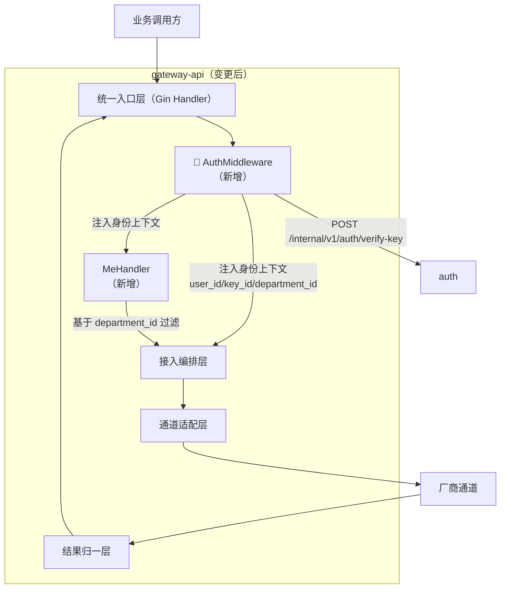
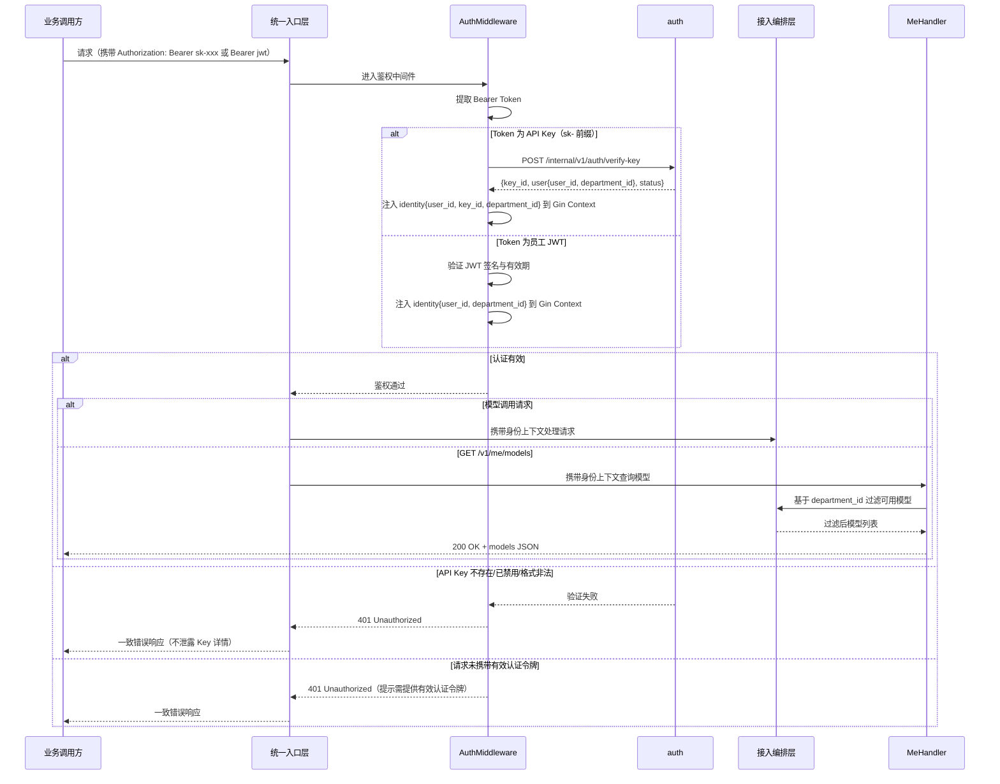

# gateway-api 概要设计变更 — CHG-20260523-001

> 基线：xspec/modules/gateway-api/hld.md (v1.0)

## 变更摘要

新增鉴权中间件：请求处理前通过调用 auth 内部接口验证 API Key 并解析为 user_id / key_id / department_id 身份上下文注入 Gin Context；新增 GET /v1/me/models 端点基于当前登录员工 JWT 身份返回可用模型列表。

## 架构变更

### 认证请求流程

## 技术选型变更

无变更，沿用 Go + Gin + Redis 技术栈。

## 新增组件

| 组件 | 位置 | 职责 |
| :--- | :--- | :--- |
| AuthMiddleware | middleware/auth.go | 在请求处理前提取 Bearer Token，按前缀分流到 API Key 验证或 JWT 验签，注入 user_id / key_id / department_id 到 Gin Context；验证失败直接返回 401 |
| MeHandler | handler/me_handler.go | 处理 GET /v1/me/models，从 Context 读取身份上下文，基于 department_id 过滤可用模型列表 |

## 新增端点

| 端点 | 方法 | 认证 | 说明 |
| :--- | :--- | :--- | :--- |
| /v1/me/models | GET | JWT Bearer Token | 返回当前登录员工可用模型列表，基于 user_id → department_id 过滤 |

## 中间件链变更

| 顺序 | 中间件 | 职责 | 失败时 | 变更类型 |
| :---: | :--- | :--- | :--- | :--- |
| 1 | 请求 ID 注入 | 生成唯一 ID，写入响应头 | — | 原有 |
| 2 | **AuthMiddleware** | **提取 Bearer Token → 分流到 auth 验证或 JWT 验签 → 注入身份上下文** | **401 Unauthorized** | **新增（替换原 Key 校验）** |
| 3 | 结构化日志 | 记录请求路径、耗时、状态码 | — | 原有 |
| 4 | 错误处理 | 捕获异常，统一错误格式 | 5xx | 原有 |

> 原中间件链中的"Key 校验"中间件（第 2 位）升级为 AuthMiddleware，从简单 Token 校验扩展为完整身份解析链路（API Key → User → Department），职责和调用范围增大。

## 外部服务依赖变更

| 服务 | 用途 | 超时配置 | 降级策略 | 变更类型 |
| :--- | :--- | :---: | :--- | :--- |
| auth /internal/v1/auth/verify-key | Key 验证与身份解析 | 500 ms | 验证不可达时所有请求返回 503 | 新增 |

## 认证与授权变更

原认证方案仅做 Key 有效性校验，本次升级为完整鉴权链路：

| 字段 | 变更前 | 变更后 |
| :--- | :--- | :--- |
| 方案 | API Key（Bearer Token）简单校验 | API Key → auth → User → Department 身份解析链路；`/v1/me/models` 额外支持员工 JWT |
| 授权模型 | Key 有效即可调用 | Key 有效或员工 JWT 有效 + 身份上下文注入（user_id / key_id / department_id），模型可用性基于 department_id 过滤 |

## 安全设计补充

| 威慑 | 防御措施 |
| :--- | :--- |
| Key 验证接口不可达导致全量拒绝 | AuthMiddleware 调 auth 超时（500ms）返回 503，不降级为无鉴权放行 |
| 身份上下文注入篡改 | identity 信息由 AuthMiddleware 写入 Gin Context，后续 Handler 只读取不修改 |
