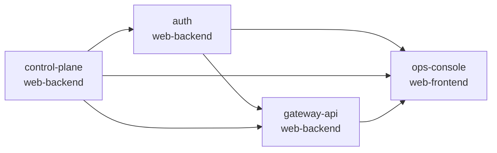

# SSO 登录 + Key 自助管理 跨模块协调视图

> 本文件是跨模块集成的导航与协调中心，不是任务汇总表。
> 各模块内部任务在对应 `task.md` 中管理，通过下方索引导航。

## 基本信息

| 属性 | 内容 |
| :--- | :--- |
| **变更编号** | CHG-20260523-001 |
| **变更名称** | SSO 登录 + Key 自助管理 |
| **生成时间** | 2026-05-23 |

---

## 1. 模块任务索引

| 模块 | 类型 | 任务文件 | 任务数 |
| :--- | :--- | :--- | :--- |
| auth | web-backend | [`task.md`](./auth/task.md) | 22 |
| control-plane | web-backend | [`task.md`](./control-plane/task.md) | 17 |
| gateway-api | web-backend | [`task.md`](./gateway-api/task.md) | 15 |
| ops-console | web-frontend | [`task.md`](./ops-console/task.md) | 15 |

---

## 2. 跨模块执行顺序

推荐启动顺序：
1. `auth`：先完成 SSO / JWT / verify-key 边界
2. `control-plane`：完成 Key CRUD 与 `/internal/v1/keys/verify`
3. `gateway-api`：接入 auth 鉴权中间件与 `/v1/me/models`
4. `ops-console`：接入登录回调、Key 页面、模型页

---

## 3. 跨模块集成任务

### 阶段：认证链路联调

- [ ] I001 P0 auth ↔ control-plane 内部 verify 契约联调（涉及模块：auth ↔ control-plane）
  depends: T028@auth, T028@control-plane

- [ ] I002 P0 auth ↔ gateway-api 鉴权链路联调（涉及模块：auth ↔ gateway-api）
  depends: T029@auth, T020@gateway-api

### 阶段：员工自助闭环联调

- [ ] I003 P0 auth ↔ ops-console SSO 登录回调与 JWT 刷新联调（涉及模块：auth ↔ ops-console）
  depends: T023@auth, T021@ops-console

- [ ] I004 P0 control-plane ↔ ops-console Key CRUD 自助管理联调（涉及模块：control-plane ↔ ops-console）
  depends: T025@control-plane, T025@ops-console

- [ ] I005 P0 gateway-api ↔ ops-console `/v1/me/models` 自服务联调（涉及模块：gateway-api ↔ ops-console）
  depends: T025@gateway-api, T026@ops-console

### 阶段：端到端验证

- [ ] I006 P0 端到端闭环验证：员工 SSO 登录 → 创建 Key → 用 Key 调模型 → 查看 `/v1/me/models`（涉及模块：auth ↔ control-plane ↔ gateway-api ↔ ops-console）
  depends: I001, I002, I003, I004, I005

- [ ] I007 P1 Key 禁用立即失效联调验证（涉及模块：control-plane ↔ auth ↔ gateway-api）
  depends: T030@control-plane, T031@auth, T023@gateway-api

- [ ] I008 P1 开发模式账号密码回退联调验证（涉及模块：auth ↔ ops-console）
  depends: T027@auth, T021@ops-console

---

## 4. 质量门禁

- [ ] 所有模块 task.md 任务已完成
- [ ] `POST /internal/v1/keys/verify` 联调通过
- [ ] `/auth/oidc/callback` / `/auth/refresh` / `/auth/logout` 联调通过
- [ ] `/api/v1/keys*` 全部联调通过
- [ ] `/v1/me/models` 联调通过
- [ ] 验收标准全部覆盖（auth AC-01~23、control-plane AC-KEY、gateway-api AC-AUTH/AC-MODELS、ops-console AC-LOGIN/KEY/MODEL/HOME）
- [ ] E2E / 集成测试通过
- [ ] 代码审查完成
- [ ] 部署前检查完成
