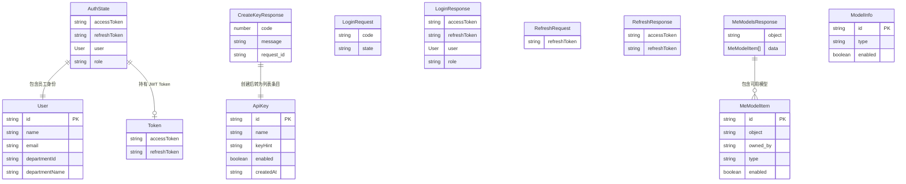

# ops-console 数据模型变更 — CHG-20260523-001

> 基线：xspec/modules/ops-console/data-model.md (v1.1)
> 关联：design.delta.md

## 变更摘要

新增员工身份认证相关类型（AuthState、User、LoginRequest、LoginResponse、RefreshRequest、RefreshResponse）、Key 管理相关类型（ApiKey、CreateKeyResponse）、模型可用查询响应类型（ModelInfo 扩展 /v1/me/models 适配）。所有类型以 TypeScript interface 形式定义，作为前端类型约束依据。

---

## 新增实体

### AuthState — 认证状态

```typescript
/** Pinia AuthStore 状态 */
interface AuthState {
  /** JWT access token，用于 Bearer 认证 */
  accessToken: string | null
  /** JWT refresh token，用于续期 accessToken */
  refreshToken: string | null
  /** 当前登录用户身份信息 */
  user: User | null
  /** 用户角色 */
  role: 'employee' | 'admin' | null
}
```

### User — 用户身份

```typescript
/** 员工身份信息 */
interface User {
  /** 员工唯一标识 */
  id: string
  /** 员工姓名 */
  name: string
  /** 员工邮箱 */
  email: string
  /** 所属部门 ID */
  departmentId: string
  /** 所属部门名称 */
  departmentName: string
}
```

### ApiKey — API Key（列表展示用，已脱敏）

```typescript
/** Key 列表条目，从 GET /api/v1/keys 响应映射 */
interface ApiKey {
  /** Key 唯一标识 */
  id: string
  /** Key 名称（用户自定义） */
  name: string
  /** Key 脱敏提示，仅末尾 4 位可见，格式："****abcd" */
  keyHint: string
  /** 是否启用 */
  enabled: boolean
  /** 创建时间（ISO 8601 字符串） */
  createdAt: string
}
```

### CreateKeyResponse — 创建 Key 响应

```typescript
/** POST /api/v1/keys 成功响应，包含 Key 明文 */
interface CreateKeyResponse {
  code: number
  message: string
  data: {
    /** 新创建的 Key 唯一标识 */
    id: string
    /** Key 名称 */
    name: string
    /** Key 明文，以 sk- 开头，仅此次返回，后续不可查询 */
    key: string
    /** Key 末尾 4 位 */
    key_hint: string
    enabled: boolean
    created_at: string
    updated_at: string
  }
  request_id: string
}
```

### LoginRequest — OIDC 回调请求

```typescript
/** POST /auth/oidc/callback 请求体 */
interface LoginRequest {
  /** SSO 回调携带的授权码 */
  code: string
  /** SSO 回调携带的 state 参数（防 CSRF） */
  state: string
}
```

### LoginResponse — OIDC 回调响应

```typescript
/** POST /auth/oidc/callback 成功响应 */
interface LoginResponse {
  /** JWT access token */
  accessToken: string
  /** JWT refresh token */
  refreshToken: string
  /** 员工身份信息 */
  user: User
  /** 用户角色 */
  role: 'employee' | 'admin'
}
```

### RefreshRequest — Token 刷新请求

```typescript
/** POST /auth/refresh 请求体 */
interface RefreshRequest {
  /** 当前有效的 refresh token */
  refreshToken: string
}
```

### RefreshResponse — Token 刷新响应

```typescript
/** POST /auth/refresh 成功响应 */
interface RefreshResponse {
  /** 新的 JWT access token */
  accessToken: string
  /** 新的 JWT refresh token（滚动刷新） */
  refreshToken: string
}
```

### ModelInfo（扩展）— 模型信息（/v1/me/models 适配）

```typescript
/**
 * 可用模型信息，从 /v1/me/models 响应映射
 * 相比已有 ModelInfo（/v1/models），新增 type 字段描述模型类型
 */
interface ModelInfo {
  /** 模型唯一标识 */
  id: string
  /** 模型类型：chat / completion / embedding / image / audio */
  type: 'chat' | 'completion' | 'embedding' | 'image' | 'audio'
  /** 是否可用（当前身份可调用） */
  enabled: boolean
}
```

### /v1/me/models 响应

```typescript
/** GET /v1/me/models 原始响应 */
interface MeModelsResponse {
  /** 固定为 list */
  object: 'list'
  /** 当前身份可用的模型列表 */
  data: MeModelItem[]
}

interface MeModelItem {
  /** 模型名称（唯一标识） */
  id: string
  /** OpenAI 兼容固定值 */
  object: 'model'
  /** 提供方标识 */
  owned_by: string
  /** 模型类型 */
  type: string
  /** 是否启用 */
  enabled: boolean
}
```

### /api/v1/keys 列表响应映射函数

```typescript
interface ListKeysResponse {
  code: number
  message: string
  data: {
    items: RawKeyItem[]
    total: number
    page: number
    page_size: number
  }
  request_id: string
}

/** 将 control-plane 原始响应映射为前端 ApiKey 数组 */
function mapKeysResponse(response: ListKeysResponse): ApiKey[] {
  return response.data.items.map(item => ({
    id: item.id,
    name: item.name,
    keyHint: item.key_hint,
    enabled: item.enabled,
    createdAt: item.created_at
  }))
}

interface RawKeyItem {
  id: string
  name: string
  masked_key: string
  key_hint: string
  enabled: boolean
  created_at: string
  updated_at: string
}
```

### 字段映射规则（新增）

| 原始字段路径 | 目标字段 | 映射方式 |
| :--- | :--- | :--- |
| data.items[].id | ApiKey.id | 直接赋值 |
| data.items[].name | ApiKey.name | 直接赋值 |
| data.items[].key_hint | ApiKey.keyHint | snake_case 转 camelCase |
| data.items[].enabled | ApiKey.enabled | 直接赋值 |
| data.items[].created_at | ApiKey.createdAt | snake_case 转 camelCase |

---

## 数据关系



**新增关系说明**：

| 主体 | 关系 | 客体 | 基数 | 说明 |
| :--- | :--- | :--- | :--- | :--- |
| AuthState | 包含 | User | 1..1 | 每个登录态对应唯一用户身份 |
| AuthState | 持有 | Token | 1..1 | accessToken + refreshToken 配对 |
| CreateKeyResponse | 创建后转为 | ApiKey | 1..1 | 创建成功后丢弃 `data.key` 明文，仅保留脱敏条目 |
| MeModelsResponse | 包含 | MeModelItem | 0..N | 当前身份可用的模型列表 |
| LoginRequest | 兑换为 | LoginResponse | 1..1 | OIDC code → 身份 + token |
| RefreshRequest | 兑换为 | RefreshResponse | 1..1 | refreshToken → 新 token 对 |

---

## 本地状态类型（新增）

### AuthStore 持久化存储结构

```typescript
/** localStorage 中 AuthStore 的持久化键 */
const AUTH_STORAGE_KEY = 'ops-console:auth'

/** 持久化到 localStorage 的数据子集 */
interface AuthPersistedState {
  accessToken: string
  refreshToken: string
  user: User
  role: 'employee' | 'admin'
}
```

### KeyListPage 状态

```typescript
interface KeyListPageState {
  keys: ApiKey[]
  loading: boolean
  error: string | null
}
```

### KeyCreateDialog 状态

```typescript
interface KeyCreateDialogState {
  visible: boolean
  name: string
  submitting: boolean
  createdKey: CreateKeyResponse | null
  plaintextCopied: boolean
}
```

### ModelListPage 状态

```typescript
interface ModelListPageState {
  models: ModelInfo[]
  loading: boolean
  error: string | null
}
```

### HomePage 状态

```typescript
interface HomePageState {
  hasKeys: boolean
  hasModels: boolean
  keysLoading: boolean
  modelsLoading: boolean
}
```

### 状态初始值

```typescript
const initialKeyListPageState: KeyListPageState = {
  keys: [],
  loading: false,
  error: null
}

const initialKeyCreateDialogState: KeyCreateDialogState = {
  visible: false,
  name: '',
  submitting: false,
  createdKey: null,
  plaintextCopied: false
}

const initialModelListPageState: ModelListPageState = {
  models: [],
  loading: false,
  error: null
}

const initialHomePageState: HomePageState = {
  hasKeys: false,
  hasModels: false,
  keysLoading: true,
  modelsLoading: true
}
```
