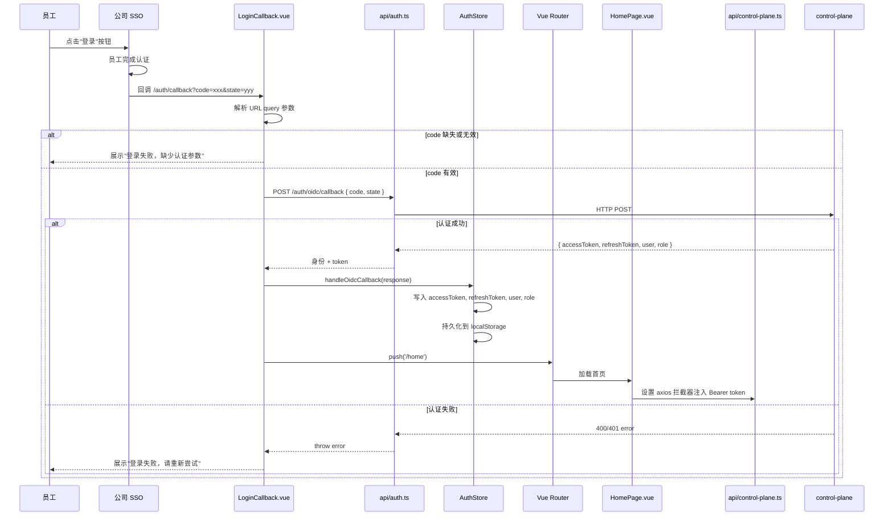
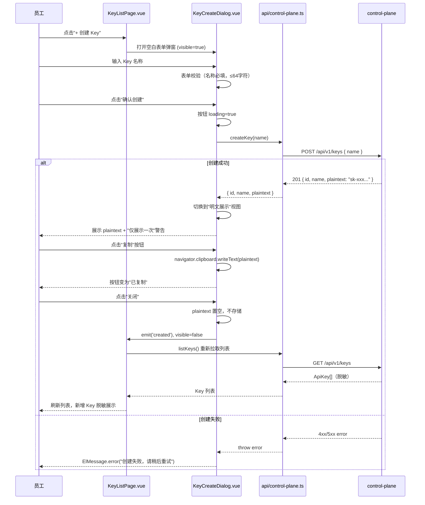
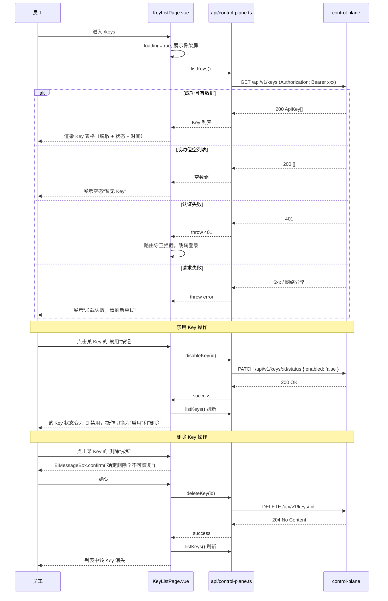

# ops-console 详细设计变更 — CHG-20260523-001

> 基线：xspec/modules/ops-console/design.md (v1.1)
> 关联：spec.delta.md / hld.delta.md

## 变更摘要

新增 OIDC 登录回调与员工会话管理（LoginCallback.vue + AuthStore）、Key 自助管理页面与创建弹窗（KeyListPage.vue + KeyCreateDialog.vue）、模型可用列表页面（ModelListPage.vue）、首页欢迎与使用文档页（HomePage.vue）；引入 auth.ts API 模块；控制平面 API 模块新增 Key 管理方法；路由新增员工端入口；导航栏按认证状态条件渲染。

---

## 新增页面

### HomePage.vue — 首页欢迎与使用文档

**路由**：`/home`（替代原有 `/` 作为员工登录后落地页）

**职责**：展示欢迎信息（当前登录员工姓名 + 所属部门）+ API 使用文档（curl 示例 + OpenAI SDK 示例）+ 快捷跳转至"我的 Key"和"可用模型"入口。

```
┌─────────────────────────────────────────────────────────────────────┐
│  你好，{name}                                Inter Semi Bold 24px    │
│  部门：{departmentName}                        #98989D 14px          │
├─────────────────────────────────────────────────────────────────────┤
│                                                                      │
│  ┌─── 快速入口 ─────────────────────────────────────────────────┐  │
│  │  [我的 Key →]                          [可用模型 →]          │  │
│  └──────────────────────────────────────────────────────────────┘  │
│                                                                      │
│  ┌─── 使用文档 ─ 背景 #1E1E1E radius:16px ──────────────────────┐  │
│  │                                                                  │
│  │  curl 示例：                                                     │
│  │  ┌────────────────────────────────────────────────────────────┐│
│  │  │ curl https://api.example.com/v1/chat/completions \        ││
│  │  │   -H "Content-Type: application/json" \                   ││
│  │  │   -H "Authorization: Bearer $API_KEY" \                   ││
│  │  │   -d '{ "model": "gpt-4o", "messages": [...] }'           ││
│  │  └────────────────────────────────────────────────────────────┘│
│  │                                                                  │
│  │  OpenAI SDK 示例：                                               │
│  │  ┌────────────────────────────────────────────────────────────┐│
│  │  │ import OpenAI                                              ││
│  │  │ client = OpenAI(base_url="https://api.example.com/v1",    ││
│  │  │                 api_key="$API_KEY")                        ││
│  │  │ response = client.chat.completions.create(                 ││
│  │  │     model="gpt-4o", messages=[{"role":"user","content":".."}]│
│  │  │ )                                                          ││
│  │  └────────────────────────────────────────────────────────────┘│
│  └──────────────────────────────────────────────────────────────────┘
└─────────────────────────────────────────────────────────────────────┘
```

**边界态**：
- 员工无 Key → 文档区上方展示提示："请先前往我的 Key 页面创建 API Key"
- 员工无可用模型 → 文档区上方展示提示："当前身份暂无可用模型，模型名称需从可用模型页面获取"

**数据依赖**：
- `AuthStore.identity`（姓名、部门信息）
- `keys.list()`（判断是否有 Key，仅计数不展示内容）
- `models.me()`（判断是否有可用模型，仅计数不展示内容）

---

### LoginCallback.vue — OIDC 回调处理页

**路由**：`/auth/callback`

**职责**：接收 SSO 回调 code → 调 control-plane 换取身份与 token → 写入 AuthStore → 跳转首页；失败时展示明确错误提示。

```
┌───────────────────────────────────────────────────┐
│                                                   │
│         ┌─────────────┐                           │
│         │  处理中...   │  加载态                   │
│         └─────────────┘                           │
│                                                   │
│   ────────── 或 ───────────────                   │
│                                                   │
│         ┌─────────────────────────────┐           │
│         │ ⚠️ 登录失败                  │           │
│         │ 认证服务暂时不可用，          │  错误态   │
│         │ 请稍后重试                    │           │
│         │         [重新登录]            │           │
│         └─────────────────────────────┘           │
│                                                   │
└───────────────────────────────────────────────────┘
```

**状态流转**：

| 状态 | 条件 | UI |
| :--- | :--- | :--- |
| 加载中 | onMounted，正在解析 code 并请求 | 居中 Loading 动画 + "正在登录..." |
| 成功 | control-plane 返回 valid identity + token | 无感知 → router.push('/home') |
| 失败-code缺失 | URL 无 code 参数 | 错误提示："登录失败，缺少认证参数，请重新登录" + [重新登录] 按钮 |
| 失败-认证无效 | control-plane 返回错误 | 错误提示："登录失败，请重新尝试" + [重新登录] 按钮 |
| 失败-网络异常 | 请求超时或连接失败 | 错误提示："认证服务暂时不可用，请稍后重试" + [重新登录] 按钮 |

---

### KeyListPage.vue — 我的 Key 管理页

**路由**：`/keys`

**职责**：展示当前员工名下 Key 列表（脱敏 + 状态 + 时间）；提供创建、禁用、启用、删除操作入口。

```
┌─────────────────────────────────────────────────────────────────────┐
│  我的 Key                                      Inter Semi Bold 24px  │
├─────────────────────────────────────────────────────────────────────┤
│                                                                      │
│  [+ 创建 Key]  #00E5FF 主按钮                                        │
│                                                                      │
│  ┌─── Key 列表  #1E1E1E  radius:16px  border:#2C2C2E ─────────────┐│
│  │  Key 名称      │ 脱敏值       │ 状态     │ 创建时间     │ 操作    ││
│  ├────────────────┼──────────────┼──────────┼──────────────┼─────────┤│
│  │ 生产环境 Key    │ sk-****abcdef │ 🟢 启用  │ 2026-05-20   │ 禁用    ││
│  │ 测试 Key       │ sk-****1234  │ 🔴 禁用  │ 2026-05-18   │ 启用│删除││
│  └────────────────┴──────────────┴──────────┴──────────────┴─────────┘│
│                                                                      │
│  空态：  暂无 Key，点击创建按钮生成你的第一个 Key                      │
└─────────────────────────────────────────────────────────────────────┘
```

**脱敏展示规则**：仅显示末尾 4 位，前缀为 `sk-****`。

**状态指示灯**：

| 状态 | 颜色 | 文字 | 可用操作 |
| :--- | :--- | :--- | :--- |
| 启用 | #32D74B | 启用 | [禁用] |
| 禁用 | #FF453A | 禁用 | [启用] [删除] |

**边界态**：
- 列表为空 → "暂无 Key，点击创建按钮生成你的第一个 Key"
- Key 数量达上限 → "[+ 创建 Key]" 按钮置灰 + tooltip："已达 Key 数量上限"
- 删除操作 → 弹出 ElMessageBox.confirm："确定删除 Key「{name}」？此操作不可恢复。"

---

### KeyCreateDialog.vue — 创建 Key 弹窗

**组件位置**：`components/key/KeyCreateDialog.vue`

**职责**：提供 Key 名称输入 → 调 POST /api/v1/keys → 展示 Key 明文（仅一次）+ 复制引导 → 关闭后刷新列表。

```
┌───────────────────────────────────────────────┐
│  创建 API Key                      [×]        │
├───────────────────────────────────────────────┤
│                                               │
│  Key 名称 *  [____________________________]  │
│                                               │
├───────────────────────────────────────────────┤
│              [取消]     [确认创建] #00E5FF     │
└───────────────────────────────────────────────┘

          ↓ 点击"确认创建"成功后

┌───────────────────────────────────────────────┐
│  创建成功                          [×]        │
├───────────────────────────────────────────────┤
│                                               │
│  ⚠️ 此明文仅展示一次，请立即复制保存            │
│                                               │
│  ┌─────────────────────────────────────────┐ │
│  │ sk-xxxxxxxxxxxxxxxxxxxxxxxxxxxxxxx      │ │
│  │                              [📋 复制]   │ │
│  └─────────────────────────────────────────┘ │
│                                               │
├───────────────────────────────────────────────┤
│                    [关闭]                      │
└───────────────────────────────────────────────┘
```

**交互规则**：
- 弹窗关闭后 Key 明文不再展示，页面刷新 Key 列表（脱敏状态）
- 明文展示区提供一键复制按钮，使用 `navigator.clipboard.writeText()`，复制后按钮变为"已复制"
- 明文不在 localStorage / sessionStorage / Pinia store 中缓存
- 表单校验：Key 名称必填，最多 64 字符

---

### ModelListPage.vue — 可用模型列表页

**路由**：`/models`

**职责**：调 GET /v1/me/models 展示当前身份可用模型（名称、类型、状态）。

```
┌─────────────────────────────────────────────────────────────────────┐
│  可用模型                                      Inter Semi Bold 24px  │
├─────────────────────────────────────────────────────────────────────┤
│                                                                      │
│  ┌─── 模型列表  #1E1E1E  radius:16px  border:#2C2C2E ─────────────┐│
│  │ 模型名称        │ 模型类型          │ 状态                      ││
│  ├─────────────────┼───────────────────┼────────────────────────────┤│
│  │ gpt-4o          │ 对话补全 (chat)    │ 🟢 可用                    ││
│  │ qwen-turbo      │ 对话补全 (chat)    │ 🟢 可用                    ││
│  │ text-embedding  │ 向量嵌入 (embedding)│ 🟢 可用                   ││
│  └─────────────────┴───────────────────┴────────────────────────────┘│
│                                                                      │
│  空态：  当前身份暂无可用模型                                         │
│  错误态：模型列表加载失败，请刷新重试 [刷新]                           │
└─────────────────────────────────────────────────────────────────────┘
```

**数据来源**：`GET /v1/me/models`（gateway-api），基于员工身份（User → Department）过滤后返回。

**边界态**：
- 空态 → "当前身份暂无可用模型"
- 加载失败 → "模型列表加载失败，请刷新重试" + [刷新] 按钮
- 不展示过期缓存数据，每次进入页面实时请求

---

## 新增 Store

### AuthStore（Pinia）— `stores/auth.ts`

**职责**：管理员工登录态、JWT Token 生命周期、用户身份信息。

**状态定义**：

| 字段 | 类型 | 说明 |
| :--- | :--- | :--- |
| accessToken | string \| null | JWT access token（Bearer 认证用） |
| refreshToken | string \| null | JWT refresh token |
| user | User \| null | 当前登录员工身份信息 |
| role | 'employee' \| 'admin' \| null | 用户角色 |

**计算属性**：

| Getter | 返回类型 | 说明 |
| :--- | :--- | :--- |
| isLoggedIn | boolean | accessToken 非空且未过期 |
| identity | { name, departmentName } \| null | 用于页面展示的快捷身份信息 |

**关键 Action**：

| Action | 说明 |
| :--- | :--- |
| handleOidcCallback(code) | 调 auth API 换取 token 与 identity，写入 store |
| refreshAccessToken() | 使用 refreshToken 续期 accessToken |
| logout() | 清空所有状态，跳转 SSO 登录页 |
| restoreSession() | 从 localStorage 恢复 token（页面刷新后保持登录） |

**持久化**：accessToken + refreshToken + user + role 写入 localStorage，页面刷新后通过 `restoreSession()` 恢复。登出时清除。

**路由守卫**：

```typescript
router.beforeEach((to, from, next) => {
  const authStore = useAuthStore()
  const publicRoutes = ['/auth/callback', '/login']
  if (!authStore.isLoggedIn && !publicRoutes.includes(to.path)) {
    next('/login')
  } else {
    next()
  }
})
```

---

## 新增 API 模块

### `api/auth.ts` — 认证服务 API

| 方法 | 说明 |
| :--- | :--- |
| oidcCallback(code: string) | POST /auth/oidc/callback → { accessToken, refreshToken, user, role } |
| refreshToken(refreshToken: string) | POST /auth/refresh → { accessToken, refreshToken } |
| logout() | POST /auth/logout → void（服务端注销 + 前端清空 store） |

### `api/control-plane.ts` — 新增 Key 管理方法

| 方法 | 说明 |
| :--- | :--- |
| listKeys() | GET /api/v1/keys → ApiKey[] |
| createKey(name: string) | POST /api/v1/keys → { id, name, plaintext } |
| disableKey(id: string) | PATCH /api/v1/keys/:id/status { enabled: false } → void |
| enableKey(id: string) | PATCH /api/v1/keys/:id/status { enabled: true } → void |
| deleteKey(id: string) | DELETE /api/v1/keys/:id → void |

**认证头**：所有 Key 管理 API 调用携带 `Authorization: Bearer {accessToken}`，由 axios 请求拦截器统一注入。

---

## 关键流程设计

### OIDC 登录流程



### Key 创建流程



### Key 列表加载与操作流程



---

## 路由变更

### 新增路由

```typescript
// 员工端路由
{
  path: '/auth/callback',
  name: 'LoginCallback',
  component: () => import('@/views/auth/LoginCallback.vue'),
  meta: { title: '登录回调', public: true }
},
{
  path: '/home',
  name: 'Home',
  component: () => import('@/views/home/HomePage.vue'),
  meta: { title: '首页', requiresAuth: true }
},
{
  path: '/keys',
  name: 'KeyList',
  component: () => import('@/views/key/KeyListPage.vue'),
  meta: { title: '我的 Key', requiresAuth: true }
},
{
  path: '/models',
  name: 'ModelList',
  component: () => import('@/views/model/ModelListPage.vue'),
  meta: { title: '可用模型', requiresAuth: true }
}
```

### 已有路由

保留 `/access/unified-entry`、`/admin/providers`、`/admin/models`，属于管理员入口，由角色路由守卫保护。

---

## 导航更新

侧边栏菜单按 `AuthStore.isLoggedIn` 和 `AuthStore.role` 条件渲染：

| 条件 | 可见菜单项 |
| :--- | :--- |
| 未登录 | 仅显示"登录"入口（跳转 SSO） |
| role === 'employee' | 首页、我的 Key、可用模型 |
| role === 'admin' | 首页、我的 Key、可用模型、统一接入、渠道管理、模型管理 |

---

## 组件层级变更

```
App.vue
├── SidebarNav.vue（已有，条件渲染逻辑新增）
├── AuthStore（新增 Pinia Store）
├── Vue Router
│   ├── /auth/callback → LoginCallback.vue（新增）
│   ├── /home → HomePage.vue（新增）
│   ├── /keys → KeyListPage.vue（新增）
│   │   └── KeyCreateDialog.vue（新增）
│   ├── /models → ModelListPage.vue（新增）
│   ├── /access/unified-entry → UnifiedEntryPage.vue（已有）
│   │   ├── CapabilitySection.vue（已有）
│   │   └── ModelDiscoverySection.vue（已有）
│   │       └── ModelCard.vue（已有）
│   ├── /admin/providers → ProviderListPage.vue（已有）
│   │   ├── ProviderTable.vue（已有）
│   │   ├── ProviderFormDialog.vue（已有）
│   │   └── SyncModelsDialog.vue（已有）
│   └── /admin/models → ModelListPage.vue（已有，管理端）
│       ├── ModelTable.vue（已有）
│       └── ModelFormDialog.vue（已有）
├── api/
│   ├── auth.ts（新增）
│   └── control-plane.ts（已有，新增 Key 管理方法）
└── components/
    └── key/
        └── KeyCreateDialog.vue（新增）
```

---

## 关键交互设计

### Key 明文一次性展示

- KeyCreateDialog 调用 POST /api/v1/keys 成功后，plaintext 仅在弹窗内展示
- 弹窗标题切换为"创建成功"，内容区展示明文 + 警告文案
- 明文使用 monospace 字体，背景 #252525，可选中不可编辑
- 明文不在 localStorage / sessionStorage / Pinia / Vuex 任何地方缓存
- 弹窗关闭（无论点击关闭按钮、按 ESC、点击遮罩层）后 plaintext 置空，后续无法再次获取

### 剪贴板复制

- 明文展示区右侧 [复制] 按钮，调用 `navigator.clipboard.writeText(plaintext)`
- 复制成功后按钮文案变为"已复制"，颜色变为 #32D74B，2s 后恢复原状
- 若 `navigator.clipboard` 不可用（非 HTTPS 环境），降级为选中明文 + 提示"请手动复制"

### Key 状态 Badge

- 启用 Key：绿色圆点 (#32D74B) + "启用" 文字
- 禁用 Key：红色圆点 (#FF453A) + "禁用" 文字
- Badge 位于表格"状态"列，使用 Element Plus `<el-tag>` 组件

### 模型类型展示

| 后端 type 值 | 前端展示 |
| :--- | :--- |
| chat | 对话补全 (chat) |
| completion | 文本补全 (completion) |
| embedding | 向量嵌入 (embedding) |
| image | 图像生成 (image) |
| audio | 语音处理 (audio) |

---

## 设计决策记录

### 决策 7：引入 Pinia AuthStore

| 项 | 内容 |
| :--- | :--- |
| 问题 | 员工登录态和身份信息需要跨页面共享（首页、Key 管理、模型列表、导航栏） |
| 选择 | 引入 Pinia AuthStore 管理认证状态，替代原有"复用后台 JWT Cookie"方案 |
| 理由 | 员工端新增多个页面需访问登录态，组件内 ref 跨页面无法共享；Pinia 支持 getter 派生状态（isLoggedIn、identity），支持持久化插件，适合单页应用会话管理 |
| 备选方案 | 继续仅使用 Cookie + 后端拦截器——无法在纯前端实现条件导航和路由守卫，需额外请求 /me 接口判断登录态 |

### 决策 8：Key 明文仅展示一次不禁缓存

| 项 | 内容 |
| :--- | :--- |
| 问题 | Key 明文在创建后如何安全展示 |
| 选择 | 仅在 KeyCreateDialog 弹窗内展示，关闭后置空，任何持久化存储均不写入 plaintext |
| 理由 | 安全策略要求——Key 明文仅在创建时返回，关闭弹窗后后端不再提供明文查询能力；前端不缓存是防御纵深，防止 XSS 或浏览器扩展窃取 |
| 备选方案 | 写入 Pinia store 以便后续页内查看——安全风险高，违反"仅展示一次"的安全设计原则 |

### 决策 9：模型可用列表使用 /v1/me/models 而非 /v1/models

| 项 | 内容 |
| :--- | :--- |
| 问题 | 员工端模型列表应展示所有注册模型还是仅展示其身份可用的模型 |
| 选择 | 使用 /v1/me/models（基于 User → Department 过滤），而非通用 /v1/models |
| 理由 | 业务需求明确"展示当前员工经身份鉴权后可用的模型"，/v1/me/models 由 gateway-api 根据请求方 JWT 身份做部门级过滤，前端无需自行比对；/v1/models 返回全量注册模型，不适合员工端场景 |
| 备选方案 | 使用 /v1/models + 前端自行过滤——增加前端复杂度且无法感知后端权限策略变更 |