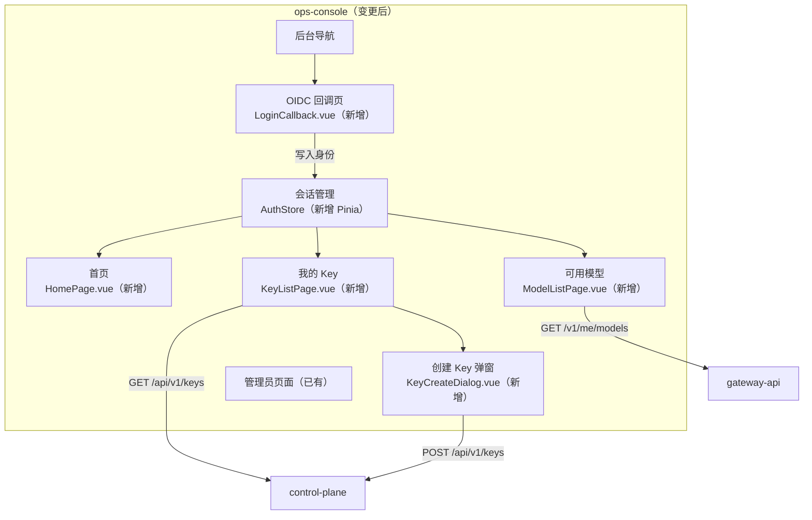
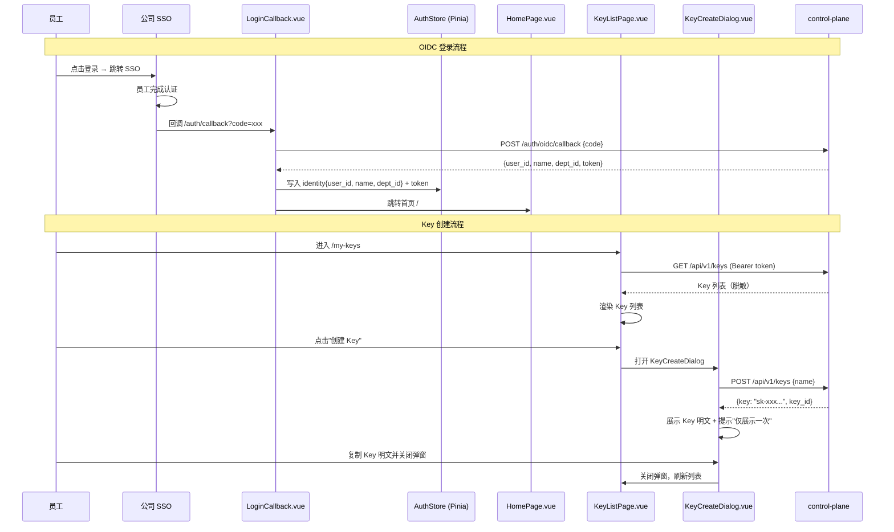

# ops-console 概要设计变更 — CHG-20260523-001

> 基线：xspec/modules/ops-console/hld.md (v1.1)

## 变更摘要

新增 OIDC 登录回调页与员工会话管理、Key 自助管理页面（KeyListPage.vue + KeyCreateDialog.vue）、模型可用列表页面（基于 /v1/me/models）、首页欢迎与使用文档页；从纯管理后台扩展为员工 + 管理员双角色入口。

## 架构变更

### OIDC 登录 + Key 管理流程

## 技术选型变更

无变更，沿用 Vue 3 + Element Plus + Vite + Pinia 技术栈。

## 新增组件

| 组件 | 位置 | 职责 |
| :--- | :--- | :--- |
| LoginCallback.vue | views/auth/ | OIDC 回调页：接收 SSO code → 调 control-plane 换取身份 → 写入 AuthStore → 跳转首页；失败时展示明确错误提示 |
| AuthStore | stores/auth.ts | Pinia 状态管理：存储 identity{user_id, name, dept_id} + JWT token；提供 isAuthenticated getter；登出时清空身份并跳转 SSO |
| HomePage.vue | views/home/ | 首页欢迎与使用文档：展示员工姓名 + 部门、curl/OpenAI SDK 调用示例、跳转至我的 Key 和可用模型的快捷入口 |
| KeyListPage.vue | views/key/ | 我的 Key 页面：展示当前用户 Key 脱敏列表（末尾 4 位 + 状态 + 时间）；提供创建、禁用、启用、删除操作入口 |
| KeyCreateDialog.vue | components/key/ | 创建 Key 弹窗：调 POST /api/v1/keys → 展示 Key 明文 + "仅展示一次"提示 → 复制引导 → 关闭后刷新列表 |
| ModelListPage.vue | views/model/ | 可用模型页面：调 GET /v1/me/models 展示当前身份可用模型（名称、类型、状态）；空态提示"当前身份暂无可用模型" |

## 新增路由

| 路由 | 页面 | 认证要求 | 说明 |
| :--- | :--- | :--- | :--- |
| /auth/callback | LoginCallback.vue | 无（回调处理） | OIDC 回调入口，处理 SSO 认证结果 |
| / | HomePage.vue | 需登录 | 首页欢迎 + 使用文档 |
| /my-keys | KeyListPage.vue | 需登录 | Key 自助管理 |
| /models | ModelListPage.vue | 需登录 | 可用模型列表 |

## 认证与会话变更

| 项 | 变更前 | 变更后 |
| :--- | :--- | :--- |
| 认证方式 | 复用后台 SSO + JWT Cookie | 新增 OIDC 回调处理页，员工登录通过 OIDC code → control-plane 换取 token |
| 登录页 | 复用后台统一登录 | 新增 LoginCallback.vue 处理 OIDC 回调，失败展示错误提示 |
| 会话管理 | 复用后台 JWT Cookie | 新增 AuthStore (Pinia) 管理员工 identity + token，路由守卫检查 isAuthenticated |
| Token 刷新 | 复用后台已有机制 | AuthStore 管理 token 生命周期，过期时重定向 SSO 登录 |

## 新增 API 消费

| API | 来源模块 | 用途 |
| :--- | :--- | :--- |
| POST /auth/oidc/callback | control-plane | OIDC 回调换取身份 token |
| GET /api/v1/keys | control-plane | 查询当前用户 Key 列表（脱敏） |
| POST /api/v1/keys | control-plane | 创建新 Key |
| PATCH /api/v1/keys/:id/status | control-plane | 禁用/启用 Key |
| DELETE /api/v1/keys/:id | control-plane | 删除 Key |
| GET /v1/me/models | gateway-api | 查询当前身份可用模型 |

## 安全设计补充

| 威胁 | 防御措施 |
| :--- | :--- |
| OIDC code 被截获 | code 仅一次性有效，回调后立即换取 token；code 使用后由 SSO 服务端标记为已消费 |
| Key 明文在弹窗中被截图 | 弹窗明确提示"仅展示一次"，关闭后不再展示；不使用 localStorage 缓存明文 |
| 跨角色操作（员工访问管理页面） | 路由守卫基于 AuthStore 中的角色字段做页面级权限隔离 |