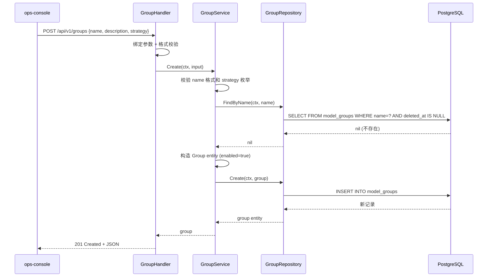
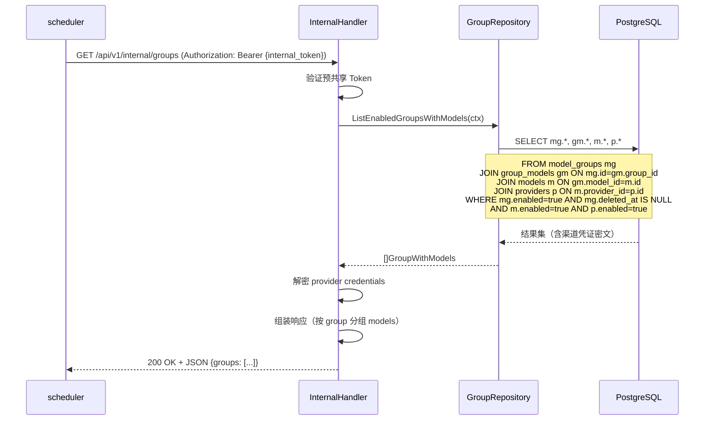

# control-plane 技术设计变更 — CHG-20260525-001

> 基线：xspec/modules/control-plane/design.md (v1.2)

## 变更摘要

在现有 Handler→Service→Repository 分层架构中新增模型组管理层（GroupHandler、GroupService、GroupRepository）及组内模型关联管理层（GroupModelHandler、GroupModelService），新增 Scheduler 内部配置读取端点。现有渠道、模型和 Key 管理不受影响。

---

## 1. 设计决策

### 决策 10：模型组存储方案 — model_groups + group_models 双表

- **问题**：模型组及其路由策略如何存储？
- **候选方案**：
  - A — 单表存储，group 内嵌 model 列表 JSON 字段：简单 / JSON 字段无法建立外键约束和索引，查询效率低
  - B — model_groups 主表 + group_models 关联表：标准化关系模型，支持外键级联和索引 / 多一次 JOIN
  - C — 在 models 表加 group_id 字段：实现最简单 / 一个模型只能属于一个组，无法满足跨组需求
- **决策**：选择方案 B
- **理由**：需求明确"一个模型可同时属于多个组"，必须使用 M:N 关联表。标准化设计支持外键约束保证数据一致性、独立索引优化关联查询。策略参数（priority/weight）天然属于关联边属性，放在 group_models 表中语义清晰。

### 决策 11：组删除策略 — 软删除 + 禁用而非级联清理

- **问题**：删除模型组时组内关联模型如何处理？
- **候选方案**：
  - A — 级联删除 group_models 关联后删除 group：简单直接 / 操作不可逆，group 重新创建需重新配置所有模型关联
  - B — 先禁用 group，要求管理员清空组内模型后方可物理删除：安全 / 操作步骤多
  - C — 软删除 group，关联表保留，scheduler 自动跳过 disabled 的 group：恢复方便 / group 记录保留
- **决策**：选择方案 C
- **理由**：模型组是调度基础设施，误删影响面大。软删除保留恢复能力，scheduler 读取配置时过滤 `enabled=false` 的组即可。group_models 关联表在组禁用后无需清理，组恢复后策略配置完整保留。

### 决策 12：Scheduler 配置读取 — 内部端点 + 预共享 Token

- **问题**：scheduler 如何获取模型组配置？
- **候选方案**：
  - A — scheduler 直接读 PostgreSQL：减少一跳 / 数据库耦合，schema 变更影响 scheduler
  - B — 内部 HTTP 接口 GET /api/v1/internal/groups：通过 control-plane API 层读取，schema 变更对 scheduler 透明 / 增加一次 HTTP 调用
  - C — Redis 缓存 + pub/sub 推送：实时性好 / 缓存一致性维护复杂，pub/sub 消息可能丢失
- **决策**：选择方案 B
- **理由**：与现有 `/internal/v1/models/available` 内部接口模式一致，scheduler 通过 API 读取配置，不直接依赖数据库 schema。预共享 Token 认证复用已有内部接口安全机制。group 配置变更频率极低，HTTP 读取延迟可接受（内网 < 5ms）。

---

## 2. 新增组件详细设计

### 2.1 GroupHandler

> HTTP 入口层，只做：请求解析、参数绑定与格式校验、调用 Service、响应序列化。不含业务逻辑。

**注册端点：**

| 端点 | 方法 | 路径 | 用途 |
| :--- | :---: | :--- | :--- |
| 创建模型组 | POST | `/api/v1/groups` | 创建新的模型组 |
| 模型组列表 | GET | `/api/v1/groups` | 分页查询模型组列表 |
| 模型组详情 | GET | `/api/v1/groups/:id` | 查询单个组详情（含模型列表） |
| 更新模型组 | PUT | `/api/v1/groups/:id` | 更新组名称、描述、策略 |
| 删除模型组 | DELETE | `/api/v1/groups/:id` | 软删除模型组 |

**输入校验：**

| 字段 / 参数 | 校验规则 | 失败时 |
| :--- | :--- | :--- |
| `name`（创建/更新 body） | 非空，长度 2–64，仅允许字母数字下划线连字符 | 400 |
| `description`（创建 body） | 可选，长度 ≤ 512 | 400 |
| `strategy`（创建/更新 body） | 枚举值：`round_robin` / `priority` / `weighted` | 400 |
| `:id`（path） | 非空，合法 UUID 格式 | 400 |
| `page`（query） | 正整数，默认 1 | 400 |
| `page_size`（query） | 正整数，默认 20，最大 100 | 400 |
| `search`（query） | 可选，按名称模糊搜索，长度 ≤ 64 | 400 |

**请求/响应结构：**

```json
// POST /api/v1/groups — Request
{
  "name": "日常推理",
  "description": "用于日常对话推理任务的模型组",
  "strategy": "round_robin"
}

// POST /api/v1/groups — Response (201)
{
  "code": 0,
  "message": "success",
  "data": {
    "id": "550e8400-e29b-41d4-a716-446655440010",
    "name": "日常推理",
    "description": "用于日常对话推理任务的模型组",
    "strategy": "round_robin",
    "enabled": true,
    "model_count": 0,
    "created_at": "2026-05-25T10:00:00Z",
    "updated_at": "2026-05-25T10:00:00Z"
  },
  "request_id": "req-uuid"
}

// GET /api/v1/groups/:id — Response (200, 含模型列表)
{
  "code": 0,
  "message": "success",
  "data": {
    "id": "550e8400-e29b-41d4-a716-446655440010",
    "name": "日常推理",
    "description": "用于日常对话推理任务的模型组",
    "strategy": "round_robin",
    "enabled": true,
    "model_count": 2,
    "models": [
      {
        "model_id": "660e8400-e29b-41d4-a716-446655440001",
        "model_name": "qwen-turbo",
        "model_type": "chat",
        "priority": null,
        "weight": null
      },
      {
        "model_id": "660e8400-e29b-41d4-a716-446655440002",
        "model_name": "deepseek-chat",
        "model_type": "chat",
        "priority": null,
        "weight": null
      }
    ],
    "created_at": "2026-05-25T10:00:00Z",
    "updated_at": "2026-05-25T10:00:00Z"
  },
  "request_id": "req-uuid"
}
```

---

### 2.2 GroupService

> 包含全部模型组业务逻辑和事务编排，不处理 HTTP 细节。

**公开方法：**

| 方法签名 | 职责 | 事务 | 抛出异常 |
| :--- | :--- | :---: | :--- |
| `Create(ctx, input CreateGroupInput) (*Group, error)` | 校验组名称全局唯一，创建模型组（默认 enabled=true） | 是 | ConflictError(E4096) |
| `List(ctx, query GroupListQuery) (*PageResult, error)` | 分页查询组列表，支持 search 模糊搜索 | 否 | — |
| `GetByID(ctx, id string) (*GroupWithModels, error)` | 查询组详情及组内模型列表（含 model_name, model_type, priority, weight） | 否 | NotFoundError(E4043) |
| `Update(ctx, id string, input UpdateGroupInput) (*Group, error)` | 更新组名称/描述/策略；策略切换时如新策略参数不兼容旧参数，触发 strategy_switch_warning | 是 | NotFoundError(E4043), ConflictError(E4096) |
| `Delete(ctx, id string) error` | 软删除组（设 enabled=false + deleted_at），group_models 关联保留不清除 | 是 | NotFoundError(E4043) |

**业务规则：**

- 组名称全局唯一（跨所有 model_groups 记录）
- 策略枚举严格校验，非法值拒绝创建
- 策略变更时检测旧策略参数兼容性：
  - 切换到 `round_robin`：priority 和 weight 参数无意义，旧参数保留不清理
  - 切换到 `priority`：此前 weight 参数无意义，优先使用 priority
  - 切换到 `weighted`：此前 priority 参数无意义，优先使用 weight
  - 策略切换不自动清除旧参数，仅触发 E4225 警告通知调用方"策略变更后旧参数可能不兼容，请重新配置组内模型"
- 组删除（软删除）后 scheduler 配置读取自动跳过 disabled 组，不影响现有路由
- 组删除不等同于物理删除，管理员可手动恢复（PUT 更新 enabled=true）

**跨模块调用：**

| 依赖模块 | 调用时机 | 失败处理 |
| :--- | :--- | :--- |
| GroupRepository | 创建/查询/更新/删除操作 | 数据库错误返回 InternalError |

---

### 2.3 GroupRepository

> 封装 model_groups 和 group_models 表的全部数据库操作，向 Service 屏蔽 GORM 细节。

**方法：**

| 方法签名 | 操作 | 说明 |
| :--- | :--- | :--- |
| `Create(ctx, *Group) error` | INSERT into model_groups | 名称唯一约束冲突返回 ConflictError(E4096) |
| `FindByID(ctx, id string) (*Group, error)` | SELECT from model_groups | 不存在返回 nil, nil；不包含软删除记录 |
| `FindByName(ctx, name string) (*Group, error)` | SELECT from model_groups | 用于唯一性检查，不包含软删除记录 |
| `List(ctx, query GroupListQuery) ([]*Group, int64, error)` | SELECT + COUNT from model_groups | 支持 search 模糊匹配、分页；排除软删除记录 |
| `Update(ctx, id string, updates map) error` | UPDATE model_groups | 不存在返回 NotFoundError(E4043) |
| `SoftDelete(ctx, id string) error` | UPDATE model_groups SET enabled=false, deleted_at=now() | 不存在返回 NotFoundError(E4043) |
| `FindGroupWithModels(ctx, groupID string) (*GroupWithModels, error)` | SELECT from model_groups JOIN group_models JOIN models | 返回组信息 + 关联模型列表（含 model_name, model_type, priority, weight） |
| `ListEnabledGroupsWithModels(ctx) ([]*GroupWithModels, error)` | SELECT from model_groups JOIN group_models JOIN models WHERE enabled=true | 内部接口用，返回所有启用组的完整配置 |
| `AddModelToGroup(ctx, groupID, modelID string, priority *int, weight *int) error` | INSERT into group_models | (group_id, model_id) 唯一约束冲突返回 ConflictError |
| `RemoveModelFromGroup(ctx, groupID, modelID string) error` | DELETE from group_models | 不存在返回 NotFoundError |
| `ListGroupModels(ctx, groupID string) ([]*GroupModel, error)` | SELECT from group_models JOIN models | 返回组内模型列表 |
| `FindGroupModel(ctx, groupID, modelID string) (*GroupModel, error)` | SELECT from group_models | 检查模型是否已在组内 |

---

### 2.4 GroupModelHandler

> HTTP 入口层，只做：请求解析、参数绑定与格式校验、调用 GroupModelService、响应序列化。

**注册端点：**

| 端点 | 方法 | 路径 | 用途 |
| :--- | :---: | :--- | :--- |
| 添加模型到组 | POST | `/api/v1/groups/:id/models` | 将模型添加到模型组 |
| 组内模型列表 | GET | `/api/v1/groups/:id/models` | 查询组内模型列表 |
| 从组移除模型 | DELETE | `/api/v1/groups/:id/models/:model_id` | 从模型组移除模型 |

**输入校验：**

| 字段 / 参数 | 校验规则 | 失败时 |
| :--- | :--- | :--- |
| `:id`（path - group ID） | 非空，合法 UUID 格式，组必须存在且未删除 | 404 |
| `model_id`（body） | 非空，合法 UUID 格式 | 400 |
| `priority`（body） | 可选，正整数；strategy=priority 时必填 | 400 |
| `weight`（body） | 可选，整数 1–100；strategy=weighted 时必填 | 400 |
| `:model_id`（path） | 非空，合法 UUID 格式 | 400 |

**请求/响应结构：**

```json
// POST /api/v1/groups/:id/models — Request (priority 策略)
{
  "model_id": "660e8400-e29b-41d4-a716-446655440001",
  "priority": 1
}

// POST /api/v1/groups/:id/models — Request (weighted 策略)
{
  "model_id": "660e8400-e29b-41d4-a716-446655440001",
  "weight": 50
}

// POST /api/v1/groups/:id/models — Request (round_robin 策略)
{
  "model_id": "660e8400-e29b-41d4-a716-446655440001"
}

// POST /api/v1/groups/:id/models — Response (201)
{
  "code": 0,
  "message": "success",
  "data": {
    "group_id": "550e8400-e29b-41d4-a716-446655440010",
    "model_id": "660e8400-e29b-41d4-a716-446655440001",
    "model_name": "qwen-turbo",
    "model_type": "chat",
    "priority": 1,
    "weight": null,
    "created_at": "2026-05-25T10:05:00Z"
  },
  "request_id": "req-uuid"
}

// GET /api/v1/groups/:id/models — Response (200)
{
  "code": 0,
  "message": "success",
  "data": {
    "items": [
      {
        "group_id": "550e8400-e29b-41d4-a716-446655440010",
        "model_id": "660e8400-e29b-41d4-a716-446655440001",
        "model_name": "qwen-turbo",
        "model_type": "chat",
        "priority": 1,
        "weight": null,
        "created_at": "2026-05-25T10:05:00Z"
      }
    ],
    "total": 1
  },
  "request_id": "req-uuid"
}
```

---

### 2.5 GroupModelService

> 包含组内模型关联的全部业务逻辑和事务编排。

**公开方法：**

| 方法签名 | 职责 | 事务 | 抛出异常 |
| :--- | :--- | :---: | :--- |
| `AddModel(ctx, groupID, modelID string, priority *int, weight *int) (*GroupModel, error)` | 校验组存在且未删除，校验模型存在，检查重复添加，插入 group_models | 是 | NotFoundError, ConflictError |
| `ListModels(ctx, groupID string) ([]*GroupModel, error)` | 查询组内所有模型（含 model_name, model_type） | 否 | NotFoundError(E4043) |
| `RemoveModel(ctx, groupID, modelID string) error` | 从组内移除模型关联 | 是 | NotFoundError |

**业务规则：**

- 添加模型前校验 model_id 对应模型存在且未删除
- 同组内同一模型不可重复添加（group_id + model_id 联合唯一约束）
- 一个模型可同时属于多个组（跨组允许）
- strategy=priority 时 priority 字段必填，正整数；strategy=weighted 时 weight 字段必填，1–100；strategy=round_robin 时两个字段均可省略
- 模型从组内移除后，该模型在该组中不再参与路由，但不影响该模型在其他组的路由

---

### 2.6 SchedulerConfigEndpoint（内部配置端点）

> 提供 scheduler 读取所有启用模型组完整配置的 HTTP 端点，复用已有 InternalHandler 注册。

- **端点**：`GET /api/v1/internal/groups`
- **认证**：预共享 Token（`Authorization: Bearer {internal_token}`）
- **用途**：scheduler 启动时全量拉取或定期刷新
- **数据范围**：仅返回 `enabled=true` 且未软删除的模型组

**响应结构：**

```json
{
  "code": 0,
  "message": "success",
  "data": {
    "groups": [
      {
        "id": "550e8400-e29b-41d4-a716-446655440010",
        "name": "日常推理",
        "strategy": "round_robin",
        "models": [
          {
            "model_name": "qwen-turbo",
            "model_type": "chat",
            "provider": {
              "name": "bailian-main",
              "type": "bailian",
              "endpoint": "https://dashscope.aliyuncs.com/compatible-mode/v1",
              "credentials": {
                "api_key": "sk-abcdefghijklmnop"
              }
            },
            "priority": null,
            "weight": null
          }
        ]
      },
      {
        "id": "550e8400-e29b-41d4-a716-446655440011",
        "name": "高智能",
        "strategy": "priority",
        "models": [
          {
            "model_name": "qwen-max",
            "model_type": "chat",
            "provider": {
              "name": "bailian-main",
              "type": "bailian",
              "endpoint": "https://dashscope.aliyuncs.com/compatible-mode/v1",
              "credentials": {
                "api_key": "sk-abcdefghijklmnop"
              }
            },
            "priority": 1,
            "weight": null
          },
          {
            "model_name": "deepseek-r1",
            "model_type": "chat",
            "provider": {
              "name": "deepseek-main",
              "type": "deepseek",
              "endpoint": "https://api.deepseek.com/v1",
              "credentials": {
                "api_key": "sk-deepseekkey1234"
              }
            },
            "priority": 2,
            "weight": null
          }
        ]
      }
    ],
    "updated_at": "2026-05-25T12:00:00Z"
  },
  "request_id": "req-uuid"
}
```

> **安全说明**：此接口返回解密后的 credential 明文（复用现有 ModelService 凭证解密逻辑），仅供内部可信服务调用，通过预共享 Token 认证 + 网络隔离保护。

---

## 3. 关键流程

### 3.1 模型组创建流程



### 3.2 Scheduler 配置读取流程



---

## 4. 错误码新增

| 异常类 | 抛出层 | 语义 | HTTP 状态 | 错误码 |
| :--- | :--- | :--- | :---: | :--- |
| GroupNameConflictError | Repository / Service | 模型组名称与已有组重复 | 409 | E4096 |
| GroupNotFoundError | Repository / Service | 模型组不存在或已被软删除 | 404 | E4043 |
| InvalidStrategyError | Service | 策略类型枚举值非法 | 422 | E4224 |
| StrategySwitchWarning | Service | 策略切换后旧参数可能不兼容（非阻断，仅提示） | 422 | E4225 |

**错误场景说明：**

| 场景 | 触发条件 | 错误码 | message 示例 |
| :--- | :--- | :--- | :--- |
| 组名称冲突 | 创建或更新时名称与已有组重复 | E4096 | `"模型组名称 '日常推理' 已存在"` |
| 组不存在 | 对不存在的组执行操作 | E4043 | `"模型组不存在或已被删除"` |
| 非法策略 | strategy 字段不属于枚举值 | E4224 | `"无效的策略类型 'xxx'，支持：round_robin, priority, weighted"` |
| 策略切换警告 | 更新策略类型后旧参数不兼容 | E4225 | `"策略已变更为 'round_robin'，原有 priority/weight 参数可能不兼容，请重新配置组内模型"` |

> **错误码分配说明**：E4091–E4095 已被 Key CRUD 功能占用（key_name_conflict / key_already_disabled / key_already_enabled），故模型组名称冲突使用 E4096。

---

## 5. 目录变更

在 `control-plane/internal/` 下新增：

```
control-plane/
├── internal/
│   ├── handler/
│   │   ├── group.go            # NEW — GroupHandler
│   │   └── group_model.go      # NEW — GroupModelHandler
│   ├── service/
│   │   ├── group.go            # NEW — GroupService
│   │   └── group_model.go      # NEW — GroupModelService
│   ├── repository/
│   │   ├── group.go            # NEW — GroupRepository (含 group_models 操作)
│   ├── model/
│   │   ├── group.go            # NEW — Group / GroupModel 实体定义
│   ├── dto/
│   │   ├── group.go            # NEW — Group 请求/响应 DTO
│   └── errors/
│       └── errors.go           # MODIFY — 新增 GroupNameConflictError 等
```

---

## 6. 变更历史

| 版本号 | 修改日期 | 修改内容摘要 | 修改人 |
| :--- | :--- | :--- | :--- |
| v1.3-delta | 2026-05-25 | 新增模型组管理功能（GroupHandler/Service/Repository + GroupModelHandler/Service）；新增内部配置端点 GET /api/v1/internal/groups | OpenCode |