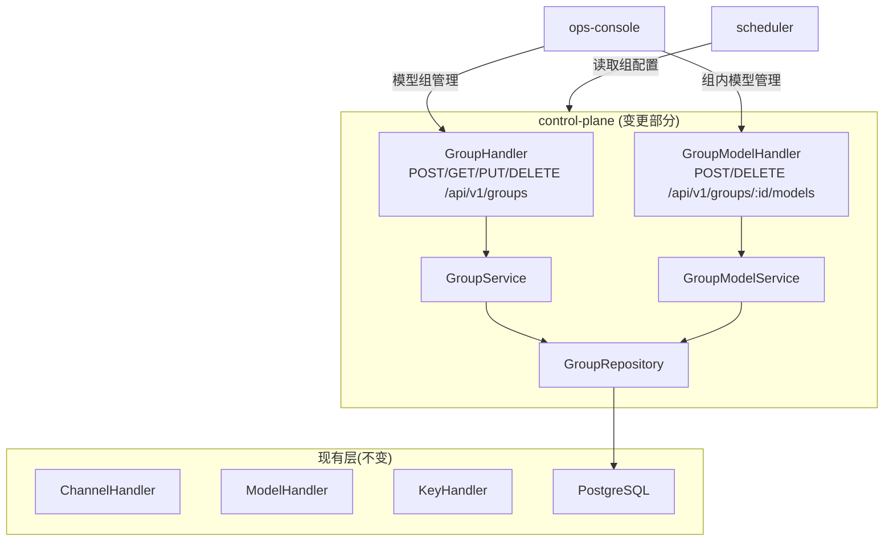

# control-plane 概要设计变更 — CHG-20260525-001

> 基线：xspec/modules/control-plane/hld.md (v1.2)

## 变更摘要

在现有 Handler→Service→Repository 分层架构中新增模型组管理层：GroupHandler（HTTP 端点）、GroupService（业务逻辑+策略校验）、GroupRepository（数据持久化），以及 GroupModelAssoc 关联表管理。现有渠道和模型管理不受影响。

## 架构变更

## 新增组件

| 组件 | 职责 | 端点 |
| :--- | :--- | :--- |
| GroupHandler | 模型组 CRUD 的 HTTP 入口 | POST/GET/PUT/DELETE `/api/v1/groups` |
| GroupService | 组名称唯一性校验、策略参数校验、组删除前的安全校验 | — |
| GroupRepository | 模型组和组内模型关联的持久化操作 | — |
| GroupModelHandler | 组内模型添加/移除/列表的 HTTP 入口 | POST/DELETE/GET `/api/v1/groups/:id/models` |
| GroupModelService | 模型存在性校验、同组重复添加检查、跨组允许 | — |
| SchedulerConfigEndpoint | scheduler 配置读取端点 | GET `/api/v1/internal/groups`（内部接口，预共享 Token 认证） |

## 数据模型变更

新增 `model_groups` 表和 `group_models` 关联表：

| 表 | 关键字段 | 说明 |
| :--- | :--- | :--- |
| model_groups | id, name(unique), description, strategy(enum), enabled | 模型组主表 |
| group_models | group_id, model_id, priority, weight | 组内模型关联，priority 用于优先级策略，weight 用于加权策略 |

## 技术选型

无新增技术选型。沿用现有 Go+Gin+GORM+PostgreSQL 技术栈，不引入新依赖。