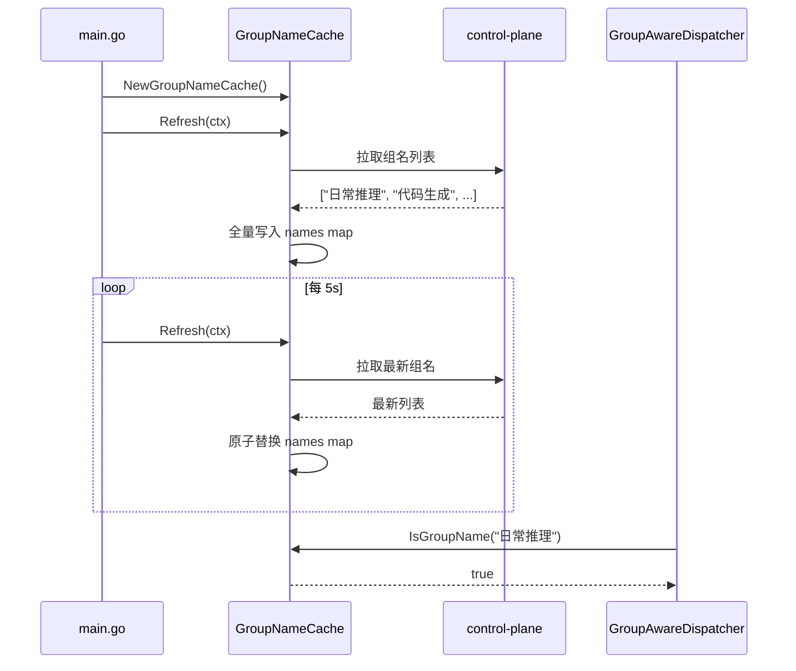
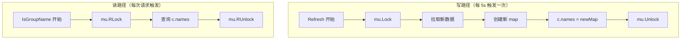
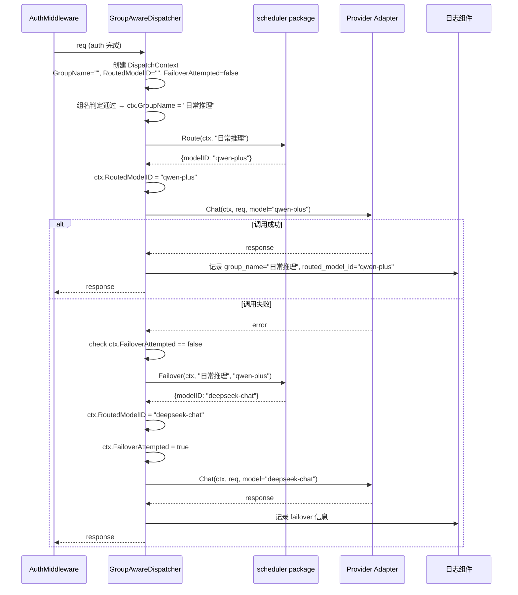
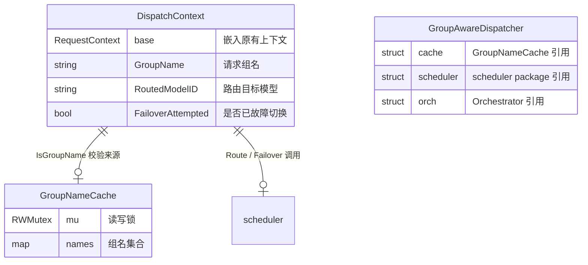
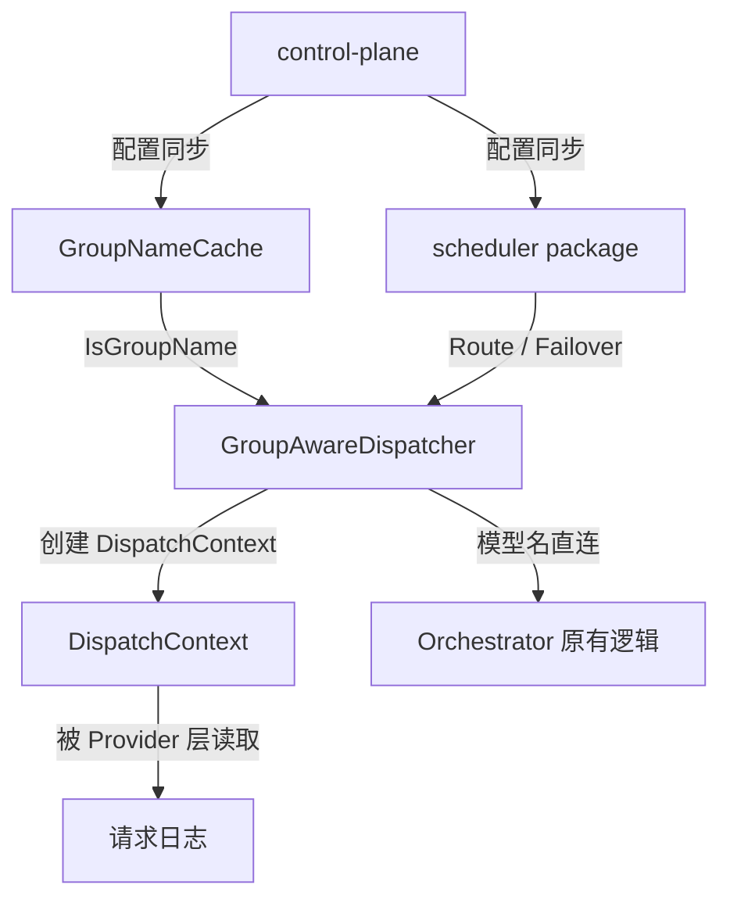

# gateway-api 数据模型变更 — CHG-20260525-001

> 基线：xspec/modules/gateway-api/data-model.md (v1.1)

## 变更摘要

新增两个运行时 Go struct：**GroupNameCache**（组名内存缓存）和 **DispatchContext**（扩展请求上下文）。两个结构均为进程内 Go 类型，gateway-api 保持无状态设计，无新增数据库表、无迁移需求。

---

## 1. 新增运行时结构

### 1.1 GroupNameCache — 组名本地缓存

维护一组当前有效的模型组名称，供 GroupAwareDispatcher 在 O(1) 时间内判定请求中的 `model` 字段是组名还是模型名。数据从 control-plane 同步，每 5s 全量刷新。

```go
// GroupNameCache 模型组名本地缓存
// 使用 sync.RWMutex 保护，IsGroupName 高频读不加锁阻塞
type GroupNameCache struct {
    mu    sync.RWMutex
    names map[string]struct{} // 组名集合，空 struct 零内存占用
}
```

**字段说明**：

| 字段 | 类型 | 说明 |
| :--- | :--- | :--- |
| `mu` | `sync.RWMutex` | 读写锁，Refresh 全量替换时使用写锁，IsGroupName 使用读锁 |
| `names` | `map[string]struct{}` | 组名集合，Key 为组名，Value 为空 struct（最小内存开销） |

**核心方法**：

```go
// NewGroupNameCache 创建空的组名缓存
func NewGroupNameCache() *GroupNameCache

// Refresh 从 control-plane 全量拉取最新组名列表并原子替换
// ctx 用于控制拉取超时
// 返回 error 时，names 保持原值不变（首次调用失败则为空）
func (c *GroupNameCache) Refresh(ctx context.Context) error

// IsGroupName 判定给定名称是否为模型组名
// 读锁操作，高频调用安全
func (c *GroupNameCache) IsGroupName(name string) bool {
    c.mu.RLock()
    defer c.mu.RUnlock()
    _, ok := c.names[name]
    return ok
}

// Names 返回当前所有组名的快照（调试用）
func (c *GroupNameCache) Names() []string {
    c.mu.RLock()
    defer c.mu.RUnlock()
    result := make([]string, 0, len(c.names))
    for name := range c.names {
        result = append(result, name)
    }
    return result
}
```

**数据来源**：

| 来源 | 同步方式 | 触发频率 | 失败处理 |
| :--- | :--- | :--- | :--- |
| control-plane 模型组配置 | scheduler package 同步周期中附带拉取（或独立 HTTP/Redis 查询） | 每 5s | 保持现有 names map 不变；首次失败则 map 为空，所有请求走模型名直连逻辑 |

**不变式**：

| 不变式 | 说明 |
| :--- | :--- |
| names map 非 nil | `NewGroupNameCache()` 初始化时分配空 map，不为 nil |
| IsGroupName 无锁竞争 | 使用 RWMutex 分离读写，Refresh 低频（每 5s）+ IsGroupName 高频读 |
| 空 cache 安全降级 | cache 为空时所有名称判定为模型名，走原有 Provider 路由，不产生误判 |

**生命周期**：



**缓存读取时序（并发安全）**：



---

### 1.2 DispatchContext — 扩展请求分发上下文

在原有 `RequestContext` 基础上扩展，新增组名路由相关信息。由 GroupAwareDispatcher 创建并注入 Gin Context，Provider 层和日志组件需读取。

```go
// DispatchContext 扩展请求分发上下文
// 嵌入原有 RequestContext，新增组名路由相关字段
// 由 GroupAwareDispatcher 创建，通过 Gin Context 传递
type DispatchContext struct {
    // 继承原有请求上下文
    RequestContext

    // --- 组名路由新增字段 ---

    // GroupName 请求传入的模型组名
    // 当 model 字段被判定为组名时写入，模型名直连时为空
    GroupName string `json:"group_name,omitempty"`

    // RoutedModelID scheduler 路由决策后选中的目标模型 ID
    // 组名路由时写入，用于日志记录和 failover 时的 failedModelID 参数
    RoutedModelID string `json:"routed_model_id,omitempty"`

    // FailoverAttempted 是否已尝试过故障切换
    // 防止在连续故障的组中无限重试
    FailoverAttempted bool `json:"failover_attempted"`
}
```

**字段约束**：

| 字段 | 类型 | 来源 | 约束 |
| :--- | :--- | :--- | :--- |
| `GroupName` | `string` | GroupAwareDispatcher | 组名路由时写入原始组名；模型名直连时为空字符串 |
| `RoutedModelID` | `string` | scheduler.Route / scheduler.Failover 返回值 | 组名路由时写入；failover 后更新为新模型 ID |
| `FailoverAttempted` | `bool` | GroupAwareDispatcher | 初始为 `false`；首次 failover 调用前置为 `true` |

**使用生命周期**：



**在 Gin Context 中的存储与读取**：

```go
// GroupAwareDispatcher 注入
c.Set("dispatch_ctx", dispatchCtx)

// Provider 层读取（用于日志等）
dispCtx, ok := c.Get("dispatch_ctx")
if ok {
    ctx := dispCtx.(*DispatchContext)
    slog.Info("call routed",
        "group_name", ctx.GroupName,
        "routed_model_id", ctx.RoutedModelID,
    )
}
```

**不变式**：

| 不变式 | 说明 |
| :--- | :--- |
| GroupName 非空 ↔ RoutedModelID 非空 | 组名路由时两者必须同时有值；模型名直连时两者均为空 |
| FailoverAttempted 递增 | 在组名调用生命周期中，该字段只能从 `false` 变为 `true`，不可逆 |
| 单次请求仅一次 failover | `FailoverAttempted == true` 后不再调用 `scheduler.Failover` |
| 日志完整性 | 组名调用日志必须同时包含 `GroupName` + `RoutedModelID`，满足 AC-GINV-05 |

---

## 2. 原有结构变更

### 2.1 RequestContext 嵌入

无破坏性变更。`DispatchContext` 通过 Go struct 嵌入（embedded）`RequestContext`，而非修改 `RequestContext` 本身。原有代码中对 `RequestContext` 的引用无需改动。

### 2.2 日志字段扩充

请求日志在原有字段基础上新增以下可选字段（仅组名路由时输出）：

| 字段 | 含义 | 输出条件 |
| :--- | :--- | :--- |
| `group_name` | 请求传入的组名 | `DispatchContext.GroupName != ""` |
| `routed_model_id` | scheduler 选中的目标模型 | `DispatchContext.RoutedModelID != ""` |
| `failover_attempted` | 是否触发过故障切换 | 组名路由请求始终输出 |
| `routed_model_id_after_failover` | 故障切换后的新模型 | failover 触发后输出 |

---

## 3. 实体关系变更

### 3.1 新增运行时关系



### 3.2 与现有数据消费关系的关系



---

## 4. 数据约束与规则扩充

### 4.1 新增缓存行为约束

| 约束 | 值 |
| :--- | :--- |
| 组名同步超时 | 5s（与 scheduler 配置同步一致） |
| 组名同步频率 | 每 5s |
| 同步失败策略 | 保持现有 names map 不变；首次启动失败则 map 为空 |
| 空 cache 语义 | 所有名称判定为模型名，走原有链路，不返回错误 |

### 4.2 新增 failover 状态约束

| 约束 | 值 |
| :--- | :--- |
| 最大 failover 次数 | 1 次（首次调用 + 1 次切换） |
| Failover 触发条件 | 组名路由调用 provider 层返回 error + `FailoverAttempted == false` |
| Failover 不触发场景 | (1) 模型名直连调用；(2) `FailoverAttempted == true`；(3) 流式中途失败 |
| 流式调用不切换 | 流已中断，数据已部分返回给客户端，无法透明重试 |

### 4.3 组名与模型名命名空间约束

| 约束 | 说明 |
| :--- | :--- |
| 组名优先匹配 | 同一名称如果同时是组名和已注册模型名，优先按组名处理 |
| 组名不与模型名重叠（运营规范） | control-plane 创建/修改组名时应校验不与现有模型名重叠 |
| 组名不存在时走直连 | GroupNameCache 未命中时当作模型名处理，由 Provider 层返回具体错误 |

---

## 5. 数据库变更

**无变更。** gateway-api 保持无状态设计，无新增数据库表，无迁移需求。

所有新增数据结构（GroupNameCache、DispatchContext）均为进程内 Go struct，生命周期随进程或请求。数据来源仍为 control-plane（Redis / 配置同步），gateway-api 不执行任何写入操作。