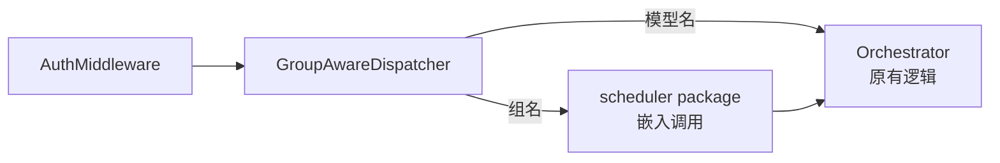
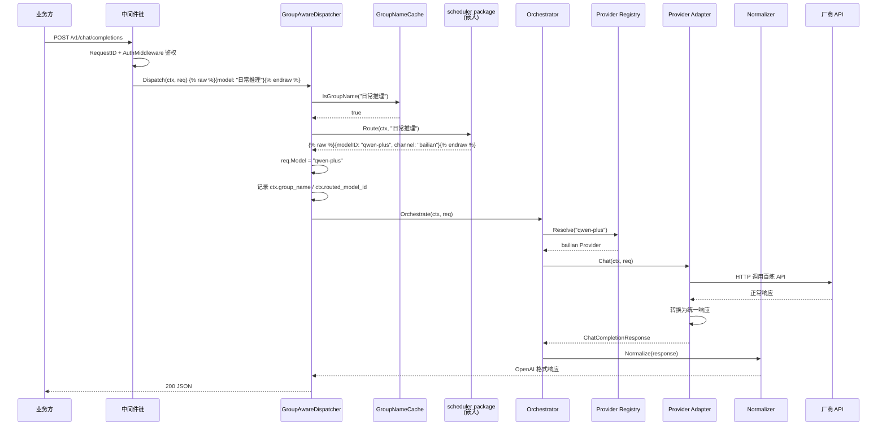
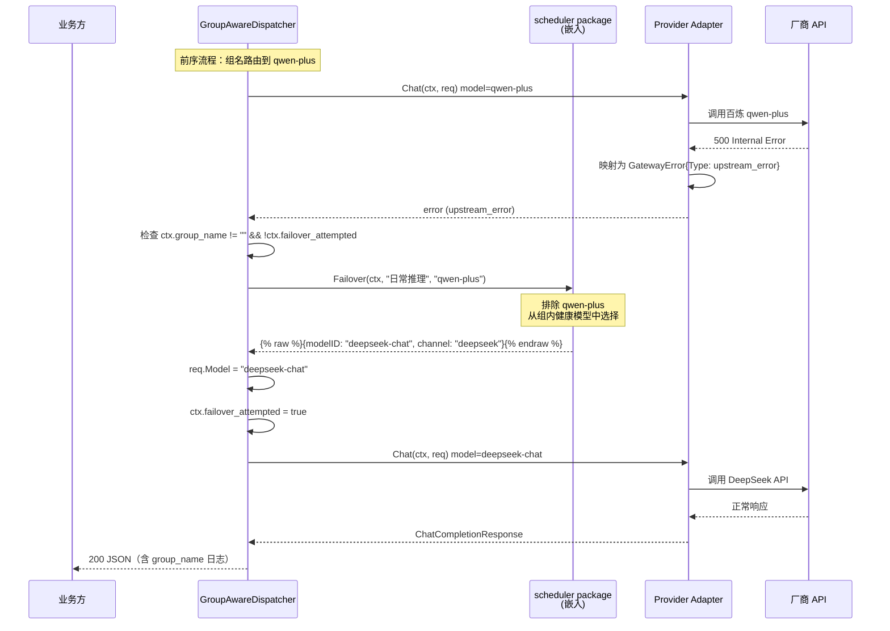
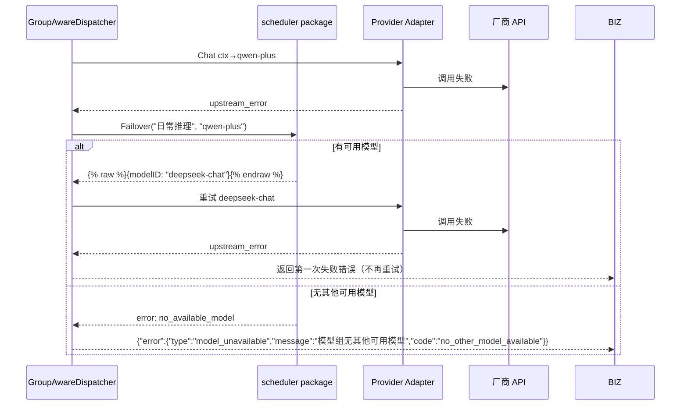
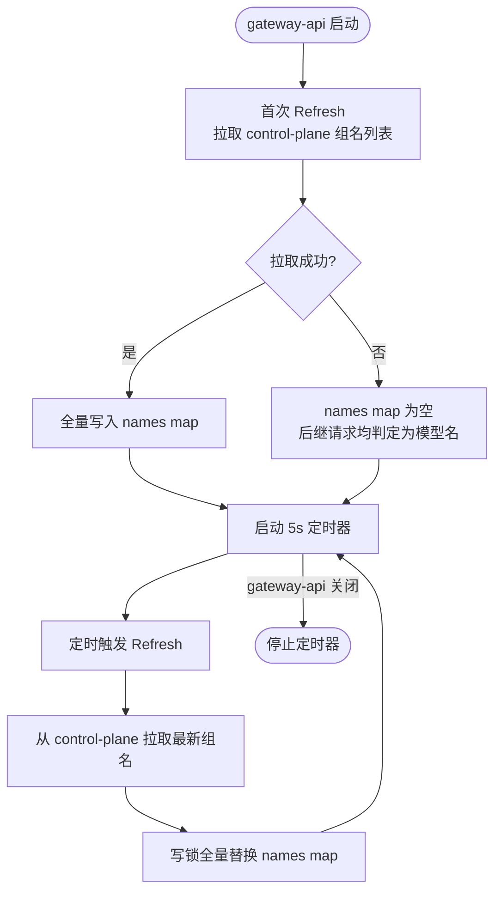

# gateway-api 技术设计变更 — CHG-20260525-001

> 基线：xspec/modules/gateway-api/design.md (v1.1)

## 变更摘要

在现有 Provider 直连调用链路的编排层之前，插入 **GroupAwareDispatcher** 组件。请求中的 `model` 字段先判定是组名还是模型名：组名则委托嵌入式 scheduler package（Go 函数调用）进行路由决策，模型名则保持原有 Provider Registry 前缀匹配逻辑。调用失败时触发 scheduler 故障切换并重试一次。新增 **GroupNameCache** 从 control-plane 同步组名集合，用于组名/模型名判定。

---

## 1. 设计决策

### 决策 1：组名与模型名判定策略

| 维度 | 内容 |
| :--- | :--- |
| **问题** | 请求中 `model` 字段可能传入组名或模型名，组名与模型名可能存在命名重叠，如何准确判定 |
| **选择** | 先查 GroupNameCache（control-plane 同步的模型组列表），命中则视为组名；未命中则视为模型名，走原有 Provider 路由 |
| **理由** | 组名来自 control-plane 维护的权威数据源，组名优先匹配可避免重叠时误判为模型名；模型名不命中组名则保持原有逻辑，向后兼容 |
| **备选** | (A) 请求中添加独立 `group` 字段区分——破坏 OpenAI 兼容性；(B) 通过前缀约定区分（如 `group:` 前缀）——增加调用方理解成本 |
| **风险** | 若 control-plane 新增与现有模型同名的组，该模型原直连调用将变为组名路由。缓解：运营规范约束组名不与模型名重叠；配置变更时在 control-plane 侧校验 |

### 决策 2：故障切换重试次数

| 维度 | 内容 |
| :--- | :--- |
| **问题** | 组内模型调用失败后，自动切换重试几次合适 |
| **选择** | 最多 1 次 failover 重试（即首次调用 + 1 次切换重试，共 2 次尝试） |
| **理由** | 若组内多个模型均不健康，连续重试会放大延迟并浪费资源；1 次切换覆盖最常见的单点故障场景，同时避免陷入无限重试循环 |
| **备选** | (A) 不重试——单模型故障直接失败，可用性差；(B) 遍历所有模型——延迟不可控，可能数十秒 |

### 决策 3：scheduler 配置未就绪时的降级策略

| 维度 | 内容 |
| :--- | :--- |
| **问题** | gateway-api 刚启动时 scheduler package 可能尚未完成首次配置同步（control-plane 数据尚未拉取），组名路由请求到达时如何处理 |
| **选择** | scheduler 配置未就绪时，fallback 选择该组内第一个注册模型直连调用 |
| **理由** | 避免启动窗口期所有组名调用被拒绝；首个注册模型通常是管理员优先配置的高可用模型，兜底可用性较高 |
| **备选** | (A) 返回 503 等待同步完成——启动期全量不可用，不可接受；(B) 随机选模型——可预测性差 |

---

## 2. 新增组件详细设计

### 2.1 GroupAwareDispatcher — 组名感知分发器

| 属性 | 内容 |
| :--- | :--- |
| **位置** | `handler/group_dispatcher.go` |
| **职责** | 接收 AuthMiddleware 鉴权后的请求，判定 `model` 字段是组名还是模型名；组名时调用 sprint scheduler package 进行路由决策并分发；调用失败时触发一次 failover；组名不存在时立即返回错误 |

**组件定位**：GroupAwareDispatcher 插入在 AuthMiddleware 与现有 Orchestrator 之间，作为请求模型的"类型判定 + 路由网关"。



**入口**：在 Gin Handler 中 AuthMiddleware 通过后的第一个处理步骤调用 `dispatcher.Dispatch(ctx, req)`。

**详细工作流程**：

1. **获取请求模型标识**：读取 `req.Model` 字段
2. **组名判定**：调用 `GroupNameCache.IsGroupName(req.Model)`，查询本地内存缓存
3. **组名路由（命中组名）**：
   - 调用 `scheduler.Route(ctx, req.Model)` 进行路由决策（_注：此处为 Go 函数调用，非 HTTP。scheduler 作为 package 嵌入 gateway-api 进程_）
   - scheduler 返回目标模型信息 `{modelID, channel, endpoint}`
   - 将 `modelID` 替换到 `req.Model`，转入原有 Orchestrator → Provider 链路
   - 在 DispatchContext 中记录 `group_name` 和 `routed_model_id`
4. **模型名直通（未命中组名）**：直接将请求传入原有 Orchestrator，行为完全不变
5. **组名不存在（GroupNameCache 未命中 + scheduler 查询也无）**：
   - 立即返回错误，不进入 provider 调用
   - 错误：`group_not_found`，消息："模型组 `${groupName}` 不存在"
6. **调用失败处理**：
   - Provider 层返回错误时（连接失败、超时、5xx），Dispatcher 捕获错误
   - 检查是否为组名路由的调用（`DispatchContext.group_name != ""`）
   - 若 `failover_attempted == false`，调用 `scheduler.Failover(ctx, groupName, failedModelID)` 获取新目标模型
   - 若 `scheduler.Failover` 返回新模型 → 更新 `req.Model` 为新模型，标记 `failover_attempted = true`，重新走 Provider 调用
   - 若 `scheduler.Failover` 返回无可用模型 → 返回错误 `no_other_model_available`
   - 若二次调用也失败 → 直接返回失败，不再重试
7. **日志记录**：调用日志同时记录 `group_name` 和 `routed_model_id`，满足 US-GROUP-INVOKE-03 的可追溯诉求

**Dispatcher 伪代码接口**：

```go
// GroupAwareDispatcher 组名感知分发器
type GroupAwareDispatcher struct {
    cache     *GroupNameCache
    scheduler scheduler.Scheduler // scheduler package 接口（进程内调用）
    orch      *Orchestrator       // 原有编排层
}

// Dispatch 处理请求分发
// 返回 ChatCompletionResponse 或 error
func (d *GroupAwareDispatcher) Dispatch(ctx *DispatchContext, req *ChatCompletionRequest) (*ChatCompletionResponse, error)

// dispatchWithFailover 含故障切换的调用
func (d *GroupAwareDispatcher) dispatchWithFailover(ctx *DispatchContext, req *ChatCompletionRequest) (*ChatCompletionResponse, error)
```

### 2.2 GroupNameCache — 组名本地缓存

| 属性 | 内容 |
| :--- | :--- |
| **位置** | `cache/group_name_cache.go` |
| **职责** | 维护一组当前 valid 模型组名，供 GroupAwareDispatcher 快速判定请求中的 `model` 字段是组名还是模型名 |
| **数据来源** | control-plane 模型组配置（与 scheduler 共享同一数据同步周期） |
| **同步频率** | 每 5s 从 control-plane 拉取最新组名列表（与 scheduler 配置同步使用相同 cycle） |

**缓存结构**：

```go
type GroupNameCache struct {
    mu    sync.RWMutex
    names map[string]struct{} // 组名集合，空 struct 节省内存
}
```

**核心方法**：

```go
// IsGroupName 判定给定名称是否为模型组名
func (c *GroupNameCache) IsGroupName(name string) bool

// Refresh 从 control-plane 全量刷新组名列表
func (c *GroupNameCache) Refresh(ctx context.Context) error

// Names 返回当前所有组名（调试用）
func (c *GroupNameCache) Names() []string
```

**同步逻辑**：
- gateway-api 启动时立即执行首次 Refresh，同步失败则 cache 为空（所有名称判定为模型名，降级为原有逻辑）
- 之后每 5s 执行 Refresh，全量替换 `names` map
- Refresh 使用写锁，`IsGroupName` 使用读锁，确保高频读不被写阻塞

---

## 3. 关键流程

### 3.1 组名调用完整请求流程



### 3.2 故障切换流程



**Failover 失败场景**：



### 3.3 组名缓存同步流程



**缓存未命中的兜底处理**：

当 `GroupNameCache.IsGroupName()` 返回 `false` 时，Dispatcher 按模型名走原有链路。若该名称实际是一个合法组名但缓存尚未同步，则会被当作模型名处理，走 Provider 的普通路由逻辑——若模型名也在模型列表中注册，调用可正常完成；若模型名不存在（如纯组名），则 Provider 层返回 `unknown_model` 错误，不会造成安全或数据问题。极端场景仅在启动后的首个 5s 窗口内可能发生。

---

## 4. 嵌入集成点

### 4.1 scheduler package 初始化

gateway-api 启动时在 `main.go` 中初始化 scheduler package，作为 gateway-api 进程内的 Go package 直接调用，非独立服务。

```go
import "llm-gateway/internal/scheduler"

// main.go 启动逻辑伪代码
func main() {
    // ... 其他初始化 ...

    // 1. 创建 scheduler 实例（嵌入运行）
    sched := scheduler.New(scheduler.Config{
        ControlPlaneURL: cfg.ControlPlaneURL,
        RedisAddr:       cfg.RedisAddr,
        SyncInterval:    5 * time.Second,
    })

    // 2. 创建 GroupNameCache
    groupCache := cache.NewGroupNameCache()

    // 3. 注入到 GroupAwareDispatcher
    dispatcher := handler.NewGroupAwareDispatcher(
        groupCache,
        sched,
        orchestrator,
    )

    // 4. 注册路由（Dispatcher 作为中间件/前置处理）
    router.POST("/v1/chat/completions", dispatcher.Handle)

    // ...
}
```

### 4.2 生命周期管理

| 阶段 | scheduler package | GroupNameCache |
| :--- | :--- | :--- |
| **启动** | `scheduler.Start(ctx)` 启动内部健康探测、配置同步等 goroutine | 首次 `Refresh(ctx)` 从 control-plane 同步组名列表 |
| **运行时** | 提供 `Route(ctx, groupName)` 和 `Failover(ctx, groupName, failedModelID)` 方法 | 每 5s 定时 `Refresh`，`IsGroupName()` 高频读 |
| **关闭** | `scheduler.Stop()` 优雅停止内部 goroutine，等待进行中的探测完成 | 随进程退出自然释放 |
| **健康探针** | `/ready` 检查 scheduler 是否已就绪（首次配置同步完成） | `/ready` 检查 cache 是否有有效数据（非空） |

### 4.3 健康探针变更

在原有 `/ready` 端点的检查项中新增 `scheduler` 检查：

```json
{
  "status": "ready",
  "checks": {
    "redis": "ok",
    "providers": "ok",
    "scheduler": "ok"
  }
}
```

| 检查项 | 检查内容 | 失败影响 |
| :--- | :--- | :--- |
| `scheduler` | scheduler 配置是否已完成首次同步 | 返回 503，从负载均衡摘除（组名路由不可用） |

### 4.4 依赖关系变更

在原有依赖关系基础上新增：

| 依赖方 | 依赖方式 | 说明 | 变更类型 |
| :--- | :--- | :--- | :--- |
| scheduler package | Go import + 函数调用 | 路由决策、故障切换（嵌入 gateway-api 进程） | 新增 |
| control-plane（组名数据） | Redis / HTTP 只读（由 scheduler package 内部消费） | 模型组配置、组内模型列表 | 新增（scheduler 内部） |
| GroupNameCache | 内存 | 组名判定缓存，5s 同步周期 | 新增 |

### 4.5 外部服务依赖扩充

| 服务 | 端点/方式 | 用途 | 超时 | 降级策略 | 变更类型 |
| :--- | :--- | :--- | :---: | :--- | :--- |
| control-plane | scheduler 内部配置同步 | 模型组配置、健康状态、负载信息 | 5s | 配置未就绪时 fallback 选组内首模型 | 新增（由 scheduler 管理） |