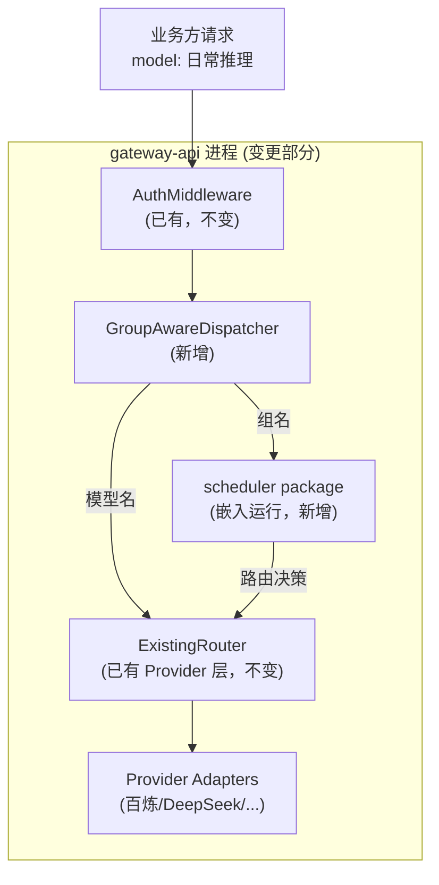

# gateway-api 概要设计变更 — CHG-20260525-001

> 基线：xspec/modules/gateway-api/hld.md (v1.1)

## 变更摘要

在现有转发链路中引入组名解析：请求中的 `model` 字段先判定是组名还是模型名，组名则委托 scheduler 路由后转发，模型名保持原有直连逻辑。调用失败时触发 scheduler 故障切换并重试一次。

## 架构变更



## 新增组件

| 组件 | 职责 |
| :--- | :--- |
| GroupAwareDispatcher | 判断 `model` 字段是组名还是模型名；组名时调用（进程内）scheduler 获取目标模型；调用失败时请求 scheduler 切换并重试一次；组名不存在时直接返回错误 |
| scheduler package | 嵌入 gateway-api 进程的调度引擎：路由决策、负载均衡、健康探测、故障切换（详见 scheduler 模块文档） |

## 调用流程

```mermaid
sequenceDiagram
    participant BIZ as 业务方
    participant GW as gateway-api
    participant SCH as scheduler(嵌入)
    participant PROV as Provider

    BIZ->>GW: POST /v1/chat/completions
            {model: "日常推理"}
    GW->>GW: AuthMiddleware 鉴权
    GW->>GW: GroupAwareDispatcher
            判定"日常推理"为组名
    GW->>SCH: 函数调用 Route("日常推理")
    SCH-->>GW: {model: qwen-plus, channel: bailian}
    GW->>PROV: 转发请求到百炼 qwen-plus
    alt 调用成功
        PROV-->>GW: 正常响应
        GW-->>BIZ: 返回结果
    else 调用失败
        GW->>SCH: 函数调用 Failover("日常推理", "qwen-plus")
        SCH-->>GW: {model: deepseek-chat, ...}
        GW->>PROV: 重试转发到 deepseek-chat
        PROV-->>GW: 成功响应
        GW-->>BIZ: 返回结果
    end
```

## 关键决策

| 决策 | 选择 | 理由 |
| :--- | :--- | :--- |
| 组名/模型名判定 | 先查 control-plane 模型组列表再查模型列表 | 组名和模型名可能重叠，组名优先匹配 |
| scheduler 配置未就绪降级 | 选择组内首个注册模型直连 | scheduler 刚启动配置未同步完成时的兜底 |
| 切换重试次数 | 最多 1 次 | 避免在连续故障的组中陷入无限重试 |

## 技术选型

无新增技术选型。沿用现有 Go+Gin 技术栈，通过 HTTP 调用 scheduler。