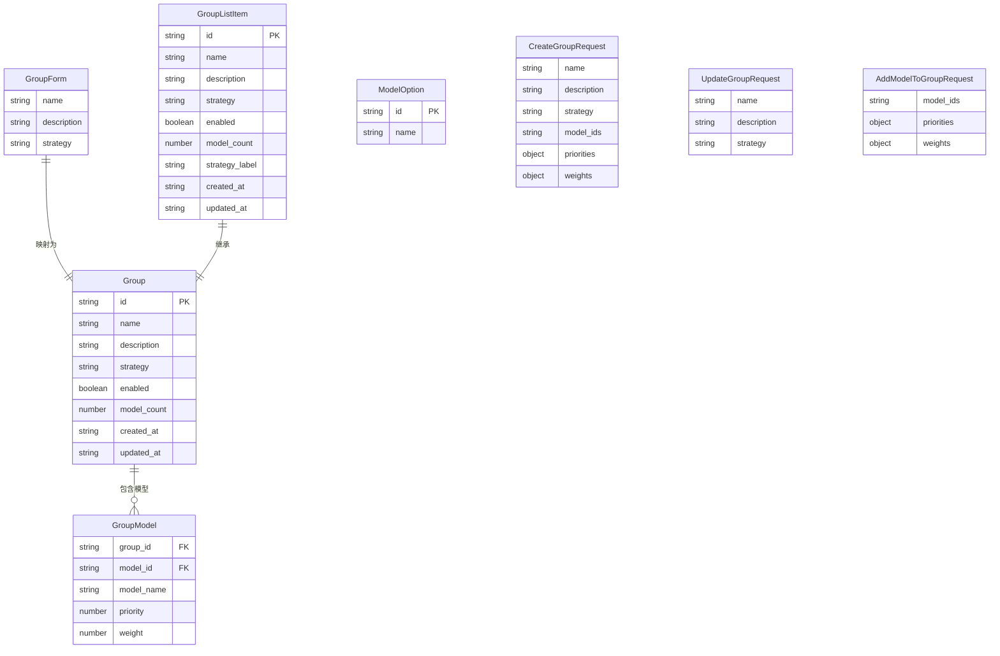

# ops-console 数据模型变更 — CHG-20260525-001

> 基线：xspec/modules/ops-console/data-model.md (v1.2)

## 变更摘要

新增模型组管理相关的前端类型定义，包括核心实体类型（Group、GroupForm、GroupModel 等）、请求/响应类型、前端状态类型、以及表单验证规则。所有类型以 TypeScript interface 形式定义。

---

## 1. 新增类型

### 1.1 策略枚举 — Strategy

```typescript
/** 模型组路由策略类型 */
type Strategy = 'round_robin' | 'priority' | 'weighted'
```

### 1.2 模型组 — Group

```typescript
/** 模型组实体（来自 GET /api/v1/groups 响应） */
interface Group {
  /** 模型组唯一标识 */
  id: string
  /** 组名称 */
  name: string
  /** 组描述 */
  description: string
  /** 路由策略 */
  strategy: Strategy
  /** 是否启用 */
  enabled: boolean
  /** 组内模型数量 */
  model_count: number
  /** 创建时间（ISO 8601） */
  created_at: string
  /** 更新时间（ISO 8601） */
  updated_at: string
}
```

### 1.3 模型组列表项 — GroupListItem

```typescript
/**
 * 列表页展示用的模型组条目
 * 继承 Group，新增 computed 展示字段
 */
interface GroupListItem extends Group {
  /** 策略类型的中文标签 */
  strategy_label: string
}

/** 策略标签映射 */
const STRATEGY_LABEL_MAP: Record<Strategy, string> = {
  round_robin: '轮询',
  priority: '优先级',
  weighted: '加权'
}
```

### 1.4 模型组表单 — GroupForm

```typescript
/** 创建/编辑模型组的表单数据 */
interface GroupForm {
  /** 组名称（必填，最多 64 字符） */
  name: string
  /** 组描述（选填） */
  description: string
  /** 路由策略 */
  strategy: Strategy
}
```

### 1.5 组内模型 — GroupModel

```typescript
/** 组内模型条目 */
interface GroupModel {
  /** 所属模型组 ID（提交时由上下文确定） */
  group_id: string
  /** 模型唯一标识 */
  model_id: string
  /** 模型名称（展示用） */
  model_name: string
  /**
   * 优先级数值
   * - strategy=priority 时必填，范围 0-999，整数
   * - 其他策略时为 undefined
   */
  priority?: number
  /**
   * 权重值
   * - strategy=weighted 时必填，范围 1-100，整数
   * - 其他策略时为 undefined
   */
  weight?: number
}
```

### 1.6 模型选择器选项 — ModelOption

```typescript
/** 模型选择器中的模型选项（来自 GET /api/v1/models） */
interface ModelOption {
  /** 模型唯一标识 */
  id: string
  /** 模型名称（展示用） */
  name: string
}
```

---

## 2. 请求/响应类型

### 2.1 CreateGroupRequest — 创建模型组请求

```typescript
/** POST /api/v1/groups 请求体 */
interface CreateGroupRequest {
  /** 组名称 */
  name: string
  /** 组描述 */
  description?: string
  /** 路由策略 */
  strategy: Strategy
  /** 关联的模型 ID 列表 */
  model_ids: string[]
  /**
   * 优先级映射表：model_id → priority
   * strategy=priority 时必传
   */
  priorities?: Record<string, number>
  /**
   * 权重映射表：model_id → weight
   * strategy=weighted 时必传
   */
  weights?: Record<string, number>
}
```

**JSON 示例**（priority 策略）：
```json
{
  "name": "日常推理",
  "description": "日常推理场景模型组",
  "strategy": "priority",
  "model_ids": ["model_001", "model_002"],
  "priorities": {
    "model_001": 0,
    "model_002": 1
  }
}
```

**JSON 示例**（weighted 策略）：
```json
{
  "name": "高负载场景",
  "description": "高负载场景加权模型组",
  "strategy": "weighted",
  "model_ids": ["model_001", "model_002"],
  "weights": {
    "model_001": 70,
    "model_002": 30
  }
}
```

**JSON 示例**（round_robin 策略）：
```json
{
  "name": "默认轮询组",
  "description": "",
  "strategy": "round_robin",
  "model_ids": ["model_001", "model_002", "model_003"]
}
```

### 2.2 UpdateGroupRequest — 更新模型组请求

```typescript
/** PUT /api/v1/groups/:id 请求体 */
interface UpdateGroupRequest {
  /** 组名称 */
  name?: string
  /** 组描述 */
  description?: string
  /** 路由策略 */
  strategy?: Strategy
}
```

### 2.3 AddModelToGroupRequest — 添加模型到组请求

```typescript
/** POST /api/v1/groups/:id/models 请求体 */
interface AddModelToGroupRequest {
  /** 要添加的模型 ID 列表 */
  model_ids: string[]
  /**
   * 优先级映射表
   * strategy=priority 时必传
   */
  priorities?: Record<string, number>
  /**
   * 权重映射表
   * strategy=weighted 时必传
   */
  weights?: Record<string, number>
}
```

### 2.4 GroupListResponse — 模型组列表响应

```typescript
/** GET /api/v1/groups 成功响应 */
interface GroupListResponse {
  code: number
  message: string
  data: {
    items: Group[]
    total: number
  }
  request_id: string
}
```

**JSON 示例**：
```json
{
  "code": 0,
  "message": "success",
  "data": {
    "items": [
      {
        "id": "group_001",
        "name": "日常推理",
        "description": "日常推理场景模型组",
        "strategy": "priority",
        "enabled": true,
        "model_count": 3,
        "created_at": "2026-05-20T10:00:00Z",
        "updated_at": "2026-05-20T10:00:00Z"
      }
    ],
    "total": 1
  },
  "request_id": "req-uuid"
}
```

### 2.5 GroupDetailResponse — 模型组详情响应

```typescript
/** GET /api/v1/groups/:id 成功响应 */
interface GroupDetailResponse {
  code: number
  message: string
  data: Group
  request_id: string
}
```

### 2.6 GroupModelsResponse — 组内模型列表响应

```typescript
/** GET /api/v1/groups/:id/models 成功响应 */
interface GroupModelsResponse {
  code: number
  message: string
  data: {
    items: GroupModel[]
  }
  request_id: string
}
```

**JSON 示例**：
```json
{
  "code": 0,
  "message": "success",
  "data": {
    "items": [
      {
        "group_id": "group_001",
        "model_id": "model_001",
        "model_name": "gpt-4o",
        "priority": 0
      },
      {
        "group_id": "group_001",
        "model_id": "model_002",
        "model_name": "qwen-turbo",
        "priority": 1
      }
    ]
  },
  "request_id": "req-uuid"
}
```

### 2.7 ModelListForSelector — 模型选择器响应

```typescript
/** GET /api/v1/models 选择器用响应 */
interface ModelListForSelectorResponse {
  code: number
  message: string
  data: {
    items: ModelOption[]
  }
  request_id: string
}
```

### 2.8 通用错误响应

```typescript
/** 通用错误响应 */
interface ErrorResponse {
  code: number
  message: string
  data: null
  request_id: string
}

/** 409 冲突错误响应 */
interface ConflictErrorResponse extends ErrorResponse {
  code: 409
  message: string  // e.g. "模型组名称已存在"
}
```

---

## 3. 表单验证规则

### 3.1 组名称 (name)

```typescript
const nameRules = [
  { required: true, message: '请输入组名称', trigger: 'blur' },
  { max: 64, message: '组名称不能超过 64 个字符', trigger: 'blur' },
  {
    validator: (_rule: any, value: string, callback: Function) => {
      if (value && value.trim() === '') {
        callback(new Error('组名称不能为纯空格'))
      } else {
        callback()
      }
    },
    trigger: 'blur'
  }
]
```

| 规则 | 类型 | 值 | 错误提示 |
| :--- | :--- | :--- | :--- |
| 必填 | required | true | "请输入组名称" |
| 最大长度 | max | 64 | "组名称不能超过 64 个字符" |
| 去空格 | whitespace | — | "组名称不能为纯空格" |
| 提交前 trim | transform | `value.trim()` | 自动去除首尾空格 |

### 3.2 路由策略 (strategy)

```typescript
const strategyRules = [
  { required: true, message: '请选择路由策略', trigger: 'change' }
]
```

| 规则 | 类型 | 值 | 错误提示 |
| :--- | :--- | :--- | :--- |
| 必填 | required | true | "请选择路由策略" |

### 3.3 已选模型 (selectedModels)

```typescript
// 提交时手动校验（非 el-form rules）
function validateSelectedModels(): boolean {
  return selectedModels.length > 0
}
// 失败时 ElMessage.warning('请至少添加一个模型')
```

| 规则 | 校验时机 | 条件 | 错误提示 |
| :--- | :--- | :--- | :--- |
| 至少一个 | submit | `selectedModels.length === 0` | "请至少添加一个模型" |

### 3.4 优先级 (priority) — strategy=priority 时

```typescript
function validatePriority(value: number | undefined): boolean {
  return value != null
    && Number.isInteger(value)
    && value >= 0
    && value <= 999
}
```

| 规则 | 条件 | 错误提示 |
| :--- | :--- | :--- |
| 非空 | `value == null` | "请为每个模型设置有效的优先级" |
| 整数 | `!Number.isInteger(value)` | "优先级必须为整数" |
| 最小值 | `value < 0` | "优先级不能小于 0" |
| 最大值 | `value > 999` | "优先级不能大于 999" |

### 3.5 权重 (weight) — strategy=weighted 时

```typescript
function validateWeight(value: number | undefined): boolean {
  return value != null
    && Number.isInteger(value)
    && value >= 1
    && value <= 100
}
```

| 规则 | 条件 | 错误提示 |
| :--- | :--- | :--- |
| 非空 | `value == null` | "请为每个模型设置有效的权重" |
| 整数 | `!Number.isInteger(value)` | "权重必须为整数" |
| 最小值 | `value < 1` | "权重不能小于 1" |
| 最大值 | `value > 100` | "权重不能大于 100" |

---

## 4. 数据关系



**关系说明**：

| 主体 | 关系 | 客体 | 基数 | 说明 |
| :--- | :--- | :--- | :--- | :--- |
| Group | 包含 | GroupModel | 0..N | 一个模型组可包含多个模型 |
| GroupListItem | 继承 | Group | 1..1 | 列表项基于实体增加计算字段 |
| GroupForm | 映射为 | CreateGroupRequest / UpdateGroupRequest | 1..1 | 表单数据序列化为 API 请求体 |
| GroupModel | 映射为 | AddModelToGroupRequest | 0..N | 模型列表序列化为入组请求 |

---

## 5. 字段映射规则

| 原始字段（API snake_case） | 前端字段（camelCase） | 说明 |
| :--- | :--- | :--- |
| data.items[].id | Group.id | 直接赋值 |
| data.items[].name | Group.name | 直接赋值 |
| data.items[].description | Group.description | 直接赋值 |
| data.items[].strategy | Group.strategy | 直接赋值（枚举值一致） |
| data.items[].enabled | Group.enabled | 直接赋值 |
| data.items[].model_count | Group.model_count | 保持 snake_case（前端列表展示字段无映射必要） |
| data.items[].created_at | Group.created_at | 保持 snake_case |
| data.items[].updated_at | Group.updated_at | 保持 snake_case |
| items[].group_id | GroupModel.group_id | 保持 snake_case |
| items[].model_id | GroupModel.model_id | 保持 snake_case |
| items[].model_name | GroupModel.model_name | 保持 snake_case |
| items[].priority | GroupModel.priority | 直接赋值 |
| items[].weight | GroupModel.weight | 直接赋值 |

> 注：本次新增类型中大部分字段与 API 返回的 snake_case 一致（如 `model_count`、`created_at` 等），未做 snake_case → camelCase 转换，以保持与 control-plane 响应格式的一致性和最小的映射层复杂度。仅在需要与其他已有前端类型对齐时做转换。

---

## 6. 状态类型

### 6.1 GroupsState — 列表页状态

```typescript
interface GroupsState {
  groups: GroupListItem[]
  loading: boolean
  error: string | null
  searchKeyword: string
}

const initialGroupsState: GroupsState = {
  groups: [],
  loading: false,
  error: null,
  searchKeyword: ''
}
```

### 6.2 GroupEditState — 编辑弹窗状态

```typescript
interface GroupEditState {
  form: GroupForm
  submitting: boolean
  selectedModels: GroupModel[]
}

const initialGroupEditState: GroupEditState = {
  form: { name: '', description: '', strategy: 'round_robin' },
  submitting: false,
  selectedModels: []
}
```

### 6.3 ModelGroupSelectorState — 选择器状态

```typescript
interface ModelGroupSelectorState {
  allModels: ModelOption[]
  searchKeyword: string
  selectedIds: Set<string>
  loading: boolean
}

const initialSelectorState: ModelGroupSelectorState = {
  allModels: [],
  searchKeyword: '',
  selectedIds: new Set(),
  loading: false
}
```

### 6.4 状态变更矩阵

**GroupsState**：

| 场景 | groups | loading | error | searchKeyword |
| :--- | :--- | :--- | :--- | :--- |
| 初始 | [] | false | null | '' |
| 请求发起 | 保持 | true | null | — |
| 请求成功 | GroupListItem[] | false | null | — |
| 空列表 | [] | false | null | — |
| 网络异常 | [] | false | "网络异常，请刷新重试" | — |
| 服务端错误 | [] | false | "操作失败，请重试" | — |
| 搜索触发 | — | true | null | 用户输入 |
| 删除/创建成功 | 触发刷新 | — | — | — |

**GroupEditState**：

| 场景 | form | submitting | selectedModels |
| :--- | :--- | :--- | :--- |
| 创建模式打开 | 空表单 | false | [] |
| 编辑模式打开 | 回填数据 | false | 已加载模型列表 |
| 提交中 | — | true | — |
| 提交成功 → 关闭 | resetForm() | false | [] |
| 提交失败 | 保持 | false | 保持 |
| 策略切换 | strategy 更新 | — | priority/weight 清空 |
| 添加模型 | — | — | push |
| 移除模型 | — | — | splice |